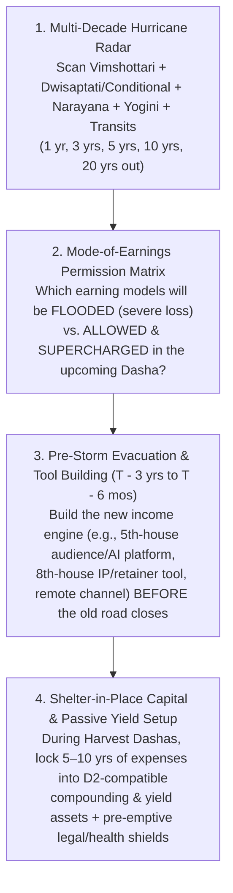
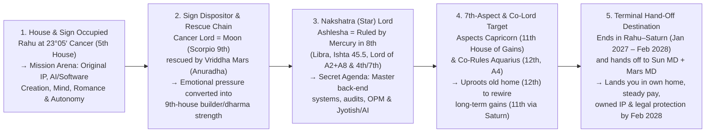

# TECHNIQUE — The Application of Astrology: Hurricane Radar, Evacuation Routes, Shelter-in-Place Capital & Mode-of-Earnings Pivots

**Status:** Core Predictive & Strategic Doctrine (2026-10-31)  
**Owner:** AI Astra Reading Engine (`docs/reading-engine/34`, `docs/ASK-REQUIREMENTS.md`)  
**Schools Synthesized:** **Parashara (BPHS)** · **Jaimini / Pt. Sanjay Rath** · **Lunar Astro / Deepanshu Giri** · **Tajaka Annual Charts**

---

## 1. Why This Technique Exists: The True Application of Astrology

Most astrological readings fail the human being sitting in front of them for one of two reasons:
1. **Trivial Micro-Management:** Telling someone what color shirt to wear or "what brand of milk to buy" while missing a Category-5 career or financial freeze heading straight toward their life.
2. **Passive Post-Mortem Fatalism:** Waiting until the user is already inside a 3-year 6th/8th/12th-house storm (with savings drained and applications ignored) and telling them, *"You are in a tough Dasha, wait two years."*

**The real application of astrology is long-range civil engineering and weather radar:**
- **Finding the Hurricane 3 to 10 Years Before Landfall:** Scanning the multi-Dasha stack (**Vimshottari + Primary Conditional Dasha [e.g., Dwisaptati Sama] + Narayana Rasi Dasha + Sudasa + Yogini + Slow Transits**) to see *when* a Category-3 to Category-5 storm will hit a specific house (e.g., conventional 10th-house employment, 4th-house real estate, 11th-house network/sibling support, or 6th-house health/litigation).
- **Mapping the Best Evacuation Route Out of the City:** Even during the worst Dasha, **never are all 12 houses destroyed at once.** When a hurricane floods Highway 10 (standard corporate W-2 employment), Highway 5 (audience/influencer/media/advisory), Highway 8 (research, audit, diagnostics, IP licensing, OPM retainers), or Highway 12 (remote/out-of-state/foreign markets) is **wide open and paved with tailwinds**. Astrology's job is to tell the native **which route out of the city is open** and **how the sky allows them to earn** during that window—*with enough lead time to build the vehicle before the storm arrives*.
- **Building the "Shelter-in-Place" 10-Year War Chest & Passive Yield Engine:** Using the chart's **Harvest Windows** (when 1st, 2nd, 5th, 9th, 10th, and 11th lords run in *Yuva/Vriddha* maturity) to systematically accumulate **5 to 10 years of untouched liquid reserves and cash-flowing investments** matched to the native's **D2 (Hora) Lagna** and **Indu Lagna**, so that when a future "shelter-in-place" window arrives, their investments pay their bills automatically.

---

## 2. Step 1 — The Multi-Dasha Hurricane Radar (Detecting Storms & Harvests Years in Advance)

A single Dasha system never creates a Category-5 storm or a Category-5 harvest by itself. Major life freezes and major wealth leaps happen when **3 or more primary systems converge on the same house axis at the same time**.

### 2.1 How the Radar Classifies Future Windows (1 to 20 Years Out)

| Weather Grade | Multi-Dasha & Transit Signature | Real-World Meaning | Strategic Mandate |
| :--- | :--- | :--- | :--- |
| **Category-5 Harvest (Peak Prosperity & Scale)** | **3+ Primary Dashas** (*Vimshottari + Applicable Conditional [e.g. Dwisaptati] + Narayana + Sudasa*) activate **2nd, 5th, 9th, 10th, or 11th houses/lords** in *Yuva* or *Vriddha Avastha*, backed by Jupiter/Saturn **Double Transit** on the 2nd/10th/11th or `AL`/`HL`/`IL`. | Earnings exceed effort by 3x–10x; doors open fast; high surplus cash flow. | **Aggressively scale revenue, BUT do not inflate fixed overhead.** Skim **40–60% of surplus** directly into your **10-Year Shelter-in-Place War Chest** and pre-build the tools required for the *next* Mahadasha/Antardasha. |
| **Category-2/3 Shifting Wind (Mode-of-Earnings Pivot)** | Primary Dashas shift from **10th/11th/2nd** lords to **3rd, 5th (Rahu), 8th, or 12th** lords while `HL`/`IL` or `A2/A8` remain supported by benefic Argala. | **Your old profession or channel slows down or stops working, while a new unconventional channel opens.** | **Execute the Evacuation Pivot (see §3):** Shift from solo W-2 portals or local clients to the house currently in period (e.g., 5th-house media/influencer/advisory, 8th-house audit/IP/OPM retainers, or 12th-house remote/foreign markets). |
| **Category-4/5 Hurricane (Structural Freeze / Siege)** | **2+ Primary Nakshatra Dashas** (*Vimshottari + Dwisaptati/Yogini*) simultaneously run **6th, 8th, or 12th lords** (or **Ketu in 11th** / *Mrita* planet) while **Saturn/Rahu/Ketu transit the 1st, 6th, 8th, or 12th** and an eclipse strikes the period lord or wealth lagna. | **Conventional doors freeze; unpaid effort traps appear; hidden enemies/health/family friction peak.** *(Example: Sachin's Aug 2023 – Jan 2027 window across Dwisaptati Rahu–Mercury/Venus + Vimshottari Moon–Mercury/Ketu/Venus).* | **Shelter in Place & Run on Pre-Built Engines:** 1. Live off passive yield / retainer / pre-built 5th/8th-house tools. 2. Never sign uncontracted sweat-equity deals. 3. Deploy pre-prepared legal, tax, and medical shields. |

---

## 3. Step 2 — The Mode-of-Earnings Permission Matrix ("How You Are Allowed to Earn")

A core law of **Parashara**, **Sanjay Rath (Jaimini Arudhas)**, and **Lunar Astro (Deepanshu Giri)** is that **every Dasha permits and rewards a specific mode of earning while starving incompatible modes.**
- If a native's upcoming 9-year *Dwisaptati* or 18-year *Vimshottari* period is ruled by **5th-house Rahu** or **8th-house Mercury**, continuing to rely exclusively on a standard 10th-house W-2 job is like staying in a coastal basement during a storm surge.
- Conversely, if the native **knows 3–5 years in advance** that a **5th-house Rahu** or **8th-house Mercury** era is coming, they can **build the tools, audience, IP, or retainer model ahead of time**—turning what would have been unemployment into their most profitable chapter!

### 3.1 The Astrological Mode-of-Earnings Table (What Works vs. What Fails by Active House/Planet)

| Active Dasha House / Planet | What Mode of Earning Suffers Severe Loss (Flooded Road) | What Mode of Earning Is Permitted & Most Profitable (The Evacuation Route) | Tools to Pre-Build *Before* This Period Starts |
| :--- | :--- | :--- | :--- |
| **5th House / Rahu in 5th** *(Intellect, Media, Followers, Speculation, Algorithms, Advisory)* | **Silent back-office W-2 grinding** where nobody knows your name; waiting for recruiters on job boards; **leveraged gambling/options** (if 5th lord or D2 5th is afflicted). | **The Influencer, Broadcaster, Platform Owner, AI Product Creator & High-Leverage Advisor:** Building a public audience, content engine, educational/advisory community, or algorithmic/AI software product that reaches thousands of people at once (1-to-many leverage). | • Launch a public content/video/writing channel (YouTube, Substack, X, LinkedIn, podcast). • Build a subscriber list & community. • Package your expertise into scalable software/AI tools or courses. |
| **6th House / `HL` & `IL` in 6th** *(Service, Contracts, Problem-Solving, Audits, Litigation, Health)* | **Unpaid co-founder "sweat equity"** without a written salary or retainer; passive equity waiting for a distant exit; luxury consumer businesses. | **Paid Salaried/Contract Problem-Solver, B2B Implementation Specialist, Compliance/Security/Legal/Medical-Tech & Crisis Turnaround:** Getting paid on a strict clock (salary, hourly, or fixed monthly retainer) to solve urgent operational, technical, or regulatory headaches. | • Lock in written master service agreements (MSAs) and paid pilot templates. • Cultivate 7th-house referral partners who feed you paid 6th-house contracts. • Never work a day without a signed scope and fee. |
| **7th House / `A7` / `Sudasa` in 7th** *(Partners, Clients, B2B Deals, Contracts, Public Trade)* | **Cold solo applications** into anonymous portals (especially if the 7th holds a *Mrita* planet like Jupiter at 3°48′ Virgo); working with **12th-lord Saturn partners** without binding milestones. | **Warm Referral & B2B Partnership Deals:** Every dollar arrives through a named human being—a former client, colleague, partner, or joint-venture channel—paired with **Mercury-type (sales/tech)** and **Mars-type (builder/operator)** partners. | • Maintain a living CRM of your top 50 former clients, colleagues, and decision-makers. • Pre-draft IP-ownership and milestone-vesting clauses before entering any partnership. |
| **8th House / `A2 + A8` Conjoined** *(Hidden Systems, Back-End Infrastructure, OPM, Retainers, Insurance/Tax/Legacy, Occult/Jyotish)* | **Front-end retail, superficial marketing, or handshake deals**; counting on easy family inheritance when 8th SAV bindus are low. | **Deep Back-End Architecture, Cybersecurity, Data/AI Plumbing, Predictive Systems (Jyotish/Analytics) & Other People's Money (OPM):** Using upfront client retainers, B2B float, licensing royalties, escrow/insurance/tax systems, or institutional financing (`A8`) to feed your bank balance (`A2`). | • Build proprietary back-end libraries, diagnostic/audit tools, or predictive engines (e.g., AI Astra). • Structure every engagement with **upfront retainers** (OPM) rather than billing 90 days in arrears. |
| **9th House / Mars-Moon in 9th** *(Dharma, Higher Strategy, Long-Distance/Global, Publishing, Real Assets)* | **Short-sighted tactical hustling** or staying trapped in a toxic local environment when the 9th house calls for distance and principle. | **Principal Architect, Strategic Advisor, Real-Estate/Contractor Platform Builder & Global/Long-Distance Trade:** Combining high-level architecture/dharma with tangible Mars execution (land, property, construction, engineering). | • Establish credentials, patents, published frameworks, or advisory board seats. • Build relationships with out-of-state and international clients. |
| **11th House with Ketu / Saturn Lord** *(Network, Elder Sibling, Institutional Gains, Long-Term Compounding)* | **Asking friends or an elder sibling for favors or job referrals** (Ketu in 11th walls off casual network favors); chasing "get-rich-quick" network schemes. | **Rule-Based Institutional Systems & Automated Saturnian Compounding:** Earning through formal, large-scale systems, government/enterprise compliance, and **automated D2 Jupiter-Saturn index/treasury compounding** after Rahu transits or Saturn matures. | • Automate monthly investment transfers so wealth compounds without emotional decisions. • Keep family/sibling finances 100% formal and contractual (fixed monthly rent/ledger). |
| **12th House / `A4` in 12th / `Paradesa Saham`** *(Foreign Lands, Remote Work, Institutions, Hospitals/Labs, Exit/Research)* | **Insisting on local in-office roles in your immediate city** when the 12th lord or `Paradesa saham` governs the year's career and gains. | **Remote / Out-of-Area / International Employers & Institutional Backbones:** Working from home or relocating to serve employers headquartered east, south, or abroad; R&D labs, cloud infrastructure, privacy/security, or hospital/financial systems. | • Set up remote-first consulting/employment infrastructure and multi-state/global client channels *before* a 12th-house period begins. |

---

## 4. Step 3 — The Pre-Storm Evacuation & War-Chest Timeline ($T - 5\text{ Years}$ to Landfall)

Just as a meteorologist tracks a hurricane from tropical depression to landfall, the AI Astra reading engine must give the user a **staged preparation countdown** before every upcoming **Category-3 to Category-5 Storm Window** or **Mahadasha Mode-of-Earnings Shift**:

1. **$T - 5\text{ to } 3\text{ Years}$ (During the Preceding Harvest Window — "Build the Ark & the 10-Year War Chest"):**
   - **Capital Rule:** Whenever the native is in a high-earning sub-period (e.g., *Mars–Rahu* 2028–2029 or *Mars–Saturn* 2030–2031), calculate their baseline annual survival cost ($C_{\text{annual}}$) and systematically lock away **$5\times\text{ to }10\times C_{\text{annual}}$** into **D2-Lagna-compatible yield and compounding assets** (treasury ladders, dividend/index equities, and debt-free core housing).
   - **Tool & Channel Rule:** Identify the **house and planet** that will rule the *next* storm or Mahadasha (e.g., 5th-house Rahu, 8th-house Mercury, or 6th-house Venus) and spend **5–10 hours per week** (e.g., on the planet's weekday, such as Thursdays for Jupiter/AI Astra or Wednesdays/Saturdays for Mercury/Saturn systems) building the **audience, IP, software tool, or remote consulting channel** that matches that future Dasha.
2. **$T - 18\text{ to } 6\text{ Months}$ (Pre-Landfall Hardening — "Eliminate Fragility & Lock Contracts"):**
   - **Zero Unsecured Exposure:** Pay off high-interest debt, refuse speculative/margin trades (especially if D1/D2 5th house is afflicted), and avoid buying illiquid real estate if the 4th house is about to take Ketu/eclipse hits.
   - **Contractual & Legal Lockdown:** Convert all handshake or sweat-equity arrangements into binding written retainers or IP-ownership contracts *before* an 8th-lord, 12th-lord, or retrograde window begins.
   - **Medical & Household Pre-Clearance:** Run baseline organ screenings for the houses about to be compressed (e.g., liver/gut for Virgo/6th/8th) and formalize living/rent agreements before an eclipse hits the 4th or 11th house.
3. **$T - 0$ (Inside the Storm Window — "Shelter in Place & Operate the Pre-Built Engine"):**
   - **Do Not Fight the Closed Door:** Stop pouring emotional energy into the house that is temporarily walled off by Ketu, *Mrita* Avastha, or a 6/8/12 Dasha.
   - **Run the Evacuation Channel:** Earn through the open house (e.g., 6th-house paid contracts via 7th-house referrals, 8th-house retainers/diagnostics, or 5th-house media/advisory), live comfortably off the pre-built yield/runway, and perform the chart's **Lunar Astro "Blind Saturnian Actions"** daily until the transit/Dasha gate reopens.

---

## 5. Step 4 — Designing the 10-Year "Shelter-in-Place" Investment Engine (D2 Hora + Indu Lagna + `A2/A8`)

To ensure the native has **10 years of savings and investments that actually pay them during tough Dashas**, the reading must audit the **D2 (Hora) Wealth Chart**, **Indu Lagna (`IL`)**, **Arudha Padas (`A2`, `A8`, `A11`)**, and **4th/5th/11th SAV bindus** to prescribe their exact asset allocation:

| Chart Indicator | How to Read It for the 10-Year War Chest | What Pays vs. What Bleeds During a Storm |
| :--- | :--- | :--- |
| **D2 (Hora) Lagna & Occupants** | Shows the native's **core wealth-keeping temperament and safest compounding vehicle**. *(Example: Jupiter own-sign + Rank-1 Saturn on D2 Lagna = institutional index funds, treasury/bond ladders, 401k/IRA retirement compounding, and long-duration blue-chip tech/infrastructure).* | **Pays:** Automated, boring, long-horizon index & treasury yield. **Bleeds:** Emotional stock-picking or pulling money out early. |
| **D1 & D2 5th House** | Shows whether **active speculation, options, crypto, or angel gambling** builds or destroys the war chest. *(Example: Rahu in D1 5th in Ashlesha + debilitated Mars in D2 5th + Rahu/Ketu in D2 8th = lethal trap for leveraged speculation).* | **Pays:** Owning 5th-house **intellectual property, software, and media/audience platforms** (zero margin debt). **Bleeds:** Options, margin trading, and speculative tips during Rahu/Mars transits. |
| **Hora Lagna (`HL`) & Indu Lagna (`IL`) House** | Shows **where active cash flow regenerates fastest** even during a storm. *(Example: `HL` & `IL` in 6th house Leo with Yuva Venus = paid service contracts, B2B retainers, compliance/health/audit systems).* | **Pays:** Fixed-fee retainers, paid pilots, and contracted technical service. **Bleeds:** Working for free on handshake equity promises. |
| **`A2` (Dhana Pada) & `A8` (Rina/OPM Pada) Relationship** | When `A2` and `A8` sit together (e.g., in Gemini 4th house ruled by 8th-house Mercury), **Other People's Money (OPM)** either funds your war chest or drains it. | **Pays:** Upfront client retainers, B2B float, licensing royalties, insurance/tax credits, and non-recourse partner capital. **Bleeds:** Personal consumer debt or funding a partner's business out of your own pocket. |
| **4th House SAV & Ketu/Eclipse Schedule** | Shows **when real estate is a shelter vs. a money pit**. *(Example: 4th house Gemini has 35 bindus—great long-term equity—but Ketu + 3 eclipses hit Gemini in Jun 2028 – Jan 2030).* | **Pays:** Buying core property in a clean 4th-lord/Saturn window (**Sep 2030 – Sep 2032**). **Bleeds:** Buying property during a 4th-house Ketu/eclipse window (**2028–2029**). |

---

## 6. Step 5 — Complete Proof & Application on Sachin's Chart (Retrospective 2010–2026 & Prospective 2026–2053)

### 6.1 Retrospective Proof (2010–2026): What a 2012–2017 Reading *Should* Have Told You Before the 2018–2027 Storm

Look at why your observation—*"If I had known to become an influencer in the 2010s, I wouldn't be looking for a job in 2025–2026"*—is **100% astrologically exact**:

1. **What Was Written on the Radar in 2012–2018:**
   - Every table in your birth chart already showed that after *Vimshottari Sun MD* (2012–2018) and *Dwisaptati Saturn MD* (2010–2019), you were entering a **9-to-10-year double shift**:
     - **Vimshottari Moon Mahadasha (Mar 2018 – Mar 2028):** 5th lord & *Amatyakaraka* in the 9th house (publishing, advisory, global voice, dharma).
     - **Dwisaptati Sama Rahu Mahadasha (Feb 16, 2019 – Feb 16, 2028):** Your primary conditional dasha handed 9 full years to **Rahu in the 5th house (Cancer, *Ashlesha*)**—the exact astrological house and planet of **digital media, influencers, mass psychology, AI/algorithms, unconventional teaching, and 1-to-many platforms!**
     - **Narayana Dasha in Aquarius (12th house, 2016–2021) & Pisces (1st house solo self with `A5/A9/A10`, 2021–2027):** Pulling you out of conventional corporate teams and throwing you back onto your own voice (`A5`), dharma (`A9`), and self-directed work (`A10` on Lagna).
2. **Why the Category-5 W-2 Freeze Hit in August 2023 – January 2027:**
   - Inside that 2019–2028 *Dwisaptati Rahu* decade, look at the exact sub-period sequence that hit from **July 2022 to January 2027**:
     - **Jul 2, 2022 – Aug 17, 2023 (*Dwisaptati Rahu–Mars* + *Vimshottari Moon–Saturn*):** Saturn entered your 12th house and triggered the hidden enemy/stalker in Virginia.
     - **Aug 17, 2023 – Oct 1, 2024 (*Dwisaptati Rahu–Mercury*) & Jan 15, 2024 – Jun 15, 2025 (*Vimshottari Moon–Mercury*):** Both systems put **Mercury in the 8th house** in charge. Standard 10th-house job portals went silent because the 8th house **blocks conventional front-door employment** while rewarding **deep 8th-house research, hidden sciences (Jyotish/AI), and proprietary diagnostics**.
     - **Nov 16, 2025 – Jan 1, 2027 (*Dwisaptati Rahu–Venus*) & Jan 14, 2026 – Sep 15, 2027 (*Vimshottari Moon–Venus*):** Followed *Vimshottari Moon–Ketu* (Jun 2025 – Jan 2026, Ketu in 11th cutting regular paychecks) by putting **8th-lord Venus in the 6th** in charge in **both** systems while Ketu and the Mar 3, 2026 eclipse hit Venus—producing the exact 13.5-month stretch of unpaid work at CarbonLite and living in your brother's home!
3. **What the Evacuation Route Would Have Done (Had You Been Briefed in 2012–2017):**
   - Had this radar been run in 2012–2017, the instruction would have been crystal clear:
     1. **War Chest (2012–2022):** Bank 5–7 years of liquid runway in D2 Jupiter-Saturn index/treasury funds before **August 2023** (*Rahu–Mercury*), knowing that standard W-2 job boards would freeze between **Aug 2023 and early 2027**.
     2. **Mode-of-Earnings Pivot (2015–2021):** Because **Dwisaptati Rahu (5th house)** runs from **2019 to 2028** and **Pisces Narayana (`A5/A9/A10` on Lagna)** runs from **2021 to 2027**, **build a 5th-house Rahu + 8th-house Mercury digital asset** (an influencer/authority channel, subscriber community, or automated B2B/AI diagnostic software tool) in the 2010s so that during 2023–2026, **Rahu in the 5th and Mercury in the 8th would be paying you recurring platform/audience revenue instead of blocking your resume!**

---

### 6.2 Prospective Master Plan (2026–2053): Your Next 27 Years of Hurricane Radar, Evacuation Routes & War-Chest Construction

Now we apply this exact radar **forward from October 2026 to 2053** so you never get caught by surprise again:

| Future Era & Dates | Active Multi-Dasha Stack | Weather Forecast (Harvest vs. Storm) | Allowed Mode of Earnings (What Profits Most) | Pre-Build & Shelter-in-Place Mandate (What to Do *Before* It Hits) |
| :--- | :--- | :--- | :--- | :--- |
| **Phase 1: Immediate Exit from the 2026 Storm** **Nov 14, 2026 – Oct 15, 2027** | *Vimshottari:* **Moon–Venus–Jupiter (Nov 20)** → **Saturn (Feb 9)** → **Mercury (May 16)** → **Moon–Sun (Sep 15)** *Dwisaptati:* **Rahu–Saturn (from Jan 1, 2027)** *Narayana:* **Pisces–Leo (Apr 16 – Oct 15)** *Sudasa:* **Virgo (from Jun 5)** | **Clearing Skies → Steady Salary by Sep 15–19, 2027** *(Mini-squalls to hunker through: **Now–Nov 20**, **Jan 9–13**, **Feb 6 – Apr 15**).* | **6th-House Paid Contracts via 7th-House People + Paid CarbonLite Pilots:** Cold portals still fail (*Mrita* Jupiter); warm 7th-house referrals + remote/out-of-area employers + written IP/retainer contracts pay. | • **Before Nov 14:** Finish log, resume, IP audit, fixed brother rent. • **Dec 5 – Jan 8:** File police/IC3/Virginia court petitions before Jan 9 Mars station. • **May–Jul 2027:** Move into own apartment (sign lease after Jul 5). |
| **Phase 2: 45-Day Health & Authority Squall** **Nov 26, 2027 – Jan 9, 2028** | *Vimshottari:* **Moon–Sun–Saturn PD (Dec 11 – Jan 9)** *Dwisaptati:* **Rahu–Saturn** (closing) *Transit:* **Saturn stations on 2027 *Roga saham* Dec 24, 2027** | **Category-2 Health & Work-Load Squall** (final test of the 10-year Moon MD). | **Steady Salaried Execution (6th-Lord Sun):** Keep your head down in your new role; let your lawyer handle any court paperwork via 8th-house Mercury. | • **Pre-Build in Sep–Nov 2027:** Save the surplus from your first 3 months of steady salary; run preventive liver panel in **Nov 2027**; zero alcohol & light schedule across **Dec 2027 – Jan 2028**. |
| **Phase 3: The 7-Year Category-5 Harvest & War-Chest Decade** **Feb 16, 2028 – Mar 16, 2035** | *Vimshottari:* **Mars Mahadasha (Mar 16, 2028 – Mar 16, 2035; 2nd & 9th lord, Vriddha own sign)** *Dwisaptati:* **Sun Mahadasha (Feb 16, 2028 – Feb 16, 2037; 6th lord & AK)** *Narayana:* **Aries Mahadasha (Oct 15, 2027 – Oct 15, 2034; 2nd house & `UL`)** | **Category-5 Harvest Era** • **Surge 1:** *Mars–Rahu* (**Aug 2028 – Aug 2029**) • **Marriage:** *Mars–Jupiter* (**Aug 2029 – Aug 2030**) • **Peak Net Worth:** *Mars–Saturn* (**Aug 2030 – Sep 2031**) • **Home Buy:** *Mars–Saturn/Mercury* (**Sep 2030 – Sep 2032**) | **1. Executive / Principal Contracting (`Dwisaptati Sun`)** **2. Prop-Tech / Real Estate / Contractor Platform (`CarbonLite` — Mars in Scorpio)** **3. Predictive / AI Software (`AI Astra` — `Mars–Jupiter/Mercury` 2029–2032)** **4. OPM / Partner Capital (`2029 Laabha+Vyaapaara in 8th`)** | **THIS IS WHEN YOU BUILD YOUR 10-YEAR WAR CHEST & YOUR 2035 PLATFORM:** 1. **Avoid the 2028–2029 4th-House Property Hurricane** (Ketu + 3 eclipses in Gemini Jun 2028 – Jan 2030): do NOT buy a house in 2028–29; bank the *Mars–Rahu* cash in T-bills/index funds (`Saturn in 2nd house Aries 2028–2030`). 2. **Lock 10 Years of Living Expenses** into D2 Jupiter-Saturn compounding assets during **Aug 2030 – Sep 2031 (*Mars–Saturn*)**. 3. **Pre-Build for 2035:** Between **2029 and 2034**, build your **5th-house public voice / influencer / AI Astra platform** so it is live *before* **March 2035**! |
| **Phase 4: Sub-Squall Inside Late Mars MD** **Sep 15, 2032 – Apr 2034** | *Vimshottari:* **Mars–Ketu (Sep 2032 – Feb 2033)** → **Mars–Venus (Feb 2033 – Apr 2034)** *Dwisaptati:* **Sun–Venus / Sun–Saturn** | **Category-2 Cash-Flow Pause (*Mars–Ketu*) followed by High-Luxury Spend Temptation (*Mars–Venus*)** | **Recurring SaaS/Platform Subscriptions + Salaried/Advisory Retainers** (do not depend on new 11th-house deals during the 5-month *Mars–Ketu* window). | • **Pre-Build by Aug 2032:** Complete your home purchase **before Sep 2032** (*Mars–Mercury*), and keep 18–24 months of liquid cash untouched through *Mars–Ketu* (Sep 2032 – Feb 2033). |
| **Phase 5: The 18-Year 5th-House Influencer / Platform / Advisory Era** **Mar 16, 2035 – Mar 16, 2053** *(Age 54–72)* | *Vimshottari:* **Rahu Mahadasha (18 yrs: 5th house Cancer, *Ashlesha*)** *Dwisaptati:* **Sun (to 2037) → Moon (2037–2046) → Mars (2046–2055)** *Narayana:* **Taurus (`A11`, 2034–2037) → Gemini (`A2/A8`) → Cancer (5th)** | **Major Mode-of-Earnings Shift!** *(Storm sub-windows inside Rahu MD to shelter through: **Rahu–Saturn 2040–2043**, **Rahu–Mercury 2043–2046**, **Rahu–Ketu/Venus 2046–2050**).* | **5th-House Rahu Mode ONLY:** • **Public Thought-Leader / Influencer / Author / Teacher** • **Owner of AI / Predictive / Advisory Platforms (1-to-Many Leverage)** • **Board Advisor & Investor Living Off the 2028–2034 War Chest** *(Hands-on 6th-house code grinding or conventional W-2 dependency is obsolete here!)* | Because you used **2028–2034** to: 1. Lock away **10+ years of passive yield & debt-free housing**, and 2. Build your **AI Astra + Prop-Tech IP + Public Content/Audience Channel**, you enter **March 2035 (Age 54)** financially independent—using **5th-house Rahu** to broadcast, advise, and scale globally while your **D2 Jupiter-Saturn** investments pay you every month! |

---

## 7. Mandatory Output Standard for the Reading Engine (`Oracle`)

Every comprehensive life reading produced by AI Astra must include a dedicated **"Hurricane Radar, Evacuation Routes & 10-Year War-Chest Plan"** section that explicitly answers:
1. **The Retrospective Proof:** Why the native's last 3–10 years of career/financial friction happened across **Vimshottari + Primary Conditional Dasha + Narayana**, and which mode of earning *would* have bypassed that storm.
2. **The Next 3 Storm Windows on the Radar (1 yr, 5 yrs, 15 yrs out):** Exact start and end dates of upcoming 6/8/12, Ketu, or eclipse compressions so the native is never blindsided.
3. **The Mode-of-Earnings Pivot Schedule:** When the native's current way of making money will peak, when it will face diminishing returns or severe loss, and **what new vehicle/tool/audience to build 2–5 years in advance** so they ride the next Dasha wave from Day 1.
4. **The Personalized 10-Year Shelter-in-Place Capital Blueprint:** Exact target savings windows and D2-compatible investment vehicles so their portfolio pays their living expenses during every future shelter-in-place window.

---

## 8. The Mahadasha "Charter of Purpose" & Antardasha Fruition Geometry Technique

When a user sees a table of Dasha dates (such as **Dwisaptati Sama Rahu Mahadasha: Feb 16, 2019 – Feb 16, 2028**), dates alone do not tell them **why** that 9-year chapter is happening, **what mission it is trying to accomplish**, **where it wants to place them by the day it ends**, or **which specific Antardasha delivers the ripe fruit**.

Every comprehensive reading must compute and explain the **Mahadasha Charter of Purpose** and the **Antardasha Fruition Sequence** using actual astrological geometry and the live sky.

### 8.1 Why Conditional Dashas Like Dwisaptati Sama Schedule Rahu Where They Do
1. **The Eligibility Geometry (Why Dwisaptati Sama Is Unlocked):**
   - Parashara (BPHS) assigns **Dwisaptati Sama Dasha (72-year cycle)** whenever the **Lagna lord sits in the 7th house** or the **7th lord sits in the Lagna**. Because the 1st/7th axis is the axis of *Self vs. Counterparty/World*, this native's entire life unfolds through contracts, mirrors, partnerships, and public feedback loops.
2. **The 8-Fold Symmetry & Why Rahu Sits Between Saturn (#7) and Sun (#1):**
   - Dwisaptati Sama divides 72 years into **8 equal Mahadashas of 9 years each** (`Sun → Moon → Mars → Mercury → Jupiter → Venus → Saturn → Rahu → wraps back to Sun`), with **Ketu excluded** because the 8-planet count begins from *Moola* nakshatra. Inside each 9-year Mahadasha, all 8 planets run for **exact 13.5-month (1 year, 1 month, 15 days) Antardashas**.
   - **Why is Rahu #8 (right after Saturn #7 and right before Sun #1)?**
     - **Saturn Mahadasha (#7, e.g. 2010–2019):** Builds the traditional wall—working inside existing corporate structures, paying dues, and hitting the ceiling of someone else's system.
     - **Rahu Mahadasha (#8, e.g. Feb 16, 2019 – Feb 16, 2028):** Scheduled immediately after Saturn to **shatter the outgrown Saturn cage**. Rahu is the **Great Re-Architect**: it strips away comfortable dependencies, exposes hidden vulnerabilities, and forces the native to birth an original creation (**5th house**) or master hidden systems (**8th house**).
     - **Sun Mahadasha (#1, e.g. Feb 16, 2028 – Feb 16, 2037):** Once Rahu finishes re-architecting the native, the 72-year wheel resets to **Planet #1 (The Sun — *Atmakaraka* soul authority and 6th lord of sovereign command)**, coinciding with **Vimshottari Mars Mahadasha (Mar 16, 2028)**!

---

### 8.2 The 5-Point Geometric Formula for Any Mahadasha's "Charter of Purpose"

Because **Rahu is a shadow node with no physical body or sign ownership of its own (beyond co-ruling Aquarius)**, Rahu's 9-year mission is 100% determined by **five geometric vectors** in the birth chart:

1. **Vector 1 — The House Occupied (What Rahu Wants You to Birth):**
   - In Sachin's chart, **Rahu sits in the 5th house (Cancer)**. The 5th house is *Putra/Buddhi Bhava*: your brainchild, original intellectual property, software/AI creations, advisory voice, and independent discrimination. **Rahu in the 5th refuses to let you remain a replaceable cog in someone else's 10th-house machine.** Its #1 charter is to force you to conceive and own your own creations (**CarbonLite & AI Astra**).
2. **Vector 2 — The Sign Dispositor & Cancellation Chain (How It Tests You):**
   - Rahu sits in Cancer, ruled by the **Moon** (debilitated in Scorpio 9th in *Bala Avastha*), which sits alongside its rescuer ***Vriddha* Mars (2nd & 9th lord in Saturn's star *Anuradha*)**. Therefore, Rahu's 9-year curriculum works by putting intense psychological pressure on the mind (Moon) until you activate **Mars** (courage, physical discipline, real-asset/contractor building, and 9th-house dharma).
3. **Vector 3 — The Nakshatra Lord / Star Lord (The Tool Rahu Forces You to Master):**
   - Rahu sits at **23°05′ Cancer in *Ashlesha* pada 2**, whose nakshatra lord is ***Vriddha* Mercury (22°25′ Libra in the 8th house, highest Ishta Phala 45.5, ruler of the 4th house of home, 7th house of partners/contracts, and `A2 + A8`)**.
   - **This is the hidden key to the entire 2019–2028 decade:** Why did Rahu Mahadasha pull you into deep back-end software, hidden digital trails, legal documentation, and Jyotish/predictive AI? Because **Rahu in *Ashlesha* is an agent of 8th-house Mercury!** It wants to give you mastery over 8th-house hidden knowledge and 7th-house contract architecture.
4. **Vector 4 — Co-Lordship & Aspect Geometry (Where It Moves You Physically):**
   - As co-lord of **Aquarius (12th house holding `A4` home pada)**, Rahu uproots you from outgrown residences (Virginia → California). By casting its **7th aspect directly onto Capricorn (11th house of gains)** and **9th aspect onto Pisces (1st house holding `A5/A9/A10`)**, it clears out false 11th-house dependencies (Ketu in 11th) so you stand on your own self-made authority (`A10` on Lagna).
5. **Vector 5 — The Destination at Completion (Where Rahu Wants You Standing on February 16, 2028):**
   - By the day *Dwisaptati Rahu Mahadasha* finishes on **February 16, 2028**, its charter is to have moved you from **unprotected, unwritten dependency** to **documented sovereignty**:
     - Living in your **own apartment** (achieved via 4th-lord Mercury in May–Jul 2027),
     - Earning a **steady, contracted 6th-house salary** (achieved Sep 15–19, 2027),
     - Holding **binding written IP and equity terms** in the ventures you conceived during Rahu's 5th-house incubation (**CarbonLite & AI Astra**),
     - Protected by a **formal court restraining order** against the 2022–2026 intrusion, and
     - Ready to step directly into **Dwisaptati Sun Mahadasha (Feb 16, 2028)** and **Vimshottari Mars Mahadasha (Mar 16, 2028)**.

---

### 8.3 How to Know in Which Antardasha the Mahadasha's Fruit Comes to Fruition

Inside any 8-part Dwisaptati or 9-part Vimshottari Mahadasha, the sub-periods do **not** pay out equally. They follow a strict **4-Stage Functional Arc** determined by each Antardasha lord's geometric relationship to the Mahadasha lord:

| Stage in Dwisaptati Rahu MD | Antardasha & Exact Dates (13.5 Months Each) | Geometric Link to MD Lord (Rahu in 5th) | Role in the 9-Year Arc & Why Fruit Is Unripe vs. Ripe |
| :--- | :--- | :--- | :--- |
| **Stage 1: Disruption & Dispositor Awakening** | 1. **`Rahu–Rahu`** *(Feb 16, 2019 – Apr 1, 2020)* 2. **`Rahu–Sun`** *(Apr 1, 2020 – May 16, 2021)* 3. **`Rahu–Moon`** *(May 16, 2021 – Jul 2, 2022)* | • `Rahu`: 5th house seed. • `Sun`: 6th lord in 7th (3rd from Rahu = effort). • `Moon`: **Rahu's Sign Dispositor** (debilitated in 9th, 5th from Rahu). | **Unripe / Germinating:** Breaks the old 2010–2019 Saturn routine and stirs the 5th/9th axis (mind and philosophy shift, questioning old career paths). |
| **Stage 2: The Boundary Shock & Deep Excavation** | 4. **`Rahu–Mars`** *(Jul 2, 2022 – Aug 17, 2023)* 5. **`Rahu–Mercury`** *(Aug 17, 2023 – Oct 1, 2024)* | • `Mars`: Dispositor's rescuer in 9th (aspected by 12th-house transit Saturn). • `Mercury`: **Rahu's Star Lord (*Ashlesha*) sitting in the 8th house** (4th from Rahu). | **Diagnostic / Underground:** `Rahu–Mars` + *Vimshottari Moon–Saturn* triggers the 2022 hidden enemy test; `Rahu–Mercury` + *Moon–Mercury* pulls you into the **8th house** (silent W-2 job boards, digital surveillance, deep technical/Jyotish excavation). |
| **Stage 3: The Protective Relocation & The 8th-Lord Crucible** | 6. **`Rahu–Jupiter`** *(Oct 1, 2024 – Nov 16, 2025)* 7. **`Rahu–Venus`** *(Nov 16, 2025 – Jan 1, 2027)* | • `Jupiter`: Lagna/10th lord in 7th (3rd from Rahu; *Mrita* solo). • `Venus`: **8th lord in 6th on `HL/IL` (2nd from Rahu)**, hit by Ketu + Mar 2026 eclipse while *Vimshottari Moon–Venus* runs simultaneously! | **Bitter / Purging Crucible:** `Rahu–Jupiter` buffers your move out of Virginia and sparks your venture ideas; `Rahu–Venus` (double Venus period!) forces the 13.5-month unpaid sweat test so you permanently refuse unwritten partnership deals. |
| **Stage 4: THE FRUITION & HARVEST DELIVERER** | 8. **`Rahu–Saturn`** *(Jan 1, 2027 – Feb 16, 2028)* | • `Saturn`: **Rank-1 Shadbala (1.72)**, **11th Lord of Gains**, **Co-Lord of 12th with Rahu**, sitting in 7th (casting 2nd-house Dhana Argala on `HL/IL`), while Rahu's 7th aspect hits Saturn's 11th house (Capricorn)! | **RIPE, STRUCTURAL FRUITION:** Why does `Rahu–Saturn` deliver the tangible harvest of the entire 9-year Rahu Mahadasha? Because **4 independent laws converge in 2027:** 1. **Co-Ruler & Terminal Dispositor Law:** Rahu (`Samani` of Saturn) hands its final 13.5 months to **Rank-1 Saturn (11th lord of gains)**. 2. **Sky-to-Natal Lock (`Gochar`):** Transit Rahu sits **inside Saturn's 11th house (Capricorn, Dec 5, 2026 – Jun 24, 2028)** while transit Saturn enters the **2nd house of wealth (Aries, Jun 3, 2027)** under transit Jupiter's aspect from Leo (`HL/IL`)! 3. **Sub-Window Ripening Inside `Rahu–Saturn`:**    • **Jan 1 – May 16, 2027:** Formalizes contracts, CarbonLite IP/equity, and legal filings.    • **May 16 – Aug 11, 2027 (*Moon–Venus–Mercury* + *Sudasa Virgo*):** Delivers your own apartment and the formal job offer.    • **Sep 15, 2027 – Feb 16, 2028 (*Moon–Sun* + Jupiter on Venus/HL/IL):** Delivers the steady salary and court protective order! |

---

## 9. Exact Codebase Changes Needed in `AIAstra_Server` (`src/reading/`) & `AIAstra_Radha` to Trigger These Explanations Automatically

Right now, these multi-school explanations had to be synthesized manually because the TypeScript pipeline in `src/reading/` has **six specific architectural bottlenecks**. Here is the exact file-by-file engineering blueprint to make the engine generate this depth automatically:

### 9.1 `src/reading/timeline/dashas.ts` & `src/reading/timeline/config.ts` — Promote Applicable Conditional Dashas (e.g., `dwisatpathi`) to Primary Stack
- **What is wrong in the code today:**
  - Line 16 of [`src/reading/timeline/dashas.ts`](../src/reading/timeline/dashas.ts) hardcodes:
    `export const DASHA_SYSTEMS = ['vimsottari', 'yogini', 'tithi_ashtottari', 'ashtottari', 'narayana'] as const;`
  - Lines 186–190 (`ashtottariApplies`) only check whether `dasha.ashtottari` applies and **completely ignore `dasha.dwisatpathi` (Dwisaptati Sama)**, `dasha.shatabdika`, `dasha.chaturaseeti_sama`, `dasha.dwadasottari`, `dasha.panchottari`, `dasha.shashtihayani`, `dasha.shattrimsa_sama`, `dasha.sudasa`, `dasha.chara`, `dasha.kaala`, and `dasha.karaka`!
- **Code change required:**
  1. Expand `DASHA_SYSTEMS` in [`src/reading/timeline/dashas.ts`](../src/reading/timeline/dashas.ts) to include `'dwisatpathi'`, `'sudasa'`, `'chara'`, `'kaala'`, `'karaka'`, and all conditional nakshatra systems returned by `dasha.applicable`.
  2. Replace `ashtottariApplies(payload)` with a generic **`resolveApplicableConditionalDashas(payload, foundation)`** function that reads `dasha.applicable`, identifies **every conditional system where `applies === true`** (e.g., `dasha.dwisatpathi` when Lagna lord is in 7th or 7th lord is in 1st), and assigns it **Primary System weight (`S1B`, equal to Vimshottari `S1`)** in [`src/reading/timeline/converge.ts`](../src/reading/timeline/converge.ts).

### 9.2 `src/reading/packs/selector.ts` & `src/reading/facts/types.ts` — Put Applicable Conditional Dasha, Sudasa, Avasthas & Argala Into the Evidence Pack
- **What is wrong in the code today:**
  - In [`src/reading/packs/selector.ts`](../src/reading/packs/selector.ts) (lines 315–348), `dasha` in the evidence pack **only slices `d.dasha.vimshottari` and `d.dasha.narayana.current`**. The LLM specialist (`dasha` analyst) never even receives `dasha.dwisatpathi`, `dasha.yogini`, `dasha.sudasa`, or `dasha.tithi_ashtottari` in `pack.sections.dasha`!
  - In [`src/reading/packs/selector.ts`](../src/reading/packs/selector.ts) (lines 74–88, `detailBody`), `Body` does not include `avasthas` (*Baladi, Jagradadi, Deeptadi, Lajjitadi*), `dig_bala`, `sun_distance_deg`, or D9 tight conjunction orbs.
- **Code change required:**
  1. In [`src/reading/facts/types.ts`](../src/reading/facts/types.ts), add `avasthas?: { baladi: string; jagradadi: string; deeptadi: string; lajjitadi?: string }`, `dig_bala?: number`, and `sun_distance_deg?: number` to `Body`, and add `conditional_primary?: DashaTree`, `yogini?: DashaTree`, `sudasa?: NarayanaPeriod[]`, and `tithi_ashtottari?: DashaTree` to `Dossier['dasha']`.
  2. In [`src/reading/packs/selector.ts`](../src/reading/packs/selector.ts) (`buildEvidencePack`), include:
     - `dasha.primary_conditional` (e.g., `dwisatpathi` with its eligibility reason `"Lagna lord Ju in 7th house"` and all MD/AD/PD rows overlapping the horizon + full current 9-year MD arc),
     - `dasha.narayana_periods` (all ADs overlapping the horizon, not just `current`),
     - `dasha.sudasa_periods` and `dasha.yogini_periods`,
     - `dasha.patyayini` (from the active year chart).

### 9.3 New Module `src/reading/timeline/charter.ts` — Deterministic Mahadasha Charter & Antardasha Fruition Calculator
- **Why this module is needed:**
  - Right now, [`src/reading/timeline/foundation.ts`](../src/reading/timeline/foundation.ts) builds a 2-hop `houseLordChart`, but nothing in `src/reading/timeline/` computes the **5-Vector Mahadasha Charter** or scores **which Antardasha is the Fruition Deliverer** of a running Mahadasha.
- **What `src/reading/timeline/charter.ts` (`buildMahadashaCharter`) will compute deterministically from `Foundation`, `DashaStack`, and `TransitChart`:**
  1. **`cyclePosition`:** Why this MD lord is scheduled here (e.g., in Dwisaptati, `Rahu` is #8 after `Saturn` #7 and before `Sun` #1; what house the preceding MD lord locked and what house the next MD lord opens).
  2. **`FiveVectorCharter`:**
     - `arena`: MD lord's occupied house, sign, degree, and *Baladi Avastha*.
     - `dispositorChain`: MD lord → sign lord (`Moon` in 9th) → co-tenant/rescuer (`Mars` in 9th, *Vriddha*, in `Sa` star *Anuradha*) → terminal root.
     - `starLordAgenda`: MD lord's nakshatra (`Ashlesha`) → star lord (`Mercury` in 8th, `Ishta 45.5`, owns H4/H7 and `A2/A8`).
     - `aspectAndCoLordTargets`: houses aspected by MD lord (e.g., Rahu's 7th aspect on H11 Capricorn) + co-ruled house (H12 Aquarius with `A4`).
     - `arudhaAndWealthLink`: how the MD lord and its Antardasha lords aspect or intervene (`Argala`) on `AL`, `UL`, `HL`, `IL`, `A2`, `A8`, `A10`, `A11`.
  3. **`antardashaArc[1..8]` (Classifying Every Sub-Period's Role & Identifying the Fruition Antardasha):**
     - Scores each Antardasha (`AD`) inside the running Mahadasha as:
       - `'seed_awakening'` (activating MD self or sign dispositor),
       - `'excavation_crucible'` (activating 6th/8th/12th lord or star lord in 8th, e.g., `Rahu–Mercury` in 8th and `Rahu–Venus` [8th lord in 6th]),
       - `'protective_bridge'` (activating Lagna/9th/10th benefic, e.g., `Rahu–Jupiter`), or
       - **`'fruition_harvest'`** (when the AD lord is the **11th lord of gains / Rank-1 Shadbala / co-lord or 7th-aspect target of the MD lord / casts unobstructed Dhana Argala on `HL/IL`**, AND **live sky transits** place Jupiter/Saturn/Rahu in the 2nd/6th/11th houses during that AD—pinpointing `Rahu–Saturn` **Jan 1, 2027 – Feb 16, 2028**!).

### 9.4 New Module `src/reading/timeline/hurricaneRadar.ts` — Forward 1-to-25-Year Storm, Evacuation Route & Mode-of-Earnings Matrix
- **What it computes deterministically over `[asOf, asOf + 25 years]`:**
  1. **`stormAndHarvestWindows`:** Scans the forward multi-dasha stack (`vimshottari` + `dwisatpathi`/conditional + `narayana` + `sudasa` + `yogini`) + slow transit/eclipse schedules to flag:
     - **Category-3 to Category-5 Storm Windows** (where 2+ primary systems run 6/8/12 lords, *Mrita* planets, or Ketu in 11th/4th with malefic transits/eclipses), and
     - **Category-3 to Category-5 Harvest Windows** (where 2+ primary systems run 1st/2nd/5th/9th/10th/11th lords with Double Transit support).
  2. **`modeOfEarningsMatrix`:** For each multi-year era (e.g., 2026–2028, 2028–2035 *Mars/Sun*, 2035–2053 *Rahu*), outputs:
     - `floodedChannels`: earning modes blocked in that era (e.g., cold solo W-2 portals when Lagna lord is *Mrita* in 7th or 8th/11th-Ketu runs; hands-on 6th-house grinding in 2035+ *Rahu MD*),
     - `permittedProfitableChannels`: earning modes supercharged by the active house/arudha/`HL`/`IL` (e.g., 6th-house paid contracts via 7th-house referrals now; Mars prop-tech + OPM in 2028–2034; 5th-house Rahu influencer/media/AI platform in 2035–2053),
     - `preBuildCountdown`: exact $T - 5\text{ yr}$, $T - 2\text{ yr}$, and $T - 6\text{ mo}$ tool-building and **10-Year War-Chest savings targets** matched to the native's **D2 (Hora) Lagna**.

### 9.5 Prompt & Template Upgrades (`src/reading/prompts/v2/dasha.md`, `promise.md`, `synth.md`)
- Update [`src/reading/prompts/v2/dasha.md`](../src/reading/prompts/v2/dasha.md) so the Dasha analyst never reads *Vimshottari* alone: it must read `dasha.primary_conditional` (e.g., `Dwisaptati Sama`), `dasha.narayana_periods`, `dasha.sudasa`, `dasha.yogini`, and `dasha.charter` (the 5-vector Mahadasha charter and Antardasha fruition arc).
- Update [`src/reading/prompts/v2/promise.md`](../src/reading/prompts/v2/promise.md) to read `bodies.
.avasthas` (*Baladi/Deeptadi* fruit ripeness), `arudha` (`AL, UL, HL, IL, A2+A8` Argala/Virodhargala), and **Lunar Astro pending karma** (planets in Saturn/Ketu stars and Maandi/Gulika on `AL`).
- Update [`src/reading/prompts/v2/synth.md`](../src/reading/prompts/v2/synth.md) to enforce:
  1. **"Else What Will Happen?" + "How/When Preparation Is Used"** on every immediate hold/warning window,
  2. **Immediate 1m (day-by-day bank visibility) / 3m / 6m / 9m / 12m / 1–5y Cash Relief Ladder**, and
  3. **The Mahadasha Charter of Purpose & Hurricane Radar / Evacuation Route / 10-Year War-Chest Blueprint**.
