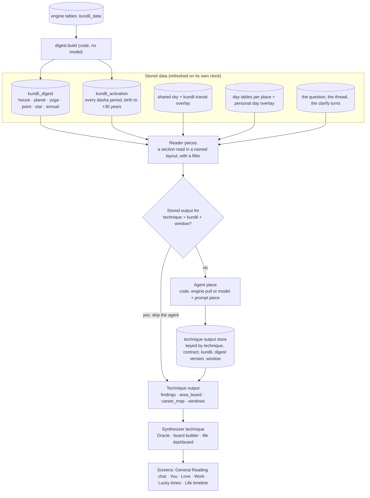

# 07 — Technique pieces and agents, illustrated

Generated from the catalogue (`src/techniques/catalog.ts`) and the agent registry (`src/agents/registry.ts`) by
`src/techniques/piecesDoc.ts`. Do not edit by hand: run `npx tsx scripts/write-technique-pieces-doc.ts` after the
catalogue changes (`--check` fails when this file is out of date). The plan behind it is
[docs/reading-engine/56](../reading-engine/56-technique-pieces-and-validity-windows.md); the same pictures are on the
Admin Panel page **Machinery**.

A technique is a recipe of standard pieces. The data changes on its own clock (transits every couple of hours, the
day at midnight, the dasha period when it ends); the recipe does not. So each piece is built and tested once, reused
by every technique that needs it, and a technique's output is stored for the window in which its inputs cannot
change, so it is not made again and its agent is skipped until the window ends.

- **Reader piece**: a digest section read in a named table layout (`house` as `house_card`). The filter (which houses,
  vargas, years) is a parameter, not a new piece.
- **Prompt piece**: a system prompt file. Code techniques have none.
- **Output piece**: the schema or type returned (`findings.v2`, `area_board.v1`, `career_map.v1` …).
- **Agent piece**: the registered agent that runs it (code, engine pull or model).
- **Family**: techniques with the same readers, prompt, output and agents: one recipe run over different filters.
- **Freshness**: how long the output stays true, from the most changeable section read. **Scope**: whether it is
  the same for every question or depends on the question.

## 1. Counts

- 132 techniques, 117 distinct pieces, 46 of them shared by two or more techniques.
- By kind: 12 reader (12 shared), 12 prompt (1 shared), 47 output (19 shared), 46 agent (14 shared).
- 95 recipe families; 47 techniques share their recipe with at least one other.
- Freshness: 33 natal, 10 annual, 28 dasha, 17 daily, 16 transit, 28 question. Scope: 120 same for every question, 12 per question.

## 2. The machinery

## 3. Every agent and the areas it serves

```mermaid
flowchart LR
  subgraph m_reading["reading"]
    a_reading_intake(["reading.intake<br/>model"])
    a_reading_specialist(["reading.specialist<br/>model"])
    a_reading_synth(["reading.synth<br/>model"])
    a_reading_fast(["reading.fast<br/>model"])
    a_reading_reader(["reading.reader<br/>model"])
    a_reading_oracle(["reading.oracle<br/>model"])
    a_reading_validator(["reading.validator<br/>model"])
    a_reading_analyst_promise(["reading.analyst.promise<br/>model"])
    a_reading_analyst_dasha(["reading.analyst.dasha<br/>model"])
    a_reading_analyst_transit(["reading.analyst.transit<br/>model"])
    a_reading_analyst_nakshatra(["reading.analyst.nakshatra<br/>model"])
    a_reading_analyst_annual(["reading.analyst.annual<br/>model"])
    a_reading_analyst_prashna(["reading.analyst.prashna<br/>model"])
    a_reading_code_varga_dynamics(["reading.code.varga_dynamics<br/>code"])
    a_reading_code_strength_yoga(["reading.code.strength_yoga<br/>code"])
    a_reading_code_jaimini(["reading.code.jaimini<br/>code"])
    a_reading_code_person(["reading.code.person<br/>code"])
    a_reading_clarify(["reading.clarify<br/>model"])
    a_reading_clarify_monitor(["reading.clarify_monitor<br/>code"])
    a_reading_step(["reading.step<br/>code"])
  end
  subgraph m_lucky_times["lucky_times"]
    a_lucky_day_tables(["lucky.day_tables<br/>engine pull"])
    a_lucky_day_overlay(["lucky.day_overlay<br/>engine pull"])
    a_lucky_scenario_windows(["lucky.scenario_windows<br/>code"])
  end
  subgraph m_area["area"]
    a_area_career_inputs(["area.career_inputs<br/>engine pull"])
    a_area_career_map(["area.career_map<br/>code"])
    a_area_self_board(["area.self_board<br/>code"])
    a_area_love_board(["area.love_board<br/>code"])
    a_research_self_dashboard_builder(["research.self_dashboard_builder<br/>code"])
    a_research_love_dashboard_builder(["research.love_dashboard_builder<br/>code"])
    a_research_work_dashboard_builder(["research.work_dashboard_builder<br/>code"])
    a_research_technical_verifier(["research.technical_verifier<br/>code"])
  end
  subgraph m_digest["digest"]
    a_digest_build(["digest.build<br/>code"])
    a_digest_annual_set(["digest.annual_set<br/>engine pull"])
    a_digest_activation(["digest.activation<br/>code"])
  end
  subgraph m_self["self"]
    a_self_reading_panel(["self.reading_panel<br/>code"])
    a_family_rasi(["family.rasi<br/>model"])
    a_family_varga(["family.varga<br/>model"])
    a_family_dasha(["family.dasha<br/>model"])
    a_family_year(["family.year<br/>model"])
    a_family_sky(["family.sky<br/>model"])
    a_lineman_self(["lineman.self<br/>model"])
    a_self_reading_oracle(["self.reading_oracle<br/>model"])
  end
  subgraph m_love["love"]
    a_love_reading_panel(["love.reading_panel<br/>code"])
    a_lineman_love(["lineman.love<br/>model"])
    a_love_reading_oracle(["love.reading_oracle<br/>model"])
  end
  subgraph m_work["work"]
    a_work_reading_panel(["work.reading_panel<br/>code"])
    a_lineman_work(["lineman.work<br/>model"])
    a_work_reading_oracle(["work.reading_oracle<br/>model"])
  end
  subgraph m_life["life"]
    a_life_dashboard(["life.dashboard<br/>code"])
  end
  area_general[["General Reading"]]
  area_self[["Self (You board and its Lucky times)"]]
  area_love[["Love"]]
  area_work[["Work"]]
  a_area_career_inputs --> area_work
  a_area_career_map --> area_work
  a_area_love_board --> area_love
  a_area_self_board --> area_self
  a_digest_activation --> area_general
  a_digest_annual_set --> area_general
  a_digest_build --> area_general
  a_family_dasha --> area_love
  a_family_dasha --> area_self
  a_family_dasha --> area_work
  a_family_rasi --> area_love
  a_family_rasi --> area_self
  a_family_rasi --> area_work
  a_family_sky --> area_love
  a_family_sky --> area_self
  a_family_sky --> area_work
  a_family_varga --> area_love
  a_family_varga --> area_self
  a_family_varga --> area_work
  a_family_year --> area_love
  a_family_year --> area_self
  a_family_year --> area_work
  a_life_dashboard --> area_general
  a_lineman_love --> area_love
  a_lineman_self --> area_self
  a_lineman_work --> area_work
  a_love_reading_oracle --> area_love
  a_love_reading_panel --> area_love
  a_lucky_day_overlay --> area_self
  a_lucky_day_tables --> area_self
  a_lucky_scenario_windows --> area_love
  a_lucky_scenario_windows --> area_self
  a_lucky_scenario_windows --> area_work
  a_reading_analyst_annual --> area_general
  a_reading_analyst_dasha --> area_general
  a_reading_analyst_nakshatra --> area_general
  a_reading_analyst_prashna --> area_general
  a_reading_analyst_promise --> area_general
  a_reading_analyst_transit --> area_general
  a_reading_clarify --> area_general
  a_reading_clarify_monitor --> area_general
  a_reading_code_jaimini --> area_general
  a_reading_code_person --> area_general
  a_reading_code_strength_yoga --> area_general
  a_reading_code_varga_dynamics --> area_general
  a_reading_intake --> area_general
  a_reading_oracle --> area_general
  a_reading_reader --> area_general
  a_reading_synth --> area_general
  a_reading_validator --> area_general
  a_research_love_dashboard_builder --> area_love
  a_research_self_dashboard_builder --> area_self
  a_research_technical_verifier --> area_self
  a_research_work_dashboard_builder --> area_work
  a_self_reading_oracle --> area_self
  a_self_reading_panel --> area_self
  a_work_reading_oracle --> area_work
  a_work_reading_panel --> area_work
```

| Agent | Title | Kind | Module | Techniques | Areas |
|---|---|---|---|---|---|
| `reading.intake` | Intake | model | reading/intake | 1 | general |
| `reading.specialist` | Specialist reader | model | reading/specialist | 0 | — |
| `reading.synth` | Synthesizer | model | reading/synth | 1 | general |
| `reading.fast` | Fast path | model | reading/fast | 0 | — |
| `reading.reader` | Oracle reader | model | reading/reader | 1 | general |
| `reading.oracle` | Oracle | model | reading/oracle | 1 | general |
| `reading.validator` | Validator | model | reading/validator | 1 | general |
| `reading.analyst.promise` | Promise analyst | model | reading/analyst | 1 | general |
| `reading.analyst.dasha` | Dasha analyst | model | reading/analyst | 1 | general |
| `reading.analyst.transit` | Transit analyst | model | reading/analyst | 1 | general |
| `reading.analyst.nakshatra` | Nakshatra analyst | model | reading/analyst | 1 | general |
| `reading.analyst.annual` | Annual chart analyst | model | reading/analyst | 1 | general |
| `reading.analyst.prashna` | Question chart analyst | model | reading/analyst | 1 | general |
| `reading.code.varga_dynamics` | Divisional chart agreement | code | reading/code_reader | 1 | general |
| `reading.code.strength_yoga` | Strength and yoga reader | code | reading/code_reader | 1 | general |
| `reading.code.jaimini` | Jaimini reader | code | reading/code_reader | 1 | general |
| `reading.code.person` | Person reader | code | reading/code_reader | 1 | general |
| `reading.clarify` | Clarify | model | reading/clarify | 1 | general |
| `reading.clarify_monitor` | Clarify counterfactual monitor | code | reading/clarify_monitor | 1 | general |
| `reading.step` | Reading step | code | reading/step | 0 | — |
| `lucky.day_tables` | Day tables puller | engine pull | lucky_times/data | 1 | self |
| `lucky.day_overlay` | Personal day overlay puller | engine pull | lucky_times/personal | 1 | self |
| `area.career_inputs` | Career inputs loader | engine pull | area/career | 9 | work |
| `area.career_map` | Career map builder | code | area/career | 9 | work |
| `digest.build` | Kundli digest builder | code | digest/build | 1 | general |
| `digest.annual_set` | Annual set puller | engine pull | digest/annual | 1 | general |
| `digest.activation` | Activation calendar builder | code | digest/activation | 1 | general |
| `area.self_board` | You board builder | code | area/self | 10 | self |
| `self.reading_panel` | You reading panel | code | self/reading | 34 | self |
| `family.rasi` | Rasi (D1) family sub-agent | model | self/family | 3 | self, love, work |
| `family.varga` | Divisional vargas (D2-D60) family sub-agent | model | self/family | 3 | self, love, work |
| `family.dasha` | Multi-clock dasha & fruition family sub-agent | model | self/family | 3 | self, love, work |
| `family.year` | Annual return (Tithi Pravesha & Varshaphal) family sub-agent | model | self/family | 3 | self, love, work |
| `family.sky` | Slow sky transit & SAV family sub-agent | model | self/family | 3 | self, love, work |
| `lineman.self` | Self reading lineman agent | model | self/lineman | 1 | self |
| `self.reading_oracle` | You reading oracle | model | self/reading | 1 | self |
| `love.reading_panel` | Love reading panel | code | love/reading | 11 | love |
| `lineman.love` | Love reading lineman agent | model | love/lineman | 1 | love |
| `love.reading_oracle` | Love reading oracle | model | love/reading | 1 | love |
| `work.reading_panel` | Work reading panel | code | work/reading | 11 | work |
| `lineman.work` | Work reading lineman agent | model | work/lineman | 1 | work |
| `work.reading_oracle` | Work reading oracle | model | work/reading | 1 | work |
| `area.love_board` | Love board builder | code | area/love | 11 | love |
| `life.dashboard` | Life reading dashboard | code | life/dashboard | 4 | general |
| `lucky.scenario_windows` | Scenario windows builder | code | lucky_times/scenarios | 15 | self, love, work |
| `research.self_dashboard_builder` | Research Self Dashboard QA builder | code | area/research_self | 1 | self |
| `research.love_dashboard_builder` | Research Love Dashboard QA builder | code | area/research_love | 1 | love |
| `research.work_dashboard_builder` | Research Work Dashboard QA builder | code | area/research_work | 1 | work |
| `research.technical_verifier` | Independent Technical Verifier Agent | code | area/research_verifier | 1 | self |

## 4. General Reading (22 techniques)

```mermaid
flowchart LR
  subgraph R["Reader pieces"]
    r_reader_activation_activation_row["activation as activation_row<br/>dasha"]
    r_reader_annual_annual_row["annual as annual_row<br/>annual"]
    r_reader_findings_findings_in["findings as findings_in<br/>question"]
    r_reader_house_house_card["house as house_card<br/>natal"]
    r_reader_planet_planet_card["planet as planet_card<br/>natal"]
    r_reader_point_point_row["point as point_row<br/>natal"]
    r_reader_prashna_prashna_card["prashna as prashna_card<br/>question"]
    r_reader_star_star_profile["star as star_profile<br/>natal"]
    r_reader_text_text_in["text as text_in<br/>question"]
    r_reader_transit_transit_row["transit as transit_row<br/>transit"]
    r_reader_yoga_yoga_row["yoga as yoga_row<br/>natal"]
  end
  subgraph P["Prompt pieces"]
    p_prompt_db_clarify_system[/"db:clarify.system"/]
    p_prompt_src_reading_prompts_annual_md[/"annual.md"/]
    p_prompt_src_reading_prompts_intake_md[/"intake.md"/]
    p_prompt_src_reading_prompts_oracle_system_md[/"oracle/system.md"/]
    p_prompt_src_reading_prompts_oracle_validator_md[/"oracle/validator.md"/]
    p_prompt_src_reading_prompts_prashna_md[/"prashna.md"/]
    p_prompt_src_reading_prompts_readers_shared_md[/"readers/_shared.md"/]
    p_prompt_src_reading_prompts_v2_dasha_md[/"v2/dasha.md"/]
    p_prompt_src_reading_prompts_v2_nakshatra_md[/"v2/nakshatra.md"/]
    p_prompt_src_reading_prompts_v2_promise_md[/"v2/promise.md"/]
    p_prompt_src_reading_prompts_v2_transit_md[/"v2/transit.md"/]
  end
  subgraph T["Techniques (one box per recipe family)"]
    f_digest_activation["digest.activation<br/>Activation calendar, thirty years ahead<br/>kundli_activation.v1 · dasha"]
    f_digest_annual_set["digest.annual_set<br/>Annual set, ten years back and ahead<br/>kundli_digest.v1 · annual"]
    f_digest_build["digest.build<br/>Kundli digest (the first-time breakdown)<br/>kundli_digest.v1 · annual"]
    f_general_annual["general.annual<br/>Annual set analyst<br/>findings.v2 · annual"]
    f_general_clarify["general.clarify<br/>Clarify<br/>intent.v1 · natal"]
    f_general_dasha["general.dasha<br/>Dasha analyst (all systems)<br/>findings.v2 · dasha"]
    f_general_intake["general.intake<br/>Intake<br/>intent.v1 · natal"]
    f_general_jaimini["general.jaimini<br/>Jaimini analyst<br/>findings.v2 · natal"]
    f_general_nakshatra["general.nakshatra<br/>Nakshatra analyst<br/>findings.v2 · natal"]
    f_general_oracle["general.oracle<br/>Oracle and synthesizer<br/>answer.markdown · question"]
    f_general_person["general.person<br/>The person in your chart<br/>findings.v2 · natal"]
    f_general_prashna["general.prashna<br/>Question chart analyst<br/>findings.v2 · question"]
    f_general_promise["general.promise<br/>House promise analyst<br/>findings.v2 · natal"]
    f_general_reader["general.reader<br/>Oracle readers (R01–R14, P1–P3)<br/>findings.v2 · question"]
    f_general_strength_yoga["general.strength_yoga<br/>Strength and yoga analyst<br/>findings.v2 · natal"]
    f_general_transit["general.transit<br/>Transit analyst<br/>findings.v2 · transit"]
    f_general_validator["general.validator<br/>Validator<br/>validator.v1 · natal"]
    f_general_varga_dynamics["general.varga_dynamics<br/>Varga dynamics analyst<br/>findings.v2 · natal"]
    f_life_dashboard["life.dashboard<br/>Your life at a glance and long-term Mahadasha charter<br/>life_reading.v2 · transit"]
    f_life_mahadasha_charter["life.mahadasha_charter<br/>Remaining largest Mahadasha (10-18+ yrs) and Antardasha life charter<br/>life_charter.v1 · transit"]
    f_life_promise_scale["life.promise_scale<br/>Life areas: the weighed promise scale<br/>life_promise.v1 · dasha"]
    f_life_timing_agreement["life.timing_agreement<br/>Life areas: when it improves, by agreement across systems<br/>life_windows.v1 · transit"]
  end
  subgraph A["Agents"]
    a_agent_digest_activation(["digest.activation<br/>code"])
    a_agent_digest_annual_set(["digest.annual_set<br/>engine pull"])
    a_agent_digest_build(["digest.build<br/>code"])
    a_agent_life_dashboard(["life.dashboard<br/>code"])
    a_agent_reading_analyst_annual(["reading.analyst.annual<br/>model"])
    a_agent_reading_analyst_dasha(["reading.analyst.dasha<br/>model"])
    a_agent_reading_analyst_nakshatra(["reading.analyst.nakshatra<br/>model"])
    a_agent_reading_analyst_prashna(["reading.analyst.prashna<br/>model"])
    a_agent_reading_analyst_promise(["reading.analyst.promise<br/>model"])
    a_agent_reading_analyst_transit(["reading.analyst.transit<br/>model"])
    a_agent_reading_clarify(["reading.clarify<br/>model"])
    a_agent_reading_clarify_monitor(["reading.clarify_monitor<br/>code"])
    a_agent_reading_code_jaimini(["reading.code.jaimini<br/>code"])
    a_agent_reading_code_person(["reading.code.person<br/>code"])
    a_agent_reading_code_strength_yoga(["reading.code.strength_yoga<br/>code"])
    a_agent_reading_code_varga_dynamics(["reading.code.varga_dynamics<br/>code"])
    a_agent_reading_intake(["reading.intake<br/>model"])
    a_agent_reading_oracle(["reading.oracle<br/>model"])
    a_agent_reading_reader(["reading.reader<br/>model"])
    a_agent_reading_synth(["reading.synth<br/>model"])
    a_agent_reading_validator(["reading.validator<br/>model"])
  end
  r_reader_activation_activation_row --> f_digest_activation
  r_reader_planet_planet_card --> f_digest_activation
  f_digest_activation --- a_agent_digest_activation
  r_reader_annual_annual_row --> f_digest_annual_set
  f_digest_annual_set --- a_agent_digest_annual_set
  r_reader_annual_annual_row --> f_digest_build
  r_reader_house_house_card --> f_digest_build
  r_reader_planet_planet_card --> f_digest_build
  r_reader_point_point_row --> f_digest_build
  r_reader_star_star_profile --> f_digest_build
  r_reader_yoga_yoga_row --> f_digest_build
  f_digest_build --- a_agent_digest_build
  r_reader_annual_annual_row --> f_general_annual
  p_prompt_src_reading_prompts_annual_md --> f_general_annual
  f_general_annual --- a_agent_reading_analyst_annual
  r_reader_text_text_in --> f_general_clarify
  p_prompt_db_clarify_system --> f_general_clarify
  f_general_clarify --- a_agent_reading_clarify
  f_general_clarify --- a_agent_reading_clarify_monitor
  r_reader_activation_activation_row --> f_general_dasha
  r_reader_house_house_card --> f_general_dasha
  r_reader_planet_planet_card --> f_general_dasha
  p_prompt_src_reading_prompts_v2_dasha_md --> f_general_dasha
  f_general_dasha --- a_agent_reading_analyst_dasha
  r_reader_text_text_in --> f_general_intake
  p_prompt_src_reading_prompts_intake_md --> f_general_intake
  f_general_intake --- a_agent_reading_intake
  r_reader_house_house_card --> f_general_jaimini
  r_reader_point_point_row --> f_general_jaimini
  f_general_jaimini --- a_agent_reading_code_jaimini
  r_reader_house_house_card --> f_general_nakshatra
  r_reader_planet_planet_card --> f_general_nakshatra
  r_reader_star_star_profile --> f_general_nakshatra
  p_prompt_src_reading_prompts_v2_nakshatra_md --> f_general_nakshatra
  f_general_nakshatra --- a_agent_reading_analyst_nakshatra
  r_reader_findings_findings_in --> f_general_oracle
  r_reader_text_text_in --> f_general_oracle
  p_prompt_src_reading_prompts_oracle_system_md --> f_general_oracle
  f_general_oracle --- a_agent_reading_oracle
  f_general_oracle --- a_agent_reading_synth
  r_reader_house_house_card --> f_general_person
  r_reader_planet_planet_card --> f_general_person
  f_general_person --- a_agent_reading_code_person
  r_reader_house_house_card --> f_general_prashna
  r_reader_prashna_prashna_card --> f_general_prashna
  p_prompt_src_reading_prompts_prashna_md --> f_general_prashna
  f_general_prashna --- a_agent_reading_analyst_prashna
  r_reader_house_house_card --> f_general_promise
  r_reader_planet_planet_card --> f_general_promise
  r_reader_point_point_row --> f_general_promise
  r_reader_yoga_yoga_row --> f_general_promise
  p_prompt_src_reading_prompts_v2_promise_md --> f_general_promise
  f_general_promise --- a_agent_reading_analyst_promise
  r_reader_activation_activation_row --> f_general_reader
  r_reader_annual_annual_row --> f_general_reader
  r_reader_house_house_card --> f_general_reader
  r_reader_planet_planet_card --> f_general_reader
  r_reader_point_point_row --> f_general_reader
  r_reader_prashna_prashna_card --> f_general_reader
  r_reader_transit_transit_row --> f_general_reader
  r_reader_yoga_yoga_row --> f_general_reader
  p_prompt_src_reading_prompts_readers_shared_md --> f_general_reader
  f_general_reader --- a_agent_reading_reader
  r_reader_house_house_card --> f_general_strength_yoga
  r_reader_planet_planet_card --> f_general_strength_yoga
  r_reader_yoga_yoga_row --> f_general_strength_yoga
  f_general_strength_yoga --- a_agent_reading_code_strength_yoga
  r_reader_planet_planet_card --> f_general_transit
  r_reader_transit_transit_row --> f_general_transit
  p_prompt_src_reading_prompts_v2_transit_md --> f_general_transit
  f_general_transit --- a_agent_reading_analyst_transit
  r_reader_text_text_in --> f_general_validator
  p_prompt_src_reading_prompts_oracle_validator_md --> f_general_validator
  f_general_validator --- a_agent_reading_validator
  r_reader_house_house_card --> f_general_varga_dynamics
  r_reader_planet_planet_card --> f_general_varga_dynamics
  f_general_varga_dynamics --- a_agent_reading_code_varga_dynamics
  r_reader_activation_activation_row --> f_life_dashboard
  r_reader_annual_annual_row --> f_life_dashboard
  r_reader_house_house_card --> f_life_dashboard
  r_reader_planet_planet_card --> f_life_dashboard
  r_reader_transit_transit_row --> f_life_dashboard
  r_reader_yoga_yoga_row --> f_life_dashboard
  f_life_dashboard --- a_agent_life_dashboard
  r_reader_activation_activation_row --> f_life_mahadasha_charter
  r_reader_annual_annual_row --> f_life_mahadasha_charter
  r_reader_house_house_card --> f_life_mahadasha_charter
  r_reader_planet_planet_card --> f_life_mahadasha_charter
  r_reader_transit_transit_row --> f_life_mahadasha_charter
  r_reader_yoga_yoga_row --> f_life_mahadasha_charter
  f_life_mahadasha_charter --- a_agent_life_dashboard
  r_reader_activation_activation_row --> f_life_promise_scale
  r_reader_house_house_card --> f_life_promise_scale
  r_reader_planet_planet_card --> f_life_promise_scale
  r_reader_yoga_yoga_row --> f_life_promise_scale
  f_life_promise_scale --- a_agent_life_dashboard
  r_reader_activation_activation_row --> f_life_timing_agreement
  r_reader_annual_annual_row --> f_life_timing_agreement
  r_reader_transit_transit_row --> f_life_timing_agreement
  f_life_timing_agreement --- a_agent_life_dashboard
  f_digest_activation -. feeds .-> f_digest_build
  f_digest_annual_set -. feeds .-> f_digest_build
  f_general_annual -. feeds .-> f_general_oracle
  f_general_dasha -. feeds .-> f_general_oracle
  f_general_jaimini -. feeds .-> f_general_oracle
  f_general_nakshatra -. feeds .-> f_general_oracle
  f_general_oracle -. feeds .-> f_general_validator
  f_general_person -. feeds .-> f_general_oracle
  f_general_prashna -. feeds .-> f_general_oracle
  f_general_promise -. feeds .-> f_general_oracle
  f_general_reader -. feeds .-> f_general_oracle
  f_general_strength_yoga -. feeds .-> f_general_oracle
  f_general_transit -. feeds .-> f_general_oracle
  f_general_varga_dynamics -. feeds .-> f_general_oracle
  f_life_mahadasha_charter -. feeds .-> f_life_dashboard
  f_life_promise_scale -. feeds .-> f_life_dashboard
  f_life_timing_agreement -. feeds .-> f_life_dashboard
```

| Technique | Title | Reader pieces (filter) | Prompt | Output | Agents | Feeds | Freshness · scope |
|---|---|---|---|---|---|---|---|
| `general.promise` | House promise analyst | `house/house_card` D1 and the frame's vargas, the frame's houses `planet/planet_card` D1 cards of the frame's house lords and karakas `point/point_row` arudhas and special lagnas of the frame `yoga/yoga_row` yogas touching the frame's houses or their lords | `v2/promise.md` | `findings.v2` | `reading.analyst.promise` | `general.oracle` | natal · question |
| `general.varga_dynamics` | Varga dynamics analyst | `house/house_card` D1 and each frame varga, the frame's houses (lord, lord_dignity, occupants) `planet/planet_card` D1 and each frame varga, the frame's house lords (dignity) | code | `findings.v2` | `reading.code.varga_dynamics` | `general.oracle` | natal · kundli |
| `general.dasha` | Dasha analyst (all systems) | `activation/activation_row` periods inside the horizon activating the frame's houses, every served system, grouped by family; Vimshottari MD/AD/PD at level 3; dasha.applicable `planet/planet_card` D1 cards of the frame's house lords and karakas `house/house_card` D1 and the frame's vargas, the frame's houses | `v2/dasha.md` | `findings.v2` | `reading.analyst.dasha` | `general.oracle` | dasha · question |
| `general.annual` | Annual set analyst | `annual/annual_row` TP and VP of the current, previous and next year, D1, D9, D10, the frame's houses; year dashas; sahams in the frame's houses; muntha and year lord when served | `annual.md` | `findings.v2` | `reading.analyst.annual` | `general.oracle` | annual · question |
| `general.transit` | Transit analyst | `transit/transit_row` shared sky with the overlay for the frame's houses, lords and karakas inside the horizon; double transit; sade sati; eclipses; transit ashtakavarga `planet/planet_card` D1 cards of the frame's house lords and karakas | `v2/transit.md` | `findings.v2` | `reading.analyst.transit` | `general.oracle` | transit · question |
| `general.nakshatra` | Nakshatra analyst | `star/star_profile` Moon star, lagna star, the tara table, gandanta flags `house/house_card` D1, the frame's houses (cusp_star column) `planet/planet_card` D1 cards of the star lords of the frame's cusps and the Moon | `v2/nakshatra.md` | `findings.v2` | `reading.analyst.nakshatra` | `general.oracle` | natal · question |
| `general.strength_yoga` | Strength and yoga analyst | `yoga/yoga_row` D1 yogas, doshas and cancellations joining the frame's planets or houses `planet/planet_card` D1 cards of the frame's lords and karakas (shadbala_rank, shadbala ratio) `house/house_card` D1, the frame's houses (sav column) | code | `findings.v2` | `reading.code.strength_yoga` | `general.oracle` | natal · kundli |
| `general.jaimini` | Jaimini analyst | `point/point_row` AK, AmK, DK, UL, AL and the chara karakas and A-houses of the frame `house/house_card` D1, the frame's houses and the houses the points sit in (argala, class columns) | code | `findings.v2` | `reading.code.jaimini` | `general.oracle` | natal · kundli |
| `general.prashna` | Question chart analyst | `prashna/prashna_card` the cast of the question moment `house/house_card` D1 and the frame's vargas, the frame's houses | `prashna.md` | `findings.v2` | `reading.analyst.prashna` | `general.oracle` | question · question |
| `general.person` | The person in your chart | `house/house_card` D1 and the person's varga (D12, D9, D7, D3), the person's house `planet/planet_card` D1 and the person's varga, the person's karaka | code | `findings.v2` | `reading.code.person` | `general.oracle` | natal · kundli |
| `general.reader` | Oracle readers (R01–R14, P1–P3) | `house/house_card` CHART CORE (nine stored types) and D1 plus the frame vargas, the frame houses `planet/planet_card` CHART CORE: every planet in D1 `yoga/yoga_row` present yogas and doshas (R01, R06) `point/point_row` arudhas and argala of the frame (R03, R04) `activation/activation_row` Vimshottari and the other dasha systems inside the horizon (R08, R09, R04) `transit/transit_row` the question's transit rows (R07, R10, R13, P1–P3) `annual/annual_row` TP, VP, sahams, Mudda and Patyayini of the years in the horizon (R11) `prashna/prashna_card` the cast when the question is prashna-eligible (R12) | `readers/_shared.md` | `findings.v2` | `reading.reader` | `general.oracle` | question · question |
| `general.oracle` | Oracle and synthesizer | `findings/findings_in` every finding of the readers or analysts of this query, with the digest rows they cite `text/text_in` the question, the history of the thread, the clarify turns | `oracle/system.md` | `answer.markdown` | `reading.oracle`, `reading.synth` | `general.validator` | question · question |
| `general.validator` | Validator | `text/text_in` the question, the clarify turns and the answer | `oracle/validator.md` | `validator.v1` | `reading.validator` |  | natal · question |
| `general.intake` | Intake | `text/text_in` the question, the history of the thread, the clarify turns | `intake.md` | `intent.v1` | `reading.intake` |  | natal · question |
| `general.clarify` | Clarify | `text/text_in` the question, the history of the thread, the clarify turns `text/text_in` the intake's intent: bucket, subjects, horizon, the slots filled and missing | `db:clarify.system` | `intent.v1` | `reading.clarify`, `reading.clarify_monitor` |  | natal · question |
| `digest.build` | Kundli digest (the first-time breakdown) | `house/house_card` dignities.dN, aspects.dN, argala.dN, arudhas.dN, house_counts.dN; D1 also ashtakavarga, benefic_malefic.badhaka, facts.houses; D1 and the vargas with dignities.dN `planet/planet_card` dignities.dN, aspects.dN, avasthas.dN (avasthas, avasthaMultipliers, dispositor chains, D1 sunProximity & dashaCharter); D1 also strength.shadbala, benefic_malefic, facts.bodies; varga.dN placement rows for the other vargas `yoga/yoga_row` yogas, yogas.dN, doshas, facts.yogas `point/point_row` karaka.chara, arudhas(.dN) (bhava/surya/chandra arudhas & special points), benefic_malefic.badhaka, avasthas.lunar_astro (K64M, K64L, KD22, BB), facts.special_lagnas, sphutas `annual/annual_row` annual.{tithi_pravesha,varsha}@year=Y (D1, D2, D7, D9, D10), annual.{tithi_pravesha_dasha,mudda,patyayini,sahams,tajaka}@year=Y, every stored year `star/star_profile` facts.nakshatra_profile, avasthas.lunar_astro.pending_karma | code | `kundli_digest.v1` | `digest.build` |  | annual · kundli |
| `digest.annual_set` | Annual set, ten years back and ahead | `annual/annual_row` annual.* for Y in −10…+10, D1, D9, D10 | code | `kundli_digest.v1` | `digest.annual_set` | `digest.build` | annual · kundli |
| `digest.activation` | Activation calendar, thirty years ahead | `activation/activation_row` every stored system, levels 1–3, birth to +30 years `planet/planet_card` D1 cards (house, owns, aspects_to) of the nine planets; D1 house cards and house_counts for rasi periods | code | `kundli_activation.v1` | `digest.activation` | `digest.build` | dasha · kundli |
| `life.promise_scale` | Life areas: the weighed promise scale | `house/house_card` D1 houses of the area; D9 and the owning varga, primary house `planet/planet_card` D1 karakas of the area; the primary house lord in D9 and the owning varga `yoga/yoga_row` D1 yogas on the area houses or their lords `activation/activation_row` periods running today, levels 1-2 | code | `life_promise.v1` | `life.dashboard` | `life.dashboard` | dasha · kundli |
| `life.timing_agreement` | Life areas: when it improves, by agreement across systems | `activation/activation_row` every family, levels 1-2, today to +15 years, the area houses `annual/annual_row` TP and VP of each year a window touches, D1 card of the primary house `transit/transit_row` stored natal-overlay double_transit windows and Saturn/Rahu/Ketu rows (read only; none fetched) | code | `life_windows.v1` | `life.dashboard` | `life.dashboard` | transit · kundli |
| `life.mahadasha_charter` | Remaining largest Mahadasha (10-18+ yrs) and Antardasha life charter | `house/house_card` D1 houses of the area; D9 and the owning varga, primary house `planet/planet_card` D1 karakas of the area; the primary house lord in D9 and the owning varga `yoga/yoga_row` D1 yogas on the area houses or their lords `activation/activation_row` every family, levels 1-2, today to +15 years, the area houses `annual/annual_row` TP and VP of each year a window touches, D1 card of the primary house `transit/transit_row` stored natal-overlay double_transit windows and Saturn/Rahu/Ketu rows (read only; none fetched) | code | `life_charter.v1` | `life.dashboard` | `life.dashboard` | transit · kundli |
| `life.dashboard` | Your life at a glance and long-term Mahadasha charter | `house/house_card` D1 houses of the area; D9 and the owning varga, primary house `planet/planet_card` D1 karakas of the area; the primary house lord in D9 and the owning varga `yoga/yoga_row` D1 yogas on the area houses or their lords `activation/activation_row` every family, levels 1-2, today to +15 years, the area houses `annual/annual_row` TP and VP of each year a window touches, D1 card of the primary house `transit/transit_row` stored natal-overlay double_transit windows and Saturn/Rahu/Ketu rows (read only; none fetched) | code | `life_reading.v2` | `life.dashboard` |  | transit · kundli |

## 5. Self (You board and its Lucky times) (54 techniques)

```mermaid
flowchart LR
  subgraph R["Reader pieces"]
    r_reader_activation_activation_row["activation as activation_row<br/>dasha"]
    r_reader_annual_annual_row["annual as annual_row<br/>annual"]
    r_reader_findings_findings_in["findings as findings_in<br/>question"]
    r_reader_house_house_card["house as house_card<br/>natal"]
    r_reader_panchang_panchang_day["panchang as panchang_day<br/>daily"]
    r_reader_planet_planet_card["planet as planet_card<br/>natal"]
    r_reader_point_point_row["point as point_row<br/>natal"]
    r_reader_star_star_profile["star as star_profile<br/>natal"]
    r_reader_text_text_in["text as text_in<br/>question"]
    r_reader_transit_transit_row["transit as transit_row<br/>transit"]
    r_reader_yoga_yoga_row["yoga as yoga_row<br/>natal"]
  end
  subgraph P["Prompt pieces"]
    p_prompt_src_reading_prompts_oracle_self_md[/"oracle/self.md"/]
  end
  subgraph T["Techniques (one box per recipe family)"]
    f_self_v2_12["self.v2.* (12)<br/>12 techniques<br/>self_v2.area_brief · question"]
    f_lucky_3["lucky.* (3)<br/>3 techniques<br/>windows.v1 · daily"]
    f_self_2["self.* (2)<br/>2 techniques<br/>area_board.v1 · natal"]
    f_self_reading_2["self.reading.* (2)<br/>2 techniques<br/>self_panel.v1 · natal"]
    f_self_reading_2["self.reading.* (2)<br/>2 techniques<br/>self_panel.v1 · dasha"]
    f_lucky_avoid_bands["lucky.avoid_bands<br/>Avoid bands and good spans of the day<br/>day_bands.v1 · daily"]
    f_lucky_day_tables["lucky.day_tables<br/>Shared day tables per place<br/>day_tables.v1 · daily"]
    f_lucky_panchang_limbs["lucky.panchang_limbs<br/>The five limbs of the day (vara, tithi, nakshatra, yoga, karana)<br/>limbs.v1 · daily"]
    f_lucky_personal_overlay["lucky.personal_overlay<br/>Personal overlay (tara, chandra bala and the chart marks)<br/>day_overlay.v1 · daily"]
    f_research_self_dashboard_qa["research.self_dashboard_qa<br/>Research Self Dashboard deep-dive & Nov/Thanksgiving/Dec/New Year zoom-in<br/>research_self_dashboard.v1 · transit"]
    f_research_technical_verifier["research.technical_verifier<br/>Independent Technical Verifier Agent (8-gate classical & governance audit)<br/>research_verifier_audit.v1 · transit"]
    f_self_activation["self.activation<br/>Activation of houses 1, 4 and 5 with the Moon by every dasha system<br/>area_board.v1 · dasha"]
    f_self_affliction["self.affliction<br/>Afflictions on houses 1, 4 and 5 with the Moon<br/>area_board.v1 · dasha"]
    f_self_annual["self.annual<br/>This year's chart for houses 1, 4 and 5 with the Moon<br/>area_board.v1 · annual"]
    f_self_character_arc["self.character_arc<br/>Character evolution across 3 decades (Last 10 Years -#gt; Who You Are Now -#gt; Next 10 Years)<br/>self_character_arc.v1 · dasha"]
    f_self_nakshatra["self.nakshatra<br/>Nakshatra charter of houses 1, 4 and 5 with the Moon<br/>area_board.v1 · natal"]
    f_self_personality_joy["self.personality_joy<br/>Vedic Moon & Mercury personality and what brings joy & fulfillment<br/>self_personality_joy.v1 · natal"]
    f_self_reading_audit["self.reading.audit<br/>You reading: the code auditor over the cards (board.auditor, code half)<br/>code_audit.v1 · question"]
    f_self_reading_chapters["self.reading.chapters<br/>You reading: Your chapters (previous, running and next main period of the reading clock, the running sub-period, confirmed by other clocks)<br/>self_panel.v1 · dasha"]
    f_self_reading_clock["self.reading.clock<br/>You reading: the reading clock (preferred, applicable or default dasha system, and the confirming clocks)<br/>self_clock.v1 · dasha"]
    f_self_reading_diagnosis["self.reading.diagnosis<br/>You reading: Who you are, in short (three sentences built from the other panels, shown first)<br/>board_diagnosis.v1 · dasha"]
    f_self_reading_mind["self.reading.mind<br/>You reading: Your mind (Moon, Mercury, 3rd, 4th and 5th houses)<br/>self_panel.v1 · natal"]
    f_self_reading_oracle["self.reading.oracle<br/>You reading: AI family sub-agents, Self Lineman, and Self Oracle synthesis<br/>self_reading.v1 · dasha"]
    f_self_reading_purview["self.reading.purview<br/>You reading: the whole-chart purview check (board.purview, Self instance)<br/>purview.v1 · question"]
    f_self_reading_year["self.reading.year<br/>You reading: This year (Tithi Pravesha and Varsha charts on the self)<br/>self_panel.v1 · annual"]
    f_self_reading_yogas["self.reading.yogas<br/>You reading: Gifts and knots (yogas and doshas on the self)<br/>self_panel.v1 · natal"]
    f_self_sub_body_facts["self.sub.body_facts<br/>Self v2 S7: body facts (footing, wear, shape, live lords on body houses, live transits over lagna and Moon)<br/>self_v2.body_facts · question"]
    f_self_sub_clock["self.sub.clock<br/>Self v2 S1: the primary dasha clock and its confirming clocks<br/>self_v2.clock_resolution · dasha"]
    f_self_sub_mind_facts["self.sub.mind_facts<br/>Self v2 S6: mind facts (feeling, thinking, peace, judgement, candidate patterns), evidence keys only<br/>self_v2.mind_facts · natal"]
    f_self_sub_periods["self.sub.periods<br/>Self v2 S2: previous, running and next main period, running sub and sub-sub, charter relation, boundaries<br/>self_v2.period_frame · dasha"]
    f_self_sub_presence_facts["self.sub.presence_facts<br/>Self v2 S8: presence facts (bearing, style, adornment, face, public vs private, best window, live care)<br/>self_v2.presence_facts · dasha"]
    f_self_sub_profile["self.sub.profile<br/>Self v2 S10: the person profile pack (age band, stated gender, role, facts, declined, confirms, mood)<br/>self_v2.profile_pack · natal"]
    f_self_sub_promise["self.sub.promise<br/>Self v2 S4: the promise ledger (gifts, knots, graces) from stored yoga and dosha rows and the charter flags<br/>self_v2.promise_ledger · natal"]
    f_self_sub_risk["self.sub.risk<br/>Self v2 S5: the risk ledger (what could go wrong, from where, from who, since, until, what holds it)<br/>self_v2.risk_ledger · question"]
    f_self_sub_windows["self.sub.windows<br/>Self v2 S3: dated windows around today (degraded: activation and the stored sky overlay until kundli_pressure lands)<br/>self_v2.window_set · transit"]
    f_self_sub_year["self.sub.year<br/>Self v2 S9: the year frame from the stored annual row covering today<br/>self_v2.year_frame · annual"]
    f_self_transit["self.transit<br/>Transits over houses 1, 4 and 5 with the Moon<br/>area_board.v1 · transit"]
    f_self_varga["self.varga<br/>Owning divisional chart of houses 1, 4 and 5 with the Moon<br/>area_board.v1 · natal"]
  end
  subgraph A["Agents"]
    a_agent_area_self_board(["area.self_board<br/>code"])
    a_agent_family_dasha(["family.dasha<br/>model"])
    a_agent_family_rasi(["family.rasi<br/>model"])
    a_agent_family_sky(["family.sky<br/>model"])
    a_agent_family_varga(["family.varga<br/>model"])
    a_agent_family_year(["family.year<br/>model"])
    a_agent_lineman_self(["lineman.self<br/>model"])
    a_agent_lucky_day_overlay(["lucky.day_overlay<br/>engine pull"])
    a_agent_lucky_day_tables(["lucky.day_tables<br/>engine pull"])
    a_agent_lucky_scenario_windows(["lucky.scenario_windows<br/>code"])
    a_agent_research_self_dashboard_builder(["research.self_dashboard_builder<br/>code"])
    a_agent_research_technical_verifier(["research.technical_verifier<br/>code"])
    a_agent_self_reading_oracle(["self.reading_oracle<br/>model"])
    a_agent_self_reading_panel(["self.reading_panel<br/>code"])
  end
  r_reader_findings_findings_in --> f_self_v2_12
  f_self_v2_12 --- a_agent_self_reading_panel
  r_reader_panchang_panchang_day --> f_lucky_3
  f_lucky_3 --- a_agent_lucky_scenario_windows
  r_reader_house_house_card --> f_self_2
  r_reader_planet_planet_card --> f_self_2
  r_reader_point_point_row --> f_self_2
  r_reader_yoga_yoga_row --> f_self_2
  f_self_2 --- a_agent_area_self_board
  r_reader_house_house_card --> f_self_reading_2
  r_reader_planet_planet_card --> f_self_reading_2
  r_reader_point_point_row --> f_self_reading_2
  f_self_reading_2 --- a_agent_self_reading_panel
  r_reader_activation_activation_row --> f_self_reading_2
  r_reader_house_house_card --> f_self_reading_2
  r_reader_planet_planet_card --> f_self_reading_2
  f_self_reading_2 --- a_agent_self_reading_panel
  r_reader_panchang_panchang_day --> f_lucky_avoid_bands
  f_lucky_avoid_bands --- a_agent_lucky_scenario_windows
  r_reader_panchang_panchang_day --> f_lucky_day_tables
  f_lucky_day_tables --- a_agent_lucky_day_tables
  r_reader_panchang_panchang_day --> f_lucky_panchang_limbs
  f_lucky_panchang_limbs --- a_agent_lucky_scenario_windows
  r_reader_activation_activation_row --> f_lucky_personal_overlay
  r_reader_panchang_panchang_day --> f_lucky_personal_overlay
  r_reader_planet_planet_card --> f_lucky_personal_overlay
  f_lucky_personal_overlay --- a_agent_lucky_day_overlay
  r_reader_activation_activation_row --> f_research_self_dashboard_qa
  r_reader_annual_annual_row --> f_research_self_dashboard_qa
  r_reader_house_house_card --> f_research_self_dashboard_qa
  r_reader_planet_planet_card --> f_research_self_dashboard_qa
  r_reader_point_point_row --> f_research_self_dashboard_qa
  r_reader_star_star_profile --> f_research_self_dashboard_qa
  r_reader_transit_transit_row --> f_research_self_dashboard_qa
  r_reader_yoga_yoga_row --> f_research_self_dashboard_qa
  f_research_self_dashboard_qa --- a_agent_research_self_dashboard_builder
  r_reader_activation_activation_row --> f_research_technical_verifier
  r_reader_annual_annual_row --> f_research_technical_verifier
  r_reader_findings_findings_in --> f_research_technical_verifier
  r_reader_house_house_card --> f_research_technical_verifier
  r_reader_planet_planet_card --> f_research_technical_verifier
  r_reader_point_point_row --> f_research_technical_verifier
  r_reader_star_star_profile --> f_research_technical_verifier
  r_reader_transit_transit_row --> f_research_technical_verifier
  r_reader_yoga_yoga_row --> f_research_technical_verifier
  f_research_technical_verifier --- a_agent_research_technical_verifier
  r_reader_activation_activation_row --> f_self_activation
  r_reader_planet_planet_card --> f_self_activation
  f_self_activation --- a_agent_area_self_board
  r_reader_activation_activation_row --> f_self_affliction
  r_reader_house_house_card --> f_self_affliction
  r_reader_planet_planet_card --> f_self_affliction
  r_reader_yoga_yoga_row --> f_self_affliction
  f_self_affliction --- a_agent_area_self_board
  r_reader_annual_annual_row --> f_self_annual
  f_self_annual --- a_agent_area_self_board
  r_reader_activation_activation_row --> f_self_character_arc
  r_reader_house_house_card --> f_self_character_arc
  r_reader_planet_planet_card --> f_self_character_arc
  r_reader_point_point_row --> f_self_character_arc
  f_self_character_arc --- a_agent_area_self_board
  r_reader_house_house_card --> f_self_nakshatra
  r_reader_planet_planet_card --> f_self_nakshatra
  r_reader_star_star_profile --> f_self_nakshatra
  f_self_nakshatra --- a_agent_area_self_board
  r_reader_house_house_card --> f_self_personality_joy
  r_reader_planet_planet_card --> f_self_personality_joy
  r_reader_star_star_profile --> f_self_personality_joy
  f_self_personality_joy --- a_agent_area_self_board
  r_reader_findings_findings_in --> f_self_reading_audit
  f_self_reading_audit --- a_agent_self_reading_panel
  r_reader_activation_activation_row --> f_self_reading_chapters
  r_reader_planet_planet_card --> f_self_reading_chapters
  f_self_reading_chapters --- a_agent_self_reading_panel
  r_reader_activation_activation_row --> f_self_reading_clock
  f_self_reading_clock --- a_agent_self_reading_panel
  r_reader_findings_findings_in --> f_self_reading_diagnosis
  f_self_reading_diagnosis --- a_agent_self_reading_panel
  r_reader_house_house_card --> f_self_reading_mind
  r_reader_planet_planet_card --> f_self_reading_mind
  r_reader_point_point_row --> f_self_reading_mind
  r_reader_yoga_yoga_row --> f_self_reading_mind
  f_self_reading_mind --- a_agent_self_reading_panel
  r_reader_activation_activation_row --> f_self_reading_oracle
  r_reader_annual_annual_row --> f_self_reading_oracle
  r_reader_house_house_card --> f_self_reading_oracle
  r_reader_planet_planet_card --> f_self_reading_oracle
  r_reader_point_point_row --> f_self_reading_oracle
  r_reader_star_star_profile --> f_self_reading_oracle
  r_reader_yoga_yoga_row --> f_self_reading_oracle
  p_prompt_src_reading_prompts_oracle_self_md --> f_self_reading_oracle
  f_self_reading_oracle --- a_agent_family_dasha
  f_self_reading_oracle --- a_agent_family_rasi
  f_self_reading_oracle --- a_agent_family_sky
  f_self_reading_oracle --- a_agent_family_varga
  f_self_reading_oracle --- a_agent_family_year
  f_self_reading_oracle --- a_agent_lineman_self
  f_self_reading_oracle --- a_agent_self_reading_oracle
  r_reader_activation_activation_row --> f_self_reading_purview
  r_reader_findings_findings_in --> f_self_reading_purview
  r_reader_planet_planet_card --> f_self_reading_purview
  r_reader_yoga_yoga_row --> f_self_reading_purview
  f_self_reading_purview --- a_agent_self_reading_panel
  r_reader_annual_annual_row --> f_self_reading_year
  f_self_reading_year --- a_agent_self_reading_panel
  r_reader_yoga_yoga_row --> f_self_reading_yogas
  f_self_reading_yogas --- a_agent_self_reading_panel
  r_reader_findings_findings_in --> f_self_sub_body_facts
  r_reader_house_house_card --> f_self_sub_body_facts
  r_reader_planet_planet_card --> f_self_sub_body_facts
  r_reader_point_point_row --> f_self_sub_body_facts
  f_self_sub_body_facts --- a_agent_self_reading_panel
  r_reader_activation_activation_row --> f_self_sub_clock
  f_self_sub_clock --- a_agent_self_reading_panel
  r_reader_house_house_card --> f_self_sub_mind_facts
  r_reader_planet_planet_card --> f_self_sub_mind_facts
  r_reader_star_star_profile --> f_self_sub_mind_facts
  r_reader_yoga_yoga_row --> f_self_sub_mind_facts
  f_self_sub_mind_facts --- a_agent_self_reading_panel
  r_reader_activation_activation_row --> f_self_sub_periods
  r_reader_planet_planet_card --> f_self_sub_periods
  f_self_sub_periods --- a_agent_self_reading_panel
  r_reader_activation_activation_row --> f_self_sub_presence_facts
  r_reader_house_house_card --> f_self_sub_presence_facts
  r_reader_planet_planet_card --> f_self_sub_presence_facts
  r_reader_point_point_row --> f_self_sub_presence_facts
  f_self_sub_presence_facts --- a_agent_self_reading_panel
  r_reader_text_text_in --> f_self_sub_profile
  f_self_sub_profile --- a_agent_self_reading_panel
  r_reader_planet_planet_card --> f_self_sub_promise
  r_reader_yoga_yoga_row --> f_self_sub_promise
  f_self_sub_promise --- a_agent_self_reading_panel
  r_reader_findings_findings_in --> f_self_sub_risk
  f_self_sub_risk --- a_agent_self_reading_panel
  r_reader_activation_activation_row --> f_self_sub_windows
  r_reader_planet_planet_card --> f_self_sub_windows
  r_reader_transit_transit_row --> f_self_sub_windows
  f_self_sub_windows --- a_agent_self_reading_panel
  r_reader_annual_annual_row --> f_self_sub_year
  f_self_sub_year --- a_agent_self_reading_panel
  r_reader_house_house_card --> f_self_transit
  r_reader_transit_transit_row --> f_self_transit
  f_self_transit --- a_agent_area_self_board
  r_reader_house_house_card --> f_self_varga
  r_reader_planet_planet_card --> f_self_varga
  r_reader_point_point_row --> f_self_varga
  f_self_varga --- a_agent_area_self_board
  f_lucky_panchang_limbs -. feeds .-> f_lucky_avoid_bands
  f_research_self_dashboard_qa -. feeds .-> f_research_technical_verifier
  f_self_reading_2 -. feeds .-> f_self_reading_diagnosis
  f_self_reading_chapters -. feeds .-> f_self_reading_diagnosis
  f_self_reading_yogas -. feeds .-> f_self_reading_diagnosis
```

| Technique | Title | Reader pieces (filter) | Prompt | Output | Agents | Feeds | Freshness · scope |
|---|---|---|---|---|---|---|---|
| `lucky.travel.set_out` | Set out on a journey | `panchang/panchang_day` the place's day rows today −7 … today +14 (five limbs, horas, avoid bands, good spans) `panchang/panchang_day` the person's overlay for the same days (tara, chandra bala, grade) | code | `windows.v1` | `lucky.scenario_windows` |  | daily · kundli |
| `lucky.study.exam_submit` | Exam or submit | `panchang/panchang_day` the place's day rows today −7 … today +14 (five limbs, horas, avoid bands, good spans) `panchang/panchang_day` the person's overlay for the same days (tara, chandra bala, grade) | code | `windows.v1` | `lucky.scenario_windows` |  | daily · kundli |
| `lucky.home.start_routine` | Start a routine | `panchang/panchang_day` the place's day rows today −7 … today +14 (five limbs, horas, avoid bands, good spans) `panchang/panchang_day` the person's overlay for the same days (tara, chandra bala, grade) | code | `windows.v1` | `lucky.scenario_windows` |  | daily · kundli |
| `lucky.avoid_bands` | Avoid bands and good spans of the day | `panchang/panchang_day` the place's day rows today −7 … today +14 (five limbs, horas, avoid bands, good spans) | code | `day_bands.v1` | `lucky.scenario_windows` |  | daily · kundli |
| `lucky.personal_overlay` | Personal overlay (tara, chandra bala and the chart marks) | `panchang/panchang_day` the person's overlay for the same days (tara, chandra bala, grade) `planet/planet_card` D1 cards of the seven hora lords (nature column) `activation/activation_row` periods running on each day, every system | code | `day_overlay.v1` | `lucky.day_overlay` |  | daily · kundli |
| `lucky.day_tables` | Shared day tables per place | `panchang/panchang_day` the place's day rows today −7 … today +14 (five limbs, horas, avoid bands, good spans) | code | `day_tables.v1` | `lucky.day_tables` |  | daily · kundli |
| `lucky.panchang_limbs` | The five limbs of the day (vara, tithi, nakshatra, yoga, karana) | `panchang/panchang_day` the place's day rows today −7 … today +14: vara, tithi, nakshatra, yoga, karana with end times | code | `limbs.v1` | `lucky.scenario_windows` | `lucky.avoid_bands` | daily · kundli |
| `self.promise` | Natal promise of houses 1, 4 and 5 with the Moon | `house/house_card` D1,D9,D20,D24,D12,D4,D7,D60 houses 1,4,5,9,12 `planet/planet_card` D1 and D9 cards of the lagna lord, the Moon, the Sun, the 4th and 5th lords, Mercury, Jupiter, Ketu and AK `point/point_row` AK, SL, AL `yoga/yoga_row` yogas and doshas joining houses 1,4,5,9,12 or their lords or the lagna lord, the Moon, the Sun, the 4th and 5th lords, Mercury, Jupiter, Ketu and AK | code | `area_board.v1` | `area.self_board` |  | natal · kundli |
| `self.affliction` | Afflictions on houses 1, 4 and 5 with the Moon | `house/house_card` D1,D9,D20,D24,D12,D4,D7,D60 houses 1,4,5,9,12 `planet/planet_card` D1 and D9 cards of the lagna lord, the Moon, the Sun, the 4th and 5th lords, Mercury, Jupiter, Ketu and AK `yoga/yoga_row` yogas and doshas joining houses 1,4,5,9,12 or their lords or the lagna lord, the Moon, the Sun, the 4th and 5th lords, Mercury, Jupiter, Ketu and AK `activation/activation_row` running and next periods of the afflicting planets, houses 1,4,5,9,12 | code | `area_board.v1` | `area.self_board` |  | dasha · kundli |
| `self.protection` | What protects houses 1, 4 and 5 with the Moon | `house/house_card` D1,D9,D20,D24,D12,D4,D7,D60 houses 1,4,5,9,12 `planet/planet_card` D1 and D9 cards of the lagna lord, the Moon, the Sun, the 4th and 5th lords, Mercury, Jupiter, Ketu and AK `point/point_row` AK, SL, AL `yoga/yoga_row` yogas and doshas joining houses 1,4,5,9,12 or their lords or the lagna lord, the Moon, the Sun, the 4th and 5th lords, Mercury, Jupiter, Ketu and AK | code | `area_board.v1` | `area.self_board` |  | natal · kundli |
| `self.activation` | Activation of houses 1, 4 and 5 with the Moon by every dasha system | `activation/activation_row` every served system, periods from today to +30 years activating houses 1,4,5,9,12 `planet/planet_card` D1 and D9 cards of the lagna lord, the Moon, the Sun, the 4th and 5th lords, Mercury, Jupiter, Ketu and AK | code | `area_board.v1` | `area.self_board` |  | dasha · kundli |
| `self.transit` | Transits over houses 1, 4 and 5 with the Moon | `transit/transit_row` shared sky with the overlay: Sa, Ju, Ra, Ke and eclipses over houses 1,4,5,9,12, their lords and arudhas, ±24 months `house/house_card` D1,D9,D20,D24,D12,D4,D7,D60 houses 1,4,5,9,12 | code | `area_board.v1` | `area.self_board` |  | transit · kundli |
| `self.annual` | This year's chart for houses 1, 4 and 5 with the Moon | `annual/annual_row` TP and VP of the current, previous and next year, houses 1,4,5,9,12, their sahams and year dashas | code | `area_board.v1` | `area.self_board` |  | annual · kundli |
| `self.varga` | Owning divisional chart of houses 1, 4 and 5 with the Moon | `house/house_card` D1,D9,D20,D24,D12,D4,D7,D60 houses 1,4,5,9,12 `planet/planet_card` D1 and D9 cards of the lagna lord, the Moon, the Sun, the 4th and 5th lords, Mercury, Jupiter, Ketu and AK `point/point_row` arudhas of houses 1,4,5,9,12 in D1, D9, D20, D24, D12, D4, D7, D60 | code | `area_board.v1` | `area.self_board` |  | natal · kundli |
| `self.nakshatra` | Nakshatra charter of houses 1, 4 and 5 with the Moon | `star/star_profile` Moon star, lagna star and the tara table `house/house_card` D1,D9,D20,D24,D12,D4,D7,D60 houses 1,4,5,9,12 (cusp_star column) `planet/planet_card` D1 and D9 cards of the lagna lord, the Moon, the Sun, the 4th and 5th lords, Mercury, Jupiter, Ketu and AK | code | `area_board.v1` | `area.self_board` |  | natal · kundli |
| `self.character_arc` | Character evolution across 3 decades (Last 10 Years -> Who You Are Now -> Next 10 Years) | `house/house_card` D1,D9,D10 houses 1,4,5,9,10 `planet/planet_card` D1,D9,D10 cards of L1, Su, Mo, AK and running MD/AD lords `point/point_row` AK, AmK, AL `activation/activation_row` vimshottari and rasi periods from -10 years to +10 years | code | `self_character_arc.v1` | `area.self_board` |  | dasha · kundli |
| `self.personality_joy` | Vedic Moon & Mercury personality and what brings joy & fulfillment | `house/house_card` D1,D9,D24 houses 1,3,4,5,11,12 `planet/planet_card` D1,D9,D24 cards of Mo, Me, L4, L5, L3, Ju, Ve `star/star_profile` Moon star, lagna star and tara table | code | `self_personality_joy.v1` | `area.self_board` |  | natal · kundli |
| `self.reading.diagnosis` | You reading: Who you are, in short (three sentences built from the other panels, shown first) | `findings/findings_in` claims of self.reading.lagna, struggle, yogas, chapters | code | `board_diagnosis.v1` | `self.reading_panel` |  | dasha · kundli |
| `self.reading.clock` | You reading: the reading clock (preferred, applicable or default dasha system, and the confirming clocks) | `activation/activation_row` systems present and their family (conditional = engine says applies) | code | `self_clock.v1` | `self.reading_panel` |  | dasha · kundli |
| `self.reading.lagna` | You reading: Who you are (1st house, lagna lord, arudha lagna, rising star, Moon lagna, D9 lagna) | `house/house_card` D1 h1, the D1 house the Moon occupies, D9 h1 `planet/planet_card` D1 and D9 cards of the lagna lord; D1 cards of planets aspecting h1 and of the Moon `point/point_row` D1 AL | code | `self_panel.v1` | `self.reading_panel` | `self.reading.diagnosis` | natal · kundli |
| `self.reading.mind` | You reading: Your mind (Moon, Mercury, 3rd, 4th and 5th houses) | `planet/planet_card` D1 and D9 cards of Mo, Me `house/house_card` D1 h3, h4, h5 and every D1 house (sav column) `yoga/yoga_row` cancellation rows naming Mo; the Moon yoga rows `point/point_row` D1 A4, A5 | code | `self_panel.v1` | `self.reading_panel` |  | natal · kundli |
| `self.reading.atma` | You reading: Your soul aim (atmakaraka, karakamsa, Sun, Jupiter, 9th and 12th houses) | `point/point_row` D1 and D9 AK `planet/planet_card` D1 cards of the AK planet, Su and Ju; D9 cards in the karakamsa sign `house/house_card` D1 h9, h12 | code | `self_panel.v1` | `self.reading_panel` |  | natal · kundli |
| `self.reading.yogas` | You reading: Gifts and knots (yogas and doshas on the self) | `yoga/yoga_row` D1 rows naming L1, Mo, Su, AK or houses 1,4,5,9 | code | `self_panel.v1` | `self.reading_panel` | `self.reading.diagnosis` | natal · kundli |
| `self.reading.struggle` | You reading: What you struggle with (afflictions on the self with release dates from the reading clock) | `planet/planet_card` D1 cards of L1, Mo, Su, AK and the malefics named `house/house_card` D1 h1, h4, h5 (class column) `activation/activation_row` reading clock levels 1-3 covering today | code | `self_panel.v1` | `self.reading_panel` | `self.reading.diagnosis` | dasha · kundli |
| `self.reading.chapters` | You reading: Your chapters (previous, running and next main period of the reading clock, the running sub-period, confirmed by other clocks) | `activation/activation_row` reading clock levels 1-2 and confirming clocks level 1, life span `planet/planet_card` D1 cards of the chapter lords | code | `self_panel.v1` | `self.reading_panel` | `self.reading.diagnosis` | dasha · kundli |
| `self.reading.body` | You reading: Your body (what the chart and the sky put on the body; facts only) | `house/house_card` D1 h1, h6, h8; D30 h1 `planet/planet_card` D1 cards of L1, Su and malefics on h1 `activation/activation_row` reading clock L1-L2 running | code | `self_panel.v1` | `self.reading_panel` |  | dasha · kundli |
| `self.reading.purview` | You reading: the whole-chart purview check (board.purview, Self instance) | `findings/findings_in` claims of every Self panel `planet/planet_card` D1 and D9 cards of L1, Mo, Su, AK `yoga/yoga_row` cancellation rows `activation/activation_row` reading clock running | code | `purview.v1` | `self.reading_panel` |  | question · kundli |
| `self.reading.audit` | You reading: the code auditor over the cards (board.auditor, code half) | `findings/findings_in` the cards and claims of the build | code | `code_audit.v1` | `self.reading_panel` |  | question · kundli |
| `self.reading.year` | You reading: This year (Tithi Pravesha and Varsha charts on the self) | `annual/annual_row` TP and VP D1 of the running year | code | `self_panel.v1` | `self.reading_panel` |  | annual · kundli |
| `self.reading.oracle` | You reading: AI family sub-agents, Self Lineman, and Self Oracle synthesis | `house/house_card` D1 and divisional house cards 1..12 `planet/planet_card` D1 and divisional planet cards with avasthas and dasha_charter `yoga/yoga_row` D1 yogas, doshas, and cancellations `point/point_row` D1/D9 chara karakas, arudha padas, and Lunar Astro points `star/star_profile` Moon star, lagna star, gandanta, and pending karma houses `annual/annual_row` running Tithi Pravesha and Varsha annual charts `activation/activation_row` reading clock L1-L3 and confirming clocks L1 | `oracle/self.md` | `self_reading.v1` | `self.reading_oracle`, `family.rasi`, `family.varga`, `family.dasha`, `family.year`, `family.sky`, `lineman.self` |  | dasha · kundli |
| `research.self_dashboard_qa` | Research Self Dashboard deep-dive & Nov/Thanksgiving/Dec/New Year zoom-in | `house/house_card` D1,D9,D10,D20,D24,D12,D2,D4,D7,D60 houses 1..12 `planet/planet_card` D1,D9,D10,D20,D24,D12,D2,D4,D7,D60 every planet `yoga/yoga_row` all yogas, doshas and cancellations `point/point_row` AK, AmK, DK, AL, UL, SL, HL, GL, K64M, K64L, KD22, BB `star/star_profile` Moon star, lagna star, tara table, gandanta and pending karma `activation/activation_row` every served system covering Nov-Jan and ±30 years (levels 1..4) `annual/annual_row` TP and VP of the current and next year with year dashas and sahams `transit/transit_row` Sa, Ju, Ra, Ke slow transits, sade sati, and daily tara/chandra bala overlay | code | `research_self_dashboard.v1` | `research.self_dashboard_builder` | `research.technical_verifier` | transit · kundli |
| `research.technical_verifier` | Independent Technical Verifier Agent (8-gate classical & governance audit) | `house/house_card` D1,D9,D10,D20,D24,D12,D2,D4,D7,D60 houses 1..12 `planet/planet_card` D1,D9,D10,D20,D24,D12,D2,D4,D7,D60 every planet `yoga/yoga_row` all yogas, doshas and cancellations `point/point_row` AK, AmK, DK, AL, UL, SL, HL, GL, K64M, K64L, KD22, BB `star/star_profile` Moon star, lagna star, tara table, gandanta and pending karma `activation/activation_row` every served system covering Nov-Jan and ±30 years (levels 1..4) `annual/annual_row` TP and VP of the current and next year with year dashas and sahams `transit/transit_row` Sa, Ju, Ra, Ke slow transits, sade sati, and daily tara/chandra bala overlay `findings/findings_in` the 10-step technical trace and Self dashboard claims under audit | code | `research_verifier_audit.v1` | `research.technical_verifier` |  | transit · kundli |
| `self.sub.clock` | Self v2 S1: the primary dasha clock and its confirming clocks | `activation/activation_row` systems present and their family; dasha.applicable | code | `self_v2.clock_resolution` | `self.reading_panel` |  | dasha · kundli |
| `self.sub.periods` | Self v2 S2: previous, running and next main period, running sub and sub-sub, charter relation, boundaries | `activation/activation_row` primary clock L1-L2 over the life, L3 asOf ±12 months `planet/planet_card` D1 card of the main lord (dasha_charter) | code | `self_v2.period_frame` | `self.reading_panel` |  | dasha · kundli |
| `self.sub.windows` | Self v2 S3: dated windows around today (degraded: activation and the stored sky overlay until kundli_pressure lands) | `activation/activation_row` primary clock L1-L3 asOf ±36 months `transit/transit_row` stored sky overlay covering asOf `planet/planet_card` D1 functional nature of period lords | code | `self_v2.window_set` | `self.reading_panel` |  | transit · kundli |
| `self.sub.promise` | Self v2 S4: the promise ledger (gifts, knots, graces) from stored yoga and dosha rows and the charter flags | `yoga/yoga_row` D1 yogas and doshas with class and details `planet/planet_card` D1 cards (house, owns, dasha_charter yogi flags) | code | `self_v2.promise_ledger` | `self.reading_panel` |  | natal · kundli |
| `self.sub.risk` | Self v2 S5: the risk ledger (what could go wrong, from where, from who, since, until, what holds it) | `findings/findings_in` outputs of self.sub.periods, self.sub.windows, self.sub.promise in the build context | code | `self_v2.risk_ledger` | `self.reading_panel` |  | question · kundli |
| `self.sub.mind_facts` | Self v2 S6: mind facts (feeling, thinking, peace, judgement, candidate patterns), evidence keys only | `planet/planet_card` D1/D9 Moon, Mercury, Jupiter, Rahu, Saturn, Ketu, 4th and 5th lords `house/house_card` D1 h4, h5 `yoga/yoga_row` D1 yogas naming the Moon `star/star_profile` star profile | code | `self_v2.mind_facts` | `self.reading_panel` |  | natal · kundli |
| `self.sub.body_facts` | Self v2 S7: body facts (footing, wear, shape, live lords on body houses, live transits over lagna and Moon) | `house/house_card` D1 h1, h6, h8; D30 h1 `planet/planet_card` D1 lagna lord, Su, Mo, Ma, Sa `point/point_row` D1 A6 `findings/findings_in` outputs of self.sub.windows in the build context | code | `self_v2.body_facts` | `self.reading_panel` |  | question · kundli |
| `self.sub.presence_facts` | Self v2 S8: presence facts (bearing, style, adornment, face, public vs private, best window, live care) | `house/house_card` D1 h1, h2, h4 `planet/planet_card` D1/D9 Venus, lagna lord, Moon `point/point_row` D1 AL `activation/activation_row` primary clock L1-L2 | code | `self_v2.presence_facts` | `self.reading_panel` |  | dasha · kundli |
| `self.sub.year` | Self v2 S9: the year frame from the stored annual row covering today | `annual/annual_row` VP D1 rows with mudda periods | code | `self_v2.year_frame` | `self.reading_panel` |  | annual · kundli |
| `self.sub.profile` | Self v2 S10: the person profile pack (age band, stated gender, role, facts, declined, confirms, mood) | `text/text_in` auth and person_facts of the user | code | `self_v2.profile_pack` | `self.reading_panel` |  | natal · question |
| `self.v2.now` | Self v2 area: Right now (hero) (selection over the self.sub outputs into an AreaBrief) | `findings/findings_in` outputs of self.sub.* in the build context | code | `self_v2.area_brief` | `self.reading_panel` |  | question · kundli |
| `self.v2.stuck` | Self v2 area: Where you get stuck (selection over the self.sub outputs into an AreaBrief) | `findings/findings_in` outputs of self.sub.* in the build context | code | `self_v2.area_brief` | `self.reading_panel` |  | question · kundli |
| `self.v2.chapter` | Self v2 area: This chapter (selection over the self.sub outputs into an AreaBrief) | `findings/findings_in` outputs of self.sub.* in the build context | code | `self_v2.area_brief` | `self.reading_panel` |  | question · kundli |
| `self.v2.diagnosis` | Self v2 area: In short (selection over the self.sub outputs into an AreaBrief) | `findings/findings_in` outputs of self.sub.* in the build context | code | `self_v2.area_brief` | `self.reading_panel` |  | question · kundli |
| `self.v2.lagna` | Self v2 area: Who you are (selection over the self.sub outputs into an AreaBrief) | `findings/findings_in` outputs of self.sub.* in the build context | code | `self_v2.area_brief` | `self.reading_panel` |  | question · kundli |
| `self.v2.mind` | Self v2 area: How you think (selection over the self.sub outputs into an AreaBrief) | `findings/findings_in` outputs of self.sub.* in the build context | code | `self_v2.area_brief` | `self.reading_panel` |  | question · kundli |
| `self.v2.body` | Self v2 area: Body & energy (selection over the self.sub outputs into an AreaBrief) | `findings/findings_in` outputs of self.sub.* in the build context | code | `self_v2.area_brief` | `self.reading_panel` |  | question · kundli |
| `self.v2.drive` | Self v2 area: Drive & ambition (selection over the self.sub outputs into an AreaBrief) | `findings/findings_in` outputs of self.sub.* in the build context | code | `self_v2.area_brief` | `self.reading_panel` |  | question · kundli |
| `self.v2.presence` | Self v2 area: How you come across (selection over the self.sub outputs into an AreaBrief) | `findings/findings_in` outputs of self.sub.* in the build context | code | `self_v2.area_brief` | `self.reading_panel` |  | question · kundli |
| `self.v2.yogas` | Self v2 area: Gifts & knots (selection over the self.sub outputs into an AreaBrief) | `findings/findings_in` outputs of self.sub.* in the build context | code | `self_v2.area_brief` | `self.reading_panel` |  | question · kundli |
| `self.v2.chapters` | Self v2 area: Chapters (selection over the self.sub outputs into an AreaBrief) | `findings/findings_in` outputs of self.sub.* in the build context | code | `self_v2.area_brief` | `self.reading_panel` |  | question · kundli |
| `self.v2.year` | Self v2 area: This year (selection over the self.sub outputs into an AreaBrief) | `findings/findings_in` outputs of self.sub.* in the build context | code | `self_v2.area_brief` | `self.reading_panel` |  | question · kundli |

## 6. Love (27 techniques)

```mermaid
flowchart LR
  subgraph R["Reader pieces"]
    r_reader_activation_activation_row["activation as activation_row<br/>dasha"]
    r_reader_annual_annual_row["annual as annual_row<br/>annual"]
    r_reader_findings_findings_in["findings as findings_in<br/>question"]
    r_reader_house_house_card["house as house_card<br/>natal"]
    r_reader_panchang_panchang_day["panchang as panchang_day<br/>daily"]
    r_reader_planet_planet_card["planet as planet_card<br/>natal"]
    r_reader_point_point_row["point as point_row<br/>natal"]
    r_reader_star_star_profile["star as star_profile<br/>natal"]
    r_reader_transit_transit_row["transit as transit_row<br/>transit"]
    r_reader_yoga_yoga_row["yoga as yoga_row<br/>natal"]
  end
  subgraph P["Prompt pieces"]
    p_prompt_src_reading_prompts_oracle_self_md[/"oracle/self.md"/]
  end
  subgraph T["Techniques (one box per recipe family)"]
    f_love_3["love.* (3)<br/>3 techniques<br/>board_subarea.v1 · question"]
    f_love_reading_3["love.reading.* (3)<br/>3 techniques<br/>board_panel.v1 · natal"]
    f_lucky_love_3["lucky.love.* (3)<br/>3 techniques<br/>windows.v1 · daily"]
    f_love_2["love.* (2)<br/>2 techniques<br/>area_board.v1 · natal"]
    f_love_activation["love.activation<br/>Activation of house 7 by every dasha system<br/>area_board.v1 · dasha"]
    f_love_affliction["love.affliction<br/>Afflictions on house 7<br/>area_board.v1 · dasha"]
    f_love_annual["love.annual<br/>This year's chart for house 7<br/>area_board.v1 · annual"]
    f_love_nakshatra["love.nakshatra<br/>Nakshatra charter of house 7<br/>area_board.v1 · natal"]
    f_love_reading_audit["love.reading.audit<br/>Love reading: the code auditor over the cards (board.auditor, Love instance)<br/>code_audit.v1 · question"]
    f_love_reading_chapters["love.reading.chapters<br/>Love reading: your chapters for love (board.chapters filtered to the love houses)<br/>board_chapters.v1 · dasha"]
    f_love_reading_clock["love.reading.clock<br/>Love reading: the reading clock and confirming clocks (Love instance)<br/>self_clock.v1 · dasha"]
    f_love_reading_diagnosis["love.reading.diagnosis<br/>Love reading: your love life, in short (three sentences from the Love panels and chapters)<br/>board_diagnosis.v1 · question"]
    f_love_reading_heart["love.reading.heart<br/>Love reading: how you love (Venus, Moon, 5th lord, D9 7th)<br/>board_panel.v1 · natal"]
    f_love_reading_oracle["love.reading.oracle<br/>Love reading: AI family sub-agents, Love Lineman, and Love Oracle synthesis<br/>self_reading.v1 · dasha"]
    f_love_reading_purview["love.reading.purview<br/>Love reading: the whole-chart purview check (board.purview, Love instance)<br/>purview.v1 · question"]
    f_love_reading_struggle["love.reading.struggle<br/>Love reading: what tests it (board.struggle filtered to love)<br/>board_struggle.v1 · dasha"]
    f_love_reading_year["love.reading.year<br/>Love reading: this year (board.year filtered to love)<br/>board_year.v1 · annual"]
    f_love_transit["love.transit<br/>Transits over house 7<br/>area_board.v1 · transit"]
    f_love_varga["love.varga<br/>Owning divisional chart of house 7<br/>area_board.v1 · natal"]
    f_research_love_dashboard_qa["research.love_dashboard_qa<br/>Research Love Dashboard deep-dive & Nov/Thanksgiving/Dec/New Year relationship zoom-in<br/>research_love_dashboard.v1 · transit"]
  end
  subgraph A["Agents"]
    a_agent_area_love_board(["area.love_board<br/>code"])
    a_agent_family_dasha(["family.dasha<br/>model"])
    a_agent_family_rasi(["family.rasi<br/>model"])
    a_agent_family_sky(["family.sky<br/>model"])
    a_agent_family_varga(["family.varga<br/>model"])
    a_agent_family_year(["family.year<br/>model"])
    a_agent_lineman_love(["lineman.love<br/>model"])
    a_agent_love_reading_oracle(["love.reading_oracle<br/>model"])
    a_agent_love_reading_panel(["love.reading_panel<br/>code"])
    a_agent_lucky_scenario_windows(["lucky.scenario_windows<br/>code"])
    a_agent_research_love_dashboard_builder(["research.love_dashboard_builder<br/>code"])
  end
  r_reader_findings_findings_in --> f_love_3
  f_love_3 --- a_agent_area_love_board
  r_reader_house_house_card --> f_love_reading_3
  r_reader_planet_planet_card --> f_love_reading_3
  r_reader_point_point_row --> f_love_reading_3
  f_love_reading_3 --- a_agent_love_reading_panel
  r_reader_panchang_panchang_day --> f_lucky_love_3
  f_lucky_love_3 --- a_agent_lucky_scenario_windows
  r_reader_house_house_card --> f_love_2
  r_reader_planet_planet_card --> f_love_2
  r_reader_point_point_row --> f_love_2
  r_reader_yoga_yoga_row --> f_love_2
  f_love_2 --- a_agent_area_love_board
  r_reader_activation_activation_row --> f_love_activation
  r_reader_planet_planet_card --> f_love_activation
  f_love_activation --- a_agent_area_love_board
  r_reader_activation_activation_row --> f_love_affliction
  r_reader_house_house_card --> f_love_affliction
  r_reader_planet_planet_card --> f_love_affliction
  r_reader_yoga_yoga_row --> f_love_affliction
  f_love_affliction --- a_agent_area_love_board
  r_reader_annual_annual_row --> f_love_annual
  f_love_annual --- a_agent_area_love_board
  r_reader_house_house_card --> f_love_nakshatra
  r_reader_planet_planet_card --> f_love_nakshatra
  r_reader_star_star_profile --> f_love_nakshatra
  f_love_nakshatra --- a_agent_area_love_board
  r_reader_findings_findings_in --> f_love_reading_audit
  f_love_reading_audit --- a_agent_love_reading_panel
  r_reader_activation_activation_row --> f_love_reading_chapters
  r_reader_planet_planet_card --> f_love_reading_chapters
  f_love_reading_chapters --- a_agent_love_reading_panel
  r_reader_activation_activation_row --> f_love_reading_clock
  f_love_reading_clock --- a_agent_love_reading_panel
  r_reader_findings_findings_in --> f_love_reading_diagnosis
  f_love_reading_diagnosis --- a_agent_love_reading_panel
  r_reader_house_house_card --> f_love_reading_heart
  r_reader_planet_planet_card --> f_love_reading_heart
  f_love_reading_heart --- a_agent_love_reading_panel
  r_reader_activation_activation_row --> f_love_reading_oracle
  r_reader_annual_annual_row --> f_love_reading_oracle
  r_reader_house_house_card --> f_love_reading_oracle
  r_reader_planet_planet_card --> f_love_reading_oracle
  r_reader_point_point_row --> f_love_reading_oracle
  r_reader_star_star_profile --> f_love_reading_oracle
  r_reader_yoga_yoga_row --> f_love_reading_oracle
  p_prompt_src_reading_prompts_oracle_self_md --> f_love_reading_oracle
  f_love_reading_oracle --- a_agent_family_dasha
  f_love_reading_oracle --- a_agent_family_rasi
  f_love_reading_oracle --- a_agent_family_sky
  f_love_reading_oracle --- a_agent_family_varga
  f_love_reading_oracle --- a_agent_family_year
  f_love_reading_oracle --- a_agent_lineman_love
  f_love_reading_oracle --- a_agent_love_reading_oracle
  r_reader_activation_activation_row --> f_love_reading_purview
  r_reader_findings_findings_in --> f_love_reading_purview
  r_reader_planet_planet_card --> f_love_reading_purview
  r_reader_yoga_yoga_row --> f_love_reading_purview
  f_love_reading_purview --- a_agent_love_reading_panel
  r_reader_activation_activation_row --> f_love_reading_struggle
  r_reader_house_house_card --> f_love_reading_struggle
  r_reader_planet_planet_card --> f_love_reading_struggle
  r_reader_yoga_yoga_row --> f_love_reading_struggle
  f_love_reading_struggle --- a_agent_love_reading_panel
  r_reader_annual_annual_row --> f_love_reading_year
  f_love_reading_year --- a_agent_love_reading_panel
  r_reader_house_house_card --> f_love_transit
  r_reader_transit_transit_row --> f_love_transit
  f_love_transit --- a_agent_area_love_board
  r_reader_house_house_card --> f_love_varga
  r_reader_planet_planet_card --> f_love_varga
  r_reader_point_point_row --> f_love_varga
  f_love_varga --- a_agent_area_love_board
  r_reader_activation_activation_row --> f_research_love_dashboard_qa
  r_reader_annual_annual_row --> f_research_love_dashboard_qa
  r_reader_house_house_card --> f_research_love_dashboard_qa
  r_reader_planet_planet_card --> f_research_love_dashboard_qa
  r_reader_point_point_row --> f_research_love_dashboard_qa
  r_reader_star_star_profile --> f_research_love_dashboard_qa
  r_reader_transit_transit_row --> f_research_love_dashboard_qa
  r_reader_yoga_yoga_row --> f_research_love_dashboard_qa
  f_research_love_dashboard_qa --- a_agent_research_love_dashboard_builder
  x_research_technical_verifier{{"research.technical_verifier<br/>another area"}}
  f_research_love_dashboard_qa -. feeds .-> x_research_technical_verifier
```

| Technique | Title | Reader pieces (filter) | Prompt | Output | Agents | Feeds | Freshness · scope |
|---|---|---|---|---|---|---|---|
| `lucky.love.ask_out` | Ask someone out | `panchang/panchang_day` the place's day rows today −7 … today +14 (five limbs, horas, avoid bands, good spans) `panchang/panchang_day` the person's overlay for the same days (tara, chandra bala, grade) | code | `windows.v1` | `lucky.scenario_windows` |  | daily · kundli |
| `lucky.love.first_date` | A first date | `panchang/panchang_day` the place's day rows today −7 … today +14 (five limbs, horas, avoid bands, good spans) `panchang/panchang_day` the person's overlay for the same days (tara, chandra bala, grade) | code | `windows.v1` | `lucky.scenario_windows` |  | daily · kundli |
| `lucky.love.clear_air` | Clear the air | `panchang/panchang_day` the place's day rows today −7 … today +14 (five limbs, horas, avoid bands, good spans) `panchang/panchang_day` the person's overlay for the same days (tara, chandra bala, grade) | code | `windows.v1` | `lucky.scenario_windows` |  | daily · kundli |
| `love.promise` | Natal promise of house 7 | `house/house_card` D1,D9,D7,D30 houses 7,5,11,2,4,8,12 `planet/planet_card` D1 and D9 cards of Venus, Jupiter, the Moon, the 7th lord and the D9 7th lord `point/point_row` UL, A7, DK, AL `yoga/yoga_row` yogas and doshas joining houses 7,5,11,2,4,8,12 or their lords or Venus, Jupiter, the Moon, the 7th lord and the D9 7th lord | code | `area_board.v1` | `area.love_board` |  | natal · kundli |
| `love.affliction` | Afflictions on house 7 | `house/house_card` D1,D9,D7,D30 houses 7,5,11,2,4,8,12 `planet/planet_card` D1 and D9 cards of Venus, Jupiter, the Moon, the 7th lord and the D9 7th lord `yoga/yoga_row` yogas and doshas joining houses 7,5,11,2,4,8,12 or their lords or Venus, Jupiter, the Moon, the 7th lord and the D9 7th lord `activation/activation_row` running and next periods of the afflicting planets, houses 7,5,11,2,4,8,12 | code | `area_board.v1` | `area.love_board` |  | dasha · kundli |
| `love.protection` | What protects house 7 | `house/house_card` D1,D9,D7,D30 houses 7,5,11,2,4,8,12 `planet/planet_card` D1 and D9 cards of Venus, Jupiter, the Moon, the 7th lord and the D9 7th lord `point/point_row` UL, A7, DK, AL `yoga/yoga_row` yogas and doshas joining houses 7,5,11,2,4,8,12 or their lords or Venus, Jupiter, the Moon, the 7th lord and the D9 7th lord | code | `area_board.v1` | `area.love_board` |  | natal · kundli |
| `love.activation` | Activation of house 7 by every dasha system | `activation/activation_row` every served system, periods from today to +30 years activating houses 7,5,11,2,4,8,12 `planet/planet_card` D1 and D9 cards of Venus, Jupiter, the Moon, the 7th lord and the D9 7th lord | code | `area_board.v1` | `area.love_board` |  | dasha · kundli |
| `love.transit` | Transits over house 7 | `transit/transit_row` shared sky with the overlay: Sa, Ju, Ra, Ke and eclipses over houses 7,5,11,2,4,8,12, their lords and arudhas, ±24 months `house/house_card` D1,D9,D7,D30 houses 7,5,11,2,4,8,12 | code | `area_board.v1` | `area.love_board` |  | transit · kundli |
| `love.annual` | This year's chart for house 7 | `annual/annual_row` TP and VP of the current, previous and next year, houses 7,5,11,2,4,8,12, their sahams and year dashas | code | `area_board.v1` | `area.love_board` |  | annual · kundli |
| `love.varga` | Owning divisional chart of house 7 | `house/house_card` D1,D9,D7,D30 houses 7,5,11,2,4,8,12 `planet/planet_card` D1 and D9 cards of Venus, Jupiter, the Moon, the 7th lord and the D9 7th lord `point/point_row` arudhas of houses 7,5,11,2,4,8,12 in D9, D7, D30 | code | `area_board.v1` | `area.love_board` |  | natal · kundli |
| `love.nakshatra` | Nakshatra charter of house 7 | `star/star_profile` Moon star, lagna star and the tara table `house/house_card` D1,D9,D7,D30 houses 7,5,11,2,4,8,12 (cusp_star column) `planet/planet_card` D1 and D9 cards of Venus, Jupiter, the Moon, the 7th lord and the D9 7th lord | code | `area_board.v1` | `area.love_board` |  | natal · kundli |
| `love.meet` | Meeting someone | `findings/findings_in` the eight Love layers of this kundli (love.promise … love.nakshatra) | code | `board_subarea.v1` | `area.love_board` |  | question · kundli |
| `love.health` | How the relationship is | `findings/findings_in` the eight Love layers of this kundli (love.promise … love.nakshatra) | code | `board_subarea.v1` | `area.love_board` |  | question · kundli |
| `love.reconcile` | Strain and reconciling | `findings/findings_in` the eight Love layers of this kundli (love.promise … love.nakshatra) | code | `board_subarea.v1` | `area.love_board` |  | question · kundli |
| `love.reading.clock` | Love reading: the reading clock and confirming clocks (Love instance) | `activation/activation_row` distinct (system, family) at level 1 | code | `self_clock.v1` | `love.reading_panel` |  | dasha · kundli |
| `love.reading.diagnosis` | Love reading: your love life, in short (three sentences from the Love panels and chapters) | `findings/findings_in` claims of love.reading.heart, partner, bond, circle, chapters | code | `board_diagnosis.v1` | `love.reading_panel` |  | question · kundli |
| `love.reading.chapters` | Love reading: your chapters for love (board.chapters filtered to the love houses) | `activation/activation_row` reading clock L1-L2 and confirming clocks L1, houses 7,5,11,2,8,4,12 `planet/planet_card` D1 cards of the chapter lords | code | `board_chapters.v1` | `love.reading_panel` |  | dasha · kundli |
| `love.reading.heart` | Love reading: how you love (Venus, Moon, 5th lord, D9 7th) | `planet/planet_card` D1 and D9 cards of Ve, Mo, L5 `house/house_card` D1 h5, h7; D9 h7 | code | `board_panel.v1` | `love.reading_panel` |  | natal · kundli |
| `love.reading.partner` | Love reading: the partner you draw (7th, its lord, DK, UL, A7, D9 7th) | `house/house_card` D1 h7; D9 h7 `planet/planet_card` D1 and D9 cards of L7, the DK planet, h7 occupants `point/point_row` DK, UL, A7, D9 lagna | code | `board_panel.v1` | `love.reading_panel` |  | natal · kundli |
| `love.reading.bond` | Love reading: the bond itself (7th, 2nd, 4th, 8th, UL and its 2nd, D9, D7) | `house/house_card` D1 h7,2,4,8; D9 h7,1; D7 h1 `planet/planet_card` D1 cards of L7, L2, L8, Ju `point/point_row` UL, A7, DK | code | `board_panel.v1` | `love.reading_panel` |  | natal · kundli |
| `love.reading.circle` | Love reading: who else is in it (family, in-laws, friends, children as facts) | `house/house_card` D1 h2,4,11,5; D7 h5 `planet/planet_card` D1 cards of L2, L4, L11, Mo, Ju `point/point_row` MK, PK, A11 | code | `board_panel.v1` | `love.reading_panel` |  | natal · kundli |
| `love.reading.struggle` | Love reading: what tests it (board.struggle filtered to love) | `planet/planet_card` D1 cards of L7, Ve, DK, Mo `house/house_card` D1 h7,5,8,12 `yoga/yoga_row` Kalathra, Manglik rows `activation/activation_row` reading clock L1-L3 running | code | `board_struggle.v1` | `love.reading_panel` |  | dasha · kundli |
| `love.reading.year` | Love reading: this year (board.year filtered to love) | `annual/annual_row` TP and VP D1 of the running year | code | `board_year.v1` | `love.reading_panel` |  | annual · kundli |
| `love.reading.purview` | Love reading: the whole-chart purview check (board.purview, Love instance) | `findings/findings_in` claims of every Love panel `planet/planet_card` D1 and D9 cards of L7, L5, Ve, Mo, DK `yoga/yoga_row` cancellation rows `activation/activation_row` reading clock running | code | `purview.v1` | `love.reading_panel` |  | question · kundli |
| `love.reading.audit` | Love reading: the code auditor over the cards (board.auditor, Love instance) | `findings/findings_in` the cards and claims of the build | code | `code_audit.v1` | `love.reading_panel` |  | question · kundli |
| `love.reading.oracle` | Love reading: AI family sub-agents, Love Lineman, and Love Oracle synthesis | `house/house_card` D1 and divisional house cards 1..12 `planet/planet_card` D1 and divisional planet cards with avasthas and dasha_charter `yoga/yoga_row` D1 yogas, doshas, and cancellations `point/point_row` D1/D9 chara karakas, arudha padas, and Lunar Astro points `star/star_profile` Moon star, lagna star, gandanta, and pending karma houses `annual/annual_row` running Tithi Pravesha and Varsha annual charts `activation/activation_row` reading clock L1-L3 and confirming clocks L1 | `oracle/self.md` | `self_reading.v1` | `love.reading_oracle`, `family.rasi`, `family.varga`, `family.dasha`, `family.year`, `family.sky`, `lineman.love` |  | dasha · kundli |
| `research.love_dashboard_qa` | Research Love Dashboard deep-dive & Nov/Thanksgiving/Dec/New Year relationship zoom-in | `house/house_card` D1,D9,D10,D20,D24,D12,D2,D4,D7,D60 houses 1..12 `planet/planet_card` D1,D9,D10,D20,D24,D12,D2,D4,D7,D60 every planet `yoga/yoga_row` all yogas, doshas and cancellations `point/point_row` AK, AmK, DK, AL, UL, SL, HL, GL, K64M, K64L, KD22, BB `star/star_profile` Moon star, lagna star, tara table, gandanta and pending karma `activation/activation_row` every served system covering Nov-Jan and ±30 years (levels 1..4) `annual/annual_row` TP and VP of the current and next year with year dashas and sahams `transit/transit_row` Sa, Ju, Ra, Ke slow transits, sade sati, and daily tara/chandra bala overlay | code | `research_love_dashboard.v1` | `research.love_dashboard_builder` | `research.technical_verifier` | transit · kundli |

## 7. Work (29 techniques)

```mermaid
flowchart LR
  subgraph R["Reader pieces"]
    r_reader_activation_activation_row["activation as activation_row<br/>dasha"]
    r_reader_annual_annual_row["annual as annual_row<br/>annual"]
    r_reader_findings_findings_in["findings as findings_in<br/>question"]
    r_reader_house_house_card["house as house_card<br/>natal"]
    r_reader_panchang_panchang_day["panchang as panchang_day<br/>daily"]
    r_reader_planet_planet_card["planet as planet_card<br/>natal"]
    r_reader_point_point_row["point as point_row<br/>natal"]
    r_reader_star_star_profile["star as star_profile<br/>natal"]
    r_reader_transit_transit_row["transit as transit_row<br/>transit"]
    r_reader_yoga_yoga_row["yoga as yoga_row<br/>natal"]
  end
  subgraph P["Prompt pieces"]
    p_prompt_src_reading_prompts_oracle_self_md[/"oracle/self.md"/]
  end
  subgraph T["Techniques (one box per recipe family)"]
    f_lucky_7["lucky.* (7)<br/>7 techniques<br/>windows.v1 · daily"]
    f_work_5["work.* (5)<br/>5 techniques<br/>career_map.v1 · transit"]
    f_work_reading_3["work.reading.* (3)<br/>3 techniques<br/>board_panel.v1 · natal"]
    f_research_work_dashboard_qa["research.work_dashboard_qa<br/>Research Work Dashboard deep-dive & Nov/Thanksgiving/Dec/New Year career zoom-in<br/>research_work_dashboard.v1 · transit"]
    f_work_annual_family["work.annual_family<br/>This year's chart (annual family)<br/>family_vote.v1 · annual"]
    f_work_conditional_family["work.conditional_family<br/>Conditional clock<br/>family_vote.v1 · dasha"]
    f_work_d10_check["work.d10_check<br/>D1 and D10 agreement on each dasha vote<br/>vote_check.v1 · dasha"]
    f_work_karaka_family["work.karaka_family<br/>Karaka clock<br/>family_vote.v1 · dasha"]
    f_work_reading_audit["work.reading.audit<br/>Work reading: the code auditor over the cards (board.auditor, Work instance)<br/>code_audit.v1 · question"]
    f_work_reading_chapters["work.reading.chapters<br/>Work reading: your chapters for work (board.chapters filtered to the work houses)<br/>board_chapters.v1 · dasha"]
    f_work_reading_clock["work.reading.clock<br/>Work reading: the reading clock and confirming clocks (Work instance)<br/>self_clock.v1 · dasha"]
    f_work_reading_diagnosis["work.reading.diagnosis<br/>Work reading: your work life, in short (three sentences from the Work panels and chapters)<br/>board_diagnosis.v1 · question"]
    f_work_reading_gain["work.reading.gain<br/>Work reading: what it pays (11th, 2nd, D2, D10 11th, dhana yogas of the work lords)<br/>board_panel.v1 · natal"]
    f_work_reading_oracle["work.reading.oracle<br/>Work reading: AI family sub-agents, Work Lineman, and Work Oracle synthesis<br/>self_reading.v1 · dasha"]
    f_work_reading_purview["work.reading.purview<br/>Work reading: the whole-chart purview check (board.purview, Work instance)<br/>purview.v1 · question"]
    f_work_reading_struggle["work.reading.struggle<br/>Work reading: what tests it (board.struggle filtered to work)<br/>board_struggle.v1 · dasha"]
    f_work_reading_year["work.reading.year<br/>Work reading: this year (board.year filtered to work)<br/>board_year.v1 · annual"]
  end
  subgraph A["Agents"]
    a_agent_area_career_inputs(["area.career_inputs<br/>engine pull"])
    a_agent_area_career_map(["area.career_map<br/>code"])
    a_agent_family_dasha(["family.dasha<br/>model"])
    a_agent_family_rasi(["family.rasi<br/>model"])
    a_agent_family_sky(["family.sky<br/>model"])
    a_agent_family_varga(["family.varga<br/>model"])
    a_agent_family_year(["family.year<br/>model"])
    a_agent_lineman_work(["lineman.work<br/>model"])
    a_agent_lucky_scenario_windows(["lucky.scenario_windows<br/>code"])
    a_agent_research_work_dashboard_builder(["research.work_dashboard_builder<br/>code"])
    a_agent_work_reading_oracle(["work.reading_oracle<br/>model"])
    a_agent_work_reading_panel(["work.reading_panel<br/>code"])
  end
  r_reader_panchang_panchang_day --> f_lucky_7
  f_lucky_7 --- a_agent_lucky_scenario_windows
  r_reader_activation_activation_row --> f_work_5
  r_reader_house_house_card --> f_work_5
  r_reader_transit_transit_row --> f_work_5
  f_work_5 --- a_agent_area_career_inputs
  f_work_5 --- a_agent_area_career_map
  r_reader_house_house_card --> f_work_reading_3
  r_reader_planet_planet_card --> f_work_reading_3
  r_reader_point_point_row --> f_work_reading_3
  f_work_reading_3 --- a_agent_work_reading_panel
  r_reader_activation_activation_row --> f_research_work_dashboard_qa
  r_reader_annual_annual_row --> f_research_work_dashboard_qa
  r_reader_house_house_card --> f_research_work_dashboard_qa
  r_reader_planet_planet_card --> f_research_work_dashboard_qa
  r_reader_point_point_row --> f_research_work_dashboard_qa
  r_reader_star_star_profile --> f_research_work_dashboard_qa
  r_reader_transit_transit_row --> f_research_work_dashboard_qa
  r_reader_yoga_yoga_row --> f_research_work_dashboard_qa
  f_research_work_dashboard_qa --- a_agent_research_work_dashboard_builder
  r_reader_annual_annual_row --> f_work_annual_family
  f_work_annual_family --- a_agent_area_career_inputs
  f_work_annual_family --- a_agent_area_career_map
  r_reader_activation_activation_row --> f_work_conditional_family
  f_work_conditional_family --- a_agent_area_career_inputs
  f_work_conditional_family --- a_agent_area_career_map
  r_reader_activation_activation_row --> f_work_d10_check
  r_reader_house_house_card --> f_work_d10_check
  r_reader_planet_planet_card --> f_work_d10_check
  f_work_d10_check --- a_agent_area_career_inputs
  f_work_d10_check --- a_agent_area_career_map
  r_reader_activation_activation_row --> f_work_karaka_family
  r_reader_planet_planet_card --> f_work_karaka_family
  r_reader_point_point_row --> f_work_karaka_family
  f_work_karaka_family --- a_agent_area_career_inputs
  f_work_karaka_family --- a_agent_area_career_map
  r_reader_findings_findings_in --> f_work_reading_audit
  f_work_reading_audit --- a_agent_work_reading_panel
  r_reader_activation_activation_row --> f_work_reading_chapters
  r_reader_planet_planet_card --> f_work_reading_chapters
  f_work_reading_chapters --- a_agent_work_reading_panel
  r_reader_activation_activation_row --> f_work_reading_clock
  f_work_reading_clock --- a_agent_work_reading_panel
  r_reader_findings_findings_in --> f_work_reading_diagnosis
  f_work_reading_diagnosis --- a_agent_work_reading_panel
  r_reader_house_house_card --> f_work_reading_gain
  r_reader_planet_planet_card --> f_work_reading_gain
  r_reader_point_point_row --> f_work_reading_gain
  r_reader_yoga_yoga_row --> f_work_reading_gain
  f_work_reading_gain --- a_agent_work_reading_panel
  r_reader_activation_activation_row --> f_work_reading_oracle
  r_reader_annual_annual_row --> f_work_reading_oracle
  r_reader_house_house_card --> f_work_reading_oracle
  r_reader_planet_planet_card --> f_work_reading_oracle
  r_reader_point_point_row --> f_work_reading_oracle
  r_reader_star_star_profile --> f_work_reading_oracle
  r_reader_yoga_yoga_row --> f_work_reading_oracle
  p_prompt_src_reading_prompts_oracle_self_md --> f_work_reading_oracle
  f_work_reading_oracle --- a_agent_family_dasha
  f_work_reading_oracle --- a_agent_family_rasi
  f_work_reading_oracle --- a_agent_family_sky
  f_work_reading_oracle --- a_agent_family_varga
  f_work_reading_oracle --- a_agent_family_year
  f_work_reading_oracle --- a_agent_lineman_work
  f_work_reading_oracle --- a_agent_work_reading_oracle
  r_reader_activation_activation_row --> f_work_reading_purview
  r_reader_findings_findings_in --> f_work_reading_purview
  r_reader_planet_planet_card --> f_work_reading_purview
  r_reader_yoga_yoga_row --> f_work_reading_purview
  f_work_reading_purview --- a_agent_work_reading_panel
  r_reader_activation_activation_row --> f_work_reading_struggle
  r_reader_house_house_card --> f_work_reading_struggle
  r_reader_planet_planet_card --> f_work_reading_struggle
  f_work_reading_struggle --- a_agent_work_reading_panel
  r_reader_annual_annual_row --> f_work_reading_year
  f_work_reading_year --- a_agent_work_reading_panel
  x_research_technical_verifier{{"research.technical_verifier<br/>another area"}}
  f_research_work_dashboard_qa -. feeds .-> x_research_technical_verifier
  f_work_annual_family -. feeds .-> f_work_5
  f_work_conditional_family -. feeds .-> f_work_5
  f_work_d10_check -. feeds .-> f_work_5
  f_work_karaka_family -. feeds .-> f_work_5
```

| Technique | Title | Reader pieces (filter) | Prompt | Output | Agents | Feeds | Freshness · scope |
|---|---|---|---|---|---|---|---|
| `work.present_tone` | Present tone | `house/house_card` D1,D10 houses 10,6,1,2,11 `activation/activation_row` families S1, S4, S2+S3, S6/S6D, S7 ±24 months `transit/transit_row` contacts and double transit on houses 10,6,1 and their lords ±24 months | code | `career_map.v1` | `area.career_inputs`, `area.career_map` |  | transit · kundli |
| `work.security_grade` | Job security by month | `house/house_card` D1 houses 10,9,5,6,8,12 and their lords `activation/activation_row` families S1, S4, S2+S3, S6/S6D, S7 ±24 months `transit/transit_row` contacts and double transit on houses 10,6,1 and their lords ±24 months | code | `career_map.v1` | `area.career_inputs`, `area.career_map` |  | transit · kundli |
| `work.subarea_windows` | Windows ahead by sub-area | `house/house_card` D1,D10 houses 10,6,1,2,11 `house/house_card` D1 houses 2,11 (money), 4 (residence), 7 (business) and their lords `activation/activation_row` families S1, S4, S2+S3, S6/S6D, S7 ±24 months `transit/transit_row` contacts and double transit on houses 10,6,1 and their lords ±24 months | code | `career_map.v1` | `area.career_inputs`, `area.career_map` |  | transit · kundli |
| `work.horizons` | Horizons (1, 3, 6, 12 months) | `house/house_card` D1,D10 houses 10,6,1,2,11 `activation/activation_row` families S1, S4, S2+S3, S6/S6D, S7 this month to +12 months `transit/transit_row` contacts and double transit on houses 10,6,1 and their lords ±24 months | code | `career_map.v1` | `area.career_inputs`, `area.career_map` |  | transit · kundli |
| `work.looking_back` | Looking back | `house/house_card` D1,D10 houses 10,6,1,2,11 `activation/activation_row` families S1, S4, S2+S3, S6/S6D, S7 −12 months to this month `transit/transit_row` contacts and double transit on houses 10,6,1 and their lords ±24 months | code | `career_map.v1` | `area.career_inputs`, `area.career_map` |  | transit · kundli |
| `work.annual_family` | This year's chart (annual family) | `annual/annual_row` TP current year, D1 and D10, houses 10,6,1,2,11; rajya and karma sahams; year dasha running this month | code | `family_vote.v1` | `area.career_inputs`, `area.career_map` | `work.present_tone` | annual · kundli |
| `work.conditional_family` | Conditional clock | `activation/activation_row` conditional systems named by dasha.applicable, levels 1–3, periods covering this month ±1, houses 10,6,1 | code | `family_vote.v1` | `area.career_inputs`, `area.career_map` | `work.present_tone` | dasha · kundli |
| `work.karaka_family` | Karaka clock | `activation/activation_row` karaka dasha level 3, periods covering this month ±1 `point/point_row` AmK and the 10th lord in D1 and D10 `planet/planet_card` D10 card of the running karaka lord | code | `family_vote.v1` | `area.career_inputs`, `area.career_map` | `work.present_tone` | dasha · kundli |
| `work.d10_check` | D1 and D10 agreement on each dasha vote | `activation/activation_row` running lords of the main, conditional and karaka clocks this month `planet/planet_card` D1, D10, D9, D60 cards of those lords `house/house_card` D10 houses 10,6,1,2,11 | code | `vote_check.v1` | `area.career_inputs`, `area.career_map` | `work.present_tone` | dasha · kundli |
| `lucky.work.sign_contract` | Sign a contract | `panchang/panchang_day` the place's day rows today −7 … today +14 (five limbs, horas, avoid bands, good spans) `panchang/panchang_day` the person's overlay for the same days (tara, chandra bala, grade) | code | `windows.v1` | `lucky.scenario_windows` |  | daily · kundli |
| `lucky.work.send_resume` | Send a resume or application | `panchang/panchang_day` the place's day rows today −7 … today +14 (five limbs, horas, avoid bands, good spans) `panchang/panchang_day` the person's overlay for the same days (tara, chandra bala, grade) | code | `windows.v1` | `lucky.scenario_windows` |  | daily · kundli |
| `lucky.work.interview` | Interview or pitch | `panchang/panchang_day` the place's day rows today −7 … today +14 (five limbs, horas, avoid bands, good spans) `panchang/panchang_day` the person's overlay for the same days (tara, chandra bala, grade) | code | `windows.v1` | `lucky.scenario_windows` |  | daily · kundli |
| `lucky.work.ask_raise` | Ask for a raise | `panchang/panchang_day` the place's day rows today −7 … today +14 (five limbs, horas, avoid bands, good spans) `panchang/panchang_day` the person's overlay for the same days (tara, chandra bala, grade) | code | `windows.v1` | `lucky.scenario_windows` |  | daily · kundli |
| `lucky.work.start_project` | Start a project | `panchang/panchang_day` the place's day rows today −7 … today +14 (five limbs, horas, avoid bands, good spans) `panchang/panchang_day` the person's overlay for the same days (tara, chandra bala, grade) | code | `windows.v1` | `lucky.scenario_windows` |  | daily · kundli |
| `lucky.work.hard_talk_boss` | A hard talk with the boss | `panchang/panchang_day` the place's day rows today −7 … today +14 (five limbs, horas, avoid bands, good spans) `panchang/panchang_day` the person's overlay for the same days (tara, chandra bala, grade) | code | `windows.v1` | `lucky.scenario_windows` |  | daily · kundli |
| `lucky.money.invest_buy` | Invest or buy | `panchang/panchang_day` the place's day rows today −7 … today +14 (five limbs, horas, avoid bands, good spans) `panchang/panchang_day` the person's overlay for the same days (tara, chandra bala, grade) | code | `windows.v1` | `lucky.scenario_windows` |  | daily · kundli |
| `work.reading.clock` | Work reading: the reading clock and confirming clocks (Work instance) | `activation/activation_row` distinct (system, family) at level 1 | code | `self_clock.v1` | `work.reading_panel` |  | dasha · kundli |
| `work.reading.diagnosis` | Work reading: your work life, in short (three sentences from the Work panels and chapters) | `findings/findings_in` claims of work.reading.vocation, standing, ground, gain, chapters | code | `board_diagnosis.v1` | `work.reading_panel` |  | question · kundli |
| `work.reading.chapters` | Work reading: your chapters for work (board.chapters filtered to the work houses) | `activation/activation_row` reading clock L1-L2 and confirming clocks L1, houses 10,6,11,2,9,3,5,7 `planet/planet_card` D1 cards of the chapter lords | code | `board_chapters.v1` | `work.reading_panel` |  | dasha · kundli |
| `work.reading.vocation` | Work reading: what you are built to do (10th, its lord, D10, AmK, the four karakas, karakamsa) | `house/house_card` D1 h10,3,5; D10 h1,10 `planet/planet_card` D1, D9, D10 cards of L10, AmK, Sa, Me, Su, Ju `point/point_row` AmK, A10, D9 AK | code | `board_panel.v1` | `work.reading_panel` |  | natal · kundli |
| `work.reading.standing` | Work reading: how you are seen (AL, A10, Sun, 10th lord, D10 lagna) | `house/house_card` D1 h10,1, AL house; D10 AL house `planet/planet_card` D1 cards of Su, L10 `point/point_row` AL, A10, D10 lagna | code | `board_panel.v1` | `work.reading_panel` |  | natal · kundli |
| `work.reading.ground` | Work reading: where the work is now (6th, 3rd, 7th, 12th, D10 6th and 3rd) | `house/house_card` D1 h6,3,7,12; D10 h6,3 `planet/planet_card` D1 cards of L6, L3 `point/point_row` A6, A3 | code | `board_panel.v1` | `work.reading_panel` |  | natal · kundli |
| `work.reading.gain` | Work reading: what it pays (11th, 2nd, D2, D10 11th, dhana yogas of the work lords) | `house/house_card` D1 h11,2; D2 h1; D10 h11 `planet/planet_card` D1 cards of L11, L2 `point/point_row` A11, A2 `yoga/yoga_row` dhana rows touching L10, L11, L2 | code | `board_panel.v1` | `work.reading_panel` |  | natal · kundli |
| `work.reading.struggle` | Work reading: what tests it (board.struggle filtered to work) | `planet/planet_card` D1 cards of L10, L6, Sa, AmK, Su `house/house_card` D1 h10,6,11,2 `activation/activation_row` reading clock L1-L3 running | code | `board_struggle.v1` | `work.reading_panel` |  | dasha · kundli |
| `work.reading.year` | Work reading: this year (board.year filtered to work) | `annual/annual_row` TP and VP D1 of the running year | code | `board_year.v1` | `work.reading_panel` |  | annual · kundli |
| `work.reading.purview` | Work reading: the whole-chart purview check (board.purview, Work instance) | `findings/findings_in` claims of every Work panel `planet/planet_card` D1 and D9 cards of L10, L6, L11, AmK, Sa, Su, Me, Ju `yoga/yoga_row` cancellation rows `activation/activation_row` reading clock running | code | `purview.v1` | `work.reading_panel` |  | question · kundli |
| `work.reading.audit` | Work reading: the code auditor over the cards (board.auditor, Work instance) | `findings/findings_in` the cards and claims of the build | code | `code_audit.v1` | `work.reading_panel` |  | question · kundli |
| `work.reading.oracle` | Work reading: AI family sub-agents, Work Lineman, and Work Oracle synthesis | `house/house_card` D1 and divisional house cards 1..12 `planet/planet_card` D1 and divisional planet cards with avasthas and dasha_charter `yoga/yoga_row` D1 yogas, doshas, and cancellations `point/point_row` D1/D9 chara karakas, arudha padas, and Lunar Astro points `star/star_profile` Moon star, lagna star, gandanta, and pending karma houses `annual/annual_row` running Tithi Pravesha and Varsha annual charts `activation/activation_row` reading clock L1-L3 and confirming clocks L1 | `oracle/self.md` | `self_reading.v1` | `work.reading_oracle`, `family.rasi`, `family.varga`, `family.dasha`, `family.year`, `family.sky`, `lineman.work` |  | dasha · kundli |
| `research.work_dashboard_qa` | Research Work Dashboard deep-dive & Nov/Thanksgiving/Dec/New Year career zoom-in | `house/house_card` D1,D9,D10,D20,D24,D12,D2,D4,D7,D60 houses 1..12 `planet/planet_card` D1,D9,D10,D20,D24,D12,D2,D4,D7,D60 every planet `yoga/yoga_row` all yogas, doshas and cancellations `point/point_row` AK, AmK, DK, AL, UL, SL, HL, GL, K64M, K64L, KD22, BB `star/star_profile` Moon star, lagna star, tara table, gandanta and pending karma `activation/activation_row` every served system covering Nov-Jan and ±30 years (levels 1..4) `annual/annual_row` TP and VP of the current and next year with year dashas and sahams `transit/transit_row` Sa, Ju, Ra, Ke slow transits, sade sati, and daily tara/chandra bala overlay | code | `research_work_dashboard.v1` | `research.work_dashboard_builder` | `research.technical_verifier` | transit · kundli |

## 8. The pieces and who uses them

| Kind | Piece | Freshness | Used by | Areas | Filters |
|---|---|---|---|---|---|
| reader | `planet/planet_card` | natal | 64 of 132 | general, self, love, work | 43 |
| reader | `house/house_card` | natal | 58 of 132 | general, self, love, work | 38 |
| reader | `activation/activation_row` | dasha | 45 of 132 | general, self, love, work | 32 |
| reader | `point/point_row` | natal | 31 of 132 | general, self, love, work | 23 |
| reader | `yoga/yoga_row` | natal | 29 of 132 | general, self, love, work | 16 |
| reader | `findings/findings_in` | question | 28 of 132 | general, self, love, work | 13 |
| reader | `annual/annual_row` | annual | 21 of 132 | general, self, love, work | 12 |
| reader | `panchang/panchang_day` | daily | 17 of 132 | self, love, work | 3 |
| reader | `transit/transit_row` | transit | 17 of 132 | general, self, love, work | 8 |
| reader | `star/star_profile` | natal | 13 of 132 | general, self, love, work | 7 |
| reader | `text/text_in` | question | 5 of 132 | general, self | 4 |
| reader | `prashna/prashna_card` | question | 2 of 132 | general | 2 |
| prompt | `oracle/self.md` |  | 3 of 132 | self, love, work |  |
| prompt | `db:clarify.system` |  | 1 of 132 | general |  |
| prompt | `annual.md` |  | 1 of 132 | general |  |
| prompt | `intake.md` |  | 1 of 132 | general |  |
| prompt | `oracle/system.md` |  | 1 of 132 | general |  |
| prompt | `oracle/validator.md` |  | 1 of 132 | general |  |
| prompt | `prashna.md` |  | 1 of 132 | general |  |
| prompt | `readers/_shared.md` |  | 1 of 132 | general |  |
| prompt | `v2/dasha.md` |  | 1 of 132 | general |  |
| prompt | `v2/nakshatra.md` |  | 1 of 132 | general |  |
| prompt | `v2/promise.md` |  | 1 of 132 | general |  |
| prompt | `v2/transit.md` |  | 1 of 132 | general |  |
| output | `area_board.v1` |  | 16 of 132 | self, love |  |
| output | `windows.v1` |  | 13 of 132 | self, love, work |  |
| output | `self_v2.area_brief` |  | 12 of 132 | self |  |
| output | `findings.v2` |  | 11 of 132 | general |  |
| output | `board_panel.v1` |  | 8 of 132 | love, work |  |
| output | `self_panel.v1` |  | 8 of 132 | self |  |
| output | `career_map.v1` |  | 5 of 132 | work |  |
| output | `board_diagnosis.v1` |  | 3 of 132 | self, love, work |  |
| output | `board_subarea.v1` |  | 3 of 132 | love |  |
| output | `code_audit.v1` |  | 3 of 132 | self, love, work |  |
| output | `family_vote.v1` |  | 3 of 132 | work |  |
| output | `purview.v1` |  | 3 of 132 | self, love, work |  |
| output | `self_clock.v1` |  | 3 of 132 | self, love, work |  |
| output | `self_reading.v1` |  | 3 of 132 | self, love, work |  |
| output | `board_chapters.v1` |  | 2 of 132 | love, work |  |
| output | `board_struggle.v1` |  | 2 of 132 | love, work |  |
| output | `board_year.v1` |  | 2 of 132 | love, work |  |
| output | `intent.v1` |  | 2 of 132 | general |  |
| output | `kundli_digest.v1` |  | 2 of 132 | general |  |
| output | `answer.markdown` |  | 1 of 132 | general |  |
| output | `day_bands.v1` |  | 1 of 132 | self |  |
| output | `day_overlay.v1` |  | 1 of 132 | self |  |
| output | `day_tables.v1` |  | 1 of 132 | self |  |
| output | `kundli_activation.v1` |  | 1 of 132 | general |  |
| output | `life_charter.v1` |  | 1 of 132 | general |  |
| output | `life_promise.v1` |  | 1 of 132 | general |  |
| output | `life_reading.v2` |  | 1 of 132 | general |  |
| output | `life_windows.v1` |  | 1 of 132 | general |  |
| output | `limbs.v1` |  | 1 of 132 | self |  |
| output | `research_love_dashboard.v1` |  | 1 of 132 | love |  |
| output | `research_self_dashboard.v1` |  | 1 of 132 | self |  |
| output | `research_verifier_audit.v1` |  | 1 of 132 | self |  |
| output | `research_work_dashboard.v1` |  | 1 of 132 | work |  |
| output | `self_character_arc.v1` |  | 1 of 132 | self |  |
| output | `self_personality_joy.v1` |  | 1 of 132 | self |  |
| output | `self_v2.body_facts` |  | 1 of 132 | self |  |
| output | `self_v2.clock_resolution` |  | 1 of 132 | self |  |
| output | `self_v2.mind_facts` |  | 1 of 132 | self |  |
| output | `self_v2.period_frame` |  | 1 of 132 | self |  |
| output | `self_v2.presence_facts` |  | 1 of 132 | self |  |
| output | `self_v2.profile_pack` |  | 1 of 132 | self |  |
| output | `self_v2.promise_ledger` |  | 1 of 132 | self |  |
| output | `self_v2.risk_ledger` |  | 1 of 132 | self |  |
| output | `self_v2.window_set` |  | 1 of 132 | self |  |
| output | `self_v2.year_frame` |  | 1 of 132 | self |  |
| output | `validator.v1` |  | 1 of 132 | general |  |
| output | `vote_check.v1` |  | 1 of 132 | work |  |
| agent | `self.reading_panel` |  | 34 of 132 | self |  |
| agent | `lucky.scenario_windows` |  | 15 of 132 | self, love, work |  |
| agent | `area.love_board` |  | 11 of 132 | love |  |
| agent | `love.reading_panel` |  | 11 of 132 | love |  |
| agent | `work.reading_panel` |  | 11 of 132 | work |  |
| agent | `area.self_board` |  | 10 of 132 | self |  |
| agent | `area.career_inputs` |  | 9 of 132 | work |  |
| agent | `area.career_map` |  | 9 of 132 | work |  |
| agent | `life.dashboard` |  | 4 of 132 | general |  |
| agent | `family.dasha` |  | 3 of 132 | self, love, work |  |
| agent | `family.rasi` |  | 3 of 132 | self, love, work |  |
| agent | `family.sky` |  | 3 of 132 | self, love, work |  |
| agent | `family.varga` |  | 3 of 132 | self, love, work |  |
| agent | `family.year` |  | 3 of 132 | self, love, work |  |
| agent | `digest.activation` |  | 1 of 132 | general |  |
| agent | `digest.annual_set` |  | 1 of 132 | general |  |
| agent | `digest.build` |  | 1 of 132 | general |  |
| agent | `lineman.love` |  | 1 of 132 | love |  |
| agent | `lineman.self` |  | 1 of 132 | self |  |
| agent | `lineman.work` |  | 1 of 132 | work |  |
| agent | `love.reading_oracle` |  | 1 of 132 | love |  |
| agent | `lucky.day_overlay` |  | 1 of 132 | self |  |
| agent | `lucky.day_tables` |  | 1 of 132 | self |  |
| agent | `reading.analyst.annual` |  | 1 of 132 | general |  |
| agent | `reading.analyst.dasha` |  | 1 of 132 | general |  |
| agent | `reading.analyst.nakshatra` |  | 1 of 132 | general |  |
| agent | `reading.analyst.prashna` |  | 1 of 132 | general |  |
| agent | `reading.analyst.promise` |  | 1 of 132 | general |  |
| agent | `reading.analyst.transit` |  | 1 of 132 | general |  |
| agent | `reading.clarify` |  | 1 of 132 | general |  |
| agent | `reading.clarify_monitor` |  | 1 of 132 | general |  |
| agent | `reading.code.jaimini` |  | 1 of 132 | general |  |
| agent | `reading.code.person` |  | 1 of 132 | general |  |
| agent | `reading.code.strength_yoga` |  | 1 of 132 | general |  |
| agent | `reading.code.varga_dynamics` |  | 1 of 132 | general |  |
| agent | `reading.intake` |  | 1 of 132 | general |  |
| agent | `reading.oracle` |  | 1 of 132 | general |  |
| agent | `reading.reader` |  | 1 of 132 | general |  |
| agent | `reading.synth` |  | 1 of 132 | general |  |
| agent | `reading.validator` |  | 1 of 132 | general |  |
| agent | `research.love_dashboard_builder` |  | 1 of 132 | love |  |
| agent | `research.self_dashboard_builder` |  | 1 of 132 | self |  |
| agent | `research.technical_verifier` |  | 1 of 132 | self |  |
| agent | `research.work_dashboard_builder` |  | 1 of 132 | work |  |
| agent | `self.reading_oracle` |  | 1 of 132 | self |  |
| agent | `work.reading_oracle` |  | 1 of 132 | work |  |

## 9. Recipe families

| Family | Techniques | Readers | Prompt | Output | Agents | Freshness |
|---|---|---|---|---|---|---|
| `lucky.* (13)` | 13 | `panchang/panchang_day` | code | `windows.v1` | `lucky.scenario_windows` | daily |
| `self.v2.* (12)` | 12 | `findings/findings_in` | code | `self_v2.area_brief` | `self.reading_panel` | question |
| `work.* (5)` | 5 | `activation/activation_row`, `house/house_card`, `transit/transit_row` | code | `career_map.v1` | `area.career_inputs`, `area.career_map` | transit |
| `love.* (3)` | 3 | `findings/findings_in` | code | `board_subarea.v1` | `area.love_board` | question |
| `love.reading.* (3)` | 3 | `house/house_card`, `planet/planet_card`, `point/point_row` | code | `board_panel.v1` | `love.reading_panel` | natal |
| `work.reading.* (3)` | 3 | `house/house_card`, `planet/planet_card`, `point/point_row` | code | `board_panel.v1` | `work.reading_panel` | natal |
| `love.* (2)` | 2 | `house/house_card`, `planet/planet_card`, `point/point_row`, `yoga/yoga_row` | code | `area_board.v1` | `area.love_board` | natal |
| `self.* (2)` | 2 | `house/house_card`, `planet/planet_card`, `point/point_row`, `yoga/yoga_row` | code | `area_board.v1` | `area.self_board` | natal |
| `self.reading.* (2)` | 2 | `house/house_card`, `planet/planet_card`, `point/point_row` | code | `self_panel.v1` | `self.reading_panel` | natal |
| `self.reading.* (2)` | 2 | `activation/activation_row`, `house/house_card`, `planet/planet_card` | code | `self_panel.v1` | `self.reading_panel` | dasha |
| `digest.activation` | 1 | `activation/activation_row`, `planet/planet_card` | code | `kundli_activation.v1` | `digest.activation` | dasha |
| `digest.annual_set` | 1 | `annual/annual_row` | code | `kundli_digest.v1` | `digest.annual_set` | annual |
| `digest.build` | 1 | `annual/annual_row`, `house/house_card`, `planet/planet_card`, `point/point_row`, `star/star_profile`, `yoga/yoga_row` | code | `kundli_digest.v1` | `digest.build` | annual |
| `general.annual` | 1 | `annual/annual_row` | `annual.md` | `findings.v2` | `reading.analyst.annual` | annual |
| `general.clarify` | 1 | `text/text_in` | `db:clarify.system` | `intent.v1` | `reading.clarify`, `reading.clarify_monitor` | natal |
| `general.dasha` | 1 | `activation/activation_row`, `house/house_card`, `planet/planet_card` | `v2/dasha.md` | `findings.v2` | `reading.analyst.dasha` | dasha |
| `general.intake` | 1 | `text/text_in` | `intake.md` | `intent.v1` | `reading.intake` | natal |
| `general.jaimini` | 1 | `house/house_card`, `point/point_row` | code | `findings.v2` | `reading.code.jaimini` | natal |
| `general.nakshatra` | 1 | `house/house_card`, `planet/planet_card`, `star/star_profile` | `v2/nakshatra.md` | `findings.v2` | `reading.analyst.nakshatra` | natal |
| `general.oracle` | 1 | `findings/findings_in`, `text/text_in` | `oracle/system.md` | `answer.markdown` | `reading.oracle`, `reading.synth` | question |
| `general.person` | 1 | `house/house_card`, `planet/planet_card` | code | `findings.v2` | `reading.code.person` | natal |
| `general.prashna` | 1 | `house/house_card`, `prashna/prashna_card` | `prashna.md` | `findings.v2` | `reading.analyst.prashna` | question |
| `general.promise` | 1 | `house/house_card`, `planet/planet_card`, `point/point_row`, `yoga/yoga_row` | `v2/promise.md` | `findings.v2` | `reading.analyst.promise` | natal |
| `general.reader` | 1 | `activation/activation_row`, `annual/annual_row`, `house/house_card`, `planet/planet_card`, `point/point_row`, `prashna/prashna_card`, `transit/transit_row`, `yoga/yoga_row` | `readers/_shared.md` | `findings.v2` | `reading.reader` | question |
| `general.strength_yoga` | 1 | `house/house_card`, `planet/planet_card`, `yoga/yoga_row` | code | `findings.v2` | `reading.code.strength_yoga` | natal |
| `general.transit` | 1 | `planet/planet_card`, `transit/transit_row` | `v2/transit.md` | `findings.v2` | `reading.analyst.transit` | transit |
| `general.validator` | 1 | `text/text_in` | `oracle/validator.md` | `validator.v1` | `reading.validator` | natal |
| `general.varga_dynamics` | 1 | `house/house_card`, `planet/planet_card` | code | `findings.v2` | `reading.code.varga_dynamics` | natal |
| `life.dashboard` | 1 | `activation/activation_row`, `annual/annual_row`, `house/house_card`, `planet/planet_card`, `transit/transit_row`, `yoga/yoga_row` | code | `life_reading.v2` | `life.dashboard` | transit |
| `life.mahadasha_charter` | 1 | `activation/activation_row`, `annual/annual_row`, `house/house_card`, `planet/planet_card`, `transit/transit_row`, `yoga/yoga_row` | code | `life_charter.v1` | `life.dashboard` | transit |
| `life.promise_scale` | 1 | `activation/activation_row`, `house/house_card`, `planet/planet_card`, `yoga/yoga_row` | code | `life_promise.v1` | `life.dashboard` | dasha |
| `life.timing_agreement` | 1 | `activation/activation_row`, `annual/annual_row`, `transit/transit_row` | code | `life_windows.v1` | `life.dashboard` | transit |
| `love.activation` | 1 | `activation/activation_row`, `planet/planet_card` | code | `area_board.v1` | `area.love_board` | dasha |
| `love.affliction` | 1 | `activation/activation_row`, `house/house_card`, `planet/planet_card`, `yoga/yoga_row` | code | `area_board.v1` | `area.love_board` | dasha |
| `love.annual` | 1 | `annual/annual_row` | code | `area_board.v1` | `area.love_board` | annual |
| `love.nakshatra` | 1 | `house/house_card`, `planet/planet_card`, `star/star_profile` | code | `area_board.v1` | `area.love_board` | natal |
| `love.reading.audit` | 1 | `findings/findings_in` | code | `code_audit.v1` | `love.reading_panel` | question |
| `love.reading.chapters` | 1 | `activation/activation_row`, `planet/planet_card` | code | `board_chapters.v1` | `love.reading_panel` | dasha |
| `love.reading.clock` | 1 | `activation/activation_row` | code | `self_clock.v1` | `love.reading_panel` | dasha |
| `love.reading.diagnosis` | 1 | `findings/findings_in` | code | `board_diagnosis.v1` | `love.reading_panel` | question |
| `love.reading.heart` | 1 | `house/house_card`, `planet/planet_card` | code | `board_panel.v1` | `love.reading_panel` | natal |
| `love.reading.oracle` | 1 | `activation/activation_row`, `annual/annual_row`, `house/house_card`, `planet/planet_card`, `point/point_row`, `star/star_profile`, `yoga/yoga_row` | `oracle/self.md` | `self_reading.v1` | `family.dasha`, `family.rasi`, `family.sky`, `family.varga`, `family.year`, `lineman.love`, `love.reading_oracle` | dasha |
| `love.reading.purview` | 1 | `activation/activation_row`, `findings/findings_in`, `planet/planet_card`, `yoga/yoga_row` | code | `purview.v1` | `love.reading_panel` | question |
| `love.reading.struggle` | 1 | `activation/activation_row`, `house/house_card`, `planet/planet_card`, `yoga/yoga_row` | code | `board_struggle.v1` | `love.reading_panel` | dasha |
| `love.reading.year` | 1 | `annual/annual_row` | code | `board_year.v1` | `love.reading_panel` | annual |
| `love.transit` | 1 | `house/house_card`, `transit/transit_row` | code | `area_board.v1` | `area.love_board` | transit |
| `love.varga` | 1 | `house/house_card`, `planet/planet_card`, `point/point_row` | code | `area_board.v1` | `area.love_board` | natal |
| `lucky.avoid_bands` | 1 | `panchang/panchang_day` | code | `day_bands.v1` | `lucky.scenario_windows` | daily |
| `lucky.day_tables` | 1 | `panchang/panchang_day` | code | `day_tables.v1` | `lucky.day_tables` | daily |
| `lucky.panchang_limbs` | 1 | `panchang/panchang_day` | code | `limbs.v1` | `lucky.scenario_windows` | daily |
| `lucky.personal_overlay` | 1 | `activation/activation_row`, `panchang/panchang_day`, `planet/planet_card` | code | `day_overlay.v1` | `lucky.day_overlay` | daily |
| `research.love_dashboard_qa` | 1 | `activation/activation_row`, `annual/annual_row`, `house/house_card`, `planet/planet_card`, `point/point_row`, `star/star_profile`, `transit/transit_row`, `yoga/yoga_row` | code | `research_love_dashboard.v1` | `research.love_dashboard_builder` | transit |
| `research.self_dashboard_qa` | 1 | `activation/activation_row`, `annual/annual_row`, `house/house_card`, `planet/planet_card`, `point/point_row`, `star/star_profile`, `transit/transit_row`, `yoga/yoga_row` | code | `research_self_dashboard.v1` | `research.self_dashboard_builder` | transit |
| `research.technical_verifier` | 1 | `activation/activation_row`, `annual/annual_row`, `findings/findings_in`, `house/house_card`, `planet/planet_card`, `point/point_row`, `star/star_profile`, `transit/transit_row`, `yoga/yoga_row` | code | `research_verifier_audit.v1` | `research.technical_verifier` | transit |
| `research.work_dashboard_qa` | 1 | `activation/activation_row`, `annual/annual_row`, `house/house_card`, `planet/planet_card`, `point/point_row`, `star/star_profile`, `transit/transit_row`, `yoga/yoga_row` | code | `research_work_dashboard.v1` | `research.work_dashboard_builder` | transit |
| `self.activation` | 1 | `activation/activation_row`, `planet/planet_card` | code | `area_board.v1` | `area.self_board` | dasha |
| `self.affliction` | 1 | `activation/activation_row`, `house/house_card`, `planet/planet_card`, `yoga/yoga_row` | code | `area_board.v1` | `area.self_board` | dasha |
| `self.annual` | 1 | `annual/annual_row` | code | `area_board.v1` | `area.self_board` | annual |
| `self.character_arc` | 1 | `activation/activation_row`, `house/house_card`, `planet/planet_card`, `point/point_row` | code | `self_character_arc.v1` | `area.self_board` | dasha |
| `self.nakshatra` | 1 | `house/house_card`, `planet/planet_card`, `star/star_profile` | code | `area_board.v1` | `area.self_board` | natal |
| `self.personality_joy` | 1 | `house/house_card`, `planet/planet_card`, `star/star_profile` | code | `self_personality_joy.v1` | `area.self_board` | natal |
| `self.reading.audit` | 1 | `findings/findings_in` | code | `code_audit.v1` | `self.reading_panel` | question |
| `self.reading.chapters` | 1 | `activation/activation_row`, `planet/planet_card` | code | `self_panel.v1` | `self.reading_panel` | dasha |
| `self.reading.clock` | 1 | `activation/activation_row` | code | `self_clock.v1` | `self.reading_panel` | dasha |
| `self.reading.diagnosis` | 1 | `findings/findings_in` | code | `board_diagnosis.v1` | `self.reading_panel` | dasha |
| `self.reading.mind` | 1 | `house/house_card`, `planet/planet_card`, `point/point_row`, `yoga/yoga_row` | code | `self_panel.v1` | `self.reading_panel` | natal |
| `self.reading.oracle` | 1 | `activation/activation_row`, `annual/annual_row`, `house/house_card`, `planet/planet_card`, `point/point_row`, `star/star_profile`, `yoga/yoga_row` | `oracle/self.md` | `self_reading.v1` | `family.dasha`, `family.rasi`, `family.sky`, `family.varga`, `family.year`, `lineman.self`, `self.reading_oracle` | dasha |
| `self.reading.purview` | 1 | `activation/activation_row`, `findings/findings_in`, `planet/planet_card`, `yoga/yoga_row` | code | `purview.v1` | `self.reading_panel` | question |
| `self.reading.year` | 1 | `annual/annual_row` | code | `self_panel.v1` | `self.reading_panel` | annual |
| `self.reading.yogas` | 1 | `yoga/yoga_row` | code | `self_panel.v1` | `self.reading_panel` | natal |
| `self.sub.body_facts` | 1 | `findings/findings_in`, `house/house_card`, `planet/planet_card`, `point/point_row` | code | `self_v2.body_facts` | `self.reading_panel` | question |
| `self.sub.clock` | 1 | `activation/activation_row` | code | `self_v2.clock_resolution` | `self.reading_panel` | dasha |
| `self.sub.mind_facts` | 1 | `house/house_card`, `planet/planet_card`, `star/star_profile`, `yoga/yoga_row` | code | `self_v2.mind_facts` | `self.reading_panel` | natal |
| `self.sub.periods` | 1 | `activation/activation_row`, `planet/planet_card` | code | `self_v2.period_frame` | `self.reading_panel` | dasha |
| `self.sub.presence_facts` | 1 | `activation/activation_row`, `house/house_card`, `planet/planet_card`, `point/point_row` | code | `self_v2.presence_facts` | `self.reading_panel` | dasha |
| `self.sub.profile` | 1 | `text/text_in` | code | `self_v2.profile_pack` | `self.reading_panel` | natal |
| `self.sub.promise` | 1 | `planet/planet_card`, `yoga/yoga_row` | code | `self_v2.promise_ledger` | `self.reading_panel` | natal |
| `self.sub.risk` | 1 | `findings/findings_in` | code | `self_v2.risk_ledger` | `self.reading_panel` | question |
| `self.sub.windows` | 1 | `activation/activation_row`, `planet/planet_card`, `transit/transit_row` | code | `self_v2.window_set` | `self.reading_panel` | transit |
| `self.sub.year` | 1 | `annual/annual_row` | code | `self_v2.year_frame` | `self.reading_panel` | annual |
| `self.transit` | 1 | `house/house_card`, `transit/transit_row` | code | `area_board.v1` | `area.self_board` | transit |
| `self.varga` | 1 | `house/house_card`, `planet/planet_card`, `point/point_row` | code | `area_board.v1` | `area.self_board` | natal |
| `work.annual_family` | 1 | `annual/annual_row` | code | `family_vote.v1` | `area.career_inputs`, `area.career_map` | annual |
| `work.conditional_family` | 1 | `activation/activation_row` | code | `family_vote.v1` | `area.career_inputs`, `area.career_map` | dasha |
| `work.d10_check` | 1 | `activation/activation_row`, `house/house_card`, `planet/planet_card` | code | `vote_check.v1` | `area.career_inputs`, `area.career_map` | dasha |
| `work.karaka_family` | 1 | `activation/activation_row`, `planet/planet_card`, `point/point_row` | code | `family_vote.v1` | `area.career_inputs`, `area.career_map` | dasha |
| `work.reading.audit` | 1 | `findings/findings_in` | code | `code_audit.v1` | `work.reading_panel` | question |
| `work.reading.chapters` | 1 | `activation/activation_row`, `planet/planet_card` | code | `board_chapters.v1` | `work.reading_panel` | dasha |
| `work.reading.clock` | 1 | `activation/activation_row` | code | `self_clock.v1` | `work.reading_panel` | dasha |
| `work.reading.diagnosis` | 1 | `findings/findings_in` | code | `board_diagnosis.v1` | `work.reading_panel` | question |
| `work.reading.gain` | 1 | `house/house_card`, `planet/planet_card`, `point/point_row`, `yoga/yoga_row` | code | `board_panel.v1` | `work.reading_panel` | natal |
| `work.reading.oracle` | 1 | `activation/activation_row`, `annual/annual_row`, `house/house_card`, `planet/planet_card`, `point/point_row`, `star/star_profile`, `yoga/yoga_row` | `oracle/self.md` | `self_reading.v1` | `family.dasha`, `family.rasi`, `family.sky`, `family.varga`, `family.year`, `lineman.work`, `work.reading_oracle` | dasha |
| `work.reading.purview` | 1 | `activation/activation_row`, `findings/findings_in`, `planet/planet_card`, `yoga/yoga_row` | code | `purview.v1` | `work.reading_panel` | question |
| `work.reading.struggle` | 1 | `activation/activation_row`, `house/house_card`, `planet/planet_card` | code | `board_struggle.v1` | `work.reading_panel` | dasha |
| `work.reading.year` | 1 | `annual/annual_row` | code | `board_year.v1` | `work.reading_panel` | annual |

## 10. How long each output stays valid (store it, skip the agent)

The window comes from `validityWindow` in `src/techniques/pieces.ts`; the key from `techniqueCacheKey` (technique, a
hash of its contract and algorithm, kundli, digest version, freshness, window, and the question hash when the scope is
per question, plus `TECHNIQUE_CACHE_VERSION`). A key is stable for the whole window, so every caller inside it reads
the same stored output.

| Freshness | Window the output is stored for | Techniques | Same for every question | Per question |
|---|---|---|---|---|
| natal | open: valid until the digest version or the contract changes | 33 | 27 | 6 |
| annual | the running year chart (fallback `TECHNIQUE_ANNUAL_FALLBACK_DAYS`, default 90 days) | 10 | 9 | 1 |
| dasha | the running dasha period (fallback `TECHNIQUE_DASHA_FALLBACK_DAYS`, default 30 days) | 28 | 27 | 1 |
| daily | the local day at the place (UTC day when no place is given) | 17 | 17 | 0 |
| transit | a `TECHNIQUE_TRANSIT_WINDOW_HOURS` window aligned to the clock (default 2 hours) | 16 | 15 | 1 |
| question | not reusable: made for each question | 28 | 25 | 3 |

## 11. Where to standardise next

Reader pieces applied with many different filters: each filter is free text today. A shared filter vocabulary
(houses, vargas, planets, span) would let two techniques with the same filter share one rendered table.

| Reader piece | Distinct filters |
|---|---|
| `planet/planet_card` | 43 |
| `house/house_card` | 38 |
| `activation/activation_row` | 32 |
| `point/point_row` | 23 |
| `yoga/yoga_row` | 16 |
| `findings/findings_in` | 13 |
| `annual/annual_row` | 12 |
| `transit/transit_row` | 8 |
| `star/star_profile` | 7 |
| `text/text_in` | 4 |
| `panchang/panchang_day` | 3 |
| `prashna/prashna_card` | 2 |

Pieces used by one technique only (candidates to fold into a shared piece, or genuinely special):

- `prompt:db:clarify.system`
- `prompt:src/reading/prompts/annual.md`
- `prompt:src/reading/prompts/intake.md`
- `prompt:src/reading/prompts/oracle/system.md`
- `prompt:src/reading/prompts/oracle/validator.md`
- `prompt:src/reading/prompts/prashna.md`
- `prompt:src/reading/prompts/readers/_shared.md`
- `prompt:src/reading/prompts/v2/dasha.md`
- `prompt:src/reading/prompts/v2/nakshatra.md`
- `prompt:src/reading/prompts/v2/promise.md`
- `prompt:src/reading/prompts/v2/transit.md`
- `output:answer.markdown`
- `output:day_bands.v1`
- `output:day_overlay.v1`
- `output:day_tables.v1`
- `output:kundli_activation.v1`
- `output:life_charter.v1`
- `output:life_promise.v1`
- `output:life_reading.v2`
- `output:life_windows.v1`
- `output:limbs.v1`
- `output:research_love_dashboard.v1`
- `output:research_self_dashboard.v1`
- `output:research_verifier_audit.v1`
- `output:research_work_dashboard.v1`
- `output:self_character_arc.v1`
- `output:self_personality_joy.v1`
- `output:self_v2.body_facts`
- `output:self_v2.clock_resolution`
- `output:self_v2.mind_facts`
- `output:self_v2.period_frame`
- `output:self_v2.presence_facts`
- `output:self_v2.profile_pack`
- `output:self_v2.promise_ledger`
- `output:self_v2.risk_ledger`
- `output:self_v2.window_set`
- `output:self_v2.year_frame`
- `output:validator.v1`
- `output:vote_check.v1`
- `agent:digest.activation`
- `agent:digest.annual_set`
- `agent:digest.build`
- `agent:lineman.love`
- `agent:lineman.self`
- `agent:lineman.work`
- `agent:love.reading_oracle`
- `agent:lucky.day_overlay`
- `agent:lucky.day_tables`
- `agent:reading.analyst.annual`
- `agent:reading.analyst.dasha`
- `agent:reading.analyst.nakshatra`
- `agent:reading.analyst.prashna`
- `agent:reading.analyst.promise`
- `agent:reading.analyst.transit`
- `agent:reading.clarify`
- `agent:reading.clarify_monitor`
- `agent:reading.code.jaimini`
- `agent:reading.code.person`
- `agent:reading.code.strength_yoga`
- `agent:reading.code.varga_dynamics`
- `agent:reading.intake`
- `agent:reading.oracle`
- `agent:reading.reader`
- `agent:reading.synth`
- `agent:reading.validator`
- `agent:research.love_dashboard_builder`
- `agent:research.self_dashboard_builder`
- `agent:research.technical_verifier`
- `agent:research.work_dashboard_builder`
- `agent:self.reading_oracle`
- `agent:work.reading_oracle`
