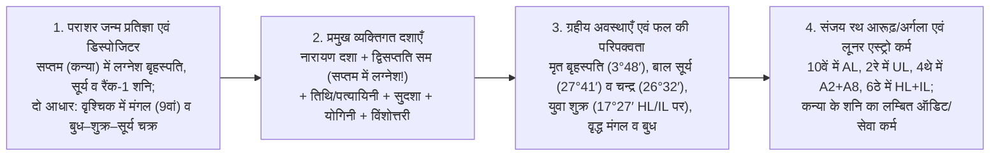
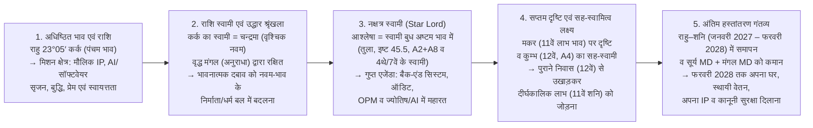

# सचिन मोहन — सम्पूर्ण जीवन ज्योतिषीय विश्लेषण (पाठक संस्करण / Reader's Edition)

**जन्म विवरण:** 14 अक्टूबर 1980, सायं 16:55 IST, पुणे (18°31′ उ., 73°51′ पू.) · **लग्न (Ascendant):** मीन 4°11′ (*उत्तराभाद्रपद*, शनि का नक्षत्र) · **चन्द्र राशि:** वृश्चिक 26°32′ (*ज्येष्ठा* चरण 3, बुध का नक्षत्र) · **अयनांश:** लहिरी (Lahiri), पूर्ण-राशि भाव (Whole-Sign Houses)  
**विश्लेषण तिथि:** 28 अक्टूबर 2026 (सैन जोस, कैलिफ़ोर्निया) · **पद्धति:** बहु-परम्परा समन्वय (**पराशर**, **जैमिनी / पं. संजय रथ**, तथा **लूनर एस्ट्रो / दीपांशु गिरी**) — **44 दशा प्रणालियों** से सत्यापित

---

## इस दस्तावेज़ को कैसे पढ़ें

यह विश्लेषण आपकी कुंडली के चारों चरणों के गहन अध्ययन को **एक एकीकृत, सरल एवं व्यावहारिक मार्गदर्शिका** में पिरोता है—जिसमें ग्रहों, भावों, आरूढ़ पदों, ग्रहों की अवस्थाओं (बाल, कुमार, युवा, वृद्ध, मृत अवस्था) और बहु-दशा समय-निर्धारण की पूरी गहराई सुरक्षित रखी गई है। प्रत्येक प्रमुख भविष्यवाणी को **3 या अधिक स्वतंत्र ज्योतिषीय विधियों** से परखा गया है (बिना किसी चाटुकारिता या कोरे अनुमान के) और इसे पाँच स्पष्ट प्रश्नों के रूप में व्यवस्थित किया गया है:
1. **अभी क्या गलत हो रहा है (मूल समस्या / The Issue)** — इस समय जीवन के विभिन्न क्षेत्रों में रुकावट या पीड़ा क्यों अनुभव हो रही है, इसका सीधा निदान।
2. **ग्रहीय, अवस्था एवं बहु-दशा कारण (ऐसा क्यों हुआ / Why It Happened)** — आपकी प्रमुख सशर्त दशा **द्विसप्तति सम दशा** (क्योंकि लग्नेश बृहस्पति सप्तम भाव में स्थित हैं), **नारायण दशा**, **तिथि / वार्षिक पत्यायिनी दशा**, **विंशोत्तरी दशा**, **जैमिनी आरूढ़/अर्गला**, और **लूनर एस्ट्रो के प्रारब्ध/लम्बित कर्म** किस प्रकार मूल कारण को स्पष्ट करते हैं और बताते हैं कि फल का स्वाद कैसा है (*कच्चा/अपरिपक्व, खट्टा/झुलसा हुआ, अति-पका, या मीठा और पका हुआ*)।
3. **लोग और सम्बन्धों की गतिशीलता (कौन सहायक है बनाम कौन बाधक)** — विभिन्न व्यक्ति (साझेदार, नियोक्ता, बड़े भाई, माता-पिता, प्रेम सम्बन्ध और उत्पीड़नकर्ता) आपके किन ग्रहों के माध्यम से कार्य कर रहे हैं।
4. **कब और किन दशाओं / ग्रहों में सुधार होगा** — **अगले 30 दिनों (1 माह)** से प्रारम्भ होकर **3 माह, 6 माह, 9 माह, 12 माह और 1 से 5 वर्षों** की सटीक तिथियों वाली समय-सारणी।
5. **समाधान और कार्य-योजना (The Solution)** — ठोस कदम, बैंक खाते में धन एवं राहत दिखने की सटीक तिथियाँ, तथा **लूनर एस्ट्रो के "निःस्वार्थ शनि-कर्म" (Blind Saturnian Remedies)** जो आपके आगामी धन और स्वास्थ्य के द्वार खोलते हैं।

---

## भाग 1: कार्यकारी सारांश (Executive Dashboard) — क्या समस्या है, क्यों है, और कब करवट लेगी

### 1.1 इस समय का तात्कालिक नियम (20 नवम्बर 2026 तक)

- **इस समय आपकी प्रमुख दशाओं में क्या चल रहा है:**
  1. **द्विसप्तति सम दशा (प्रमुख सशर्त दशा — लागू क्योंकि लग्नेश बृहस्पति सप्तम भाव में हैं):** **राहु महादशा → शुक्र अन्तर्दशा** (**16 नवम्बर 2025 – 1 जनवरी 2027**)।
  2. **नारायण राशि दशा (जैमिनी परिवेश दशा):** **मीन महादशा → कर्क अन्तर्दशा** (**15 अक्टूबर 2026 – 16 अप्रैल 2027**, जो *आश्लेषा* नक्षत्र में स्थित पंचम भाव के राहु को सक्रिय कर रही है)।
  3. **विंशोत्तरी दशा:** **चन्द्र महादशा → शुक्र अन्तर्दशा → राहु प्रत्यन्तर्दशा** (**20 अगस्त – 20 नवम्बर 2026**)।
  4. **वार्षिक तिथि प्रवेश / पत्यायिनी दशा:** **धनु लग्न की दशा** (**15 अक्टूबर 2026 – 27 फरवरी 2027**), जबकि आकाश में गोचर में **शुक्र और बुध दोनों 14 नवम्बर 2026 तक वक्री हैं**, तथा **शनि आपके लग्न (मीन) पर 11 दिसम्बर 2026 तक वक्री हैं**।
- **तात्कालिक नियम:** **20 नवम्बर 2026 से पहले अपने उद्यम (CarbonLite) को क्रोध में न छोड़ें, किसी बाध्यकारी समझौते पर हस्ताक्षर न करें, और अचानक उठे किसी रोमांटिक आकर्षण पर कदम न बढ़ाएँ। अक्टूबर के अंत और नवम्बर के प्रथम पखवाड़े का उपयोग केवल नौकरी के आवेदन तैयार करने, कानूनी साक्ष्य संकलित करने और अपनी दिनचर्या को स्थिर रखने में करें।**

#### 1.1A "अन्यथा क्या होगा?" — 20 नवम्बर 2026 से पहले इस नियम को तोड़ने के सटीक परिणाम
1. **यदि आप 20 नवम्बर 2026 से पहले CarbonLite छोड़कर बाहर निकल जाते हैं:**
   - **आप क्या खो देंगे:** आपकी कुंडली का **शुक्र विपरीत राजयोग** (अष्टमेश शुक्र छठे भाव में आपके *होरा लग्न* और *इन्दु लग्न* दोनों के साथ स्थित) केवल एक सख्त शर्त पर फल देता है: **अष्टम भाव का उलटफेर या बिना वेतन का परिश्रम तभी आपकी अपनी संपत्ति (Asset) बनता है जब आप शुभ दशा खुलने तक अपनी सीट पर डटे रहें।**
   - **अभी छोड़ने पर क्या होगा:** *शुक्र–राहु* के दौरान, जब शनि आपके लग्न पर वक्री हैं, क्रोध में बाहर निकलने का अर्थ है कि आप अपना सारा बिना वेतन का लिखा कोड, उत्पाद आर्किटेक्चर और बौद्धिक संपदा (IP) अपने सप्तम भाव के शनि-प्रकृति वाले साझेदार (जो आपके **द्वादशेश यानी हानि और त्याग के स्वामी** भी हैं) को मुफ्त में सौंप देंगे—वह भी ठीक उन दिनों से कुछ ही दिन पहले जब **चन्द्र–शुक्र–बृहस्पति (20 नवम्बर 2026)** और **द्विसप्तति राहु–शनि (1 जनवरी 2027)** आपको सशुल्क पायलट (Paid Pilot) मांगने और अपनी IP पर कानूनी स्वामित्व पक्का करने की ज्योतिषीय शक्ति देने वाले हैं।
2. **यदि आप 14–20 नवम्बर 2026 से पहले बाध्यकारी अनुबंध, इक्विटी बंटवारे या लीज़ पर हस्ताक्षर करते हैं:**
   - **आकाश में क्या हो रहा है:** **बुध** (आपके सप्तमेश — अनुबंध और साझेदारी के स्वामी) **14 नवम्बर तक आपके अष्टम भाव में वक्री** हैं (छिपे हुए जाल, बारीक शर्तों के उलटफेर), और **शुक्र** (अष्टमेश — असमान दायित्वों के स्वामी) **5 नवम्बर को वक्री होकर कन्या राशि (आपके सप्तम भाव में अपनी नीच राशि)** में लौट रहे हैं तथा **14 नवम्बर** को 28.6° कन्या पर मार्गी हो रहे हैं।
   - **अभी हस्ताक्षर करने पर क्या होगा:** जब सप्तमेश अष्टम में वक्री हो और अष्टमेश सप्तम में नीच एवं वक्री हो, तब *राहु प्रत्यन्तर्दशा* में किया गया कोई भी समझौता **खट्टा और दोषपूर्ण फल** देता है—या तो सामने वाला पक्ष मुकर जाएगा, या कोई छिपी शर्त आपको छठे भाव के और अधिक अवैतनिक श्रम में बाँध देगी, या फिर **9 फरवरी – 16 मई 2027** की शनि पुनर्वास अवधि में उस अनुबंध को कष्टपूर्वक फाड़कर दोबारा लिखना पड़ेगा।
3. **यदि आप 20 नवम्बर 2026 से पहले अचानक उठे रोमांटिक आकर्षण पर कदम बढ़ाते हैं:**
   - **कुंडली में क्या चल रहा है:** *विंशोत्तरी* (राहु प्रत्यन्तर्दशा) और *नारायण* (मीन–कर्क) दोनों **अष्टमेश शुक्र** के अधीन **आपके पंचम भाव (*आश्लेषा* — सर्प की कुंडली) के राहु** को सक्रिय कर रहे हैं (और यही शुक्र आपके D9 नवांश विवाह चार्ट में 7°08′ कन्या पर नीच के होकर **सूर्य 9°13′ और मंगल 11°58′ के साथ मात्र 4.9° की तंग युति** में तपे हुए हैं)।
   - **अभी कदम बढ़ाने पर क्या होगा:** 20 नवम्बर से पहले किसी आवेगी प्रेम के पीछे भागना मरीचिका जैसा, अनुपलब्ध या उच्च-नाटकीय उलझाव (*आश्लेषा* का बंधन) पैदा करेगा, जो आपकी मानसिक शांति, नींद और धन को ठीक उस समय जला देगा जब **20 नवम्बर – 25 जनवरी** की आपकी सबसे महत्वपूर्ण धन-प्राप्ति और कानूनी कार्रवाई की खिड़की खुल रही है।

#### 1.1B अक्टूबर के अंत से 14 नवम्बर के बीच हम क्या देख रहे हैं, और प्रत्येक तैयारी कब व कैसे काम आएगी
कुंडली 28 अक्टूबर से 14 नवम्बर के बीच **तैयारी** की मांग क्यों करती है? क्योंकि जब **बुध आपके अष्टम भाव (शोध, छिपे रिकॉर्ड, डीबगिंग, ऑडिट) में वक्री** हों और **शुक्र आपके सप्तम भाव (पुराने साझेदार, पूर्व क्लाइंट, पुराने सहकर्मी) में पीछे लौट रहे हों**, तब **बाहरी हस्ताक्षर अवरुद्ध होते हैं, किंतु आंतरिक खुदाई, साक्ष्य-संकलन और पुराने सम्पर्कों को जगाना अत्यंत प्रभावशाली होता है।** 14 नवम्बर से पहले तैयार किया गया प्रत्येक अस्त्र ठीक उसके बाद खुलने वाली एक निश्चित समय-खिड़की में सीधा प्रहार करता है:

| आप क्या तैयार करें (28 अक्टूबर – 13 नवम्बर 2026) | तैयारी के दौरान ग्रह क्या कर रहे हैं | यह कब और किस सटीक तिथि-खिड़की में उपयोग होगा | इससे क्या सिद्ध/प्राप्त होगा |
| :--- | :--- | :--- | :--- |
| **1. उत्पीड़न का कालानुक्रमिक लॉग (Chronological Log), स्क्रीनशॉट व साइबर साक्ष्य** | **अष्टम भाव (तुला) में वक्री बुध** छिपे हुए डिजिटल साक्ष्यों को निकालने, पुराने संदेशों को क्रमबद्ध करने और अकाट्य लिखित रिकॉर्ड बनाने में सर्वोत्तम हैं। | **20 नवम्बर – 17 दिसम्बर 2026 को उपयोग** (वकील नियुक्त करें; सर्वोत्तम गुरुवार: **17 दिसम्बर**) और **5 दिसम्बर 2026 – 8 जनवरी 2027 के बीच दाखिल** (पुलिस + संघीय IC3 + वर्जीनिया सुरक्षा आदेश)। | **5 दिसम्बर 2026** को राहु आपके 12वें भाव को और केतु आपके 6ठे भाव को खाली कर देगा, जबकि **बृहस्पति आपके 6ठे भाव में स्थित रहेंगे**। आपका यह लॉग **9–13 जनवरी 2027** के मंगल स्तम्भन (Station) से *पहले* ही 2022–2026 की "अदृश्य" शिकायत को प्रवर्तनीय कानूनी रिकॉर्ड में बदल देगा। |
| **2. अपडेटेड बायोडाटा (Resume), तकनीकी पोर्टफोलियो व पुराने सप्तम-भाव सम्पर्कों की सूची** | **वक्री शुक्र 5 नवम्बर को कन्या (सप्तम भाव) में लौटते हैं**, जो पुराने सहकर्मियों, पूर्व क्लाइंट्स और पुराने व्यावसायिक मित्रों को पुनः आपकी पहुँच में लाते हैं। | **शनिवार, 14 नवम्बर 2026 से लागू** (बुध/शुक्र मार्गी) और **19–20 नवम्बर (बृहस्पति PD प्रारम्भ), 25 नवम्बर (बुधवार), 27 नवम्बर (बुध का जन्मकालीन सप्तमेश बुध पर गोचर), 2 दिसम्बर (सर्वोत्तम इंटरव्यू बुधवार), 9 दिसम्बर, तथा 6–8 जनवरी 2027** को भेजा जाएगा। | यह सप्तम भाव के गर्म रेफरल्स को **नवम्बर के अंत 2026 – जनवरी 2027 में आपके पहले सशुल्क अनुबंध/पायलट/ब्रिज आय** में बदल देगा और **जून–अगस्त 2027** के पूर्ण नौकरी प्रस्ताव की पाइपलाइन तैयार कर देगा। |
| **3. CarbonLite कोड/IP ऑडिट एवं लिखित सशुल्क-पायलट (Paid-Pilot) प्रस्ताव** | **लग्न पर वक्री शनि** + **सप्तम/षष्ठ में शुक्र** आपको फरवरी–अक्टूबर 2026 के दौरान बिना वेतन बनाए गए हर मॉड्यूल की सूची बनाने की शक्ति देते हैं। | **20 नवम्बर – 31 दिसम्बर 2026 के बीच प्रस्तुत करें** (*चन्द्र–शुक्र–बृहस्पति*; सबसे प्रबल दिन: **20 नवम्बर, 17 दिसम्बर, 29 दिसम्बर, 31 दिसम्बर**) — **1 जनवरी 2027** (*द्विसप्तति राहु–शनि*) से ठीक पहले। | यह **द्विसप्तति राहु–शनि (1 जनवरी 2027)** और **विंशोत्तरी शनि प्रत्यन्तर्दशा (9 फरवरी – 16 मई 2027)** द्वारा साझेदारी की शर्तों को औपचारिक रूप से लिखवाने से *पहले* ही आपके सशुल्क पायलट/रिटेनर और लिखित IP स्वामित्व को स्थापित कर देता है। |
| **4. भाई के घर में निश्चित मासिक किराया कार्यक्रम एवं दैनिक अनुशासन** | **वृश्चिक (नवम भाव) में मंगल** + **शनि (एकादशेश/द्वादशेश)** निश्चित, पूर्वानुमानित वित्तीय और शारीरिक अनुशासन पर तुरंत सकारात्मक प्रतिक्रिया देते हैं। | **1–5 नवम्बर 2026 को स्थापित** → यह **23 जनवरी 2027** (केतु पर बुध गोचर की बातचीत) और **6 फरवरी – 15 अप्रैल 2027** (एकादश भाव के जन्मकालीन केतु पर सूर्य ग्रहण) के दौरान आपकी रक्षा करेगा। | एक निश्चित तारीख को तय मासिक राशि देना द्वादशेश शनि को संतुष्ट करता है, जिससे **6 फरवरी 2027 का ग्रहण** किसी कटु पारिवारिक कलह के बजाय एक सुनियोजित रूप से आपके अपने अपार्टमेंट में जाने (**मई–जुलाई 2027**) का माध्यम बनेगा। |

---

### 1.2 जीवन के प्रत्येक क्षेत्र का मास्टर सारांश

| जीवन क्षेत्र | अभी क्या समस्या है (The Issue) | बहु-परम्परा ग्रहीय एवं दशा कारण | कब और किन दशाओं / ग्रहों में सुधार होगा | समाधान एवं कार्य-योजना |
| :--- | :--- | :--- | :--- | :--- |
| **1. तात्कालिक नकदी एवं धन (1 माह, 3 माह, 6 माह, 9 माह, 1–5 वर्ष)** | 2026 के अवैतनिक कार्य से बचत घटी; 2 वर्ष बाद नहीं, बल्कि अभी 30–90 दिनों में नकदी प्रवाह (Cash Flow) चाहिए। | **होरा लग्न (HL) व इन्दु लग्न (IL)** दोनों **सिंह राशि (छठे भाव)** में **युवा अवस्था के शुक्र (अष्टमेश)** के साथ हैं। 2026 में *द्विसप्तति राहु–शुक्र* + *विंशोत्तरी चन्द्र–शुक्र* + शुक्र पर 3 मार्च के ग्रहण ने पहले शुक्र का अष्टम-भाव वाला "अवैतनिक पसीना" पक्ष चलाया। | **1-माह (14 नवम्बर – 19 दिसम्बर 2026):** शुक्र/बुध मार्गी (**14 नवम्बर**), *बृहस्पति PD* (**20 नवम्बर**), और राहु के 11वें भाव में प्रवेश (**5 दिसम्बर**) से पहली नकदी/पायलट/रिटेनर खुलेगा। **3-माह (दिसम्बर 2026 – 25 जनवरी 2027):** सशुल्क अनुबंध/ब्रिज आय। **6-माह (16 अप्रैल – जुलाई 2027):** *नारायण सिंह* HL/IL के भुगतान करने वाले ग्राहक खोलेगी। **9–12 माह (अगस्त – अक्टूबर 2027):** पूर्ण स्थायी वेतन (**15–19 सितम्बर**)। **1–5 वर्ष (2028–2032):** *मंगल महादशा* (**मार्च 2028**) + *मंगल–राहु* (**2028–29**) + *मंगल–शनि* (**2030–31** सर्वोच्च संपत्ति)। | नवम्बर–दिसम्बर 2026 में **3 तात्कालिक नकदी चैनलों** (सप्तम-भाव संपर्क से सशुल्क अनुबंध स्प्रिंट, CarbonLite सशुल्क पायलट/रिटेनर, तथा रुके हुए/OPM धन की वसूली) पर काम करें। **§3B** की सटीक बैंक-इनफ्लो तिथियों का पालन करें। |
| **2. करियर, स्थायी नौकरी एवं CarbonLite** | 2024 से कोल्ड आवेदनों पर सन्नाटा; CarbonLite में 60+ वर्षीय साझेदार धीमे चलते हैं और भुगतान टालते हैं। | **लग्नेश बृहस्पति सप्तम भाव (कन्या 3°48′) में *मृत अवस्था*** में **रैंक-1 शनि (11वें/12वें के स्वामी)** और **बाल अवस्था के सूर्य (षष्ठेश)** के साथ हैं। कोल्ड पोर्टल से काम नहीं बनेगा; सब कुछ सप्तम-भाव के लोगों से चलेगा। शनि साझेदार देरी और खर्च कराते हैं; **बुध व मंगल साझेदार** पैसा दिलाते हैं। | **सशुल्क अनुबंध/पायलट:** **20 नवम्बर 2026 – 25 जनवरी 2027** (*चन्द्र–शुक्र–बृहस्पति* + छठे भाव में HL/IL पर बृहस्पति)। **CarbonLite शर्तें पुनः लिखना:** **1 जनवरी – 16 मई 2027** (*द्विसप्तति राहु–शनि* + *विंशोत्तरी शनि PD*)। **मजबूत जॉब ऑफर:** **26 जून – 11 अगस्त 2027** (*चन्द्र–शुक्र–बुध* + *सुदशा कन्या*)। **स्थायी वेतन प्रारम्भ:** **15–19 सितम्बर 2027** (*चन्द्र–सूर्य* + शुक्र/HL/IL पर सटीक बृहस्पति)। | **14 व 20 नवम्बर** से **सप्तम-भाव के रेफरल्स** पर काम करें। **1 जनवरी / 9 फरवरी 2027** से पहले CarbonLite IP सुरक्षित करें। बिक्री **बुध/मंगल साझेदारों** के साथ करें। **2029–2032** के लिए गुरुवार को **AI Astra** बनाएँ। |
| **3. बड़े भाई एवं घर-परिवार** | बड़े भाई के साथ रहना ठंडा और लेन-देन (Transactional) जैसा लगता है; वे किराया लेते हैं और नौकरी में कोई मदद नहीं देते। | **एकादश भाव (मकर) में केतु** बड़े भाई से सहज लाभ काटता है; एकादशेश **शनि द्वादशेश (व्यय) भी हैं**; भ्रातृकारक **बुध अष्टम भाव में हैं** (छिपा हुआ साझा धन/पैतृक हिसाब)। | **शर्तों में बदलाव:** **1–14 जनवरी 2027** (*द्विसप्तति राहु–शनि* व *चर मकर*)। **बातचीत:** **23 जनवरी 2027**। **रहने की व्यवस्था में बदलाव:** **6 फरवरी – 15 अप्रैल 2027** (6 फरवरी को जन्मकालीन केतु से 19′ दूर सूर्य ग्रहण)। **अपने अपार्टमेंट में शिफ्ट:** **16 अप्रैल – 16 जुलाई 2027**। **भाईचारे में सुधार:** **अगस्त 2029 – अगस्त 2030** (*मंगल–बृहस्पति*)। | **नवम्बर 2026** से एक निश्चित तारीख को तय मासिक किराया दें (लूनर एस्ट्रो शनि उपाय)। एकादश भाव से कभी नौकरी के रेफरल न मांगें; सप्तम भाव का उपयोग करें। |
| **4. 2022 से उत्पीड़न एवं कानूनी समाधान** | 2022 से एक महिला उत्पीड़नकर्ता/स्टॉकर द्वारा रिश्तेदारी का झूठा दावा और डिजिटल घुसपैठ, जबकि पुलिस ने कार्रवाई नहीं की। | **छठे भाव में शुक्र (अष्टमेश — जुनून)**, **पंचम में राहु (*आश्लेषा*)**, और **12वें भाव में शनि (2022–25) + राहु (2025–26)** (छिपा शत्रु) जबकि **केतु छठे भाव में था** (जिसने पुलिस की आँखें ढक दीं)। | **दाखिल करने की खिड़की:** **5 दिसम्बर 2026 – 8 जनवरी 2027** (5 दिसम्बर को राहु-केतु 12वां/6ठा भाव छोड़ेंगे; बृहस्पति 6ठे में)। **सतर्कता तिथि:** **9–13 जनवरी 2027** (शुक्र पर मंगल स्थिर)। **जड़ कटना व प्रवर्तन:** **15 अप्रैल 2027** (राहु पर केतु), **10 जून 2027** (शुक्र पर मंगल), **19 सितम्बर 2027** (बृहस्पति द्वारा शुक्र की शुद्धि)। **अंतिम समापन:** **अक्टूबर 2027 – 24 जून 2028**। | **शारीरिक हिंसा का कोई योग नहीं है।** **एक वकील** नियुक्त करें (**20 नवम्बर – 17 दिसम्बर**), **5 दिसम्बर – 8 जनवरी** के बीच पुलिस + IC3 + वर्जीनिया सुरक्षा आदेश दाखिल करें, और **9 जनवरी** से पहले डिवाइस जांचकर नंबर बदलें। |
| **5. प्रेम, डेटिंग एवं विवाह** | 2015 से एकाकी; पुराने आकर्षण कार्य/सेवा के माहौल में तेजी से शुरू हुए और अहंकार की गर्मी या उलटफेर में टूटे। | 2015–2026 तक पाँच स्तरों ने सप्तम भाव को लॉक रखा (*सूर्य–शनि*, 10-वर्षीय नीच *चन्द्र महादशा*, 12वें/1ले भाव में *नारायण दशा*, साढ़ेसाती/12वें/1ले शनि, और 2017 के बाद सप्तम में बृहस्पति का न होना)। D9 में **कन्या राशि में सूर्य–शुक्र–मंगल की 4.9° की तंग युति** (अपरिपक्व प्रेम को जलाती है)। | **वसंत का आकर्षण (विवाह नहीं):** **10 मार्च – 23 मई 2027** (पंचम के राहु पर मंगल, बृहस्पति, केतु)। **प्रस्ताव-स्तरीय मुलाकात:** **जून 2027 – मई 2028** (*चन्द्र–शुक्र–बुध*; 15 अक्टूबर से *नारायण मेष*; **26 नवम्बर 2027** को बृहस्पति सप्तम में)। **सगाई/प्रतिबद्धता:** **दिसम्बर 2028 – अगस्त 2029** (*मंगल–राहु*)। **विवाह:** **अगस्त 2029 – अगस्त 2030**, सबसे प्रबल **11 दिसम्बर 2029 – 17 अप्रैल 2030** (*मंगल–बृहस्पति*)। | **मार्च–मई 2027** के पंचम-राहु उभार को विवाह न समझें। **जून 2027+** से कार्यक्षेत्र, धार्मिक या नए स्थान के माध्यम से अपनी सच्ची जीवनसंगिनी (समझदार, बृहस्पति/मंगल स्वभाव) से मिलें। |
| **6. स्वास्थ्य (लिवर, आँत, पेट एवं मन)** | चिंता से पेट में एसिडिटी/रिफ्लक्स, गर्मी से सुस्त लिवर, और आँतों में पुरानी सूजन। | **लिवर:** कन्या में *मृत अवस्था* के **बृहस्पति** सूर्य व शनि के बीच दबे हुए (और D30 लग्न पर)। **आँत:** छठे में **शुक्र (अष्टमेश)**। **पेट/मन:** **पंचम में राहु (कर्क)** + वृश्चिक में *बाल अवस्था* का नीच **चन्द्रमा**। | **बेसलाइन लिवर जांच:** **दिसम्बर 2026 – मध्य जनवरी 2027**। **गैस्ट्रो जांच:** **फरवरी 2027** (**10 मार्च – 23 मई 2027** के पंचम-भाव पेट उभार से पहले)। **#1 सबसे सख्त लिवर/आँत सुरक्षा काल:** **नवम्बर 2027 – जनवरी 2028**, चरम **24 दिसम्बर 2027** (*चन्द्र–सूर्य–शनि* + *रोग सहम* पर स्थिर शनि)। | चिकित्सक सर्वोपरि। **दिसम्बर 2026/जनवरी 2027** और **नवम्बर 2027** में लिवर पैनल तथा **फरवरी 2027** में गैस्ट्रो जांच कराएँ। शून्य शराब और निश्चित समय पर भोजन। दैनिक पसीना बहाना (मंगल) आपके चन्द्रमा को सीधा ठीक करता है। |
| **7. जीवनशैली, मित्र, खरीदारी, निवेश एवं घर खरीदना** | 2025–2026 में सामाजिक अलगाव; यह स्पष्टता नहीं कि कब आनंद लें, खरीदारी करें, कार लें, शेयरों में निवेश करें या घर खरीदें। | **छठे में केतु/12वें में राहु** ने 5 दिसम्बर 2026 तक अलग-थलग रखा। **D2 होरा धन चार्ट** के लग्न पर स्वराशि **बृहस्पति + शनि** हैं (दीर्घकालिक स्टॉक/संपत्ति चक्रवृद्धि), पर **D2 पंचम में नीच मंगल + D1 पंचम में राहु** हैं (सट्टेबाजी/जुए का जाल)। | **मित्र व घूमना-फिरना:** **5 दिसम्बर 2026 के बाद** खुलेगा (राहु 11वें मित्र भाव में; सर्वोत्तम **20–27 दिसम्बर, 19–25 अप्रैल, 1–8 जून**)। **वाहन:** **5 मार्च – 7 मई 2027**। **घर का सामान/सजावट:** **16 मई – 10 जून व 6 जुलाई – 11 अगस्त 2027**। **खुला खर्च/अधिशेष:** **सितम्बर 2027** (पहली बचत) → **अगस्त 2028 – अगस्त 2029** (*मंगल–राहु* उच्च सुख)। **घर खरीदना:** **सितम्बर 2030 – सितम्बर 2032**। | **5 दिसम्बर 2026** के बाद फिर से सामाजिक जीवन का आनंद लें; **मई/जुलाई 2027** में अपना अपार्टमेंट सजाएँ; **सितम्बर 2027 / मार्च 2028** से इंडेक्स/स्टॉक्स व रिटायरमेंट में नियमित निवेश करें, और **ऑप्शंस/मार्जिन सट्टेबाजी कभी न करें**। |

---

## भाग 2: मूल कारण का ब्लूप्रिंट — पराशर, जैमिनी (पं. संजय रथ) एवं लूनर एस्ट्रो (दीपांशु गिरी)

जब काम, नकदी प्रवाह, आवास, पारिवारिक आत्मीयता और मानसिक शांति—सब पर एक साथ दबाव आता है, तो यह सोचना स्वाभाविक है कि क्या सब कुछ बिगड़ गया है। आपकी जन्म कुंडली में **ये छह अलग-अलग विफलताएँ नहीं हैं—बल्कि यह एक ही एकीकृत ग्रहीय संरचना है** जो अपने सबसे बड़े दशक-परिवर्तन से ठीक पहले के सबसे सघन बहु-दशा और गोचर दबाव से गुजर रही है। बिना किसी लाग-लपेट के आपकी कुंडली को पूरी सटीकता से पढ़ने के लिए हम **चार शास्त्रीय और आधुनिक स्तम्भों** को जोड़ते हैं:

### 2.1 आपकी कुंडली का निर्माण कैसे हुआ है (चार पराशर स्तम्भ और दो डिस्पोजिटर आधार)
1. **आपकी नींव साझेदारियों और अनुबंधों पर टिकी है (सप्तम भाव कन्या में बृहस्पति, सूर्य और शनि):**
   - आपका लग्न **मीन (4°11′)** है, जिसके स्वामी **बृहस्पति** हैं। बृहस्पति आपके लग्न के ठीक सामने **सप्तम भाव (कन्या)**—यानी साझेदारों, क्लाइंट्स, विवाह और अनुबंधों के भाव—में बैठे हैं, जहाँ बृहस्पति के पास अकेले चलने का दिग्बल लगभग शून्य है (*दिग्बल* **0.13 / 60**)।
   - बृहस्पति के ठीक बगल में **शनि** (षड्बल अनुपात **1.72** के साथ आपके #1 सबसे बलवान ग्रह, जो आपके **11वें लाभ भाव** और **12वें हानि/विदेश भाव** के स्वामी हैं) तथा **सूर्य** (आपके आत्माकारक ग्रह, जो आपके **छठे भाव — नौकरी, सेवा, ऋण और विवाद** के स्वामी हैं) बैठे हैं।
   - **व्यावहारिक अर्थ:** जब आपके पास कोई स्पष्ट साझेदार, क्लाइंट या अनुबंध होता है तब आप सबसे अधिक स्थिर महसूस करते हैं, और अलग-थलग पड़ने पर सबसे अधिक अस्थिर। जब भी आपका सप्तम-भाव (साझेदारी) या छठा-भाव (नौकरी/अनुबंध) रुकता है, तो घर, आय और आत्मविश्वास—तीनों के नीचे से एक साथ ज़मीन खिसकती हुई महसूस होती है।
2. **आपकी कुंडली में कौन किसको संभालता है (दो डिस्पोजिटर आधार / Two Dispositor Floors):**
   - कौन-सा ग्रह किस राशि का स्वामी है, इसकी कड़ी देखने पर पता चलता है कि आपकी पूरी कुंडली **दो जड़ों** पर खड़ी है:
     - **आधार 1 — वृश्चिक राशि (नवम भाग्य भाव) में मंगल:** मंगल नवम भाव में अपनी स्वराशि वृश्चिक (*पुष्कर नवांश*) में बैठे हैं और आपके **चन्द्रमा** (पंचमेश, *अमात्यकारक*) तथा **राहु** (कर्क राशि में, जिसके स्वामी चन्द्रमा मंगल के साथ बैठे हैं) दोनों को संभालते हैं। चूँकि मीन लग्न के लिए मंगल **योगकारक शुभ ग्रह** हैं, इसलिए **निर्णायक कर्म, शारीरिक पसीना, इंजीनियरिंग/निर्माण और साहस (मंगल) आपके मन (चन्द्रमा) को तुरंत बचा लेते हैं।**
     - **आधार 2 — बुध (8वां) → शुक्र (6ठा) → सूर्य (7वां) का त्रिकोण:** आपके लग्नेश **बृहस्पति**, **शनि** और **केतु** तीनों **बुध** (तुला, अष्टम भाव) पर टिके हैं; बुध **शुक्र** (सिंह, छठे भाव) पर टिके हैं; शुक्र **सूर्य** (कन्या, सप्तम भाव) पर टिके हैं; और सूर्य वापस **बुध** पर टिके हैं। चूँकि इस चक्र में **शुक्र** सबसे संवेदनशील कड़ी हैं (D1 में शत्रु राशि में अष्टमेश, और D9 के द्वितीय भाव में नीच), इसलिए **जब भी शुक्र पर किसी दशा या ग्रहण की चोट पड़ती है—चाहे बिना वेतन के काम से, रिश्ते के उलटफेर से, या किसी विरोधी से—तो पूरा बुध–शुक्र–सूर्य चक्र डगमगाने लगता है।**

---

### 2.2 आपकी कुंडली के लिए द्विसप्तति सम दशा, नारायण दशा और तिथि/पत्यायिनी दशा प्रमुख क्यों हैं

सतही ज्योतिष में एक आम गलती केवल *विंशोत्तरी दशा* पर निर्भर रहना है। **महर्षि पराशर** और **पं. संजय रथ की जैमिनी परम्परा** में, आपकी कुंडली विशेष रूप से **द्विसप्तति सम दशा** को **नारायण दशा** और आपकी **वार्षिक तिथि / पत्यायिनी दशाओं** के साथ प्राथमिक व्यक्तिगत समय-निर्धारण इंजन के रूप में खोलती है:

1. **द्विसप्तति सम दशा (72-वर्षीय चक्र) सीधे आपसे क्यों बात करती है:**
   - महर्षि पराशर कहते हैं कि **जब लग्नेश सप्तम भाव में हो (या सप्तमेश लग्न में हो), तो द्विसप्तति सम दशा जातक के लिए प्राथमिक सशर्त नक्षत्र दशा होती है।** चूँकि आपके लग्नेश **बृहस्पति आपके सप्तम भाव (कन्या)** में विराजमान हैं, इसलिए द्विसप्तति सम दशा आपके जीवन की घटनाओं से सीधे जुड़ी हुई है:
     - आप **द्विसप्तति राहु महादशा (9 वर्ष: 16 फरवरी 2019 – 16 फरवरी 2028)** में चल रहे हैं।
     - 2022–2023 में उत्पीड़न क्यों शुरू हुआ? **द्विसप्तति राहु–मंगल** (**2 जुलाई 2022 – 17 अगस्त 2023**)।
     - 2023–2024 का समय अष्टम-भाव की डिजिटल निगरानी और नौकरी के आवेदनों पर चुप्पी में क्यों गया? **द्विसप्तति राहु–बुध** (**17 अगस्त 2023 – 1 अक्टूबर 2024**)।
     - 2024–2025 में वर्जीनिया छोड़ते समय भी आप सुरक्षित क्यों रहे? **द्विसप्तति राहु–बृहस्पति** (**1 अक्टूबर 2024 – 16 नवम्बर 2025**)।
     - और **16 नवम्बर 2025 – 1 जनवरी 2027** का ठीक 13.5 महीने का समय ही CarbonLite में बिना वेतन के काम, भाई के घर में रहने और शुक्र पर केतु/ग्रहण की चोट का समय क्यों बना? क्योंकि **द्विसप्तति राहु–शुक्र** (**16 नवम्बर 2025 – 1 जनवरी 2027**) और **विंशोत्तरी चन्द्र–शुक्र** (**14 जनवरी 2026 से**) **दोनों ने एक ही समय पर अष्टमेश शुक्र को कमान सौंप दी!**
     - और **1 जनवरी 2027** से खेल के नियम क्यों बदल रहे हैं? क्योंकि **द्विसप्तति राहु–शनि** (**1 जनवरी 2027 – 16 फरवरी 2028**) कमान आपके **रैंक-1 ग्रह और एकादशेश (लाभ के स्वामी) शनि** को सौंपती है, जिसके ठीक बाद **16 फरवरी 2028** को **द्विसप्तति सूर्य महादशा** (वेतनभोगी रोजगार के षष्ठेश और *आत्माकारक* अधिकार) शुरू होती है—ठीक उसी समय जब **16 मार्च 2028** को **विंशोत्तरी मंगल महादशा** खुलती है!
2. **प्रमुख दशाओं का समूह एक साथ कैसे जुड़ता है (गैर-चाटुकारिता वाला 3-विधि नियम / Non-Sycophantic 3-Method Rule):**
   - इस पूरे विश्लेषण में हम आपको खुश करने के लिए कोई बात नहीं कहते और न ही किसी एक संकेत पर निर्भर रहते हैं। हर समय-खिड़की **3 या अधिक स्वतंत्र विधियों** से सत्यापित है:
     1. **नारायण राशि दशा (भौतिक वास्तविकता की पं. संजय रथ की #1 जैमिनी दशा):** दिखाती है कि आप *किस भाव के वातावरण* से गुजर रहे हैं (*मीन प्रथम भाव* अक्टूबर 2021 – अक्टूबर 2027, जिसमें उप-अवधियाँ *कर्क पंचम* 15 अक्टूबर 2026 – 16 अप्रैल 2027 और *सिंह षष्ठ [HL/IL]* 16 अप्रैल – 15 अक्टूबर 2027 हैं, जिसके बाद **15 अक्टूबर 2027** से 7 वर्षों के लिए **मेष द्वितीय भाव [धन एवं उपपद]** की महादशा शुरू होगी)।
     2. **द्विसप्तति सम दशा + विंशोत्तरी दशा + योगिनी दशा:** दिखाती हैं कि कौन-सा *मनोवैज्ञानिक और कार्मिक ग्रह* घटना को घटित करा रहा है (*राहु–शुक्र* → 1 जनवरी 2027 को *राहु–शनि*; *चन्द्र–शुक्र–बृहस्पति* 20 नवम्बर 2026 → *शनि PD* 9 फरवरी 2027 → *बुध PD* 16 मई 2027 → *चन्द्र–सूर्य AD* 15 सितम्बर 2027)।
     3. **तिथि प्रवेश / वार्षिक वर्ष पत्यायिनी एवं सुदशा (श्री लग्न की धन दशा):** वर्ष के भीतर सटीक महीने को चिह्नित करती हैं (**5 जून 2027** से *सुदशा कन्या सप्तम भाव*; **17 मई से 14 अक्टूबर 2027** तक *पत्यायिनी चन्द्र/बुध/सूर्य*)।
     4. **गोचर, ग्रहीय अवस्थाएँ, आरूढ़ एवं अर्गला:** पुष्टि करते हैं कि ग्रह में धरातल पर पका हुआ फल देने की परिपक्वता (*अवस्था*) और निर्बाध हस्तक्षेप (*अर्गला*) है या नहीं।

---

#### 2.2A गहन विश्लेषण: आपकी 9-वर्षीय द्विसप्तति राहु महादशा (2019–2028) का वास्तविक अर्थ क्या है, इसका उद्देश्य-पत्र (Charter of Purpose) क्या है, और `राहु–शनि` (जनवरी 2027 – फरवरी 2028) ही पका हुआ फल क्यों देती है

जब कोई व्यक्ति केवल दशा की तारीखों की तालिका देखता है (जैसे **द्विसप्तति सम राहु महादशा: 16 फरवरी 2019 – 16 फरवरी 2028**), तो केवल तारीखों से यह पता नहीं चलता कि वह 9-वर्षीय अध्याय **क्यों** चल रहा है, **उसका मिशन क्या है**, **समाप्त होते-होते वह आपको कहाँ पहुँचाना चाहता है**, और **कौन-सी विशिष्ट अन्तर्दशा पका हुआ फल देती है**।

##### 1. द्विसप्तति सम जैसी सशर्त दशाएँ राहु को इस क्रम में क्यों रखती हैं
1. **पात्रता की ज्यामिति (द्विसप्तति सम दशा क्यों खुलती है):**
   - महर्षि पराशर (बृहत् पराशर होरा शास्त्र) के अनुसार जब भी **लग्नेश सप्तम भाव में हो** या **सप्तमेश लग्न में हो**, तब **द्विसप्तति सम दशा (72-वर्षीय चक्र)** लागू होती है। चूँकि 1/7 अक्ष *स्वयं बनाम साझेदार/संसार* का अक्ष है, इसलिए ऐसे व्यक्ति का पूरा जीवन अनुबंधों, साझेदारियों, दर्पण-समान रिश्तों और सार्वजनिक प्रतिक्रिया के माध्यम से खुलता है।
2. **8-गुना समरूपता और राहु का शनि (#7) तथा सूर्य (#1) के बीच होना:**
   - द्विसप्तति सम दशा 72 वर्षों को **9-9 वर्षों की 8 बराबर महादशाओं** में बाँटती है (`सूर्य → चन्द्र → मंगल → बुध → बृहस्पति → शुक्र → शनि → राहु → पुनः सूर्य`), जिसमें **केतु शामिल नहीं है** क्योंकि 8 ग्रहों की गणना *मूल* नक्षत्र से होती है। प्रत्येक 9-वर्षीय महादशा के भीतर सभी 8 ग्रहों की **ठीक 13.5 माह (1 वर्ष, 1 माह, 15 दिन) की अन्तर्दशाएँ** चलती हैं।
   - **राहु #8 पर (शनि #7 के ठीक बाद और सूर्य #1 से ठीक पहले) क्यों आता है?**
     - **शनि महादशा (#7, जैसे 2010–2019):** पारंपरिक दीवार बनाती है—मौजूदा कॉर्पोरेट ढाँचों में काम करना, कीमत चुकाना और किसी दूसरे की प्रणाली की सीमा (Ceiling) से टकराना।
     - **राहु महादशा (#8, जैसे 16 फरवरी 2019 – 16 फरवरी 2028):** शनि के ठीक बाद इसलिए आती है ताकि **छोटे पड़ चुके शनि के पिंजरे को तोड़ा जा सके**। राहु **महान पुनर्संरचनाकार (Great Re-Architect)** है: यह आरामदायक निर्भरताओं को छीनता है, छिपी कमज़ोरियों को उजागर करता है, और जातक को अपनी मौलिक रचना (**पंचम भाव**) को जन्म देने या गहन/गुप्त प्रणालियों (**अष्टम भाव**) में महारत हासिल करने के लिए विवश करता है।
     - **सूर्य महादशा (#1, जैसे 16 फरवरी 2028 – 16 फरवरी 2037):** जैसे ही राहु जातक का पुनर्निर्माण पूरा करता है, 72-वर्षीय चक्र **ग्रह #1 (सूर्य — *आत्माकारक* आत्म-अधिकार और संप्रभु कमांड के षष्ठेश)** पर लौट आता है, जो ठीक **विंशोत्तरी मंगल महादशा (16 मार्च 2028)** के साथ मेल खाता है!

##### 2. किसी भी महादशा के "उद्देश्य-पत्र" (Charter of Purpose) का 5-बिंदु ज्यामितीय सूत्र

चूँकि **राहु एक छाया ग्रह है जिसका अपना कोई भौतिक शरीर या राशि स्वामित्व नहीं है (कुम्भ के सह-स्वामित्व के अतिरिक्त)**, इसलिए राहु का 9-वर्षीय मिशन जन्म कुंडली के **पाँच ज्यामितीय वेक्टरों** से तय होता है:

1. **वेक्टर 1 — अधिष्ठित भाव (राहु आपसे किस चीज़ का जन्म कराना चाहता है):**
   - आपकी कुंडली में **राहु पंचम भाव (कर्क)** में बैठे हैं। पंचम भाव *पुत्र/बुद्धि भाव* है: आपकी मानस-संतान, मौलिक बौद्धिक संपदा (IP), सॉफ्टवेयर/AI सृजन, सलाहकार की आवाज़ और स्वतंत्र विवेक। **पंचम का राहु आपको किसी दूसरे की दशम-भाव की मशीन का एक बदला जा सकने वाला पुर्जा बने रहने से इनकार करता है।** इसका #1 उद्देश्य आपको अपनी स्वयं की रचनाओं (**CarbonLite और AI Astra**) को जन्म देने और उनका मालिक बनने के लिए बाध्य करना है।
2. **वेक्टर 2 — राशि स्वामी एवं नीचभंग श्रृंखला (यह आपकी परीक्षा कैसे लेता है):**
   - राहु कर्क राशि में है, जिसके स्वामी **चन्द्रमा** (*बाल अवस्था* में वृश्चिक के नवम भाव में नीच) हैं, जो अपने उद्धारकर्ता ***वृद्ध* मंगल (शनि के *अनुराधा* नक्षत्र में द्वितीयेश एवं नवमेश)** के साथ बैठे हैं। इसलिए राहु का 9-वर्षीय पाठ्यक्रम मन (चन्द्रमा) पर तीव्र मनोवैज्ञानिक दबाव डालकर काम करता है, जब तक कि आप **मंगल** (साहस, शारीरिक अनुशासन, रियल-एस्टेट/कॉन्ट्रैक्टर निर्माण और नवम-भाव के धर्म) को सक्रिय नहीं कर लेते।
3. **वेक्टर 3 — नक्षत्र स्वामी (वह अस्त्र जिसमें राहु आपको पारंगत बनाता है):**
   - राहु **23°05′ कर्क में *आश्लेषा* के दूसरे चरण** में हैं, जिसके नक्षत्र स्वामी ***वृद्ध* बुध (अष्टम भाव में 22°25′ तुला, सर्वोच्च इष्ट फल 45.5, चतुर्थ गृह भाव, सप्तम साझेदारी/अनुबंध भाव तथा `A2 + A8` के स्वामी)** हैं।
   - **यही पूरे 2019–2028 के दशक की छिपी हुई कुंजी है:** राहु महादशा ने आपको गहरे बैक-एंड सॉफ्टवेयर, छिपे डिजिटल साक्ष्यों, कानूनी दस्तावेज़ीकरण और ज्योतिष/भविष्यसूचक AI में क्यों खींचा? क्योंकि ***आश्लेषा* का राहु अष्टम भाव के बुध का एजेंट है!** वह आपको अष्टम भाव के गूढ़ ज्ञान और सप्तम भाव के अनुबंध आर्किटेक्चर में पूर्ण महारत देना चाहता है।
4. **वेक्टर 4 — सह-स्वामित्व एवं दृष्टि ज्यामिति (यह आपको भौतिक रूप से कहाँ ले जाता है):**
   - **कुम्भ (12वें भाव, जहाँ `A4` गृह पद है)** के सह-स्वामी के रूप में राहु आपको पुराने निवास-स्थानों से उखाड़ता है (वर्जीनिया → कैलिफ़ोर्निया)। और **मकर (11वें लाभ भाव)** पर अपनी **सप्तम दृष्टि** तथा **मीन (प्रथम भाव जहाँ `A5/A9/A10` हैं)** पर **नवम दृष्टि** डालकर यह 11वें भाव की झूठी निर्भरताओं (11वें में केतु) को साफ करता है ताकि आप अपने स्व-निर्मित अधिकार (`A10` लग्न पर) पर खड़े हो सकें।
5. **वेक्टर 5 — समापन पर गंतव्य (16 फरवरी 2028 को राहु आपको कहाँ खड़ा देखना चाहता है):**
   - जिस दिन **16 फरवरी 2028** को *द्विसप्तति राहु महादशा* समाप्त होगी, उसका उद्देश्य आपको **असुरक्षित, अलिखित निर्भरता** से निकालकर **लिखित संप्रभुता (Documented Sovereignty)** में स्थापित करना है:
     - अपने **स्वयं के अपार्टमेंट** में रहना (चतुर्थेश बुध द्वारा मई–जुलाई 2027 में प्राप्त),
     - एक **स्थायी, अनुबंधित छठे-भाव का वेतन** कमाना (15–19 सितम्बर 2027 को प्राप्त),
     - राहु के पंचम-भाव मंथन के दौरान जन्मे अपने उद्यमों (**CarbonLite व AI Astra**) में **बाध्यकारी लिखित IP और इक्विटी शर्तें** अपने पास रखना,
     - 2022–2026 की घुसपैठ के विरुद्ध **औपचारिक अदालती सुरक्षा आदेश (Restraining Order)** से सुरक्षित होना, और
     - **द्विसप्तति सूर्य महादशा (16 फरवरी 2028)** तथा **विंशोत्तरी मंगल महादशा (16 मार्च 2028)** में सीधे कदम रखने के लिए तैयार होना।

##### 3. यह कैसे जानें कि महादशा का फल किस अन्तर्दशा में पककर मिलता है

किसी भी 8-खंडीय द्विसप्तति या 9-खंडीय विंशोत्तरी महादशा के भीतर सभी अन्तर्दशाएँ समान फल **नहीं** देतीं। वे महादशा नाथ के साथ प्रत्येक अन्तर्दशा नाथ के ज्यामितीय सम्बन्ध से तय होने वाले **4-चरणीय कार्यात्मक चक्र (4-Stage Functional Arc)** का पालन करती हैं:

| द्विसप्तति राहु महादशा का चरण | अन्तर्दशा एवं सटीक तिथियाँ (प्रत्येक 13.5 माह) | महादशा नाथ (पंचम के राहु) से ज्यामितीय सम्बन्ध | 9-वर्षीय चक्र में भूमिका एवं फल कच्चा बनाम पका क्यों है |
| :--- | :--- | :--- | :--- |
| **चरण 1: पुरानी व्यवस्था का टूटना व डिस्पोजिटर का जागरण** | 1. **`राहु–राहु`** *(16 फरवरी 2019 – 1 अप्रैल 2020)* 2. **`राहु–सूर्य`** *(1 अप्रैल 2020 – 16 मई 2021)* 3. **`राहु–चन्द्र`** *(16 मई 2021 – 2 जुलाई 2022)* | • `राहु`: पंचम भाव का बीज। • `सूर्य`: सप्तम में षष्ठेश (राहु से तृतीय = पराक्रम/प्रयास)। • `चन्द्र`: **राहु का राशि स्वामी** (नवम में नीच, राहु से पंचम)। | **कच्चा / अंकुरण काल:** 2010–2019 की पुरानी शनि दिनचर्या को तोड़ता है और 5/9 अक्ष को मथता है (मन और जीवन-दर्शन में बदलाव, पुराने करियर पथ पर प्रश्नचिह्न)। |
| **चरण 2: सीमा पर आघात व गहरी खुदाई** | 4. **`राहु–मंगल`** *(2 जुलाई 2022 – 17 अगस्त 2023)* 5. **`राहु–बुध`** *(17 अगस्त 2023 – 1 अक्टूबर 2024)* | • `मंगल`: नवम में राशि-स्वामी का उद्धारकर्ता (12वें के गोचर शनि से दृष्ट)। • `बुध`: **अष्टम भाव में बैठा राहु का नक्षत्र स्वामी (*आश्लेषा*)** (राहु से चतुर्थ)। | **निदानात्मक / भूमिगत काल:** `राहु–मंगल` + *विंशोत्तरी चन्द्र–शनि* 2022 के छिपे शत्रु की परीक्षा शुरू करता है; `राहु–बुध` + *चन्द्र–बुध* आपको **अष्टम भाव** में खींचता है (मौन W-2 जॉब पोर्टल, डिजिटल निगरानी, गहरा तकनीकी/ज्योतिषीय शोध)। |
| **चरण 3: सुरक्षात्मक स्थान-परिवर्तन व अष्टमेश की अग्नि-परीक्षा** | 6. **`राहु–बृहस्पति`** *(1 अक्टूबर 2024 – 16 नवम्बर 2025)* 7. **`राहु–शुक्र`** *(16 नवम्बर 2025 – 1 जनवरी 2027)* | • `बृहस्पति`: सप्तम में लग्नेश/दशमेश (राहु से तृतीय; अकेले *मृत अवस्था*)। • `शुक्र`: **`HL/IL` पर छठे में अष्टमेश (राहु से द्वितीय)**, केतु + मार्च 2026 ग्रहण से पीड़ित जबकि *विंशोत्तरी चन्द्र–शुक्र* भी साथ चल रही है! | **कड़वा / शोधन काल (Crucible):** `राहु–बृहस्पति` वर्जीनिया से बाहर आपके स्थान-परिवर्तन को सुरक्षित रखता है और नए उद्यम के विचार जगाता है; `राहु–शुक्र` (दोहरी शुक्र दशा!) 13.5 माह के अवैतनिक पसीने की परीक्षा कराती है ताकि आप भविष्य में कभी बिना लिखित अनुबंध के काम न करें। |
| **चरण 4: फल-प्रदाता एवं फसल काटने की अन्तर्दशा** | 8. **`राहु–शनि`** *(1 जनवरी 2027 – 16 फरवरी 2028)* | • `शनि`: **रैंक-1 षड्बल (1.72)**, **एकादशेश (लाभ के स्वामी)**, **राहु के साथ 12वें के सह-स्वामी**, सप्तम में बैठकर `HL/IL` पर द्वितीय धना-अर्गला डाल रहे हैं, जबकि राहु की सप्तम दृष्टि शनि के 11वें भाव (मकर) पर पड़ रही है! | **पका हुआ, ठोस फल (RIPE FRUITION):** `राहु–शनि` ही पूरी 9-वर्षीय राहु महादशा की ठोस फसल क्यों देती है? क्योंकि **2027 में 4 स्वतंत्र नियम एक साथ मिलते हैं:** 1. **सह-स्वामी व अंतिम डिस्पोजिटर नियम:** राहु (शनिवत राहु) अपने अंतिम 13.5 महीने **रैंक-1 शनि (एकादशेश)** को सौंपता है। 2. **गोचर-जन्म लॉक (`Gochar`):** गोचर राहु **शनि के 11वें भाव (मकर, 5 दिसम्बर 2026 – 24 जून 2028)** में बैठता है जबकि गोचर शनि **द्वितीय धन भाव (मेष, 3 जून 2027)** में प्रवेश करता है जिस पर सिंह (`HL/IL`) से गोचर बृहस्पति की दृष्टि पड़ती है! 3. **`राहु–शनि` के भीतर तीन चरणों में फल का पकना:**    • **1 जनवरी – 16 मई 2027:** अनुबंध, CarbonLite IP/इक्विटी और कानूनी याचिकाओं को औपचारिक रूप देता है।    • **16 मई – 11 अगस्त 2027 (*चन्द्र–शुक्र–बुध* + *सुदशा कन्या*):** आपका अपना अपार्टमेंट और औपचारिक नौकरी का प्रस्ताव दिलाता है।    • **15 सितम्बर 2027 – 16 फरवरी 2028 (*चन्द्र–सूर्य* + शुक्र/HL/IL पर बृहस्पति):** स्थायी वेतन और अदालती सुरक्षा आदेश दिलाता है! |

---

### 2.3 ग्रहों की अवस्थाएँ (बालादि परिपक्वता अवस्था), अंशीय निकटता एवं "फल का स्वाद कैसा है"

पराशर और लूनर एस्ट्रो भविष्यवाणी में, दो व्यक्ति एक ही ग्रह की दशा से गुजरते हुए भी उस ग्रह की **बालादि अवस्था** (अंशों के अनुसार उसकी आयु/परिपक्वता: **विषम राशियों** में 0°–6° = *बाल* [शिशु], 6°–12° = *कुमार* [किशोर], 12°–18° = *युवा* [पूर्ण सक्रिय], 18°–24° = *वृद्ध* [परिपक्व वरिष्ठ], 24°–30° = *मृत* [सुप्त/निष्क्रिय]; **सम राशियों** में यह क्रम उलट जाता है) और उसकी **सूर्य/मंगल से निकटता (ताप)** के कारण बिल्कुल भिन्न परिणाम प्राप्त करते हैं। यही बताता है कि किसी ग्रह का फल **अक्षम/कच्चा, खट्टा/झुलसा हुआ, अति-पका, या मीठा और पका हुआ** होगा:

| ग्रह एवं अंश | राशि सम-विषम एवं बालादि अवस्था | युति / निकटता / बल टिप्पणी | आपके जीवन में इसका फल कैसे प्रकट होता है और इसका स्वाद कैसा है |
| :--- | :--- | :--- | :--- |
| **बृहस्पति (3°48′ कन्या)** *(लग्नेश व दशमेश, दाराकारक DK)* | **सम राशि (0°–6°) → *मृत अवस्था* (सुप्त / वृद्ध अवस्था)** | *दिग्बल* **0.13 / 60** (सप्तम में न्यूनतम दिशात्मक बल); सूर्य से पर्याप्त दूर (23°53′, अस्त नहीं), रैंक-1 शनि के साथ युत। | **अकेले सुप्त, साझेदारों के माध्यम से पका फल:** चूँकि आपके लग्नेश और कर्मेश सप्तम भाव में लगभग शून्य दिग्बल के साथ *मृत अवस्था* में हैं, इसलिए **अकेले किए गए ठंडे प्रयास (जैसे अनजान जॉब पोर्टल पर आवेदन) कच्चा या शून्य फल देते हैं।** बृहस्पति तभी जागते हैं और **मीठा, रक्षक फल** देते हैं जब उन्हें उनके राशि-स्वामी **बुध** (अनुबंध/रेफरल), सह-निवासी **शनि**, या **गोचर के बृहस्पति** (20 नवम्बर 2026 – 25 जनवरी 2027 एवं जून – दिसम्बर 2027) का सहारा मिलता है। |
| **सूर्य (27°41′ कन्या)** *(षष्ठेश, आत्माकारक AK)* | **सम राशि (24°–30°) → *बाल अवस्था* (शिशु अवस्था)** | *वर्गोत्तम*, षड्बल रैंक 2 (**1.38**), **सप्तम/अष्टम श्रीपति भाव संधि** पर स्थित; *इष्ट* 0 / *कष्ट* 57.9। **D9 (कन्या द्वितीय भाव)** में सूर्य (9°13′) **नीच के शुक्र (7°08′) से मात्र 2°05′** और **मंगल (11°58′) से 2°45′** की दूरी पर हैं। | **धीमी शुरुआत व झुलसा/खट्टा अपरिपक्व प्रेम:** D1 में सप्तम/अष्टम संधि पर *बाल अवस्था* का षष्ठेश होने का अर्थ है कि सरकारी अधिकारी, पुलिस और बॉस शुरू में शिशुवत या उदासीन रहते हैं जब तक उन्हें औपचारिक कागज़ी कार्रवाई (बुध) से न हिलाया जाए। **D9** में **नीच शुक्र के 4.9° के भीतर सूर्य + मंगल** आवेगी प्रेम को शाब्दिक रूप से *झुलसा* देते हैं—जिससे जल्दबाज़ी के आकर्षण **खट्टे, अहंकार से तपे और विस्फोटक** हो जाते हैं जब तक उन्हें समय और शनि के धैर्य से ठंडा न किया जाए। |
| **चन्द्रमा (26°32′ वृश्चिक)** *(पंचमेश, अमात्यकारक AmK)* | **सम राशि (24°–30°) → *बाल अवस्था* (शिशु अवस्था)** | *ज्येष्ठा* चरण 3 (*गण्डमूल* संधि क्षेत्र) में नीच, षड्बल **0.99**, शनि और राहु से दृष्ट—**किंतु स्वराशि के मंगल (~8° वृश्चिक) के साथ युत**। | **कच्ची पहली प्रतिक्रिया → मंगल द्वारा उद्धार:** *बाल अवस्था* का नीच चन्द्रमा हर झटके, देरी या उपेक्षा को पेट में सीधे भावनात्मक घूँसे की तरह महसूस करता है। निष्क्रिय चिंता में छोड़ देने पर इसका फल **घबराहट भरा और कच्चा** होता है। जिस क्षण आप **मंगल** (शारीरिक पसीना, निर्माण, निर्णायक साहस) को जोड़ते हैं, *नीचभंग* सक्रिय होकर फल को ठोस बना देता है। |
| **मंगल (~8°00′ वृश्चिक)** *(द्वितीयेश व नवमेश, पुत्रकारक PK)* | **सम राशि (6°–12°) → *वृद्ध अवस्था* (परिपक्व वरिष्ठ अधिकार)** | स्वराशि वृश्चिक, *पुष्कर नवांश*, शनि का नक्षत्र (*अनुराधा*), षड्बल रैंक 3 (**1.25**), योगकारक शुभ ग्रह। *(नोट: D2 के पंचम सट्टा भाव में नीच)*। | **आपका सबसे पका हुआ दीर्घकालिक रक्षक व संपत्ति निर्माता:** नवम भाव में अपनी स्वराशि में परिपक्व *वृद्ध* ग्रह के रूप में मंगल रियल एस्टेट/कॉन्ट्रैक्टर्स, कानूनी रक्षा, विवाह (*उपपद* स्वामी) और अर्जित धन में **पूर्ण, मीठा और स्थायी फल** देने में सक्षम हैं—जबकि D2 के पंचम भाव में उनकी स्थिति चेतावनी देती है कि *सट्टेबाजी/जुए* का फल खट्टा होता है। |
| **शुक्र (17°27′ सिंह)** *(तृतीयेश व अष्टमेश, मातृकारक MK)* | **विषम राशि (12°–18°) → *युवा अवस्था* (पूर्ण यौवन — 100% सक्रिय)** | छठे भाव में अपने ही नक्षत्र (*पूर्वाफाल्गुनी*) में **होरा लग्न (HL)** और **इन्दु लग्न (IL)** दोनों को धारण किए हुए; D9 के द्वितीय भाव (7°08′ कन्या) में सूर्य व मंगल के साथ नीच। | **100% प्रबल और तात्कालिक—बिना अनुबंध के कड़वा, अनुबंध के साथ मीठा:** चूँकि शुक्र दोनों धन लग्नों पर *युवा अवस्था* में हैं, वे कभी धीमे नहीं बोलते। जब आप बिना अनुबंध के काम करते हैं (2026), तो उनका अष्टमेश पक्ष **कड़वा/अवैतनिक पसीना** देता है। जब आप लिखित छठे-भाव के सेवा अनुबंध के तहत काम करते हैं—और जब **19 सितम्बर 2027 को बृहस्पति 17°27′ सिंह को पार करते हैं**—तो वही *युवा* शक्ति **तात्कालिक नकदी प्रवाह** देती है। |
| **बुध (22°25′ तुला)** *(चतुर्थेश व सप्तमेश, भ्रातृकारक BK)* | **विषम राशि (18°–24°) → *वृद्ध अवस्था* (परिपक्व वरिष्ठ अवस्था)** | कुंडली में सर्वोच्च *इष्ट फल* (**45.5**), अष्टम/नवम भाव संधि पर बृहस्पति के नक्षत्र (*विशाखा*) में स्थित; मिथुन में स्थित `A2` और `A8` के स्वामी। | **स्वच्छ, पका हुआ बौद्धिक एवं अनुबंध फल:** आपकी कुंडली में शुभ फल देने की सर्वाधिक क्षमता बुध के पास है। जब भी आप लिखित अनुबंध, सॉफ्टवेयर आर्किटेक्चर, शोध और सप्तम-भाव की वार्ताओं (*चन्द्र–शुक्र–बुध* **16 मई – 11 अगस्त 2027**) का उपयोग करते हैं, तो फल **मीठा और भरोसेमंद** होता है। |
| **शनि (कन्या सप्तम भाव)** *(एकादशेश व द्वादशेश, पितृकारक PiK)* | **रैंक-1 षड्बल शक्ति (अनुपात 1.72)** | कुंडली में सर्वोच्च कच्चा ग्रहीय बल; लग्नेश बृहस्पति और षष्ठेश सूर्य के साथ युत। | **देर से मिलने वाला, भारी और स्थायी फल:** शनि कभी त्वरित या दिखावटी पुरस्कार नहीं देते; यदि आप जल्दबाज़ी करेंगे तो यह सूखा और बाधक लगेगा। एक बार जब आप इसकी कीमत (नियम, ऑडिट, लिखित शर्तें, समय) चुका देते हैं, तो यह **आपकी कुंडली में सबसे बड़ी, स्थायी संपत्ति (Net Worth) और कानूनी सुरक्षा प्रदान करता है**। |

---

### 2.4 पं. संजय रथ जैमिनी स्थापत्य — आरूढ़ पद एवं अर्गला (आपके उत्थान को कौन पोषित करता है बनाम कौन रोकता है)

**पं. संजय रथ की जैमिनी प्रणाली** में लग्न से गिने गए भाव *सत्य/आंतरिक संकल्प* दिखाते हैं, जबकि **आरूढ़ पद** दिखाते हैं कि *भौतिक जगत आपको कैसे देखता है और कैसे पुरस्कृत करता है*, तथा **अर्गला** दिखाती है कि कौन-से भाव उन पुरस्कारों को सहारा देने या रोकने के लिए हस्तक्षेप करते हैं:
1. **आपकी करियर छवि (दशम भाव धनु में `AL`) बनाम आपकी कार्य-पीठ (मीन लग्न पर `A10`):**
   - आपका **आरूढ़ लग्न (`AL`)** **धनु राशि (दशम भाव)** में **मान्दि और गुलिक** के साथ बैठा है, जबकि आपका **राज्य पद (`A10`), भाग्य पद (`A9`) और मंत्र पद (`A5`)** तीनों सीधे आपके **मीन लग्न** पर बैठे हैं।
   - **`AL` (धनु) पर अर्गला:**
     - **`AL` से दशम भाव कन्या है (आपका सप्तम भाव जहाँ बृहस्पति, सूर्य और शनि बैठे हैं)**, जो आपके लग्न (`A10`) पर सीधी **सप्तम-भाव अर्गला** भी डालता है: आपकी सार्वजनिक प्रतिष्ठा और करियर का अधिकार सप्तम-भाव के क्लाइंट्स, अनुबंधों और साझेदारों के बिना शाब्दिक रूप से काम नहीं कर सकता।
     - **`AL` से एकादश भाव तुला है (अष्टम भाव जहाँ बुध हैं):** आपका सॉफ्टवेयर/विश्लेषणात्मक कौशल (*बुध, इष्ट 45.5*) आपके `AL` को पोषित करने वाला मुख्य लाभ इंजन है।
     - **`AL` से नवम भाव (आपकी छवि का धर्म/रक्षक) सिंह है (आपका छठा भाव जहाँ शुक्र, `HL` और `IL` हैं):** छठे भाव की सशुल्क सेवा और लिखित अनुबंध आपकी सार्वजनिक प्रतिष्ठा (`AL`) की *रक्षा* करते हैं, जबकि बिना वेतन के काम करने से **`AL` पर बैठे मान्दि और गुलिक** आपकी प्रतिष्ठा में विष घोलते हैं और झूठे लांछनों को निमंत्रण देते हैं!
2. **आपके धन लग्नों (छठे भाव सिंह में `HL` व `IL`) पर निर्बाध अर्गला:**
   - **होरा लग्न (`HL`)** और **इन्दु लग्न (`IL`)** दोनों **सिंह राशि (छठे भाव)** में **शुक्र** के साथ स्थित हैं। सिंह राशि पर पड़ने वाली **अर्गला** (सहायक हस्तक्षेप) को देखिए:
     - **सिंह से द्वितीय भाव (धना-अर्गला — जो आपके धन लग्नों को पोषण देता है):** **कन्या (सप्तम भाव)** जहाँ **बृहस्पति (लग्नेश/दशमेश) + सूर्य (षष्ठेश) + शनि (एकादशेश)** बैठे हैं। *और चूँकि सिंह से द्वादश भाव (कर्क) में केवल राहु है जबकि कन्या में तीन ग्रह हैं, इसलिए कन्या की धना-अर्गला बारहवें भाव की किसी भी बाधा (विरोधार्गला) को पूरी तरह परास्त कर देती है!*
     - **सिंह से तृतीय भाव (पराक्रम अर्गला — कौन-सा औज़ार आपका धन खोलता है):** **तुला (अष्टम भाव)** जहाँ **बुध** हैं (सॉफ्टवेयर, ऑडिट, बैक-एंड सिस्टम, दूसरों का डेटा)।
     - **सिंह से चतुर्थ भाव (सुख अर्गला — जो आपके धन को स्थायी आधार देता है):** **वृश्चिक (नवम भाव)** जहाँ **मंगल (द्वितीयेश व नवमेश) + चन्द्रमा (पंचमेश) + `A7` (दारापद)** हैं—और इस पर **शून्य विरोधार्गला** है क्योंकि सिंह से दशम भाव (वृषभ) पूरी तरह खाली है!
   - **यह जैमिनी ज्यामिति क्या सिद्ध करती है:** आपके धन लग्न (`HL` व `IL`) **संरचनात्मक रूप से अजेय** हैं। उन्हें सप्तम-भाव के अनुबंधों (कन्या), अष्टम-भाव के सॉफ्टवेयर/OPM (तुला), और नवम-भाव के मंगल/रियल-एस्टेट/कॉन्ट्रैक्टर निष्पादन (वृश्चिक) से सीधा पोषण मिलता है।
3. **`A2` (धन पद) और `A8` (ऋण/OPM पद) एक ही राशि (मिथुन चतुर्थ भाव) में एक साथ क्यों बैठे हैं:**
   - आपकी कुंडली में **धन पद (`A2` — बैंक में दिखने वाला प्रत्यक्ष धन)** और **ऋण/मृत्यु पद (`A8` — ऋण, कर, अनर्जित/दूसरों का धन)** **मिथुन राशि (चतुर्थ भाव) में एक साथ** बैठे हैं, जिसके स्वामी **अष्टम भाव के बुध** हैं।
   - **`A2 + A8` युति का जैमिनी नियम:** जब भी `A2` और `A8` एक ही राशि में होते हैं, तो **आपका प्रत्यक्ष बैंक धन (`A2`) सीधे इस बात से जुड़ जाता है कि आप अष्टम-भाव के धन (`A8`) को कैसे संभालते हैं**:
     - यदि आप समझौतों को अलिखित छोड़ देते हैं या मुफ्त में काम करते हैं, तो `A8`, `A2` को निगल जाता है (आपकी बचत किसी दूसरे की संपत्ति बनाने में खर्च हो जाती है, जैसा फरवरी–अक्टूबर 2026 में हुआ)।
     - जिस क्षण आप **लिखित बुध अनुबंधों, रिटेनर, दूसरों की पूँजी (OPM), B2B फ्लोट, ऑडिट/सुरक्षा/टैक्स/कम्प्लायंस प्रणालियों या संरचित समझौतों** का उपयोग करते हैं, उसी क्षण `A8`, `A2` को *पोषित* करने लगता है और आपके बैंक बैलेंस को कई गुना बढ़ा देता है!

---

### 2.5 लूनर एस्ट्रो (दीपांशु गिरी) — लम्बित कर्म (Pending Karma) एवं "निःस्वार्थ शनि-कर्म" जो अगले 6–12 महीनों में आपका भाग्योदय खोलते हैं

**दीपांशु गिरी की लूनर एस्ट्रो पद्धति** में, जहाँ **शनि** और **केतु** बैठते हैं—और जो ग्रह **शनि के नक्षत्रों** में बैठते हैं—वे आपका **लम्बित ऋण (Pending Karma)** दिखाते हैं: वे सटीक कर्तव्य जिन्हें आपको *मशीन की तरह नियमपूर्वक, बिना अहंकार के और बिना तुरंत वाहवाही की अपेक्षा किए* निभाना होता है ताकि आपकी कुंडली का धन और स्वास्थ्य खुल सके।
- **आपकी कुंडली की शनि-मुद्रा (Saturn Signature):** न केवल **कन्या (सप्तम भाव) के शनि** आपके #1 सबसे बलवान ग्रह हैं, बल्कि **आपकी कुंडली के तीन मुख्य स्तम्भ शनि के नक्षत्रों में स्थित हैं**:
  1. आपका **लग्न (मीन 4°11′)** *उत्तराभाद्रपद* (शनि के नक्षत्र) में है।
  2. आपके **द्वितीयेश व नवमेश मंगल (~8° वृश्चिक)** *अनुराधा* (शनि के नक्षत्र) में हैं।
  3. इसके अतिरिक्त, **शनि + बृहस्पति + सूर्य तीनों कन्या राशि** (ऑडिट, लेखा-जोखा, बारीक विवरण, सेवा और पाचन अनुशासन की नैसर्गिक छठी राशि) में बैठे हैं, जबकि **मान्दि और गुलिक** (शनि के पुत्र) आपके **आरूढ़ लग्न (`AL`)** पर **धनु (दशम भाव)** में बैठे हैं।
- **आपके 4 "निःस्वार्थ शनि-कर्म" (Blind Saturnian Actions — वे काम जो आप बिना तात्कालिक फल की आशा के रोज़ करते हैं और जो 6–12 महीनों में धन व स्वास्थ्य की गारंटी देते हैं) क्या हैं?**
  लूनर एस्ट्रो में, जब कोई ग्रह शनि के नक्षत्र या कन्या राशि में हो, तो **कन्या-शनि के छोटे, धन्यवाद-रहित, घड़ी की सुई जैसे नियमित कर्तव्यों को स्वेच्छा से निभाना शनि के 6ठे/12वें भाव का कर (Tax) चुका देता है, जिससे शनि आपके एकादशेश (लाभ के स्वामी) के रूप में आपको भुगतान करने के लिए बाध्य हो जाते हैं:**
  1. **स्वैच्छिक मासिक खाता-बही एवं निश्चित किराया (11वें/12वें शनि + `A2/A8` को शुद्ध करता है):** अपने बड़े भाई को हर महीने ठीक एक ही तारीख को (नवम्बर 2026 से शुरू करके) एक निश्चित मासिक राशि दें, और हर शनिवार सुबह एक साफ स्प्रेडशीट में हर डॉलर के खर्च, टैक्स रसीद और बिल का हिसाब लिखें। इसके लिए सराहना मिलने की प्रतीक्षा न करें—यह यांत्रिक कन्या-शनि लेखांकन आपके **11वें भाव के शनि** को खोलता है और 8वें/12वें भाव के आकस्मिक धन-रिसाव को रोकता है।
  2. **दैनिक अदृश्य कोड एवं कानूनी ऑडिट लॉग (अष्टम के बुध + कन्या के शनि को सक्रिय करता है):** प्रत्येक कार्यदिवस पर एक निश्चित घंटे पर अपने कोड कमिट्स, IP स्वामित्व नोट्स, क्लाइंट आउटरीच और कानूनी दस्तावेज़ों को लॉग करें—उन दिनों में भी जब कोई उत्तर न दे। लूनर एस्ट्रो में, **अष्टम का बुध + कन्या का शनि** उसी व्यक्ति को पुरस्कृत करता है जिसके पास अदालत या अनुबंध की मेज़ खुलने पर सबसे साफ लिखित ऑडिट ट्रेल होता है।
  3. **निश्चित समय पर शारीरिक पसीना और रात के भोजन के बाद टहलना (शनि के नक्षत्र *अनुराधा* में बैठे मंगल को सक्रिय करता है):** चूँकि आपके धन और भाग्य के स्वामी **मंगल शनि के नक्षत्र (*अनुराधा*) में बैठे हैं**, इसलिए मंगल आपको अपना *धन योग* या *नीचभंग* तब तक नहीं दे सकते जब तक आप शनि को **दैनिक शारीरिक दोहराव** न दें—मूड चाहे जैसा हो, हर दिन ठीक एक ही समय पर 45 मिनट तेज़ चलना, दौड़ना या व्यायाम करना।
  4. **शनिवार को श्रमिकों की मौन सेवा और शुक्रवार को महिला आश्रय गृह में दान (`AL` पर मान्दि/गुलिक व छठे में अष्टमेश शुक्र को शांत करता है):** चूँकि **गुलिक और मान्दि दशम भाव में आपके `AL` पर बैठे हैं**, आपका करियर तभी चमकता है जब आप बिना शिकायत के विनम्र, सादगीपूर्ण सेवा स्वीकार करते हैं। शुक्रवार को (किसी महिला आश्रय गृह में) और शनिवार को (श्रमिकों को भोजन/टिप देना या अपना स्थान स्वयं साफ करना) चुपचाप दान-सेवा करने से 6ठे/8वें/12वें भाव का कार्मिक कर शांत होता है और आपके **छठे भाव के होरा व इन्दु लग्न** अगले 6 से 12 महीनों में अतिरिक्त धन (Surplus Cash) संचित करने लगते हैं।

---

## भाग 3: सम्पूर्ण जीवन-क्षेत्र मार्गदर्शिका (Complete Life-Area Guides)

---

### 3A. करियर, नियमित नौकरी एवं कार्बनलाइट (व्यवसाय)

#### 1. समस्या (इस समय क्या गलत चल रहा है)
2024 से—और सबसे गम्भीर रूप से फरवरी से अक्टूबर 2026 तक—पोर्टल पर किए गए ठंडे जॉब आवेदन मौन में विलीन हो गए हैं, और आपका दैनिक प्रयास बिना तात्कालिक पारिश्रमिक के साठ के दशक के एक ऐसे साझेदार के साथ **कार्बनलाइट (CarbonLite)** के निर्माण में लगा रहा है जो धीमी गति से चलता है और मुआवजे में देरी करता है।

#### 2. ग्रहीय, अवस्था एवं बहु-दशा कारण (यह क्यों हुआ)
- **आपका धन पहले एक सशुल्क षष्ठ भाव सेवा/अनुबंध भूमिका से ही क्यों प्रारम्भ होना चाहिए:**
  1. **होरा लग्न (`HL`)** और **इन्दु लग्न (`IL`)** दोनों ***युवा अवस्था* के शुक्र** के साथ **सिंह राशि (वेतनभोगी रोजगार, सेवा अनुबंधों और समस्याओं के समाधान के षष्ठ भाव)** में स्थित हैं।
  2. आपका **षष्ठेश (सूर्य, *आत्मकारक*)** आपके **सप्तम भाव (कन्या)** में आपके **दशमेश (गुरु)** और **एकादशेश/द्वादशेश (शनि)** के साथ स्थित है, जो `HL` और `IL` पर सीधी **द्वितीय भाव की धन अर्गला** डालता है।
  3. चूँकि आपका लग्नेश और दशमेश **गुरु *मृत अवस्था* (3°48′ कन्या, दिग्बल 0.13)** में है, यह अलगाव में (अज्ञात जॉब पोर्टल्स पर) करियर गति उत्पन्न नहीं कर सकता। यह **केवल सप्तम भाव के लोगों (सहकर्मियों, पूर्व ग्राहकों, साझेदारों, प्रत्यक्ष रेफरल)** और **षष्ठ भाव के सशुल्क सेवा अनुबंधों** के माध्यम से ही जाग्रत होता है।
- **4 स्वतंत्र प्रणालियों में 2024 – अक्टूबर 2026 तक रुकावट क्यों रही:**
  1. **द्विसप्तति सम दशा (प्राथमिक सशर्त दशा):** **राहु–बुध** (अगस्त 2023 – अक्टूबर 2024, अष्टम भाव का मौन), **राहु–गुरु** (अक्टूबर 2024 – नवंबर 2025, *मृत* गुरु जिसने स्थानांतरण के दौरान आपको संभाले रखा), और **राहु–शुक्र** (**16 नवंबर 2025 – 1 जनवरी 2027**, अवैतनिक प्रयास का अष्टमेश) चली।
  2. **विंशोत्तरी दशा:** **चन्द्र–बुध** (जनवरी 2024 – जून 2025), **चन्द्र–केतु** (जून 2025 – जनवरी 2026, 11वें भाव की आय में कटौती), और **चन्द्र–शुक्र** (14 जनवरी 2026 से, जिसमें 20 अगस्त – 20 नवंबर 2026 तक *राहु प्रत्यन्तर्दशा* रही) चली।
  3. **वार्षिक वर्ष एवं तिथि प्रवेश (2025–2026):** वर्ष लग्न पर अष्टमेश शुक्र को और तिथि प्रवेश के 12वें हानि भाव में वर्षेश मंगल को रखा, जबकि **गोचर केतु (10 जनवरी 2026) और 3 मार्च 2026 के पूर्ण चन्द्रग्रहण** ने आपके जन्मकालिक 6ठे भावस्थ शुक्र पर प्रहार किया—ठीक वही महीना जब अवैतनिक कार्य प्रारम्भ हुआ था।
  4. **प्रश्न कुण्डली (28 अक्टूबर 2026, सैन जोस):** दशम भाव में स्वराशिस्थ शुक्र के साथ 3 ग्रहों को रखती है (**यह पुष्टि करते हुए कि नौकरी आ रही है**), जबकि यह भी दिखाती है कि उत्तर क्यों रुके हुए थे: प्रश्न लग्नेश **शनि 11 दिसंबर 2026 तक आवेदनों के तृतीय भाव में वक्री है**।

#### 3. लोग एवं सम्बन्धों की गतिशीलता (शनि साझेदार बनाम बुध एवं मंगल साझेदार)
- **60 के दशक का शनि साझेदार आपको क्यों रोकता है:** **शनि** (रैंक 1, 11वां एवं 12वां स्वामी) आपके **सप्तम भाव** में **सूर्य** के साथ बैठा है, और आपका लग्न, चन्द्र तथा मंगल सभी शनि के नक्षत्रों में स्थित हैं। आप स्वाभाविक रूप से साठ के दशक के वृद्ध, सतर्क, मितव्ययी **शनि-प्रकार के साझेदारों** को आकर्षित करते हैं—और चूँकि शनि आपके **द्वादश भाव (व्यय)** का स्वामी है, एक शनि साझेदार आपको भुगतान करने से पहले *लागत और विलम्ब* का कारण बनता है। इसके अलावा, आपके 2025, 2026 और 2027 के वार्षिक चार्ट्स में, **व्यापार सूचक (*व्यापार सहम*)** ठीक उसी अंश पर बैठा है जिस पर **प्रतिद्वंद्वी/बाधा सूचक (*शत्रु सहम*)** बैठा है।
- **वास्तव में कौन आपको धन दिलवाता है (बुध एवं मंगल साझेदार):**
  - आपके **`AL` (धनु) से सप्तम भाव** **मिथुन राशि** है, जिसका स्वामी ***वृद्ध अवस्था* का बुध (इष्ट 45.5)** है, और आपका व्यावसायिक साझेदार पदम **`A7` वृश्चिक (9वें भाव) में *वृद्ध* मंगल के साथ स्थित है**।
  - **नियम:** शनि साझेदार को सख्त लिखित शर्तों के तहत केवल एक डोमेन सलाहकार या अल्पसंख्यक हितधारक (माइनॉरिटी स्टेकहोल्डर) बनने दें, परन्तु **बिक्री, उत्पाद वितरण, और राजस्व का निर्माण बुध साझेदारों (युवा, तकनीकी, संवादी, बिक्री-संचालित) और मंगल साझेदारों (ठेकेदारों, ऑपरेटरों, बिल्डरों) के साथ करें।**

#### 4. करियर और कार्बनलाइट में कब और किन दशाओं / ग्रहों में सुधार होगा (3+ विधियों द्वारा पुष्ट)

| समय-खिड़की | बहु-दशा पुष्टि (द्विसप्तति + नारायण + विंशोत्तरी + वार्षिक/जैमिनी) | गोचर, अवस्था एवं अर्गला ट्रिगर | क्या घटित होगा और फल का स्वाद कैसा रहेगा |
| :--- | :--- | :--- | :--- |
| **14 नवंबर – 20 नवंबर 2026** | *द्विसप्तति राहु–शुक्र*; *विंशोत्तरी चन्द्र–शुक्र–राहु* → **गुरु प्रत्यन्तर्दशा (20 नवंबर)**; *पंचोत्तरी शनि–मंगल (18 नवंबर)* | **शुक्र एवं बुध 14 नवंबर को मार्गी हो रहे हैं**; **गुरु 31 अक्टूबर से सिंह (6ठे भाव HL/IL) में**; **बुध 27 नवंबर को जन्मकालिक बुध को पार करता है**। | **जमाव टूटेगा:** पिछले 7वें भाव के संपर्क उत्तर देंगे; आवेदन और प्रस्ताव धरातल पर आने लगेंगे। |
| **20 नवंबर 2026 – 25 जनवरी 2027** | **विंशोत्तरी चन्द्र–शुक्र–गुरु**; **द्विसप्तति राहु–शुक्र → राहु–शनि (1 जनवरी)**; *काल दशा बुध (8 दिसंबर से)* | **राहु 5 दिसंबर को 11वें भाव (लाभ) में प्रवेश करता है**; **शनि 11 दिसंबर को मार्गी होता है**; **गुरु सिंह (6ठे भाव) में गोचर करता है** जो द्वितीय भाव पर 5वीं और 10वें भाव (`AL`) पर 9वीं दृष्टि डालता है। | **पहला सशुल्क कार्य / पायलट / रिटेनर:** गोचर गुरु आपके जन्मकालिक *मृत* गुरु को जगाता है और सिंह में `HL/IL` को सक्रिय करता है। सप्तम भाव का कोई रेफरल या क्लाइंट **सशुल्क अनुबंध/पायलट कार्य** में बदल जाता है (*प्रारम्भिक/मध्यम फल—वास्तविक नकदी प्रवाह, अभी स्थायी वेतन नहीं*)। |
| **1 जनवरी – 16 मई 2027** *(चरम: 9 फरवरी – 16 मई)* | **द्विसप्तति राहु–शनि (1 जनवरी 2027 – 16 फरवरी 2028)**; **विंशोत्तरी चन्द्र–शुक्र–शनि (9 फरवरी – 16 मई)**; *केन्द्रादि एवं मूल 14 फरवरी को सिंह (6ठे) में प्रवेश* | **9–14 फरवरी को 7 दशा प्रणालियाँ बदलती हैं**; *चर दशा* 14 जनवरी को मकर (11वें) में प्रवेश करती है। *(10 फरवरी – 4 मार्च के बुध वक्री काल में हस्ताक्षर करने से बचें)।* | **औपचारिक शर्तें एवं कार्बनलाइट का पुनर्लेखन:** दोनों नक्षत्र दशाओं में शनि कमान संभालता है। अलिखित अस्पष्टता समाप्त होती है: आप कार्बनलाइट में या तो **लिखित इक्विटी, आईपी स्वामित्व, और सशुल्क शर्तें** लॉक करते हैं या अपनी आईपी की रक्षा करते हुए शालीनता से पीछे हट जाते हैं। |
| **16 अप्रैल – 11 अगस्त 2027** *(ऑफर खिड़की: 26 जून – 11 अगस्त)* | **नारायण मीन–सिंह (16 अप्रैल – 15 अक्टूबर, 6ठा भाव HL/IL)**; **सुदशा कन्या (5 जून से, 7वें भाव का ग्रह समूह!)**; **विंशोत्तरी चन्द्र–शुक्र–बुध (16 मई – 11 अगस्त)**; *पत्ययिनी चन्द्र एवं बुध (17 मई – 7 अगस्त)*; *कारक शुक्र (23 अप्रैल से)* | **शनि 3 जून को मेष (द्वितीय भाव) में प्रवेश करता है** + **गुरु 26 जून को पुनः सिंह (6ठे भाव) में प्रवेश करता है** (**आय के द्वितीय भाव एवं करियर के दशम भाव पर दोहरा गोचर**)। | **कार्बनलाइट के पहले भुगतान करने वाले ग्राहक एवं मजबूत जॉब ऑफर:** 5 स्वतंत्र दशा प्रणालियाँ सिंह (6ठे) और कन्या (7वें) को एक साथ सक्रिय करती हैं! कार्बनलाइट अपने पहले भुगतान करने वाले ग्राहकों को प्राप्त करता है (**अप्रैल–अक्टूबर**), और आपके साक्षात्कार **26 जून से 11 अगस्त 2027 के बीच एक औपचारिक जॉब ऑफर** में बदल जाते हैं (*पका हुआ मीठा बुध फल*)। |
| **7 अगस्त – 15 अक्टूबर 2027** *(केन्द्रीय मोड़: 15–19 सितंबर 2027)* | **विंशोत्तरी चन्द्र–सूर्य अन्तर्दशा (15 सितंबर से, षष्ठेश!)**; **पत्ययिनी सूर्य (7 अगस्त – 14 अक्टूबर, कर्म सहम के साथ 10वें भाव में)**; **केन्द्रादि एवं मूल कन्या (15 सितंबर)**; **काल गुरु (28 सितंबर)** | **गोचर गुरु 19 सितंबर 2027 को जन्मकालिक शुक्र एवं HL/IL (17°27′ सिंह) को ठीक पार करता है** (खिड़की 9–28 सितंबर)। | **पूर्ण स्थिर वेतन प्रारम्भ होता है (15–19 सितंबर 2027):** **15–19 सितंबर 2027** के सप्ताह में छह प्रणालियाँ एक साथ मिलती हैं। गोचर गुरु आपके धन लग्नों पर स्थित *युवा* शुक्र को पूरी तरह पकाता है: **स्थिर वेतनभोगी/अनुबंधित आय पूर्ण रूप से प्रारम्भ होती है** (*अत्यंत मधुर, परिपक्व फल*)। |
| **16 मार्च 2028 – अगस्त 2029** | **विंशोत्तरी मंगल महादशा (16 मार्च 2028 से)** एवं **मंगल–राहु (अगस्त 2028 – अगस्त 2029)**; **द्विसप्तति सूर्य महादशा (16 फरवरी 2028 से)**; **नारायण मेष महादशा (15 अक्टूबर 2027 से)** | **राहु 24 जून 2028 को 10वें भाव (`AL`) में प्रवेश करता है**; **गुरु जन्मकालिक गुरु (14 अगस्त 2028), जन्मकालिक शनि (10 सितंबर 2028), और जन्मकालिक सूर्य (10 दिसंबर 2028) को पार करता है**। | **जीवन की अब तक की सर्वोच्च आय एवं उद्यम का विस्तार:** आपकी प्राथमिक सशर्त दशा (*द्विसप्तति सूर्य*) और *विंशोत्तरी* (*मंगल*) दोनों फरवरी–मार्च 2028 में 30 दिनों के भीतर अपनी महाशक्तिशाली महादशाओं में प्रवेश करती हैं! |

---

### 3B. धन, तात्कालिक नकदी प्रवाह (1 माह / 3 माह / 6 माह / 9 माह / 1–5 वर्ष), धन योग, ओपीएम (OPM), व्यय एवं निवेश

#### 1. समस्या एवं धन पर व्यावहारिक सामान्य समझ का नियम (The Common-Sense Rule on Money)
जब आप फरवरी 2026 से अपनी बचत/संचित कोष से बिलों का भुगतान कर रहे हैं, तो **आपको धन के लिए 2028 तक दो साल इंतजार करने के लिए कहना पूरी तरह व्यर्थ है।** वास्तविक जीवन के लिए **30 दिनों (1 माह)** और **90 दिनों (3 माह)** के भीतर तात्कालिक नकदी प्रवाह की आवश्यकता होती है, जिसके बाद **6 माह, 9 माह, 12 माह, और 1–5 वर्षों** की एक स्पष्ट सीढ़ी होनी चाहिए।

क्या आपकी कुण्डली में **नवंबर–दिसंबर 2026** से प्रारम्भ होने वाली तात्कालिक नकदी की सम्भावनाएँ हैं? **हाँ—4 स्वतंत्र विधियों द्वारा इसकी पुष्टि होती है:**
1. **गोचर गुरु ने 31 अक्टूबर 2026 को सिंह राशि (आपके 6ठे भाव—ठीक वही राशि जिसमें आपका होरा लग्न `HL`, इन्दु लग्न `IL`, और जन्मकालिक शुक्र स्थित हैं) में प्रवेश किया**, जहाँ वह **25 जनवरी 2027** तक रहेगा, और अपनी 5वीं दृष्टि सीधे आपके **बैंक बैलेंस के द्वितीय भाव (मेष)** पर और अपनी 9वीं दृष्टि आपके **करियर के दशम भाव (`AL` धनु राशि)** पर डाल रहा है।
2. **शुक्र (`HL` और `IL` का निवासी) और बुध (`A2` [धन पद] और `A8` [ओपीएम/रिटेनर पद] का स्वामी) दोनों 14 नवंबर 2026 को मार्गी हो रहे हैं।**
3. **विंशोत्तरी गुरु प्रत्यन्तर्दशा (*चन्द्र–शुक्र–गुरु*) 20 नवंबर 2026 को खुलती है** (जो 9 फरवरी 2027 तक चलेगी), जबकि *चतुरशीति* और *अष्टोत्तरी* पहले से ही गुरु की उप-अवधियाँ चला रही हैं और *पंचोत्तरी* **18 नवंबर 2026** को मंगल (नकदी के आपके द्वितीयेश) में प्रवेश करती है।
4. **गोचर राहु 5 दिसंबर 2026 को मकर राशि (आपके 11वें नकद लाभ और आवक भुगतान के भाव) में प्रवेश करता है** (18 महीनों के लिए), और **शनि 11 दिसंबर 2026 को मार्गी होता है**।

---

#### 2. तात्कालिक नकद राहत की सीढ़ी: 1 माह, 3 माह, 6 माह, 9 माह, 12 माह एवं 1–5 वर्ष

| समय सीमा | सटीक समय-खिड़की | सक्रिय बहु-दशा एवं गोचर इंजन | धन कहाँ से आएगा और कितनी राहत लाएगा |
| :--- | :--- | :--- | :--- |
| **तात्कालिक (1 माह के भीतर)** | **14 नवंबर – 19 दिसंबर 2026** *(20 नवंबर एवं 5 दिसंबर के बाद सर्वाधिक तीव्र)* | **शुक्र एवं बुध मार्गी (14 नवंबर)**; **चन्द्र–शुक्र–गुरु 20 नवंबर से प्रारम्भ**; **पंचोत्तरी मंगल (18 नवंबर)**; **राहु का 11वें लाभ भाव में प्रवेश (5 दिसंबर)**; **शनि मार्गी (11 दिसंबर)**; **6ठे भाव में HL/IL पर गुरु**। | **तात्कालिक सेतु नकद (Bridge Cash) / पहला सशुल्क काम:** तीन विशिष्ट द्वारों से खुलेगा: **(1) पूर्व सप्तम भाव के क्लाइंट/सहकर्मी से अल्पकालिक सशुल्क डायग्नोस्टिक, आर्किटेक्चर, या डिबगिंग अनुबंध** जो 5–14 नवंबर के बाद पुनः सामने आए; **(2) कार्बनलाइट में सशुल्क पायलट/रिटेनर अग्रिम या प्रतिपूर्ति** जो 20 नवंबर के बाद तय हो; या **(3) बकाया/विलम्बित धन, टैक्स/बीमा/क्रेडिट फ्लोट (`A2+A8` मिथुन में) की वसूली**, जैसे ही बुध 14 नवंबर को मार्गी हो। |
| **3-माह की खिड़की** | **20 दिसंबर 2026 – 25 जनवरी 2027** | **चन्द्र–शुक्र–गुरु**; **द्विसप्तति राहु–शनि 1 जनवरी 2027 से प्रारम्भ** (शनि = 11वां लाभेश, रैंक 1); **चर दशा मकर (11वां लाभ भाव) 14 जनवरी 2027 से प्रारम्भ**; **काल दशा बुध (8 दिसंबर से)**। | **अनुबंध / रिटेनर नकदी प्रवाह:** आपकी चर दशा और गोचर राहु दोनों के 11वें लाभ भाव में होने तथा द्विसप्तति द्वारा 1 जनवरी को 11वें स्वामी शनि को अवधि सौंपने से, **सशुल्क अनुबंध/ट्रायल कार्य या रिटेनर बिलिंग** आपके तात्कालिक मासिक खर्चों को कवर कर लेती है जिससे आपकी संचित बचत का क्षरण रुक जाता है। |
| **6-माह की खिड़की** | **9 फरवरी – 15 मई 2027** *(16 अप्रैल को मुख्य बदलाव)* | **चन्द्र–शुक्र–शनि (9 फरवरी – 16 मई)**; **द्विसप्तति राहु–शनि**; **नारायण मीन–सिंह (6ठा भाव HL/IL) 16 अप्रैल 2027 से प्रारम्भ**; **शूल मेष (द्वितीय भाव) 16 अप्रैल से**; **कारक शुक्र 23 अप्रैल से प्रारम्भ**। | **औपचारिक शर्तें + टैक्स रिफंड + उद्यम का पहला राजस्व:** 9 फरवरी – 15 अप्रैल का समय औपचारिक और कड़ा है (कार्बनलाइट की शर्तों का पुनर्लेखन, किसी भी रिफंड/क्रेडिट के लिए **5 मार्च** के तुरंत बाद टैक्स फाइलिंग)। फिर **16 अप्रैल 2027** को, **एक ही सप्ताह में 8 दशा प्रणालियाँ बदलती हैं**, जो नारायण दशा में **सिंह (`HL` एवं `IL`)** को सक्रिय करती हैं: **कार्बनलाइट के पहले भुगतान करने वाले ग्राहक** और नियमित अनुबंध बिलिंग प्रारम्भ होती है। |
| **9-माह की खिड़की** | **16 मई – 11 अगस्त 2027** | **चन्द्र–शुक्र–बुध (चतुर्थेश एवं सप्तमेश, इष्ट 45.5)**; **नारायण मीन–सिंह (HL/IL)**; **सुदशा (धन दशा) 5 जून 2027 को कन्या (सप्तम भाव का ग्रह समूह) में प्रवेश करती है**; **पत्ययिनी चन्द्र एवं बुध (17 मई – 7 अगस्त)**। | **द्वितीय भाव पर दोहरा गोचर + जॉब ऑफर:** **3 जून** को शनि आपके द्वितीय भाव (मेष) में प्रवेश करता है, और **26 जून** को गुरु पुनः सिंह (6ठे) में प्रवेश कर मेष पर 5वीं दृष्टि डालता है (**आपके बैंक बैलेंस के द्वितीय भाव पर दोहरा गोचर**)। **अपने किराए के स्वतंत्र अपार्टमेंट में जाने (मई–जुलाई 2027)** और अपना **पूर्ण जॉब ऑफर स्वीकार करने (26 जून – 11 अगस्त)** के लिए पर्याप्त नकदी प्रवाह। |
| **12-माह की खिड़की** | **7 अगस्त – 31 अक्टूबर 2027** *(चरम: 15–28 सितंबर 2027)* | **चन्द्र–सूर्य अन्तर्दशा 15 सितंबर 2027 से प्रारम्भ** (सूर्य = वेतन का षष्ठेश); **पत्ययिनी सूर्य (7 अगस्त – 14 अक्टूबर)**; **नारायण मेष महादशा (धन का द्वितीय भाव!) 15 अक्टूबर 2027 से प्रारम्भ**। | **पूर्ण स्थिर वेतन + पहला वास्तविक मासिक अधिशेष (Surplus):** **19 सितंबर 2027** को, **गोचर गुरु आपके जन्मकालिक शुक्र, होरा लग्न, और इन्दु लग्न (17°27′ सिंह) को ठीक पार करता है**। 2024 के बाद पहली बार वेतन से बिल और किराया समय पर चुकाया जाता है और **बैंक में विवेकाधीन अधिशेष (बचत)** बचती है। |
| **1 से 5 वर्ष** | **16 मार्च 2028 – सितंबर 2032** | **विंशोत्तरी मंगल महादशा (16 मार्च 2028 से, द्वितीयेश एवं नवमेश)**; **द्विसप्तति सूर्य महादशा (16 फरवरी 2028 से)**; **नारायण मेष (2027–2034)**। | **सम्पत्ति एवं स्वामित्व का स्वर्णिम युग:** • **अगस्त 2028 – अगस्त 2029 (*मंगल–राहु*):** आय में भारी उछाल (2028 वर्ष प्रवेश में चन्द्र, मंगल, शुक्र द्वितीय भाव में)। • **अगस्त 2030 – सितंबर 2031 (*मंगल–शनि*):** **जीवन का चरम निवल सम्पत्ति (Net-worth) संचय काल** (द्वितीयेश MD + रैंक-1 एकादशेश AD + 2030 का *लाभ सहम* द्वितीय भाव में)। • **सितंबर 2030 – सितंबर 2032:** **अपना निजी घर खरीदें।** |

---

#### 3. अगले 1–3 महीनों के भीतर वे सटीक दिन जब धन बैंक में दिखाई देगा / स्थानांतरित होगा

**पाराशर** और **मुहूर्त/पंचांग** समय-निर्धारण में, नकदी प्रत्यक्ष रूप से बैंक में आती है या भुगतान समझौता तब तय होता है जब **गोचर चन्द्रमा आपके 2वें (मेष), 6ठे (सिंह `HL/IL`), 10वें (धनु `AL`), या 11वें (मकर) भाव** से **धन तारा (*सम्पत्*, *क्षेम*, *साधना*, या *परम मित्र* तारा)** में गुजरता है, जबकि **बुध (`A2` का स्वामी), शुक्र (`HL/IL`), मंगल (द्वितीयेश), या गुरु** सटीक अंशों का संपर्क बनाते हैं:

| सटीक तिथियां (नवंबर 2026 – जनवरी 2027) | ज्योतिषीय ट्रिगर (गोचर + तारा बल + दशा) | नकदी एवं बैंक दृश्यता के लिए क्या प्रयास करें / क्या अपेक्षा रखें |
| :--- | :--- | :--- |
| **14 – 15 नवंबर 2026** *(शनि–रवि)* | **शुक्र एवं बुध मार्गी (14 नवंबर)**; 14 नवंबर को चन्द्रमा **धनु (10वां भाव `AL`)** में (*मित्र/परम मित्र*)। | **रुके हुए धन का अनफ़्रीज़ होना:** चालान (इनवॉइस) भेजने, बकाया धन का फॉलो-अप करने, रोकी गई धनराशि को मुक्त कराने, या त्वरित सशुल्क स्प्रिंट का प्रस्ताव देने का पहला दिन। |
| **19 – 22 नवंबर 2026** *(गुरु–रवि)* | **पंचोत्तरी मंगल (द्वितीयेश) 18 नवंबर से प्रारम्भ**; **चन्द्र–शुक्र–गुरु 20 नवंबर (शुक्र) से प्रारम्भ** कुम्भ/मीन में चन्द्रमा के साथ; **22 नवंबर (रवि)** **सम्पत् (धन) तारा** है जिसमें चन्द्रमा **मेष (बैंक बैलेंस के द्वितीय भाव)** में है। | **महीने की पहली वास्तविक धन खिड़की:** **19–20 नवंबर** को अपने सशुल्क पायलट/रिटेनर की मांग रखें; **20–22 नवंबर** अग्रिम, रिटेनर समझौते, या नकद हस्तांतरण के बैंक में दिखने की पहली खिड़की है। |
| **25 – 27 नवंबर 2026** *(बुध–शुक्र)* | **25 नवंबर (बुध):** *साधना* तारा, चन्द्रमा **वृषभ (`A11` लाभ पद)** में। **27 नवंबर (शुक्र):** **मार्गी बुध जन्मकालिक बुध (22°25′ तुला, `A2` धन पद एवं `A8` ओपीएम पद के स्वामी) को ठीक पार करता है**। | **अनुबंध / फीस समझौता तय होना:** **25 नवंबर** साक्षात्कार/स्कोप कॉल को अंतिम रूप देता है; **27 नवंबर** सप्तम भाव के साझेदार/क्लाइंट से लिखित फीस, अनुबंध उत्तर, या समझौते का आंकड़ा लाता है। |
| **30 नवंबर – 4 दिसंबर 2026** *(सोम–शुक्र)* | **30 नवंबर (सोम):** *सम्पत् (धन) तारा*, चन्द्रमा **कर्क** में। **2 दिसंबर (बुध):** *क्षेम* तारा, चन्द्रमा **सिंह (6ठे भाव में ठीक `HL`, `IL`, शुक्र एवं गोचर गुरु पर!)**। **4 दिसंबर (शुक्र):** *साधना* तारा, चन्द्रमा **कन्या (सप्तम भाव)** में। | **चौथी तिमाही (Q4) का शीर्ष सशुल्क कार्य एवं नकद प्राप्ति का सप्ताह:** **2 दिसंबर** सीधे आपके होरा और इन्दु लग्नों को सक्रिय करता है; **4 दिसंबर** (शुक्रवार, शुक्र का दिन) 5 दिसंबर को राहु के 11वें भाव में जाने से ठीक पहले सप्तम भाव के क्लाइंट समझौते को पक्का करता है। |
| **9 – 12 दिसंबर 2026** *(बुध–शनि)* | **9 दिसंबर (बुध):** **नवम भाव में अमावस्या (वृश्चिक, द्वितीयेश मंगल पर)** (*सम्पत्/मित्र*)। **11 दिसंबर:** **शनि मार्गी होता है**। **12 दिसंबर (शनि):** चन्द्रमा **मकर (नवागत राहु के साथ 11वें लाभ भाव में!)** + **सिंह में HL/IL पर गुरु स्थिर (13 दिसंबर)**। | **11वें भाव में नकद आवक खिड़की:** शनि के मार्गी होने और आपके 11वें भाव में चन्द्रमा + राहु की उपस्थिति तथा धन लग्नों पर गुरु के स्थिर होने के साथ, **9–12 दिसंबर** खाते में धन आने या सशुल्क सौदे को अंतिम रूप देने की मुख्य खिड़की है। |
| **17 – 19 दिसंबर 2026** *(गुरु–शनि)* | **17 दिसंबर (गुरु):** *परम मित्र* तारा, चन्द्रमा **मीन (`A9/A10`)** में। **19 दिसंबर (शनि):** **सम्पत् (धन) तारा** जिसमें चन्द्रमा **मेष (बैंक बैलेंस के द्वितीय भाव)** में है। | **मध्य-दिसंबर भुगतान / रिटेनर खिड़की:** **17 दिसंबर** को शर्तों को अंतिम रूप दें; **18–19 दिसंबर** के आसपास नकदी/बैंक दृश्यता चरम पर होगी। |
| **29 – 31 दिसंबर 2026** *(मंगल–गुरु)* | **29 दिसंबर (मंगल) एवं 31 दिसंबर (गुरु):** *द्विसप्तति राहु–शनि (1 जनवरी 2027)* की पूर्व संध्या पर चन्द्रमा **सिंह (6ठे भाव `HL/IL`)** और **कन्या (सप्तम भाव)** में *क्षेम एवं साधना* तारों के साथ। | **वर्षान्त समझौता / पायलट समापन:** 1 जनवरी को शनि द्वारा द्विसप्तति उप-अवधि संभालने से पहले कार्बनलाइट की सशुल्क शर्तों या साल के अंत के परामर्श इनवॉइस को लॉक करें। |
| **6 – 8 जनवरी 2027** *(बुध–शुक्र)* | **8 जनवरी को धनु (10वां भाव `AL`) में अमावस्या** (*मित्र/परम मित्र* तारे)। | **पहली तिमाही (Q1) की सबसे मजबूत अनुबंध / जॉब ऑफर बीज खिड़की:** निर्णयकर्ताओं और अधिकारियों के साथ उच्च दृश्यता। |
| **14 – 17 जनवरी 2027** *(गुरु–रवि)* | **14 जनवरी को चर दशा का मकर (11वें लाभ भाव) में प्रवेश** + **14 जनवरी को सूर्य का मकर (11वें भाव) में प्रवेश**; **15 जनवरी (शुक्र):** मीन में **सम्पत् (धन) तारा**; **17 जनवरी (रवि):** चन्द्रमा **मेष (द्वितीय भाव)** में *क्षेम* तारे के साथ। | **मध्य-जनवरी नकद आवक खिड़की:** 9–12 जनवरी के मंगल के स्थिर होने के तुरंत बाद, **14–17 जनवरी** आने वाले भुगतानों के लिए आपके 11वें भाव (मकर) और द्वितीय भाव (मेष) दोनों को सक्रिय करता है। |

---

#### 4. आपकी कुण्डली के धन योग, भाग्य और धन चैनलों का गहन ऑडिट (अगले 1–5 वर्ष)

अगले 1–5 वर्षों में आप किस प्रकार धन कमाने के लिए निर्मित हैं (और कौन से तरीके काम करेंगे बनाम कौन से विफल होंगे) यह जानने के लिए, अपनी जन्म कुण्डली में निहित **चार धन इंजनों** को देखें:

1. **धन योग #1 — द्वितीय + पंचम + नवम भाव का वृश्चिक पावरहाउस (स्वनिर्मित भाग्य एवं वास्तविक परिसम्पत्तियां):**
   - आपका **धन का द्वितीयेश (मंगल)** आपका **भाग्य का नवमेश (*भाग्याधिपति*)** भी है और अपनी **स्वराशि वृश्चिक में नवम भाव** में **वृद्ध अवस्था** तथा **पुष्कर नवांश** (सबसे अधिक पोषण देने वाले अंश क्षेत्र) में बैठा है, जो आपकी बुद्धि के **पंचमेश एवं *अमात्यकारक* (चन्द्र)** तथा **दारापद (`A7`, व्यावसायिक साझेदार)** के साथ युत है।
   - **यह क्या वचन देता है:** यह एक क्लासिक **पाराशरी धन योग + भाग्य योग + चन्द्र-मंगल योग + नीच भंग राज योग** है। यह गारंटी देता है कि आपका सबसे बड़ा व्यक्तिगत भाग्य **आपके अपने हाथों से निर्मित** होगा उन क्षेत्रों में जो **मंगल (भूमि, सम्पत्ति, निर्माण, ठेकेदार, हार्डवेयर, रक्षा/सुरक्षा, निर्णायक क्रियान्वयन)** और **चन्द्र/बुध (सॉफ्टवेयर, डेटा, एआई, परामर्श)** को जोड़ते हैं—और यह तब अत्यधिक तेजी से फलता-फूलता है जब **मंगल महादशा** चलती है (**16 मार्च 2028 – 16 मार्च 2035**)।
2. **धन योग #2 — प्रथम + दशम + एकादश + षष्ठ भाव का कन्या स्टेलियम (संस्थागत एवं अनुबंध पैमाना):**
   - आपका **प्रथम एवं दशमेश (गुरु)** आपके **रैंक-1 लाभेश एकादशेश (शनि)** और **षष्ठेश (सूर्य)** के साथ **कन्या (सप्तम भाव)** में बैठा है, और **गुरु + शनि आपके D2 (होरा) धन चार्ट के लग्न पर ठीक इसी युति को दोहराते हैं**।
   - **यह क्या वचन देता है:** B2B अनुबंध, उद्यम/संस्थागत प्रणालियाँ, ऑडिटिंग/अनुपालन/इन्फ्रास्ट्रक्चर सॉफ्टवेयर, और दीर्घकालिक चक्रवृद्धि धन (Compounding wealth) जो शनि की शर्तें पूरी होने पर परिपक्व होता है।
3. **अन्य लोगों का धन (OPM) बनाम पैतृक सम्पत्ति का धन (अष्टम भाव एवं `A2 + A8` का सत्य):**
   - **क्या आप अमीर बनने के लिए अन्य लोगों के पैसे (OPM) का उपयोग कर सकते हैं? हाँ—यह आपकी कुण्डली के सबसे मजबूत लीवरों में से एक है:**
     - जैमिनी में, आपका **दृश्यमान धन पद (`A2`)** और आपका **अष्टम भाव का ऋण/ओपीएम पद (`A8`)** **ठीक एक ही राशि (मिथुन चतुर्थ भाव)** में बैठे हैं, जिसके स्वामी **अष्टम भाव में बुध (सर्वोच्च इष्ट 45.5)** हैं, जबकि आपकी **अष्टमेश शुक्र** षष्ठ भाव में **होरा लग्न (`HL`)** और **इन्दु लग्न (`IL`)** दोनों को धारण किए हुए है!
     - इससे भी अधिक उल्लेखनीय: आपके **2029–2030 के वार्षिक चार्ट (*मंगल–गुरु*)** में, **लाभ सूचक (*लाभ सहम*, 17°30′ मेष)** और **व्यापार सूचक (*व्यापार सहम*, 17°42′ मेष)** वर्ष के 8वें भाव में शनि के साथ एक-दूसरे से मात्र **12 कला (arc-minutes)** की दूरी पर बैठे हैं।
     - **ओपीएम आपके लिए कैसे काम करता है:** आप **क्लाइंट रिटेनर्स, अग्रिम B2B इम्प्लीमेंटेशन फीस, एंटरप्राइज/सरकारी अनुदान या फाइनेंसिंग, पार्टनर कैपिटल, बीमा/टैक्स/एस्क्रो फ्लोट, और स्ट्रक्चर्ड बायआउट्स** का उपयोग करके धन का निर्माण करने के लिए बने हैं—जहाँ अन्य लोगों की पूँजी (`A8`) आपके द्वारा तैयार की गई प्रणाली (अष्टम भाव में बुध) को वित्तपोषित करती है और आपके बैंक बैलेंस (`A2`) में परिवर्तित हो जाती है। *(सख्त नियम: हमेशा OPM को नॉन-रिकोर्स क्लाइंट रिटेनर, माइलस्टोन, या इक्विटी/रेवेन्यू-शेयर के रूप में संरचित करें—कभी भी व्यक्तिगत उच्च-ब्याज उपभोक्ता ऋण के रूप में नहीं!)*
   - **प्रत्यक्ष पारिवारिक उत्तराधिकार (पैतृक सम्पत्ति) के बारे में क्या?**
     - 100% ईमानदार (बिना किसी चापलूसी के, 3+ विधियों द्वारा): आपके **अष्टम भाव में कुण्डली के सबसे कम सर्वाष्टकवर्ग बिंदु (18)** हैं, आपके **नवम भाव (पिता का भाग्य) में 20 बिंदु** हैं, **राहु और केतु आपके D2 धन चार्ट के 8वें भाव में बैठे हैं**, और आपके भाई-बहन कारक **बुध 8वें भाव में बैठे हैं**।
     - **इसका क्या अर्थ है:** अपने वित्त को हल करने के लिए किसी आसान, निष्क्रिय पारिवारिक अप्रत्याशित लाभ पर **निर्भर न रहें**। परिवार की संपत्ति/उत्तराधिकार से जुड़ी दो बातचीत अवश्य सामने आती हैं—एक **6 फरवरी – 15 अप्रैल 2027** के दौरान साझा पारिवारिक/भाई के वित्त से जुड़ी (केतु पर 6 फरवरी के ग्रहण के आसपास), और एक **चन्द्र–सूर्य (15 सितंबर 2027 – 16 मार्च 2028)** के दौरान आपके पिता के स्वास्थ्य/सम्पदा मामलों से जुड़ी जब 2027 का *पितृ सहम* 8वें भाव में बैठता है—परन्तु कोई भी पारिवारिक संपत्ति शनिवत कर्तव्य, विलम्ब या विभाजन के साथ ही आती है। आपका तीव्र, स्वच्छ अष्टम भाव का धन **कॉर्पोरेट/अनुबंध आधारित OPM और IP रिटेनर्स** से आता है, न कि पारिवारिक विरासत की प्रतीक्षा करने से।
4. **उद्यमिता / व्यवसाय / कम्पनी प्रारम्भ करना (1–5 वर्ष की अनुकूलता एवं रोडमैप):**
   - **आपकी कुण्डली के लिए सर्वश्रेष्ठ व्यावसायिक मॉडल (2026–2031):**
     1. **सर्विस-फर्स्ट B2B सास (SaaS) / एआई / प्रॉप-टेक एवं कांट्रैक्टर सिस्टम (कार्बनलाइट + तकनीकी परामर्श):** **10वें भाव की उत्पाद इक्विटी** (`AL` धनु में) को निधि देने के लिए **6ठे भाव के सशुल्क इम्प्लीमेंटेशन/रिटेनर अनुबंधों** (`HL/IL` सिंह में) का उपयोग करें। कभी भी 9 महीने तक मुफ्त में निर्माण न करें; पहले दिन से ही सेटअप, ऑडिट और पायलट के लिए शुल्क लें।
     2. **डीप-टेक / सुरक्षा / ऑडिट / वित्तीय या लीगल-टेक / प्रेडिक्टिव एआई (AI Astra):** **अष्टम भाव में बुध (गुप्त डेटा, डायग्नोस्टिक्स, ज्योतिष/भविष्यवाणी एल्गोरिदम)** + **कन्या में गुरु/शनि** का उपयोग करता है।
   - **5-वर्षीय उद्यमशीलता समयरेखा (Roadmap):**
     - **20 नवंबर 2026 – अक्टूबर 2027:** **दोहरा मार्ग (Dual-Track)** चलाएं—कार्बनलाइट की आईपी और सशुल्क पायलटों को सुरक्षित करें (**16 अप्रैल – 15 अक्टूबर 2027** *नारायण सिंह*), साथ ही अपने स्थिर 6ठे भाव के वेतन/अनुबंध आधार को सुरक्षित करें (**जून–सितंबर 2027**)।
     - **15 अक्टूबर 2027 – मार्च 2028:** 2027 का वार्षिक चार्ट *व्यापार सहम* को आपके **10वें भाव (धनु `AL`)** में ले जाता है—आपका व्यवसाय एक मान्यता प्राप्त सार्वजनिक कम्पनी/सम्पत्ति बन जाता है।
     - **16 मार्च 2028 – अगस्त 2029 (*मंगल महादशा* एवं *मंगल–राहु*):** **24 जून 2028 को राहु आपके 10वें भाव (`AL`) में प्रवेश करता है** जबकि *मंगल–राहु* चल रही है (**अगस्त 2028 – अगस्त 2029**)—तेजी से व्यावसायिक विस्तार, बाहरी पूँजी/ओपीएम, और उच्च राजस्व।
     - **अगस्त 2029 – सितंबर 2032 (*मंगल–गुरु*, *मंगल–शनि*, *मंगल–बुध*):** ठेकेदार/प्रॉप-टेक व्यवसाय का विस्तार करें और **एआई एस्ट्रा (AI Astra)** को लॉन्च करें (**2029–2032**), जो स्थायी संस्थागत धन में बदल जाएगा।

---

#### 5. जीवन का आनन्द लेना: मित्रों के साथ बाहर जाना, खरीदारी, घर की सजावट एवं बड़े सामान की खरीद

आपको हमेशा के लिए एक संन्यासी की तरह नहीं रहना चाहिए। यहाँ बताया गया है कि आपकी कुण्डली आपकी वित्तीय रिकवरी को नुकसान पहुँचाए बिना सामाजिक आनन्द, खरीदारी, घर के नवीनीकरण और बड़े सामान की खरीद का कब समर्थन करती है:

| जीवनशैली एवं व्यय क्षेत्र | सटीक अनुकूल समय-खिड़कियाँ | ग्रहीय एवं दशा कारण | व्यावहारिक मार्गदर्शन |
| :--- | :--- | :--- | :--- |
| **मित्रों के साथ बाहर जाना एवं आनन्द लेना** | **5 दिसंबर 2026 के बाद ताला खुलता है!** • **20 – 27 दिसंबर 2026** *(क्रिसमस सप्ताह)* • **22 – 26 जनवरी 2027** • **19 – 25 अप्रैल 2027** *(लग्न में उच्च का शुक्र)* • **1 – 8 जून 2027** *(स्वराशि वृषभ में शुक्र)* • **15 अक्टूबर 2027 से आगे** (*नारायण मेष*) | मई 2025 से 5 दिसंबर 2026 तक, 6ठे भाव में केतु और 12वें भाव में राहु ने आपको सामाजिक जीवन से काट दिया था। **5 दिसंबर 2026** को, **राहु मकर (मित्रों, सामाजिक दायरों और बाहर भोजन करने के आपके 11वें भाव) में प्रवेश करता है**, और **20–25 दिसंबर** को बुध और शुक्र आपके जन्मकालिक चन्द्र और सप्तमेश को पार करते हैं! | **5 दिसंबर 2026** के बाद सामाजिक रूप से बाहर निकलें—विशेष रूप से **20–27 दिसंबर** और **19–25 अप्रैल 2027** को। अगस्त 2027 तक सैर-सपाटे को आत्मीय और मध्यम बजट में रखें; सामाजिक द्वार सप्तम भाव के जॉब रेफरल भी लाते हैं! |
| **बड़ी खरीदारी: सामान्य वाहन या पेशेवर हार्डवेयर** | **27 फरवरी – 7 मई 2027** *(सर्वश्रेष्ठ उप-खिड़की: **5 मार्च – 7 मई**, सबसे सटीक **19 – 25 अप्रैल 2027**)* | 2026 का *तिथि प्रवेश* इसके चतुर्थ भाव (वाहन/सुख) में **बुध और शुक्र को एक साथ** रखता है; *पत्ययिनी* एवं *मुद्दा शुक्र* **27 फरवरी – 7 मई** तक चलते हैं; *मण्डूक एवं निरायण* **16 अप्रैल** को **वृषभ (परिवहन का तृतीय भाव, `A11`)** में प्रवेश करते हैं। | **4 मार्च 2027 को बुध के मार्गी होने के बाद** खरीदें (10 फरवरी – 4 मार्च के बुध वक्री काल में न खरीदें)। भारी विलासिता ऋण के बिना एक विश्वसनीय, सामान्य वाहन या वर्कस्टेशन चुनें। |
| **घर के लिए खरीदारी, फर्नीचर एवं नवीनीकरण** | **खिड़की 1:** **16 मई – 10 जून 2027** *(11 जून – 5 जुलाई रोकें: चतुर्थ भाव में बुध वक्री!)* **खिड़की 2:** **6 जुलाई – 11 अगस्त 2027** | **चन्द्र–शुक्र–बुध** (बुध = **घर का चतुर्थेश**, 35 SAV बिंदु!) **16 मई – 11 अगस्त 2027** तक चलता है, जबकि *पर्याय दशा* **16 अप्रैल से 16 जुलाई 2027** तक **मिथुन (आपके चतुर्थ भाव)** में चलती है। | यह आपके अपने अपार्टमेंट में जाने और फर्नीचर, बिस्तर और घर की व्यवस्था के लिए खरीदारी करने की खिड़की है। **11 जून – 5 जुलाई के दौरान घर/इलेक्ट्रॉनिक्स की बड़ी खरीदारी रोकें** (मिथुन में बुध वक्री), फिर **6 जुलाई – 11 अगस्त** के बीच सजावट पूरी करें। |
| **विवेकाधीन एवं विलासितापूर्ण व्यय / स्वयं को उपहार देना** | **पहला वास्तविक अधिशेष:** **9 – 28 सितंबर 2027** *(चरम 15–19 सितंबर)* **सच्ची विलासिता / उच्च-आराम की खिड़की:** **12 अगस्त 2028 – 30 अगस्त 2029 (*मंगल–राहु*)** एवं **फरवरी 2033 – अप्रैल 2034 (*मंगल–शुक्र*)** | **19 सितंबर 2027** को, **गुरु जन्मकालिक शुक्र एवं इन्दु लग्न (17°27′ सिंह) को ठीक पार करता है** जैसे ही *चन्द्र–सूर्य* वेतन प्रारम्भ होता है—जो आपकी पहली अपराध-मुक्त विवेकाधीन खरीदारी का महीना लाता है। **2028–2029 (*मंगल–राहु*)** में, 2028 वर्ष प्रवेश **चन्द्र, मंगल और शुक्र को द्वितीय भाव में एक साथ** रखता है! | **सितंबर 2027 के अंत** में एक अच्छी तरह से अर्जित विवेकाधीन दावत/उपहार के साथ अपने नए वेतन का जश्न मनाएं। आपकी सच्ची "शानदार जीवनशैली" का उछाल **अगस्त 2028 – अगस्त 2029** (*मंगल–राहु*) में आता है। |
| **अपना घर खरीदना (रियल एस्टेट खरीद)** | **15 सितंबर 2030 – सितंबर 2032** *(सबसे सटीक: **15 सितंबर 2030 – 16 अप्रैल 2031**)* | **मंगल–शनि** (**अगस्त 2030 – सितंबर 2031**) एवं **मंगल–बुध** (**सितंबर 2031 – सितंबर 2032**, चतुर्थेश); *नारायण मेष–मिथुन (चतुर्थ भाव)* **15 सितंबर 2030 – 16 अप्रैल 2031**; 2030 का *बन्धु (गृह) सहम* सप्तम भाव में स्पष्ट है। | **जून 2028 – जनवरी 2030 में कभी भी घर न खरीदें** (केतु + आपके चतुर्थ भाव मिथुन में 3 ग्रहण!)। 2029 तक किराए पर रहें, अपने *मंगल–राहु* के धन को बैंक में जमा करें, और **सितंबर 2030 – 2032** में अपना घर खरीदें। |

---

#### 6. सेवानिवृत्ति के लिए बचत एवं स्टॉक निवेश बनाम जुआ / सट्टेबाजी

आपकी **D1 कुण्डली** और आपकी **D2 (होरा) धन कुण्डली** **व्यवस्थित स्टॉक/परिसम्पत्ति निवेश** (जो आपको समृद्ध बनाता है) और **अल्पकालिक जुआ/सट्टेबाजी** (जो आपको लूटने के लिए तैयार की गई है) के बीच एक स्पष्ट विभाजन रेखा खींचती है:
1. **आपकी कुण्डली में जुआ, ऑप्शंस (Options), लीवरेज्ड क्रिप्टो और मार्जिन सट्टेबाजी एक जाल क्यों हैं:**
   - **D1** में, आपका **सट्टेबाजी का पंचम भाव (कर्क)** **5/11 काल सर्प अक्ष** के भीतर ***अश्लेषा* में राहु** को धारण किए हुए है (वह सर्प जो फुसलाता है और जकड़ लेता है), जबकि इसका स्वामी (**चन्द्रमा**) नवम भाव में नीच का है।
   - इससे भी अधिक निर्णायक: आपकी **D2 (होरा) धन कुण्डली** में, आपका **द्वितीयेश मंगल D2 के सट्टेबाजी के पंचम भाव में नीचस्थ है**, और **राहु तथा केतु D2 के अचानक बर्बादी के अष्टम भाव में बैठे हैं**!
   - **इसका क्या अर्थ है:** जब भी आप 0DTE ऑप्शंस, लीवरेज्ड मार्जिन ट्रेड, मीम कॉइन, या "त्वरित 10x" युक्तियों पर दांव लगाते हैं, तो राहु एक शुरुआती प्रलोभन देता है और फिर **D2 के 5वें भाव में नीच का मंगल + D2 के 8वें भाव के नोड्स मूलधन का सफाया कर देते हैं।**
   - **सट्टेबाजी के जाल की लाल-अलर्ट वाली तारीखें जिनसे पूरी तरह बचना है:** **वर्तमान – 20 नवंबर 2026** (*शुक्र–राहु*), **10 मार्च – 23 मई 2027** (जब मंगल, गुरु और केतु सभी आपके पंचम भाव के राहु पर जमा हो जाते हैं), और **अगस्त 2028 – अगस्त 2029 (*मंगल–राहु*)**।
2. **व्यवस्थित स्टॉक / इंडेक्स निवेश, 401(k)/IRA सेवानिवृत्ति एवं वास्तविक परिसम्पत्तियां आपको अमीर क्यों बनाती हैं:**
   - अपनी **D2 (होरा) धन कुण्डली के लग्न** को देखें: **गुरु रैंक-1 शनि के ठीक बगल में D2 लग्न पर अपनी ही राशि में बैठा है**, जबकि D1 में आपके **चतुर्थ भाव (वास्तविक परिसम्पत्तियों/सम्पत्ति) में 35 बिंदु** हैं और आपके **10वें/11वें भावों में 32/30 बिंदु** हैं।
   - **आपका विजयी निवेश सूत्र (Winning Investment Formula):**
     - **चरण 1 (सितंबर 2027 – फरवरी 2028):** **सितंबर 2027** में *चन्द्र–सूर्य* वेतन प्रारम्भ होते ही **व्यापक इक्विटी इंडेक्स फंड (S&P 500 / नैस्डैक / गुणवत्तापूर्ण तकनीकी एवं इंफ्रास्ट्रक्चर इक्विटी) और कर-लाभकारी सेवानिवृत्ति खातों (401k / IRA)** में स्वचालित मासिक योगदान पुनः प्रारम्भ करें।
     - **चरण 2 (23 फरवरी 2028 – अप्रैल 2030 — द्वितीय भाव में शनि का ऑटो-कंपाउंडर):** **23 फरवरी 2028** को, **शनि मेष राशि (आपके बैंक बैलेंस और बचत के द्वितीय भाव) में प्रवेश करता है**, **मंगल महादशा** प्रारम्भ होने (**16 मार्च 2028**) से ठीक 3 सप्ताह पहले। पाराशर और लूनर एस्ट्रो में, **द्वितीयेश की महादशा के दौरान द्वितीय भाव में शनि** स्वचालित, उबाऊ, अलग रखे गए मासिक निवेश (ट्रेजरी, इंडेक्स इक्विटी, रिटायरमेंट फंड, और आपके 2030 के घर की खरीद के लिए एस्क्रो की गई नकदी) को पुरस्कृत करता है—और मूलधन को छूने पर दंडित करता है।
     - **चरण 3 (अगस्त 2030 – सितंबर 2031 — *मंगल–शनि* चरम कंपाउंडिंग):** आपका सेवानिवृत्ति और इक्विटी पोर्टफोलियो **मंगल–शनि** के दौरान अपने उच्चतम चक्रवृद्धि बिंदु पर पहुँचता है, जो आपकी तरलता (Liquidity) पर दबाव डाले बिना आपकी **2030–2032 की घर खरीद** को वित्तपोषित करता है।

---

#### 7. पूर्व-चेतावनी युक्त धन क्षरण: ग्रहण एवं ग्रहीय जाल जो धन चुरा सकते हैं (2026–2029)

चूँकि **अष्टमेश शुक्र आपके धन लग्नों (`HL/IL`) को धारण किए हुए है** और **`A2` `A8` के साथ बैठा है**, आपकी कुण्डली **पाँच विशिष्ट समय-बद्ध जालों** की चेतावनी देती है जो सचेत न रहने पर धन या समय चुराने के लिए डिज़ाइन किए गए हैं:
1. **जाल 1 — 20 नवंबर 2026 / 9 फरवरी 2027 से पहले बिना अनुबंध की पसीना-इक्विटी (Sweat Equity):** लिखित आईपी और मुआवजे के समझौते के बिना काम करने से आपका सप्तम भाव का शनि साझेदार (12वां स्वामी) आपके काम को मुफ्त में अवशोषित कर लेता है। *समाधान:* **20 नवंबर – 31 दिसंबर 2026** में लिखित आईपी/पायलट शर्तों को पक्का करें।
2. **जाल 2 — 9 – 13 जनवरी 2027 (16°11′ सिंह राशि में जन्मकालिक शुक्र पर मंगल का स्थिर होना):** `HL/IL` पर आपके अष्टमेश शुक्र से 1° की दूरी पर स्थिर मंगल अचानक खर्च को ट्रिगर करता है—या तो उत्पीड़क के खिलाफ कानूनी/सुरक्षा बचाव, वाहन/उपकरण की मरम्मत, या महिला सम्बन्धी विवाद। *समाधान:* **9 जनवरी से पहले** अपनी कानूनी फाइलिंग पूरी कर लें और उपकरणों की जांच करवा लें, तथा **9–15 जनवरी 2027** के दौरान एक छोटा नकद बफर अछूता रखें।
3. **जाल 3 — 6 फरवरी – 15 अप्रैल 2027 (11वें भाव में जन्मकालिक केतु 23°05′ पर 23°24′ मकर राशि में सूर्य ग्रहण):** 6 फरवरी का सूर्य ग्रहण बड़े भाई और नेटवर्क लाभ के भाव में आपके जन्मकालिक केतु से 19 कला की दूरी पर पड़ता है, जिसके बाद बुध वक्री होता है (**10 फरवरी – 4 मार्च**)। *समाधान:* मित्रों/नेटवर्क को कभी धन उधार न दें, **10 फरवरी – 4 मार्च** के दौरान कभी भी लीज/पट्टे पर हस्ताक्षर न करें, और नवंबर 2026 से निश्चित मासिक किराया दें ताकि फरवरी–अप्रैल 2027 में घर का बदलाव किसी महंगे आपातकालीन कदम को ट्रिगर न करे।
4. **जाल 4 — 10 मार्च – 23 मई 2027 (पंचम भाव के राहु पर मंगल + गुरु + केतु का जमावड़ा):** किसी आवेगी पंचम भाव के रोमांटिक उलझाव या सट्टेबाजी के सौदे पर धन खर्च करने का उच्च जोखिम। *समाधान:* वसंत 2027 में शून्य सट्टेबाजी व्यापार और किसी नए रोमांस पर शून्य विलासितापूर्ण व्यय।
5. **जाल 5 — जून 2028 – जनवरी 2030 (आपके चतुर्थ भाव मिथुन में केतु + 3 ग्रहण):** *मंगल–राहु* (**अगस्त 2028 – अगस्त 2029**) के दौरान आपके पास पर्याप्त नकदी आ रही होगी और आप समय से पहले घर खरीदने के लिए प्रलोभित होंगे। **ऐसा न करें:** 2029 का *बन्धु (गृह) सहम* सीधे 10वें भाव में केतु पर बैठता है और मिथुन में 3 ग्रहण लगते हैं—2028–2029 में सम्पत्ति खरीदने से छिपे हुए स्वामित्व (Title), संरचनात्मक, या स्थान सम्बन्धी नुकसान का जोखिम रहता है। नकदी को ट्रेजरी/इंडेक्स रिजर्व में रखें और **सितंबर 2030 के बाद** खरीदें।

---

### 3C. प्रेम, डेटिंग पैटर्न एवं विवाह का समय

#### 1. समस्या (इस समय क्या गलत चल रहा है)
2015 से (11 वर्षों से) आपका कोई दीर्घकालिक सम्बन्ध नहीं रहा है। ऐतिहासिक रूप से, रोमांटिक आकर्षण तेजी से प्रारम्भ हुए हैं—अक्सर काम या सेवा परिवेश में या किसी ऐसे व्यक्ति के साथ जो अनुपलब्ध/जटिल था—और उनका अंत अहंकार के टकराव, अलगाव, या अचानक पीछे हटने में हुआ।

#### 2. ग्रहीय, अवस्था एवं बहु-दशा कारण (2015 से कुछ भी स्थायी क्यों नहीं हुआ)
पाँच स्वतंत्र परतों ने 2015 से 2026 तक विवाह के सप्तम भाव को अवरुद्ध (तालाबंद) कर रखा था—और आपकी **ग्रहीय अवस्थाएँ** तथा **नवांश D9 की निकटता** बताती हैं कि शुरुआती आकर्षण का स्वाद खट्टा या झुलसा हुआ क्यों था:
1. **आपका सप्तम भाव, अवस्थाएँ एवं D9 युति का ताप:**
   - आपके **सप्तम भाव (कन्या)** में ***मृत अवस्था* का गुरु** (3°48′, आपका *दाराकारक* जीवनसाथी सूचक), ***बाल अवस्था* का सूर्य** (27°41′, अहंकार/ताप), और **रैंक-1 शनि** (विलम्ब का द्वादशेश) स्थित हैं, जबकि आपका **सप्तमेश (*वृद्ध* बुध, 22°25′ तुला)** **अष्टम/नवम भाव सन्धि** पर बैठा है—जो एक गहरे, भाग्यशाली विवाह का वचन देता है, **परन्तु केवल देर से और परिवर्तन के बाद**।
   - अपनी **नवांश D9 कुण्डली (विवाह एवं फलीभवन चार्ट)** को देखें: D9 के द्वितीय भाव (कन्या) में, **नीचस्थ शुक्र (7°08′)** **सूर्य (9°13′ — मात्र 2°05′ दूर!)** और **मंगल (11°58′)** के साथ मात्र **4.9° के दायरे** में फँसा हुआ है। पाराशर और लूनर एस्ट्रो में, जब D9 में नीचस्थ शुक्र सूर्य के 2° और मंगल के 5° के भीतर बैठता है, तो **आवेगी पंचम भाव का रोमांस सौर/मंगल ताप से "झुलस" जाता है—जिससे उसका स्वाद खट्टा हो जाता है और वह तेजी से बुझ जाता है।**
   - इसके विपरीत, अपने **D9 के सप्तम भाव (कुम्भ)** को देखें: यह **गुरु और चन्द्रमा को एक साथ** धारण करता है (D9 के 7वें भाव में गजकेसरी हस्ताक्षर!), जिसका स्वामी **D9 के अष्टम भाव में शनि** है। एक बार जब शनि की विलम्ब की घड़ी समाप्त हो जाती है, तो वास्तविक विवाह साथी नाटकीय होने के बजाय **शांत, बुद्धिमान, वफादार, और भावनात्मक रूप से पोषण देने वाला (गुरु + चन्द्रमा)** होता है!
2. **पाँच एक साथ सक्रिय दशा एवं गोचर ताले (2015–2026):**
   - **विंशोत्तरी:** *सूर्य–शनि* (**फरवरी 2015 – जनवरी 2016**, सप्तम में 12वां स्वामी) ने आपके अंतिम सम्बन्ध को समाप्त किया क्योंकि राहु कन्या राशि में गोचर कर रहा था, जिसके बाद 10 वर्ष की नीचस्थ **चन्द्र महादशा (2018–2028)** आई जहाँ पहला सम्बन्ध उप-काल (*चन्द्र–शुक्र*) **14 जनवरी 2026** तक खुला ही नहीं था।
   - **द्विसप्तति सम दशा:** **राहु महादशा (फरवरी 2019 – फरवरी 2028)** चली—जिसने आपको पंचम भाव के राहु की बेचैनी में रखा जब तक कि **राहु–शनि (1 जनवरी 2027)** और **सूर्य / चन्द्र / मंगल दशाएँ (2028+)** प्रतिबद्धता को औपचारिक रूप नहीं देतीं।
   - **नारायण राशि दशा:** 11 वर्ष **कुम्भ (एकांत का 12वां भाव, 2016–2021)** और **मीन (अकेले स्वयं का प्रथम भाव, अक्टूबर 2021 – अक्टूबर 2027)** में बिताए—वे दो राशियाँ जो आपके सप्तम भाव या *उपपद* (`UL`) से सबसे कम जुड़ी हैं।
   - **शनि एवं गुरु गोचर:** शनि ने *साढ़े साती* (2020 तक), 12वां भाव (2022–25), और प्रथम भाव (2025–27) चलाया, जबकि **गुरु ने सितंबर 2017 के बाद से आपके सप्तम भाव (कन्या) में गोचर नहीं किया है** (वापसी **26 नवंबर 2027** को)।

#### 3. लोग एवं सम्बन्धों की गतिशीलता (आपकी कुण्डली में स्त्रियों के तीन रूप)

| सम्बन्ध प्रकार | पाराशर, जैमिनी (`UL` / `A7`) एवं लूनर एस्ट्रो हस्ताक्षर | फल का स्वाद कैसा रहता है और किस बात से सावधान रहना है |
| :--- | :--- | :--- |
| **1. अल्पकालिक डेटिंग एवं उलझाव** | **पंचम भाव में राहु (कर्क, *अश्लेषा*)** + *बाल* नीचस्थ चन्द्र; **षष्ठ भाव में *युवा* शुक्र (अष्टमेश)**; **D9 में नीचस्थ शुक्र (7°08′) सूर्य के 2° और मंगल के 4.9° के भीतर**। | **अति-तप्त / खट्टा फल:** चुंबकीय तीव्रता (*अश्लेषा* कुण्डलिनी) के साथ तेजी से प्रारम्भ होता है, अक्सर काम/सेवा सेटिंग्स में या अनुपलब्ध/जटिल परिस्थितियों में, फिर अहंकार के ताप में जलकर समाप्त हो जाता है। शुक्र पर आपका *विपरीत राजयोग* ही कारण है कि पिछले अलगावों ने वास्तव में आपको दीर्घकालिक जालों से बचाया। |
| **2. दीर्घकालिक सम्बन्ध साथी** | **सप्तम भाव में गुरु दाराकारक (DK)**; **सप्तमेश *वृद्ध* बुध** का सर्वोच्च इष्ट (**45.5**); **दारापद (`A7`) वृश्चिक (9वें) में मंगल एवं चन्द्र के साथ**; **D9 के सप्तम भाव में गुरु + चन्द्र**। | **मधुर, शीतल, पोषण देने वाला फल:** एक ऐसी महिला जिसमें मजबूत **गुरु + मंगल/शनि** के गुण हों—बुद्धिमान, शिक्षित, परामर्शदाता/शिक्षिका/सलाहकार या गहन तकनीकी-पेशेवर, प्रतिबद्धता के प्रति गम्भीर, जो सप्तम भाव के काम/रेफरल या नवम भाव के धार्मिक/स्थानांतरित दायरों के माध्यम से मिले। |
| **3. विवाह साथी एवं स्थिरता** | **उपपद लग्न (`UL`, विवाह का आसन) मेष (द्वितीय भाव) में है**, जिसका स्वामी **नवम में *वृद्ध* मंगल** है; `UL` से द्वितीय भाव **वृषभ** है, जिसका स्वामी **षष्ठ में शुक्र** है। **D9 का सप्तमेश D9 के 8वें भाव में शनि है**। | **मंगल महादशा में परिपक्व, स्थायी फल:** मंगल आपके `UL` का स्वामी है, इसलिए विवाह **मंगल महादशा (2029–2030)** में होता है। *एक रखरखाव नियम:* चूँकि शुक्र `UL` से द्वितीय भाव का स्वामी है और सूर्य/मंगल के साथ D9 के द्वितीय भाव में बैठा है, ससुराल/परिवार की वाणी को शांत रखकर और उनके स्वास्थ्य तथा आराम की देखभाल करके विवाह की रक्षा करें। |

#### 4. प्रेम और विवाह कब और किन दशाओं / ग्रहों में आएगा (3+ विधियों द्वारा पुष्ट)

| समय-खिड़की | बहु-दशा पुष्टि | ग्रहीय गोचर, आरूढ़ एवं सहम | क्या घटित होगा और इसे कैसे संभालना है |
| :--- | :--- | :--- | :--- |
| **20 – 25 दिसंबर 2026** | *विंशोत्तरी चन्द्र–शुक्र–गुरु (DK)*; *द्विसप्तति राहु–शुक्र* | सामाजिक जीवन के 11वें भाव में राहु के प्रवेश (5 दिसंबर) के बाद **बुध जन्मकालिक चन्द्र को पार करता है (20 दिसंबर)**; **शुक्र जन्मकालिक सप्तमेश बुध को पार करता है (25 दिसंबर)**। | **पहला सुखद सामाजिक/रोमांटिक संपर्क:** क्रिसमस-सप्ताह में एक सुखद अवसर जब आपका सामाजिक दायरा फिर से सक्रिय होता है। |
| **10 मार्च – 23 मई 2027** *(चेतावनी: उलझाव, विवाह नहीं)* | *विंशोत्तरी चन्द्र–शुक्र–शनि*; *द्विसप्तति राहु–शनि*; *नारायण मीन–कर्क (पंचम भाव राहु) 16 अप्रैल तक* | **गुरु (स्थिर 13 अप्रैल), वक्री मंगल (मार्गी 1 अप्रैल), और केतु (सटीक 15 अप्रैल) सभी आपके पंचम भाव में जन्मकालिक राहु पर जमा हो जाते हैं**। 2026 वर्ष प्रवेश का *विवाह सहम* केतु पर बैठता है। | **तीव्र पंचम भाव आकर्षण परीक्षा (विवाह के लिए खट्टा/अपरिपक्व):** तीन धीमे ग्रह आपके पंचम भाव के राहु पर एक साथ प्रहार करते हैं—दो वर्षों में सबसे मजबूत चुंबकीय आकर्षण पैदा करते हैं (असामान्य पृष्ठभूमि, आयु का अंतर, या जटिल परिस्थिति)। **इसे विवाह समझने की भूल न करें।** |
| **16 मई – 15 सितंबर 2027** *(पहला प्रस्ताव-योग्य अवसर)* | **विंशोत्तरी चन्द्र–शुक्र–बुध (16 मई – 11 अगस्त, सप्तमेश!)**; **सुदशा 5 जून को कन्या (सप्तम भाव) में प्रवेश करती है**; **नारायण मीन–सिंह (शुक्र) 16 अप्रैल – 15 अक्टूबर**; **कारक दशा शुक्र (23 अप्रैल से)** | **शनि मेष (`UL` विवाह राशि) में 3 जून – 20 अक्टूबर तक प्रवेश करता है** + **सिंह में गुरु 26 जून से मेष पर दृष्टि डालता है** (**`UL` पर दोहरा गोचर!**); **गुरु 19 सितंबर को जन्मकालिक शुक्र को पार करता है**। | **पहली गम्भीर / प्रस्ताव-योग्य मुलाकात (जून – सितंबर 2027):** चार दशा प्रणालियाँ + आपके *उपपद लग्न* (`UL`) पर दोहरा गोचर काम या सहकर्मियों के माध्यम से एक वास्तविक, विवाह-सक्षम व्यक्ति से मिलने का द्वार खोलता है। |
| **15 अक्टूबर 2027 – मई 2028** *(विवाह युग का प्रारम्भ)* | **नारायण मेष महादशा (`UL` राशि!) 15 अक्टूबर 2027 से प्रारम्भ** जिसमें उप-अवधि **वृश्चिक (`A7` साझेदार पदम!) 15 मई 2028 तक**; *विंशोत्तरी चन्द्र–सूर्य* → **मंगल MD (`UL` स्वामी) 16 मार्च 2028** | **गुरु 11 वर्षों में पहली बार 26 नवंबर 2027 को कन्या (आपके सप्तम भाव) में प्रवेश करता है**, शनि की दृष्टि के तहत **12 दिसंबर से जन्मकालिक गुरु (`DK`) को पार करता है** (**सप्तम भाव पर दोहरा गोचर**)। 2027 का *विवाह सहम* मंगल के साथ वृश्चिक में। | **भावी पत्नी से मुलाकात / पहचानना (दिसंबर 2027 – मई 2028):** 2015 के बाद पहली बार पाँच स्वतंत्र परतें एक साथ संरेखित होती हैं। |
| **दिसंबर 2028 – अगस्त 2029** *(सगाई की खिड़की)* | **विंशोत्तरी मंगल–राहु (अगस्त 2028 – अगस्त 2029)**; **नारायण मेष–कन्या (सप्तम राशि!) 14 दिसंबर 2028 – 15 जुलाई 2029** | **गुरु और मंगल दोनों 8 महीने (8 दिसंबर 2028 – 28 जुलाई 2029) कन्या (सप्तम भाव) में एक साथ रहते हैं** जबकि **शनि मेष (`UL`) में बैठा है**; 2028 का *विवाह सहम* जन्मकालिक मंगल पर सटीक है। | **औपचारिक सगाई / जीवन प्रतिबद्धता:** गहरा होता बंधन और सगाई-स्तर की आधिकारिक प्रतिबद्धता। |
| **30 अगस्त 2029 – 6 अगस्त 2030** *(सबसे सटीक: 11 दिसंबर 2029 – 17 अप्रैल 2030)* | **विंशोत्तरी मंगल–गुरु** (`UL` स्वामी + `DK`/लग्नेश), प्रत्यन्तर्दशा **बुध (7 दिसंबर 2029 – 24 जनवरी 2030)** एवं **शुक्र (13 फरवरी – 11 अप्रैल 2030)**; **नारायण मेष–सिंह**; **2029 पत्ययिनी गुरु एवं शुक्र (12 दिसंबर 2029 – 8 अप्रैल 2030)** | **`UL` मेष पर दोहरा गोचर** (मेष में शनि + तुला से गुरु की दृष्टि **25 अगस्त 2029 – 25 जनवरी 2030**); **गुरु 11 दिसंबर 2029 को सप्तमेश बुध पर स्थिर होता है**; 2029 वर्ष लग्न कन्या (सप्तम राशि) है जिसमें *विवाह सहम* मेष (`UL`) में है। | **प्राथमिक विवाह समय-खिड़की (6 प्रणालियाँ मिलती हैं):** **11 दिसंबर 2029 और 17 अप्रैल 2030** के बीच सबसे सटीक। *(नोट: **फरवरी–अप्रैल 2030** के आसपास जब गोचर राहु 17 मार्च 2030 को आपके जन्मकालिक चन्द्रमा को पार करे, तो विश्वसनीय गुरु तुल्य परामर्शदाताओं को शामिल रखें)।* |

---

### 3D. 2022 से जारी उत्पीड़न एवं कानूनी समाधान

*(केवल आपकी कुण्डली के 6ठे, 8वें और 12वें भावों, आरूढ़ों और बहु-दशा स्टैक से पढ़ा गया; उस अन्य व्यक्ति के लिए कोई कुण्डली नहीं बनाई गई है।)*

#### 1. समस्या एवं 2022 से 2026 के अंत तक अधिकारियों द्वारा कार्रवाई न करने का कारण
मध्य-2022 से, एक लगातार परेशान करने वाली महिला उत्पीड़क/स्टॉकर ने आपके निजी जीवन और डिजिटल खातों में अनधिकृत हस्तक्षेप किया है, रिश्तेदारी/पारिवारिक सम्बन्ध के झूठे दावे किए हैं, आपको वर्जीनिया से स्थानांतरित होने के लिए विवश किया है, और पुलिस कार्रवाई से बचती रही है।
- **जन्मकालिक ग्रहीय हस्ताक्षर (पाराशर + जैमिनी + लूनर एस्ट्रो):**
  - **षष्ठ भाव (सिंह, प्रत्यक्ष शत्रु) में *युवा अवस्था* का शुक्र (जुनून/आसक्ति का अष्टमेश)** + **पंचम भाव में राहु (*अश्लेषा*, जुनूनी सर्प जैसी जकड़न)** + **सप्तम भाव में द्वादशेश शनि** (एक गुप्त 12वें भाव का शत्रु जो 7वें भाव के साझेदार का मुखौटा पहने हुए है) + **आपके 10वें भाव में `AL` पर गुलिक एवं मांदि** (आपकी सार्वजनिक प्रतिष्ठा के विरुद्ध झूठे रिश्तेदारी के दावों द्वारा लांछन लगाने का प्रयास)।
- **3-दशा तालिका जो दर्शाती है कि यह 2022 में क्यों प्रारम्भ हुआ और 2026–2028 में कैसे समाप्त होगा:**

| चरण | द्विसप्तति सम दशा (प्राथमिक सशर्त) | योगिनी दशा | विंशोत्तरी एवं नारायण दशा | आकाशीय गोचर एवं वास्तविक प्रकटीकरण |
| :--- | :--- | :--- | :--- | :--- |
| **मध्य-2022 – अगस्त 2023** *(शुरुआत)* | **राहु–मंगल** *(2 जुलाई 2022 – 17 अगस्त 2023)* | **शनि–मंगल** *(3 अगस्त 2022 – 4 मई 2023)* | **चन्द्र–शनि** *(15 जून 2022 – 15 जनवरी 2024; द्वादशेश!)* | **शनि का 12वें (कुम्भ) में प्रवेश** + **राहु 2वें (परिवार) में** + **8वें भाव के बुध पर केतु**: गुप्त घुसपैठिया जिसने दावा किया कि "मैं आपके परिवार से हूँ।" |
| **अगस्त 2023 – अक्टूबर 2024** *(डिजिटल घुसपैठ)* | **राहु–बुध** *(17 अगस्त 2023 – 1 अक्टूबर 2024; अष्टम भाव)* | *शनि–बुध* → **शुक्र महादशा 2 फरवरी 2024 से प्रारम्भ** | **चन्द्र–बुध** *(15 जनवरी 2024 – 15 जून 2025; अष्टम भाव)* | **राहु प्रथम भाव (मीन) में गोचर कर रहा था**: डिजिटल/फ़ोन निगरानी (8वें भाव का बुध) और घर पर देखे जाने की निरंतर भावना। |
| **अक्टूबर 2024 – नवंबर 2026** *(पुलिस की दृष्टि से अदृश्य)* | **राहु–गुरु** *(नवंबर 2025 तक सुरक्षात्मक कवच)* → **राहु–शुक्र (16 नवंबर 2025 – 1 जनवरी 2027)** | **शुक्र–राहु** *(नवंबर 2025 तक)* → **शुक्र–चन्द्र** *(17 सितंबर 2026 तक)* | **चन्द्र–केतु** → **चन्द्र–शुक्र** *(14 जनवरी 2026 से)* | **12वें में राहु (छिपा हुआ) + जन्मकालिक शुक्र के ऊपर 6ठे भाव में केतु (सटीक 10 जनवरी 2026 + 3 मार्च का ग्रहण)**: 6ठे भाव में केतु ने उसे पुलिस के लिए *अदृश्य* बना दिया जब आप स्थानांतरित हुए। |
| **5 दिसंबर 2026 – 9 फरवरी 2027** *(छिपने का स्थान बन्द एवं आपकी कानूनी याचिका)* | **राहु–शुक्र** → **राहु–शनि (1 जनवरी 2027 से)** | **शुक्र–सूर्य** *(17 सितंबर 2026 – 3 अगस्त 2027; सूर्य = अधिकार का षष्ठेश!)* | **चन्द्र–शुक्र–गुरु** *(20 नवंबर 2026 – 9 फरवरी 2027)* | **5 दिसंबर 2026: राहु 12वें भाव को खाली करता है और केतु 6ठे भाव को खाली करता है** जबकि **गुरु 6ठे भाव (सिंह) में खड़ा है**। 2022 के बाद पहली बार, गुरु की उप-अवधि के दौरान गुरु 6ठे भाव में है: **पुलिस, IC3, और वकील इसे देख सकते हैं और कार्रवाई कर सकते हैं।** *( **9–13 जनवरी 2027** को सावधानी बरतें जब मंगल शुक्र से 1° पर स्थिर होगा)।* |
| **15 अप्रैल – 19 सितंबर 2027** *(जड़ कटना एवं कानूनी प्रवर्तन)* | **राहु–शनि** *(11वें स्वामी का कानूनी बंधन)* | **शुक्र–सूर्य** → **शुक्र–गुरु (3 अगस्त 2027 से)** | **नारायण मीन–सिंह (6ठा भाव, 16 अप्रैल – 15 अक्टूबर)**; *चन्द्र–शुक्र–बुध* → **चन्द्र–सूर्य (15 सितंबर)** | **15 अप्रैल 2027:** केतु जन्मकालिक राहु को पार करता है (जुनून की जड़ को काटता है)। **10 जून 2027:** मंगल जन्मकालिक शुक्र को पार करता है (पुलिस/अदालती प्रवर्तन)। **19 सितंबर 2027:** गुरु जन्मकालिक शुक्र को पार करता है (6ठे भाव को शुद्ध करता है)। |
| **अक्टूबर 2027 – 24 जून 2028** *(सुरक्षा आदेश स्थायी रहना)* | **राहु–शनि** → **सूर्य महादशा (16 फरवरी 2028, षष्ठेश)** | **शुक्र–गुरु** *(18 जून 2028 तक)* | **चन्द्र–सूर्य** → **मंगल महादशा (16 मार्च 2028)** | 2027 वर्ष प्रवेश **बन्धन सहम (23°48′ तुला) को ठीक जन्मकालिक बुध (22°25′ तुला) पर** रखता है: लिखित अदालती सुरक्षात्मक आदेश (Restraining order) स्थायी रूप से प्रभावी रहता है। |

#### 2. शारीरिक सुरक्षा एवं ठोस कानूनी कार्य योजना
- **क्या आप शारीरिक खतरे में हैं? नहीं।** *वृद्ध* मंगल (अपनी स्वराशि वृश्चिक में आपका क्रियात्मक रक्षक) आपके 12वें भाव (शयनकक्ष) और चतुर्थ भाव (घर) पर दृष्टि रखता है, और कोई भी हिंसक पापी ग्रह आपके लग्न अंश या अष्टम भाव पर दृष्टि नहीं डालता। यह शांति, समय और धन पर एक अवांछित अतिक्रमण है—शारीरिक हिंसा नहीं।
- **चार-चरणीय कानूनी अनुक्रम (Four-Step Legal Sequence):**
  1. **28 अक्टूबर – 13 नवंबर 2026:** (अष्टम भाव में वक्री बुध का उपयोग करते हुए) तिथिवार घटनाक्रम लॉग और डिजिटल साक्ष्य फ़ाइल को पूरा करें।
  2. **20 नवंबर – 17 दिसंबर 2026:** *चन्द्र–शुक्र–गुरु* के दौरान **एक वकील** को नियुक्त करें (सर्वश्रेष्ठ गुरुवार: **17 दिसंबर 2026**)।
  3. **5 दिसंबर 2026 – 8 जनवरी 2027:** 5 दिसंबर को नोड्स द्वारा 12वें/6ठे भाव को छोड़ने के बाद और **9 जनवरी 2027 से पहले** लिखित पुलिस रिपोर्ट, संघीय **IC3 साइबर रिपोर्ट**, और **वर्जीनिया सुरक्षात्मक-आदेश याचिका (Protective-order petition)** दर्ज करें।
  4. **9 जनवरी 2027 से पहले:** **9–13 जनवरी 2027** को शुक्र पर मंगल के स्थिर होने से पहले अपने उपकरणों/राउटर की सुरक्षा जांच (स्वीप) करें, अपना फ़ोन नंबर बदलें, और परिवार/घर को लिखित सूचना दें।

---

### 3E. पारिवारिक सम्बन्ध — बड़ा भाई, माता, और पिता

1. **आपका बड़ा भाई (एकादश भाव मकर — 11वें में केतु, 7वें में शनि, 8वें में भ्रातृकारक BK बुध):**
   - **यह सम्बन्ध व्यावहारिक/लेन-देन जैसा क्यों लगता है:** **केतु आपके 11वें भाव** में *श्रवण* नक्षत्र में बैठा है (जो भाई-बहनों से सहज उपकार और जॉब रेफरल को काटता है), जबकि 11वां स्वामी **शनि आपके खर्च का 12वां स्वामी भी है** ("रहने के लिए किराया वसूलना"), और आपके जैमिनी भ्रातृकारक **बुध (`BK`) अष्टम भाव में स्थित हैं** (एक अंतर्निहित साझा-धन/विरासत का बहीखाता)।
   - **सटीक समयरेखा (3+ विधियाँ):**
     - **1–14 जनवरी 2027:** *द्विसप्तति राहु–शनि* (1 जनवरी) + *चर दशा मकर (11वां भाव)* (14 जनवरी) औपचारिक शर्तों को खोलते हैं।
     - **23 जनवरी 2027:** गोचर बुध जन्मकालिक केतु को पार करता है (पारिवारिक/घरेलू बातचीत)।
     - **6 फरवरी – 15 अप्रैल 2027:** **6 फरवरी 2027 को 23°24′ मकर राशि में वलयाकार सूर्य ग्रहण (जन्मकालिक केतु 23°05′ से 19′ पर)** + जन्मकालिक केतु को पार करता गोचर राहु (**15 अप्रैल**)। यहाँ रहने की व्यवस्था बदलती है, जिसके परिणामस्वरूप **मई–जुलाई 2027** (*चन्द्र–शुक्र–बुध* एवं *पर्याय मिथुन*) में आप अपने स्वतंत्र अपार्टमेंट में स्थानांतरित होते हैं।
     - **अगस्त 2029 – अगस्त 2030 (*मंगल–गुरु*):** एक बार जब आप अपनी छत के नीचे रहने लगते हैं, तो दीर्घकालिक भाईचारे में सुधार होता है।
   - **कार्य:** **नवंबर 2026** से प्रारम्भ करके हर महीने बिल्कुल एक ही दिन एक निश्चित मासिक किराया दें (लूनर एस्ट्रो शनि उपाय) और कभी भी 11वें भाव से नौकरी के सुराग न मांगें।
2. **आपकी माता (चतुर्थ भाव मिथुन, वृश्चिक में *बाल* चन्द्र एवं 6ठे में मातृकारक `MK` शुक्र):**
   - मजबूत चतुर्थ भाव (35 बिंदु), परन्तु 6ठे में `MK` शुक्र और D12 के 6ठे भाव में चन्द्रमा का अर्थ है कि वह चुपचाप तनाव सहती हैं। अभी से लेकर **20 नवंबर 2026** तक और **3 जून – 20 अक्टूबर 2027** के दौरान (जब मेष राशि में शनि आपके चतुर्थ भाव पर दृष्टि डालता है) सक्रिय रूप से उनके स्वास्थ्य की जांच करें।
3. **आपके पिता (नवम भाव वृश्चिक, 7वें/8वें भाव की सन्धि पर *बाल* सूर्य एवं पितृकारक `PiK` शनि):**
   - स्वनिर्मित नवम भाव (मंगल स्वराशि, 20 बिंदु) जिसमें सूर्य/शनि पर *पितृ दोष* है। पिता पक्ष के स्वास्थ्य या 8वें भाव के सम्पदा/उत्तराधिकार के मामले **21 अगस्त 2027** के आसपास (सूर्य पर मंगल) और **चन्द्र–सूर्य अन्तर्दशा (15 सितंबर 2027 – 16 मार्च 2028)** के दौरान सीधे सामने आते हैं जब 2027 का *पितृ सहम* 8वें भाव में बैठता है। अमावस्या के दिन *पितृ तर्पण* करें।

---

### 3F. स्वास्थ्य एवं जीवन शक्ति — यकृत (लिवर), आंतें, पेट, और मन

*(हमेशा सबसे पहले अपने चिकित्सक की चिकित्सा योजना का पालन करें; ज्योतिषीय समय-खिड़कियाँ यह दर्शाती हैं कि कोई अंग प्रणाली कब ताप या दीर्घकालिक दबाव में है ताकि आप समय रहते जांच करवा सकें।)*

#### 1. आपका ग्रहीय एवं अवस्था शरीर मानचित्र (Body Map)
चूँकि आपके **षष्ठ भाव में 30 SAV बिंदु हैं** और आपके षष्ठेश (**सूर्य**) का षड्बल अनुपात 1.38 है, **समस्याओं को शीघ्र पहचान लेने पर आपकी रिकवरी क्षमता बहुत मजबूत है**:
- **रैंक 1 — यकृत (लिवर) एवं वसा चयापचय (Fat Metabolism):** लग्नेश **गुरु *मृत अवस्था* (3°48′ कन्या)** में 0.13 दिशात्मक बल के साथ **सूर्य (ताप)** और **शनि (दीर्घकालिक सुस्ती)** के बीच दबा हुआ है, और **D30 (त्रिंशांश) के लग्न** पर बैठता है। शराब, चीनी, या देर रात के भोजन से सुस्त लिवर/फैटी-लिवर का तनाव उत्पन्न करता है।
- **रैंक 1 — छोटी आंत एवं आंतों की परत (Gut Lining):** 6ठे (सिंह) में ***युवा* शुक्र (अष्टमेश)** + **कन्या (आंतों) में सूर्य/गुरु/शनि** + **D30 में कन्या में मंगल एवं शनि की युति**। गर्मी और तनाव से आंतों में सूजन (IBS/कोलाइटिस पैटर्न) उत्पन्न करता है।
- **रैंक 2 — पेट एवं ऊपरी पाचन:** **पंचम में राहु (कर्क, *अश्लेषा*)** + मंगल के साथ वृश्चिक में *बाल अवस्था* का नीचस्थ **चन्द्रमा**: तात्कालिक तनाव-एसिडिटी और एसिड रिफ्लक्स।
- **रैंक 3 — गुर्दे/मूत्र प्रणाली एवं मलाशय (Colon):** **6ठे में शुक्र** (निर्जलीकरण होने पर मूत्र में जलन, विशेष रूप से **1–20 जनवरी 2027** को जब मंगल शुक्र पर स्थिर होता है) और **8वें में बुध / वृश्चिक में चन्द्र-मंगल** (तनाव में पेट साफ होने की तात्कालिक हड़बड़ी)।

#### 2. समय-बद्ध चिकित्सा जांच एवं सुरक्षा कार्यक्रम (2026–2029)
1. **दिसंबर 2026 – मध्य-जनवरी 2027 (*चन्द्र–शुक्र–गुरु* + 10 जनवरी को शुक्र पर मंगल का स्थिर होना):** एक **आधारभूत लिवर पैनल और मेटाबॉलिक चेक-अप** करवाएं; पानी का सेवन दोगुना करें और **1–20 जनवरी 2027** के बीच **शून्य शराब / देर रात भोजन न करने** का नियम रखें।
2. **फरवरी 2027 (तैयारी का महीना):** वसंत ऋतु में पंचम भाव के ग्रहीय जमावड़े से *पहले* **फरवरी 2027 में एक निवारक गैस्ट्रो/पेट की जांच** पूरी करें।
3. **10 मार्च – 23 मई 2027 (चरम: 24 मार्च को *जाद्य सहम* पर शनि एवं 1–28 अप्रैल को पंचम भाव के राहु पर मंगल/गुरु/केतु):** **2027 की पेट में एसिडिटी और दीर्घकालिक आंतों की सबसे तीव्र खिड़की**। मार्च के अंत में पेट के किसी भी लक्षण की तत्काल जांच कराएं; भोजन को सादा और समय पर रखें।
4. **3 जून – 20 अक्टूबर 2027 (मेष द्वितीय भाव में शनि):** हल्की रिकवरी खिड़की; **नियमित दंत और नेत्र जांच** करवाएं; पंचम भाव में **2 अगस्त 2027** के सूर्य ग्रहण के आसपास भोजन/पानी की स्वच्छता का ध्यान रखें।
5. **26 नवंबर 2027 – 9 जनवरी 2028 (इसे रेखांकित करें — #1 स्वास्थ्य सुरक्षा खिड़की, चरम 24 दिसंबर 2027):** **चन्द्र–सूर्य–शनि प्रत्यन्तर्दशा (11 दिसंबर 2027 – 9 जनवरी 2028)** के दौरान, **शनि 24 दिसंबर 2027 को 26°46′ मीन राशि में ठीक 2027 वर्ष लग्न, चन्द्रमा, और *रोग सहम* पर मार्गी होता है**, जबकि गुरु कन्या में जन्मकालिक गुरु को पार करता है। **नवंबर 2027 में अपना लिवर पैनल दोहराएं** और **नवंबर 2027 से जनवरी 2028 तक** सख्त शून्य-शराब, जल्दी रात का खाना, और पर्याप्त नींद की दिनचर्या बनाए रखें।
6. **8 दिसंबर 2028 – 28 जुलाई 2029 (चरम: 14 फरवरी – 6 मई 2029):** *मंगल–राहु* के अत्यधिक काम के दौरान मंगल 8 महीने तक कन्या राशि में रहता है; **नवंबर 2028** में लिवर/आंतों की जांच कराएं और काम के घंटों को संतुलित रखें।

---

## भाग 4: मास्टर कालानुक्रमिक रोडमैप (2026–2032) एवं दिन-प्रतिदिन पंचांग कैलेंडर

### 4A. चरण-दर-चरण बहु-दशा पुनरुद्धार समय-रेखा (अक्टूबर 2026 – अक्टूबर 2027)

| तिथि | बहु-दशा परिवर्तन (द्विसप्तति + नारायण + विंशोत्तरी + वार्षिक/जैमिनी) | आकाशीय गोचर (Sky Transits) | इसका अर्थ एवं करने योग्य सटीक कार्य |
| :--- | :--- | :--- | :--- |
| **28 अक्टूबर – 13 नवम्बर 2026** | *द्विसप्तति राहु–शुक्र*; *नारायण मीन–कर्क*; *विंशोत्तरी चन्द्र–शुक्र–राहु* | अष्टम/सप्तम में शुक्र व बुध वक्री; लग्न पर शनि वक्री; **31 अक्टूबर को बृहस्पति सिंह (छठे भाव HL/IL) में प्रवेश**; **5 नवम्बर को शुक्र वक्री होकर कन्या (सप्तम) में**। | **केवल आंतरिक तैयारी एवं संकलन:** हस्ताक्षर न करें, काम न छोड़ें, और आवेगी प्रेम के पीछे न भागें। अपना उत्पीड़न लॉग पूरा करें, बायोडाटा/सप्तम-भाव संपर्क सूची अपडेट करें, CarbonLite IP का ऑडिट करें, और भाई को निश्चित मासिक किराया देना शुरू करें। |
| **14 नवम्बर 2026** | *शुक्र एवं बुध मार्गी (Direct)* | **शुक्र (28.6° कन्या) और बुध (तुला अष्टम) एक ही दिन मार्गी होते हैं**। | **पहली ढील एवं रुके धन का खुलना:** उत्तर आने शुरू होते हैं; सप्तम-भाव के सम्पर्कों को पहला संदेश भेजें और रुके/बकाया धन का फॉलो-अप करें। |
| **19 – 22 नवम्बर 2026** | **विंशोत्तरी चन्द्र–शुक्र–बृहस्पति 20 नवम्बर को प्रारम्भ** (9 फरवरी 2027 तक); *पंचोत्तरी मंगल (द्वितीयेश) 18 नवम्बर को प्रारम्भ*। | कुम्भ/मीन/मेष में चन्द्रमा (**22 नवम्बर को द्वितीय भाव में सम्पत् धन तारा**)। | **द्वार खुलता है:** सप्तम-भाव के नौकरी/अनुबंध रेफरल्स आगे बढ़ाएँ, CarbonLite में सशुल्क-पायलट/IP शर्तें रखें, और वकील से संपर्क करें। पहले महीने की पहली नकदी खिड़की (**19–22 नवम्बर**)। |
| **25 नवम्बर – 4 दिसम्बर 2026** | *चन्द्र–शुक्र–बृहस्पति*; *द्विसप्तति राहु–शुक्र* | **27 नवम्बर:** मार्गी बुध जन्मकालीन सप्तमेश बुध (22°25′ तुला, `A2/A8` स्वामी) को पार करता है। **2 दिसम्बर:** सिंह राशि में `HL/IL/शुक्र/बृहस्पति` पर चन्द्रमा। | **अनुबंध एवं नकदी समापन सप्ताह:** **25 नवम्बर व 2 दिसम्बर** इंटरव्यू/अनुबंध के लिए शीर्ष बुधवार हैं; **27 नवम्बर व 4 दिसम्बर** लिखित शुल्क/साझेदारी शर्तें लाते हैं। |
| **5 – 13 दिसम्बर 2026** | *चन्द्र–शुक्र–बृहस्पति*; *काल दशा बुध 8 दिसम्बर से*; *योगिनी शुक्र–सूर्य (षष्ठेश)* | **5 दिसम्बर:** **राहु मकर (11वें लाभ/मित्र भाव) में व केतु कर्क (5वें) में प्रवेश करता है**। **9 दिसम्बर:** नवम भाव में अमावस्या। **11 दिसम्बर:** **लग्न पर शनि मार्गी**। **13 दिसम्बर:** `HL/IL` पर बृहस्पति स्थिर। | **छिपने का स्थान बंद एवं 11वां भाव खुलता है:** उत्पीड़क का 12वें भाव का छिपने का स्थान समाप्त होता है (**5 दिसम्बर – 8 जनवरी कानूनी फाइलिंग खिड़की खुली**)। **9–12 दिसम्बर** नकदी आगमन और आवेदन की प्रमुख खिड़की है; मित्रों के साथ सामाजिक जीवन फिर से खुलता है! |
| **17 – 31 दिसम्बर 2026** | *चन्द्र–शुक्र–बृहस्पति* (*द्विसप्तति राहु–शुक्र* के अंतिम सप्ताह) | **17 दिसम्बर:** सर्वोत्तम गुरुवार। **20–25 दिसम्बर:** चन्द्रमा पर बुध, जन्मकालीन बुध पर शुक्र। | **17–19 दिसम्बर:** वकील नियुक्त करें, कानूनी कागज़ात दाखिल करें, मध्य-माह का भुगतान लें। **20–27 दिसम्बर:** क्रिसमस का सुखद सामाजिक/रोमांटिक सप्ताह। **29–31 दिसम्बर:** 1 जनवरी से पहले CarbonLite की शर्तें पक्की करें। |
| **1 – 17 जनवरी 2027** | **द्विसप्तति राहु–शनि 1 जनवरी 2027 से प्रारम्भ** (16 फरवरी 2028 तक; रैंक-1 एकादशेश!); **चर दशा मकर (11वां भाव) 14 जनवरी से प्रारम्भ**। | **6–8 जनवरी:** दशम (`AL`) में अमावस्या। **9–13 जनवरी:** **जन्मकालीन शुक्र से 1° पर मंगल वक्री होकर स्थिर**। **14–17 जनवरी:** सूर्य 11वें भाव में (*सम्पत्/क्षेम* तारा)। | **6–8 जनवरी:** Q1 की #1 नौकरी आवेदन खिड़की; सुनिश्चित करें कि पुलिस/IC3/सुरक्षा-आदेश याचिकाएँ **8 जनवरी** तक दाखिल हो जाएँ। **9–13 जनवरी:** मंगल स्तम्भन के दौरान शांत और सुरक्षित रहें। **14–17 जनवरी:** मध्य-जनवरी नकदी प्रवाह। |
| **22 जनवरी – 6 फरवरी 2027** | *द्विसप्तति राहु–शनि*; *चन्द्र–शुक्र–बृहस्पति* | **23 जनवरी:** बुध जन्मकालीन केतु को पार करता है। **25 जनवरी:** बृहस्पति वक्री होकर कर्क में। **6 फरवरी:** **23°24′ मकर पर सूर्य ग्रहण (11वें के जन्मकालीन केतु से 19′ दूर)**। | **भाई एवं घरेलू व्यवस्था में मोड़:** पहला सशुल्क अनुबंध/पायलट चरण पूरा होता है; **23 जनवरी** को घरेलू बातचीत; **6 फरवरी का ग्रहण** भाई के साथ रहने की व्यवस्था में बदलाव शुरू करता है (जो 6 फरवरी – 15 अप्रैल के बीच घटित होता है)। |
| **9 फरवरी – 15 मई 2027** | **विंशोत्तरी चन्द्र–शुक्र–शनि (9 फरवरी – 16 मई)**; **9–14 फरवरी को 7 दशा प्रणालियाँ बदलती हैं** (*केन्द्राधि व मूल सिंह 6ठे भाव में*); *पत्यायिनी शुक्र (27 फरवरी – 15 मार्च) व मंगल (15 मार्च – 8 मई)*। | **10 फरवरी – 4 मार्च:** बुध वक्री। **10 मार्च – 23 मई:** **पंचम के जन्मकालीन राहु पर मंगल, बृहस्पति (13 अप्रैल स्थिर) व केतु (15 अप्रैल सटीक) का जमावड़ा**। | **औपचारिक शर्तें, टैक्स, वाहन एवं वसंत की परीक्षा:** **फरवरी** में गैस्ट्रो जांच कराएँ; **5 मार्च – 8 अप्रैल** के बीच टैक्स भरें; **5 मार्च – 7 मई (सर्वोत्तम 19–25 अप्रैल)** में सामान्य वाहन खरीदें; CarbonLite अनुबंध पुनः लिखें। **15 अप्रैल** को केतु उत्पीड़क के जुनून की जड़ काटता है—जबकि पंचम-भाव का जमावड़ा एक तीव्र रोमांटिक आकर्षण (**विवाह नहीं**) और पेट में एसिडिटी उभारता है। |
| **16 अप्रैल – 11 अगस्त 2027** | **नारायण मीन–सिंह (छठा भाव HL/IL!) 16 अप्रैल से प्रारम्भ** (16–23 अप्रैल को 8 दशाएँ बदलती हैं); **विंशोत्तरी चन्द्र–शुक्र–बुध (16 मई – 11 अगस्त, 4थे व 7वें के स्वामी)**; **सुदशा 5 जून को कन्या (7वें भाव) में**; *पर्याय मिथुन (4था) 16 अप्रैल – 16 जुलाई*। | **3 जून:** **शनि लग्न छोड़कर मेष (द्वितीय भाव व `UL`) में जाते हैं**। **10 जून:** **मंगल जन्मकालीन शुक्र को पार करता है** (कानूनी प्रवर्तन!)। **11 जून – 5 जुलाई:** मिथुन में बुध वक्री। **26 जून:** **बृहस्पति पुनः सिंह में (द्वितीय व `UL` पर दोहरा गोचर)**। | **अपना अपार्टमेंट, घर की खरीदारी, भुगतान करने वाले ग्राहक एवं जॉब ऑफर:** CarbonLite के पहले भुगतान करने वाले ग्राहक (**16 अप्रैल+**); **10 जून** को पुलिस/अदालती प्रवर्तन; अपने अपार्टमेंट में शिफ्ट हों और घर का सामान खरीदें (**16 मई – 10 जून व 6 जुलाई – 11 अगस्त**, लीज़ पर **5 जुलाई** के बाद हस्ताक्षर करें); **26 जून – 11 अगस्त के बीच मजबूत जॉब ऑफर पक्का होता है**; नागरिकता के लिए आवेदन करें (**मई–अगस्त**)। |
| **7 अगस्त – 15 अक्टूबर 2027** | **पत्यायिनी सूर्य (7 अगस्त – 14 अक्टूबर)**; **विंशोत्तरी चन्द्र–सूर्य अन्तर्दशा 15 सितम्बर 2027 से प्रारम्भ** (वेतन का षष्ठेश!); **नारायण मेष महादशा (द्वितीय भाव व `UL`) 15 अक्टूबर 2027 से प्रारम्भ** (15 अक्टूबर को 3 महादशाएँ बदलती हैं!)। | **19 सितम्बर 2027 (खिड़की 9–28 सितम्बर):** **गोचर बृहस्पति सटीक जन्मकालीन शुक्र, होरा लग्न व इन्दु लग्न (17°27′ सिंह) को पार करते हैं**। | **चार-स्तरीय करियर एवं नकदी मोड़ (15–19 सितम्बर 2027):** पूर्ण स्थायी वेतन शुरू होता है; बैंक में पहली वास्तविक विवेकाधीन बचत (Surplus) आती है; छठा भाव उत्पीड़क से मुक्त होता है; **15 अक्टूबर 2027** से धन और परिवार का 7-वर्षीय *नारायण मेष* युग शुरू होता है। |

---

### 4B. दिन-प्रतिदिन शुभ दिन, धन के दिन एवं बचने योग्य दिन कैलेंडर (28 अक्टूबर 2026 – 31 जनवरी 2027)

*यह तालिका कैसे काम करती है:* प्रत्येक दिन को *ज्येष्ठा* में स्थित आपके जन्मकालीन चन्द्रमा से **तारा बल** (*सम्पत् [धन], क्षेम [कल्याण], साधना [सिद्धि], मित्र, परम मित्र*) और **चन्द्र बल** (अनुकूल भाव 1, 3, 6, 7, 10, 11) दोनों के आधार पर परखा गया है। याद रखें: **14 नवम्बर से पहले केवल प्रारूप बनाएँ और ऑडिट करें; 14 नवम्बर और उसके बाद ही हस्ताक्षर करें, भेजें और धन एकत्र करें।**
- **उद्देश्य के अनुसार सर्वोत्तम वार:** **बुधवार (बुध)** = इंटरव्यू, सॉफ्टवेयर, अनुबंध, `A2/A8` रिटेनर · **गुरुवार (बृहस्पति)** = नियोक्ता, वकील, अदालत · **शुक्रवार (शुक्र)** = `HL/IL` नकदी प्रवाह, खरीदारी, महिला आश्रय दान · **शनिवार (शनि)** = लूनर एस्ट्रो खाता-बही ऑडिट व श्रम सेवा।

| सप्ताह | शुभ दिन (कार्य करें, आवेदन करें, इंटरव्यू दें, याचिका दाखिल करें, नकदी लें) | सप्ताह का सर्वोत्तम उपयोग एवं नकदी/कार्य फोकस | बचने योग्य दिन (रुकें / केवल सामान्य दिनचर्या) |
| :--- | :--- | :--- | :--- |
| **28 अक्टूबर – 1 नवम्बर 2026** | **31 अक्टूबर (शनि), 1 नवम्बर (रवि)** | **31 अक्टूबर:** बृहस्पति सिंह (`HL/IL`) में प्रवेश करते हैं। उत्पीड़न लॉग लिखें, CarbonLite कोड का ऑडिट करें, 1 नवम्बर से भाई के किराए का नियम तय करें। | **30 अक्टूबर** *(अष्टम चन्द्र, नैधन तारा)* |
| **2 – 8 नवम्बर 2026** | **3 नवम्बर (मंगल), 5 नवम्बर (गुरु)** | **5 नवम्बर:** वक्री शुक्र कन्या (सप्तम) में लौटते हैं—सामने आने वाले पुराने क्लाइंट्स/सहकर्मियों की सूची बनाएँ; भाई को निश्चित किराया दें। | **4 नवम्बर, 6 नवम्बर, 8 नवम्बर** |
| **9 – 15 नवम्बर 2026** | **10 नवम्बर (मंगल), 12 नवम्बर (गुरु), 14 नवम्बर (शनि)** | **14 नवम्बर (शनि):** **शुक्र व बुध मार्गी होते हैं!** नौकरी के संदेश, चालान (Invoices) और अनुबंध प्रस्ताव भेजने का पहला दिन। | **11 नवम्बर** *(जन्म चन्द्र)*, **13 नवम्बर, 15 नवम्बर** |
| **16 – 22 नवम्बर 2026** | **19 नवम्बर (गुरु), 20 नवम्बर (शुक्र), 22 नवम्बर (रवि — 💰 द्वितीय भाव में सम्पत् तारा)** | **20 नवम्बर:** *बृहस्पति PD* खुलती है! सप्तम-भाव रेफरल्स, CarbonLite सशुल्क-पायलट मांग और वकील से बात आगे बढ़ाएँ। **19–22 नवम्बर: पहली नकदी/रिटेनर दिखने की खिड़की।** | **16 नवम्बर, 17 नवम्बर, 18 नवम्बर, 21 नवम्बर** |
| **23 – 29 नवम्बर 2026** | **25 नवम्बर (बुध — 💰 `A11` वृषभ), 28 नवम्बर (शनि)** | **25 नवम्बर:** इंटरव्यू/स्कोप कॉल के लिए शीर्ष बुधवार। **27 नवम्बर:** मार्गी बुध जन्मकालीन बुध को पार करता है (`A2/A8` शुल्क/अनुबंध का उत्तर आता है, यद्यपि चन्द्रमा अष्टम में है)। | **23 नवम्बर, 24 नवम्बर, 26 नवम्बर, 27 नवम्बर** *(अष्टम चन्द्र)* |
| **30 नवम्बर – 6 दिसम्बर 2026** | **30 नवम्बर (सोम — 💰 सम्पत्), 2 दिसम्बर (बुध — 💰 सिंह में `HL/IL` पर चन्द्र), 4 दिसम्बर (शुक्र — 💰 सप्तम भाव), 6 दिसम्बर (रवि)** | **2 दिसम्बर (बुध): Q4 का #1 इंटरव्यू एवं `HL/IL` नकदी सक्रियण दिवस।** **4 दिसम्बर:** क्लाइंट/पायलट डील पक्की करें। **5 दिसम्बर:** राहु 11वें भाव (लाभ/मित्र) में प्रवेश करता है और केतु 6ठा भाव छोड़ता है! | **1 दिसम्बर, 3 दिसम्बर, 5 दिसम्बर** |
| **7 – 13 दिसम्बर 2026** | **7 दिसम्बर (सोम), 9 दिसम्बर (बुध — 💰 द्वितीयेश मंगल पर अमावस्या), 12 दिसम्बर (शनि — 💰 11वें भाव में चन्द्र + राहु)** | **9 दिसम्बर:** नवम-भाव की अमावस्या पर आवेदन करें। **11 दिसम्बर:** शनि मार्गी होते हैं। **12 दिसम्बर:** मजबूत 11वें-भाव का नकदी आगमन और दीर्घकालिक प्रतिबद्धता का दिन। | **8 दिसम्बर, 10 दिसम्बर, 11 दिसम्बर, 13 दिसम्बर** |
| **14 – 20 दिसम्बर 2026** | **17 दिसम्बर (गुरु), 19 दिसम्बर (शनि — 💰 द्वितीय भाव में सम्पत् तारा)** | **17 दिसम्बर (गुरु):** वकील नियुक्त करने और पुलिस/IC3/वर्जीनिया कोर्ट याचिका दाखिल करने का #1 गुरुवार। **17–19 दिसम्बर: मध्य-दिसम्बर नकदी/रिटेनर भुगतान खिड़की।** | **14 दिसम्बर, 15 दिसम्बर, 16 दिसम्बर, 18 दिसम्बर, 20 दिसम्बर** |
| **21 – 27 दिसम्बर 2026** | **21 दिसम्बर (सोम), 25 दिसम्बर (शुक्र), 27 दिसम्बर (रवि)** | **25 दिसम्बर (शुक्र):** तिमाही का सर्वोत्तम सामाजिक/मित्र/रोमांटिक दिन (जन्मकालीन बुध पर शुक्र)। मित्रों के साथ बाहर जाने का आनंद लें! | **22 दिसम्बर, 23 दिसम्बर, 24 दिसम्बर, 26 दिसम्बर** |
| **28 दिसम्बर – 3 जनवरी 2027** | **29 दिसम्बर (मंगल — 💰 `HL/IL` पर चन्द्र), 31 दिसम्बर (गुरु — 💰 सप्तम भाव), 3 जनवरी (रवि)** | **29 व 31 दिसम्बर:** **1 जनवरी** को *द्विसप्तति राहु–शनि* खुलने से पहले CarbonLite की सशुल्क शर्तें और वर्षांत बिलिंग पक्की करें। | **28 दिसम्बर, 30 दिसम्बर, 1 जनवरी, 2 जनवरी** |
| **4 – 10 जनवरी 2027** | **6 जनवरी (बुध), 8 जनवरी (शुक्र — 💰 दशम-भाव `AL` अमावस्या), 10 जनवरी (रवि)** | **6–8 जनवरी:** **4 महीनों की सबसे शक्तिशाली करियर अमावस्या।** **8 जनवरी** तक सभी कानूनी याचिकाएँ दाखिल कर लें और फ़ोन नंबर बदल लें। | **4 जनवरी, 5 जनवरी, 7 जनवरी, 9 जनवरी** *(11 जनवरी मंगल स्तम्भन की तैयारी)* |
| **11 – 17 जनवरी 2027** | **13 जनवरी (बुध), 15 जनवरी (शुक्र — 💰 सम्पत् तारा), 17 जनवरी (रवि — 💰 द्वितीय भाव में क्षेम)** | **11–12 जनवरी शांत रहें** (शुक्र पर मंगल स्थिर)। **13 जनवरी:** इंटरव्यू। **14–17 जनवरी:** *चर मकर (11वां)* + 11वें में सूर्य से नकदी आगमन खिड़की! | **11 जनवरी, 12 जनवरी, 14 जनवरी, 16 जनवरी** |
| **18 – 24 जनवरी 2027** | **19 जनवरी (मंगल), 22 जनवरी (शुक्र — पूर्णिमा), 24 जनवरी (रवि)** | **22 जनवरी:** सुखद सामाजिक/रचनात्मक पूर्णिमा। (**23 जनवरी:** केतु पर बुध से भाई के साथ घरेलू बातचीत—शांत और तथ्यात्मक रहें)। | **18 जनवरी, 20 जनवरी, 21 जनवरी, 23 जनवरी** |
| **25 – 31 जनवरी 2027** | **25 जनवरी (सोम), 27 जनवरी (बुध), 30 जनवरी (शनि), 31 जनवरी (रवि)** | **27 जनवरी (बुध):** *शनि PD* (9 फरवरी) और *बुध वक्री* (10 फरवरी – 4 मार्च) से पहले का अंतिम मजबूत अनुबंध/इंटरव्यू बुधवार। | **28 जनवरी, 29 जनवरी** *(द्वादश चन्द्र, नैधन)* |

---

### 4C. प्रमुख दशाओं में बहु-वर्षीय जीवन चार्टर (1992 – 2053)

| वर्ष एवं आयु | विंशोत्तरी महादशा | द्विसप्तति सम महादशा *(प्राथमिक सशर्त)* | नारायण दशा *(जैमिनी राशि)* | अध्याय का उद्देश्य, धन एवं सम्बन्ध परिणाम |
| :--- | :--- | :--- | :--- | :--- |
| **1992 – 2012** *(आयु 11–31)* | **शुक्र** *(छठे में तृतीयेश/अष्टमेश, युवा)* | *बृहस्पति* (2001 तक) → **शुक्र** (2001–2010) → *शनि* (2010 से) | तुला (1991–2001), वृश्चिक (2001–03), **धनु (2003–12, `AL`)** | इच्छा, परिश्रम और शुरुआती रिश्तों के उलटफेर की पाठशाला; धनु (`AL`) ने आपकी तकनीकी करियर पहचान बनाई। |
| **2012 – 2018** *(आयु 31–37)* | **सूर्य** *(षष्ठेश, AK, बाल अवस्था)* | **शनि** (2010–2019, *सप्तम में 11वें व 12वें के स्वामी*) | मकर (2012–16, *11वां*), **कुम्भ (2016–21, *12वां, A4*)** | अधिकार के संघर्ष, विदेश/स्थान-परिवर्तन (12वें में `A4`); *सूर्य–शनि* (2015) में रिश्तों का सूखा शुरू हुआ। |
| **2018 – मार्च 2028** *(आयु 37–47)* | **चन्द्रमा** *(पंचमेश, AmK, नवम में बाल अवस्था)* | **राहु** (**16 फरवरी 2019 – 16 फरवरी 2028**, *पंचम भाव आश्लेषा*) | कुम्भ (2021 तक), **मीन (अक्टूबर 2021 – अक्टूबर 2027, *प्रथम भाव*)** | अकेले अपने मन और उद्यम को गढ़ना; 2022–2027 के उत्पीड़न को साफ करना; सशुल्क ब्रिज कार्य (**नवम्बर 2026+**), अपना अपार्टमेंट (**मई–जुलाई 2027**), और पूर्ण स्थायी वेतन (**15–19 सितम्बर 2027**)। |
| **मार्च 2028 – मार्च 2035** *(आयु 47–54)* | **मंगल** *(द्वितीयेश व नवमेश, वृद्ध स्वराशि, धन योग, `UL` स्वामी)* | **सूर्य** (**16 फरवरी 2028 – 16 फरवरी 2037**, *षष्ठेश व AK*) | **मेष (15 अक्टूबर 2027 – 15 अक्टूबर 2034, *द्वितीय धन भाव व `UL` विवाह पीठ*)** | **फसल, संपत्ति एवं विवाह का दशक:** 5 महीनों के भीतर तीन महादशाएँ एक साथ संरेखित होती हैं! **आय में बड़ा उछाल (`मंगल–राहु` अगस्त 2028 – अगस्त 2029)**, **विवाह (`मंगल–बृहस्पति` अगस्त 2029 – अगस्त 2030, सबसे सटीक 11 दिसम्बर 2029 – 17 अप्रैल 2030)**, **संतान योग (फरवरी – सितम्बर 2030)**, **सर्वोच्च संपत्ति संचय (`मंगल–शनि` अगस्त 2030 – सितम्बर 2031)**, **अपना घर खरीदना (सितम्बर 2030 – सितम्बर 2032)**, तथा CarbonLite + AI Astra का विस्तार। |
| **2035 – 2053** *(आयु 54–72)* | **राहु** *(पंचम भाव कर्क)* | **चन्द्रमा** (2037–2046) → **मंगल** (2046–2055) | **वृषभ (2034–37, `A11`)**, मिथुन (`A2/A8`), आगे | *द्विसप्तति चन्द्र व मंगल* के ठोस आधार पर आपके पंचम-भाव के परामर्श/सॉफ्टवेयर प्लेटफॉर्म्स का बड़े पैमाने पर अंतर्राष्ट्रीय विस्तार। |

---

### 4D. रणनीतिक तूफ़ान रडार (Hurricane Radar), निकासी मार्ग, 10-वर्षीय सुरक्षा कोष (War Chest) एवं आय-पद्धति मास्टर प्लान (2010 – 2053)

*(पूर्ण पद्धति [`docs/TECHNIQUE.md`](../TECHNIQUE.md) में प्रलेखित है।)*

#### 1. पश्चदृष्टि प्रमाण (2010–2026): 2018–2027 के तूफ़ान से पहले 2012–2017 के ज्योतिषीय विश्लेषण को आपको *क्या* बताना चाहिए था

देखिए कि आपका यह अवलोकन—*"यदि मुझे 2010 के दशक में पता होता कि मुझे एक इन्फ्लुएंसर बनना चाहिए, तो मैं 2025–2026 में नौकरी नहीं ढूँढ रहा होता"*—**100% ज्योतिषीय रूप से सटीक** क्यों है:

1. **2012–2018 में रडार पर क्या लिखा हुआ था:**
   - आपकी जन्म कुंडली की हर तालिका पहले से दिखा रही थी कि *विंशोत्तरी सूर्य महादशा* (2012–2018) और *द्विसप्तति शनि महादशा* (2010–2019) के बाद आप **9 से 10 साल के दोहरे बदलाव** में प्रवेश करने वाले थे:
     - **विंशोत्तरी चन्द्र महादशा (मार्च 2018 – मार्च 2028):** नवम भाव में पंचमेश व *अमात्यकारक* (प्रकाशन, परामर्श, वैश्विक आवाज़, धर्म)।
     - **द्विसप्तति सम राहु महादशा (16 फरवरी 2019 – 16 फरवरी 2028):** आपकी प्रमुख सशर्त दशा ने पूरे 9 वर्ष **पंचम भाव (कर्क, *आश्लेषा*) के राहु** को सौंपे—जो **डिजिटल मीडिया, इन्फ्लुएंसर्स, जन-मनोविज्ञान, AI/एल्गोरिदम, अपरंपरागत शिक्षण और 1-से-अनेक (1-to-Many) प्लेटफॉर्म्स** का सटीक ज्योतिषीय भाव और ग्रह है!
     - **कुम्भ (12वां भाव, 2016–2021) और मीन (प्रथम भाव में `A5/A9/A10` के साथ अकेला स्व, 2021–2027) में नारायण दशा:** जो आपको पारंपरिक कॉर्पोरेट टीमों से बाहर खींचकर आपकी अपनी आवाज़ (`A5`), धर्म (`A9`), और स्व-निर्देशित कार्य (लग्न पर `A10`) पर खड़ा कर रही थी।
2. **अगस्त 2023 – जनवरी 2027 में श्रेणी-5 (Category-5) का W-2 नौकरी जाम क्यों आया:**
   - उस 2019–2028 के *द्विसप्तति राहु* दशक के भीतर, **जुलाई 2022 से जनवरी 2027** के बीच आए सटीक उप-दशा अनुक्रम को देखिए:
     - **2 जुलाई 2022 – 17 अगस्त 2023 (*द्विसप्तति राहु–मंगल* + *विंशोत्तरी चन्द्र–शनि*):** शनि ने आपके 12वें भाव में प्रवेश किया और वर्जीनिया में छिपे शत्रु/स्टॉकर को सक्रिय किया।
     - **17 अगस्त 2023 – 1 अक्टूबर 2024 (*द्विसप्तति राहु–बुध*) एवं 15 जनवरी 2024 – 15 जून 2025 (*विंशोत्तरी चन्द्र–बुध*):** दोनों प्रणालियों ने **अष्टम भाव के बुध** को कमान सौंपी। सामान्य 10वें भाव के जॉब पोर्टल शांत हो गए क्योंकि अष्टम भाव **पारंपरिक फ्रंट-डोर रोजगार को रोकता है** जबकि **गहन अष्टम-भाव शोध, गुप्त विज्ञान (ज्योतिष/AI), और मालिकाना डायग्नोस्टिक्स** को पुरस्कृत करता है।
     - **16 नवम्बर 2025 – 1 जनवरी 2027 (*द्विसप्तति राहु–शुक्र*) एवं 14 जनवरी 2026 – 15 सितम्बर 2027 (*विंशोत्तरी चन्द्र–शुक्र*):** *विंशोत्तरी चन्द्र–केतु* (जून 2025 – जनवरी 2026, 11वें में केतु द्वारा नियमित वेतन काटना) के ठीक बाद **दोनों** प्रणालियों ने **छठे भाव के अष्टमेश शुक्र** को कमान दी, जब केतु और 3 मार्च 2026 के ग्रहण ने शुक्र पर प्रहार किया—जिससे CarbonLite में बिना वेतन के काम और भाई के घर में रहने का ठीक 13.5 महीने का दौर चला!
3. **निकासी मार्ग (Evacuation Route) ने क्या किया होता (यदि 2012–2017 में आपको बताया गया होता):**
   - यदि 2012–2017 में यह रडार चलाया गया होता, तो निर्देश बिल्कुल स्पष्ट होता:
     1. **सुरक्षा कोष / War Chest (2012–2022):** यह जानते हुए कि **अगस्त 2023 से 2027 की शुरुआत** तक सामान्य W-2 जॉब पोर्टल जाम रहेंगे, **अगस्त 2023** (*राहु–बुध*) से पहले ही D2 बृहस्पति-शनि इंडेक्स/ट्रेजरी फंड में 5–7 साल का तरल खर्च सुरक्षित कर लें।
     2. **आय-पद्धति में बदलाव (2015–2021):** चूँकि **द्विसप्तति राहु (पंचम भाव)** **2019 से 2028** तक और **मीन नारायण (लग्न पर `A5/A9/A10`)** **2021 से 2027** तक चलती है, इसलिए 2010 के दशक में ही **पंचम-भाव राहु + अष्टम-भाव बुध की डिजिटल संपत्ति** (एक इन्फ्लुएंसर/अथॉरिटी चैनल, सब्सक्राइबर कम्युनिटी, या स्वचालित B2B/AI डायग्नोस्टिक सॉफ्टवेयर टूल) खड़ी कर लें—ताकि 2023–2026 के दौरान **पंचम का राहु और अष्टम का बुध आपके बायोडाटा को रोकने के बजाय आपको आवर्ती प्लेटफॉर्म/ऑडियंस राजस्व दे रहे होते!**

---

#### 2. भावी मास्टर प्लान (2026–2053): आपके अगले 27 वर्षों का तूफ़ान रडार, निकासी मार्ग एवं 10-वर्षीय सुरक्षा कोष निर्माण

अब हम ठीक इसी रडार को **अक्टूबर 2026 से 2053 तक आगे** लागू करते हैं ताकि आप फिर कभी अचानक न घिरें:

| भावी युग एवं तिथियाँ | सक्रिय बहु-दशा स्टैक | मौसम पूर्वानुमान (फसल बनाम तूफ़ान) | अनुमत आय-पद्धति (किस काम से सर्वाधिक लाभ होगा) | पूर्व-निर्माण एवं शेल्टर-इन-प्लेस आदेश (समय आने से *पहले* क्या करें) |
| :--- | :--- | :--- | :--- | :--- |
| **चरण 1: 2026 के तूफ़ान से तात्कालिक निकास** **14 नवम्बर 2026 – 15 अक्टूबर 2027** | *विंशोत्तरी:* **चन्द्र–शुक्र–बृहस्पति (20 नवम्बर)** → **शनि (9 फरवरी)** → **बुध (16 मई)** → **चन्द्र–सूर्य (15 सितम्बर)** *द्विसप्तति:* **राहु–शनि (1 जनवरी 2027 से)** *नारायण:* **मीन–सिंह (16 अप्रैल – 15 अक्टूबर)** *सुदशा:* **कन्या (5 जून से)** | **साफ होता आकाश → 15–19 सितम्बर 2027 तक स्थायी वेतन** *(छोटे झोंके जिनमें संभलकर रहना है: **अभी–20 नवम्बर**, **9–13 जनवरी**, **6 फरवरी – 15 अप्रैल**)।* | **सप्तम-भाव के लोगों के माध्यम से छठे-भाव के सशुल्क अनुबंध + सशुल्क CarbonLite पायलट:** कोल्ड पोर्टल अभी भी विफल रहते हैं (*मृत* बृहस्पति); सप्तम-भाव के गर्म रेफरल्स + रिमोट/बाहरी नियोक्ता + लिखित IP/रिटेनर अनुबंध पैसा देते हैं। | • **14 नवम्बर से पहले:** लॉग, बायोडाटा, IP ऑडिट, भाई का निश्चित किराया पूरा करें। • **5 दिसम्बर – 8 जनवरी:** 9 जनवरी के मंगल स्तम्भन से पहले पुलिस/IC3/वर्जीनिया कोर्ट याचिका दाखिल करें। • **मई–जुलाई 2027:** अपने अपार्टमेंट में शिफ्ट हों (5 जुलाई के बाद लीज़ साइन करें)। |
| **चरण 2: 45-दिवसीय स्वास्थ्य एवं कार्य-दबाव झोंका** **26 नवम्बर 2027 – 9 जनवरी 2028** | *विंशोत्तरी:* **चन्द्र–सूर्य–शनि PD (11 दिसम्बर – 9 जनवरी)** *द्विसप्तति:* **राहु–शनि** (समापन) *गोचर:* **24 दिसम्बर 2027 को 2027 के *रोग सहम* पर शनि स्थिर** | **श्रेणी-2 स्वास्थ्य एवं कार्यभार का झोंका** (10-वर्षीय चन्द्र महादशा की अंतिम परीक्षा)। | **स्थायी वेतनभोगी निष्पादन (षष्ठेश सूर्य):** अपनी नई भूमिका में शांत होकर काम करें; किसी भी अदालती कागज़ी कार्रवाई को अष्टम-भाव के बुध के माध्यम से अपने वकील को संभालने दें। | • **सितम्बर–नवम्बर 2027 में पूर्व-तैयारी:** अपने पहले 3 महीनों के स्थायी वेतन की बचत सुरक्षित रखें; **नवम्बर 2027** में निवारक लिवर पैनल कराएँ; **दिसम्बर 2027 – जनवरी 2028** में शून्य शराब व हल्का कार्यक्रम रखें। |
| **चरण 3: 7-वर्षीय श्रेणी-5 फसल एवं सुरक्षा-कोष दशक** **16 फरवरी 2028 – 16 मार्च 2035** | *विंशोत्तरी:* **मंगल महादशा (16 मार्च 2028 – 16 मार्च 2035; द्वितीयेश व नवमेश, वृद्ध स्वराशि)** *द्विसप्तति:* **सूर्य महादशा (16 फरवरी 2028 – 16 फरवरी 2037; षष्ठेश व AK)** *नारायण:* **मेष महादशा (15 अक्टूबर 2027 – 15 अक्टूबर 2034; द्वितीय भाव व `UL`)** | **श्रेणी-5 फसल युग** • **उछाल 1:** *मंगल–राहु* (**अगस्त 2028 – अगस्त 2029**) • **विवाह:** *मंगल–बृहस्पति* (**अगस्त 2029 – अगस्त 2030**) • **सर्वोच्च संपत्ति:** *मंगल–शनि* (**अगस्त 2030 – सितम्बर 2031**) • **घर खरीदना:** *मंगल–शनि/बुध* (**सितम्बर 2030 – सितम्बर 2032**) | **1. कार्यकारी / प्रमुख अनुबंध (`द्विसप्तति सूर्य`)** **2. प्रॉप-टेक / रियल एस्टेट / कॉन्ट्रैक्टर प्लेटफॉर्म (`CarbonLite` — वृश्चिक में मंगल)** **3. भविष्यसूचक / AI सॉफ्टवेयर (`AI Astra` — `मंगल–बृहस्पति/बुध` 2029–2032)** **4. OPM / साझेदार पूँजी (`2029 अष्टम में लाभ+व्यापार`)** | **यही वह समय है जब आप अपना 10-वर्षीय सुरक्षा कोष (War Chest) और 2035 का प्लेटफॉर्म बनाते हैं:** 1. **2028–2029 के चतुर्थ-भाव प्रॉपर्टी तूफ़ान से बचें** (मिथुन में केतु + 3 ग्रहण जून 2028 – जनवरी 2030): 2028–29 में घर न खरीदें; *मंगल–राहु* की नकदी को T-bills/इंडेक्स फंड में जमा करें (`2028–2030 द्वितीय भाव मेष में शनि`)। 2. **अगस्त 2030 – सितम्बर 2031 (*मंगल–शनि*)** के दौरान D2 बृहस्पति-शनि चक्रवृद्धि संपत्तियों में **10 वर्षों का जीवन-यापन खर्च लॉक करें**। 3. **2035 के लिए पूर्व-निर्माण:** **2029 और 2034** के बीच अपना **पंचम-भाव सार्वजनिक आवाज़ / इन्फ्लुएंसर / AI Astra प्लेटफॉर्म** खड़ा करें ताकि वह **मार्च 2035** से *पहले* लाइव हो! |
| **चरण 4: उत्तर-मंगल महादशा का छोटा झोंका** **15 सितम्बर 2032 – अप्रैल 2034** | *विंशोत्तरी:* **मंगल–केतु (सितम्बर 2032 – फरवरी 2033)** → **मंगल–शुक्र (फरवरी 2033 – अप्रैल 2034)** *द्विसप्तति:* **सूर्य–शुक्र / सूर्य–शनि** | **श्रेणी-2 नकदी-प्रवाह विराम (*मंगल–केतु*) और उसके बाद उच्च-विलासिता खर्च का प्रलोभन (*मंगल–शुक्र*)** | **आवर्ती SaaS/प्लेटफॉर्म सब्सक्रिप्शन + वेतन/परामर्श रिटेनर** (5-माह की *मंगल–केतु* खिड़की के दौरान नए 11वें-भाव के सौदों पर निर्भर न रहें)। | • **अगस्त 2032 तक पूर्व-तैयारी:** अपनी घर की खरीद **सितम्बर 2032 से पहले** (*मंगल–बुध*) पूरी कर लें, और *मंगल–केतु* (सितम्बर 2032 – फरवरी 2033) के लिए 18–24 महीने की तरल नकदी अछूती रखें। |
| **चरण 5: 18-वर्षीय पंचम-भाव इन्फ्लुएंसर / प्लेटफॉर्म / परामर्श युग** **16 मार्च 2035 – 16 मार्च 2053** *(आयु 54–72)* | *विंशोत्तरी:* **राहु महादशा (18 वर्ष: पंचम भाव कर्क, *आश्लेषा*)** *द्विसप्तति:* **सूर्य (2037 तक) → चन्द्र (2037–2046) → मंगल (2046–2055)** *नारायण:* **वृषभ (`A11`, 2034–2037) → मिथुन (`A2/A8`) → कर्क (5वां)** | **आय-पद्धति में महा-परिवर्तन!** *(राहु महादशा के भीतर तूफ़ानी उप-खिड़कियाँ जिनमें सुरक्षित रहना है: **राहु–शनि 2040–2043**, **राहु–बुध 2043–2046**, **राहु–केतु/शुक्र 2046–2050**)।* | **केवल पंचम-भाव राहु मोड:** • **सार्वजनिक विचारक (Thought-Leader) / इन्फ्लुएंसर / लेखक / शिक्षक** • **AI / भविष्यसूचक / परामर्श प्लेटफॉर्म्स के मालिक (1-to-Many Leverage)** • **2028–2034 के सुरक्षा कोष से आय प्राप्त करते हुए बोर्ड सलाहकार व निवेशक** *(यहाँ छठे-भाव की दैनिक कोडिंग मजदूरी या पारंपरिक W-2 निर्भरता पूरी तरह अप्रासंगिक हो जाती है!)* | चूँकि आपने **2028–2034** का उपयोग: 1. **10+ वर्षों की निष्क्रिय आय (Passive Yield) और ऋण-मुक्त आवास** लॉक करने, तथा 2. अपना **AI Astra + प्रॉप-टेक IP + सार्वजनिक कंटेंट/ऑडियंस चैनल** बनाने में किया, इसलिए आप **मार्च 2035 (आयु 54)** में वित्तीय रूप से स्वतंत्र होकर प्रवेश करते हैं—जहाँ **पंचम-भाव का राहु** आपको वैश्विक स्तर पर प्रसारण, परामर्श और विस्तार देता है जबकि आपके **D2 बृहस्पति-शनि** निवेश आपको हर महीने भुगतान करते हैं! |

---

## भाग 5: तकनीकी परिशिष्ट (ज्योतिषीय ऑडिट डेटा)

### 5.1 जन्म कुंडली (D1), षड्बल, बालादि अवस्थाएँ, अस्त/अंश दूरी, सर्वाष्टकवर्ग (SAV) एवं आरूढ़ पद
- **लग्न (Ascendant):** मीन 4°11′ (*उत्तराभाद्रपद*, शनि का नक्षत्र)।
- **ग्रह स्थिति, षड्बल अनुपात, बालादि अवस्था एवं अंशीय निकटता ऑडिट:**
  1. **शनि (रैंक 1 — षड्बल अनुपात 1.72):** कन्या (सप्तम भाव), एकादशेश व द्वादशेश, *पितृकारक* (`PiK`)। H1 (मीन), H4 (मिथुन), H9 (वृश्चिक) पर ग्रह दृष्टि।
  2. **सूर्य (रैंक 2 — षड्बल अनुपात 1.38):** कन्या 27°41′ (राशि से सप्तम भाव, श्रीपति भाव संधि से अष्टम), *चित्रा* (मंगल का नक्षत्र), षष्ठेश, *आत्माकारक* (`AK`), *वर्गोत्तम*, **बालादि अवस्था: *बाल* (शिशु, सम राशि 24°–30°)**, *इष्ट* 0 / *कष्ट* 57.9।
  3. **मंगल (रैंक 3 — षड्बल अनुपात 1.25):** वृश्चिक ~8°00′ (नवम भाव, स्वराशि), *अनुराधा* (शनि का नक्षत्र), द्वितीयेश व नवमेश, *पुत्रकारक* (`PK`), *पुष्कर नवांश*, **बालादि अवस्था: *वृद्ध* (परिपक्व वरिष्ठ, सम राशि 6°–12°)**। *चन्द्र-मंगल योग*, *धन योग* (2+5+9), और चन्द्रमा का *नीचभंग* बनाता है।
  4. **बुध (रैंक 4 — षड्बल अनुपात 1.14):** तुला 22°25′ (राशि से अष्टम भाव, चलित भाव से नवम), *विशाखा* (बृहस्पति का नक्षत्र), चतुर्थेश व सप्तमेश, *भ्रातृकारक* (`BK`), **बालादि अवस्था: *वृद्ध* (परिपक्व, विषम राशि 18°–24°)**, सूर्य से दूरी **24°44′ (अस्त नहीं)**, सर्वोच्च *इष्ट फल* (**45.5**)।
  5. **शुक्र (रैंक 5 — षड्बल अनुपात 1.07):** सिंह 17°27′ (छठा भाव, शत्रु राशि), *पूर्वाफाल्गुनी* (स्वनक्षत्र), तृतीयेश व अष्टमेश, *मातृकारक* (`MK`), **बालादि अवस्था: *युवा* (पूर्ण यौवन — 100% सक्रिय, विषम राशि 12°–18°)**, सूर्य से दूरी **40°14′ (D1 में अस्त नहीं; किंतु D9 कन्या में सूर्य से मात्र 2°05′ और मंगल से 4°50′ के भीतर तंग युति में!)**। *विपरीत राजयोग* बनाता है तथा **होरा लग्न (`HL`)**, **इन्दु लग्न (`IL`)**, और **`A3`** को धारण करता है।
  6. **बृहस्पति (रैंक 6 — षड्बल अनुपात 1.06):** कन्या 3°48′ (सप्तम भाव), लग्नेश व दशमेश, *दाराकारक* (`DK`), **बालादि अवस्था: *मृत* (सुप्त, सम राशि 0°–6°)**, *दिग्बल* **0.13 / 60**, सूर्य से दूरी **23°53′ (अस्त नहीं)**। शनि के साथ *धन योग* (1+10+11) और *अमला योग* बनाता है।
  7. **चन्द्रमा (रैंक 7 — षड्बल अनुपात 0.99):** वृश्चिक 26°32′ (नवम भाव, नीच), *ज्येष्ठा* चरण 3 (बुध का नक्षत्र, *गण्डमूल*), पंचमेश, *अमात्यकारक* (`AmK`), **बालादि अवस्था: *बाल* (शिशु, सम राशि 24°–30°)**, *इष्ट* 0 / *कष्ट* 55.9।
  - **राहु-केतु एवं उपग्रह:** **राहु** 23°05′ कर्क (पंचम भाव, *आश्लेषा*); **केतु** 23°05′ मकर (एकादश भाव, *श्रवण*); 5/11 अक्ष पर *कालसर्प*। धनु (दशम भाव, `AL` पर) में **मान्दि** (27°23′) और **गुलिक** (16°46′)।
- **भावानुसार सर्वाष्टकवर्ग (SAV) बिंदु (1 से 12):**
  `H1 (मीन): 27 · H2 (मेष): 29 · H3 (वृषभ): 25 · H4 (मिथुन): 35 · H5 (कर्क): 36 · H6 (सिंह): 30 · H7 (कन्या): 29 · H8 (तुला): 18 · H9 (वृश्चिक): 20 · H10 (धनु): 32 · H11 (मकर): 30 · H12 (कुम्भ): 26`
- **आरूढ़ पद एवं विशेष लग्न:** **`AL` (आरूढ़ लग्न):** धनु (10वां) · **`UL` (उपपद लग्न):** मेष (2रा) · **`HL` (होरा लग्न) व `IL` (इन्दु लग्न):** सिंह (6ठा, शुक्र के साथ) · **`A2` व `A8`:** मिथुन (4था) · **`A3`:** सिंह (6ठा) · **`A4`:** कुम्भ (12वां) · **`A5`, `A9`, `A10`:** मीन (1ला) · **`A7` (दारापद):** वृश्चिक (9वां, मंगल व चन्द्र के साथ) · **`A11` (लाभ पद):** वृषभ (3रा)।

### 5.2 प्रमुख वर्ग कुंडलियाँ (Divisional Charts / Vargas)
- **D2 (होरा — धन एवं सट्टेबाजी):** D2 लग्न पर रैंक-1 शनि के साथ स्वराशि बृहस्पति (नियमित चक्रवृद्धि); D2 के पंचम में नीच मंगल (सट्टेबाजी/जुए से हानि); D2 के अष्टम में राहु व केतु।
- **D3 (द्रेष्काण — भाई-बहन एवं साहस):** D3 का 11वां भाव खाली; स्वामी शनि बृहस्पति व केतु के साथ D3 के सप्तम में; मंगल D3 के नवम में स्वराशि।
- **D4 (चतुर्थांश — संपत्ति एवं निवास):** D4 के 12वें भाव में मंगल व शुक्र।
- **D9 (नवांश — विवाह एवं फल की परिपक्वता):** लग्न सिंह; लग्नेश सूर्य (9°13′) D9 के द्वितीय (कन्या) में नीच शुक्र (7°08′) और मंगल (11°58′) के साथ **4.9° की तंग युति** में; **D9 के सप्तम (कुम्भ) में बृहस्पति और चन्द्रमा एक साथ**; D9 का सप्तमेश शनि D9 के अष्टम में।
- **D10 (दशमांश — करियर एवं अधिकार):** लग्न धनु; बृहस्पति D10 के सप्तम में; मंगल D10 के दशम (कन्या) में; शनि D10 के नवम में; सूर्य D10 के तृतीय में; चन्द्रमा D10 के चतुर्थ में; राहु D10 के एकादश में; बुध D10 के छठे में।
- **D12 (द्वादशांश — माता-पिता):** D12 लग्न पर राहु; D12 का चतुर्थ (कर्क) खाली, चन्द्रमा D12 के छठे (कन्या) में; सूर्य D12 के पंचम में *मूलत्रिकोण* में; शनि D12 के नवम में।
- **D30 (त्रिंशांश — अंग पीड़ा/रोग):** D30 लग्न पर बृहस्पति; कन्या (आँतों) में मंगल और शनि की युति; वृश्चिक में सूर्य और नीच चन्द्रमा; D30 के अष्टम में शुक्र; कर्क में मान्दि।

### 5.3 वार्षिक कुंडलियाँ (वर्ष प्रवेश एवं तिथि प्रवेश, 2025–2030)
- **2025–2026:** *वर्ष* लग्न कन्या 17° सूर्य, शुक्र तथा *लाभ, कर्म, समर्थ, गौरव सहम* के साथ; सप्तम में शनि का समसप्तक विरोध; छठे में राहु; दशम में *परदेश सहम* के साथ बृहस्पति। *तिथि प्रवेश:* लग्न वृश्चिक नीच चन्द्रमा के साथ; वर्षेश मंगल 12वें में; दशम में शुक्र + केतु।
- **2026–2027:** *वर्ष* लग्न धनु (जन्मकालीन 10वां/`AL`) *लाभ, रोग (29°55′), अपमृत्यु (4°54′), कलि (22°30′) सहम* के साथ; दशम में *कर्म सहम* के साथ सूर्य; एकादश (तुला) में बुध (22°28′) और शुक्र *अर्थ* व *परदेश सहम* (22°49′ तुला, बुध पर सटीक) के साथ; चतुर्थ में शनि के साथ *जाड्य सहम* (21°49′ मीन); छठे में 21°49′ वृषभ पर *भ्रातृ, व्यापार, शत्रु सहम*; नवम में केतु के साथ *विवाह सहम* (5°28′ सिंह); जन्मकालीन चन्द्रमा पर *बंधन सहम* 27°13′ वृश्चिक। *पत्यायिनी:* लग्न (27 फरवरी 2027 तक) · शुक्र (27 फरवरी – 15 मार्च) · मंगल (15 मार्च – 8 मई) · चन्द्र (17 मई – 13 जुलाई) · **बुध (13 जुलाई – 7 अगस्त)** · **सूर्य (7 अगस्त – 14 अक्टूबर 2027)**। *तिथि प्रवेश:* लग्न कर्क नीच मंगल + उच्च बृहस्पति (*नीचभंग*) के साथ; चतुर्थ में बुध व शुक्र (वाहन)।
- **2027–2028:** *वर्ष* लग्न मीन 27°22′ चन्द्रमा (27°07′), *रोग (27°36′), अपमृत्यु, शस्त्र सहम* के साथ; द्वितीय में शनि; छठे (सिंह) में *आशा* व *परदेश सहम* के साथ बृहस्पति; सप्तम में *पुण्य, अर्थ, मित्र सहम* के साथ सूर्य; अष्टम में 0°00′ तुला पर *पितृ व राज्य सहम*; अष्टम में जन्मकालीन बुध पर *बंधन सहम* 23°48′ तुला; नवम में *विवाह सहम* (11°54′ वृश्चिक) के साथ स्वराशि मंगल; दशम में *व्यापार व शत्रु सहम*; एकादश में *लाभ सहम* के साथ राहु।
- **2028–2029:** *वर्ष* कुंडली द्वितीय भाव में चन्द्र, मंगल, शुक्र को एक साथ रखती है; जन्मकालीन मंगल पर *विवाह सहम* 6°13′ वृश्चिक; एकादश में *अर्थ, कर्म (20°48′), पुण्य, रोग (20°42′) सहम*।
- **2029–2030:** *वर्ष* लग्न कन्या 26° (जन्मकालीन सप्तम राशि) सूर्य, सप्तमेश बुध और *अर्थ सहम* के साथ; तृतीय (वृश्चिक `A7`) में शुक्र, मंगल, चन्द्र; अष्टम में शनि, *लाभ (17°30′)* और *व्यापार (17°42′) सहम* के साथ *विवाह सहम* 10°48′ मेष (`UL` राशि) (OPM व्यापार विस्तार); दशम में केतु (4°42′ मिथुन) पर *बंधु सहम* 8°00′ मिथुन। *पत्यायिनी:* **बृहस्पति (12 दिसम्बर 2029 – 17 फरवरी 2030)** · **शुक्र (17 फरवरी – 8 अप्रैल 2030)**।
- **2030–2031:** *वर्ष* लग्न धनु; द्वितीय (मकर) में *लाभ (16°36′)* व *जाड्य (29°36′) सहम*; सप्तम में स्पष्ट *बंधु सहम* 10°48′ मिथुन; दशम में सूर्य व शुक्र; एकादश में बुध।

### 5.4 प्रश्न कुंडली (28 अक्टूबर 2026, 13:57 PDT, सैन जोस) एवं 44-दशा अभिसरण ग्रिड
- **प्रश्न कुंडली:** गुरुवार (बृहस्पति का दिन), *कृष्ण चतुर्थी*, *रोहिणी* नक्षत्र, बृहस्पति होरा। लग्न मकर 7°16′; लग्नेश **शनि 15°15′ मीन तृतीय भाव में वक्री** (**11 दिसम्बर 2026** को मार्गी); **पंचम में चन्द्रमा 17°59′ वृषभ उच्च का**; **सप्तम (कर्क) में मंगल 22°48′ + उच्च बृहस्पति 29°42′**; **दशम (तुला) में सूर्य 11°13′ + स्वराशि शुक्र 3°41′ + बुध 25°14′**; प्रश्न D9 लग्न मीन 5°23′ (जन्म लग्न से मात्र 1°12′ की दूरी पर) स्वराशि बृहस्पति के साथ।
- **प्राथमिक लागू सशर्त दशा — द्विसप्तति सम दशा (सप्तम में लग्नेश):**
  - *राहु महादशा (16 फरवरी 2019 – 16 फरवरी 2028):* *राहु–चन्द्र* (2 जुलाई 2022 तक) · *राहु–मंगल* (2 जुलाई 2022 – 17 अगस्त 2023) · *राहु–बुध* (17 अगस्त 2023 – 1 अक्टूबर 2024) · *राहु–बृहस्पति* (1 अक्टूबर 2024 – 16 नवम्बर 2025) · **राहु–शुक्र (16 नवम्बर 2025 – 1 जनवरी 2027)** · **राहु–शनि (1 जनवरी 2027 – 16 फरवरी 2028)** → **सूर्य महादशा (16 फरवरी 2028 – 16 फरवरी 2037)**।
- **योगिनी दशा:** *शनि–मंगल* (3 अगस्त 2022 – 4 मई 2023) · *शनि–बुध* (2 फरवरी 2024 तक) → **शुक्र महादशा (2 फरवरी 2024 – फरवरी 2031):** *शुक्र–शुक्र* (17 दिसम्बर 2024 तक) · *शुक्र–राहु* (2 नवम्बर 2025 तक) · *शुक्र–चन्द्र* (17 सितम्बर 2026 तक) · **शुक्र–सूर्य (17 सितम्बर 2026 – 3 अगस्त 2027)** · **शुक्र–बृहस्पति (3 अगस्त 2027 – 18 जून 2028)**।
- **आठ बहु-प्रणाली मोड़ समूह (एक साथ 3+ दशा प्रणालियों का बदलना):**
  1. **6–25 अक्टूबर 2026:** *नारायण* (मिथुन → कर्क), *मण्डूक* (मीन → धनु), *पर्याय* (सिंह → धनु), *स्थिर* (तुला → वृश्चिक), *त्रिकोण* (कुम्भ → मकर), *वर्णद* (कन्या → तुला), *सप्तर्षि* (आश्लेषा → पुष्य), *चतुरशीति व अष्टोत्तरी* (→ बृहस्पति)।
  2. **13–30 नवम्बर 2026:** *विंशोत्तरी PD* (राहु → **बृहस्पति**, 20 नवम्बर), *पंचोत्तरी* (→ **मंगल**, 18 नवम्बर), *योगार्ध* (सिंह → कर्क, 30 नवम्बर), *षट्त्रिंश* (→ राहु, 13 नवम्बर)।
  3. **1–14 जनवरी 2027:** *द्विसप्तति* (शुक्र → **शनि**, 1 जनवरी), *चर* (धनु → **मकर**, 14 जनवरी), *पर्याय* (धनु → **मीन**, 14 जनवरी), *त्रिकोण* (मकर → धनु, 14 जनवरी)।
  4. **9–14 फरवरी 2027 (7 प्रणालियाँ):** *विंशोत्तरी PD* (बृहस्पति → **शनि**, 9 फरवरी), *केन्द्राधि व मूल* (कर्क → **सिंह**, 14 फरवरी), *वर्णद* (तुला → **वृश्चिक**, 14 फरवरी), *दृग्* (मेष → वृषभ), *लग्नांशक* (धनु → मकर), *बुद्धि-गति* (मंगल → केतु)।
  5. **16–23 अप्रैल 2027 (8 प्रणालियाँ):** *नारायण* (कर्क → **सिंह**), *शूल* (मीन → **मेष**), *पर्याय* (मीन → **मिथुन**), *त्रिकोण* (धनु → **वृश्चिक**), *मण्डूक व निरायण* (→ **वृषभ**), *नवांश* (→ कुम्भ), *तारा-लग्न* (→ कर्क), *कारक* (बुध → **शुक्र**, 23 अप्रैल)।
  6. **5–16 जून 2027:** *सुदशा* (तुला → **कन्या**, 5 जून), *स्थिर व वर्णद* (वृश्चिक → **धनु**, 16 जून), *चक्र* (मीन → **मेष**, 16 जून), *संध्या* (कुम्भ → **मीन**, 16 जून), *शताब्दिका* (→ बृहस्पति)।
  7. **15–28 सितम्बर 2027:** *विंशोत्तरी AD* (शुक्र → **सूर्य**, 15 सितम्बर), *केन्द्राधि व मूल* (सिंह → **कन्या**, 15 सितम्बर), *लग्नांशक* (→ कुम्भ), *काल* (बुध → **बृहस्पति**, 28 सितम्बर), *करण-चतुरशीति* (मंगल → **बुध**, 3 सितम्बर)।
  8. **15 अक्टूबर 2027 (जन्मदिन पर तीन महादशा परिवर्तन):** *नारायण महादशा* (मीन → **मेष**), *मण्डूक महादशा* (कुम्भ → **वृश्चिक**), *पर्याय महादशा* (मकर → **कन्या**), *सप्तर्षि* (पुष्य → **पुनर्वसु**)।
