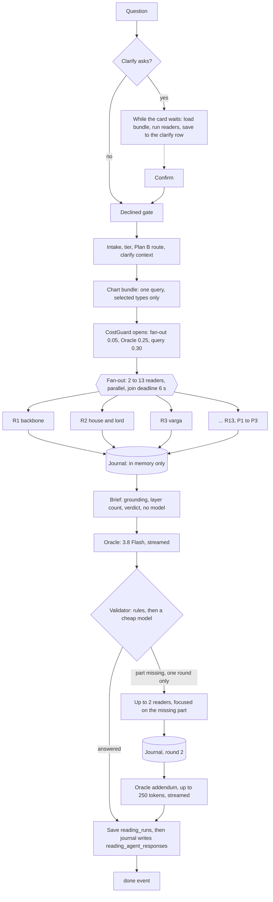

# 39 — Readers, journal, Oracle, validator: the multi-agent reading backend

Status: plan, 2026-11-01, branch `claude/reading-dag-journal-oracle-40cd64`. Written to "How a plan is written" in
`AGENTS.md`. §11 "As built" is added when the phases land, and where it differs from this plan, §11 wins. The flow that
runs today, with diagrams and measurements, is in [doc 40](./40-dag-active-today.md).

## 0. Answer first

1. **Build one new flow, `READING_FLOW=oracle`, next to the existing two.** Up to 13 narrow readers each digest one data
   category. A journal holds every response in memory. The Oracle writes the answer. A validator checks it and can send
   unanswered parts back through a small loop. Only then does the journal write one row per agent to a new table,
   `reading_agent_responses`.
2. **Cost is not the constraint.** A normal question costs about **$0.02–0.03** and a full reading about **$0.07**,
   against a $0.30 cap (§6). The guard is still needed: today's code has no cap and could spend about $0.43 (doc 40 §3).
3. **Time is the constraint, and 5–10 s is not reachable on every flow.** With measured speeds (§5):

   | Flow | Complete | 5–10 s? |
   |---|---|---|
   | Clarified question, readers finished during clarify | 5.4–9.7 s | **yes** |
   | Direct question, short answer (up to 260 words: T1, T9, T10) | about 9.9 s | **yes, barely** |
   | Direct question, normal answer (up to 420 words plus a table) | about 14 s | **no** |
   | Full reading, Tier 1, 2,500 words | about 35 s | **no** |
   | Any flow on a cold Lambda | adds 2–4 s | no |

4. **When targets conflict, depth gives way on normal questions; time gives way only on a full reading.** Spending more
   would not help: every stronger model is slower, so the unused $0.25 Oracle budget buys no speed. A direct question
   gets a shorter answer so it can land inside 10 s where the template allows. A Tier 1 reading stays long and the UI
   says so.
5. **Speed comes from the clarify wait.** Readers run while the person reads the clarify card, so the Oracle starts at
   once on confirm. This is what brings a normal answer inside 10 s.

**Where Plan A and Plan B come from.** Both terms are defined only in
[doc 33 §0](./33-agent-curriculum-oracle-clarify.md) and §6:

- **Plan A, the question reading:** cheap readers → reconcile → one writer, with eight tiers (docs 23, 25, 26, 30).
- **Plan B, the state modules:** pressure map, mood today, luck now, prediction, each with its remedy (doc 32).

`docs/TODOS.md` also mentions "Plans A, B, 3 and 4" without defining 3 and 4. They are read here as doc 33's third plan
(the 18 + 18 timeline) and doc 34's life reading.

---

## 1. Start: the system as it is

Details and diagrams: [doc 40](./40-dag-active-today.md). The facts that drive this plan, all checked on 2026-11-01:

| Fact | Evidence | What the user sees |
|---|---|---|
| Readers read the dossier, not the Radha tables | `run.ts` reads `kundli_facts`; no reading code reads `kundli_data` | Readings rest on values `docs/TODOS.md` P0 proves wrong (Rahu dignity, shadbala ranks) |
| `kundli_data` is large | 142 rows, 2.1M chars per kundli; reading 106 natal rows took 5.18 s from this laptop | Loading everything per question is not an option |
| Six reader prompts exist; doc 33's fifteen curricula do not | `src/reading/prompts/` | Readers list facts instead of saying who holds whom and who can act |
| No journal; no per-agent record | Only JSON in `reading_runs.findings` | Nobody can see what one agent was asked or highlighted |
| No validator | `graph.ts` ends at the writer | Parts of a question can go unanswered unnoticed |
| No cost cap | No code reads a budget | Up to about $0.43 per question is possible |
| Reader budgets are 30 s and 8,192 tokens, up to 60 s with a retry | `specialists.ts:85` | A slow reader can hold the answer for a minute |
| Prewarm runs one reader, and its result stays in one instance | `clarify/prewarm.ts` | The clarify wait is mostly unused |
| Clarify answers reach the writer only as the one-line `exactQuery` | `service.ts:191` | Things the person told the clarifier are lost |
| `real_want` is not built | no match in `src/` | The answer opens with the question asked, not what they want to know |
| Plan B modules are not built | no match in `src/` | "What is troubling me" gets a general reading |
| Answer text arrives in one burst | first token within 5 ms of the end on both stored runs | Streaming hides nothing: complete time is what counts |

**Doc 32 conflicts with a rule.** It specifies the pressure, mood and luck scores as Node computation, but the repo rule
is that Node computes nothing astrological. This plan follows the rule: Plan B runs as readers that read Radha's fields.
No pressure weights or tier tables are coded in Node.

---

## 2. End goal: what the user gets

A person asks a question. Within 2 s they see "I understood…" and pills moving. If the clarifier asks something, the
readers are already working during that wait, so after they confirm, the answer lands inside 10 s. The answer starts
with what they really want to know, says plainly which statements are findings and which are pointers, and gives dates
that all come from stored data. If the validator finds a part unanswered, a short addition follows the answer.

What can no longer go wrong:

- One question can never spend over $0.30, and the fan-out can never spend over $0.05.
- No reader can hold the answer past its join deadline.
- A failed journal write can never lose an answer.
- Every agent's prompt, digest and highlights are on record for each question.

---

## 3. Deliverable

| Kind | What ships |
|---|---|
| Code | `src/reading/oracle/`: `costGuard`, `chartBundle`, `slices`, `readers`, `runReader`, `journal`, `brief`, `oracleCall`, `validator`, `flow`, `prewarm`, `planB`; `clarify/realWant.ts` |
| Changes | `llm/models.ts` (dated prices), `config.ts` (flow and limits), `run.ts` (branch to the flow), `askChatTurn.ts` (journal flush), `clarify/service.ts`, `clarify/prewarm.ts`, `routes/clarifyRoutes.ts`, `types.ts` |
| Prompts | `prompts/readers/R01…R14`, `P1…P3`, `_shared.md`; `prompts/oracle/{system,addendum,validator}.md`; regenerated `generated.ts` |
| Migration | `20261101120000_reading_m18_agent_responses`: written, **not applied** |
| API | New stage names on existing SSE events; new `addendum` and `validation` events; new `POST /api/chat/prewarm` |
| Tests | One file per module in `tests/unit/reading/oracle/`, using the existing fake Gemini |
| Docs | This doc, doc 40, README entries, `docs/TODOS.md` findings |
| Default | Off. `READING_FLOW` stays as it is until the deploy session changes it |

---

## 4. Exactly how it works when done

### 4.1 Backend

**Fan-out size by tier** (doc 26 Part B, doc 33 §3.1). The tier is chosen by rules, never by a model:

| Tier | When | Readers | Count |
|---|---|---|---|
| 8 Quick | Explain a term; short yes/no (`isFastLane`) | none: one Oracle call | 0 |
| 5 Transit-first | "This month", horizon up to 3 months | R8, R10 | 2 |
| 4 Dasha-first | "When", one subject | R2, R8, R10 | 3 |
| 3 Core (default) | One subject | R1, R2, R3, R8, R10 | 5 |
| 2 Deep | Decision or compare, person named, or "why" | Tier 3 + R4, R5, R7 (+R13 when a person is named) | 8–9 |
| 1 Full | Two or more subjects, or life reading | R1–R11, R13 | 12 |
| Plan B routes | Pressure, mood, luck, prediction cues | §4.1 Plan B table | 3–5 |

R12 prashna adds one when eligible. R14 remedy adds one only with `READING_REMEDY_READER=1`, and is off by default
because doc 33 §8 leaves the remedy gate as Sachin's decision. R15 belongs to the timeline, not this flow.

**The readers:** each has one data slice and one curriculum (doc 33 §2). Natal readers do not receive the question, so
their findings can be reused across questions.

| Reader | Digests | Stored types | Question sent? | Required at | Budget |
|---|---|---|---|---|---|
| R1 Backbone | Lagna lord, Moon, strongest and weakest, dispositor chain | core only | no | 3, 2, 1 | 1,100 tok, 5 s |
| R2 House and lord | Frame houses and lords, aspects, argala | core + `aspects`, `argala.d1`, `bhava` | no | 4, 3, 2, 1 | 1,100, 5 s |
| R3 Varga | Subject's divisional charts + D9, D30 | `varga.dN`, `arudhas.dN` | no | 3, 2, 1 | 1,100, 5 s |
| R4 Jaimini | Karakas, arudhas, argala, rasi dashas | `arudhas`, `argala.d1`, `dasha.narayana`, `dasha.chara` | no | optional | 1,100, 5 s |
| R5 Strength | Shadbala, bhava bala, SAV, BAV | `strength.*`, `ashtakavarga` | no | optional | 800, 4 s |
| R6 Yoga and dosha | Only entries Radha marks present | `yogas`, `doshas` | no | optional | 800, 4 s |
| R7 Nakshatra | Star lords, clusters, taras | `varga.d1`, transit rows | no | optional | 1,100, 5 s |
| R8 Vimshottari | Lords in the horizon, what each gives | `dasha.vimsottari` clipped | yes | all | 1,100, 5 s |
| R9 Other dashas | Confirmation from other systems | `dasha.applicable`, `yogini`, `narayana`, `tithi_ashtottari`, `dwisatpathi` clipped | yes | optional | 1,400, 6 s |
| R10 Transit | Dated triggers, hold / listen / act | transit snapshot rows | yes | all up to 3y horizon | 1,100, 5 s |
| R11 Annual | Year chart, sahams, Mudda, Patyayini | `annual.*` for the current year | yes | optional | 1,100, 5 s |
| R12 Prashna | The moment's chart | cast at confirm | yes | optional | 800, 4 s |
| R13 Person | One named person inside the owner's chart | core + `varga.d12`/`d9`/`d7`/`d3` by person | yes | required when named | 1,400, 6 s |
| R14 Remedy | Practice per culprit (off by default) | findings, not tables | yes | optional | 800, 4 s |

**Plan B routes.** Cues on the question pick the route; the declined gate always runs first.

| Route | Reader added | Runs with | What is left out, and why |
|---|---|---|---|
| Pressure | P1 Pressure: Moon, 4th, 5th, lagna lord, running lords, slow transits | R1, R8, R10 | Hand-set weights (rule: no Node computation) |
| Mood today | P2 Mood: running lords, the day's transit rows, the question moment | R8, R10 | `panchanga.day` is not served yet: P2 says so as a gap |
| Luck now | P3 Luck: 9th, Jupiter, sphutas, running lords, the moment | R1, R8, R10 | Tajaka aspect check needs Radha data |
| Will it happen | none extra: tier 4 with the deadline as horizon | R2, R8, R10 | **No probability shown**, as doc 32 risk 3 says. Tiers only. `predictions` and calibration wait for labels |

**Data gathering, revised.**

1. One query, selected types only: `findMany({ kundli_id, data_type in [...], status: 'ready' })`. The union for a tier
   comes from `fetchPlan`. Tier 3 is about 15 rows and 100k characters, not 142 rows and 2.1M.
2. In-process cache per kundli and type set (5-minute TTL, as the other reading caches). Started the moment a question
   arrives, including at clarify.
3. **Node selects and never computes.** Slices remove rows and fields: date overlap with the horizon, frame houses, and
   housekeeping fields such as `*_jd`. Arrays become objects keyed by name so evidence ids are stable
   (`dignities.planets.Saturn.dignity`).
4. A missing type never blocks. The reader is told it is absent and reports a gap. The fetch for missing types stays
   with the chart-build owner in doc 38.
5. **Still read from the dossier:** frame lords, the running period and the transit rows, because `kundli_data` holds
   no transit rows. These go away when Radha `facts` deploys.
6. **Shared cached prefix.** Every reader for a user starts with the same bytes: reader rules + `CHART CORE`
   (`varga.d1`, `dignities`, `benefic_malefic`, `relations`, `ashtakavarga`, `strength.shadbala`, `karaka.chara`,
   `arudhas`, `panchanga.birth`), about 23k characters or 6.4k tokens. That clears Gemini's 4,096-token cache minimum,
   and the existing `cachePrefix` path serves it at 10 % of the input price.

**Journal.** It holds every reader's prompt, digest, highlights, usage and status in memory.

- It is **not a model**, so it adds no latency or cost. An LLM would add both and could only lose data.
- It writes nothing until the Oracle and validator finish. If the Oracle fails, it still writes, with
  `oracle_status = failed`, so the evidence of what happened is kept.
- `flush()` runs once, awaited inside the request, because a Lambda freezes after the response. It writes with one
  `createMany`, retries once, and never throws.

**The new table `reading_agent_responses`, one row per agent response per query:**

| Column | Holds |
|---|---|
| `id`, `run_id`, `user_id`, `chat_id`, `message_id`, `created_at` | Which query. `run_id` is plain text with no foreign key, because the journal's order against `reading_runs` must never decide whether an agent row survives |
| `question` | The question as asked |
| `agent`, `agent_kind` | `R08`, `oracle`, `validator`; `reader`, `oracle`, `validator` |
| `round` | 1 first pass, 2 validator loop |
| `subject`, `tier`, `model` | Context |
| `prompt_name`, `prompt_version` | Which versioned curriculum |
| `prompt_sent` | The per-call prompt: curriculum and tail. **Not** the chart tables |
| `data_keys`, `data_hash` | Which tables it read and the hash of what it saw |
| `digest` | How it digested the data: verdict, score, its own "how I read this", gaps, disagreement |
| `highlights` | Claims, windows, quotes, actors, graces, pointers |
| `status`, `failure_reason`, `source` | `ok`, `failed`, `skipped`, `cached`; `live`, `prewarm`, `cache` |
| `prompt_tokens`, `cached_tokens`, `output_tokens`, `thought_tokens`, `cost_usd`, `ms` | Usage |

`user_id` cascades on user deletion, and the table is excluded from logs. It is written only for the oracle flow.

**Oracle.** `READING_MODEL_ORACLE`, falling back to `READING_MODEL_SYNTH`, today `gemini-3.8-flash`. Thinking `low`.
It receives the persona and method, the Oracle prompt, the answer template and the brief. It never sees raw tables.

The brief (`oracle/brief.ts`, no model, byte-stable) has: CLARIFIED, REAL WANT, the verdict and windows from the existing
`reconcile`, FINDINGS (statements three or more layers agree on), POINTERS (one or two layers), ACTORS, GRACES, GAPS,
READER DIGESTS, FAILED LAYERS. `SENSITIVE` lines go in for the Oracle only and are never printed.

Layer counting is bookkeeping over reader tags, not astrology: it groups grounded claims by subject and `about`, then
counts distinct traditions and data families (doc 33 §3.5).

**Validator.** Two steps, both after the answer has been sent.

1. Rules, under 5 ms, no model: is the answer empty or cut off? Does a timing question contain a date? Does each part of
   a multi-part question appear? Are engine names absent? Do the dates and placements pass the existing prose checker?
2. Model, `READING_MODEL_VALIDATOR`, falling back to `READING_MODEL_SPECIALIST`: question, clarify context and answer in;
   `{ answered, parts: [{ part, status, missing, readers }] }` out. Budget: 200 tokens and 2 s. On any failure or
   timeout the rules' result stands, so **a validator failure never holds or changes the answer**.

The answer is already on screen, so the loop **adds to it and never replaces it**. If a part is missing and money and
time remain: run up to 2 readers named by the validator, restricted to known readers, with the missing part as their
focus (3 s), then an Oracle addendum of up to 250 tokens (6 s). One round, never more.

### 4.2 API

| Surface | Change |
|---|---|
| `POST /api/chat/ask-stream`, `/confirm-stream` | Unchanged request. `stage` events gain names `R01`…`R14`, `P1`–`P3`, `journal`, `oracle`, `validate`. `cached: true` when prewarmed |
| New SSE `validation` | `{ type: 'validation', answered: boolean, source: 'rules' \| 'model', missing: string[] }`. Sent before `done`. Safe to ignore |
| New SSE `addendum` | `{ type: 'addendum', status: 'start' \| 'done', part: string }`. Tokens arrive as normal `token` events |
| `done` | Gains `cost: { usd, capped }` |
| New `POST /api/chat/prewarm` | `{ runId }` → `200 { ran, cached, skipped }`, `401`, `404`. Idempotent. Holds its request for up to 6 s. Failure is harmless: the reading runs the readers itself |
| `POST /api/chat/answer` | Unchanged |

An older client ignores all of this: the existing stage parser shows unknown names as generic pills.

### 4.3 Frontend experience

No web change is needed for the flow to work. One small web change makes prewarm complete:

- **On a `propose` event, the web fires `POST /api/chat/prewarm` without waiting.** It is a separate request, so Lambda
  stays alive for it. Without it, timing readers run only at ask time on the default horizon. Owner: web session.
- Pills should get labels (`R08` → "Vimshottari periods"). Until then raw names show.
- On `validation` with `answered: false` and no addendum, the UI can stay as it is.

### 4.4 UI/UX

| Moment | Words on screen | When |
|---|---|---|
| Understood | "You are asking about…" | under 2 s |
| Reading | One pill per reader, ticking to done, "cached" when prewarmed | 0–6 s |
| Writing | "Writing your reading" | until the burst arrives |
| Answer | Starts with what they want to know | 5–10 s on the good paths |
| Addition | A short section headed "One more thing on …" | 5–9 s later, rarely |
| A reader failed | "Read without: <layer>" inside the answer's cautions | |
| Cost cap reached | Nothing different; the reading is shorter or has fewer layers, and the cautions say which layers are missing | |
| Full reading | "This is a long reading, about 30 to 40 seconds" | Tier 1 only |

---

## 5. Time: what each agent gets

Speeds are measured from `reading_runs` (doc 40 §5). Two points per model is thin: the model is a guide, the budgets
below are enforced, and §10 lists the live bench that replaces them.

| Model | Fit | Basis |
|---|---|---|
| `gemini-3.1-flash-lite` (readers) | 1.6 s + tokens ÷ 500 | 906 tokens in 3.35 s; 1,143 tokens in 3.82 s |
| `gemini-3.8-flash` (Oracle) | 3.3 s + tokens ÷ 140 | 718 tokens in 8.3 s; 1,555 tokens in 14.2 s |

**Output tokens are the time control.** Today's 8,192-token reader limit is what allows a slow reader. Budgets are
derived from a speed table (`READER_SPEEDS`), so a model swap cannot silently cause time-outs like the ones in doc 30.

| Stage | Budget | Hard limit | Why |
|---|---|---|---|
| Chart bundle, cached | 1 ms | | Prewarmed |
| Chart bundle, miss | ≤ 400 ms on Lambda (estimate; 5.18 s for 106 rows from the laptop) | waits for data at most 1.5 s | Selected types only |
| Each reader | 1,100 tokens, about 3.8 s | **5 s** (6 s heavy, 4 s light) | Measured 3.35–3.82 s |
| Retry | Only if the first attempt failed fast and at least 3.5 s of the join is left | | No timed-out retries: they would repeat the same slow work |
| Reader join | Slowest required | **6 s** (Tier 1: 8 s) | The Oracle starts then, with what it has |
| Brief | under 50 ms | | Doc 12 measured reconcile at 0.35 ms p95 |
| **Oracle, T1/T9/T10** | up to 380 tokens, about 6 s | 15 s | Fits with readers inside 10 s |
| **Oracle, other templates** | up to 900 tokens, about 9.7 s | 25 s | Inside 10 s only when prewarmed |
| **Oracle, Tier 1** | up to 3,600 tokens, about 29 s | 60 s | Time gives way here |
| Clarify context | About 100–200 extra input tokens: no measurable time | | Added to the brief; not a separate step |
| Validator rules | under 5 ms | | |
| Validator model | 200 tokens, about 2 s | 2 s | Delays `done`, not the answer |
| Loop readers | up to 2, 800 tokens each | 3 s | |
| Addendum | up to 250 tokens, about 5 s | 6 s | |
| Journal flush | under 100 ms on Lambda | 2 s | Delays `done`, not the answer |

**Answer on screen, by flow (warm Lambda, nothing failing):**

| Flow | Readers | Oracle | Complete | In target? |
|---|---|---|---|---|
| Clarified, prewarmed, 300–900 tokens | 0 s | 5.4–9.7 s | **5.4–9.7 s** | Yes |
| Clarified, horizon changed, timing readers re-run | 3.8 s | 5.4–9.7 s | 9.2–13.5 s | Partly |
| Direct, T1/T9/T10, about 370 tokens | 4 s | 5.9 s | **9.9 s** | Yes, barely |
| Direct, other templates, 900 tokens | 4 s | 9.7 s | **13.7 s** | **No** |
| Tier 1, 12 readers | 6 s | 29 s | **35 s** | **No** |
| Add a cold Lambda | | | +2–4 s | |
| Add a data miss (measured) | | | +2 s | Prewarm removes it |

**How to keep getting faster**, best first:

1. Prewarm hit rate, which needs the web call in §4.3. Target: over 70 % of clarified questions start the Oracle at once.
2. Try the Oracle on `gemini-3.1-flash-lite`, about 3 to 4 times faster and 3 times cheaper. Quality is unknown: run the
   goldens through `READING_MODEL_ORACLE` before any switch.
3. Shorter readers: 6 claims instead of 8 saves about 0.3 s of the join.
4. Provisioned concurrency of 1 removes the cold start (about $10–15 a month, doc 05 §3). This is Sachin's call.

---

## 6. Cost structure

Prices read from `ai.google.dev/gemini-api/docs/pricing` and `platform.claude.com/docs/en/about-claude/pricing` on
2026-11-01, per 1M tokens. They match `llm/models.ts`. The table gains dated changes in Phase 1.

| Model | Input | Output | Cache read | Storage per hour | Scheduled change |
|---|---|---|---|---|---|
| `gemini-3.1-flash-lite` | $0.25 | $1.50 | $0.025 | $1.00 | none stated |
| `gemini-3.5-flash-lite` | $0.30 | $2.50 | $0.03 | $1.00 | none stated |
| `gemini-3.8-flash` | $0.75 | $3.75 | $0.075 | $0.50 | **from 2027-01-01: 1.50 / 7.50 / 0.15 / 1.00** |
| `gemini-4-argon` | $2.00 | $10.00 | $0.10 (implicit only) | — | **from 2026-12-01: 4.00 / 20.00 / 0.20** |
| Claude Haiku 5.5 (prompt ≤ 100k) | $0.10 | $0.50 | $0.01 | | |
| Claude Sonnet 5.5 | $2.00 | $10.00 | $0.10 | | |
| Claude Fable 5.1 | $10.00 | $50.00 | $0.25 | | |

**Reader model.** Doc 33 names 3.5 Flash-Lite. Today's `.env` and all measurements use 3.1 Flash-Lite. **Decision: start
on 3.1**, because it is measured and cheaper; `READING_MODEL_READER` flips it. Either fits the $0.05 cap at Tier 1.

**One reader on 3.1 Flash-Lite:**

| | Prompt | Output | Cost |
|---|---|---|---|
| First use, cache cold | 10k uncached | 1,000 | $0.0025 + $0.0015 = **$0.0040** |
| Cache warm | 7k cached + 3k | 1,000 | $0.0002 + $0.0008 + $0.0015 = **$0.0024** |

**One query:**

| Line | Tier 3 (5 readers) | Tier 1 (12 readers) | Cap |
|---|---|---|---|
| Readers, cold | $0.020 | $0.048 | $0.05 |
| Readers, warm | $0.012 | $0.029 | |
| Cache storage (12k tokens × $1 × 0.5 h, charged once per session) | $0.006 | $0.006 | counted in fan-out |
| Oracle on 3.8 Flash | $0.011 (7k in, 900 + 300 out) | $0.021 (9k in, 3,600 out) | $0.25 |
| Validator | $0.0007 | $0.0007 | query |
| Loop, rare | $0.006 | $0.006 | shared |
| **Total, typical** | **about $0.03** | **about $0.07** | **$0.30** |
| Same after 2027-01-01 | about $0.04 | about $0.09 | |

Check against reality: the stored 9-reader graph run cost $0.0100 with cached prefixes and failures, so these numbers
are not optimistic.

**Why the caps are never reached.** The fan-out cap fits about 20 cold readers at the 3.1 Flash-Lite rate. What the
Oracle's $0.25 could buy, for a 9k in, 3,600 out Tier 1 answer:

| Oracle model | Cost | Fits $0.25? | Comment |
|---|---|---|---|
| 3.8 Flash | $0.021 | yes | Chosen: fastest measured |
| Argon, from 2026-12-01 | $0.108 | yes | Slower thinking model; not measured |
| Sonnet 5.5 | $0.054 | yes | No adapter in this repo (doc 23 G4) |
| Fable 5.1 | $0.27 | **no** | Over the cap, and the slowest |

**At volume:** 1,000 questions a day at $0.03 is $30 a day, about $900 a month. Tier 1 at $0.07 is $70 a day.

**How the cap is enforced** (`oracle/costGuard.ts`). All limits are env-overridable.

| Rule | Value |
|---|---|
| `READING_COST_CAP_FANOUT_USD` | $0.05: all readers in all rounds, prewarm included |
| `READING_COST_CAP_ORACLE_USD` | $0.25: the Oracle and addendum |
| `READING_COST_CAP_QUERY_USD` | $0.30: everything |

1. **Reserve before each call.** The worst case is prompt tokens at full input price plus `maxOutputTokens` at output
   price. Gemini counts thinking inside `maxOutputTokens`, so this is a hard bound.
2. **Clamp, then refuse.** If the worst case does not fit, lower `maxOutputTokens`. If under 300 tokens would remain,
   refuse the call: the reader is marked `skipped`, reason `budget`.
3. **Settle after each call** with actual usage. The unused reservation returns at once. Parallel readers cannot
   overspend together, because reservations add up.
4. **An unknown model is refused**, never priced at 0. Today's `usageCostUsd` returns 0 for an unknown model, which would
   defeat the cap.
5. **Failed attempts count**, because they were billed.
6. **The Oracle is guaranteed first.** Money for the Oracle is held back from the query cap before any optional spend, so
   a question can't end with no answer because readers spent the budget. If even the Oracle cannot fit, the guard falls
   back to a smaller `maxOutputTokens`.
7. **Prewarm counts.** Its spend seeds the guard, wasted calls included.

---

## 7. Architecture

| Runs where | What | Guarantee at the boundary |
|---|---|---|
| Request path, Lambda | Flow, readers, Oracle, validator, journal flush | Everything awaited; nothing depends on background work after the response |
| Request path, ask stream | Prewarm after the clarify card | Capped at 12 s, as today |
| Separate request | `POST /api/chat/prewarm` | Its own invocation, capped at 6 s, idempotent |
| Postgres | `kundli_data`, `kundli_facts`, `transit_snapshots`, `reading_runs`, `reading_agent_responses` | Read failures degrade to gaps; write failures are logged and never fail the turn |
| Gemini | Readers, Oracle, validator | One retry on 429/500/503 inside `post()`; per-call abort |
| Radha | Not called in the reading path for natal data | Missing data is a gap. Prashna and dated transit stay as they are |
| LangGraph | State, `Send` fan-out, the conditional loop | Per doc 04's decision; model calls stay on our REST wrapper |

**Prewarm across Lambda instances.** Prewarm results go into the clarify row's existing `reading_runs.findings` column, so
no new table is needed. The clarify run id travels on `intent.clarified`, and the confirm request reads it from any
instance. This is not the journal: journal rows are written only after the Oracle. Prewarm entries are copied into the
journal at confirm with `source = prewarm`.

**Reader reuse.** Natal readers are reused by key: dossier hash + reader + subject + prompt version + model. Timing
readers add the horizon. The in-process `findingsCache` is used first, then the clarify row.

---

## 8. Ingredients

| Need | Who provides it |
|---|---|
| Migration file | This session writes it. Applying it needs Sachin's OK, through the deploy session |
| Env: `READING_FLOW=oracle`, `READING_MODEL_ORACLE`, `READING_MODEL_READER`, `READING_MODEL_VALIDATOR`, `READING_COST_CAP_*` | Deploy session. All have safe defaults; the flow stays off until set |
| Paid Gemini billing and the explicit cache | Already on in `.env`; confirm on the Lambda (deploy session) |
| Web `prewarm` call and pill labels | Web session, after this merges |
| Radha `facts` deployed | Radha session. Not a blocker: natal readers no longer use the dossier |
| Prisma, LangGraph, undici, zod | Already installed. No new library |
| Fake Gemini, fixtures | `tests/helpers/fakeGemini.ts`, `tests/helpers/readingFixtures.ts` |

---

## 9. Action steps and phases

Each phase leaves the existing flows untouched and the new flow off, so every commit can ship.

| # | Phase | Steps and files | Closes when |
|---|---|---|---|
| 1 | **Cost** | Dated prices and `priceFor(model, date)` in `llm/models.ts`; `oracle/costGuard.ts`; config | Tests: parallel reservations cannot exceed the cap; clamp, refuse, unknown model, Oracle hold-back, prices change on 2027-01-01 |
| 2 | **Data** | `oracle/chartBundle.ts` (fetch plan, one query, cache); `oracle/slices.ts` | Tests: only planned types read; one query per load; rows clipped by date; byte-stable; no engine-computed value altered |
| 3 | **Readers** | `oracle/readers.ts`; `oracle/runReader.ts`; `prompts/readers/*` | Tests: tier → reader set; reader parses tolerant JSON, repairs cut-off JSON, stops at its deadline; every prompt free of engine names |
| 4 | **Journal** | `oracle/journal.ts`; schema + migration; flush in `askChatTurn.ts` | Tests: nothing written before flush; one row per response; a failed write does not fail the turn; flush once |
| 5 | **Oracle** | `oracle/brief.ts`; `oracle/oracleCall.ts`; `oracle/flow.ts`; `run.ts` branch; `clarify/realWant.ts`; clarify context | Tests: full run on the fake model; layer count; pointers vs findings; failed required reader caps the verdict; join deadline holds |
| 6 | **Validator** | `oracle/validator.ts`; loop in the flow; events | Tests: rules catch a missing date and part; model failure leaves the answer; one round only; loop refused when money or time is short |
| 7 | **Prewarm** | `oracle/prewarm.ts`; `clarify/prewarm.ts`; `POST /api/chat/prewarm`; clarify row | Tests: confirm on another instance reuses findings; horizon change re-runs only timing readers; prewarm spend seeds the guard |
| 8 | **Plan B** | `oracle/planB.ts`; P1–P3 prompts | Tests: cues route correctly; declined topics never reach the route; no probability in any prompt |
| 9 | **Bench** | `scripts/bench-oracle.ts` | Runs on the fake model; `--live` replaces §5's fit with measured numbers once Sachin OKs the spend |

Phases 1, 2 and the prompts are independent. Phases 3–7 build on each other.

**Deferred, with the reason:**

| Item | Why not now |
|---|---|
| `real_want` as a clarify question with chips | Rules inference and the Oracle block ship now. Asking needs doc 33 §8 decision 1 (Sachin) and changes clarify's flow |
| R14 remedy on by default | Doc 33 §8 decision 3 |
| Claude or Bedrock as reader or Oracle | Needs doc 23's adapter. Costs in §6 show no need yet |
| `predictions` table and calibration | Doc 32: months of labels first |
| Plan B buckets in the taxonomy | Cue routing ships first; buckets and chips touch the classifier and its tests |
| R15, timeline adoption | Separate flow, doc 33 T-1 |
| Category flows (romance, finances) | `docs/TODOS.md` says not designed; these readers are the base for them |

---

## 10. Recommendation and what is not verified

**Build `READING_FLOW=oracle` as above, with 3.1 Flash-Lite readers and a 3.8 Flash Oracle.** Turn it on after the
live bench.

| Alternative | Verdict |
|---|---|
| Extend the existing graph in place | No: it would change a working flow and its tests. Same fan-out engine, new flow |
| Journal as an LLM agent | No: adds cost and time, and can only lose or change what it holds |
| Oracle rewrite after the validator | No: the answer is already on screen. Rewriting doubles the time. Add to it instead |
| Validator before the answer is shown | No: answer text arrives in one burst, so holding it would add 2 s to every question |
| Readers send findings straight to a table as they finish | No: Sachin asked for the write after the Oracle, and it would add writes to the fan-out |
| Doc 32's Node scoring for Plan B | No: breaks the repo rule |

**Not verified until the live bench runs:** reader and Oracle speeds beyond two stored data points, real reader output
quality on the new curricula, cache hit rate on the new prefix, and bundle read time on the Lambda. **Sachin's decisions:**
the live bench spend (under $1), applying the migration, doc 33 §8's three open items.

---

## 11. As built

Added when the phases land.
