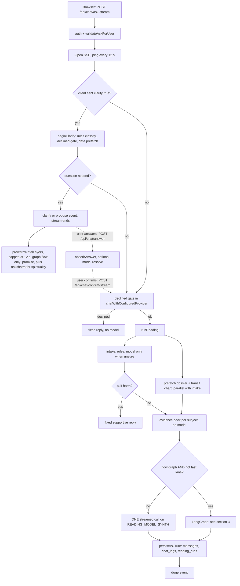
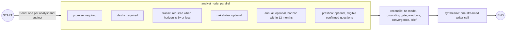
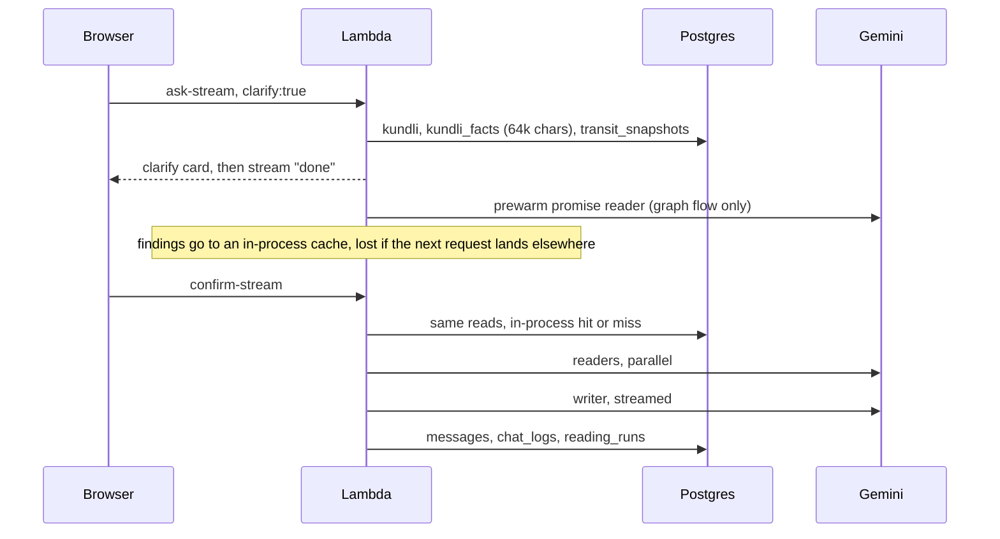

# 40 — The DAG and multi-agent flow that is active today

Status: as-built record, 2026-11-01, written from `develop` at 38bc225 before doc 39's changes. Doc 39 is the plan that
changes this flow. Every statement below names the code that shows it.

## 1. Which flow runs

There are two flows today. A switch picks between them, and a rule can overrule the switch for each question.

| Switch | Value | Source |
|---|---|---|
| `READING_FLOW` | code default `single`; `graph` turns on the fan-out | `src/reading/config.ts:14` |
| `READING_FLOW` on this machine | `graph` | `.env` in the main checkout |
| `READING_FLOW` on the Lambda | **not confirmed**: the `aiastra-ops` key returned `InvalidClientTokenId` on 2026-11-01 | filed in `docs/TODOS.md` |
| `READING_MODEL_SPECIALIST` | `gemini-3.1-flash-lite` | `.env` |
| `READING_MODEL_SYNTH`, `_FAST` | `gemini-3.8-flash` | `.env` |
| `READING_MODEL_INTAKE` | `gemini-3.1-flash-lite`, used only when the rules are unsure | `.env` |
| `READING_MODEL_CLARIFY` | `bedrock:openai.gpt-oss-120b-1:0` | `.env` |
| `READING_EXPLICIT_CACHE` | `1` | `.env` |
| `READING_FINDINGS` | unset, so v1 prompts | `.env` |

The stored runs agree with this. The newest run with timings (2026-11-01 15:02) records only `synth`, so it ran the
single flow. The one graph run stored in the last 21 days is from 2026-10-26.

## 2. The whole request, as a picture



## 3. The graph flow

`src/reading/graph.ts`. Nothing in the graph is a journal or a validator: findings stay in graph state and go straight
to the writer, and the only record is the JSON in `reading_runs.findings`.



### How many agents fan out

`fanOut` in `graph.ts:140`. It runs promise, dasha and transit per subject, nakshatra once on the first subject when it
applies, cuts the list to 10, then adds annual and prashna.

| Question | Subjects | Readers | Model calls with no failure | Worst case with retries |
|---|---|---|---|---|
| Fast lane (`isFastLane`: one subject, horizon 6 months or less, yes/no or explain) | 1 | 0 | 1 (writer) | 1 |
| Confirmed by the clarifier | 1 (other parts wait in `nextSubjects`) | 3 to 6 | 4 to 7 | 4 + 3 retries = 10 |
| Direct, one subject | 1 | 3 to 6 | 4 to 7 | 10 |
| Direct, three subjects | 3 | 9 or 10, plus up to 2 | 11 to 13 | 13 + 9 retries = 22 |

```
                        one subject                                three subjects
                       ┌─ promise ─┐                    ┌─ promise ×3 ─┐
question ─► pack ─────►├─ dasha   ─┼─► reconcile ─►     ├─ dasha   ×3 ─┤
                       ├─ transit ─┤      writer        ├─ transit ×3 ─┼─► reconcile ─► writer
                       ├ nakshatra ┤                    ├─ nakshatra   ┤
                       ├ annual    ┤                    ├─ annual      ┤
                       └ prashna  ─┘                    └─ prashna    ─┘
                       3–6 readers                       up to 12 readers
```

### What each agent is told today

There are six reader prompts (`src/reading/prompts/*.md`, with v2 copies behind `READING_FINDINGS=v2`). None of the
fifteen curricula in doc 33 exist in code. Each reader receives the shared base chart, its evidence-pack sections and
its role prompt. `ANALYST_SECTIONS` in `packs/selector.ts:39` sets which sections each one sees.

### Time and money limits as coded

| Limit | Value | Code |
|---|---|---|
| Reader, one attempt | 18 s, plus 12 s on a model that thinks: **30 s on every 3.x model** | `specialists.ts:85` |
| Reader, required, after a retry | up to **60 s** | `graph.ts:240` |
| Reader output | 4,096 tokens, plus 4,096 on 3.x: **8,192** | `config.ts:83` |
| Writer timeout | **120 s** | `run.ts:351` |
| Writer output | 12,288 tokens | `config.ts:74` |
| Cost cap per question | **none** | no code reads a budget; doc 05 §6 `READING_DAILY_BUDGET_USD` was never built |

So the code allows a 3-subject question to spend, at today's prices with no cap:
24 reader attempts × (12k in + 8,192 out) on 3.1 Flash-Lite ≈ $0.37, plus a 15k in + 12,288 out writer on 3.8 Flash ≈
$0.06: **about $0.43**. With 3.8 Flash readers it would be about $1.01. Typical runs are far lower (section 5).

## 4. What is loaded, and when



- The reading engine reads `kundli_facts.dossier` and `transit_snapshots`. **It does not read `kundli_data`**, which
  holds 142 Radha tables per kundli (about 2.1M characters) on 19 kundlis. Stored dossiers carry known wrong values
  (`docs/TODOS.md` P0).
- Prewarm results stay in one Lambda instance. If the user taps before prewarm ends, Lambda sends the confirm to another
  instance, and the work is lost.

## 5. Measured numbers (`reading_runs`, last 21 days)

There are 19 rows: 17 are clarify conversations with no timings, and 2 are readings. That is too few for percentiles, so
these are single data points. Doc 24's 12-question live run adds the single-flow figures.

| Run | Readers | Cost | First answer text | Complete | Writer call |
|---|---|---|---|---|---|
| 2026-11-01 15:02, single, one reading | 0 | $0.0172 | 16.39 s | 16.39 s | 14.2 s; 15,165 in, 895 out, 660 thought |
| 2026-10-26 06:24, graph, 3 subjects | 9, 7 failed before the parse fix | $0.0100 | 20.57 s | 20.58 s | 8.3 s; 3,739 in, 718 out, 0 thought |
| Doc 24, 2026-10-26, 12 goldens, single | 0 | $0.0059–0.0157, mean $0.0094 | median 9.7 s, p95 11.9 s | median 10.2 s, p95 11.9 s | |

Reader calls from the graph run, both on `gemini-3.1-flash-lite`:

| Reader | Prompt (cached) | Output + thought | Time |
|---|---|---|---|
| promise | 12,380 (10,793) | 762 + 144 | 3.35 s |
| dasha | 12,683 (10,793) | 1,025 + 118 | 3.82 s |

**What these show:**

- **Answer text does not arrive gradually.** On both stored runs the first answer token came within 5 ms of the end.
  Doc 24 found the same ("arrives in a short burst"). First-token time is therefore not a useful target here: complete
  time is.
- **The writer takes about 3.3 s plus 7 ms per output token** (fit through the two stored points, so a rough guide).
- **A healthy reader takes under 4 s.** The 9.5 to 12 s reader timings on 2026-10-26 were two attempts each.
- **Data miss:** the 15:02 run waited 2.03 s for data (`transits: miss`).

## 6. Files

| Part | File |
|---|---|
| Routes | `server.ts` (`/api/chat/ask-stream`), `src/routes/clarifyRoutes.ts` |
| Entry | `src/services/chatLlmService.ts`, `src/reading/run.ts` |
| Graph | `src/reading/graph.ts`, `nodes/specialists.ts`, `nodes/reconcile.ts`, `nodes/convergence.ts`, `nodes/findingsCache.ts` |
| Data | `src/reading/data/store.ts`, `packs/selector.ts`, `packs/fullPrefix.ts` |
| Clarify | `src/reading/clarify/{machine,service,planner,prewarm,store}.ts` |
| Model calls | `src/reading/llm/{gemini,bedrock,models,promptCache}.ts` |
| Save | `src/services/askChatTurn.ts` |
