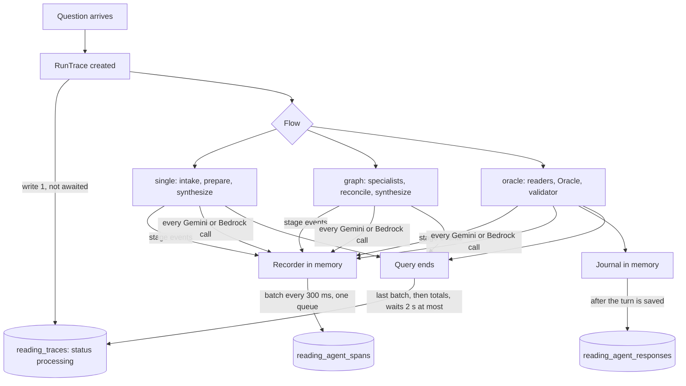

# 41 — Agent metrics: what every agent did, for how long, at what cost

Status: Phase 1 code is live on the API Lambda (image `api-faaa60916874`) and M19 is applied, both checked 2026-11-02. **Not
yet proven:** no question has been asked since the deploy, so both tables are empty and no real row has been written. Written
to "How a plan is written" in `AGENTS.md`.

## 1. Start: what exists today

- `reading_runs` holds one row per answered question, written after the answer, with `timings_ms` and `usage` as JSON. A
  query still running, or one that crashed, leaves nothing. JSON cannot be charted per agent without unpacking it.
- `reading_agent_responses` (M18, not applied) holds what each agent said, but only for the oracle flow, which is off by
  default, and only after the Oracle and validator finish.
- CloudWatch has one `reading timing` log line per run. It cannot be joined to a user's question or browsed by an admin.
- Failed calls that left no usage report, clarify, and prewarm are not recorded anywhere per agent.

## 2. The question you asked: who should write the agents' notes?

**Is logging a big task for the journal? No.** The journal is plain code, not a model
(`src/reading/oracle/journal.ts`). It holds rows in memory and does one bulk insert after the Oracle. It costs no tokens,
and plan 39 budgets the write at under 100 ms (not measured yet).

**Should each agent write its own notes instead? No.** There are three reasons:

1. **Connections.** Each process has a pool of 6. Seventeen readers finishing together would queue on it during the seconds
   the answer depends on, including the Oracle's own reads.
2. **Round trips.** Seventeen inserts cost seventeen round trips to Render. One bulk insert costs one.
3. **Failure handling.** Every agent would need its own retry and failure rule, and a failed note must never cost an answer.

**The real gap is timing, not who writes.** Waiting until the end means a crashed or running query shows nothing. So the two
jobs are split:

| | Metrics (this doc) | Agent responses (doc 39) |
|---|---|---|
| Holds | Times, tokens, estimated cost, status | Prompt sent, digest, highlights |
| Size per agent | Small, fixed | Large, varies |
| Written | During the query, in batches, from one queue | After the Oracle, one bulk insert |
| Flows | All, plus clarify and prewarm | Oracle only |

Agents only add to a shared in-memory recorder. They never touch the database, and they never wait on it.

## 3. End goal

Any query can be answered from the tables: what is running now, how many agents it spawned, how long each took, which step
inside a model call was slow, what it cost, and what failed. The admin module later reads these tables with no new recording.

## 4. Deliverable

- Phase 1, built: `src/reading/metrics/trace.ts`, hooks in `gemini.ts`, `bedrock.ts`, `run.ts`, `clarifyRoutes.ts`, migration
  `20261101130000_reading_m19_agent_metrics`, `READING_METRICS=0` as the off switch, `tests/unit/reading/metrics.test.ts`.
- Phase 2 and 3: see §10.

## 5. How it works



### Backend

- **Trace row:** written when the query starts, with `status = processing`, and closed at the end with totals.
- **Two levels of span:**
  - `stage`: the agent from start to finish, read from the stage events every flow already emits.
  - `model_call`: one request to a model, from the Gemini and Bedrock wrappers. Retries show as separate calls.
- **Steps inside an agent:** `model_call.steps` has `wait_ms` (until the response starts) and `read_ms` (reading it), plus
  `ttft_ms` when streaming. The gap between a `stage` and its `model_call`s is our own overhead: queueing, building the
  prompt, parsing.
- **Writes:** one queue per query, so one connection at a time. Spans wait 300 ms so a burst becomes one insert. The end of the
  query waits at most 2 s for them.
- **Failure:** a failed write logs a line with no text and is dropped. A missing table turns writes off for 5 minutes per
  process. The reading never sees either.
- **Estimated cost:** tokens × the dated prices in `llm/models.ts`. A model with no price stores `null` and adds to
  `unpriced_calls`, so an unpriced call never reads as free. It is an estimate, not a bill, and for the oracle flow it can
  differ from the cost guard's figure, which also counts reservations for calls with no usage report.
- **Privacy:** no prompt, chart or model text. Failure reasons are a status or error type, never a message. Clarify and
  prewarm traces hold no question, because declined topics are decided inside the clarifier.

### API, frontend, UI

No change in Phase 1. Phase 3 adds the admin pages in §10.

## 6. Schema

**`reading_traces`, one row per request:** `run_id` (equals `reading_runs.id` for readings), `user_id`, `kind` (`reading`,
`clarify`, `prewarm`), `flow`, `question`, `clarify_run_id`, `status` (`processing`, `done`, `failed`, `unavailable`),
`agents_spawned`, `agents_failed`, `model_calls`, four token counts, `est_cost_usd`, `unpriced_calls`, `ttft_ms`, `ms`, `error`,
`started_at`, `ended_at`.

**`reading_agent_spans`, one row per agent or model call:** `run_id`, `agent`, `agent_kind` (`reader`, `specialist`, `oracle`,
`validator`, `intake`, `clarify`, `step`), `level` (`stage`, `model_call`), `model`, `status` (`ok`, `cached`, `failed`, `skipped`,
`unfinished`), `failure_reason`, `started_at`, `ended_at`, `ms`, `ttft_ms`, `steps`, four token counts, `est_cost_usd`.

`clarify_run_id` joins a question's clarify, prewarm and reading requests. Deleting a user removes their traces and spans.

## 7. Questions the tables answer

```sql
-- What is running now (a row stuck here for minutes means the process died)
SELECT run_id, kind, flow, question, started_at FROM reading_traces WHERE status = 'processing' ORDER BY started_at DESC;

-- Latest queries: how many agents, how fast, how much
SELECT run_id, flow, agents_spawned, agents_failed, model_calls, ttft_ms, ms, est_cost_usd, status
FROM reading_traces WHERE kind = 'reading' ORDER BY started_at DESC LIMIT 50;

-- One query, in order
SELECT agent, level, status, ms, ttft_ms, steps, prompt_tokens, cached_tokens, output_tokens, est_cost_usd
FROM reading_agent_spans WHERE run_id = $1 ORDER BY started_at;

-- Slowest agents this week
SELECT agent, count(*) AS calls, percentile_cont(0.5) WITHIN GROUP (ORDER BY ms) AS p50_ms,
       percentile_cont(0.95) WITHIN GROUP (ORDER BY ms) AS p95_ms, avg(est_cost_usd) AS avg_usd,
       count(*) FILTER (WHERE status = 'failed') AS failed
FROM reading_agent_spans WHERE level = 'model_call' AND started_at > now() - interval '7 days'
GROUP BY agent ORDER BY p95_ms DESC;

-- Is the time waiting on the model, or reading its answer?
SELECT agent, avg((steps->>'wait_ms')::int) AS wait_ms, avg((steps->>'read_ms')::int) AS read_ms
FROM reading_agent_spans WHERE level = 'model_call' AND status = 'ok' GROUP BY agent;
```

## 8. Ingredients

| Ingredient | Who | Status |
|---|---|---|
| Apply M19 | Subscription tiers session | Done 2026-11-01 |
| Deploy the server | Deploy session | Done 2026-11-01 23:30Z, merge `faaa609` |
| One signed-in staging question, then check the rows | Sachin asks, deploy session reads | **Not done: Phase 1 is unproven until then** |
| Retention rule for `reading_agent_spans` | Sachin | Open: rows grow with every query (see §10) |

## 9. Limits

- Prewarm that outlives its time cap can add spans after its trace closes. They are stored, but not in that trace's totals.
- A process that dies leaves its trace on `processing`. The admin page should show those older than 30 minutes as lost.
- `wait_ms` on a non-streamed call includes the model's whole thinking time, because that response arrives all at once.
- Steps inside our own code (prompt building, parsing) are only visible as the gap between the two levels so far.
- Calls outside these wrappers are not covered: the Groq path, `geminiChatService.ts` (the older chat path), and the prompt cache
  creation calls.

## 10. Development phases

| Phase | What | Closes when |
|---|---|---|
| 1. Record | This doc's code | M19 applied, one staging question shows rows for every agent |
| 2. Read | Admin-only GraphQL: `adminReadingTraces(status, kind, limit)`, `adminReadingTrace(runId)` with spans and, for the oracle flow, responses, `adminAgentStats(days)` | Queries in §7 served through the API |
| 3. Admin module | Web: live list, one query's timeline, agent table with p50 and p95 | Sachin can open a query and see which agent was slow |
| 4. Act | Alarms on p95 and failure rate, retention job, finer steps if the gaps prove large | First slow agent found and fixed from this data |

Phases 2 to 4 are now planned in full in `docs/admin/01-admin-panel-users-and-agent-metrics.md` (2026-11-04): M24 adds `bucket`, `template`, `tier`,
`route`, `subjects` to traces and `subject`, `tier` to spans, and the admin pages read them.

**Recommendation:** apply M19 and collect a few days of real data before building Phase 3, so the pages are designed around
what actually turns out slow.
