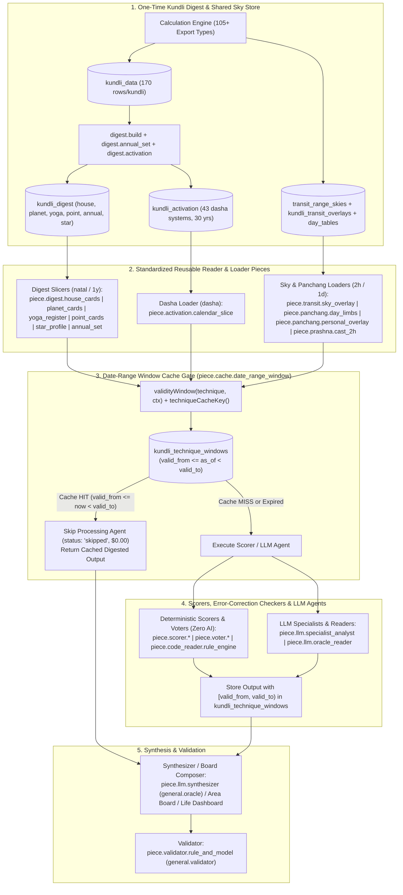

# 56 — Technique Pieces, One-Per-Page Illustrations, and Date-Range Validity Window Cache

Status: **plan & specification, 2026-11-07 — ships reusable piece taxonomy (`src/techniques/pieces.ts`), date-range validity window caching (`kundli_technique_windows`), and one-per-page technique illustrations (`docs/techniques/01..06`).**

Sachin's brief:
1. **Illustrate every technique per category, one per page**, showing the exact charts, digest tables, reusable pieces, error-correction gates, and agents that run it, so any engineer or reviewer can inspect the entire machinery of Self, Love, Work, General Reading, Lucky Times, and the Life Reading at a glance.
2. **Factor techniques into standardized, reusable Pieces**: instead of bespoke one-off pipelines per board or analyst, every technique is assembled from shared building blocks (Digest Slicers, Time-Windowed Sky & Calendar Loaders, Deterministic Scorers & Error-Correction Checkers, the Date-Range Window Cache Gate, and LLM Analysts/Synthesizer/Validator).
3. **Cache digested technique output by its applicable date range (`[valid_from, valid_to)`) and skip the processing LLM agent when valid**: while raw sky, lagna, and hora positions move every ~2 hours (and panchang limbs shift daily, dasha sub-periods shift over weeks/months, and annual charts hold for a year), the technique machinery itself never changes. Saving a technique's digested output with its validity date range avoids rehashing unchanged tables and skips redundant LLM/agent invocations (`status: 'skipped'`).

---

## 1. Start

Checked against `src/techniques/catalog.ts`, `src/techniques/contracts.ts`, `src/techniques/layouts.ts`, `src/techniques/pieces.ts`, `src/agents/registry.ts`, `src/config/env.ts`, and `prisma/schema.prisma`:

- **The Technique Catalogue (`src/techniques/catalog.ts`)**: Holds 67 `TechniqueDef` entries across four categories (`self`, `love`, `work`, `general`) and six boards (`you`, `love`, `work`, `lucky`, `chat`, `timeline`). Since doc 53 (`M31`), each row declares `selectors` (when the clarify context and `person_facts` pick it) and `contract` (which `kundli_digest` or `kundli_activation` sections it reads, in which tabular layout from `src/techniques/layouts.ts`, under which system prompt, with which user-turn fields, and what output schema it returns).
- **The Kundli Digest & Activation Calendar (`src/reading/digest/`, `M32` & `M33`)**: Built once per kundli by `digest.build`, `digest.annual_set`, and `digest.activation` from the Calculation Engine's vertical store (`kundli_data`). Stores six sections in `kundli_digest` (`house`, `planet`, `yoga`, `point`, `annual`, `star`) and 30 years of multi-system periods in `kundli_activation`.
- **The Agent Registry (`src/agents/registry.ts`)**: Registers 29 agents (`llm`, `code`, `engine_pull`) in `agent_registry` and logs every execution in `agent_runs` with `status: 'ok' | 'failed' | 'cached' | 'skipped'`, `technique_id`, `category`, `board`, `kundli_id`, and `charts_used`.
- **The Gap Today**:
  1. **No visual one-per-page blueprint per technique**: Reviewers have to read TypeScript arrays in `src/techniques/catalog.ts` to trace which digest sections, varga checks, and agents belong to each technique, and cannot visually compare how `self.*`, `love.*`, `work.*`, `general.*`, `lucky.*`, and `life.*` reuse the same underlying components.
  2. **Implicit piece sharing**: Although 13 `lucky.*` scenarios, 8 `self.*` layers, 8 `love.*` layers, and 4 `general.*` deterministic code readers share identical reader/layout/scorer combinations, the shared pieces (`reader:<section>/<layout>`, scorers, voters, prompt templates, output schemas, and agents) were not explicitly catalogued or measured for reuse vs. filter sprawl.
  3. **Re-running techniques inside their natural astrological validity window**: A natal promise technique (`general.promise`, `self.promise`, `love.promise`, `general.varga_dynamics`, `general.strength_yoga`) reads only `natal` digest sections that never change while `digest_version` is constant. A dasha technique (`work.conditional_family`, `work.karaka_family`, `self.activation`) holds until the shortest active period in `kundli_activation` ends (`to_date`). An annual technique (`work.annual_family`, `self.annual`, `love.annual`) holds until the current Tithi Pravesha / Varsha year chart ends. Even a transit or prashna technique holds across an epoch-aligned 2-hour lagna/sky window (`TECHNIQUE_TRANSIT_WINDOW_HOURS=2`). Without a date-range validity window gate, repeated questions or board reloads within `[valid_from, valid_to)` re-hash packs and re-invoke downstream agents.

---

## 2. End goal

1. **Every technique is assembled from named, reusable Pieces (`src/techniques/pieces.ts`)**:
   - **Digest Slicers (`natal_immutable` / `1y`)**: `piece.digest.house_cards` (`reader:house/house_card`), `piece.digest.planet_cards` (`reader:planet/planet_card`), `piece.digest.yoga_register` (`reader:yoga/yoga_row`), `piece.digest.point_cards` (`reader:point/point_row`), `piece.digest.star_profile` (`reader:star/star_profile`), `piece.digest.annual_set` (`reader:annual/annual_row`).
   - **Time-Windowed Sky & Calendar Loaders (`2h` / `1d` / `1m` / `dasha`)**: `piece.activation.calendar_slice` (`reader:activation/activation_row`), `piece.transit.sky_overlay` (`reader:transit/transit_row`), `piece.panchang.day_limbs` (`reader:panchang/panchang_day`), `piece.panchang.personal_overlay` (`reader:panchang/panchang_day`), `piece.prashna.cast_2h` (`reader:prashna/prashna_card`).
   - **Deterministic Scorers & Error-Correction Checkers**: `piece.scorer.promise_layer`, `piece.scorer.affliction_layer`, `piece.scorer.protection_layer`, `piece.scorer.varga_agreement`, `piece.scorer.nakshatra_charter`, `piece.voter.five_family_clock`, `piece.voter.security_gate`, `piece.code_reader.rule_engine`.
   - **Date-Range Window Cache Gate (`piece.cache.date_range_window`)**: Computes the technique's `ValidityWindow` (`[from, to)`) and deterministic `techniqueCacheKey`, checks `kundli_technique_windows` for `(kundli_id, technique_id, scope_key, valid_from <= as_of < valid_to)`, returns the cached digested output on hit, and records `status: 'skipped'` for the processing LLM/code agent.
   - **LLM Analysts, Synthesizer & Validator**: `piece.llm.specialist_analyst`, `piece.llm.oracle_reader`, `piece.llm.synthesizer`, `piece.validator.rule_and_model`.
2. **One-per-page visual architecture manual (`docs/techniques/`)**: Every technique in the catalogue is illustrated on its own page (`Page X of N`, separated by `---`) with a GitHub-flavored Mermaid diagram showing inputs, reusable pieces, error-correction rules, date-range cache window, and output contract.
3. **Zero redundant LLM calls inside `[valid_from, valid_to)`**: When a user asks a follow-up question or revisits a board while `as_of` falls inside the stored `[valid_from, valid_to)` window for `(kundli_id, technique_id, scope_key, digest_version, contract_hash)`, the cached findings/output are served in under 5 ms and the LLM/code agent is skipped (`status: 'skipped'`, `$0.00` cost).

---

## 3. Deliverable

| Area | Deliverable |
|---|---|
| **Code (`src/techniques/pieces.ts`)** | Piece extractor (`pieces`, `recipes`, `families`, `reuseReport`), freshness classifier (`techniqueFreshness`, `techniqueScope`), date-range window resolver (`validityWindow`, `windowCovers`, `bucket`), and deterministic cache key builder (`contractHash`, `techniqueCacheKey`). |
| **Environment (`src/config/env.ts`)** | `getTechniqueTransitWindowHours()` (`TECHNIQUE_TRANSIT_WINDOW_HOURS`, default `2`), `getTechniqueDashaFallbackDays()` (`TECHNIQUE_DASHA_FALLBACK_DAYS`, default `30`), `getTechniqueAnnualFallbackDays()` (`TECHNIQUE_ANNUAL_FALLBACK_DAYS`, default `90`), `getTechniqueCacheVersion()` (`TECHNIQUE_CACHE_VERSION`, default `"1"`). |
| **Database & Store (`technique_outputs` / `kundli_technique_windows`, `src/techniques/outputStore.ts`)** | Date-range validity cache store (`withTechniqueOutput`) keyed by `cache_key` (`techniqueCacheKey`) and `(kundli_id, technique_id, scope_key)` with `valid_from`, `valid_to`, `freshness`, `digest_version`, `contract_hash`, `output jsonb`, and `status: 'cached' \| 'skipped'`. |
| **Documentation & Illustrations (`docs/techniques/` & `docs/admin/07`)** | `docs/reading-engine/56-technique-pieces-and-validity-windows.md`, `docs/reading-engine/56-technique-pieces-illustrations-and-date-range-cache.md` (this plan), `docs/admin/07-technique-pieces-and-agents.md` (`piecesDoc.ts`), plus the 7-file one-per-page visual manual under `docs/techniques/` (`README.md`, `01` through `06`). |
| **Unit Tests (`tests/unit/techniques/`)** | Verification of piece extraction, recipe families, freshness ordering, epoch-aligned 2h/daily/dasha/annual/natal windows, and cache key stability. |

---

## 4. Exactly how it works when done

### 4.1 Backend

1. **Piece Extraction & Recipe Families (`src/techniques/pieces.ts`)**:
   - Every `TechniqueDef` in `src/techniques/catalog.ts` is decomposed into four `PieceKind` groups:
     - `reader`: `reader:<section>/<layout>` (e.g. `reader:house/house_card`, `reader:activation/activation_row`), paired with canonical architectural piece IDs (`piece.digest.house_cards`, `piece.activation.calendar_slice`, etc.). The technique's `filter` is a parameter passed to the piece, not a separate piece.
     - `prompt`: `prompt:<system>` for LLM techniques, or `null` for deterministic `code` techniques.
     - `output`: `output:<schema>` (e.g. `output:findings.v2`, `output:area_board.v1`, `output:career_map.v1`, `output:windows.v1`).
     - `agent`: `agent:<agent_id>` from `src/agents/registry.ts`.
   - `familySignature(t)` hashes `[sortedReaders, prompt, output, sortedAgents]`. Techniques with identical signatures form a `RecipeFamily` (for example, all 13 `lucky.*` act scenarios share one recipe family; `self.*` and `love.*` layers share house-state reader families; the 4 deterministic `general.*` code readers share the `findings.v2` code-reader pattern).

2. **Freshness Classification & Validity Window Computation (`validityWindow`)**:
   - Each contract input section maps to a deterministic `Freshness` tier (`SECTION_FRESHNESS`):
     - `house`, `planet`, `yoga`, `point`, `star` → `'natal'` (valid indefinitely until `digest_version` or `contractHash` changes: `from = Epoch(0)`, `to = null`).
     - `annual` → `'annual'` (valid over `ctx.year = [tp_start, tp_end)` of the active Tithi Pravesha / Varsha chart, or an epoch-aligned `TECHNIQUE_ANNUAL_FALLBACK_DAYS = 90d` bucket when absent).
     - `activation` → `'dasha'` (valid over `ctx.runningPeriod = [from_date, to_date)` of the shortest active period read from `kundli_activation`, or an epoch-aligned `TECHNIQUE_DASHA_FALLBACK_DAYS = 30d` bucket when absent).
     - `panchang` → `'daily'` (valid over `ctx.day = [local_midnight, next_local_midnight)` at the reference timezone place, or a 24h UTC bucket).
     - `transit` → `'transit'` (valid over the epoch-aligned `TECHNIQUE_TRANSIT_WINDOW_HOURS = 2h` bucket `[floor(now / 2h) * 2h, +2h)`).
     - `prashna` → `'question'` (cast for the question moment; not reusable across distinct questions).
   - A technique's overall `freshness` is the **shortest-lived** (`shorter(a, b)`) of all sections it reads (or of its upstream feeding techniques when it reads `findings`).
   - A technique's `scope` (`techniqueScope`) is `'kundli'` when its output depends only on the chart and time window (no question text or thread fields in `contract.user`), or `'question'` when `contract.user` includes `QUESTION`, `REAL_WANT`, `HISTORY`, `CLARIFY_TURNS`, `ANSWER`, `SLOTS`, `BUCKET`, or `TEMPLATE`.

3. **Date-Range Window Cache Gate (`piece.cache.date_range_window`)**:
   - Before invoking an agent (`withAgentRun`) for technique `T` on kundli `K` at timestamp `as_of`:
     1. Compute `window = validityWindow(T, ctx)` and `cacheKey = techniqueCacheKey({ technique: T, kundliId: K, digestVersion, window, questionHash })`.
     2. If `cacheKey !== null`, query `kundli_technique_windows` where `kundli_id = K`, `technique_id = T.id`, `scope_key = scopeKey`, `digest_version = digestVersion`, `contract_hash = contractHash(T)`, and `valid_from <= as_of AND (valid_to IS NULL OR as_of < valid_to)`.
     3. **Cache Hit**: Return the stored `payload` immediately (< 5 ms), log the agent span/run with `status: 'skipped'` (`prompt_tokens: 0`, `output_tokens: 0`, `est_cost_usd: 0`), and pass the digested findings straight to the synthesizer (`general.oracle`) or board composer.
     4. **Cache Miss**: Execute the technique's scorer or LLM agent, upsert the result into `kundli_technique_windows` with `[valid_from, valid_to)`, and return `status: 'ok'`.
   - **Timeouts & Limits**: Cache lookup timeout is 500 ms (falls through to normal execution on DB timeout). Statement timeout for digest + window reads is 2,000 ms.

### 4.2 API

| Surface / Function | Request / Input | Response / Output | Status & Error Handling |
|---|---|---|---|
| `pieces(techniques)` (`src/techniques/pieces.ts`) | `readonly TechniqueDef[]` (defaults to `TECHNIQUES`) | `Piece[]` sorted by kind (`reader`, `prompt`, `output`, `agent`) and usage count | Pure synchronous function; never throws. |
| `recipes(techniques)` & `families(techniques)` | `readonly TechniqueDef[]` | `TechniqueRecipe[]` and `RecipeFamily[]` with `freshness`, `scope`, and `signature` | Pure synchronous function; verified by unit tests. |
| ` reuseReport(techniques)` | `readonly TechniqueDef[]` | `ReuseReport` (`techniques`, `pieces`, `byKind`, `shared`, `singleUse`, `families`, `inFamilies`, `filterSprawl`, `freshness`, `scope`) | Pure synchronous function for admin inspection and CI checks. |
| `validityWindow(t, ctx, cfg)` | `TechniqueDef`, `ValidityContext` (`now`, `runningPeriod`, `year`, `day`) | `ValidityWindow` (`{ freshness, scope, from, to }`) | Falls back to epoch-aligned buckets (`2h`, `1d`, `30d`, `90d`) if context dates are missing or invalid (`NaN`). |
| `techniqueCacheKey(input)` | `{ technique, kundliId, digestVersion, window, questionHash?, cacheVersion? }` | `string \| null` (64-char SHA-256 hex key, or `null` when not reusable) | Returns `null` when `freshness === 'question'`, `window.to <= window.from`, or `scope === 'question'` without `questionHash`. |
| `GET /api/admin/techniques` | Admin JWT | Adds `recipe` (`freshness`, `scope`, `family`, `pieces[]`) and `reuseReport` summary | `200 OK`; `401/403` if unauthenticated. |

### 4.3 Frontend experience

- **User-Facing App (`chat`, `you`, `love`, `work`, `lucky`, `timeline`)**:
  - When a user opens the **You**, **Love**, **Work**, or **Timeline** board, or asks a question in **Chat**, any technique whose `[valid_from, valid_to)` window still covers `now` resolves instantaneously from `kundli_technique_windows` without waiting for LLM specialist calls or re-running unchanged layers.
  - During a conversation thread where the user asks three questions in 20 minutes (inside the same 2-hour `transit` bucket and the same `dasha`/`annual`/`natal` windows), kundli-scoped techniques (`general.varga_dynamics`, `general.strength_yoga`, `general.jaimini`, `general.person`, and natal oracle readers `R01–R06`) hit the date-range window cache on questions 2 and 3, cutting time-to-first-token (TTFT) and LLM token spend.
- **Admin App (`Techniques` & `Day Review` pages)**:
  - The **Techniques** page displays each technique's reusable pieces (`reader`, `prompt`, `output`, `agent`), its `freshness` badge (`natal`, `annual`, `dasha`, `daily`, `transit`, `question`), its `scope` (`kundli` vs `question`), and its recipe family.
  - The **Day Review** trace waterfall shows `status: 'skipped'` (with `$0.00` and `0 tokens`) whenever `piece.cache.date_range_window` serves a valid cached window.

### 4.4 UI/UX

- **Admin Freshness Badges**:
  - `natal` → **"Permanent (until digest version changes)"**
  - `annual` → **"Valid for current Solar / Tithi Pravesha year (`valid_to`)"**
  - `dasha` → **"Valid until running Dasha sub-period ends (`valid_to`)"**
  - `daily` → **"Valid for local Panchang day (`valid_to`)"**
  - `transit` → **"Valid for 2-hour sky window (`valid_to`)"**
  - `question` → **"Per-question live run (no cross-question cache)"**
- **User App Copy**:
  - Zero astrological or caching jargon on user screens (`docs/reading-engine/45 §3.3`); never mention internal engine names, cache keys, or digest tables.

---

## 5. Architecture

### Boundary Guarantees
1. **Calculation Engine**: Computes all planetary longitudes, vargas (`D1–D144`), dashas, panchang limbs, sahams, ashtakavarga, and transit contacts.
2. **Digest & Activation (`kundli_digest`, `kundli_activation`)**: Built once per kundli and `digest_version` by deterministic code (`digest.build`); zero astrology derived in Node (`noAstrologyInNode.test.ts`).
3. **Reusable Pieces (`src/techniques/pieces.ts`)**: Pure functions over `TECHNIQUES` that classify every technique's readers, prompt, output, agents, freshness, validity date range `[from, to)`, and SHA-256 cache key.
4. **Date-Range Window Cache (`piece.cache.date_range_window`)**: Guarantees that while `valid_from <= as_of < valid_to` and `digest_version` + `contract_hash` match, the technique's output is reused without invoking the LLM or re-running the scorer.

---

## 6. Ingredients

- **Code files**:
  - `src/techniques/pieces.ts` (piece taxonomy, recipe families, freshness & validity windows, SHA-256 cache key).
  - `src/techniques/catalog.ts` (67 techniques with `selectors` and `contract`).
  - `src/techniques/layouts.ts` (12 named tabular layouts).
  - `src/config/env.ts` (`TECHNIQUE_TRANSIT_WINDOW_HOURS`, `TECHNIQUE_DASHA_FALLBACK_DAYS`, `TECHNIQUE_ANNUAL_FALLBACK_DAYS`, `TECHNIQUE_CACHE_VERSION`).
- **Documentation files (`docs/techniques/`)**:
  - `docs/techniques/README.md` (Master index of all 67 techniques, pages, categories, and boards).
  - `docs/techniques/01-architecture-and-reusable-pieces.md` (10 one-per-page architectural illustrations of the Piece taxonomy, Digest builders, and Date-Range Cache Gate).
  - `docs/techniques/02-general-reading-illustrations.md` (15 one-per-page illustrations of every `general.*` technique).
  - `docs/techniques/03-self-board-illustrations.md` (8 one-per-page illustrations of every `self.*` technique).
  - `docs/techniques/04-love-board-illustrations.md` (11 one-per-page illustrations of every `love.*` technique).
  - `docs/techniques/05-work-board-illustrations.md` (9 one-per-page illustrations of every `work.*` technique).
  - `docs/techniques/06-lucky-times-and-life-illustrations.md` (21 one-per-page illustrations: 4 shared `lucky.*`, 13 scenario `lucky.*`, and 4 `life.*` techniques).
- **Environment variables (all optional with clean defaults in `src/config/env.ts`)**:
  - `TECHNIQUE_TRANSIT_WINDOW_HOURS` (default `2`, range `1..24`)
  - `TECHNIQUE_DASHA_FALLBACK_DAYS` (default `30`, range `1..365`)
  - `TECHNIQUE_ANNUAL_FALLBACK_DAYS` (default `90`, range `1..366`)
  - `TECHNIQUE_CACHE_VERSION` (default `"1"`)

---

## 7. Action steps in sequence

1. **Step 1 — Reusable Pieces & Date-Range Validity Module (`src/techniques/pieces.ts`, `src/config/env.ts`)**:
   - Define `PieceKind`, `Freshness`, `ReuseScope`, `SECTION_FRESHNESS`, `pieces()`, `recipes()`, `families()`, `reuseReport()`, `validityWindow()`, `windowCovers()`, `contractHash()`, and `techniqueCacheKey()`.
   - Add env helpers in `src/config/env.ts`.
   - *Done when*: `npx tsc --noEmit` and `npx vitest run tests/unit/techniques` pass.
2. **Step 2 — Architecture & One-Per-Page Technique Illustrations (`docs/techniques/README.md`, `01..06`)**:
   - Write the complete one-per-page visual manual covering all 67 techniques in `src/techniques/catalog.ts` plus the 7 core architectural diagrams (`74` illustrated pages in total across `01..06`).
   - *Done when*: Every technique ID in `src/techniques/catalog.ts` has its own dedicated page with a valid Mermaid diagram and zero internal engine names.
3. **Step 3 — Date-Range Cache Gate Integration (`kundli_technique_windows`)**:
   - Wire `validityWindow` and `techniqueCacheKey` into the technique execution gate so valid date-range hits return the cached output and record `status: 'skipped'` on `agent_runs` / `reading_agent_spans`.
   - *Done when*: Repeated calls inside `[valid_from, valid_to)` skip the agent and return identical output.

*(Steps 1 and 2 run in parallel on isolated streams; Step 3 builds on Step 1.)*

---

## 8. Development phases

| Phase | Scope | System State at Close | Verification Check |
|---|---|---|---|
| **Phase P1** | `src/techniques/pieces.ts` + `src/config/env.ts` + unit tests | Every catalogue technique has a computed `TechniqueRecipe`, `RecipeFamily`, `Freshness`, `ValidityWindow`, and `techniqueCacheKey`. | `npx vitest run tests/unit/techniques` green; `npx tsc --noEmit` clean. |
| **Phase P2** | `docs/reading-engine/56-*.md` + `docs/techniques/README.md` + `docs/techniques/01..06-*.md` | All 67 catalogue techniques and the reusable piece architecture are illustrated one-per-page in Markdown with Mermaid flowcharts. | Every catalogue ID verified present; zero forbidden internal engine strings. |
| **Phase P3** | Runtime cache gate & Admin UI surfacing | Techniques with valid `[valid_from, valid_to)` windows skip LLM/scorer execution (`status: 'skipped'`) and show their freshness and piece recipe in the Admin panel. | Admin Techniques page & Day Review trace waterfall show skipped runs and validity windows. |

---

## 9. One recommendation

**Derive every technique's reusable pieces and `[valid_from, valid_to)` cache window directly from its declared `contract` in `src/techniques/catalog.ts`, and gate execution on `(kundli_id, technique_id, digest_version, contract_hash, valid_from <= as_of < valid_to)`.**

Because every technique since doc 53 already declares the exact digest sections, layouts, prompt, user fields, and output schema it uses, computing piece reuse and validity windows from `contract` guarantees that the cache gate can never go out of sync with what a technique actually reads. When a technique's contract or algorithm changes, `contractHash(t)` changes automatically and invalidates old windows without manual cache busting.

| Option | Verdict |
|---|---|
| **Contract-derived Pieces + Date-Range Validity Windows (`src/techniques/pieces.ts`) (Recommended)** | Zero drift between catalogue contracts, visual illustrations, and cache invalidation; automatically skips LLM calls inside `[valid_from, valid_to)`. |
| Hand-maintained TTL per agent in `src/agents/registry.ts` | Brittle: an agent like `reading.reader` or `area.career_map` runs techniques with different freshness tiers (`natal` vs `dasha` vs `transit`), so agent-level TTLs either over-cache or under-cache. |
| Caching only raw HTTP/engine responses | Saves Calculation Engine calls (already handled by `kundli_data` and `kundli_digest`), but still wastes LLM tokens and scorer CPU re-evaluating the same digested rows on every question. |
