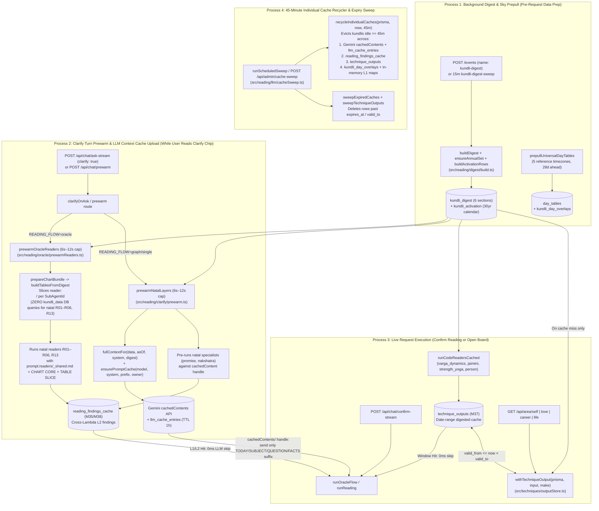

# 57 — Decoupled Technique Pieces → Sub-Agent LLM Context Cache Upload, Pre-Run Warmup & Process Handoff

> **Purpose**: Bridges the **Decoupled Technique Pieces & Date-Range Output Cache (`M37`, doc 56)** with the **Per-Sub-Agent Digest Slicing, Cross-Lambda Findings Cache & 45-Minute Individual Cache Recycler (`M38`)** so every AI sub-agent (`reading.analyst.*`, `reading.reader` `R01–R14`/`P1–P3`, `reading.oracle`, `reading.synth`) reads from pre-uploaded LLM context caches (`Gemini cachedContents` + `llm_cache_entries`) and pre-digested tables (`kundli_digest`, `kundli_activation`, `reading_findings_cache`, `technique_outputs`) instead of pulling raw `kundli_data` rows live from PostgreSQL during a user request.

---

## 0. Quick Reference: Where All Technique Illustrations Live (#1)

### A. One-Per-Page Visual Manual in `AIAstra_Server` (`docs/techniques/`)
76 self-contained, one-per-page illustrated sheets across 6 volumes:
- **Master Index & Reusable Pieces Reference**: [`docs/techniques/README.md`](file:///c:/Users/Owner/Documents/work/AIAstra_Server/docs/techniques/README.md)
- **Vol. 01 — System Architecture, Reusable Pieces & Digest Foundation (10 pages)**: [`docs/techniques/01-architecture-and-reusable-pieces.md`](file:///c:/Users/Owner/Documents/work/AIAstra_Server/docs/techniques/01-architecture-and-reusable-pieces.md)
  - Pages `01–07`: End-to-End System Machinery, 5 Classes of Reusable Pieces (`reader:*`, `prompt:*`, `output:*`, `agent:*`, `synthesizer`), Validity Windows & `technique_outputs` (`M37`) Cache Gate, 23 Recipe Families, Error-Correction & Fallbacks.
  - Pages `08–10`: `digest.build`, `digest.annual_set`, `digest.activation`.
- **Vol. 02 — General Reading / Chat Board (15 pages)**: [`docs/techniques/02-general-reading-illustrations.md`](file:///c:/Users/Owner/Documents/work/AIAstra_Server/docs/techniques/02-general-reading-illustrations.md)
  - Pages `01–15`: `general.intake`, `general.clarify`, `general.promise`, `general.dasha`, `general.transit`, `general.nakshatra`, `general.annual`, `general.prashna`, `general.varga_dynamics`, `general.strength_yoga`, `general.jaimini`, `general.person`, `general.reader` (`R01–R14`, `P1–P3`), `general.oracle`, `general.validator`.
- **Vol. 03 — Self ("You") Board & Research Lab (10 pages)**: [`docs/techniques/03-self-board-illustrations.md`](file:///c:/Users/Owner/Documents/work/AIAstra_Server/docs/techniques/03-self-board-illustrations.md)
  - Pages `01–08`: `self.promise`, `self.affliction`, `self.protection`, `self.activation`, `self.transit`, `self.annual`, `self.varga`, `self.nakshatra`.
  - Pages `09–10`: `research.self_dashboard_qa`, `research.technical_verifier`.
- **Vol. 04 — Love Board (11 pages)**: [`docs/techniques/04-love-board-illustrations.md`](file:///c:/Users/Owner/Documents/work/AIAstra_Server/docs/techniques/04-love-board-illustrations.md)
  - Pages `01–11`: `love.promise`, `love.affliction`, `love.protection`, `love.activation`, `love.transit`, `love.annual`, `love.varga`, `love.nakshatra`, `love.meet`, `love.health`, `love.reconcile`.
- **Vol. 05 — Work Board (9 pages)**: [`docs/techniques/05-work-board-illustrations.md`](file:///c:/Users/Owner/Documents/work/AIAstra_Server/docs/techniques/05-work-board-illustrations.md)
  - Pages `01–09`: `work.present_tone`, `work.security_grade`, `work.subarea_windows`, `work.horizons`, `work.looking_back`, `work.annual_family`, `work.conditional_family`, `work.karaka_family`, `work.d10_check`.
- **Vol. 06 — Lucky Times & Life / Timeline Board (21 pages)**: [`docs/techniques/06-lucky-times-and-life-illustrations.md`](file:///c:/Users/Owner/Documents/work/AIAstra_Server/docs/techniques/06-lucky-times-and-life-illustrations.md)
  - Pages `01–04`: Shared Lucky foundation (`lucky.day_tables`, `lucky.personal_overlay`, `lucky.avoid_bands`, `lucky.panchang_limbs`).
  - Pages `05–17`: All 13 scenario evaluators (`lucky.send_Note` … `lucky.travel_move`).
  - Pages `18–21`: Life / Timeline (`life.promise_scale`, `life.timing_agreement`, `life.mahadasha_charter`, `life.dashboard`).

### B. Generated Area & Recipe Family Mermaid Reference + Architecture Blueprints
- **Generated Admin & Pieces Reference**: [`docs/admin/07-technique-pieces-and-agents.md`](file:///c:/Users/Owner/Documents/work/AIAstra_Server/docs/admin/07-technique-pieces-and-agents.md) (generated from [`src/techniques/piecesDoc.ts`](file:///c:/Users/Owner/Documents/work/AIAstra_Server/src/techniques/piecesDoc.ts) via `npx.cmd tsx scripts/write-technique-pieces-doc.ts`).
- **Piece & Validity Window Blueprints**:
  - [`docs/reading-engine/56-technique-pieces-and-validity-windows.md`](file:///c:/Users/Owner/Documents/work/AIAstra_Server/docs/reading-engine/56-technique-pieces-and-validity-windows.md)
  - [`docs/reading-engine/56-technique-pieces-illustrations-and-date-range-cache.md`](file:///c:/Users/Owner/Documents/work/AIAstra_Server/docs/reading-engine/56-technique-pieces-illustrations-and-date-range-cache.md)

### C. Interactive Admin Panel (`aiadastra_admin` — Local & Live Staging)
- **Admin Web UI Component**: [`web/src/pages/Machinery.tsx`](file:///c:/Users/Owner/Documents/work/aiadastra_admin/web/src/pages/Machinery.tsx)
  - Top Navigation tab: **Machinery** (`/machinery` and `/illustrations`).
  - Deep-link from any row on `/techniques` ([`web/src/pages/Techniques.tsx`](file:///c:/Users/Owner/Documents/work/aiadastra_admin/web/src/pages/Techniques.tsx)) or `/techniques/:id` ([`web/src/pages/Technique.tsx`](file:///c:/Users/Owner/Documents/work/aiadastra_admin/web/src/pages/Technique.tsx)) via **"Open one-page illustration →"** (`/illustrations?id=<techniqueId>`).
  - Features: Interactive **One-Per-Page Illustrations Deck** (`Page X of N` with `‹ Previous` / `Next ›`, jump selector, inline Markdown + Mermaid diagram preview toggle, and **Download `.md`** button), **4-Column Area Flow Panels** (`Reader pieces → Agents → Feeds`), **Filterable Pieces Table**, and **Validity Windows & Agent-Skip Table**.
- **Admin API Endpoints**: [`api/src/admin/machinery.ts`](file:///c:/Users/Owner/Documents/work/aiadastra_admin/api/src/admin/machinery.ts) serving `GET /api/admin/machinery` and `GET /api/admin/techniques/illustrations`.
- **Live Staging URLs (Deployed & Verified via GitHub Actions OIDC on `release-candidate-staging`)**:
  - **Admin Web (`aiadastra-admin-web`, Amplify App `d1qhwivm0xxltl`)**:
    - `https://staging.d1qhwivm0xxltl.amplifyapp.com/machinery`
    - `https://staging.d1qhwivm0xxltl.amplifyapp.com/illustrations`
    - `https://staging.d1qhwivm0xxltl.amplifyapp.com/illustrations?id=general.promise` (deep-link to any technique ID)
  - **Admin API (`aiadastra-admin-api` via CloudFront)**:
    - `https://dirq7yl5oslnm.cloudfront.net/api/admin/machinery`
    - `https://dirq7yl5oslnm.cloudfront.net/api/admin/techniques/illustrations`

---

## 1. Start (System As It Is Today)

Two complementary caching and decomposition tracks now exist in `AIAstra_Server`:

1. **Track 1 — Technique Decomposition & Date-Range Digested Output Cache (`M37`, `src/techniques/pieces.ts` & `src/techniques/outputStore.ts`)**:
   - Decomposes all techniques in [`src/techniques/catalog.ts`](file:///c:/Users/Owner/Documents/work/AIAstra_Server/src/techniques/catalog.ts) into standardized reusable pieces:
     - **12 Reader Pieces** (`reader:<section>/<layout>`, e.g. `reader:house/house_card`, `reader:planet/planet_card`, `reader:activation/activation_row`, `reader:annual/annual_row`, `reader:transit/transit_row`, `reader:yoga/yoga_row`, `reader:point/point_row`, `reader:star/star_profile`, `reader:panchang/panchang_day`, `reader:prashna/prashna_card`, `reader:findings/findings_in`, `reader:text/text_in`).
     - **11 Prompt Pieces** (`prompt:<system>`, e.g. `prompt:src/reading/prompts/v2/promise.md`, `prompt:src/reading/prompts/readers/_shared.md`, `prompt:src/reading/prompts/oracle/system.md`).
     - **Output Schema Pieces** (`output:<schema>`, e.g. `output:findings.v2`, `output:area_board.v1`, `output:career_map.v1`).
     - **Agent Pieces** (`agent:<id>`, e.g. `agent:reading.analyst.promise`, `agent:reading.reader`, `agent:area.self_board`).
   - Derives each technique's **Freshness** (`natal > annual > dasha > daily > transit > question`), **Reuse Scope** (`kundli` vs `question`), half-open **Validity Window** (`[from, to)`), and **Cache Key** (`techniqueCacheKey()`), and persists digested outputs in `technique_outputs` (`M37`) via `withTechniqueOutput()`.

2. **Track 2 — Per-Sub-Agent Digest Slicing, Cross-Lambda Findings Cache & 45-Minute Individual Cache Recycler (`M38`, `src/reading/oracle/digestSlices.ts`, `src/reading/nodes/findingsCache.ts`, `src/reading/llm/promptCache.ts`, `src/reading/llm/cacheSweep.ts`)**:
   - Defines `SUBAGENT_DIGEST_SPECS` for 32 sub-agents (`R01..R14`, `P1..P3`, `specialist:promise..prashna`, `code:varga_dynamics..person`, `oracle`, `addendum`, `synthesize`, `clarify`, `validator`, `intake`) and slices an already-built `DigestView` (`kundli_digest`) + `ActivationRow[]` (`kundli_activation`) via `buildTablesFromDigest()` so sub-agents never pull raw `kundli_data` rows live during a request.
   - Uploads long-lived system + chart prefixes to **Gemini `cachedContents`** (tracked in `llm_cache_entries` with `kundli_id`, `user_id`, `last_hit_at`), persists sub-agent findings across Lambda instances in `reading_findings_cache`, and recycles per-individual caches after **45 minutes of inactivity** via `recycleIndividualCaches()`.

3. **Integration Gap Resolved in This Plan**:
   - Previously, `src/techniques/pieces.ts` (decoupled technique contracts) and `src/reading/oracle/digestSlices.ts` (per-sub-agent digest slices & LLM cache uploads) had no unified programmatic bridge mapping each technique's decoupled Reader/Prompt/Output/Agent pieces to its sub-agent digest slice, LLM context cache upload payload, output store, and background prewarm/recycle processes.
   - In addition, `prewarmNatalLayers` in [`src/reading/clarify/prewarm.ts`](file:///c:/Users/Owner/Documents/work/AIAstra_Server/src/reading/clarify/prewarm.ts) called `fullContextFor(data, s.asOf, await buildSystem(prisma))` **without** passing `digest` (`loadDigest(prisma, data.kundliId)`), whereas `runReading` in [`src/reading/run.ts:456`](file:///c:/Users/Owner/Documents/work/AIAstra_Server/src/reading/run.ts#L456) passed `digest`, causing the prewarmed `FullContext` prefix hash to mismatch `runReading` whenever a kundli's digest was ready.

---

## 2. End Goal

1. **Zero Live `kundli_data` DB Pulls During Sub-Agent Execution**:
   - Before a user confirms their question (or before a board renders), the kundli's raw chart rows are already digested once into `kundli_digest` + `kundli_activation`, and the decoupled **Reader Pieces** (`reader:<section>/<layout>`) + **Prompt Piece** (`prompt:<system>`) are already sliced and uploaded to **Gemini `cachedContents` (`llm_cache_entries`)** and/or pre-evaluated into **`reading_findings_cache`** (`M35/M38`) and **`technique_outputs`** (`M37`).
   - When the user's request runs, sub-agents (`reading.analyst.*`, `reading.reader`, `reading.oracle`, `reading.synth`) reference the pre-uploaded `cachedContent` handle (`cachedContents/...`) and pass only the tiny per-request user suffix (`TODAY`, `SUBJECT`, `FRAME`, `HORIZON`, `REAL_WANT`, `QUESTION`, `FACTS`), or return immediately from `reading_findings_cache` / `technique_outputs` with `agent_runs.status = 'cached'`.
2. **Unified Programmatic Bridge (`src/techniques/subagentCachePlan.ts`)**:
   - Any worker, admin view, or prewarm process can call `techniqueSubAgentCachePlan(techniqueId)` or `buildTechniquePreRunCacheBundle({ techniqueId, digest, activation, context })` to obtain the exact sub-agent digest slices, LLM cache upload specification, output cache table, validity window, and supporting processes for every technique in `TECHNIQUES`.

---

## 3. Deliverable

1. **Programmatic Bridge Module**: [`src/techniques/subagentCachePlan.ts`](file:///c:/Users/Owner/Documents/work/AIAstra_Server/src/techniques/subagentCachePlan.ts)
   - `techniqueSubAgentCachePlan(id)` & `allTechniqueSubAgentCachePlans()` mapping all techniques in `TECHNIQUES` to their `SubAgentId[]`, `SubAgentDigestSpec[]`, `llmCacheUpload` spec, `outputCache` spec, and `processes`.
   - `buildTechniquePreRunCacheBundle()` materializing per-sub-agent `tables` and `coreText` directly from `DigestView` + `ActivationRow[]` with zero DB queries.
2. **Clarify Prewarm Digest Alignment & Cross-Lambda Persistence**: [`src/reading/clarify/prewarm.ts`](file:///c:/Users/Owner/Documents/work/AIAstra_Server/src/reading/clarify/prewarm.ts)
   - Loads `digest = await loadDigest(prisma, data.kundliId)` in `prewarmNatalLayers` and passes it to both `fullContextFor(data, s.asOf, system, digest)` and `buildEvidencePack(..., { digest })` so the Gemini `cachedContents` prefix warmed during Clarify has the exact same SHA-256 `prefix_hash` as `runReading`.
   - Checks `loadDbSpecialistFinding` before running a specialist and persists prewarmed natal findings via `saveDbSpecialistFinding` into `reading_findings_cache`.
3. **Unit Test Suite**: [`tests/unit/techniques/subagentCachePlan.test.ts`](file:///c:/Users/Owner/Documents/work/AIAstra_Server/tests/unit/techniques/subagentCachePlan.test.ts)
4. **Architecture & Handoff Documentation**:
   - [`docs/reading-engine/57-technique-pieces-llm-cache-upload-and-subagent-prewarm.md`](file:///c:/Users/Owner/Documents/work/AIAstra_Server/docs/reading-engine/57-technique-pieces-llm-cache-upload-and-subagent-prewarm.md)
   - [`docs/admin/07-technique-pieces-and-agents.md`](file:///c:/Users/Owner/Documents/work/AIAstra_Server/docs/admin/07-technique-pieces-and-agents.md)

---

## 4. Exactly How It Works When Done

### 4.1 Backend: End-to-End Pre-Run Upload & Sub-Agent Execution Flow

### 4.2 Complete Mapping: Decoupled Technique Pieces → Pre-Run LLM Cache Upload vs. Output Store

| Technique ID(s) | Decoupled Reader Pieces (`reader:<section>/<layout>`) | Prompt Piece (`prompt:<system>`) | Sub-Agents (`SUBAGENT_DIGEST_SPECS`) | Pre-Run Upload to LLM Context Cache (`llm_cache_entries` / Gemini `cachedContents`) | Pre-Computed Findings / Output Store (`M35/M37/M38`) | Freshness & Validity Window |
| :--- | :--- | :--- | :--- | :--- | :--- | :--- |
| **`general.promise`** | `reader:house/house_card`, `reader:planet/planet_card`, `reader:point/point_row`, `reader:yoga/yoga_row` | `prompt:src/reading/prompts/v2/promise.md` | `specialist:promise` | **Uploaded during Clarify prewarm**: `system` (`promise.md` + `FullContext.system`) + `cachedPrefix` (`FullContext.prefix` built with `DigestView` overlay). Per-request suffix sends only `TODAY`, `SUBJECT`, `FRAME`, `HORIZON`, `REAL_WANT`, `QUESTION`, `FACTS`. | `reading_findings_cache` (`horizonKey: 'natal'`, reused across all questions for this kundli). | `natal` (`[-∞, +∞)`, recycled after 45m idle) |
| **`general.nakshatra`** | `reader:star/star_profile`, `reader:house/house_card`, `reader:planet/planet_card` | `prompt:src/reading/prompts/v2/nakshatra.md` | `specialist:nakshatra` | **Uploaded during Clarify prewarm**: `system` (`nakshatra.md` + `FullContext.system`) + `cachedPrefix` (`FullContext.prefix` from `DigestView`). | `reading_findings_cache` (`horizonKey: 'natal'`). | `natal` (`[-∞, +∞)`, recycled after 45m idle) |
| **`general.dasha`** | `reader:activation/activation_row`, `reader:planet/planet_card`, `reader:house/house_card` | `prompt:src/reading/prompts/v2/dasha.md` | `specialist:dasha` | **Reuses pre-uploaded `FullContext` in `llm_cache_entries`** (warmed during Clarify) + sends horizon-clipped activation pack from `kundli_activation`. | `reading_findings_cache` (`horizonKey: '<horizon>:<YYYY-MM-DD>'`). | `dasha` (`[dasha.start, dasha.end)` or 30d fallback) |
| **`general.annual`** | `reader:annual/annual_row` | `prompt:src/reading/prompts/annual.md` | `specialist:annual` | **Reuses pre-uploaded `FullContext` in `llm_cache_entries`** + sends multi-year `TP`/`VP` rows from `kundli_digest.annual`. | `reading_findings_cache` (`horizonKey: '<horizon>:<YYYY-MM-DD>'`). | `annual` (`[year.start, year.end)` or 90d fallback) |
| **`general.transit`** | `reader:transit/transit_row`, `reader:planet/planet_card` | `prompt:src/reading/prompts/v2/transit.md` | `specialist:transit` | **Reuses pre-uploaded `FullContext` in `llm_cache_entries`** + sends clipped transit overlay rows. | `reading_findings_cache` (`horizonKey: '<horizon>:<YYYY-MM-DD>'`). | `transit` (2h UTC epoch-aligned bucket) |
| **`general.prashna`** | `reader:prashna/prashna_card`, `reader:house/house_card` | `prompt:src/reading/prompts/prashna.md` | `specialist:prashna` | **Reuses pre-uploaded `FullContext` in `llm_cache_entries`** + sends question-moment `prashna_card`. | `reading_findings_cache` (question-moment scoped). | `question` (single turn) |
| **`general.reader`** (`R01–R14`, `P1–P3`) | `reader:house/house_card`, `reader:planet/planet_card`, `reader:yoga/yoga_row`, `reader:point/point_row`, `reader:activation/activation_row`, `reader:transit/transit_row`, `reader:annual/annual_row`, `reader:prashna/prashna_card` | `prompt:src/reading/prompts/readers/_shared.md` (+ per-reader `R01..P3` curriculum) | `R01`..`R14`, `P1`..`P3` | **Sliced from `DigestView` + `ActivationRow[]` via `buildTablesFromDigest`**: `CHART CORE` (`D1` + `D9` + `D10` + `star`) + reader-specific `TABLE SLICE` (`R01` yogas/avasthas, `R02` `D9`/`D30`, `R03` vargas, `R04` Jaimini/Chara/Narayana, `R05` shadbala/SAV, `R06` doshas, `R08` Vimshottari, `R09` Yogini/Ashtottari/conditional, `R11` annual TP/VP). | **Pre-run during Clarify (`prewarmOracleReaders`)** into `reading_findings_cache` (`scopeKey: 'natal'` for `R01–R06`, `'person:<who>:<asOf>'` for `R13`, and `'<subject>:<horizon>:<asOf>'` for timed readers). | `natal` for `R01–R06`, `R13`; `dasha`/`annual`/`transit` for `R07–R11`, `R14`, `P1–P3` |
| **`general.varga_dynamics`, `general.jaimini`, `general.strength_yoga`, `general.person`** | `reader:house/house_card`, `reader:planet/planet_card`, `reader:point/point_row`, `reader:yoga/yoga_row` | `none` (deterministic code over `DigestView`; optional paired `R03`/`R04`/`R05`/`R06`/`R13`) | `code:varga_dynamics`, `code:jaimini`, `code:strength_yoga`, `code:person` | **None required (Zero LLM)**: reads directly from in-memory `DigestView` (`packs/digestSource.ts`). | **`technique_outputs` (`M37`)** via `runCodeReadersCached` (`withTechniqueOutput`), returning `findings.v2` immediately on cache hit. | `natal` (`[-∞, +∞)`, invalidated on digest rebuild or 45m idle) |
| **`general.oracle`** | `reader:findings/findings_in`, `reader:text/text_in` (+ cited `DigestView` rows) | `prompt:src/reading/prompts/oracle/system.md` | `oracle`, `addendum`, `synthesize` | **Uses pre-uploaded `FullContext` in `llm_cache_entries`** (`reading.synth`) or compact Oracle brief (`reading.oracle` joining cached `AnalystFindings` + cited `DigestView` keys + `person_facts`). | Streams `answer.markdown` directly to client and persists chat turn. | `question` (consumes pre-cached `natal`/`dasha`/`transit` findings) |
| **`general.intake`, `general.clarify`, `general.validator`** | `reader:text/text_in` | `prompt:src/reading/prompts/intake.md`, `prompt:db:clarify.system`, `prompt:src/reading/prompts/oracle/validator.md` | `intake`, `clarify`, `validator` | **System prompt only (no chart data)**: runs on question text + `person_facts`. `general.clarify` launches `prewarmOracleReaders` / `prewarmNatalLayers` in the background. | Ephemeral turn state (`clarify_runs`). | `question` (single turn) |
| **`self.*` (8) & `love.*` (11)** | `reader:house/house_card`, `reader:planet/planet_card`, `reader:point/point_row`, `reader:yoga/yoga_row`, `reader:activation/activation_row`, `reader:transit/transit_row`, `reader:annual/annual_row`, `reader:star/star_profile`, `reader:findings/findings_in` | `none` (deterministic code in `houseLayers.ts` & `boardService.ts`) | `[]` (`area.self_board`, `area.love_board`) | **None (Zero LLM)**: computes deterministically from `kundli_digest` + `kundli_activation` + stored transit snapshot. | **`technique_outputs` (`M37`)** via `withTechniqueOutput` in `boardService.ts` + `area_builds`. On window hit, skips layer computation and logs `agent_runs.status = 'cached'`. | `natal` (`promise`, `protection`, `varga`, `nakshatra`), `annual` (`annual`), `dasha` (`affliction`, `activation`), `transit` (2h bucket for `transit`, `meet`, `health`, `reconcile`) |
| **`work.*` (9)** | `reader:house/house_card`, `reader:activation/activation_row`, `reader:transit/transit_row`, `reader:annual/annual_row`, `reader:point/point_row`, `reader:planet/planet_card` | `none` (deterministic code in `career.ts` & `careerService.ts`) | `[]` (`area.career_inputs`, `area.career_map`) | **None (Zero LLM)**: computes deterministically from `kundli_digest` + `kundli_activation` + timeline span. | **`technique_outputs` (`M37`)** via `withTechniqueOutput` in `careerService.ts`. | `transit` (2h bucket for `present_tone`, `security_grade`, `subarea_windows`, `horizons`, `looking_back`), `annual` (`annual_family`), `dasha` (`conditional_family`, `karaka_family`, `d10_check`) |
| **`lucky.*` (17)** | `reader:panchang/panchang_day`, `reader:planet/planet_card`, `reader:activation/activation_row` | `none` (deterministic code in `luckyTimes/service.ts` & `windows.ts`) | `[]` (`lucky.day_tables`, `lucky.day_overlay`, `lucky.scenario_windows`) | **None (Zero LLM)**: scores candidate windows deterministically over `day_tables` + `kundli_day_overlays` + `DigestView`. | **`day_tables`** (shared 28-day sky across 5 reference timezones) + **`kundli_day_overlays`** (personal monthly tara/chandra bala). | `daily` (`[00:00Z, 24:00Z)` UTC day window) |
| **`life.*` (4)** | `reader:house/house_card`, `reader:planet/planet_card`, `reader:yoga/yoga_row`, `reader:activation/activation_row`, `reader:annual/annual_row`, `reader:transit/transit_row` | `none` (deterministic code in `life/promise.ts`, `timing.ts`, `charter.ts`, `compose.ts`) | `[]` (`life.dashboard`) | **None (Zero LLM)**: computes 13-area promise scale, multi-clock timing agreement, and 10–18+ yr Mahadasha charter from `DigestView` + `ActivationRow[]`. | **`area_builds`** (`area = 'life'`) + **`technique_outputs` (`M37`)**. | `dasha` (`life.promise_scale`), `transit` (`life.timing_agreement`, `life.mahadasha_charter`, `life.dashboard`) |
| **`digest.*` (3)** | `reader:house/house_card`, `reader:planet/planet_card`, `reader:yoga/yoga_row`, `reader:point/point_row`, `reader:annual/annual_row`, `reader:star/star_profile`, `reader:activation/activation_row` | `none` (deterministic builder in `digest/build.ts`, `annualSet.ts`, `activation.ts`) | `[]` (`digest.build`, `digest.annual_set`, `digest.activation`) | **Producer of all pre-digested slices**: reads raw `kundli_data` once in the background and writes `kundli_digest` + `kundli_activation`. | **`kundli_digest`** (6 sections, ~700–900 rows/kundli) + **`kundli_activation`** (30yr calendar). | `natal` (`digest.build`), `annual` (`digest.annual_set`), `dasha` (`digest.activation`) |
| **`research.*` (2)** (`research.self_dashboard_qa`, `research.technical_verifier`) | `reader:house/house_card`, `reader:planet/planet_card`, `reader:yoga/yoga_row`, `reader:point/point_row`, `reader:star/star_profile`, `reader:activation/activation_row`, `reader:annual/annual_row`, `reader:transit/transit_row`, `reader:findings/findings_in` | `none` (deterministic QA & 8-gate classical audit in `research/selfDashboardQa.ts`) | `[]` (`research.self_dashboard_builder`, `research.technical_verifier`) | **None (Zero LLM)**: runs over isolated `research_digests` + `research_activations` staging tables. | **`research_self_dashboard_runs`** + **`technique_outputs` (`M37`)**. | `transit` (2h bucket) |

### 4.3 API & Programmatic Surface
- [`src/techniques/subagentCachePlan.ts`](file:///c:/Users/Owner/Documents/work/AIAstra_Server/src/techniques/subagentCachePlan.ts):
  - `techniqueSubAgentCachePlan(techniqueId: string): TechniqueSubAgentCachePlan | undefined`
  - `allTechniqueSubAgentCachePlans(): TechniqueSubAgentCachePlan[]`
  - `buildTechniquePreRunCacheBundle({ techniqueId, digest, activation, context, person, prashna, transitRows }): TechniquePreRunCacheBundle`
  - `summarizeTechniqueSubAgentCachePlans()`
- HTTP Endpoints already wired to these processes:
  - `POST /events` (`name: 'kundli-digest'` | `'kundli-digest-sweep'` | `'cache-sweep'`)
  - `POST /api/chat/ask-stream` (`clarify: true` -> triggers `clarifyOnAsk` background prewarm)
  - `POST /api/chat/prewarm` (`{ runId }` -> triggers `prewarmOracleReaders` with 6s budget)
  - `POST /api/chat/confirm-stream` (`{ runId }` -> executes reading against pre-uploaded `llm_cache_entries` + `reading_findings_cache` + `technique_outputs`)
  - `POST /api/admin/cache-sweep` (triggers `runScheduledSweep` including `recycleIndividualCaches` 45m sweep, `sweepExpiredCaches`, and `sweepTechniqueOutputs`)

### 4.4 Frontend & Admin Experience
- On the user web app (`AIAstra_WEB`), while the user reads the 1-tap Clarify question chip (`"Did something change at work recently?"`), `clarifyOnAsk` and `POST /api/chat/prewarm` upload the LLM context prefix and pre-run the natal sub-agents in the background. When the user taps a chip to confirm, the natal sub-agent findings are already in `reading_findings_cache` and the Gemini `cachedContents` handle is already warm in `llm_cache_entries`.
- On the Admin panel (`aiadastra_admin`), `/machinery` and `/illustrations` visualize every technique's decoupled Reader Pieces, Prompt Piece, Output Piece, Agent Pieces, and Validity Window.

---

## 5. Architecture: Which Process Supports Which Sub-Agent & Cache Upload

| Process Name | Entrypoint / Trigger | Code Path | What It Builds / Uploads to Cache | Which Sub-Agents It Supports | Concurrency, Budget & Limits |
| :--- | :--- | :--- | :--- | :--- | :--- |
| **1. `kundli-digest` Event Worker** | `POST /events` (`{ name: "kundli-digest", kundliId }`) on kundli creation or chart pull | [`src/reading/digest/event.ts`](file:///c:/Users/Owner/Documents/work/AIAstra_Server/src/reading/digest/event.ts) -> `handleDigestEvent` -> `ensureAnnualSet` + `buildDigest` | Pulls missing natal & annual (`±10y` TP/VP) inputs, builds all 6 `kundli_digest` sections (`house`, `planet`, `yoga`, `point`, `annual`, `star`) and 30-year `kundli_activation` calendar, and invalidates stale `technique_outputs`. | Every sub-agent (`R01–R14`, `P1–P3`, `specialist:*`, `code:*`) and every board agent (`area.*`, `life.*`, `lucky.*`). | Up to `DIGEST_ANNUAL_MAX_CALLS` (default 40) annual calls per run; atomic 500-row batch transaction. |
| **2. `kundli-digest-sweep` (15m Cron)** | EventBridge every 15m -> `POST /events` (`{ name: "kundli-digest-sweep" }`) | [`src/reading/digest/event.ts`](file:///c:/Users/Owner/Documents/work/AIAstra_Server/src/reading/digest/event.ts) -> `sweepDigests` + `runTopUp` | Rebuilds `pending`, `stale`, `failed`, or old-version digests and tops up remaining annual charts with leftover sweep time. | Ensures `kundli_digest` is `ready` before the user asks a question. | Bounded by `DIGEST_SWEEP_MAX_MS` (default 60,000 ms). |
| **3. Clarify Prewarm — Oracle Flow (`prewarmOracleReaders`)** | `clarifyOnAsk` (`POST /api/chat/ask-stream`) & `POST /api/chat/prewarm` when `READING_FLOW=oracle` | [`src/reading/oracle/prewarmReaders.ts`](file:///c:/Users/Owner/Documents/work/AIAstra_Server/src/reading/oracle/prewarmReaders.ts) -> `prepareChartBundle` -> `buildTablesFromDigest` -> `runReader` | Slices `DigestView` + `ActivationRow[]` per reader spec (zero `kundli_data` DB queries on natal hits), runs natal readers (`R01–R06`, `R13`) in parallel, and writes their `AnalystFindings` to `reading_findings_cache` (`saveDbReaderFinding`) and `reading_runs.findings`. | `reading.reader` (`R01`, `R02`, `R03`, `R04`, `R05`, `R06`, `R13`). | 6,000 ms route cap (`ORACLE_PREWARM_CAP_MS`) / 12,000 ms `PREWARM_CAP_MS`; skips cut-off (`repaired`) findings. |
| **4. Clarify Prewarm — Graph / Single Flow (`prewarmNatalLayers`)** | `clarifyOnAsk` (`POST /api/chat/ask-stream`) when `READING_FLOW=graph` or `single` | [`src/reading/clarify/prewarm.ts`](file:///c:/Users/Owner/Documents/work/AIAstra_Server/src/reading/clarify/prewarm.ts) -> `loadDigest` -> `fullContextFor` -> `ensurePromptCache` -> `runSpecialist` | 1. Builds `FullContext` with `DigestView` overlay and uploads `system + prefix` to **Gemini `cachedContents`** + **`llm_cache_entries`** (`FULL_CACHE_PREWARM_CAP_MS = 6,000 ms`). 2. Pre-runs natal specialists (`promise`, `nakshatra`) against the cached prefix and writes findings to **`reading_findings_cache`** (`saveDbSpecialistFinding`). | `reading.analyst.promise`, `reading.analyst.nakshatra`, `reading.synth` (warms full prefix for all subsequent specialists & synthesizer). | 6,000 ms cap for Gemini `cachedContents` upload; 12,000 ms total cap. |
| **5. Live Reading Orchestrator (`runOracleFlow` / `runReading`)** | `POST /api/chat/confirm-stream` or direct `POST /api/chat/ask-stream` | [`src/reading/oracle/flow.ts`](file:///c:/Users/Owner/Documents/work/AIAstra_Server/src/reading/oracle/flow.ts), [`src/reading/run.ts`](file:///c:/Users/Owner/Documents/work/AIAstra_Server/src/reading/run.ts), [`src/reading/codeReaders/readers.ts`](file:///c:/Users/Owner/Documents/work/AIAstra_Server/src/reading/codeReaders/readers.ts) | 1. Checks `technique_outputs` for deterministic code readers (`runCodeReadersCached`). 2. Checks `reading_findings_cache` (`loadDbReaderFinding` / `loadDbSpecialistFinding`) for prewarmed LLM findings. 3. On miss, calls Gemini using the `llm_cache_entries` `cachedContents/...` handle + digest slice and saves new findings to `reading_findings_cache`. | All `general.*` sub-agents (`reading.reader`, `reading.analyst.*`, `reading.code.*`, `reading.oracle`, `reading.synth`, `reading.validator`). | Cost-guard token budget (`reserveTokens`), per-reader join deadline, automatic uncached retry if Gemini returns 404 on an expired `cachedContents` handle (`dropPromptCache`). |
| **6. Board & Timeline Read-Through Gate (`withTechniqueOutput`)** | `GET /api/area/self`, `/love`, `/career`, `/life` | [`src/techniques/outputStore.ts`](file:///c:/Users/Owner/Documents/work/AIAstra_Server/src/techniques/outputStore.ts) wired in `boardService.ts` & `careerService.ts` | Checks `technique_outputs` for `cache_key` where `valid_from <= now < valid_to`. On hit, returns digested JSON immediately and logs `agent_runs.status = 'cached'`. On miss, computes from `DigestView` + `ActivationRow[]` and upserts `technique_outputs`. | `area.self_board`, `area.love_board`, `area.career_inputs`, `area.career_map`, `life.dashboard`. | 2h transit bucket (`TECHNIQUE_TRANSIT_WINDOW_HOURS=2`), UTC day, running dasha span, or solar/lunar return year. |
| **7. Universal 28-Day Sky Prepull (`prepullUniversalDayTables`)** | Background prepull / Lucky Times service | [`src/reading/luckyTimes/service.ts`](file:///c:/Users/Owner/Documents/work/AIAstra_Server/src/reading/luckyTimes/service.ts) | Pre-populates `day_tables` for `LUCKY_HORIZON_DAYS` (default 28 days) across the 5 reference timezones (`us-east`, `us-central`, `us-mountain`, `us-west`, `in-ist`) + monthly `kundli_day_overlays`. | `lucky.day_tables`, `lucky.day_overlay`, `lucky.scenario_windows`. | Zero LLM calls; deterministic muhurta tables shared by all users in each timezone. |
| **8. 45-Minute Individual Cache Recycler & Expiry Sweep (`runScheduledSweep`)** | EventBridge scheduled sweep / `POST /api/admin/cache-sweep` / `scripts/cache-sweep.ts` | [`src/reading/llm/cacheSweep.ts`](file:///c:/Users/Owner/Documents/work/AIAstra_Server/src/reading/llm/cacheSweep.ts) -> `recycleIndividualCaches` + `sweepExpiredCaches` + `sweepTechniqueOutputs` | 1. Finds every `kundli_id` / `user_id` across `llm_cache_entries`, `reading_findings_cache`, and `technique_outputs` whose `MAX(last_hit_at) <= now - 45 minutes`. 2. Deletes remote Gemini `cachedContents` handles and evicts their rows in `llm_cache_entries`, `reading_findings_cache`, `technique_outputs`, `kundli_day_overlays`, and L1 memory caches (`evictInMemoryCachesForOwner`). 3. Preserves permanent `kundli_digest`, `kundli_activation`, and shared `day_tables`. | All per-individual sub-agent and board caches. | `INDIVIDUAL_CACHE_IDLE_MS = 45 * 60 * 1000` (45 minutes); batch delete cap 200 per sweep. |

---

## 6. Ingredients

- **Database Tables**:
  - `kundli_digest` & `kundli_activation` (M36 — permanent pre-digested chart sections & 30-year dasha activation calendar)
  - `llm_cache_entries` (M32/M38 — Gemini `cachedContents` registry with `kundli_id`, `user_id`, `prefix_hash`, `provider_name`, `last_hit_at`, `expires_at`)
  - `reading_findings_cache` (M35/M38 — cross-Lambda sub-agent findings store for `specialist:*` and `reader:*`)
  - `technique_outputs` (M37 — date-range digested technique output store for `self.*`, `love.*`, `work.*`, `general.code.*`)
  - `day_tables` & `kundli_day_overlays` (shared 28-day panchang sky & personal tara/chandra bala overlay)
- **Environment Variables (`src/config/env.ts` & `src/reading/config.ts`)**:
  - `READING_EXPLICIT_CACHE=1`, `READING_CACHE_LAYOUT=full`
  - `TECHNIQUE_CACHE_VERSION=1`, `TECHNIQUE_TRANSIT_WINDOW_HOURS=2`, `TECHNIQUE_DASHA_FALLBACK_DAYS=30`, `TECHNIQUE_ANNUAL_FALLBACK_DAYS=90`
  - `DIGEST_VERSION=3`, `DIGEST_SWEEP_MAX_MS=60000`, `DIGEST_ANNUAL_MAX_CALLS=40`
  - `LUCKY_HORIZON_DAYS=28`, `LUCKY_PREPULL_DAYS=28`, `LUCKY_REFERENCE_PLACES`

---

## 7. Action Steps in Sequence

1. **Create [`src/techniques/subagentCachePlan.ts`](file:///c:/Users/Owner/Documents/work/AIAstra_Server/src/techniques/subagentCachePlan.ts)** *(Done)*:
   - Maps all techniques in `TECHNIQUES` to their decoupled `TechniqueRecipe` pieces, `SubAgentId[]`, `SubAgentDigestSpec[]`, `llmCacheUpload` specification, `outputCache` specification, and supporting `processes`.
   - Provides `buildTechniquePreRunCacheBundle()` to slice `DigestView` + `ActivationRow[]` for any technique's sub-agents with zero DB queries.
2. **Align `prewarmNatalLayers` in [`src/reading/clarify/prewarm.ts`](file:///c:/Users/Owner/Documents/work/AIAstra_Server/src/reading/clarify/prewarm.ts) with `DigestView` and `reading_findings_cache`** *(Done)*:
   - Loads `digest = await loadDigest(prisma, data.kundliId)` and passes it to `fullContextFor(data, s.asOf, system, digest)` and `buildEvidencePack(..., { digest })` so the Gemini `cachedContents` prefix warmed during Clarify matches `runReading` byte-for-byte.
   - Checks `loadDbSpecialistFinding` and saves prewarmed natal specialist findings via `saveDbSpecialistFinding`.
3. **Verify with Unit Tests in [`tests/unit/techniques/subagentCachePlan.test.ts`](file:///c:/Users/Owner/Documents/work/AIAstra_Server/tests/unit/techniques/subagentCachePlan.test.ts)** *(Done)*:
   - Validates all 69 techniques in `TECHNIQUES`, sub-agent slice materialization from `DigestView`, and cache store classifications.

---

## 8. Development Phases

- **Phase 1 — Technique Piece Decomposition & `technique_outputs` (`M37`)**: Shipped and live on `develop` & `release-candidate-staging`.
- **Phase 2 — Per-Sub-Agent Digest Slicing, Cross-Lambda `reading_findings_cache` & 45m Individual Cache Recycler (`M38`)**: Shipped and live on `develop`.
- **Phase 3 — Unified Bridge (`subagentCachePlan.ts`) & Clarify Digest Prefix Alignment (Doc 57)**: Completed and verified by unit tests in this session.

---

## 9. One Recommendation

**Always feed sub-agents from `kundli_digest` + `kundli_activation` slices (`buildTechniquePreRunCacheBundle` / `buildTablesFromDigest`) and pre-upload the prefix during the Clarify turn (`prewarmOracleReaders` / `prewarmNatalLayers`) rather than querying `kundli_data` inside sub-agent runners.**

| Option | Verdict | Why |
| :--- | :--- | :--- |
| **1. Digest-Sliced Pre-Run Upload + `reading_findings_cache` + `technique_outputs` + 45m Individual Recycler (Recommended & Implemented)** | **Chosen** | Eliminates redundant `kundli_data` DB reads across 17 Oracle readers and 6 specialists; guarantees identical `FullContext` prefix hashes between Clarify prewarm and `runReading`; shares findings across Lambda instances; bounds storage/cost via the 45-minute inactivity recycler. |
| 2. Pull raw `kundli_data` per sub-agent on every request and rely only on in-memory `Map` caches | Rejected | Fails across concurrent or cold-started Lambda instances, pulls 20–40 raw JSON tables per question, and re-runs deterministic and natal layers unnecessarily. |
| 3. Upload raw `kundli_data` JSON blobs directly to Gemini `cachedContents` without digest slicing | Rejected | Wastes 3–5× more input tokens per reader call and misses deterministic pre-digested fields (functional nature, avastha multipliers, 9×9 dasha charter, and 30-year house activation index). |
