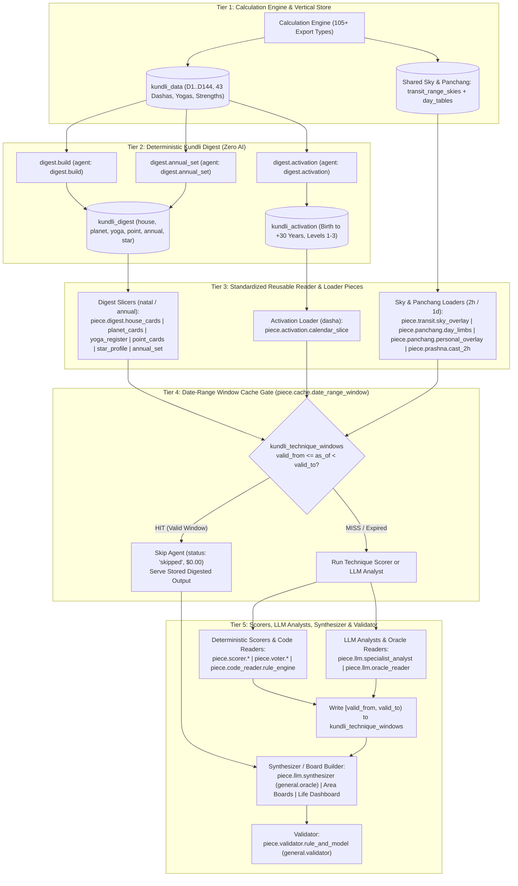
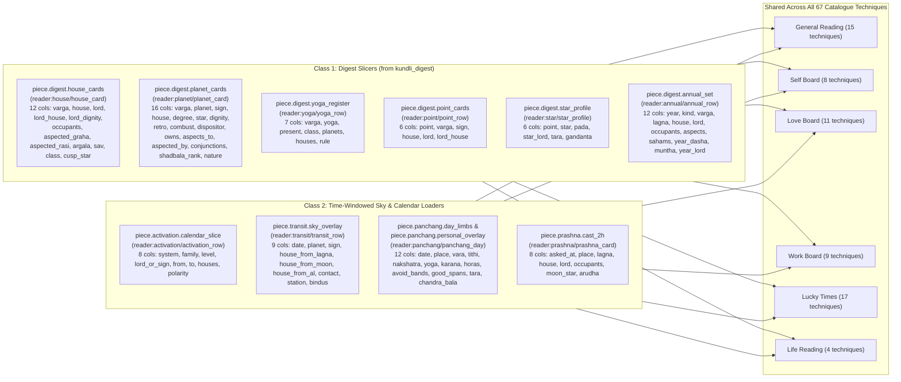
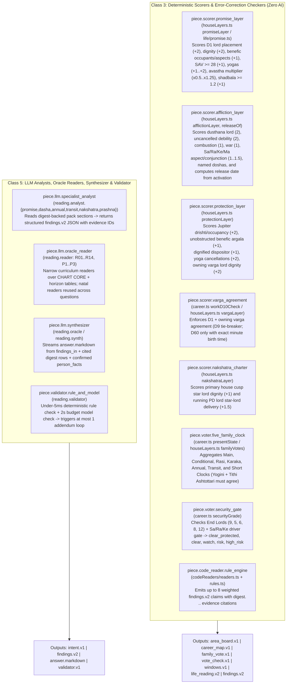
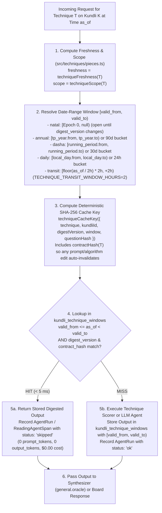
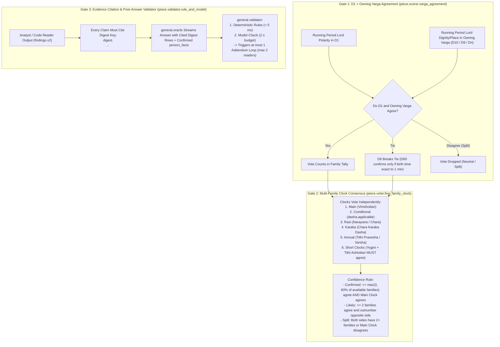
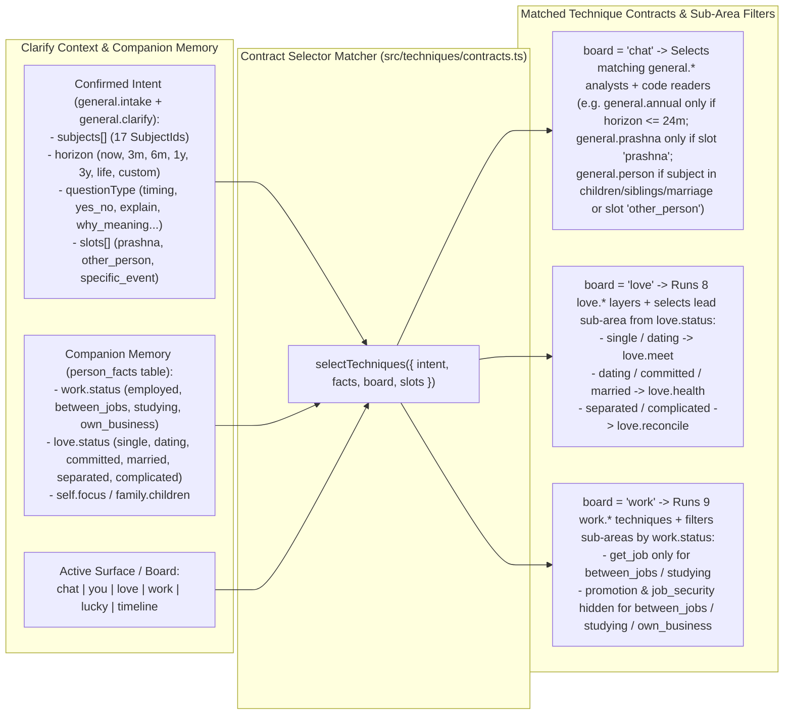
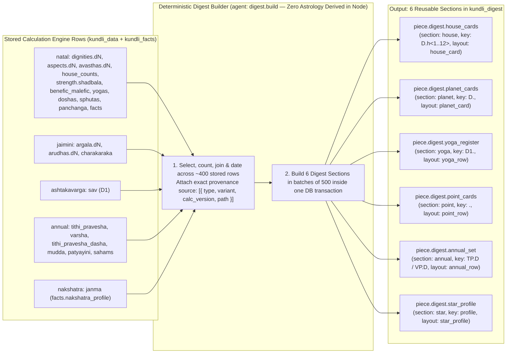
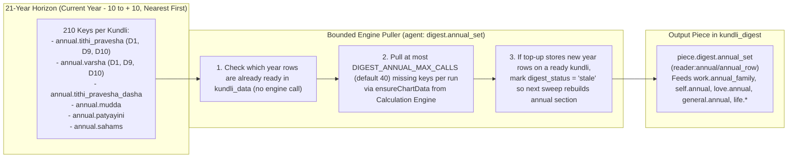
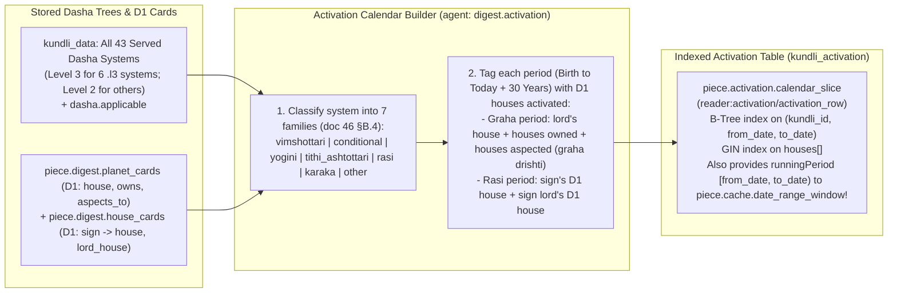

# Volume 01 — Architecture, Reusable Pieces, Date-Range Cache & Digest Techniques

> **Format**: One illustration per page (`Page 1 of 10` through `Page 10 of 10`), separated by `---`.  
> **Code References**: [`src/techniques/pieces.ts`](../../src/techniques/pieces.ts) · [`src/techniques/piecesDoc.ts`](../../src/techniques/piecesDoc.ts) · [`src/techniques/catalog.ts`](../../src/techniques/catalog.ts) · [`src/techniques/layouts.ts`](../../src/techniques/layouts.ts) · [`src/reading/digest/build.ts`](../../src/reading/digest/build.ts) · [`docs/reading-engine/56-technique-pieces-and-validity-windows.md`](../reading-engine/56-technique-pieces-and-validity-windows.md)

---

## Page 1 of 10 — Master Architecture: Digest Once, Assemble from Pieces, Cache by Date Range

Every astrological calculation is performed once by the **Calculation Engine** (`POST /api/export-horoscope`) and stored vertically in `kundli_data`. The deterministic **Kundli Digest** (`digest.build`, `digest.annual_set`, `digest.activation`) compiles those raw tables into six provenance-tagged sections (`house`, `planet`, `yoga`, `point`, `annual`, `star`) and a 30-year multi-system activation calendar (`kundli_activation`). Every technique across Chat, You, Love, Work, Lucky Times, and Life Reading is assembled from standardized **Reusable Pieces** and gated by `piece.cache.date_range_window`.

---

## Page 2 of 10 — Class 1 & 2 Pieces: Digest Slicers (`natal` / `1y`) & Time-Windowed Loaders (`2h` / `1d` / `dasha`)

Every technique reads its inputs exclusively through 12 named tabular layouts (`src/techniques/layouts.ts`). In `src/techniques/pieces.ts`, each `(section, layout)` pair is a single reusable **Reader Piece** (`reader:<section>/<layout>`), parameterized by the technique's `filter` (which houses, vargas, planets, or years to slice).

| Reader Piece (`src/techniques/pieces.ts`) | Canonical Architectural Piece | Freshness Tier | Techniques Reusing This Piece |
|---|---|---|---|
| `reader:house/house_card` | `piece.digest.house_cards` | `natal` | 30 techniques (`general.*`, `self.*`, `love.*`, `work.*`, `life.*`, `digest.build`) |
| `reader:planet/planet_card` | `piece.digest.planet_cards` | `natal` | 29 techniques (`general.*`, `self.*`, `love.*`, `work.*`, `lucky.personal_overlay`, `life.*`, `digest.*`) |
| `reader:activation/activation_row` | `piece.activation.calendar_slice` | `dasha` | 21 techniques (`work.*`, `self.*`, `love.*`, `general.dasha`, `general.reader`, `lucky.personal_overlay`, `life.*`) |
| `reader:panchang/panchang_day` | `piece.panchang.day_limbs` / `personal_overlay` | `daily` | 17 techniques (`lucky.day_tables`, `lucky.panchang_limbs`, `lucky.avoid_bands`, `lucky.personal_overlay`, 13 `lucky.*` scenarios) |
| `reader:transit/transit_row` | `piece.transit.sky_overlay` | `transit` | 12 techniques (`work.*`, `self.transit`, `love.transit`, `general.transit`, `general.reader`, `life.*`) |
| `reader:yoga/yoga_row` | `piece.digest.yoga_register` | `natal` | 12 techniques (`self.*`, `love.*`, `general.promise`, `general.strength_yoga`, `general.reader`, `life.*`, `digest.build`) |
| `reader:point/point_row` | `piece.digest.point_cards` | `natal` | 11 techniques (`self.*`, `love.*`, `work.karaka_family`, `general.promise`, `general.jaimini`, `general.reader`, `digest.build`) |
| `reader:annual/annual_row` | `piece.digest.annual_set` | `annual` | 9 techniques (`work.annual_family`, `self.annual`, `love.annual`, `general.annual`, `general.reader`, `life.*`, `digest.*`) |
| `reader:star/star_profile` | `piece.digest.star_profile` | `natal` | 4 techniques (`self.nakshatra`, `love.nakshatra`, `general.nakshatra`, `digest.build`) |
| `reader:prashna/prashna_card` | `piece.prashna.cast_2h` | `question` | 2 techniques (`general.prashna`, `general.reader`) |

---

## Page 3 of 10 — Class 3 & 5 Pieces: Deterministic Scorers, Error-Correction Voters & LLM Agents

Techniques never duplicate scoring logic or prompt orchestration. Code techniques run through 8 deterministic **Scorer / Voter / Rule Engine Pieces** (`system: 'none'`), while conversational techniques run through 4 **LLM / Validation Pieces**.

---

## Page 4 of 10 — Class 4 Piece: The Date-Range Window Cache Gate (`piece.cache.date_range_window`)

Why re-run a technique or call an LLM when the astrological inputs it reads have not changed?
Even though the sky (`transit`), lagna (`prashna`), and planetary hours (`hora`) shift every ~2 hours, **each technique's contract declares the exact sections it reads**, which determines its natural validity window `[valid_from, valid_to)` (`src/techniques/pieces.ts validityWindow`).

### Freshness Tiers & Validity Windows Across All 67 Catalogue Techniques

| Freshness Tier | Validity Range `[valid_from, valid_to)` | Env Config (`src/config/env.ts`) | Catalogue Count | Example Techniques |
|---|---|---|---|---|
| **`natal`** | `[1970-01-01T00:00:00Z, null)` — valid until `digest_version` or `contractHash` changes | `DIGEST_VERSION`, `TECHNIQUE_CACHE_VERSION` | **12** | `general.promise`, `general.varga_dynamics`, `general.nakshatra`, `general.strength_yoga`, `general.jaimini`, `general.person`, `self.promise`, `self.protection`, `self.varga`, `self.nakshatra`, `love.promise`, `love.protection`, `love.varga`, `love.nakshatra` |
| **`annual`** | `[year.from, year.to)` of running Tithi Pravesha / Varsha chart (fallback `90d` bucket) | `TECHNIQUE_ANNUAL_FALLBACK_DAYS=90` | **5** | `work.annual_family`, `self.annual`, `love.annual`, `general.annual`, `digest.annual_set` |
| **`dasha`** | `[runningPeriod.from, runningPeriod.to)` in `kundli_activation` (fallback `30d` bucket) | `TECHNIQUE_DASHA_FALLBACK_DAYS=30` | **11** | `work.conditional_family`, `work.karaka_family`, `work.d10_check`, `self.affliction`, `self.activation`, `love.affliction`, `love.activation`, `general.dasha`, `life.promise_scale`, `digest.activation` |
| **`daily`** | `[day.from, day.to)` at reference timezone place (fallback `24h` bucket) | `LUCKY_HORIZON_DAYS=28` | **17** | `lucky.day_tables`, `lucky.panchang_limbs`, `lucky.avoid_bands`, `lucky.personal_overlay`, all 13 `lucky.<area>.<act>` scenarios |
| **`transit`** | Epoch-aligned `2h` bucket `[floor(now / 2h) * 2h, +2h)` | `TECHNIQUE_TRANSIT_WINDOW_HOURS=2` | **16** | `work.present_tone`, `work.security_grade`, `work.subarea_windows`, `work.horizons`, `work.looking_back`, `self.transit`, `love.transit`, `love.meet`, `love.health`, `love.reconcile`, `general.transit`, `life.timing_agreement`, `life.mahadasha_charter`, `life.dashboard` |
| **`question`** | `[now, now)` — per-question live execution (`techniqueCacheKey = null`) | N/A | **6** | `general.intake`, `general.clarify`, `general.prashna`, `general.reader`, `general.oracle`, `general.validator` |

---

## Page 5 of 10 — Recipe Families: How 67 Techniques Collapse into Shared Tested Recipes

In `src/techniques/pieces.ts`, `families(TECHNIQUES)` groups techniques by their `familySignature` (`[sortedReaders, prompt, output, sortedAgents]`). Instead of 67 unrelated implementations, the catalogue collapses into compact **Recipe Families** where the machinery is identical and only the `selectors` or `filter` parameters differ.

```mermaid
flowchart LR
    subgraph Fam1["Family 1: Lucky Scenario Windows (13 Techniques)"]
        R_L1["Readers: reader:panchang/panchang_day (General + Personal)"]
        A_L1["Agent: lucky.scenario_windows (code, system: none)"]
        O_L1["Output: windows.v1 (daily_freshness)"]
        M_L1["Members (13): lucky.work.{sign_contract, send_resume, interview, ask_raise, start_project, hard_talk_boss},<br/>lucky.love.{ask_out, first_date, clear_air}, lucky.money.invest_buy,<br/>lucky.travel.set_out, lucky.study.exam_submit, lucky.home.start_routine"]
        R_L1 --> A_L1 --> O_L1 --> M_L1
    end

    subgraph Fam2["Family 2: Work Timeline & Sub-Area Map (3 Core + 2 Variant Techniques)"]
        R_W1["Readers: reader:house/house_card + reader:activation/activation_row + reader:transit/transit_row"]
        A_W1["Agents: area.career_inputs + area.career_map (code, system: none)"]
        O_W1["Output: career_map.v1 (transit_freshness)"]
        M_W1["Members: work.present_tone, work.horizons, work.looking_back<br/>(+ work.security_grade, work.subarea_windows)"]
        R_W1 --> A_W1 --> O_W1 --> M_W1
    end

    subgraph Fam3["Family 3: Self & Love 8-Layer House-State Engine (16 Techniques)"]
        R_SL["Readers: house_card, planet_card, point_row, yoga_row, activation_row, transit_row, annual_row, star_profile"]
        A_SL["Agents: area.self_board (8 self.*) & area.love_board (8 love.*)"]
        O_SL["Output: area_board.v1 (natal / dasha / annual / transit)"]
        M_SL["Members (16): {self,love}.{promise, affliction, protection, activation, transit, annual, varga, nakshatra}"]
        R_SL --> A_SL --> O_SL --> M_SL
    end

    subgraph Fam4["Family 4: Love Companion-Memory Sub-Areas (3 Techniques)"]
        R_LS["Reader: reader:findings/findings_in (8 Love layers)"]
        A_LS["Agent: area.love_board (code, system: none)"]
        O_LS["Output: board_subarea.v1"]
        M_LS["Members (3): love.meet (single/dating), love.health (dating/committed/married), love.reconcile (separated/complicated)"]
        R_LS --> A_LS --> O_LS --> M_LS
    end
```

---

## Page 6 of 10 — Error-Correction, Multi-System Voting & Anti-Hallucination Gates

Every board and reading technique passes through deterministic error-correction gates so that no single dasha, single planet, or unverified LLM claim can produce a false prediction.

---

## Page 7 of 10 — Companion Memory (`person_facts`) & Clarify Context Selection (`selectTechniques`)

Following the core product rule (*"Specific to this person, or not shown; ask before you answer, and let the chart lead the question"*), `selectTechniques(input)` in `src/techniques/contracts.ts` matches the confirmed `Intent` (`subjects`, `horizon`, `questionType`, `slots`) and the companion memory (`person_facts`) against every technique's `selectors`.

---

## Page 8 of 10 — `digest.build`: Kundli Digest (First-Time Breakdown)

| Field | Value |
|---|---|
| **Technique ID** | `digest.build` |
| **Title** | Kundli digest (the first-time breakdown) |
| **Category / Board / Status** | `general` · `chat` (selects on all boards: `chat, you, love, work, lucky, timeline`) · `built` |
| **Agents** | `digest.build` (`kind: 'code'`, `system: 'none'`) |
| **Output Contract** | `kundli_digest.v1` (writes 1,500–2,500 rows to `kundli_digest` + stamps `kundlis.digest_status = 'ready'`) |
| **Freshness / Scope** | `annual` (reads `annual.*` alongside `natal` tables; rebuilt only when `digest_version` or input `kundli_data` changes) · `kundli` |
| **Code Path** | [`src/reading/digest/build.ts`](../../src/reading/digest/build.ts) (`buildDigestRows`, `buildDigest`, `loadDigest`) |

---

## Page 9 of 10 — `digest.annual_set`: Annual Set, Ten Years Back and Ahead

| Field | Value |
|---|---|
| **Technique ID** | `digest.annual_set` |
| **Title** | Annual set, ten years back and ahead |
| **Category / Board / Status** | `general` · `chat` (all boards) · `built` |
| **Agents** | `digest.annual_set` (`kind: 'engine_pull'`, `engineType: 'annual'`) |
| **Synthesizer / Consumer** | Feeds `digest.build` → `kundli_digest.v1` (`section: 'annual'`) |
| **Freshness / Scope** | `annual` · `kundli` |
| **Code Path** | [`src/reading/digest/annualSet.ts`](../../src/reading/digest/annualSet.ts) (`ensureAnnualSet`; `event.ts runTopUp`) |

---

## Page 10 of 10 — `digest.activation`: Activation Calendar, Thirty Years Ahead

| Field | Value |
|---|---|
| **Technique ID** | `digest.activation` |
| **Title** | Activation calendar, thirty years ahead |
| **Category / Board / Status** | `general` · `chat` (all boards) · `built` |
| **Agents** | `digest.activation` (`kind: 'code'`, `system: 'none'`) |
| **Synthesizer / Consumer** | Feeds `digest.build` → `kundli_activation.v1` (`kundli_activation` table) |
| **Freshness / Scope** | `dasha` (stores birth to +30 years; indexed by `(kundli_id, from_date, to_date)` and GIN `houses[]`) · `kundli` |
| **Code Path** | [`src/reading/digest/activation.ts`](../../src/reading/digest/activation.ts) (`buildActivationRows`, `activationFor`) |

