# Volume 02 — General Reading (`general.*` / `chat` Board) One-Per-Page Illustrations

> **Format**: One illustration per page (`Page 1 of 15` through `Page 15 of 15`), separated by `---`.  
> **Category / Board**: `general` · `chat`  
> **Code References**: [`src/techniques/catalog.ts`](../../src/techniques/catalog.ts) · [`src/techniques/pieces.ts`](../../src/techniques/pieces.ts) · [`src/reading/nodes/specialists.ts`](../../src/reading/nodes/specialists.ts) · [`src/reading/codeReaders/readers.ts`](../../src/reading/codeReaders/readers.ts) · [`src/reading/oracle/flow.ts`](../../src/reading/oracle/flow.ts)

---

## Page 1 of 15 — `general.intake`: Intake

| Field | Value |
|---|---|
| **Technique ID / Title** | `general.intake` — Intake |
| **Category / Board / Status** | `general` · `chat` · `built` |
| **Selectors** | `boards: ['chat']` |
| **Reader Pieces** | `reader:text/text_in` (filter: `"the question, the history of the thread, the clarify turns"`) |
| **Prompt & User Fields** | `prompt:src/reading/prompts/intake.md` · `user: ['TODAY', 'QUESTION', 'HISTORY']` |
| **Agent Piece** | `agent:reading.intake` (`kind: 'llm'`, role: `intake`) |
| **Output Piece / Synthesizer** | `output:intent.v1` · feeds `general.clarify` and `selectTechniques` |
| **Date-Range Window Cache** | `freshness: 'natal'` · `scope: 'question'` (reads `text_in` + `QUESTION`; cached by `questionHash` for retries of the same question via `withTechniqueOutput`) |
| **Code & Source** | `src/reading/nodes/intake.ts` (`docs/reading-engine/41`) |

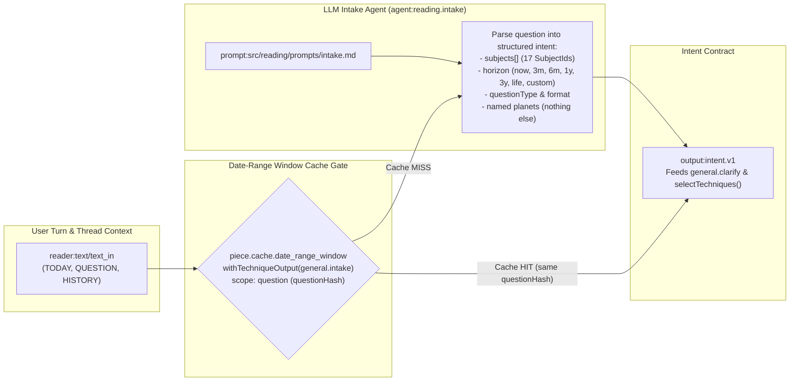

---

## Page 2 of 15 — `general.clarify`: Clarify

| Field | Value |
|---|---|
| **Technique ID / Title** | `general.clarify` — Clarify |
| **Category / Board / Status** | `general` · `chat` · `built` |
| **Selectors** | `boards: ['chat']` |
| **Reader Pieces** | `reader:text/text_in` (`"the question, the history of the thread, the clarify turns"`) + `reader:text/text_in` (`"the intake's intent: bucket, subjects, horizon, the slots filled and missing"`) |
| **Prompt & User Fields** | `prompt:db:clarify.system` · `user: ['TODAY', 'QUESTION', 'BUCKET', 'SLOTS', 'HISTORY']` |
| **Agent Piece** | `agent:reading.clarify` (`kind: 'llm'`, provider: `bedrock`, 900 ms budget) |
| **Output Piece / Synthesizer** | `output:intent.v1` (confirmed intent + slots) · drives `selectTechniques(intent, person_facts, 'chat')` |
| **Date-Range Window Cache** | `freshness: 'natal'` · `scope: 'question'` (per-question clarify resolution) |
| **Code & Source** | `src/reading/clarify/planner.ts; service.ts` (`docs/reading-engine/13; 48; 53 §4.3`) |

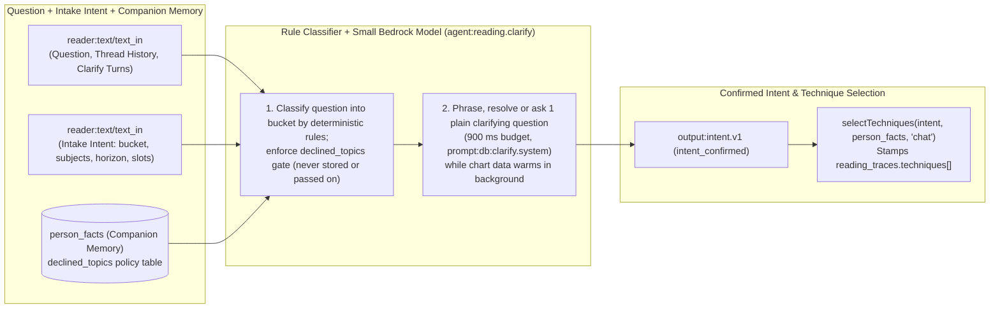

---

## Page 3 of 15 — `general.promise`: House Promise Analyst

| Field | Value |
|---|---|
| **Technique ID / Title** | `general.promise` — House promise analyst |
| **Category / Board / Status** | `general` · `chat` · `built` |
| **Charts Declared** | `natal:facts`, `divisional:D1..D10`, `jaimini:arudhas`, `jaimini:special_lagnas` |
| **Selectors** | `boards: ['chat']`, `subjects: ALL_SUBJECTS` (all 17 subjects) |
| **Reader Pieces** | `reader:house/house_card` (`piece.digest.house_cards`: D1 + frame vargas, frame houses) · `reader:planet/planet_card` (`piece.digest.planet_cards`: D1 cards of frame lords and karakas) · `reader:point/point_row` (`piece.digest.point_cards`: arudhas & special lagnas of frame) · `reader:yoga/yoga_row` (`piece.digest.yoga_register`: yogas touching frame houses or lords) |
| **Prompt & User Fields** | `prompt:src/reading/prompts/v2/promise.md` · `user: ['TODAY', 'SUBJECT', 'FRAME', 'HORIZON', 'REAL_WANT', 'QUESTION', 'FACTS']` |
| **Agent Piece** | `agent:reading.analyst.promise` (`piece.llm.specialist_analyst`, role: `specialist`) |
| **Output Piece / Synthesizer** | `output:findings.v2` · feeds `general.oracle` |
| **Date-Range Window Cache** | `freshness: 'natal'` (`open` window: `to = null`, valid until `digest_version` or `contractHash` changes) · `scope: 'question'` (keyed with `questionHash`) |
| **Code & Source** | `src/reading/nodes/specialists.ts; packs/selector.ts ANALYST_SECTIONS.promise; packs/digestSource.ts overlayDigest` (`docs/reading-engine/03 §3; 53 §4.4`) |

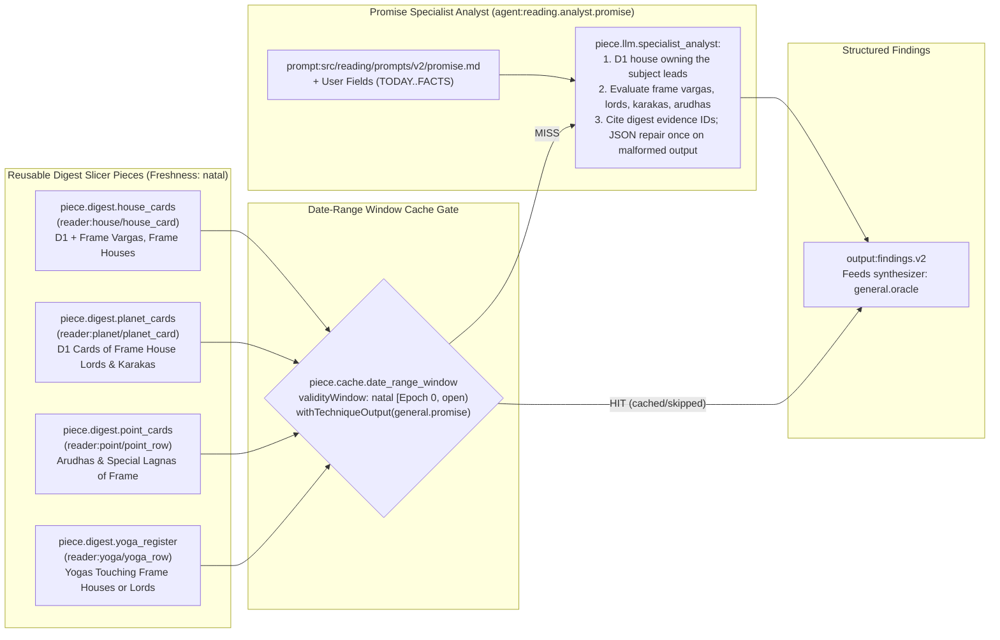

---

## Page 4 of 15 — `general.varga_dynamics`: Varga Dynamics Analyst (Deterministic Code Reader)

| Field | Value |
|---|---|
| **Technique ID / Title** | `general.varga_dynamics` — Varga dynamics analyst |
| **Category / Board / Status** | `general` · `chat` · `built` |
| **Charts Declared** | `divisional: D2, D4, D7, D9, D10, D12, D24, D30, D60, D16, D20, D27, D40, D45, D81, D108, D144` |
| **Selectors** | `boards: ['chat']`, `subjects: ALL_SUBJECTS`, `vargas: ['D2'..'D144']` |
| **Reader Pieces** | `reader:house/house_card` (`piece.digest.house_cards`: D1 and each frame varga, lord, lord_dignity, occupants) · `reader:planet/planet_card` (`piece.digest.planet_cards`: D1 and each frame varga, frame house lords' dignity) |
| **Prompt & User Fields** | `system: 'none'` (Deterministic Code Reader — Zero AI) · `user: []` |
| **Agent Piece** | `agent:reading.code.varga_dynamics` (`piece.code_reader.rule_engine` + `piece.scorer.varga_agreement`, `kind: 'code'`) |
| **Output Piece / Synthesizer** | `output:findings.v2` (up to 8 heaviest claims + layer score `-3..+3`) · feeds `general.oracle` |
| **Date-Range Window Cache** | `freshness: 'natal'` (`open` window: `to = null`) · `scope: 'kundli'` (**reused across all questions for this kundli and subject frame without re-running!**) |
| **Code & Source** | `src/reading/codeReaders/readers.ts vargaDynamics; rules.ts` (`docs/reading-engine/53 §4.4; 33 R3; BPHS ch. 6-7`) |

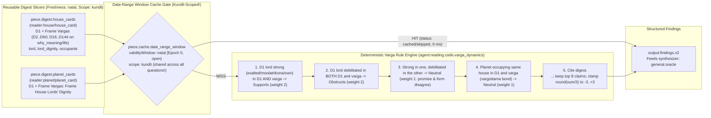

---

## Page 5 of 15 — `general.dasha`: Dasha Analyst (All Systems)

| Field | Value |
|---|---|
| **Technique ID / Title** | `general.dasha` — Dasha analyst (all systems) |
| **Category / Board / Status** | `general` · `chat` · `built` |
| **Charts Declared** | `natal:facts`, `divisional:D1..D10`, `dasha:vimshottari`, `dasha:narayana`, `dasha:conditional`, `dasha:chara`, `dasha:karaka`, `dasha:yogini`, `dasha:tithi_ashtottari` |
| **Selectors** | `boards: ['chat']`, `subjects: ALL_SUBJECTS`, `horizons: ALL_HORIZONS` |
| **Reader Pieces** | `reader:activation/activation_row` (`piece.activation.calendar_slice`: periods inside horizon activating frame houses across all served systems, grouped by 7 families; Vimshottari MD/AD/PD at level 3; `dasha.applicable`) · `reader:planet/planet_card` (`piece.digest.planet_cards`: D1 cards of frame lords & karakas) · `reader:house/house_card` (`piece.digest.house_cards`: D1 + frame vargas, frame houses) |
| **Prompt & User Fields** | `prompt:src/reading/prompts/v2/dasha.md` · `user: ['TODAY', 'SUBJECT', 'FRAME', 'HORIZON', 'REAL_WANT', 'QUESTION', 'FACTS']` |
| **Agent Piece** | `agent:reading.analyst.dasha` (`piece.llm.specialist_analyst`, role: `specialist`) |
| **Output Piece / Synthesizer** | `output:findings.v2` · feeds `general.oracle` |
| **Date-Range Window Cache** | `freshness: 'dasha'` (`[runningPeriod.from, runningPeriod.to)` from `kundli_activation`, or `30d` fallback bucket `TECHNIQUE_DASHA_FALLBACK_DAYS`) · `scope: 'question'` |
| **Code & Source** | `src/reading/nodes/specialists.ts; packs/selector.ts ANALYST_SECTIONS.dasha; packs/digestSource.ts overlayDigest` (`docs/reading-engine/03 §3; 53 §4.4`) |

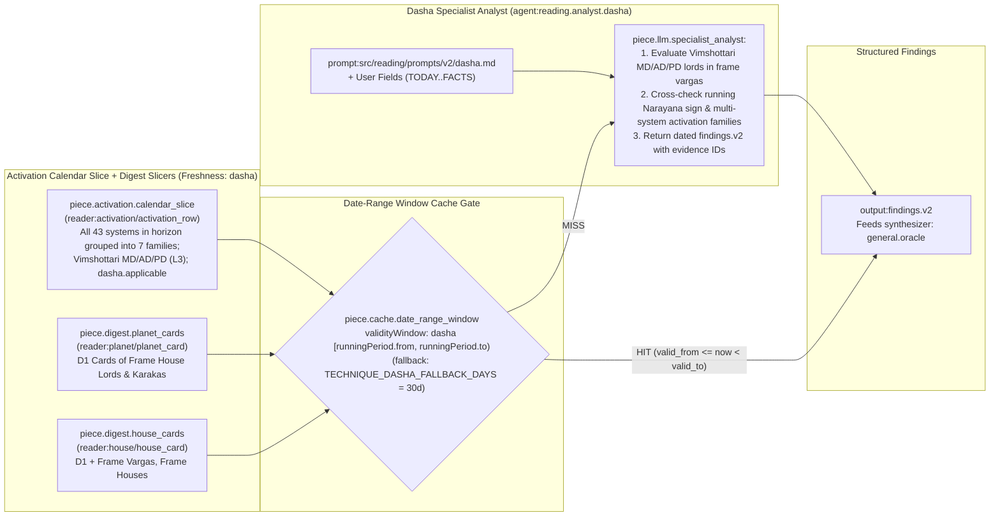

---

## Page 6 of 15 — `general.annual`: Annual Set Analyst

| Field | Value |
|---|---|
| **Technique ID / Title** | `general.annual` — Annual set analyst |
| **Category / Board / Status** | `general` · `chat` · `built` |
| **Charts Declared** | `natal:facts`, `annual:tithi_pravesha`, `annual:tithi_pravesha_dasha`, `annual:varsha`, `annual:sahams`, `annual:mudda`, `annual:patyayini`, `annual:tajaka` |
| **Selectors** | `boards: ['chat']`, `subjects: ALL_SUBJECTS`, `horizons: ['now', '3m', '6m', '1y', 'custom']` (selected for horizons within 24 months) |
| **Reader Pieces** | `reader:annual/annual_row` (`piece.digest.annual_set`: TP and VP of current, previous, and next year in D1, D9, D10 for frame houses; year dashas; sahams in frame houses; muntha and year lord when served) |
| **Prompt & User Fields** | `prompt:src/reading/prompts/annual.md` · `user: ['TODAY', 'SUBJECT', 'FRAME', 'HORIZON', 'REAL_WANT', 'QUESTION', 'FACTS']` |
| **Agent Piece** | `agent:reading.analyst.annual` (`piece.llm.specialist_analyst`, role: `specialist`) |
| **Output Piece / Synthesizer** | `output:findings.v2` · feeds `general.oracle` |
| **Date-Range Window Cache** | `freshness: 'annual'` (`[year.from, year.to)` of running Tithi Pravesha / Varsha chart, or `90d` fallback bucket `TECHNIQUE_ANNUAL_FALLBACK_DAYS`) · `scope: 'question'` |
| **Code & Source** | `src/reading/nodes/specialists.ts; packs/selector.ts ANALYST_SECTIONS.annual; packs/digestSource.ts overlayDigest` (`docs/reading-engine/28 §5; 53 §4.4`) |

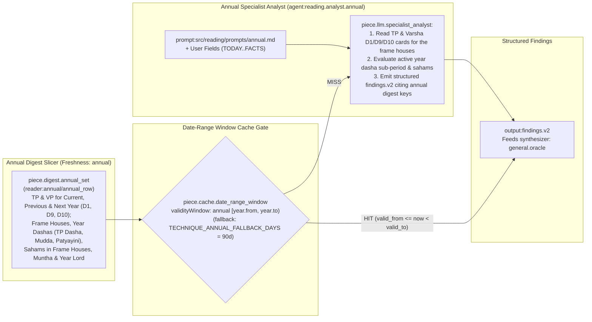

---

## Page 7 of 15 — `general.transit`: Transit Analyst

| Field | Value |
|---|---|
| **Technique ID / Title** | `general.transit` — Transit analyst |
| **Category / Board / Status** | `general` · `chat` · `built` |
| **Charts Declared** | `natal:facts`, `jaimini:arudhas`, `dasha:vimshottari`, `dasha:narayana`, `transit:transit_overlay`, `transit:transit_contacts`, `transit:transit_at` |
| **Selectors** | `boards: ['chat']`, `subjects: ALL_SUBJECTS`, `horizons: ALL_HORIZONS` |
| **Reader Pieces** | `reader:transit/transit_row` (`piece.transit.sky_overlay`: shared sky with kundli overlay for frame houses, lords and karakas inside horizon; double transit; sade sati; eclipses; transit ashtakavarga) · `reader:planet/planet_card` (`piece.digest.planet_cards`: D1 cards of frame house lords & karakas) |
| **Prompt & User Fields** | `prompt:src/reading/prompts/v2/transit.md` · `user: ['TODAY', 'SUBJECT', 'FRAME', 'HORIZON', 'REAL_WANT', 'QUESTION', 'FACTS']` |
| **Agent Piece** | `agent:reading.analyst.transit` (`piece.llm.specialist_analyst`, role: `specialist`) |
| **Output Piece / Synthesizer** | `output:findings.v2` · feeds `general.oracle` |
| **Date-Range Window Cache** | `freshness: 'transit'` (epoch-aligned `2h` window `[floor(now / 2h) * 2h, +2h)` via `TECHNIQUE_TRANSIT_WINDOW_HOURS=2`) · `scope: 'question'` |
| **Code & Source** | `src/reading/nodes/specialists.ts; packs/selector.ts ANALYST_SECTIONS.transit` (`docs/reading-engine/03 §3; 28 §5; 53 §4.4`) |

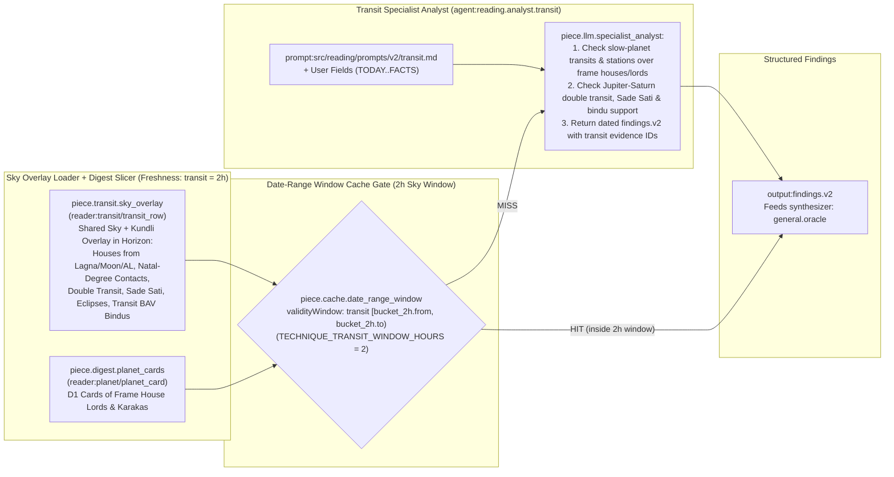

---

## Page 8 of 15 — `general.nakshatra`: Nakshatra Analyst

| Field | Value |
|---|---|
| **Technique ID / Title** | `general.nakshatra` — Nakshatra analyst |
| **Category / Board / Status** | `general` · `chat` · `built` |
| **Charts Declared** | `natal:facts`, `nakshatra:janma`, `dasha:vimshottari`, `transit:transit_overlay` |
| **Selectors** | `boards: ['chat']`, `subjects: ALL_SUBJECTS` |
| **Reader Pieces** | `reader:star/star_profile` (`piece.digest.star_profile`: Moon star, lagna star, tara table, gandanta flags) · `reader:house/house_card` (`piece.digest.house_cards`: D1 frame houses `cusp_star` column) · `reader:planet/planet_card` (`piece.digest.planet_cards`: D1 cards of star lords of frame cusps and Moon) |
| **Prompt & User Fields** | `prompt:src/reading/prompts/v2/nakshatra.md` · `user: ['TODAY', 'SUBJECT', 'FRAME', 'HORIZON', 'REAL_WANT', 'QUESTION', 'FACTS']` |
| **Agent Piece** | `agent:reading.analyst.nakshatra` (`piece.llm.specialist_analyst`, role: `specialist`) |
| **Output Piece / Synthesizer** | `output:findings.v2` · feeds `general.oracle` |
| **Date-Range Window Cache** | `freshness: 'natal'` (`open` window: `to = null`, valid until `digest_version` changes) · `scope: 'question'` |
| **Code & Source** | `src/reading/nodes/specialists.ts; packs/selector.ts ANALYST_SECTIONS.nakshatra` (`docs/reading-engine/03 §3; 53 §4.4`) |

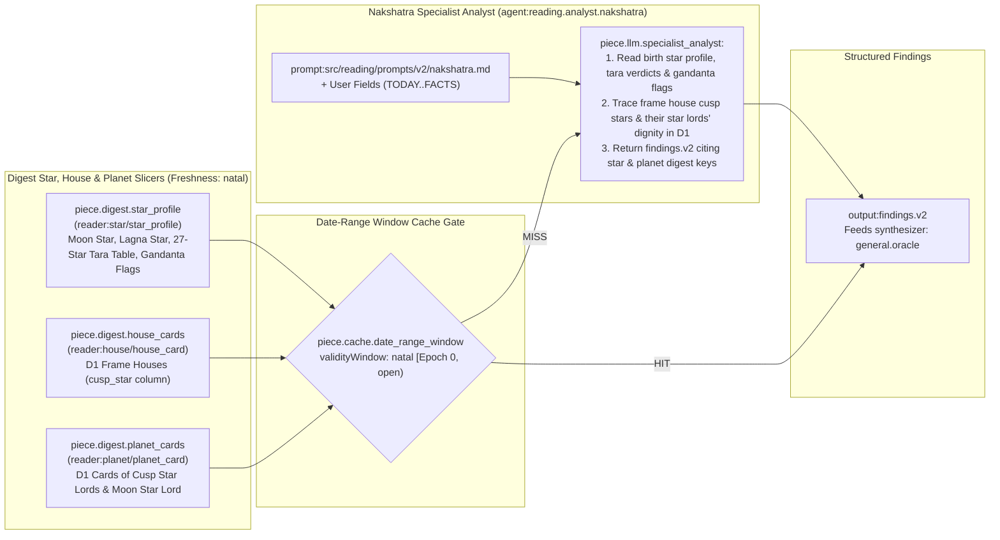

---

## Page 9 of 15 — `general.strength_yoga`: Strength and Yoga Analyst (Deterministic Code Reader)

| Field | Value |
|---|---|
| **Technique ID / Title** | `general.strength_yoga` — Strength and yoga analyst |
| **Category / Board / Status** | `general` · `chat` · `built` |
| **Charts Declared** | `natal:yogas`, `natal:doshas`, `natal:strength`, `ashtakavarga:sav`, `natal:avasthas` |
| **Selectors** | `boards: ['chat']`, `subjects: ALL_SUBJECTS` |
| **Reader Pieces** | `reader:yoga/yoga_row` (`piece.digest.yoga_register`: D1 yogas, doshas, cancellations joining frame planets or houses) · `reader:planet/planet_card` (`piece.digest.planet_cards`: D1 cards of frame lords & karakas, `shadbala_rank`, shadbala ratio) · `reader:house/house_card` (`piece.digest.house_cards`: D1 frame houses `sav` column) |
| **Prompt & User Fields** | `system: 'none'` (Deterministic Code Reader — Zero AI) · `user: []` |
| **Agent Piece** | `agent:reading.code.strength_yoga` (`piece.code_reader.rule_engine`, `kind: 'code'`) |
| **Output Piece / Synthesizer** | `output:findings.v2` (with `graces[]` and weighted claims) · feeds `general.oracle` |
| **Date-Range Window Cache** | `freshness: 'natal'` (`open` window: `to = null`) · `scope: 'kundli'` (**reused across all questions for this kundli and subject frame!**) |
| **Code & Source** | `src/reading/codeReaders/readers.ts strengthYoga; rules.ts` (`docs/reading-engine/53 §4.4; 33 R5, R6; BPHS ch. 27, 34-41, 66-72`) |

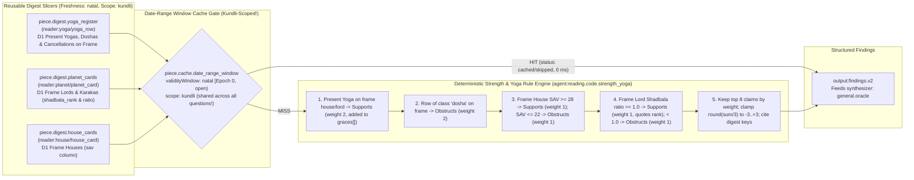

---

## Page 10 of 15 — `general.jaimini`: Jaimini Analyst (Deterministic Code Reader)

| Field | Value |
|---|---|
| **Technique ID / Title** | `general.jaimini` — Jaimini analyst |
| **Category / Board / Status** | `general` · `chat` · `built` |
| **Charts Declared** | `jaimini:charakaraka`, `jaimini:arudhas`, `jaimini:argala`, `dasha:narayana`, `dasha:chara` |
| **Selectors** | `boards: ['chat']`, `subjects: ALL_SUBJECTS` |
| **Reader Pieces** | `reader:point/point_row` (`piece.digest.point_cards`: `AK, AmK, DK, UL, AL` and frame chara karakas and A-houses) · `reader:house/house_card` (`piece.digest.house_cards`: D1 frame houses and houses the points sit in, `argala` and `class` columns) |
| **Prompt & User Fields** | `system: 'none'` (Deterministic Code Reader — Zero AI) · `user: []` |
| **Agent Piece** | `agent:reading.code.jaimini` (`piece.code_reader.rule_engine`, `kind: 'code'`) |
| **Output Piece / Synthesizer** | `output:findings.v2` · feeds `general.oracle` |
| **Date-Range Window Cache** | `freshness: 'natal'` (`open` window: `to = null`) · `scope: 'kundli'` (**reused across all questions for this kundli and subject frame!**) |
| **Code & Source** | `src/reading/codeReaders/readers.ts jaimini; rules.ts` (`docs/reading-engine/53 §4.4; 33 R4; Jaimini Upadesa Sutras 1.1.5-9`) |

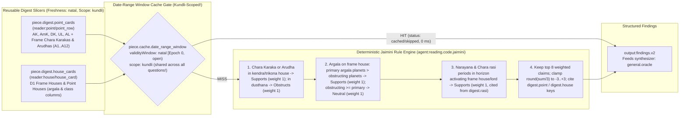

---

## Page 11 of 15 — `general.prashna`: Question Chart Analyst

| Field | Value |
|---|---|
| **Technique ID / Title** | `general.prashna` — Question chart analyst |
| **Category / Board / Status** | `general` · `chat` · `built` |
| **Charts Declared** | `natal:facts`, `natal:prashna` |
| **Selectors** | `boards: ['chat']`, `subjects: ALL_SUBJECTS`, `slots: ['prashna']` (runs only when the question moment chart is cast) |
| **Reader Pieces** | `reader:prashna/prashna_card` (`piece.prashna.cast_2h`: cast of the question moment — `asked_at, place, lagna, house, lord, occupants, moon_star, arudha`) · `reader:house/house_card` (`piece.digest.house_cards`: D1 + frame vargas, frame houses) |
| **Prompt & User Fields** | `prompt:src/reading/prompts/prashna.md` · `user: ['TODAY', 'SUBJECT', 'FRAME', 'HORIZON', 'REAL_WANT', 'QUESTION', 'FACTS']` |
| **Agent Piece** | `agent:reading.analyst.prashna` (`piece.llm.specialist_analyst`, role: `specialist`) |
| **Output Piece / Synthesizer** | `output:findings.v2` · feeds `general.oracle` |
| **Date-Range Window Cache** | `freshness: 'question'` (`[now, now)` — tied to the specific `prashna_casts` moment; `techniqueCacheKey = null`) · `scope: 'question'` |
| **Code & Source** | `src/reading/nodes/specialists.ts; packs/selector.ts ANALYST_SECTIONS.prashna` (`docs/reading-engine/28 §5; 53 §4.4`) |

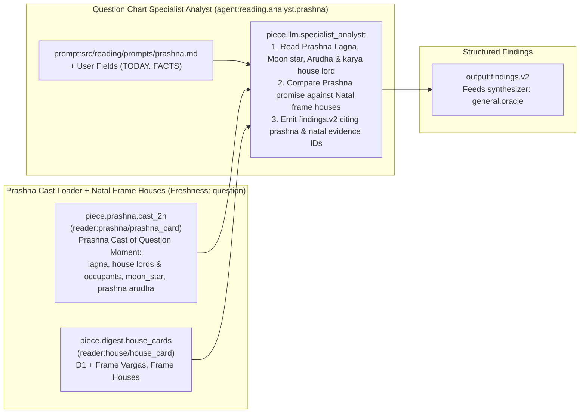

---

## Page 12 of 15 — `general.person`: The Person in Your Chart (Deterministic Code Reader)

| Field | Value |
|---|---|
| **Technique ID / Title** | `general.person` — The person in your chart |
| **Category / Board / Status** | `general` · `chat` · `built` |
| **Charts Declared** | `natal:facts`, `natal:aspects`, `divisional:D12`, `divisional:D9`, `divisional:D7`, `divisional:D3`, `dasha:vimshottari` |
| **Selectors** | `boards: ['chat']`, `subjects: ['children', 'siblings', 'marriage_relationship']` (also selected by `other_person` clarify slot on any subject) |
| **Reader Pieces** | `reader:house/house_card` (`piece.digest.house_cards`: D1 and the person's relationship varga `D12, D9, D7, D3`, the person's house) · `reader:planet/planet_card` (`piece.digest.planet_cards`: D1 and the person's varga, the person's natural karaka) |
| **Prompt & User Fields** | `system: 'none'` (Deterministic Code Reader — Zero AI) · `user: []` |
| **Agent Piece** | `agent:reading.code.person` (`piece.code_reader.rule_engine`, `kind: 'code'`) |
| **Output Piece / Synthesizer** | `output:findings.v2` (every claim tagged `about: <person>`, never using another person's birth data) · feeds `general.oracle` |
| **Date-Range Window Cache** | `freshness: 'natal'` (`open` window: `to = null`) · `scope: 'kundli'` (**reused across questions for the same person signifier!**) |
| **Code & Source** | `src/reading/codeReaders/readers.ts personReader; rules.ts` (`docs/reading-engine/53 §4.4; 33 R13; BPHS ch. 3, 32`) |

```mermaid
flowchart LR
    subgraph SignifierMap["Person Signifier Mapping (PERSON_SIGNIFIERS — Owner's Chart Only)"]
        MAP["Map named person or subject to Owner's Chart:<br/>- Mother: h4, D12, Moon<br/>- Father: h9, D12, Sun<br/>- Spouse: h7, D9, Venus/Jupiter<br/>- Child: h5, D7, Jupiter<br/>- Sibling: h3, D3, Mars"]
    end

    subgraph DigestInputs["Reusable Digest Slicers (Freshness: natal, Scope: kundli)"]
        P_HC["piece.digest.house_cards<br/>(reader:house/house_card)<br/>D1 + Relationship Varga (D12/D9/D7/D3), Person's House"]
        P_PC["piece.digest.planet_cards<br/>(reader:planet/planet_card)<br/>D1 + Relationship Varga, Person's Natural Karaka"]
    end

    subgraph CacheGate["Date-Range Window Cache Gate (Kundli-Scoped!)"]
        GATE{"piece.cache.date_range_window<br/>validityWindow: natal [Epoch 0, open)<br/>scope: kundli"}
    end

    subgraph CodeReader["Deterministic Person Reader (agent:reading.code.person)"]
        C1["1. Person's house lord, occupants & karaka strong (exalted/moolatrikona/own) -> Supports (weight 2)"]
        C2["2. Debilitated lord/occupant/karaka -> Obstructs (weight 2)"]
        C3["3. Person's D1 house SAV >= 28 -> Supports (weight 1); SAV <= 22 -> Obstructs (weight 1)"]
        C4["4. Tag every claim with about = person; cite digest keys"]
        C1 --> C2 --> C3 --> C4
    end

    subgraph Output["Structured Findings"]
        OUT["output:findings.v2<br/>Feeds synthesizer: general.oracle"]
    end

    MAP --> P_HC & P_PC --> GATE
    GATE -->|"HIT (status: cached/skipped)"| OUT
    GATE -->|"MISS"| C1
    C4 --> OUT
```

---

## Page 13 of 15 — `general.reader`: Oracle Readers (`R01–R14, P1–P3`)

| Field | Value |
|---|---|
| **Technique ID / Title** | `general.reader` — Oracle readers (R01–R14, P1–P3) |
| **Category / Board / Status** | `general` · `chat` · `built` |
| **Charts Declared** | `natal:{yogas,doshas,aspects,bhava,strength,prashna,sphutas}`, `jaimini:argala`, `divisional:{D1..D10,D30}`, `dasha:{vimshottari,narayana,chara,yogini,tithi_ashtottari,dwisatpathi,applicable}`, `transit:transit_overlay`, `annual:{tithi_pravesha,varsha,sahams,mudda,patyayini}` |
| **Selectors** | `boards: ['chat']`, `subjects: ALL_SUBJECTS` |
| **Reader Pieces** | `reader:house/house_card` · `reader:planet/planet_card` · `reader:yoga/yoga_row` · `reader:point/point_row` · `reader:activation/activation_row` · `reader:transit/transit_row` · `reader:annual/annual_row` · `reader:prashna/prashna_card` |
| **Prompt & User Fields** | `prompt:src/reading/prompts/readers/_shared.md` (+ per-reader curriculum `R01..R14`) · `user: ['TODAY', 'SUBJECT', 'FRAME', 'HORIZON', 'REAL_WANT', 'QUESTION', 'FACTS']` |
| **Agent Piece** | `agent:reading.reader` (`piece.llm.oracle_reader`, role: `reader`) |
| **Output Piece / Synthesizer** | `output:findings.v2` · feeds `general.oracle` |
| **Date-Range Window Cache** | Overall `freshness: 'question'` (because `R12` reads `prashna`); **individual natal readers (`R01–R06`) are NOT sent the question text and their findings are cached & reused across questions!** |
| **Code & Source** | `src/reading/oracle/readers.ts READERS; runReader.ts` (`docs/reading-engine/33 §2; 39 §4.1; 53 §4.2`) |

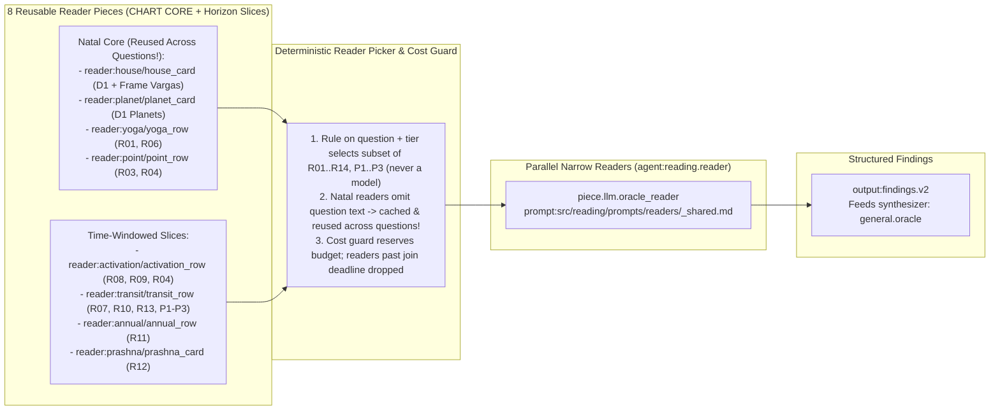

---

## Page 14 of 15 — `general.oracle`: Oracle and Synthesizer

| Field | Value |
|---|---|
| **Technique ID / Title** | `general.oracle` — Oracle and synthesizer |
| **Category / Board / Status** | `general` · `chat` · `built` |
| **Charts Declared** | `[]` (reads findings and cited digest keys only; never raw chart tables) |
| **Selectors** | `boards: ['chat']`, `subjects: ALL_SUBJECTS` |
| **Reader Pieces** | `reader:findings/findings_in` (`"every finding of the readers or analysts of this query, with the digest rows they cite"`) · `reader:text/text_in` (`"the question, the history of the thread, the clarify turns"`) |
| **Prompt & User Fields** | `prompt:src/reading/prompts/oracle/system.md` · `user: ['TODAY', 'SUBJECT', 'FRAME', 'HORIZON', 'REAL_WANT', 'QUESTION', 'FACTS', 'TEMPLATE']` |
| **Agent Pieces** | `agent:reading.oracle` (role: `oracle`) and `agent:reading.synth` (role: `synth`) (`piece.llm.synthesizer`) |
| **Output Piece / Synthesizer** | `output:answer.markdown` (streamed SSE response) · feeds `general.validator` |
| **Date-Range Window Cache** | `freshness: 'question'` (inherits shortest upstream freshness via `findings_in`) · `scope: 'question'` (streams live over cached/fresh upstream `findings.v2`) |
| **Code & Source** | `src/reading/oracle/flow.ts; src/reading/run.ts (synthesize)` (`docs/reading-engine/39 §4.1; 41; 53 §4.4`) |

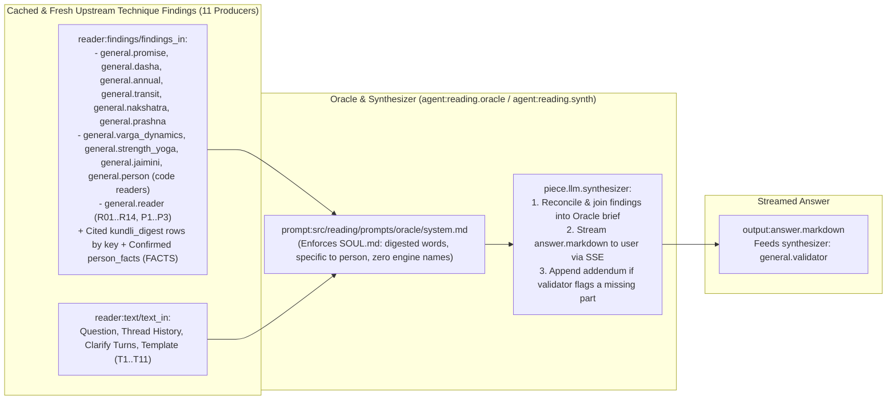

---

## Page 15 of 15 — `general.validator`: Validator

| Field | Value |
|---|---|
| **Technique ID / Title** | `general.validator` — Validator |
| **Category / Board / Status** | `general` · `chat` · `built` |
| **Charts Declared** | `[]` |
| **Selectors** | `boards: ['chat']`, `subjects: ALL_SUBJECTS` |
| **Reader Pieces** | `reader:text/text_in` (`"the question, the clarify turns and the answer"`) |
| **Prompt & User Fields** | `prompt:src/reading/prompts/oracle/validator.md` · `user: ['QUESTION', 'CLARIFY_TURNS', 'ANSWER']` |
| **Agent Piece** | `agent:reading.validator` (`piece.validator.rule_and_model`, role: `validator`) |
| **Output Piece / Synthesizer** | `output:validator.v1` (`{ answered, parts[] }`) · terminal check of the reading pipeline |
| **Date-Range Window Cache** | `freshness: 'natal'` · `scope: 'question'` (validates the specific `ANSWER` against `QUESTION`) |
| **Code & Source** | `src/reading/oracle/validator.ts` (`docs/reading-engine/39 §4.1`) |

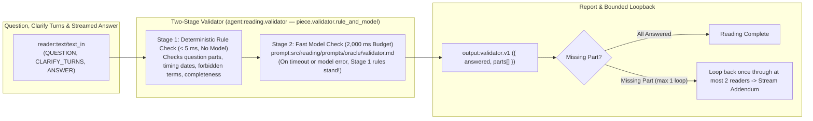
