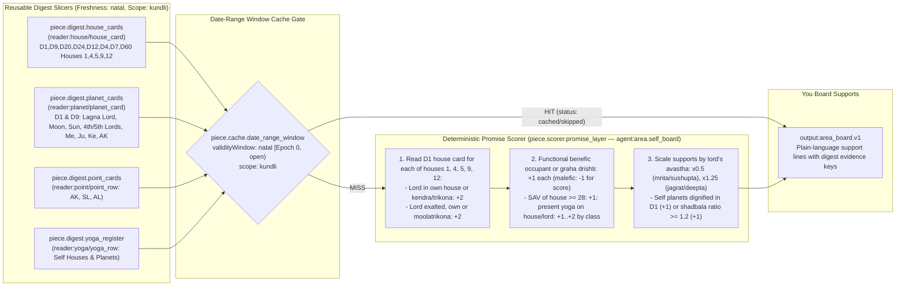
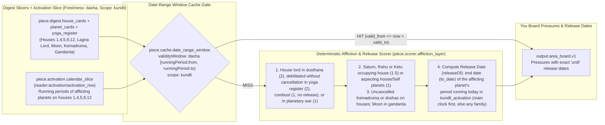
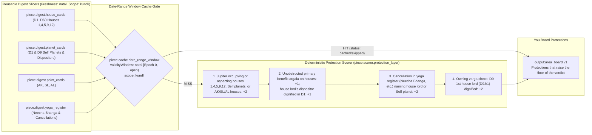
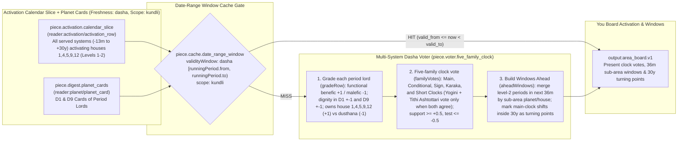
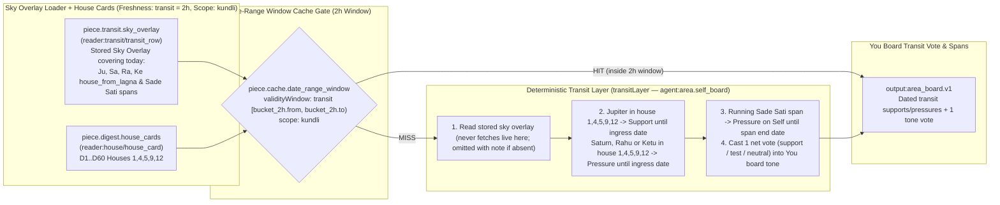
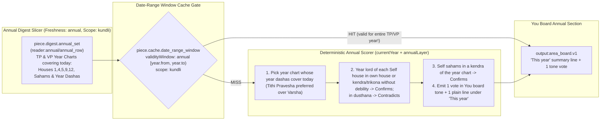
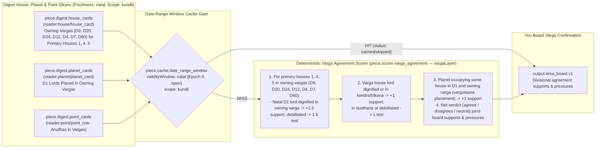
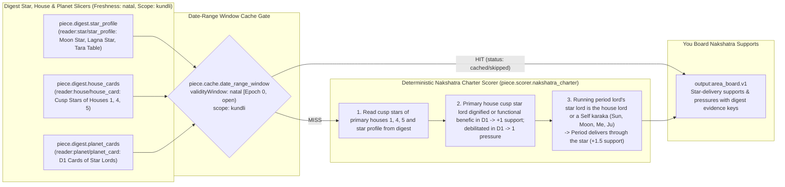
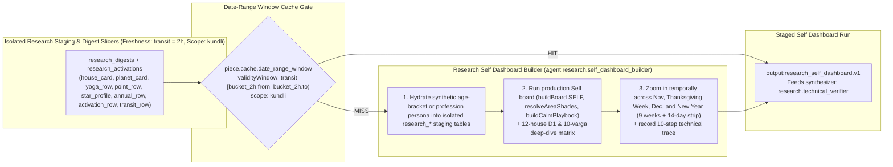
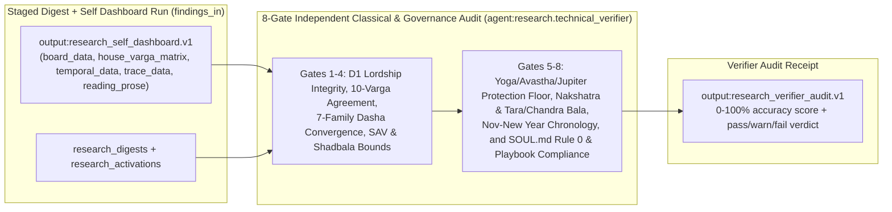

# Volume 03 — Self / You Board (`self.*` / `you` Board) One-Per-Page Illustrations

> **Format**: One illustration per page (`Page 1 of 10` through `Page 10 of 10`), separated by `---`.  
> **Category / Board**: `self` · `you`  
> **Houses & Vargas**: Houses `1, 4, 5, 9, 12` with the Moon · Vargas `D1, D9, D20, D24, D12, D4, D7, D60`  
> **Code References**: [`src/techniques/catalog.ts`](../../src/techniques/catalog.ts) · [`src/reading/area/houseLayers.ts`](../../src/reading/area/houseLayers.ts) · [`src/reading/area/self.ts`](../../src/reading/area/self.ts) · [`src/reading/area/boardService.ts`](../../src/reading/area/boardService.ts)

---

## Page 1 of 10 — `self.promise`: Natal Promise of Houses 1, 4 and 5 with the Moon

| Field | Value |
|---|---|
| **Technique ID / Title** | `self.promise` — Natal promise of houses 1, 4 and 5 with the Moon |
| **Category / Board / Status** | `self` · `you` · `built` |
| **Charts Declared** | `natal:{facts,house_counts,dignities,aspects,strength.bhava,yogas,doshas,avasthas}`, `jaimini:{argala,arudhas}`, `ashtakavarga:sav` |
| **Selectors** | `boards: ['you']`, `subjects: ['general_life_direction', 'health_body', 'education_learning', 'spirituality_moksha']`, `houses: [1, 4, 5, 9, 12]`, `vargas: ['D1', 'D9', 'D20', 'D24', 'D12', 'D4', 'D7', 'D60']` |
| **Reader Pieces** | `reader:house/house_card` (`piece.digest.house_cards`: `D1,D9,D20,D24,D12,D4,D7,D60 houses 1,4,5,9,12`) · `reader:planet/planet_card` (`piece.digest.planet_cards`: `D1 and D9 cards of lagna lord, Moon, Sun, 4th and 5th lords, Mercury, Jupiter, Ketu and AK`) · `reader:point/point_row` (`piece.digest.point_cards`: `AK, SL, AL`) · `reader:yoga/yoga_row` (`piece.digest.yoga_register`: yogas/doshas joining houses `1,4,5,9,12` or Self planets) |
| **Agent & Scorer Pieces** | `agent:area.self_board` (`piece.scorer.promise_layer`, `kind: 'code'`, `system: 'none'`) |
| **Output Piece** | `output:area_board.v1` |
| **Date-Range Window Cache** | `freshness: 'natal'` (`open` window: `to = null`, valid until `digest_version` or `contractHash` changes) · `scope: 'kundli'` (`withTechniqueOutput` skips re-scoring on every subsequent You board open!) |
| **Code & Source** | `src/reading/area/houseLayers.ts promiseLayer; self.ts SELF; boardService.ts getAreaBoard` (`docs/reading-engine/46 §B.2; 53 §4.5; 54 §3`) |

---

## Page 2 of 10 — `self.affliction`: Afflictions on Houses 1, 4 and 5 with the Moon

| Field | Value |
|---|---|
| **Technique ID / Title** | `self.affliction` — Afflictions on houses 1, 4 and 5 with the Moon |
| **Category / Board / Status** | `self` · `you` · `built` |
| **Charts Declared** | `natal:{facts,dignities,aspects,doshas,avasthas,house_counts}` |
| **Selectors** | `boards: ['you']`, `subjects: ['general_life_direction', 'health_body', 'education_learning', 'spirituality_moksha']`, `houses: [1, 4, 5, 9, 12]`, `vargas: ['D1', 'D9', 'D20', 'D24', 'D12', 'D4', 'D7', 'D60']` |
| **Reader Pieces** | `reader:house/house_card` (`piece.digest.house_cards`) · `reader:planet/planet_card` (`piece.digest.planet_cards`) · `reader:yoga/yoga_row` (`piece.digest.yoga_register`: Kemadruma, doshas, cancellations) · `reader:activation/activation_row` (`piece.activation.calendar_slice`: running & next periods of afflicting planets on houses `1,4,5,9,12`) |
| **Agent & Scorer Pieces** | `agent:area.self_board` (`piece.scorer.affliction_layer`: `afflictionLayer`, `releaseOf`, `kind: 'code'`, `system: 'none'`) |
| **Output Piece** | `output:area_board.v1` (pressures with release `until` dates) |
| **Date-Range Window Cache** | `freshness: 'dasha'` (`[runningPeriod.from, runningPeriod.to)` from `kundli_activation`, or `30d` fallback bucket) · `scope: 'kundli'` |
| **Code & Source** | `src/reading/area/houseLayers.ts afflictionLayer, releaseOf; self.ts SELF; boardService.ts getAreaBoard` (`docs/reading-engine/46 §B.3; 53 §4.5; 54 §3`) |

---

## Page 3 of 10 — `self.protection`: What Protects Houses 1, 4 and 5 with the Moon

| Field | Value |
|---|---|
| **Technique ID / Title** | `self.protection` — What protects houses 1, 4 and 5 with the Moon |
| **Category / Board / Status** | `self` · `you` · `built` |
| **Charts Declared** | `natal:{aspects,dignities,yogas,avasthas}`, `jaimini:argala`, `divisional:{D1,D9,D20,D24,D12,D4,D7,D60}` |
| **Selectors** | `boards: ['you']`, `subjects: ['general_life_direction', 'health_body', 'education_learning', 'spirituality_moksha']`, `houses: [1, 4, 5, 9, 12]`, `vargas: ['D1'..'D60']` |
| **Reader Pieces** | `reader:house/house_card` (`piece.digest.house_cards`) · `reader:planet/planet_card` (`piece.digest.planet_cards`) · `reader:point/point_row` (`piece.digest.point_cards`) · `reader:yoga/yoga_row` (`piece.digest.yoga_register`) |
| **Agent & Scorer Pieces** | `agent:area.self_board` (`piece.scorer.protection_layer`: `protectionLayer`, `kind: 'code'`, `system: 'none'`) |
| **Output Piece** | `output:area_board.v1` |
| **Date-Range Window Cache** | `freshness: 'natal'` (`open` window: `to = null`) · `scope: 'kundli'` |
| **Code & Source** | `src/reading/area/houseLayers.ts protectionLayer; self.ts SELF; boardService.ts getAreaBoard` (`docs/reading-engine/46 §B.3; 53 §4.5; 54 §3`) |

---

## Page 4 of 10 — `self.activation`: Activation of Houses 1, 4 and 5 by Every Dasha System

| Field | Value |
|---|---|
| **Technique ID / Title** | `self.activation` — Activation of houses 1, 4 and 5 with the Moon by every dasha system |
| **Category / Board / Status** | `self` · `you` · `built` |
| **Charts Declared** | `dasha:{vimshottari,conditional,narayana,chara,karaka,yogini,tithi_ashtottari}`, `annual:tithi_pravesha_dasha`, `divisional:{D1,D9,D20,D24,D12,D4,D7,D60}` |
| **Selectors** | `boards: ['you']`, `subjects: ['general_life_direction', 'health_body', 'education_learning', 'spirituality_moksha']`, `houses: [1, 4, 5, 9, 12]`, `vargas: ['D1'..'D60']` |
| **Reader Pieces** | `reader:activation/activation_row` (`piece.activation.calendar_slice`: every served system from `-13m` to `+30y` activating houses `1,4,5,9,12`) · `reader:planet/planet_card` (`piece.digest.planet_cards`: D1 and D9 cards of period lords) |
| **Agent & Voter Pieces** | `agent:area.self_board` (`piece.voter.five_family_clock`: `gradeRow`, `familyVotes`, `aheadWindows`, `kind: 'code'`, `system: 'none'`) |
| **Output Piece** | `output:area_board.v1` (family votes + 36-month sub-area windows + 30-year turning points) |
| **Date-Range Window Cache** | `freshness: 'dasha'` (`[runningPeriod.from, runningPeriod.to)` from `kundli_activation`, fallback `30d`) · `scope: 'kundli'` |
| **Code & Source** | `src/reading/area/houseLayers.ts gradeRow, familyVotes, aheadWindows; self.ts SELF; boardService.ts getAreaBoard` (`docs/reading-engine/46 §B.4; 53 §4.5; 54 §3`) |

---

## Page 5 of 10 — `self.transit`: Transits Over Houses 1, 4 and 5 with the Moon

| Field | Value |
|---|---|
| **Technique ID / Title** | `self.transit` — Transits over houses 1, 4 and 5 with the Moon |
| **Category / Board / Status** | `self` · `you` · `built` |
| **Charts Declared** | `transit:{transit_contacts,double_transit,sade_sati,eclipses}`, `ashtakavarga:transit_ashtakavarga` |
| **Selectors** | `boards: ['you']`, `subjects: ['general_life_direction', 'health_body', 'education_learning', 'spirituality_moksha']`, `houses: [1, 4, 5, 9, 12]`, `vargas: ['D1'..'D60']` |
| **Reader Pieces** | `reader:transit/transit_row` (`piece.transit.sky_overlay`: shared sky with overlay for Sa, Ju, Ra, Ke and eclipses over houses `1,4,5,9,12`, their lords and arudhas, `±24m`) · `reader:house/house_card` (`piece.digest.house_cards`) |
| **Agent Piece** | `agent:area.self_board` (`transitLayer`, `kind: 'code'`, `system: 'none'`) |
| **Output Piece** | `output:area_board.v1` |
| **Date-Range Window Cache** | `freshness: 'transit'` (epoch-aligned `2h` window `TECHNIQUE_TRANSIT_WINDOW_HOURS=2`) · `scope: 'kundli'` |
| **Code & Source** | `src/reading/area/houseLayers.ts transitLayer; self.ts SELF; boardService.ts getAreaBoard` (`docs/reading-engine/46 §B.5; 53 §4.5; 54 §3`) |

---

## Page 6 of 10 — `self.annual`: This Year's Chart for Houses 1, 4 and 5 with the Moon

| Field | Value |
|---|---|
| **Technique ID / Title** | `self.annual` — This year's chart for houses 1, 4 and 5 with the Moon |
| **Category / Board / Status** | `self` · `you` · `built` |
| **Charts Declared** | `annual:{tithi_pravesha,sahams,mudda,patyayini,tithi_pravesha_dasha}` |
| **Selectors** | `boards: ['you']`, `subjects: ['general_life_direction', 'health_body', 'education_learning', 'spirituality_moksha']`, `houses: [1, 4, 5, 9, 12]`, `vargas: ['D1'..'D60']` |
| **Reader Pieces** | `reader:annual/annual_row` (`piece.digest.annual_set`: TP and VP of current, previous and next year, houses `1,4,5,9,12`, their sahams and year dashas) |
| **Agent Piece** | `agent:area.self_board` (`currentYear`, `annualLayer`, `kind: 'code'`, `system: 'none'`) |
| **Output Piece** | `output:area_board.v1` |
| **Date-Range Window Cache** | `freshness: 'annual'` (`[year.from, year.to)` of running Tithi Pravesha / Varsha chart, fallback `90d`) · `scope: 'kundli'` |
| **Code & Source** | `src/reading/area/houseLayers.ts currentYear, annualLayer; self.ts SELF; boardService.ts getAreaBoard` (`docs/reading-engine/46 §B.6; 53 §4.5; 54 §3`) |

---

## Page 7 of 10 — `self.varga`: Owning Divisional Chart of Houses 1, 4 and 5 with the Moon

| Field | Value |
|---|---|
| **Technique ID / Title** | `self.varga` — Owning divisional chart of houses 1, 4 and 5 with the Moon |
| **Category / Board / Status** | `self` · `you` · `built` |
| **Charts Declared** | `divisional:{D1,D9,D20,D24,D12,D4,D7,D60}` |
| **Selectors** | `boards: ['you']`, `subjects: ['general_life_direction', 'health_body', 'education_learning', 'spirituality_moksha']`, `houses: [1, 4, 5, 9, 12]`, `vargas: ['D1'..'D60']` |
| **Reader Pieces** | `reader:house/house_card` (`piece.digest.house_cards`: `D1,D9,D20,D24,D12,D4,D7,D60 houses 1,4,5,9,12`) · `reader:planet/planet_card` (`piece.digest.planet_cards`) · `reader:point/point_row` (`piece.digest.point_cards`: arudhas of houses `1,4,5,9,12` in `D1..D60`) |
| **Agent & Scorer Pieces** | `agent:area.self_board` (`piece.scorer.varga_agreement`: `vargaLayer`, `kind: 'code'`, `system: 'none'`) |
| **Output Piece** | `output:area_board.v1` |
| **Date-Range Window Cache** | `freshness: 'natal'` (`open` window: `to = null`) · `scope: 'kundli'` |
| **Code & Source** | `src/reading/area/houseLayers.ts vargaLayer; self.ts SELF; boardService.ts getAreaBoard` (`docs/reading-engine/46 §B.7; 53 §4.5; 54 §3`) |

---

## Page 8 of 10 — `self.nakshatra`: Nakshatra Charter of Houses 1, 4 and 5 with the Moon

| Field | Value |
|---|---|
| **Technique ID / Title** | `self.nakshatra` — Nakshatra charter of houses 1, 4 and 5 with the Moon |
| **Category / Board / Status** | `self` · `you` · `built` |
| **Charts Declared** | `nakshatra:{cusp_nak,star_lord,occupant_stars}` |
| **Selectors** | `boards: ['you']`, `subjects: ['general_life_direction', 'health_body', 'education_learning', 'spirituality_moksha']`, `houses: [1, 4, 5, 9, 12]`, `vargas: ['D1'..'D60']` |
| **Reader Pieces** | `reader:star/star_profile` (`piece.digest.star_profile`: Moon star, lagna star, tara table) · `reader:house/house_card` (`piece.digest.house_cards`: `cusp_star` column of houses `1,4,5`) · `reader:planet/planet_card` (`piece.digest.planet_cards`: D1 cards of cusp star lords & period star lords) |
| **Agent & Scorer Pieces** | `agent:area.self_board` (`piece.scorer.nakshatra_charter`: `nakshatraLayer`, `kind: 'code'`, `system: 'none'`) |
| **Output Piece** | `output:area_board.v1` |
| **Date-Range Window Cache** | `freshness: 'natal'` (`open` window: `to = null`) · `scope: 'kundli'` |
| **Code & Source** | `src/reading/area/houseLayers.ts nakshatraLayer; self.ts SELF; boardService.ts getAreaBoard` (`docs/reading-engine/46 §B.8; 53 §4.5; 54 §3`) |

---

## Page 9 of 10 — `research.self_dashboard_qa`: Research Self Dashboard Deep-Dive & Nov/Thanksgiving/Dec/New Year Zoom-In

| Field | Value |
|---|---|
| **Technique ID / Title** | `research.self_dashboard_qa` — Research Self Dashboard deep-dive & Nov/Thanksgiving/Dec/New Year zoom-in |
| **Category / Board / Status** | `self` · `you` · `built` |
| **Charts Declared** | `natal:{facts,dignities,aspects,avasthas,yogas,doshas,strength.shadbala}`, `ashtakavarga:sav`, `jaimini:{charakaraka,arudhas,argala}`, `nakshatra:{janma,cusp_nak}`, `divisional:{D1,D9,D10,D20,D24,D12,D2,D4,D7,D60}`, `dasha:{vimshottari,yogini,tithi_ashtottari,narayana,chara,karaka}`, `annual:{tithi_pravesha,varsha,tithi_pravesha_dasha}`, `transit:{transit_contacts,sade_sati}`, `panchang:muhurta` |
| **Selectors** | `boards: ['you']`, `subjects: ['general_life_direction', 'health_body', 'education_learning', 'spirituality_moksha', 'career_work']`, `houses: [1..12]`, `vargas: ['D1', 'D9', 'D10', 'D20', 'D24', 'D12', 'D2', 'D4', 'D7', 'D60']` |
| **Reader Pieces** | `reader:house/house_card` · `reader:planet/planet_card` · `reader:yoga/yoga_row` · `reader:point/point_row` · `reader:star/star_profile` · `reader:activation/activation_row` · `reader:annual/annual_row` · `reader:transit/transit_row` |
| **Agent Piece** | `agent:research.self_dashboard_builder` (`hydrateResearchSubject`, `buildSelfResearchDashboard`, `kind: 'code'`, `system: 'none'`) |
| **Output Piece** | `output:research_self_dashboard.v1` (feeds `research.technical_verifier`) |
| **Date-Range Window Cache** | `freshness: 'transit'` (`2h` window) · `scope: 'kundli'` |
| **Code & Source** | `src/reading/research/selfDashboardQa.ts hydrateResearchSubject, buildSelfResearchDashboard` (`docs/admin/09 §4.1; docs/reading-engine/46 §B; 54 §3; 55 §2`) |

---

## Page 10 of 10 — `research.technical_verifier`: Independent Technical Verifier Agent (8-Gate Classical & Governance Audit)

| Field | Value |
|---|---|
| **Technique ID / Title** | `research.technical_verifier` — Independent Technical Verifier Agent (8-gate classical & governance audit) |
| **Category / Board / Status** | `self` · `you` · `built` |
| **Charts Declared** | Same 35 chart sources as `research.self_dashboard_qa` + `findings_in` from the 10-step technical trace |
| **Selectors** | `boards: ['you']`, `subjects: ['general_life_direction', 'health_body', 'education_learning', 'spirituality_moksha']`, `houses: [1, 4, 5, 9, 10, 12]`, `vargas: ['D1', 'D9', 'D10', 'D20', 'D24']` |
| **Reader Pieces** | `reader:house/house_card` · `reader:planet/planet_card` · `reader:yoga/yoga_row` · `reader:point/point_row` · `reader:star/star_profile` · `reader:activation/activation_row` · `reader:annual/annual_row` · `reader:transit/transit_row` · `reader:findings/findings_in` |
| **Agent Piece** | `agent:research.technical_verifier` (`verifySelfDashboardRun`, `kind: 'code'`, `system: 'none'`) |
| **Output Piece** | `output:research_verifier_audit.v1` |
| **Date-Range Window Cache** | `freshness: 'transit'` (`2h` window) · `scope: 'kundli'` |
| **Code & Source** | `src/reading/research/selfDashboardQa.ts verifySelfDashboardRun` (`docs/admin/09 §4.1.4; SOUL.md; BPHS`) |

