# Volume 03 — Self / You Board (`self.*` / `you` Board) One-Per-Page Illustrations

> **Format**: One illustration per page (`Page 1 of 10` through `Page 10 of 10`), separated by `---`.  
> **Category / Board**: `self` · `you`  
> **Houses & Vargas**: Houses `1, 4, 5, 9, 12` with the Moon · Vargas `D1, D9, D20, D24, D12, D4, D7, D60`  
> **Code References**: [`src/techniques/catalog.ts`](../../src/techniques/catalog.ts) · [`src/reading/area/houseLayers.ts`](../../src/reading/area/houseLayers.ts) · [`src/reading/area/self.ts`](../../src/reading/area/self.ts) · [`src/reading/area/boardService.ts`](../../src/reading/area/boardService.ts)

---

## Page 1 of 10 — `self.promise`: Natal Promise of Houses 1, 4 and 5 with the Moon

| Field | Value |
|---|---|
| **Technique ID / Title** | `self.promise` — Natal promise of houses 1, 4 and 5 with the Moon |
| **Category / Board / Status** | `self` · `you` · `built` |
| **Charts Declared** | `natal:{facts,house_counts,dignities,aspects,strength.bhava,yogas,doshas,avasthas}`, `jaimini:{argala,arudhas}`, `ashtakavarga:sav` |
| **Selectors** | `boards: ['you']`, `subjects: ['general_life_direction', 'health_body', 'education_learning', 'spirituality_moksha']`, `houses: [1, 4, 5, 9, 12]`, `vargas: ['D1', 'D9', 'D20', 'D24', 'D12', 'D4', 'D7', 'D60']` |
| **Reader Pieces** | `reader:house/house_card` (`piece.digest.house_cards`: `D1,D9,D20,D24,D12,D4,D7,D60 houses 1,4,5,9,12`) · `reader:planet/planet_card` (`piece.digest.planet_cards`: `D1 and D9 cards of lagna lord, Moon, Sun, 4th and 5th lords, Mercury, Jupiter, Ketu and AK`) · `reader:point/point_row` (`piece.digest.point_cards`: `AK, SL, AL`) · `reader:yoga/yoga_row` (`piece.digest.yoga_register`: yogas/doshas joining houses `1,4,5,9,12` or Self planets) |
| **Agent & Scorer Pieces** | `agent:area.self_board` (`piece.scorer.promise_layer`, `kind: 'code'`, `system: 'none'`) |
| **Output Piece** | `output:area_board.v1` |
| **Date-Range Window Cache** | `freshness: 'natal'` (`open` window: `to = null`, valid until `digest_version` or `contractHash` changes) · `scope: 'kundli'` (`withTechniqueOutput` skips re-scoring on every subsequent You board open!) |
| **Code & Source** | `src/reading/area/houseLayers.ts promiseLayer; self.ts SELF; boardService.ts getAreaBoard` (`docs/reading-engine/46 §B.2; 53 §4.5; 54 §3`) |

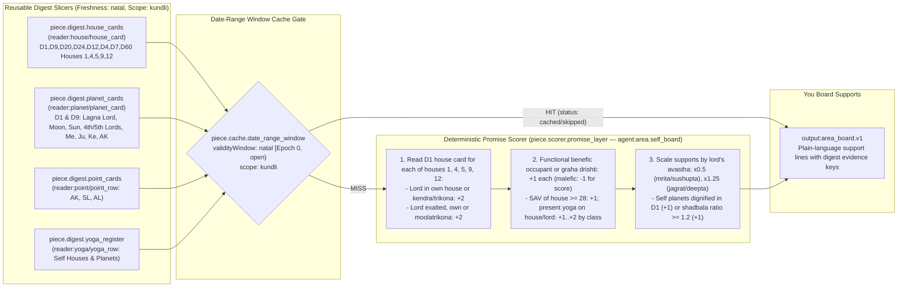

---

## Page 2 of 10 — `self.affliction`: Afflictions on Houses 1, 4 and 5 with the Moon

| Field | Value |
|---|---|
| **Technique ID / Title** | `self.affliction` — Afflictions on houses 1, 4 and 5 with the Moon |
| **Category / Board / Status** | `self` · `you` · `built` |
| **Charts Declared** | `natal:{facts,dignities,aspects,doshas,avasthas,house_counts}` |
| **Selectors** | `boards: ['you']`, `subjects: ['general_life_direction', 'health_body', 'education_learning', 'spirituality_moksha']`, `houses: [1, 4, 5, 9, 12]`, `vargas: ['D1', 'D9', 'D20', 'D24', 'D12', 'D4', 'D7', 'D60']` |
| **Reader Pieces** | `reader:house/house_card` (`piece.digest.house_cards`) · `reader:planet/planet_card` (`piece.digest.planet_cards`) · `reader:yoga/yoga_row` (`piece.digest.yoga_register`: Kemadruma, doshas, cancellations) · `reader:activation/activation_row` (`piece.activation.calendar_slice`: running & next periods of afflicting planets on houses `1,4,5,9,12`) |
| **Agent & Scorer Pieces** | `agent:area.self_board` (`piece.scorer.affliction_layer`: `afflictionLayer`, `releaseOf`, `kind: 'code'`, `system: 'none'`) |
| **Output Piece** | `output:area_board.v1` (pressures with release `until` dates) |
| **Date-Range Window Cache** | `freshness: 'dasha'` (`[runningPeriod.from, runningPeriod.to)` from `kundli_activation`, or `30d` fallback bucket) · `scope: 'kundli'` |
| **Code & Source** | `src/reading/area/houseLayers.ts afflictionLayer, releaseOf; self.ts SELF; boardService.ts getAreaBoard` (`docs/reading-engine/46 §B.3; 53 §4.5; 54 §3`) |

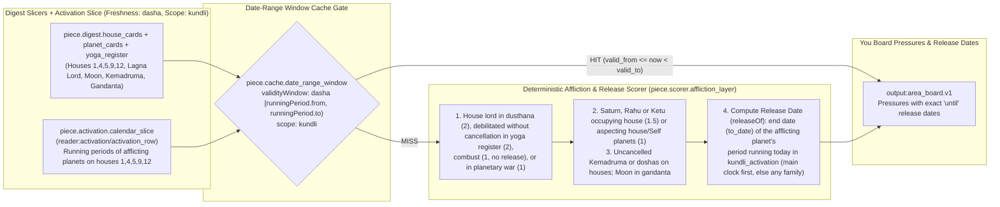

---

## Page 3 of 10 — `self.protection`: What Protects Houses 1, 4 and 5 with the Moon

| Field | Value |
|---|---|
| **Technique ID / Title** | `self.protection` — What protects houses 1, 4 and 5 with the Moon |
| **Category / Board / Status** | `self` · `you` · `built` |
| **Charts Declared** | `natal:{aspects,dignities,yogas,avasthas}`, `jaimini:argala`, `divisional:{D1,D9,D20,D24,D12,D4,D7,D60}` |
| **Selectors** | `boards: ['you']`, `subjects: ['general_life_direction', 'health_body', 'education_learning', 'spirituality_moksha']`, `houses: [1, 4, 5, 9, 12]`, `vargas: ['D1'..'D60']` |
| **Reader Pieces** | `reader:house/house_card` (`piece.digest.house_cards`) · `reader:planet/planet_card` (`piece.digest.planet_cards`) · `reader:point/point_row` (`piece.digest.point_cards`) · `reader:yoga/yoga_row` (`piece.digest.yoga_register`) |
| **Agent & Scorer Pieces** | `agent:area.self_board` (`piece.scorer.protection_layer`: `protectionLayer`, `kind: 'code'`, `system: 'none'`) |
| **Output Piece** | `output:area_board.v1` |
| **Date-Range Window Cache** | `freshness: 'natal'` (`open` window: `to = null`) · `scope: 'kundli'` |
| **Code & Source** | `src/reading/area/houseLayers.ts protectionLayer; self.ts SELF; boardService.ts getAreaBoard` (`docs/reading-engine/46 §B.3; 53 §4.5; 54 §3`) |

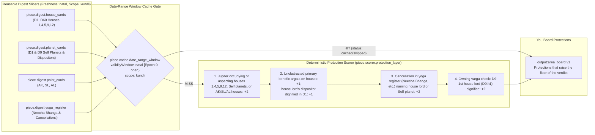

---

## Page 4 of 10 — `self.activation`: Activation of Houses 1, 4 and 5 by Every Dasha System

| Field | Value |
|---|---|
| **Technique ID / Title** | `self.activation` — Activation of houses 1, 4 and 5 with the Moon by every dasha system |
| **Category / Board / Status** | `self` · `you` · `built` |
| **Charts Declared** | `dasha:{vimshottari,conditional,narayana,chara,karaka,yogini,tithi_ashtottari}`, `annual:tithi_pravesha_dasha`, `divisional:{D1,D9,D20,D24,D12,D4,D7,D60}` |
| **Selectors** | `boards: ['you']`, `subjects: ['general_life_direction', 'health_body', 'education_learning', 'spirituality_moksha']`, `houses: [1, 4, 5, 9, 12]`, `vargas: ['D1'..'D60']` |
| **Reader Pieces** | `reader:activation/activation_row` (`piece.activation.calendar_slice`: every served system from `-13m` to `+30y` activating houses `1,4,5,9,12`) · `reader:planet/planet_card` (`piece.digest.planet_cards`: D1 and D9 cards of period lords) |
| **Agent & Voter Pieces** | `agent:area.self_board` (`piece.voter.five_family_clock`: `gradeRow`, `familyVotes`, `aheadWindows`, `kind: 'code'`, `system: 'none'`) |
| **Output Piece** | `output:area_board.v1` (family votes + 36-month sub-area windows + 30-year turning points) |
| **Date-Range Window Cache** | `freshness: 'dasha'` (`[runningPeriod.from, runningPeriod.to)` from `kundli_activation`, fallback `30d`) · `scope: 'kundli'` |
| **Code & Source** | `src/reading/area/houseLayers.ts gradeRow, familyVotes, aheadWindows; self.ts SELF; boardService.ts getAreaBoard` (`docs/reading-engine/46 §B.4; 53 §4.5; 54 §3`) |

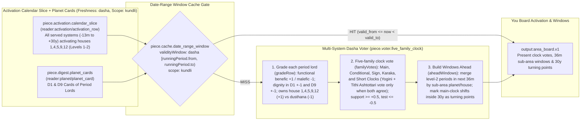

---

## Page 5 of 10 — `self.transit`: Transits Over Houses 1, 4 and 5 with the Moon

| Field | Value |
|---|---|
| **Technique ID / Title** | `self.transit` — Transits over houses 1, 4 and 5 with the Moon |
| **Category / Board / Status** | `self` · `you` · `built` |
| **Charts Declared** | `transit:{transit_contacts,double_transit,sade_sati,eclipses}`, `ashtakavarga:transit_ashtakavarga` |
| **Selectors** | `boards: ['you']`, `subjects: ['general_life_direction', 'health_body', 'education_learning', 'spirituality_moksha']`, `houses: [1, 4, 5, 9, 12]`, `vargas: ['D1'..'D60']` |
| **Reader Pieces** | `reader:transit/transit_row` (`piece.transit.sky_overlay`: shared sky with overlay for Sa, Ju, Ra, Ke and eclipses over houses `1,4,5,9,12`, their lords and arudhas, `±24m`) · `reader:house/house_card` (`piece.digest.house_cards`) |
| **Agent Piece** | `agent:area.self_board` (`transitLayer`, `kind: 'code'`, `system: 'none'`) |
| **Output Piece** | `output:area_board.v1` |
| **Date-Range Window Cache** | `freshness: 'transit'` (epoch-aligned `2h` window `TECHNIQUE_TRANSIT_WINDOW_HOURS=2`) · `scope: 'kundli'` |
| **Code & Source** | `src/reading/area/houseLayers.ts transitLayer; self.ts SELF; boardService.ts getAreaBoard` (`docs/reading-engine/46 §B.5; 53 §4.5; 54 §3`) |

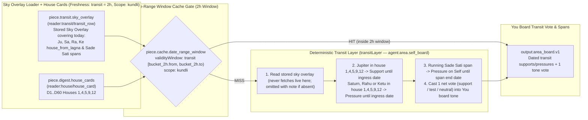

---

## Page 6 of 10 — `self.annual`: This Year's Chart for Houses 1, 4 and 5 with the Moon

| Field | Value |
|---|---|
| **Technique ID / Title** | `self.annual` — This year's chart for houses 1, 4 and 5 with the Moon |
| **Category / Board / Status** | `self` · `you` · `built` |
| **Charts Declared** | `annual:{tithi_pravesha,sahams,mudda,patyayini,tithi_pravesha_dasha}` |
| **Selectors** | `boards: ['you']`, `subjects: ['general_life_direction', 'health_body', 'education_learning', 'spirituality_moksha']`, `houses: [1, 4, 5, 9, 12]`, `vargas: ['D1'..'D60']` |
| **Reader Pieces** | `reader:annual/annual_row` (`piece.digest.annual_set`: TP and VP of current, previous and next year, houses `1,4,5,9,12`, their sahams and year dashas) |
| **Agent Piece** | `agent:area.self_board` (`currentYear`, `annualLayer`, `kind: 'code'`, `system: 'none'`) |
| **Output Piece** | `output:area_board.v1` |
| **Date-Range Window Cache** | `freshness: 'annual'` (`[year.from, year.to)` of running Tithi Pravesha / Varsha chart, fallback `90d`) · `scope: 'kundli'` |
| **Code & Source** | `src/reading/area/houseLayers.ts currentYear, annualLayer; self.ts SELF; boardService.ts getAreaBoard` (`docs/reading-engine/46 §B.6; 53 §4.5; 54 §3`) |

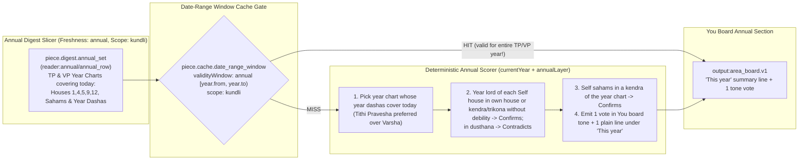

---

## Page 7 of 10 — `self.varga`: Owning Divisional Chart of Houses 1, 4 and 5 with the Moon

| Field | Value |
|---|---|
| **Technique ID / Title** | `self.varga` — Owning divisional chart of houses 1, 4 and 5 with the Moon |
| **Category / Board / Status** | `self` · `you` · `built` |
| **Charts Declared** | `divisional:{D1,D9,D20,D24,D12,D4,D7,D60}` |
| **Selectors** | `boards: ['you']`, `subjects: ['general_life_direction', 'health_body', 'education_learning', 'spirituality_moksha']`, `houses: [1, 4, 5, 9, 12]`, `vargas: ['D1'..'D60']` |
| **Reader Pieces** | `reader:house/house_card` (`piece.digest.house_cards`: `D1,D9,D20,D24,D12,D4,D7,D60 houses 1,4,5,9,12`) · `reader:planet/planet_card` (`piece.digest.planet_cards`) · `reader:point/point_row` (`piece.digest.point_cards`: arudhas of houses `1,4,5,9,12` in `D1..D60`) |
| **Agent & Scorer Pieces** | `agent:area.self_board` (`piece.scorer.varga_agreement`: `vargaLayer`, `kind: 'code'`, `system: 'none'`) |
| **Output Piece** | `output:area_board.v1` |
| **Date-Range Window Cache** | `freshness: 'natal'` (`open` window: `to = null`) · `scope: 'kundli'` |
| **Code & Source** | `src/reading/area/houseLayers.ts vargaLayer; self.ts SELF; boardService.ts getAreaBoard` (`docs/reading-engine/46 §B.7; 53 §4.5; 54 §3`) |

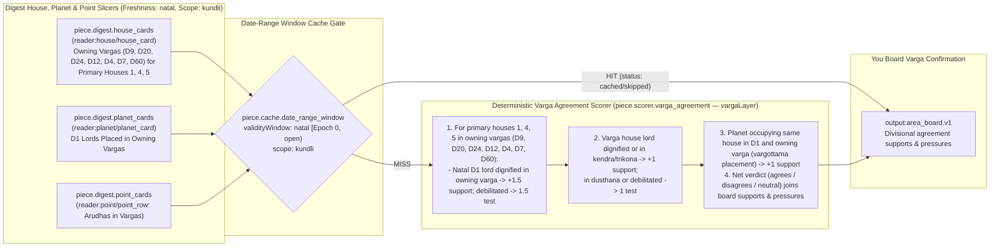

---

## Page 8 of 10 — `self.nakshatra`: Nakshatra Charter of Houses 1, 4 and 5 with the Moon

| Field | Value |
|---|---|
| **Technique ID / Title** | `self.nakshatra` — Nakshatra charter of houses 1, 4 and 5 with the Moon |
| **Category / Board / Status** | `self` · `you` · `built` |
| **Charts Declared** | `nakshatra:{cusp_nak,star_lord,occupant_stars}` |
| **Selectors** | `boards: ['you']`, `subjects: ['general_life_direction', 'health_body', 'education_learning', 'spirituality_moksha']`, `houses: [1, 4, 5, 9, 12]`, `vargas: ['D1'..'D60']` |
| **Reader Pieces** | `reader:star/star_profile` (`piece.digest.star_profile`: Moon star, lagna star, tara table) · `reader:house/house_card` (`piece.digest.house_cards`: `cusp_star` column of houses `1,4,5`) · `reader:planet/planet_card` (`piece.digest.planet_cards`: D1 cards of cusp star lords & period star lords) |
| **Agent & Scorer Pieces** | `agent:area.self_board` (`piece.scorer.nakshatra_charter`: `nakshatraLayer`, `kind: 'code'`, `system: 'none'`) |
| **Output Piece** | `output:area_board.v1` |
| **Date-Range Window Cache** | `freshness: 'natal'` (`open` window: `to = null`) · `scope: 'kundli'` |
| **Code & Source** | `src/reading/area/houseLayers.ts nakshatraLayer; self.ts SELF; boardService.ts getAreaBoard` (`docs/reading-engine/46 §B.8; 53 §4.5; 54 §3`) |

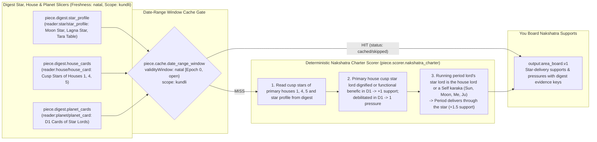

---

## Page 9 of 10 — `research.self_dashboard_qa`: Research Self Dashboard Deep-Dive & Nov/Thanksgiving/Dec/New Year Zoom-In

| Field | Value |
|---|---|
| **Technique ID / Title** | `research.self_dashboard_qa` — Research Self Dashboard deep-dive & Nov/Thanksgiving/Dec/New Year zoom-in |
| **Category / Board / Status** | `self` · `you` · `built` |
| **Charts Declared** | `natal:{facts,dignities,aspects,avasthas,yogas,doshas,strength.shadbala}`, `ashtakavarga:sav`, `jaimini:{charakaraka,arudhas,argala}`, `nakshatra:{janma,cusp_nak}`, `divisional:{D1,D9,D10,D20,D24,D12,D2,D4,D7,D60}`, `dasha:{vimshottari,yogini,tithi_ashtottari,narayana,chara,karaka}`, `annual:{tithi_pravesha,varsha,tithi_pravesha_dasha}`, `transit:{transit_contacts,sade_sati}`, `panchang:muhurta` |
| **Selectors** | `boards: ['you']`, `subjects: ['general_life_direction', 'health_body', 'education_learning', 'spirituality_moksha', 'career_work']`, `houses: [1..12]`, `vargas: ['D1', 'D9', 'D10', 'D20', 'D24', 'D12', 'D2', 'D4', 'D7', 'D60']` |
| **Reader Pieces** | `reader:house/house_card` · `reader:planet/planet_card` · `reader:yoga/yoga_row` · `reader:point/point_row` · `reader:star/star_profile` · `reader:activation/activation_row` · `reader:annual/annual_row` · `reader:transit/transit_row` |
| **Agent Piece** | `agent:research.self_dashboard_builder` (`hydrateResearchSubject`, `buildSelfResearchDashboard`, `kind: 'code'`, `system: 'none'`) |
| **Output Piece** | `output:research_self_dashboard.v1` (feeds `research.technical_verifier`) |
| **Date-Range Window Cache** | `freshness: 'transit'` (`2h` window) · `scope: 'kundli'` |
| **Code & Source** | `src/reading/research/selfDashboardQa.ts hydrateResearchSubject, buildSelfResearchDashboard` (`docs/admin/09 §4.1; docs/reading-engine/46 §B; 54 §3; 55 §2`) |

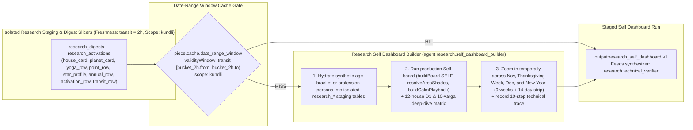

---

## Page 10 of 10 — `research.technical_verifier`: Independent Technical Verifier Agent (8-Gate Classical & Governance Audit)

| Field | Value |
|---|---|
| **Technique ID / Title** | `research.technical_verifier` — Independent Technical Verifier Agent (8-gate classical & governance audit) |
| **Category / Board / Status** | `self` · `you` · `built` |
| **Charts Declared** | Same 35 chart sources as `research.self_dashboard_qa` + `findings_in` from the 10-step technical trace |
| **Selectors** | `boards: ['you']`, `subjects: ['general_life_direction', 'health_body', 'education_learning', 'spirituality_moksha']`, `houses: [1, 4, 5, 9, 10, 12]`, `vargas: ['D1', 'D9', 'D10', 'D20', 'D24']` |
| **Reader Pieces** | `reader:house/house_card` · `reader:planet/planet_card` · `reader:yoga/yoga_row` · `reader:point/point_row` · `reader:star/star_profile` · `reader:activation/activation_row` · `reader:annual/annual_row` · `reader:transit/transit_row` · `reader:findings/findings_in` |
| **Agent Piece** | `agent:research.technical_verifier` (`verifySelfDashboardRun`, `kind: 'code'`, `system: 'none'`) |
| **Output Piece** | `output:research_verifier_audit.v1` |
| **Date-Range Window Cache** | `freshness: 'transit'` (`2h` window) · `scope: 'kundli'` |
| **Code & Source** | `src/reading/research/selfDashboardQa.ts verifySelfDashboardRun` (`docs/admin/09 §4.1.4; SOUL.md; BPHS`) |

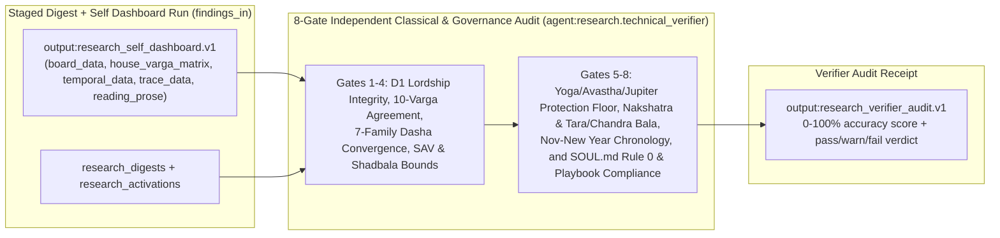

---

## Page 11 of 12 — `self.character_arc`: Character Evolution Across Three Decades (Last 10 Years · Now · Next 10 Years)

| Field | Value |
|---|---|
| **Technique ID / Title** | `self.character_arc` — Character evolution across three decades (Last 10 Years · Now · Next 10 Years) |
| **Category / Board / Status** | `self` · `you` · `built` |
| **Charts Declared** | `natal:{facts,dignities,aspects,avasthas}`, `divisional:D9`, `jaimini:{charakaraka,arudhas}`, `dasha:{vimshottari,narayana}` |
| **Selectors** | `boards: ['you']`, `subjects: ['general_life_direction', 'spirituality_moksha', 'health_body']`, `houses: [1, 4, 5, 9, 10, 12]`, `vargas: ['D1', 'D9']` |
| **Reader Pieces** | `reader:house/house_card` (`D1,D9_h1,4,5,9,10,12`) · `reader:planet/planet_card` · `reader:point/point_row` · `reader:activation/activation_row` |
| **Agent Piece** | `agent:area.self_board` (`buildSelfCharacterArc`, `kind: 'code'`, `system: 'none'`) |
| **Output Piece** | `output:self_character_arc.v1` |
| **Date-Range Window Cache** | `freshness: 'dasha'` (`[runningPeriod.from, runningPeriod.to)` from `kundli_activation`) · `scope: 'kundli'` |
| **Code & Source** | `src/reading/area/selfCharacterAndJoy.ts buildSelfCharacterArc` (`BPHS Ch. 12, 45–51; Jaimini Upadesa Sutras; Sanjay Rath Crux of Vedic Astrology; docs/reading-engine/45 §3.3`) |

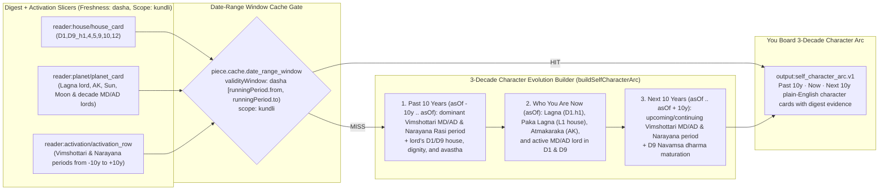

---

## Page 12 of 12 — `self.personality_joy`: Purely Vedic Personality & What Brings You Joy (Chandra · Budha · 4th/5th Bhava)

| Field | Value |
|---|---|
| **Technique ID / Title** | `self.personality_joy` — Purely Vedic personality & what brings you joy (Chandra · Budha · 4th/5th Bhava) |
| **Category / Board / Status** | `self` · `you` · `built` |
| **Charts Declared** | `natal:{facts,dignities,aspects,avasthas}`, `nakshatra:{janma,cusp_nak}`, `divisional:{D9,D24}`, `ashtakavarga:sav` |
| **Selectors** | `boards: ['you']`, `subjects: ['general_life_direction', 'education_learning', 'health_body']`, `houses: [1, 3, 4, 5]`, `vargas: ['D1', 'D9', 'D24']` |
| **Reader Pieces** | `reader:planet/planet_card` (`Mo & Me in D1, D9, D24`) · `reader:house/house_card` (`D1_h1,3,4,5`) · `reader:star/star_profile` (`Janma star & cusp stars`) |
| **Agent Piece** | `agent:area.self_board` (`buildSelfPersonalityAndJoy`, `kind: 'code'`, `system: 'none'`) |
| **Output Piece** | `output:self_personality_joy.v1` |
| **Date-Range Window Cache** | `freshness: 'natal'` (valid until digest version or contract changes) · `scope: 'kundli'` |
| **Code & Source** | `src/reading/area/selfCharacterAndJoy.ts buildSelfPersonalityAndJoy` (`BPHS Ch. 3, 15, 16; Phaladeepika Ch. 2, 8; Lunar Astro Moon-Mercury synthesis; docs/reading-engine/45 §3.3`) |

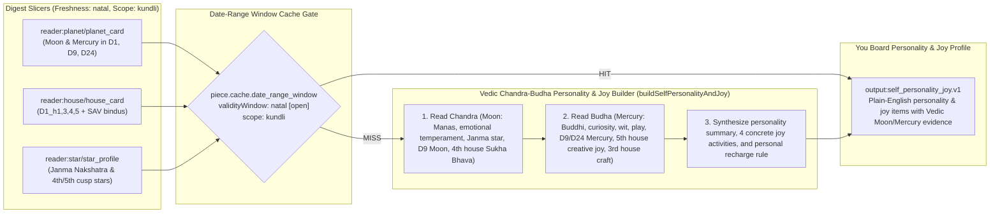

---

---

---

---

---

<!-- self.reading pages: generated by scripts/write-self-reading-pages.ts -->

## Page 13 of 22 — `self.reading.diagnosis`: Who you are, in short (three sentences built from the other panels, shown first)

| Field | Value |
|---|---|
| **Technique ID / Title** | `self.reading.diagnosis` — You reading: Who you are, in short (three sentences built from the other panels, shown first) |
| **Category / Board / Status** | `self` · `you` · `built` |
| **Charts Declared** | `natal:panel claims` |
| **Selectors** | `{"boards":["you"],"subjects":["general_life_direction"],"houses":[1],"vargas":["D1"]}` |
| **Reader Pieces** | `reader:findings/findings_in` (claims of self.reading.lagna, struggle, yogas, chapters) |
| **Agent Piece** | `agent:self.reading_panel` (`system: none`) |
| **Output Piece** | `output:board_diagnosis.v1` |
| **Date-Range Window Cache** | `freshness: 'dasha'` · `scope: 'kundli'` |
| **Code & Source** | `src/reading/self/panels/diagnosis.ts diagnosisPanel, tensionSource (board.diagnosis, Self instance)` (docs/reading-engine/58; BPHS (lagna, lords, karakatva, avasthas ch. 45); Jaimini (chara karakas, karakamsa, arudha lagna); PVR Narasimha Rao, Integrated Approach (dasha delivery, conditional dashas)) |

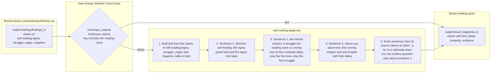

---

## Page 14 of 22 — `self.reading.clock`: the reading clock (preferred, applicable or default dasha system, and the confirming clocks)

| Field | Value |
|---|---|
| **Technique ID / Title** | `self.reading.clock` — You reading: the reading clock (preferred, applicable or default dasha system, and the confirming clocks) |
| **Category / Board / Status** | `self` · `you` · `built` |
| **Charts Declared** | `dasha:dasha.applicable`, `dasha:all served systems` |
| **Selectors** | `{"boards":["you"],"subjects":["general_life_direction"],"houses":[1],"vargas":["D1"]}` |
| **Reader Pieces** | `reader:activation/activation_row` (systems present and their family (conditional = engine says applies)) |
| **Agent Piece** | `agent:self.reading_panel` (`system: none`) |
| **Output Piece** | `output:self_clock.v1` |
| **Date-Range Window Cache** | `freshness: 'dasha'` · `scope: 'kundli'` |
| **Code & Source** | `src/reading/self/clock.ts resolveClock; service.ts getSelfReading` (docs/reading-engine/58; BPHS (lagna, lords, karakatva, avasthas ch. 45); Jaimini (chara karakas, karakamsa, arudha lagna); PVR Narasimha Rao, Integrated Approach (dasha delivery, conditional dashas)) |

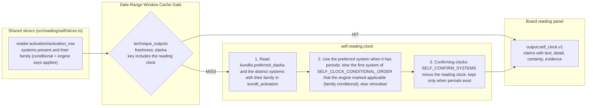

---

## Page 15 of 22 — `self.reading.lagna`: Who you are (1st house, lagna lord, arudha lagna, rising star, Moon lagna, D9 lagna)

| Field | Value |
|---|---|
| **Technique ID / Title** | `self.reading.lagna` — You reading: Who you are (1st house, lagna lord, arudha lagna, rising star, Moon lagna, D9 lagna) |
| **Category / Board / Status** | `self` · `you` · `built` |
| **Charts Declared** | `divisional:D1`, `divisional:D9`, `natal:dignities`, `natal:aspects`, `natal:avasthas`, `jaimini:arudhas`, `nakshatra:cusp star` |
| **Selectors** | `{"boards":["you"],"subjects":["general_life_direction"],"houses":[1],"vargas":["D1","D9"]}` |
| **Reader Pieces** | `reader:house/house_card` (D1 h1, the D1 house the Moon occupies, D9 h1) · `reader:planet/planet_card` (D1 and D9 cards of the lagna lord; D1 cards of planets aspecting h1 and of the Moon) · `reader:point/point_row` (D1 AL) |
| **Agent Piece** | `agent:self.reading_panel` (`system: none`) |
| **Output Piece** | `output:self_panel.v1` |
| **Date-Range Window Cache** | `freshness: 'natal'` · `scope: 'kundli'` |
| **Code & Source** | `src/reading/self/panels/lagna.ts lagnaPanel; slices.ts planetChain, houseFrame, pointOf` (docs/reading-engine/58; BPHS (lagna, lords, karakatva, avasthas ch. 45); Jaimini (chara karakas, karakamsa, arudha lagna); PVR Narasimha Rao, Integrated Approach (dasha delivery, conditional dashas)) |

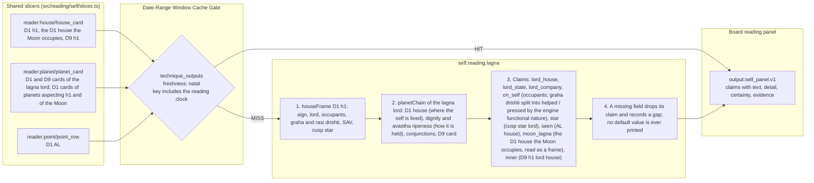

---

## Page 16 of 22 — `self.reading.mind`: Your mind (Moon, Mercury, 3rd, 4th and 5th houses)

| Field | Value |
|---|---|
| **Technique ID / Title** | `self.reading.mind` — You reading: Your mind (Moon, Mercury, 3rd, 4th and 5th houses) |
| **Category / Board / Status** | `self` · `you` · `built` |
| **Charts Declared** | `divisional:D1`, `divisional:D9`, `natal:dignities`, `natal:yogas`, `nakshatra:Moon star`, `ashtakavarga:sav` |
| **Selectors** | `{"boards":["you"],"subjects":["general_life_direction"],"houses":[3,4,5],"vargas":["D1","D9"]}` |
| **Reader Pieces** | `reader:planet/planet_card` (D1 and D9 cards of Mo, Me) · `reader:house/house_card` (D1 h3, h4, h5 and every D1 house (sav column)) · `reader:yoga/yoga_row` (cancellation rows naming Mo) |
| **Agent Piece** | `agent:self.reading_panel` (`system: none`) |
| **Output Piece** | `output:self_panel.v1` |
| **Date-Range Window Cache** | `freshness: 'natal'` · `scope: 'kundli'` |
| **Code & Source** | `src/reading/self/panels/mind.ts mindPanel` (docs/reading-engine/58; BPHS (lagna, lords, karakatva, avasthas ch. 45); Jaimini (chara karakas, karakamsa, arudha lagna); PVR Narasimha Rao, Integrated Approach (dasha delivery, conditional dashas)) |

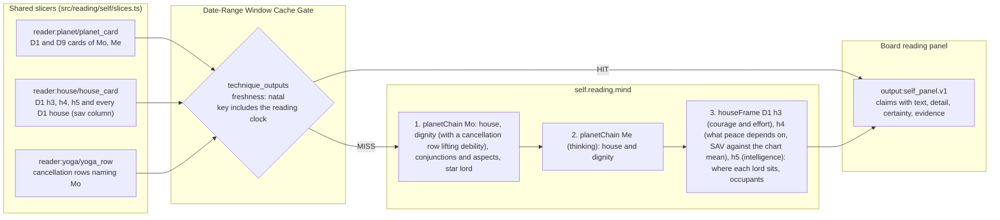

---

## Page 17 of 22 — `self.reading.atma`: Your soul aim (atmakaraka, karakamsa, Sun, Jupiter, 9th and 12th houses)

| Field | Value |
|---|---|
| **Technique ID / Title** | `self.reading.atma` — You reading: Your soul aim (atmakaraka, karakamsa, Sun, Jupiter, 9th and 12th houses) |
| **Category / Board / Status** | `self` · `you` · `built` |
| **Charts Declared** | `jaimini:charakaraka`, `divisional:D1`, `divisional:D9`, `natal:avasthas` |
| **Selectors** | `{"boards":["you"],"subjects":["general_life_direction"],"houses":[1,9,12],"vargas":["D1","D9"]}` |
| **Reader Pieces** | `reader:point/point_row` (D1 and D9 AK) · `reader:planet/planet_card` (D1 cards of the AK planet, Su and Ju; D9 cards in the karakamsa sign) · `reader:house/house_card` (D1 h9, h12) |
| **Agent Piece** | `agent:self.reading_panel` (`system: none`) |
| **Output Piece** | `output:self_panel.v1` |
| **Date-Range Window Cache** | `freshness: 'natal'` · `scope: 'kundli'` |
| **Code & Source** | `src/reading/self/panels/atma.ts atmaPanel` (docs/reading-engine/58; BPHS (lagna, lords, karakatva, avasthas ch. 45); Jaimini (chara karakas, karakamsa, arudha lagna); PVR Narasimha Rao, Integrated Approach (dasha delivery, conditional dashas)) |

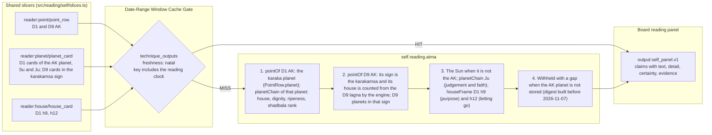

---

## Page 18 of 22 — `self.reading.yogas`: Gifts and knots (yogas and doshas on the self)

| Field | Value |
|---|---|
| **Technique ID / Title** | `self.reading.yogas` — You reading: Gifts and knots (yogas and doshas on the self) |
| **Category / Board / Status** | `self` · `you` · `built` |
| **Charts Declared** | `natal:yogas`, `natal:doshas` |
| **Selectors** | `{"boards":["you"],"subjects":["general_life_direction"],"houses":[1,4,5,9],"vargas":["D1"]}` |
| **Reader Pieces** | `reader:yoga/yoga_row` (D1 rows naming L1, Mo, Su, AK or houses 1,4,5,9) |
| **Agent Piece** | `agent:self.reading_panel` (`system: none`) |
| **Output Piece** | `output:self_panel.v1` |
| **Date-Range Window Cache** | `freshness: 'natal'` · `scope: 'kundli'` |
| **Code & Source** | `src/reading/self/panels/yogas.ts yogasPanel; slices.ts yogasTouching` (docs/reading-engine/58; BPHS (lagna, lords, karakatva, avasthas ch. 45); Jaimini (chara karakas, karakamsa, arudha lagna); PVR Narasimha Rao, Integrated Approach (dasha delivery, conditional dashas)) |

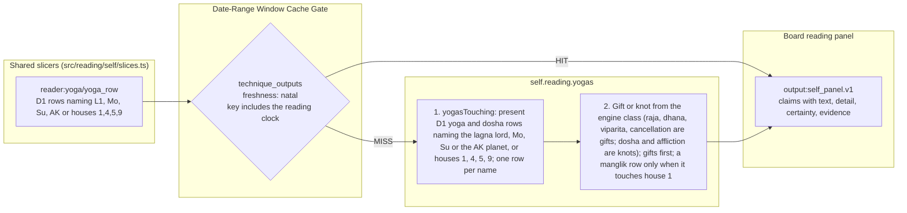

---

## Page 19 of 22 — `self.reading.struggle`: What you struggle with (afflictions on the self with release dates from the reading clock)

| Field | Value |
|---|---|
| **Technique ID / Title** | `self.reading.struggle` — You reading: What you struggle with (afflictions on the self with release dates from the reading clock) |
| **Category / Board / Status** | `self` · `you` · `built` |
| **Charts Declared** | `divisional:D1`, `natal:dignities`, `natal:avasthas`, `natal:benefic_malefic`, `natal:house_counts`, `dasha:reading clock L1-L3` |
| **Selectors** | `{"boards":["you"],"subjects":["general_life_direction"],"houses":[1,4,5],"vargas":["D1"]}` |
| **Reader Pieces** | `reader:planet/planet_card` (D1 cards of L1, Mo, Su, AK and the malefics named) · `reader:house/house_card` (D1 h1, h4, h5 (class column)) · `reader:activation/activation_row` (reading clock levels 1-3 covering today) |
| **Agent Piece** | `agent:self.reading_panel` (`system: none`) |
| **Output Piece** | `output:self_panel.v1` |
| **Date-Range Window Cache** | `freshness: 'dasha'` · `scope: 'kundli'` |
| **Code & Source** | `src/reading/self/panels/struggle.ts strugglePanel; slices.ts runningChain` (docs/reading-engine/58; BPHS (lagna, lords, karakatva, avasthas ch. 45); Jaimini (chara karakas, karakamsa, arudha lagna); PVR Narasimha Rao, Integrated Approach (dasha delivery, conditional dashas)) |

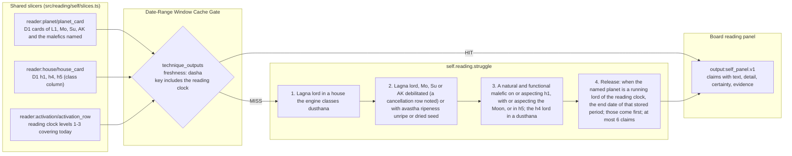

---

## Page 20 of 22 — `self.reading.chapters`: Your chapters (previous, running and next main period of the reading clock, the running sub-period, confirmed by other clocks)

| Field | Value |
|---|---|
| **Technique ID / Title** | `self.reading.chapters` — You reading: Your chapters (previous, running and next main period of the reading clock, the running sub-period, confirmed by other clocks) |
| **Category / Board / Status** | `self` · `you` · `built` |
| **Charts Declared** | `dasha:reading clock L1-L2`, `dasha:vimshottari`, `dasha:narayana`, `dasha:chara`, `dasha:yogini`, `dasha:karaka`, `dasha:tithi_ashtottari`, `natal:avasthas dasha_charter` |
| **Selectors** | `{"boards":["you"],"subjects":["general_life_direction"],"houses":[1],"vargas":["D1"]}` |
| **Reader Pieces** | `reader:activation/activation_row` (reading clock levels 1-2 and confirming clocks level 1, life span) · `reader:planet/planet_card` (D1 cards of the chapter lords) |
| **Agent Piece** | `agent:self.reading_panel` (`system: none`) |
| **Output Piece** | `output:self_panel.v1` |
| **Date-Range Window Cache** | `freshness: 'dasha'` · `scope: 'kundli'` |
| **Code & Source** | `src/reading/self/panels/chapters.ts chaptersPanel, confirmShift; slices.ts mdSpine, mainStarts` (docs/reading-engine/58; BPHS (lagna, lords, karakatva, avasthas ch. 45); Jaimini (chara karakas, karakamsa, arudha lagna); PVR Narasimha Rao, Integrated Approach (dasha delivery, conditional dashas)) |

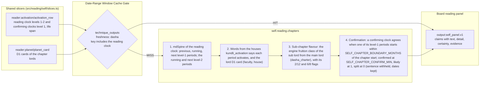

---

## Page 21 of 22 — `self.reading.year`: This year (Tithi Pravesha and Varsha charts on the self)

| Field | Value |
|---|---|
| **Technique ID / Title** | `self.reading.year` — You reading: This year (Tithi Pravesha and Varsha charts on the self) |
| **Category / Board / Status** | `self` · `you` · `built` |
| **Charts Declared** | `annual:tithi_pravesha`, `annual:varsha`, `annual:mudda` |
| **Selectors** | `{"boards":["you"],"subjects":["general_life_direction"],"houses":[1],"vargas":["D1"]}` |
| **Reader Pieces** | `reader:annual/annual_row` (TP and VP D1 of the running year) |
| **Agent Piece** | `agent:self.reading_panel` (`system: none`) |
| **Output Piece** | `output:self_panel.v1` |
| **Date-Range Window Cache** | `freshness: 'annual'` · `scope: 'kundli'` |
| **Code & Source** | `src/reading/self/panels/year.ts yearPanel, runningMudda` (docs/reading-engine/58; BPHS (lagna, lords, karakatva, avasthas ch. 45); Jaimini (chara karakas, karakamsa, arudha lagna); PVR Narasimha Rao, Integrated Approach (dasha delivery, conditional dashas)) |

```mermaid
flowchart LR
    subgraph Inputs["Shared slicers (src/reading/self/slices.ts)"]
        I1["reader:annual/annual_row<br/>TP and VP D1 of the running year"]
    end
    subgraph CacheGate["Date-Range Window Cache Gate"]
        GATE{"technique_outputs<br/>freshness: annual<br/>key includes the reading clock"}
    end
    subgraph Steps["self.reading.year"]
        S1["1. The VP D1 row whose Mudda periods cover today picks the year"]
        S2["2. TP D1 row of that year: the house holding the natal lagna lord and its dignity there, its company; the year h1 lord house"]
        S3["3. The running Mudda lord as the short clock of the year; withheld when no year row covers today"]
        S1 --> S2 --> S3
    end
    subgraph Output["Board reading panel"]
        OUT["output:self_panel.v1<br/>claims with text, detail, certainty, evidence"]
    end
    I1 --> GATE
    GATE -->|"HIT"| OUT
    GATE -->|"MISS"| S1
    S3 --> OUT
```

---

## Page 22 of 22 — `self.reading.oracle`: the reading in prose (Self reader R15 and the Self Oracle)

| Field | Value |
|---|---|
| **Technique ID / Title** | `self.reading.oracle` — You reading: the reading in prose (Self reader R15 and the Self Oracle) |
| **Category / Board / Status** | `self` · `you` · `planned` |
| **Charts Declared** | `natal:panel claims` |
| **Selectors** | `{"boards":["you"],"subjects":["general_life_direction"]}` |
| **Reader Pieces** | `reader:findings/findings_in` (the seven self.reading panels) |
| **Agent Piece** | none until the spend yes (`system: src/reading/prompts/oracle/self.md`) |
| **Output Piece** | `output:self_reading.v1` |
| **Date-Range Window Cache** | `freshness: 'question'` · `scope: 'kundli'` |
| **Code & Source** | `src/reading/self/oracle.ts runSelfOracle (flagged off)` (docs/reading-engine/58; BPHS (lagna, lords, karakatva, avasthas ch. 45); Jaimini (chara karakas, karakamsa, arudha lagna); PVR Narasimha Rao, Integrated Approach (dasha delivery, conditional dashas)) |

```mermaid
flowchart LR
    subgraph Inputs["Shared slicers (src/reading/self/slices.ts)"]
        I1["reader:findings/findings_in<br/>the seven self.reading panels"]
    end
    subgraph CacheGate["Date-Range Window Cache Gate"]
        GATE{"technique_outputs<br/>freshness: question<br/>key includes the reading clock"}
    end
    subgraph Steps["self.reading.oracle"]
        S1["1. Input: the seven panel claims with their evidence keys and certainty, the confirmed self.confirm.* facts, the clock label"]
        S2["2. Reader R15-self turns claims into findings; the Self Oracle writes: diagnosis, three dated chapters, promised and taken, built, mind, struggle, this year, one question"]
        S3["3. The validator drops any sentence whose evidence keys are not in the input; off unless SELF_READING_MODEL=1 (no call before the spend yes)"]
        S1 --> S2 --> S3
    end
    subgraph Output["Board reading panel"]
        OUT["output:self_reading.v1<br/>claims with text, detail, certainty, evidence"]
    end
    I1 --> GATE
    GATE -->|"HIT"| OUT
    GATE -->|"MISS"| S1
    S3 --> OUT
```
