# Volume 04 — Love Board (`love.*` / `love` Board) One-Per-Page Illustrations

> **Format**: One illustration per page (`Page 1 of 11` through `Page 11 of 11`), separated by `---`.  
> **Category / Board**: `love` · `love`  
> **Houses, Vargas & Karakas**: Houses `7, 5, 11, 2, 4, 8, 12` · Vargas `D9, D7, D30` (with `D1`) · Planets `Venus, Jupiter, Moon, 7th lord, D9 7th lord` · Points `UL, A7, DK, AL`  
> **Code References**: [`src/techniques/catalog.ts`](../../src/techniques/catalog.ts) · [`src/reading/area/houseLayers.ts`](../../src/reading/area/houseLayers.ts) · [`src/reading/area/love.ts`](../../src/reading/area/love.ts) · [`src/reading/area/boardService.ts`](../../src/reading/area/boardService.ts)

---

## Page 1 of 11 — `love.promise`: Natal Promise of House 7

| Field | Value |
|---|---|
| **Technique ID / Title** | `love.promise` — Natal promise of house 7 |
| **Category / Board / Status** | `love` · `love` · `built` |
| **Charts Declared** | `natal:{facts,house_counts,dignities,aspects,strength.bhava,yogas,doshas,avasthas}`, `jaimini:{argala,arudhas}`, `ashtakavarga:sav` |
| **Selectors** | `boards: ['love']`, `subjects: ['marriage_relationship']`, `houses: [7, 5, 11, 2, 4, 8, 12]`, `vargas: ['D9', 'D7', 'D30']` |
| **Reader Pieces** | `reader:house/house_card` (`piece.digest.house_cards`: `D1,D9,D7,D30 houses 7,5,11,2,4,8,12`) · `reader:planet/planet_card` (`piece.digest.planet_cards`: `D1 and D9 cards of Venus, Jupiter, the Moon, the 7th lord and the D9 7th lord`) · `reader:point/point_row` (`piece.digest.point_cards`: `UL, A7, DK, AL`) · `reader:yoga/yoga_row` (`piece.digest.yoga_register`: yogas/doshas joining houses `7,5,11,2,4,8,12` or Love planets) |
| **Agent & Scorer Pieces** | `agent:area.love_board` (`piece.scorer.promise_layer`: `promiseLayer`, `kind: 'code'`, `system: 'none'`) |
| **Output Piece** | `output:area_board.v1` |
| **Date-Range Window Cache** | `freshness: 'natal'` (`open` window: `to = null`, valid until `digest_version` changes) · `scope: 'kundli'` |
| **Code & Source** | `src/reading/area/houseLayers.ts promiseLayer; love.ts LOVE; boardService.ts getAreaBoard` (`docs/reading-engine/46 §B.2; 53 §4.5; 54 §3`) |

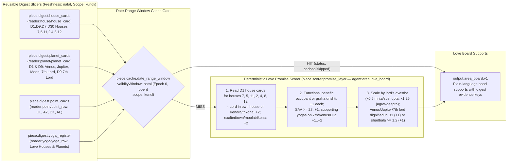

---

## Page 2 of 11 — `love.affliction`: Afflictions on House 7

| Field | Value |
|---|---|
| **Technique ID / Title** | `love.affliction` — Afflictions on house 7 |
| **Category / Board / Status** | `love` · `love` · `built` |
| **Charts Declared** | `natal:{facts,dignities,aspects,doshas,avasthas,house_counts}` |
| **Selectors** | `boards: ['love']`, `subjects: ['marriage_relationship']`, `houses: [7, 5, 11, 2, 4, 8, 12]`, `vargas: ['D9', 'D7', 'D30']` |
| **Reader Pieces** | `reader:house/house_card` (`piece.digest.house_cards`) · `reader:planet/planet_card` (`piece.digest.planet_cards`) · `reader:yoga/yoga_row` (`piece.digest.yoga_register`: Kalathra dosha, Manglik dosha, cancellations) · `reader:activation/activation_row` (`piece.activation.calendar_slice`: running & next periods of afflicting planets on houses `7,5,11,2,4,8,12`) |
| **Agent & Scorer Pieces** | `agent:area.love_board` (`piece.scorer.affliction_layer`: `afflictionLayer`, `releaseOf`, `kind: 'code'`, `system: 'none'`) |
| **Output Piece** | `output:area_board.v1` |
| **Date-Range Window Cache** | `freshness: 'dasha'` (`[runningPeriod.from, runningPeriod.to)` from `kundli_activation`, fallback `30d`) · `scope: 'kundli'` |
| **Code & Source** | `src/reading/area/houseLayers.ts afflictionLayer, releaseOf; love.ts LOVE; boardService.ts getAreaBoard` (`docs/reading-engine/46 §B.3; 53 §4.5; 54 §3`) |

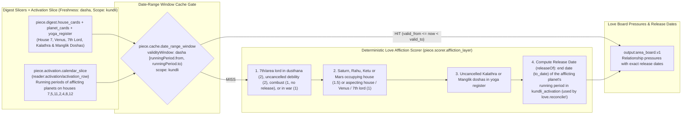

---

## Page 3 of 11 — `love.protection`: What Protects House 7

| Field | Value |
|---|---|
| **Technique ID / Title** | `love.protection` — What protects house 7 |
| **Category / Board / Status** | `love` · `love` · `built` |
| **Charts Declared** | `natal:{aspects,dignities,yogas,avasthas}`, `jaimini:argala`, `divisional:{D9,D7,D30}` |
| **Selectors** | `boards: ['love']`, `subjects: ['marriage_relationship']`, `houses: [7, 5, 11, 2, 4, 8, 12]`, `vargas: ['D9', 'D7', 'D30']` |
| **Reader Pieces** | `reader:house/house_card` (`piece.digest.house_cards`) · `reader:planet/planet_card` (`piece.digest.planet_cards`) · `reader:point/point_row` (`piece.digest.point_cards`: `UL, A7, DK, AL`) · `reader:yoga/yoga_row` (`piece.digest.yoga_register`) |
| **Agent & Scorer Pieces** | `agent:area.love_board` (`piece.scorer.protection_layer`: `protectionLayer`, `kind: 'code'`, `system: 'none'`) |
| **Output Piece** | `output:area_board.v1` |
| **Date-Range Window Cache** | `freshness: 'natal'` (`open` window: `to = null`) · `scope: 'kundli'` |
| **Code & Source** | `src/reading/area/houseLayers.ts protectionLayer; love.ts LOVE; boardService.ts getAreaBoard` (`docs/reading-engine/46 §B.3; 53 §4.5; 54 §3`) |

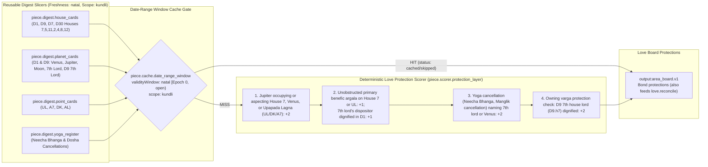

---

## Page 4 of 11 — `love.activation`: Activation of House 7 by Every Dasha System

| Field | Value |
|---|---|
| **Technique ID / Title** | `love.activation` — Activation of house 7 by every dasha system |
| **Category / Board / Status** | `love` · `love` · `built` |
| **Charts Declared** | `dasha:{vimshottari,conditional,narayana,chara,karaka,yogini,tithi_ashtottari}`, `annual:tithi_pravesha_dasha`, `divisional:{D9,D7,D30}` |
| **Selectors** | `boards: ['love']`, `subjects: ['marriage_relationship']`, `houses: [7, 5, 11, 2, 4, 8, 12]`, `vargas: ['D9', 'D7', 'D30']` |
| **Reader Pieces** | `reader:activation/activation_row` (`piece.activation.calendar_slice`: every served system from today to `+30y` activating houses `7,5,11,2,4,8,12`) · `reader:planet/planet_card` (`piece.digest.planet_cards`: D1 and D9 cards of period lords) |
| **Agent & Voter Pieces** | `agent:area.love_board` (`piece.voter.five_family_clock`: `gradeRow`, `familyVotes`, `aheadWindows`, `kind: 'code'`, `system: 'none'`) |
| **Output Piece** | `output:area_board.v1` |
| **Date-Range Window Cache** | `freshness: 'dasha'` (`[runningPeriod.from, runningPeriod.to)` from `kundli_activation`, fallback `30d`) · `scope: 'kundli'` |
| **Code & Source** | `src/reading/area/houseLayers.ts gradeRow, familyVotes, aheadWindows; love.ts LOVE; boardService.ts getAreaBoard` (`docs/reading-engine/46 §B.4; 53 §4.5; 54 §3`) |

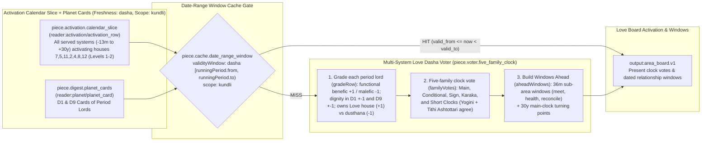

---

## Page 5 of 11 — `love.transit`: Transits Over House 7

| Field | Value |
|---|---|
| **Technique ID / Title** | `love.transit` — Transits over house 7 |
| **Category / Board / Status** | `love` · `love` · `built` |
| **Charts Declared** | `transit:{transit_contacts,double_transit,sade_sati,eclipses}`, `ashtakavarga:transit_ashtakavarga` |
| **Selectors** | `boards: ['love']`, `subjects: ['marriage_relationship']`, `houses: [7, 5, 11, 2, 4, 8, 12]`, `vargas: ['D9', 'D7', 'D30']` |
| **Reader Pieces** | `reader:transit/transit_row` (`piece.transit.sky_overlay`: shared sky with overlay for Sa, Ju, Ra, Ke and eclipses over houses `7,5,11,2,4,8,12`, their lords and arudhas, `±24m`) · `reader:house/house_card` (`piece.digest.house_cards`) |
| **Agent Piece** | `agent:area.love_board` (`transitLayer`, `kind: 'code'`, `system: 'none'`) |
| **Output Piece** | `output:area_board.v1` |
| **Date-Range Window Cache** | `freshness: 'transit'` (epoch-aligned `2h` window `TECHNIQUE_TRANSIT_WINDOW_HOURS=2`) · `scope: 'kundli'` |
| **Code & Source** | `src/reading/area/houseLayers.ts transitLayer; love.ts LOVE; boardService.ts getAreaBoard` (`docs/reading-engine/46 §B.5; 53 §4.5; 54 §3`) |

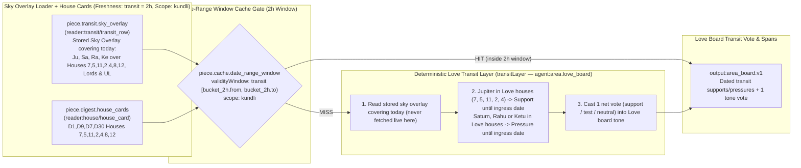

---

## Page 6 of 11 — `love.annual`: This Year's Chart for House 7

| Field | Value |
|---|---|
| **Technique ID / Title** | `love.annual` — This year's chart for house 7 |
| **Category / Board / Status** | `love` · `love` · `built` |
| **Charts Declared** | `annual:{tithi_pravesha,sahams,mudda,patyayini,tithi_pravesha_dasha}` |
| **Selectors** | `boards: ['love']`, `subjects: ['marriage_relationship']`, `houses: [7, 5, 11, 2, 4, 8, 12]`, `vargas: ['D9', 'D7', 'D30']` |
| **Reader Pieces** | `reader:annual/annual_row` (`piece.digest.annual_set`: TP and VP of current, previous and next year, houses `7,5,11,2,4,8,12`, their sahams and year dashas) |
| **Agent Piece** | `agent:area.love_board` (`currentYear`, `annualLayer`, `kind: 'code'`, `system: 'none'`) |
| **Output Piece** | `output:area_board.v1` |
| **Date-Range Window Cache** | `freshness: 'annual'` (`[year.from, year.to)` of running Tithi Pravesha / Varsha chart, fallback `90d`) · `scope: 'kundli'` |
| **Code & Source** | `src/reading/area/houseLayers.ts currentYear, annualLayer; love.ts LOVE; boardService.ts getAreaBoard` (`docs/reading-engine/46 §B.6; 53 §4.5; 54 §3`) |

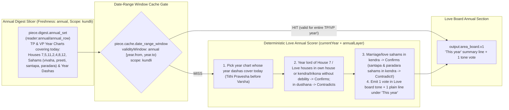

---

## Page 7 of 11 — `love.varga`: Owning Divisional Chart of House 7

| Field | Value |
|---|---|
| **Technique ID / Title** | `love.varga` — Owning divisional chart of house 7 |
| **Category / Board / Status** | `love` · `love` · `built` |
| **Charts Declared** | `divisional:{D9,D7,D30}` |
| **Selectors** | `boards: ['love']`, `subjects: ['marriage_relationship']`, `houses: [7, 5, 11, 2, 4, 8, 12]`, `vargas: ['D9', 'D7', 'D30']` |
| **Reader Pieces** | `reader:house/house_card` (`piece.digest.house_cards`: `D1,D9,D7,D30 houses 7,5,11,2,4,8,12`) · `reader:planet/planet_card` (`piece.digest.planet_cards`) · `reader:point/point_row` (`piece.digest.point_cards`: arudhas of houses `7,5,11,2,4,8,12` in `D9, D7, D30`) |
| **Agent & Scorer Pieces** | `agent:area.love_board` (`piece.scorer.varga_agreement`: `vargaLayer`, `kind: 'code'`, `system: 'none'`) |
| **Output Piece** | `output:area_board.v1` |
| **Date-Range Window Cache** | `freshness: 'natal'` (`open` window: `to = null`) · `scope: 'kundli'` |
| **Code & Source** | `src/reading/area/houseLayers.ts vargaLayer; love.ts LOVE; boardService.ts getAreaBoard` (`docs/reading-engine/46 §B.7; 53 §4.5; 54 §3`) |

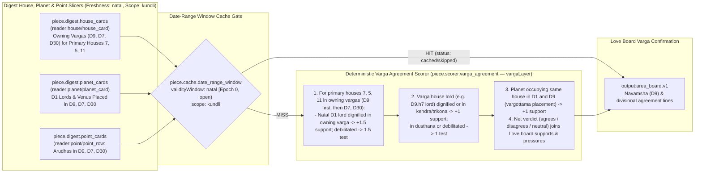

---

## Page 8 of 11 — `love.nakshatra`: Nakshatra Charter of House 7

| Field | Value |
|---|---|
| **Technique ID / Title** | `love.nakshatra` — Nakshatra charter of house 7 |
| **Category / Board / Status** | `love` · `love` · `built` |
| **Charts Declared** | `nakshatra:{cusp_nak,star_lord,occupant_stars}` |
| **Selectors** | `boards: ['love']`, `subjects: ['marriage_relationship']`, `houses: [7, 5, 11, 2, 4, 8, 12]`, `vargas: ['D9', 'D7', 'D30']` |
| **Reader Pieces** | `reader:star/star_profile` (`piece.digest.star_profile`: Moon star, lagna star, tara table) · `reader:house/house_card` (`piece.digest.house_cards`: `cusp_star` column of houses `7,5,11`) · `reader:planet/planet_card` (`piece.digest.planet_cards`: D1 cards of cusp star lords & Venus/7th lord) |
| **Agent & Scorer Pieces** | `agent:area.love_board` (`piece.scorer.nakshatra_charter`: `nakshatraLayer`, `kind: 'code'`, `system: 'none'`) |
| **Output Piece** | `output:area_board.v1` |
| **Date-Range Window Cache** | `freshness: 'natal'` (`open` window: `to = null`) · `scope: 'kundli'` |
| **Code & Source** | `src/reading/area/houseLayers.ts nakshatraLayer; love.ts LOVE; boardService.ts getAreaBoard` (`docs/reading-engine/46 §B.8; 53 §4.5; 54 §3`) |

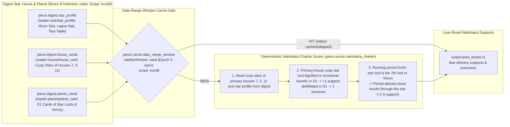

---

## Page 9 of 11 — `love.meet`: Meeting Someone (`love.status` in `single, dating`)

| Field | Value |
|---|---|
| **Technique ID / Title** | `love.meet` — Meeting someone |
| **Category / Board / Status** | `love` · `love` · `built` |
| **Charts Declared** | `natal:facts`, `divisional:D9`, `dasha:vimshottari`, `transit:transit_contacts` |
| **Selectors** | `boards: ['love']`, `subjects: ['marriage_relationship']`, `houses: [7, 5, 11]`, `vargas: ['D9']`, `facts: { 'love.status': ['single', 'dating'] }` |
| **Reader Pieces** | `reader:findings/findings_in` (`"the eight Love layers of this kundli (love.promise … love.nakshatra)"`) |
| **Agent Piece** | `agent:area.love_board` (`LOVE_LEAD`, `LOVE_FIT`, `shapeBoard`, `kind: 'code'`, `system: 'none'`) |
| **Output Piece** | `output:board_subarea.v1` |
| **Date-Range Window Cache** | `freshness: 'question'` / `'transit'` (composes over the 8 cached `love.*` layers in < 1 ms) · `scope: 'kundli'` |
| **Code & Source** | `src/reading/area/love.ts LOVE_LEAD, LOVE_FIT; boardService.ts shapeBoard` (`docs/reading-engine/53 §4.5; 46 §B.12; 54 §3`) |

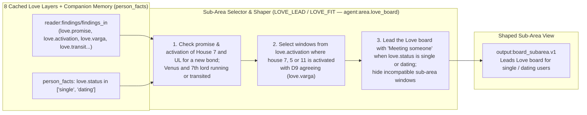

---

## Page 10 of 11 — `love.health`: How the Relationship Is (`love.status` in `dating, committed, married`)

| Field | Value |
|---|---|
| **Technique ID / Title** | `love.health` — How the relationship is |
| **Category / Board / Status** | `love` · `love` · `built` |
| **Charts Declared** | `natal:facts`, `divisional:D9`, `dasha:vimshottari`, `transit:transit_contacts` |
| **Selectors** | `boards: ['love']`, `subjects: ['marriage_relationship']`, `houses: [7, 5, 11]`, `vargas: ['D9']`, `facts: { 'love.status': ['dating', 'committed', 'married'] }` |
| **Reader Pieces** | `reader:findings/findings_in` (`"the eight Love layers of this kundli (love.promise … love.nakshatra)"`) |
| **Agent Piece** | `agent:area.love_board` (`LOVE_LEAD`, `LOVE_FIT`, `shapeBoard`, `kind: 'code'`, `system: 'none'`) |
| **Output Piece** | `output:board_subarea.v1` |
| **Date-Range Window Cache** | Composes over the 8 cached `love.*` layers · `scope: 'kundli'` |
| **Code & Source** | `src/reading/area/love.ts LOVE_LEAD, LOVE_FIT; boardService.ts shapeBoard` (`docs/reading-engine/53 §4.5; 46 §B.12; 54 §3`) |

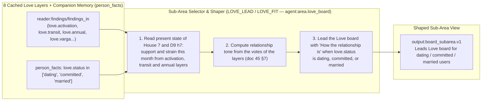

---

## Page 11 of 11 — `love.reconcile`: Strain and Reconciling (`love.status` in `separated, complicated`)

| Field | Value |
|---|---|
| **Technique ID / Title** | `love.reconcile` — Strain and reconciling |
| **Category / Board / Status** | `love` · `love` · `built` |
| **Charts Declared** | `natal:facts`, `divisional:D9`, `dasha:vimshottari`, `transit:transit_contacts` |
| **Selectors** | `boards: ['love']`, `subjects: ['marriage_relationship']`, `houses: [7, 5, 11]`, `vargas: ['D9']`, `facts: { 'love.status': ['separated', 'complicated'] }` |
| **Reader Pieces** | `reader:findings/findings_in` (`"the eight Love layers of this kundli (love.promise … love.nakshatra)"`) |
| **Agent Piece** | `agent:area.love_board` (`LOVE_LEAD`, `LOVE_FIT`, `shapeBoard`, `kind: 'code'`, `system: 'none'`) |
| **Output Piece** | `output:board_subarea.v1` |
| **Date-Range Window Cache** | Composes over the 8 cached `love.*` layers · `scope: 'kundli'` |
| **Code & Source** | `src/reading/area/love.ts LOVE_LEAD, LOVE_FIT; boardService.ts shapeBoard` (`docs/reading-engine/53 §4.5; 46 §B.12; 54 §3`) |

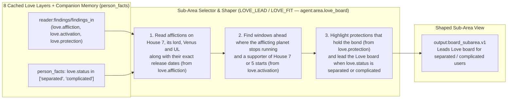

---

## Page 12 of 12 — `research.love_dashboard_qa`: Research Love & Relationships Dashboard Deep-Dive & Nov/Thanksgiving/Dec/New Year Zoom-In

| Field | Value |
|---|---|
| **Technique ID / Title** | `research.love_dashboard_qa` — Research Love & Relationships Dashboard deep-dive & Nov/Thanksgiving/Dec/New Year zoom-in |
| **Category / Board / Status** | `love` · `love` · `built` |
| **Charts Declared** | `natal:{facts,dignities,aspects,avasthas,yogas,doshas,strength.shadbala}`, `ashtakavarga:sav`, `jaimini:{charakaraka,arudhas}`, `nakshatra:{janma,cusp_nak}`, `divisional:{D1,D9,D7,D10,D2,D4,D12,D20,D24,D60}`, `dasha:{vimshottari,yogini,tithi_ashtottari,narayana,karaka}`, `annual:{tithi_pravesha,varsha}`, `transit:{transit_contacts,sade_sati}`, `panchang:muhurta` |
| **Selectors** | `boards: ['love']`, `subjects: ['marriage_relationship', 'children', 'family_home']`, `houses: [7, 5, 11, 2, 4, 8, 12]`, `vargas: ['D1', 'D9', 'D7']` |
| **Reader Pieces** | `reader:house/house_card` (`D1..D60_h1..12`) · `reader:planet/planet_card` · `reader:yoga/yoga_row` · `reader:point/point_row` · `reader:star/star_profile` · `reader:activation/activation_row` · `reader:annual/annual_row` · `reader:transit/transit_row` |
| **Agent Piece** | `agent:research.love_dashboard_builder` (`buildLoveResearchDashboard`, `verifyLoveDashboardQaReport`, `kind: 'code'`, `system: 'none'`) |
| **Output Piece / Synthesizer** | `output:research_love_dashboard.v1` · feeds `research.technical_verifier` |
| **Date-Range Window Cache** | `freshness: 'transit'` (`2h` window) · `scope: 'kundli'` |
| **Code & Source** | `src/reading/research/loveDashboardQa.ts buildLoveResearchDashboard, verifyLoveDashboardQaReport` (`docs/admin/09 §4.1; docs/reading-engine/46 §B; 54 §3; 55 §2`) |

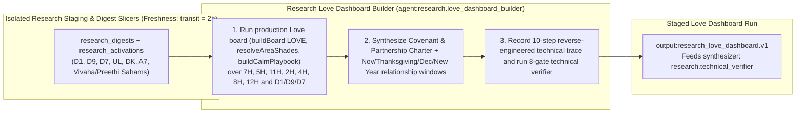

---

---

---

---

<!-- love.reading pages: generated by scripts/write-self-reading-pages.ts -->

## Page 13 of 20 — `love.reading.diagnosis`: Love reading: your love life, in short (three sentences from the Love panels and chapters)

| Field | Value |
|---|---|
| **Technique ID / Title** | `love.reading.diagnosis` — Love reading: your love life, in short (three sentences from the Love panels and chapters) |
| **Category / Board / Status** | `love` · `love` · `planned` |
| **Charts Declared** | `natal:panel claims` |
| **Selectors** | `{"boards":["love"],"houses":[7],"vargas":["D1","D9"]}` |
| **Reader Pieces** | `reader:findings/findings_in` (claims of love.reading.heart, partner, bond, circle, chapters) |
| **Agent Piece** | none until the spend yes (`system: none`) |
| **Output Piece** | `output:board_diagnosis.v1` |
| **Date-Range Window Cache** | `freshness: 'question'` · `scope: 'kundli'` |
| **Code & Source** | `board.diagnosis (planned) with DIAGNOSIS_LOVE` (docs/reading-engine/59; BPHS (bhava, karakas); Jaimini (DK, UL, AmK, A10, karakamsa); docs 42-46) |

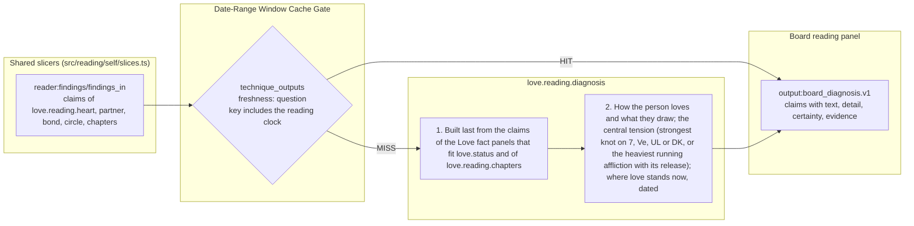

---

## Page 14 of 20 — `love.reading.chapters`: Love reading: your chapters for love (board.chapters filtered to the love houses)

| Field | Value |
|---|---|
| **Technique ID / Title** | `love.reading.chapters` — Love reading: your chapters for love (board.chapters filtered to the love houses) |
| **Category / Board / Status** | `love` · `love` · `planned` |
| **Charts Declared** | `dasha:reading clock L1-L2`, `dasha:confirming clocks L1` |
| **Selectors** | `{"boards":["love"],"houses":[7,5,11,2,8,4,12],"vargas":["D1","D9"]}` |
| **Reader Pieces** | `reader:activation/activation_row` (reading clock L1-L2 and confirming clocks L1, houses 7,5,11,2,8,4,12) · `reader:planet/planet_card` (D1 cards of the chapter lords) |
| **Agent Piece** | none until the spend yes (`system: none`) |
| **Output Piece** | `output:board_chapters.v1` |
| **Date-Range Window Cache** | `freshness: 'dasha'` · `scope: 'kundli'` |
| **Code & Source** | `src/reading/self/panels/chapters.ts as board.chapters (filter planned)` (docs/reading-engine/59; BPHS (bhava, karakas); Jaimini (DK, UL, AmK, A10, karakamsa); docs 42-46) |

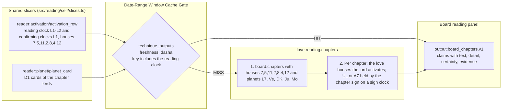

---

## Page 15 of 20 — `love.reading.heart`: Love reading: how you love (Venus, Moon, 5th lord, D9 7th)

| Field | Value |
|---|---|
| **Technique ID / Title** | `love.reading.heart` — Love reading: how you love (Venus, Moon, 5th lord, D9 7th) |
| **Category / Board / Status** | `love` · `love` · `planned` |
| **Charts Declared** | `divisional:D1`, `divisional:D9` |
| **Selectors** | `{"boards":["love"],"houses":[5,7],"vargas":["D1","D9"]}` |
| **Reader Pieces** | `reader:planet/planet_card` (D1 and D9 cards of Ve, Mo, L5) · `reader:house/house_card` (D1 h5, h7; D9 h7) |
| **Agent Piece** | none until the spend yes (`system: none`) |
| **Output Piece** | `output:board_panel.v1` |
| **Date-Range Window Cache** | `freshness: 'natal'` · `scope: 'kundli'` |
| **Code & Source** | `not built` (docs/reading-engine/59; BPHS (bhava, karakas); Jaimini (DK, UL, AmK, A10, karakamsa); docs 42-46) |

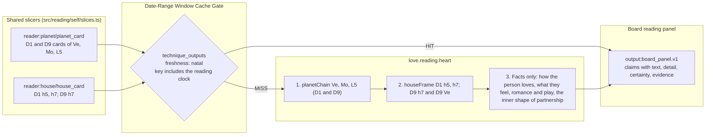

---

## Page 16 of 20 — `love.reading.partner`: Love reading: the partner you draw (7th, its lord, DK, UL, A7, D9 7th)

| Field | Value |
|---|---|
| **Technique ID / Title** | `love.reading.partner` — Love reading: the partner you draw (7th, its lord, DK, UL, A7, D9 7th) |
| **Category / Board / Status** | `love` · `love` · `planned` |
| **Charts Declared** | `divisional:D1`, `divisional:D9`, `jaimini:charakaraka`, `jaimini:arudhas` |
| **Selectors** | `{"boards":["love"],"houses":[7],"vargas":["D1","D9"]}` |
| **Reader Pieces** | `reader:house/house_card` (D1 h7; D9 h7) · `reader:planet/planet_card` (D1 and D9 cards of L7, the DK planet, h7 occupants) · `reader:point/point_row` (DK, UL, A7, D9 lagna) |
| **Agent Piece** | none until the spend yes (`system: none`) |
| **Output Piece** | `output:board_panel.v1` |
| **Date-Range Window Cache** | `freshness: 'natal'` · `scope: 'kundli'` |
| **Code & Source** | `not built` (docs/reading-engine/59; BPHS (bhava, karakas); Jaimini (DK, UL, AmK, A10, karakamsa); docs 42-46) |

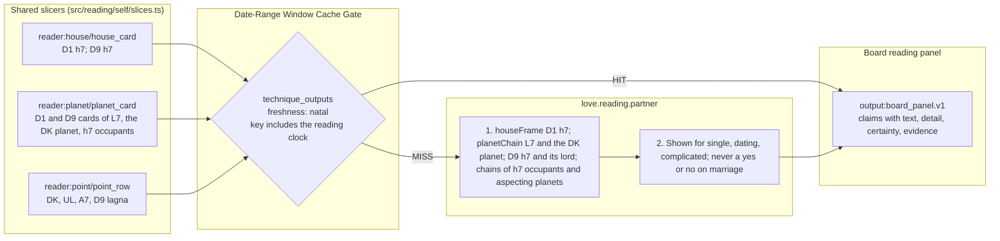

---

## Page 17 of 20 — `love.reading.bond`: Love reading: the bond itself (7th, 2nd, 4th, 8th, UL and its 2nd, D9, D7)

| Field | Value |
|---|---|
| **Technique ID / Title** | `love.reading.bond` — Love reading: the bond itself (7th, 2nd, 4th, 8th, UL and its 2nd, D9, D7) |
| **Category / Board / Status** | `love` · `love` · `planned` |
| **Charts Declared** | `divisional:D1`, `divisional:D9`, `divisional:D7`, `jaimini:arudhas` |
| **Selectors** | `{"boards":["love"],"houses":[7,2,4,8],"vargas":["D1","D9","D7"]}` |
| **Reader Pieces** | `reader:house/house_card` (D1 h7,2,4,8; D9 h7,1; D7 h1) · `reader:planet/planet_card` (D1 cards of L7, L2, L8, Ju) · `reader:point/point_row` (UL, A7, DK) |
| **Agent Piece** | none until the spend yes (`system: none`) |
| **Output Piece** | `output:board_panel.v1` |
| **Date-Range Window Cache** | `freshness: 'natal'` · `scope: 'kundli'` |
| **Code & Source** | `not built` (docs/reading-engine/59; BPHS (bhava, karakas); Jaimini (DK, UL, AmK, A10, karakamsa); docs 42-46) |

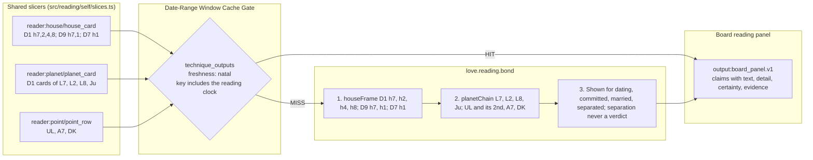

---

## Page 18 of 20 — `love.reading.circle`: Love reading: who else is in it (family, in-laws, friends, children as facts)

| Field | Value |
|---|---|
| **Technique ID / Title** | `love.reading.circle` — Love reading: who else is in it (family, in-laws, friends, children as facts) |
| **Category / Board / Status** | `love` · `love` · `planned` |
| **Charts Declared** | `divisional:D1`, `divisional:D7`, `jaimini:charakaraka` |
| **Selectors** | `{"boards":["love"],"houses":[2,4,11,5],"vargas":["D1","D7"]}` |
| **Reader Pieces** | `reader:house/house_card` (D1 h2,4,11,5; D7 h5) · `reader:planet/planet_card` (D1 cards of L2, L4, L11, Mo, Ju) · `reader:point/point_row` (MK, PK, A11) |
| **Agent Piece** | none until the spend yes (`system: none`) |
| **Output Piece** | `output:board_panel.v1` |
| **Date-Range Window Cache** | `freshness: 'natal'` · `scope: 'kundli'` |
| **Code & Source** | `not built` (docs/reading-engine/59; BPHS (bhava, karakas); Jaimini (DK, UL, AmK, A10, karakamsa); docs 42-46) |

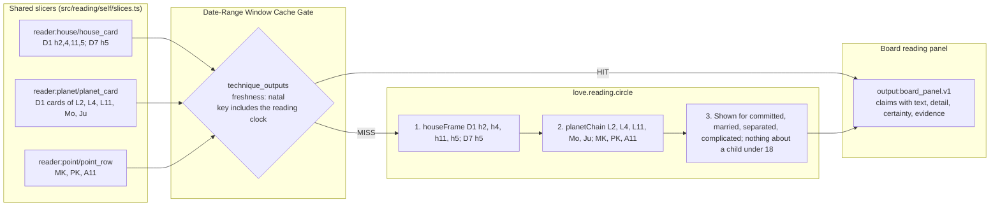

---

## Page 19 of 20 — `love.reading.struggle`: Love reading: what tests it (board.struggle filtered to love)

| Field | Value |
|---|---|
| **Technique ID / Title** | `love.reading.struggle` — Love reading: what tests it (board.struggle filtered to love) |
| **Category / Board / Status** | `love` · `love` · `planned` |
| **Charts Declared** | `divisional:D1`, `natal:doshas`, `dasha:reading clock L1-L3` |
| **Selectors** | `{"boards":["love"],"houses":[7,5,8,12],"vargas":["D1"]}` |
| **Reader Pieces** | `reader:planet/planet_card` (D1 cards of L7, Ve, DK, Mo) · `reader:house/house_card` (D1 h7,5,8,12) · `reader:yoga/yoga_row` (Kalathra, Manglik rows) · `reader:activation/activation_row` (reading clock L1-L3 running) |
| **Agent Piece** | none until the spend yes (`system: none`) |
| **Output Piece** | `output:board_struggle.v1` |
| **Date-Range Window Cache** | `freshness: 'dasha'` · `scope: 'kundli'` |
| **Code & Source** | `src/reading/self/panels/struggle.ts as board.struggle (filter planned)` (docs/reading-engine/59; BPHS (bhava, karakas); Jaimini (DK, UL, AmK, A10, karakamsa); docs 42-46) |

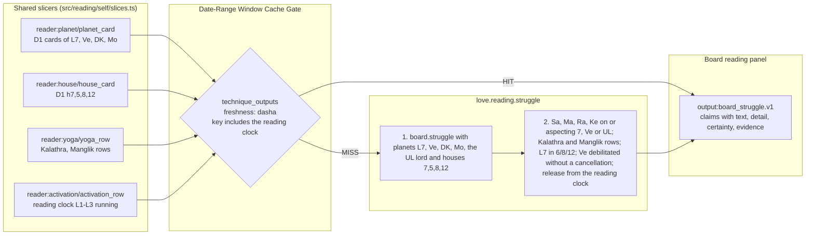

---

## Page 20 of 20 — `love.reading.year`: Love reading: this year (board.year filtered to love)

| Field | Value |
|---|---|
| **Technique ID / Title** | `love.reading.year` — Love reading: this year (board.year filtered to love) |
| **Category / Board / Status** | `love` · `love` · `planned` |
| **Charts Declared** | `annual:tithi_pravesha`, `annual:varsha` |
| **Selectors** | `{"boards":["love"],"houses":[7],"vargas":["D1"]}` |
| **Reader Pieces** | `reader:annual/annual_row` (TP and VP D1 of the running year) |
| **Agent Piece** | none until the spend yes (`system: none`) |
| **Output Piece** | `output:board_year.v1` |
| **Date-Range Window Cache** | `freshness: 'annual'` · `scope: 'kundli'` |
| **Code & Source** | `src/reading/self/panels/year.ts as board.year (filter planned)` (docs/reading-engine/59; BPHS (bhava, karakas); Jaimini (DK, UL, AmK, A10, karakamsa); docs 42-46) |

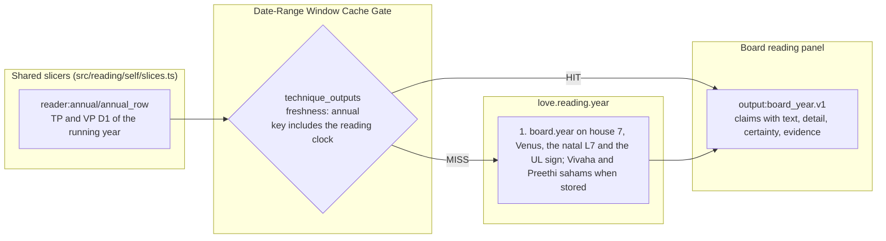
