# Volume 05 — Work Board (`work.*` / `work` Board) One-Per-Page Illustrations

> **Format**: One illustration per page (`Page 1 of 9` through `Page 9 of 9`), separated by `---`.  
> **Category / Board**: `work` · `work`  
> **Houses & Vargas**: Houses `10, 6, 1, 2, 11` (plus `9, 5, 8, 12` for security end lords; `4, 7` for residence/business sub-areas) · Vargas `D1, D10` (with `D9, D60` tie-breakers)  
> **Code References**: [`src/techniques/catalog.ts`](../../src/techniques/catalog.ts) · [`src/reading/area/career.ts`](../../src/reading/area/career.ts) · [`src/reading/area/careerService.ts`](../../src/reading/area/careerService.ts)

---

## Page 1 of 9 — `work.present_tone`: Present Tone

| Field | Value |
|---|---|
| **Technique ID / Title** | `work.present_tone` — Present tone |
| **Category / Board / Status** | `work` · `work` · `built` |
| **Charts Declared** | `dasha:{vimshottari,yogini,tithi_ashtottari,narayana}`, `transit:{transit_contacts,double_transit}`, `jaimini:modifier`, `natal:{house_counts,facts}` |
| **Selectors** | `boards: ['work']`, `subjects: ['career_work']`, `houses: [10, 6, 1, 2, 11]`, `vargas: ['D1', 'D10']` |
| **Reader Pieces** | `reader:house/house_card` (`piece.digest.house_cards`: `D1,D10 houses 10,6,1,2,11`) · `reader:activation/activation_row` (`piece.activation.calendar_slice`: `families S1, S4, S2+S3, S6/S6D, S7 ±24 months`) · `reader:transit/transit_row` (`piece.transit.sky_overlay`: `contacts and double transit on houses 10,6,1 and their lords ±24 months`) |
| **Upstream Feeders** | Receives `family_vote.v1` from `work.annual_family`, `work.conditional_family`, `work.karaka_family`, and `vote_check.v1` from `work.d10_check` |
| **Agent & Voter Pieces** | `agent:area.career_inputs`, `agent:area.career_map` (`piece.voter.five_family_clock`, `kind: 'code'`, `system: 'none'`) |
| **Output Piece / Accuracy** | `output:career_map.v1` · `accuracy: 'area_checks:career'` |
| **Date-Range Window Cache** | `freshness: 'transit'` (epoch-aligned `2h` window `TECHNIQUE_TRANSIT_WINDOW_HOURS=2`) · `scope: 'kundli'` |
| **Code & Source** | `src/reading/area/career.ts presentState` (`docs/reading-engine/43 §8.1`) |

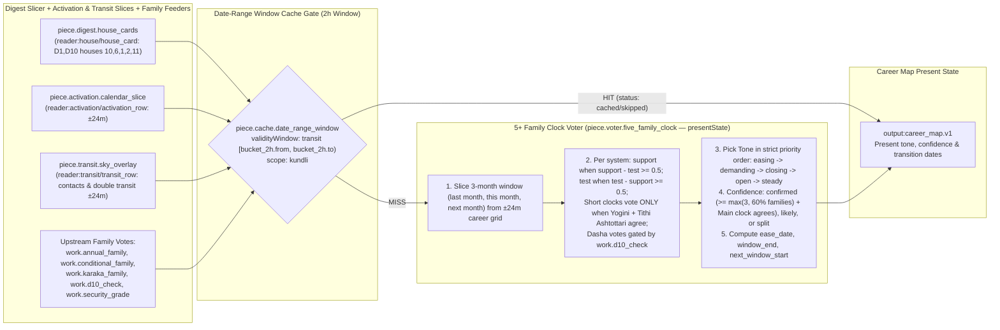

---

## Page 2 of 9 — `work.security_grade`: Job Security by Month

| Field | Value |
|---|---|
| **Technique ID / Title** | `work.security_grade` — Job security by month |
| **Category / Board / Status** | `work` · `work` · `built` |
| **Charts Declared** | `dasha:{vimshottari,yogini,tithi_ashtottari,narayana}`, `transit:{transit_contacts,double_transit}`, `jaimini:modifier`, `natal:{house_counts,facts}` |
| **Selectors** | `boards: ['work']`, `subjects: ['career_work']`, `houses: [10, 6, 1, 2, 11]`, `vargas: ['D1', 'D10']` |
| **Reader Pieces** | `reader:house/house_card` (`piece.digest.house_cards`: `D1 houses 10,9,5,6,8,12 and their lords`) · `reader:activation/activation_row` (`piece.activation.calendar_slice`: `families S1, S4, S2+S3, S6/S6D, S7 ±24 months`) · `reader:transit/transit_row` (`piece.transit.sky_overlay`: `contacts and double transit on houses 10,6,1 and their lords ±24 months`) |
| **Agent & Voter Pieces** | `agent:area.career_inputs`, `agent:area.career_map` (`piece.voter.security_gate`, `kind: 'code'`, `system: 'none'`) |
| **Output Piece / Accuracy** | `output:career_map.v1` · `accuracy: 'staff'` |
| **Date-Range Window Cache** | `freshness: 'transit'` (epoch-aligned `2h` window) · `scope: 'kundli'` |
| **Code & Source** | `src/reading/area/career.ts securityGrade` (`docs/reading-engine/43 §6–§7`) |

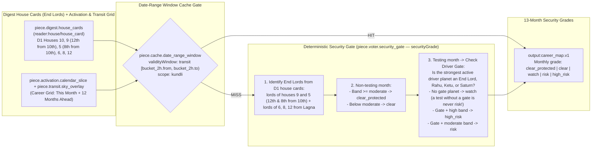

---

## Page 3 of 9 — `work.subarea_windows`: Windows Ahead by Sub-Area

| Field | Value |
|---|---|
| **Technique ID / Title** | `work.subarea_windows` — Windows ahead by sub-area |
| **Category / Board / Status** | `work` · `work` · `built` |
| **Charts Declared** | `dasha:{vimshottari,yogini,tithi_ashtottari,narayana}`, `transit:{transit_contacts,double_transit}`, `jaimini:modifier`, `natal:{house_counts,facts}` |
| **Selectors** | `boards: ['work']`, `subjects: ['career_work']`, `houses: [10, 6, 1, 2, 11]`, `vargas: ['D1', 'D10']` |
| **Reader Pieces** | `reader:house/house_card` (`D1,D10 houses 10,6,1,2,11`) · `reader:house/house_card` (`D1 houses 2,11 (money), 4 (residence), 7 (business) and their lords`) · `reader:activation/activation_row` (`±24 months`) · `reader:transit/transit_row` (`±24 months`) |
| **Agent Pieces** | `agent:area.career_inputs`, `agent:area.career_map` (`careerMap (ahead)`, `careerSubareas`, `fitsStatus`, `kind: 'code'`, `system: 'none'`) |
| **Output Piece / Accuracy** | `output:career_map.v1` · `accuracy: 'staff'` |
| **Date-Range Window Cache** | `freshness: 'transit'` (`2h` window) · `scope: 'kundli'` |
| **Code & Source** | `src/reading/area/career.ts careerMap (ahead), careerSubareas; careerService.ts fitsStatus` (`docs/reading-engine/43 §2, §8.3`) |

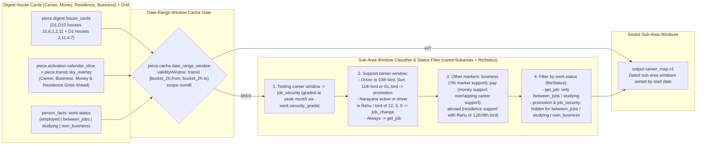

---

## Page 4 of 9 — `work.horizons`: Horizons (`1, 3, 6, 12` Months)

| Field | Value |
|---|---|
| **Technique ID / Title** | `work.horizons` — Horizons (1, 3, 6, 12 months) |
| **Category / Board / Status** | `work` · `work` · `built` |
| **Charts Declared** | `dasha:{vimshottari,yogini,tithi_ashtottari,narayana}`, `transit:{transit_contacts,double_transit}`, `jaimini:modifier`, `natal:{house_counts,facts}` |
| **Selectors** | `boards: ['work']`, `subjects: ['career_work']`, `houses: [10, 6, 1, 2, 11]`, `vargas: ['D1', 'D10']` |
| **Reader Pieces** | `reader:house/house_card` (`D1,D10 houses 10,6,1,2,11`) · `reader:activation/activation_row` (`this month to +12 months`) · `reader:transit/transit_row` (`±24 months`) |
| **Agent Pieces** | `agent:area.career_inputs`, `agent:area.career_map` (`careerMap (horizons)`, `kind: 'code'`, `system: 'none'`) |
| **Output Piece / Accuracy** | `output:career_map.v1` · `accuracy: 'staff'` |
| **Date-Range Window Cache** | `freshness: 'transit'` (`2h` window) · `scope: 'kundli'` |
| **Code & Source** | `src/reading/area/career.ts careerMap (horizons)` (`docs/reading-engine/45 §10`) |

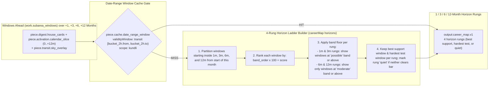

---

## Page 5 of 9 — `work.looking_back`: Looking Back (12-Month Calibration Edges)

| Field | Value |
|---|---|
| **Technique ID / Title** | `work.looking_back` — Looking back |
| **Category / Board / Status** | `work` · `work` · `built` |
| **Charts Declared** | `dasha:{vimshottari,yogini,tithi_ashtottari,narayana}`, `transit:{transit_contacts,double_transit}`, `jaimini:modifier`, `natal:{house_counts,facts}` |
| **Selectors** | `boards: ['work']`, `subjects: ['career_work']`, `houses: [10, 6, 1, 2, 11]`, `vargas: ['D1', 'D10']` |
| **Reader Pieces** | `reader:house/house_card` (`D1,D10 houses 10,6,1,2,11`) · `reader:activation/activation_row` (`-12 months to this month`) · `reader:transit/transit_row` (`±24 months`) |
| **Agent Pieces** | `agent:area.career_inputs`, `agent:area.career_map` (`careerMap (back)`, `recordCheck`, `kind: 'code'`, `system: 'none'`) |
| **Output Piece / Accuracy** | `output:career_map.v1` · `accuracy: 'area_checks:career'` (stores user `yes | partly | no | skip` in `area_checks`) |
| **Date-Range Window Cache** | `freshness: 'transit'` (`2h` window) · `scope: 'kundli'` |
| **Code & Source** | `src/reading/area/career.ts careerMap (back); src/reading/area/careerService.ts recordCheck` (`docs/reading-engine/45 §9`) |

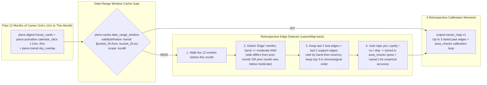

---

## Page 6 of 9 — `work.annual_family`: This Year's Chart (Annual Family Vote)

| Field | Value |
|---|---|
| **Technique ID / Title** | `work.annual_family` — This year's chart (annual family) |
| **Category / Board / Status** | `work` · `work` · `built` |
| **Charts Declared** | `annual:{tithi_pravesha,tithi_pravesha_dasha,mudda,patyayini,sahams}`, `divisional:D10` |
| **Selectors** | `boards: ['work']`, `subjects: ['career_work']`, `houses: [10, 6, 1, 2, 11]`, `vargas: ['D1', 'D10']` |
| **Reader Pieces** | `reader:annual/annual_row` (`piece.digest.annual_set`: `TP current year, D1 and D10, houses 10,6,1,2,11; rajya and karma sahams; year dasha running this month`) |
| **Agent Pieces** | `agent:area.career_inputs`, `agent:area.career_map` (`workAnnualVote`, `kind: 'code'`, `system: 'none'`) |
| **Output Piece / Synthesizer** | `output:family_vote.v1` · feeds `work.present_tone` |
| **Date-Range Window Cache** | `freshness: 'annual'` (`[year.from, year.to)` of running Tithi Pravesha / Varsha chart, fallback `90d`) · `scope: 'kundli'` |
| **Code & Source** | `src/reading/area/career.ts workAnnualVote, presentState; careerService.ts getCareer` (`docs/reading-engine/43 §8.1 (family 5); 46 §B.6; 53 §4.5`) |

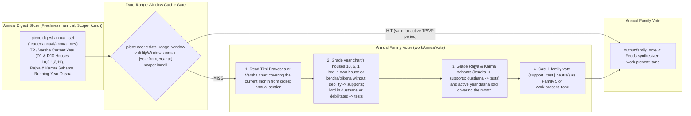

---

## Page 7 of 9 — `work.conditional_family`: Conditional Clock

| Field | Value |
|---|---|
| **Technique ID / Title** | `work.conditional_family` — Conditional clock |
| **Category / Board / Status** | `work` · `work` · `built` |
| **Charts Declared** | `dasha:{applicable,conditional}` |
| **Selectors** | `boards: ['work']`, `subjects: ['career_work']`, `houses: [10, 6, 1, 2, 11]`, `vargas: ['D1', 'D10']` |
| **Reader Pieces** | `reader:activation/activation_row` (`piece.activation.calendar_slice`: `conditional systems named by dasha.applicable, levels 1–3, periods covering this month ±1, houses 10,6,1`) |
| **Agent Pieces** | `agent:area.career_inputs`, `agent:area.career_map` (`workConditionalVote`, `kind: 'code'`, `system: 'none'`) |
| **Output Piece / Synthesizer** | `output:family_vote.v1` · feeds `work.present_tone` |
| **Date-Range Window Cache** | `freshness: 'dasha'` (`[runningPeriod.from, runningPeriod.to)` from `kundli_activation`, fallback `30d`) · `scope: 'kundli'` |
| **Code & Source** | `src/reading/area/career.ts workConditionalVote, presentState; careerService.ts getCareer` (`docs/reading-engine/43 §8.1 (family 2); 46 §B.4; 53 §4.5`) |

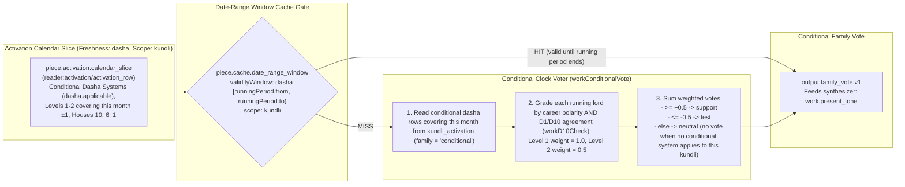

---

## Page 8 of 9 — `work.karaka_family`: Karaka Clock

| Field | Value |
|---|---|
| **Technique ID / Title** | `work.karaka_family` — Karaka clock |
| **Category / Board / Status** | `work` · `work` · `built` |
| **Charts Declared** | `dasha:karaka`, `jaimini:chara_karakas`, `divisional:D10` |
| **Selectors** | `boards: ['work']`, `subjects: ['career_work']`, `houses: [10, 6, 1, 2, 11]`, `vargas: ['D1', 'D10']` |
| **Reader Pieces** | `reader:activation/activation_row` (`piece.activation.calendar_slice`: `karaka dasha level 3, periods covering this month ±1`) · `reader:point/point_row` (`piece.digest.point_cards`: `AmK and the 10th lord in D1 and D10`) · `reader:planet/planet_card` (`piece.digest.planet_cards`: `D10 card of the running karaka lord`) |
| **Agent Pieces** | `agent:area.career_inputs`, `agent:area.career_map` (`workKarakaVote`, `kind: 'code'`, `system: 'none'`) |
| **Output Piece / Synthesizer** | `output:family_vote.v1` · feeds `work.present_tone` |
| **Date-Range Window Cache** | `freshness: 'dasha'` (`[runningPeriod.from, runningPeriod.to)` from `kundli_activation`, fallback `30d`) · `scope: 'kundli'` |
| **Code & Source** | `src/reading/area/career.ts workKarakaVote, presentState; careerService.ts getCareer` (`docs/reading-engine/43 §8.1 (family 4); 46 §B.4; 53 §4.5`) |

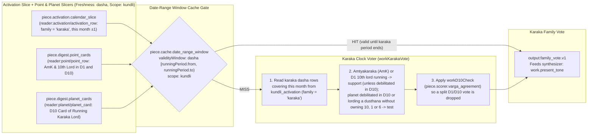

---

## Page 9 of 9 — `work.d10_check`: D1 and D10 Agreement on Each Dasha Vote

| Field | Value |
|---|---|
| **Technique ID / Title** | `work.d10_check` — D1 and D10 agreement on each dasha vote |
| **Category / Board / Status** | `work` · `work` · `built` |
| **Charts Declared** | `divisional:{D1,D10,D9,D60}` |
| **Selectors** | `boards: ['work']`, `subjects: ['career_work']`, `houses: [10, 6, 1, 2, 11]`, `vargas: ['D1', 'D10']` |
| **Reader Pieces** | `reader:activation/activation_row` (`piece.activation.calendar_slice`: `running lords of the main, conditional and karaka clocks this month`) · `reader:planet/planet_card` (`piece.digest.planet_cards`: `D1, D10, D9, D60 cards of those lords`) · `reader:house/house_card` (`piece.digest.house_cards`: `D10 houses 10,6,1,2,11`) |
| **Agent & Scorer Pieces** | `agent:area.career_inputs`, `agent:area.career_map` (`piece.scorer.varga_agreement`: `workD10Check`, `kind: 'code'`, `system: 'none'`) |
| **Output Piece / Synthesizer** | `output:vote_check.v1` · feeds `work.present_tone` |
| **Date-Range Window Cache** | `freshness: 'dasha'` (`[runningPeriod.from, runningPeriod.to)` from `kundli_activation`, fallback `30d`) · `scope: 'kundli'` |
| **Code & Source** | `src/reading/area/career.ts workD10Check, presentState; careerService.ts getCareer` (`docs/reading-engine/43 §8.1; 46 §B.7; 53 §4.5`) |

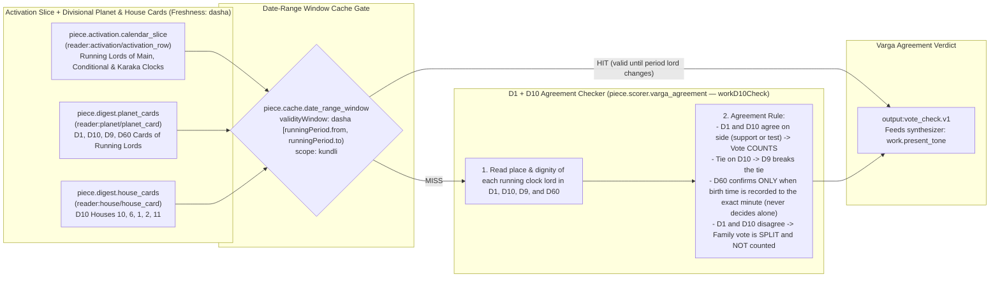

---

## Page 10 of 10 — `research.work_dashboard_qa`: Research Work & Career Dashboard Deep-Dive & Nov/Thanksgiving/Dec/New Year Zoom-In

| Field | Value |
|---|---|
| **Technique ID / Title** | `research.work_dashboard_qa` — Research Work & Career Dashboard deep-dive & Nov/Thanksgiving/Dec/New Year zoom-in |
| **Category / Board / Status** | `work` · `work` · `built` |
| **Charts Declared** | `natal:{facts,dignities,aspects,avasthas,yogas,doshas,strength.shadbala}`, `ashtakavarga:sav`, `jaimini:{charakaraka,arudhas}`, `nakshatra:{janma,cusp_nak}`, `divisional:{D1,D9,D10,D2,D24,D4,D7,D12,D20,D60}`, `dasha:{vimshottari,yogini,tithi_ashtottari,narayana,karaka}`, `annual:{tithi_pravesha,varsha}`, `transit:{transit_contacts,sade_sati}`, `panchang:muhurta` |
| **Selectors** | `boards: ['work']`, `subjects: ['career_work', 'wealth_income', 'business_partnership']`, `houses: [10, 6, 11, 2, 1, 9, 3]`, `vargas: ['D1', 'D10', 'D9', 'D2', 'D24']` |
| **Reader Pieces** | `reader:house/house_card` (`D1..D60_h1..12`) · `reader:planet/planet_card` · `reader:yoga/yoga_row` · `reader:point/point_row` · `reader:star/star_profile` · `reader:activation/activation_row` · `reader:annual/annual_row` · `reader:transit/transit_row` |
| **Agent Piece** | `agent:research.work_dashboard_builder` (`buildWorkResearchDashboard`, `verifyWorkDashboardQaReport`, `kind: 'code'`, `system: 'none'`) |
| **Output Piece / Synthesizer** | `output:research_work_dashboard.v1` · feeds `research.technical_verifier` |
| **Date-Range Window Cache** | `freshness: 'transit'` (`2h` window) · `scope: 'kundli'` |
| **Code & Source** | `src/reading/research/workDashboardQa.ts buildWorkResearchDashboard, verifyWorkDashboardQaReport` (`docs/admin/09 §4.1; docs/reading-engine/43 §8; 46 §B; 54 §3; 55 §2`) |

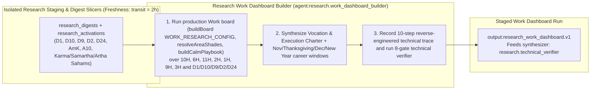

---

---

---

---

---

<!-- work.reading pages: generated by scripts/write-self-reading-pages.ts -->

## Page 11 of 22 — `work.reading.clock`: Work reading: the reading clock and confirming clocks (Work instance)

| Field | Value |
|---|---|
| **Technique ID / Title** | `work.reading.clock` — Work reading: the reading clock and confirming clocks (Work instance) |
| **Category / Board / Status** | `work` · `work` · `built` |
| **Charts Declared** | `dasha:kundli_activation` |
| **Selectors** | `{"boards":["work"],"houses":[10],"vargas":["D1"]}` |
| **Reader Pieces** | `reader:activation/activation_row` (distinct (system, family) at level 1) |
| **Agent Piece** | `agent:work.reading_panel` (`system: none`) |
| **Output Piece** | `output:self_clock.v1` |
| **Date-Range Window Cache** | `freshness: 'dasha'` · `scope: 'kundli'` |
| **Code & Source** | `src/reading/self/clock.ts resolveClock` (docs/reading-engine/59; BPHS (bhava, karakas); Jaimini (DK, UL, AmK, A10, karakamsa); docs 42-46) |

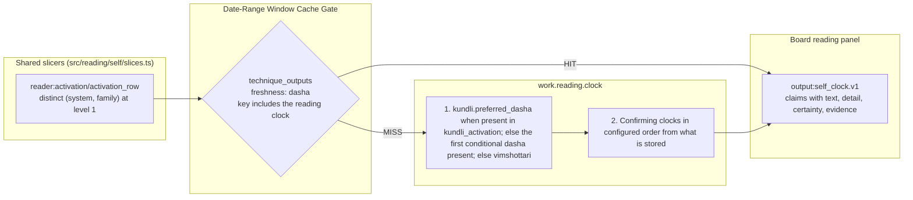

---

## Page 12 of 22 — `work.reading.diagnosis`: Work reading: your work life, in short (three sentences from the Work panels and chapters)

| Field | Value |
|---|---|
| **Technique ID / Title** | `work.reading.diagnosis` — Work reading: your work life, in short (three sentences from the Work panels and chapters) |
| **Category / Board / Status** | `work` · `work` · `built` |
| **Charts Declared** | `natal:panel claims` |
| **Selectors** | `{"boards":["work"],"houses":[10],"vargas":["D1","D10"]}` |
| **Reader Pieces** | `reader:findings/findings_in` (claims of work.reading.vocation, standing, ground, gain, chapters) |
| **Agent Piece** | `agent:work.reading_panel` (`system: none`) |
| **Output Piece** | `output:board_diagnosis.v1` |
| **Date-Range Window Cache** | `freshness: 'question'` · `scope: 'kundli'` |
| **Code & Source** | `src/reading/self/panels/work.ts workDiagnosisPanel` (docs/reading-engine/59; BPHS (bhava, karakas); Jaimini (DK, UL, AmK, A10, karakamsa); docs 42-46) |

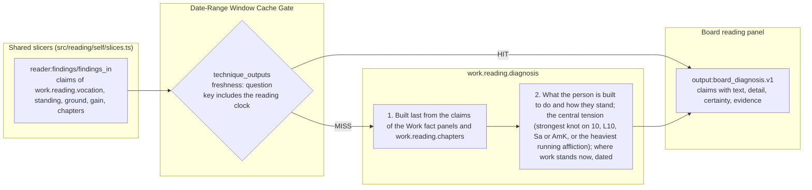

---

## Page 13 of 22 — `work.reading.chapters`: Work reading: your chapters for work (board.chapters filtered to the work houses)

| Field | Value |
|---|---|
| **Technique ID / Title** | `work.reading.chapters` — Work reading: your chapters for work (board.chapters filtered to the work houses) |
| **Category / Board / Status** | `work` · `work` · `built` |
| **Charts Declared** | `dasha:reading clock L1-L2`, `dasha:confirming clocks L1` |
| **Selectors** | `{"boards":["work"],"houses":[10,6,11,2,9,3,5,7],"vargas":["D1","D10"]}` |
| **Reader Pieces** | `reader:activation/activation_row` (reading clock L1-L2 and confirming clocks L1, houses 10,6,11,2,9,3,5,7) · `reader:planet/planet_card` (D1 cards of the chapter lords) |
| **Agent Piece** | `agent:work.reading_panel` (`system: none`) |
| **Output Piece** | `output:board_chapters.v1` |
| **Date-Range Window Cache** | `freshness: 'dasha'` · `scope: 'kundli'` |
| **Code & Source** | `src/reading/self/panels/work.ts workChaptersPanel` (docs/reading-engine/59; BPHS (bhava, karakas); Jaimini (DK, UL, AmK, A10, karakamsa); docs 42-46) |

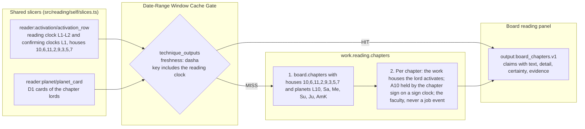

---

## Page 14 of 22 — `work.reading.vocation`: Work reading: what you are built to do (10th, its lord, D10, AmK, the four karakas, karakamsa)

| Field | Value |
|---|---|
| **Technique ID / Title** | `work.reading.vocation` — Work reading: what you are built to do (10th, its lord, D10, AmK, the four karakas, karakamsa) |
| **Category / Board / Status** | `work` · `work` · `built` |
| **Charts Declared** | `divisional:D1`, `divisional:D9`, `divisional:D10`, `jaimini:charakaraka` |
| **Selectors** | `{"boards":["work"],"houses":[10,3,5],"vargas":["D1","D9","D10"]}` |
| **Reader Pieces** | `reader:house/house_card` (D1 h10,3,5; D10 h1,10) · `reader:planet/planet_card` (D1, D9, D10 cards of L10, AmK, Sa, Me, Su, Ju) · `reader:point/point_row` (AmK, A10, D9 AK) |
| **Agent Piece** | `agent:work.reading_panel` (`system: none`) |
| **Output Piece** | `output:board_panel.v1` |
| **Date-Range Window Cache** | `freshness: 'natal'` · `scope: 'kundli'` |
| **Code & Source** | `src/reading/self/panels/work.ts vocationPanel` (docs/reading-engine/59; BPHS (bhava, karakas); Jaimini (DK, UL, AmK, A10, karakamsa); docs 42-46) |

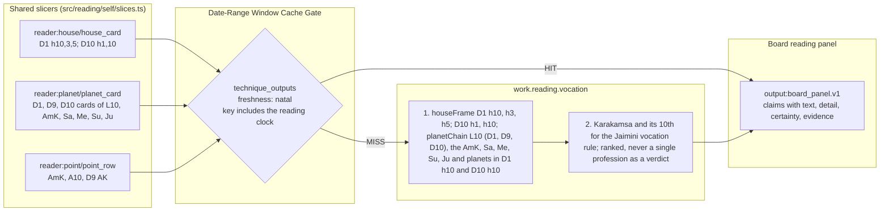

---

## Page 15 of 22 — `work.reading.standing`: Work reading: how you are seen (AL, A10, Sun, 10th lord, D10 lagna)

| Field | Value |
|---|---|
| **Technique ID / Title** | `work.reading.standing` — Work reading: how you are seen (AL, A10, Sun, 10th lord, D10 lagna) |
| **Category / Board / Status** | `work` · `work` · `built` |
| **Charts Declared** | `divisional:D1`, `divisional:D10`, `jaimini:arudhas` |
| **Selectors** | `{"boards":["work"],"houses":[10,1],"vargas":["D1","D10"]}` |
| **Reader Pieces** | `reader:house/house_card` (D1 h10,1, AL house; D10 AL house) · `reader:planet/planet_card` (D1 cards of Su, L10) · `reader:point/point_row` (AL, A10, D10 lagna) |
| **Agent Piece** | `agent:work.reading_panel` (`system: none`) |
| **Output Piece** | `output:board_panel.v1` |
| **Date-Range Window Cache** | `freshness: 'natal'` · `scope: 'kundli'` |
| **Code & Source** | `src/reading/self/panels/work.ts standingPanel` (docs/reading-engine/59; BPHS (bhava, karakas); Jaimini (DK, UL, AmK, A10, karakamsa); docs 42-46) |

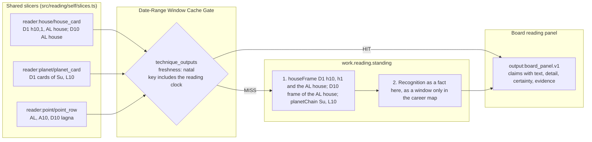

---

## Page 16 of 22 — `work.reading.ground`: Work reading: where the work is now (6th, 3rd, 7th, 12th, D10 6th and 3rd)

| Field | Value |
|---|---|
| **Technique ID / Title** | `work.reading.ground` — Work reading: where the work is now (6th, 3rd, 7th, 12th, D10 6th and 3rd) |
| **Category / Board / Status** | `work` · `work` · `built` |
| **Charts Declared** | `divisional:D1`, `divisional:D10` |
| **Selectors** | `{"boards":["work"],"houses":[6,3,7,12],"vargas":["D1","D10"]}` |
| **Reader Pieces** | `reader:house/house_card` (D1 h6,3,7,12; D10 h6,3) · `reader:planet/planet_card` (D1 cards of L6, L3) · `reader:point/point_row` (A6, A3) |
| **Agent Piece** | `agent:work.reading_panel` (`system: none`) |
| **Output Piece** | `output:board_panel.v1` |
| **Date-Range Window Cache** | `freshness: 'natal'` · `scope: 'kundli'` |
| **Code & Source** | `src/reading/self/panels/work.ts groundPanel` (docs/reading-engine/59; BPHS (bhava, karakas); Jaimini (DK, UL, AmK, A10, karakamsa); docs 42-46) |

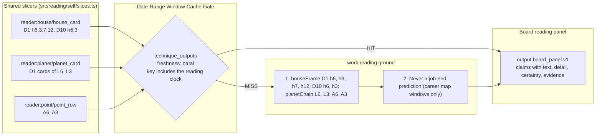

---

## Page 17 of 22 — `work.reading.gain`: Work reading: what it pays (11th, 2nd, D2, D10 11th, dhana yogas of the work lords)

| Field | Value |
|---|---|
| **Technique ID / Title** | `work.reading.gain` — Work reading: what it pays (11th, 2nd, D2, D10 11th, dhana yogas of the work lords) |
| **Category / Board / Status** | `work` · `work` · `built` |
| **Charts Declared** | `divisional:D1`, `divisional:D2`, `divisional:D10`, `natal:yogas` |
| **Selectors** | `{"boards":["work"],"houses":[11,2],"vargas":["D1","D2","D10"]}` |
| **Reader Pieces** | `reader:house/house_card` (D1 h11,2; D2 h1; D10 h11) · `reader:planet/planet_card` (D1 cards of L11, L2) · `reader:point/point_row` (A11, A2) · `reader:yoga/yoga_row` (dhana rows touching L10, L11, L2) |
| **Agent Piece** | `agent:work.reading_panel` (`system: none`) |
| **Output Piece** | `output:board_panel.v1` |
| **Date-Range Window Cache** | `freshness: 'natal'` · `scope: 'kundli'` |
| **Code & Source** | `src/reading/self/panels/work.ts gainPanel` (docs/reading-engine/59; BPHS (bhava, karakas); Jaimini (DK, UL, AmK, A10, karakamsa); docs 42-46) |

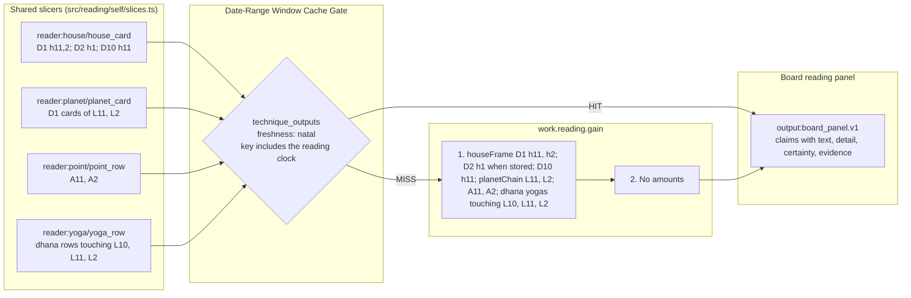

---

## Page 18 of 22 — `work.reading.struggle`: Work reading: what tests it (board.struggle filtered to work)

| Field | Value |
|---|---|
| **Technique ID / Title** | `work.reading.struggle` — Work reading: what tests it (board.struggle filtered to work) |
| **Category / Board / Status** | `work` · `work` · `built` |
| **Charts Declared** | `divisional:D1`, `natal:avasthas`, `dasha:reading clock L1-L3` |
| **Selectors** | `{"boards":["work"],"houses":[10,6,11,2],"vargas":["D1"]}` |
| **Reader Pieces** | `reader:planet/planet_card` (D1 cards of L10, L6, Sa, AmK, Su) · `reader:house/house_card` (D1 h10,6,11,2) · `reader:activation/activation_row` (reading clock L1-L3 running) |
| **Agent Piece** | `agent:work.reading_panel` (`system: none`) |
| **Output Piece** | `output:board_struggle.v1` |
| **Date-Range Window Cache** | `freshness: 'dasha'` · `scope: 'kundli'` |
| **Code & Source** | `src/reading/self/panels/work.ts workStrugglePanel` (docs/reading-engine/59; BPHS (bhava, karakas); Jaimini (DK, UL, AmK, A10, karakamsa); docs 42-46) |

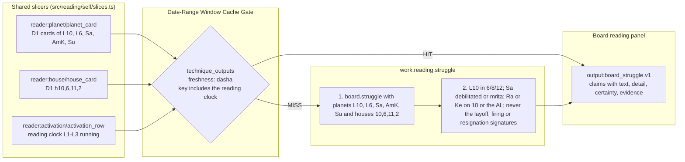

---

## Page 19 of 22 — `work.reading.year`: Work reading: this year (board.year filtered to work)

| Field | Value |
|---|---|
| **Technique ID / Title** | `work.reading.year` — Work reading: this year (board.year filtered to work) |
| **Category / Board / Status** | `work` · `work` · `built` |
| **Charts Declared** | `annual:tithi_pravesha`, `annual:varsha` |
| **Selectors** | `{"boards":["work"],"houses":[10],"vargas":["D1"]}` |
| **Reader Pieces** | `reader:annual/annual_row` (TP and VP D1 of the running year) |
| **Agent Piece** | `agent:work.reading_panel` (`system: none`) |
| **Output Piece** | `output:board_year.v1` |
| **Date-Range Window Cache** | `freshness: 'annual'` · `scope: 'kundli'` |
| **Code & Source** | `src/reading/self/panels/work.ts workYearPanel` (docs/reading-engine/59; BPHS (bhava, karakas); Jaimini (DK, UL, AmK, A10, karakamsa); docs 42-46) |

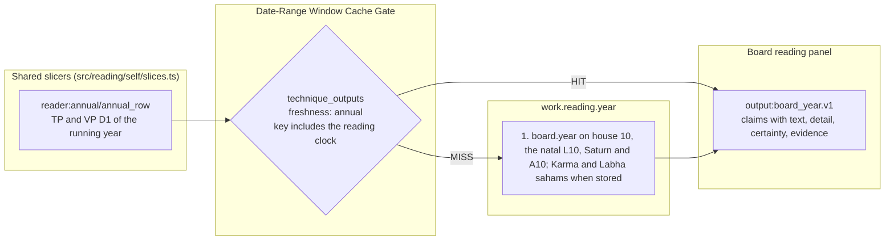

---

## Page 20 of 22 — `work.reading.purview`: Work reading: the whole-chart purview check (board.purview, Work instance)

| Field | Value |
|---|---|
| **Technique ID / Title** | `work.reading.purview` — Work reading: the whole-chart purview check (board.purview, Work instance) |
| **Category / Board / Status** | `work` · `work` · `built` |
| **Charts Declared** | `divisional:D1`, `divisional:D9`, `divisional:D10`, `natal:yogas`, `dasha:reading clock` |
| **Selectors** | `{"boards":["work"],"houses":[10,6,11],"vargas":["D1","D9","D10"]}` |
| **Reader Pieces** | `reader:findings/findings_in` (claims of every Work panel) · `reader:planet/planet_card` (D1 and D9 cards of L10, L6, L11, AmK, Sa, Su, Me, Ju) · `reader:yoga/yoga_row` (cancellation rows) · `reader:activation/activation_row` (reading clock running) |
| **Agent Piece** | `agent:work.reading_panel` (`system: none`) |
| **Output Piece** | `output:purview.v1` |
| **Date-Range Window Cache** | `freshness: 'question'` · `scope: 'kundli'` |
| **Code & Source** | `src/reading/self/purview.ts runPurview, applyPurview` (docs/reading-engine/59; BPHS (bhava, karakas); Jaimini (DK, UL, AmK, A10, karakamsa); docs 42-46) |

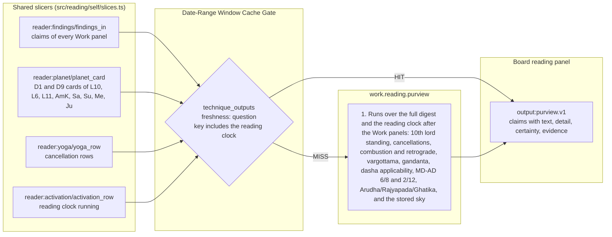

---

## Page 21 of 22 — `work.reading.audit`: Work reading: the code auditor over the cards (board.auditor, Work instance)

| Field | Value |
|---|---|
| **Technique ID / Title** | `work.reading.audit` — Work reading: the code auditor over the cards (board.auditor, Work instance) |
| **Category / Board / Status** | `work` · `work` · `built` |
| **Charts Declared** | `natal:dossier rows` |
| **Selectors** | `{"boards":["work"],"houses":[10],"vargas":["D1"]}` |
| **Reader Pieces** | `reader:findings/findings_in` (the cards and claims of the build) |
| **Agent Piece** | `agent:work.reading_panel` (`system: none`) |
| **Output Piece** | `output:code_audit.v1` |
| **Date-Range Window Cache** | `freshness: 'question'` · `scope: 'kundli'` |
| **Code & Source** | `src/reading/self/audit.ts auditCards` (docs/reading-engine/59; BPHS (bhava, karakas); Jaimini (DK, UL, AmK, A10, karakamsa); docs 42-46) |

```mermaid
flowchart LR
    subgraph Inputs["Shared slicers (src/reading/self/slices.ts)"]
        I1["reader:findings/findings_in<br/>the cards and claims of the build"]
    end
    subgraph CacheGate["Date-Range Window Cache Gate"]
        GATE{"technique_outputs<br/>freshness: question<br/>key includes the reading clock"}
    end
    subgraph Steps["work.reading.audit"]
        S1["1. Every card line: at most 22 words, a range, claim ids that exist and were not vetoed, evidence keys that resolve to stored rows"]
        S1
    end
    subgraph Output["Board reading panel"]
        OUT["output:code_audit.v1<br/>claims with text, detail, certainty, evidence"]
    end
    I1 --> GATE
    GATE -->|"HIT"| OUT
    GATE -->|"MISS"| S1
    S1 --> OUT
```

---

## Page 22 of 22 — `work.reading.oracle`: Work reading: AI family sub-agents, Work Lineman, and Work Oracle synthesis

| Field | Value |
|---|---|
| **Technique ID / Title** | `work.reading.oracle` — Work reading: AI family sub-agents, Work Lineman, and Work Oracle synthesis |
| **Category / Board / Status** | `work` · `work` · `built` |
| **Charts Declared** | `natal:panel claims`, `divisional:D1`, `divisional:D9`, `divisional:D10`, `divisional:D2`, `dasha:reading clock`, `annual:tithi_pravesha`, `transit:sky overlay` |
| **Selectors** | `{"boards":["work"],"houses":[10,6,11,2,9,3,5,7],"vargas":["D1","D9","D10","D2"]}` |
| **Reader Pieces** | `reader:house/house_card` (D1 and divisional house cards 1..12) · `reader:planet/planet_card` (D1 and divisional planet cards with avasthas and dasha_charter) · `reader:yoga/yoga_row` (D1 yogas, doshas, and cancellations) · `reader:point/point_row` (D1/D9 chara karakas, arudha padas, and Lunar Astro points) · `reader:star/star_profile` (Moon star, lagna star, gandanta, and pending karma houses) · `reader:annual/annual_row` (running Tithi Pravesha and Varsha annual charts) · `reader:activation/activation_row` (reading clock L1-L3 and confirming clocks L1) |
| **Agent Piece** | `agent:work.reading_oracle`, `agent:family.rasi`, `agent:family.varga`, `agent:family.dasha`, `agent:family.year`, `agent:family.sky`, `agent:lineman.work` (`system: src/reading/prompts/oracle/self.md`) |
| **Output Piece** | `output:self_reading.v1` |
| **Date-Range Window Cache** | `freshness: 'dasha'` · `scope: 'kundli'` |
| **Code & Source** | `src/reading/self/oracle.ts runSelfOracle` (docs/reading-engine/59; BPHS (bhava, karakas); Jaimini (DK, UL, AmK, A10, karakamsa); docs 42-46; docs/reading-engine/63 §4.1) |

```mermaid
flowchart LR
    subgraph Inputs["Shared slicers (src/reading/self/slices.ts)"]
        I1["reader:house/house_card<br/>D1 and divisional house cards 1..12"]
        I2["reader:planet/planet_card<br/>D1 and divisional planet cards with avasthas and dasha_charter"]
        I3["reader:yoga/yoga_row<br/>D1 yogas, doshas, and cancellations"]
        I4["reader:point/point_row<br/>D1/D9 chara karakas, arudha padas, and Lunar Astro points"]
        I5["reader:star/star_profile<br/>Moon star, lagna star, gandanta, and pending karma houses"]
        I6["reader:annual/annual_row<br/>running Tithi Pravesha and Varsha annual charts"]
        I7["reader:activation/activation_row<br/>reading clock L1-L3 and confirming clocks L1"]
    end
    subgraph CacheGate["Date-Range Window Cache Gate"]
        GATE{"technique_outputs<br/>freshness: dasha<br/>key includes the reading clock"}
    end
    subgraph Steps["work.reading.oracle"]
        S1["1. Reuses the five shared chart family sub-agent findings (family.rasi, family.varga, family.dasha, family.year, family.sky) from reading_findings_cache across Self, Love, and Work"]
        S2["2. Compiles the family sub-agent findings, the eight deterministic Work panel claims, and the whole-chart purview rules through the Work Lineman AI agent (lineman.work) into a unified Work brief"]
        S3["3. Synthesizes the personalized Work reading through the Work Oracle synthesizer (work.reading_oracle), stores the output in technique_outputs, and validates every cited evidence key against the stored chart keys under the $1.00 spend guard"]
        S1 --> S2 --> S3
    end
    subgraph Output["Board reading panel"]
        OUT["output:self_reading.v1<br/>claims with text, detail, certainty, evidence"]
    end
    I1 & I2 & I3 & I4 & I5 & I6 & I7 --> GATE
    GATE -->|"HIT"| OUT
    GATE -->|"MISS"| S1
    S3 --> OUT
```
