# Volume 06 — Lucky Times (`lucky.*`) & Life Reading (`life.*`) One-Per-Page Illustrations

> **Format**: One illustration per page (`Page 1 of 21` through `Page 21 of 21`), separated by `---`.  
> **Boards**: `lucky` (Pages 1–17: 4 shared Panchang/Overlay techniques + 13 Act Scenarios) · `timeline` (Pages 18–21: 4 Life Reading & Long-Term Mahadasha Charter techniques)  
> **Code References**: [`src/techniques/catalog.ts`](../../src/techniques/catalog.ts) · [`src/reading/luckyTimes/scenarios.ts`](../../src/reading/luckyTimes/scenarios.ts) · [`src/reading/luckyTimes/windows.ts`](../../src/reading/luckyTimes/windows.ts) · [`src/reading/luckyTimes/service.ts`](../../src/reading/luckyTimes/service.ts) · [`src/reading/life/promise.ts`](../../src/reading/life/promise.ts) · [`src/reading/life/timing.ts`](../../src/reading/life/timing.ts) · [`src/reading/life/charter.ts`](../../src/reading/life/charter.ts) · [`src/reading/life/compose.ts`](../../src/reading/life/compose.ts)

---

## Page 1 of 21 — `lucky.day_tables`: Shared Day Tables per Place (5 Reference Timezones)

| Field | Value |
|---|---|
| **Technique ID / Title** | `lucky.day_tables` — Shared day tables per place |
| **Category / Board / Status** | `self` · `lucky` · `built` |
| **Charts Declared** | `panchang:muhurta` |
| **Selectors** | `boards: ['lucky']` |
| **Reader Pieces** | `reader:panchang/panchang_day` (`piece.panchang.day_limbs`: `"the place's day rows today −7 … today +14 (five limbs, horas, avoid bands, good spans)"`) |
| **Agent Piece** | `agent:lucky.day_tables` (`kind: 'engine_pull'`, `engineType: 'muhurta'`, `system: 'none'`) |
| **Output Piece** | `output:day_tables.v1` (writes to shared `day_tables` per `(place_key, date, ayanamsa)`) |
| **Date-Range Window Cache** | `freshness: 'daily'` (each `day_tables` row is immutable for its `(place_key, date)` across all users in that reference timezone!) · `scope: 'kundli'` |
| **Env Config (`src/config/env.ts`)** | `LUCKY_HORIZON_DAYS=28`, `LUCKY_PREPULL_DAYS=28`, `LUCKY_REFERENCE_PLACES` (`us-east` / New York, `us-central` / Chicago, `us-mountain` / Denver, `us-west` / San Jose, `in-ist` / Pune) |
| **Code & Source** | `src/reading/luckyTimes/service.ts pullDayTables, prepullUniversalDayTables; places.ts` (`docs/reading-engine/47 §3; 49 §4.1; 53 §4.6`) |

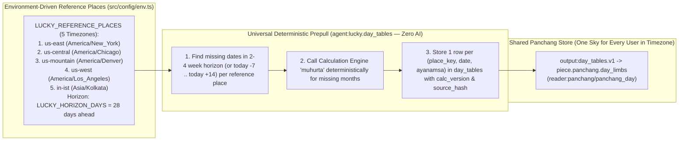

---

## Page 2 of 21 — `lucky.panchang_limbs`: The Five Limbs of the Day (`vara, tithi, nakshatra, yoga, karana`)

| Field | Value |
|---|---|
| **Technique ID / Title** | `lucky.panchang_limbs` — The five limbs of the day (vara, tithi, nakshatra, yoga, karana) |
| **Category / Board / Status** | `self` · `lucky` · `built` |
| **Charts Declared** | `panchang:{weekday,tithi,nakshatra,yoga,karana}` |
| **Selectors** | `boards: ['lucky']` |
| **Reader Pieces** | `reader:panchang/panchang_day` (`piece.panchang.day_limbs`: `"the place's day rows today −7 … today +14: vara, tithi, nakshatra, yoga, karana with end times"`) |
| **Agent Piece** | `agent:lucky.scenario_windows` (`kind: 'code'`, `system: 'none'`) |
| **Output Piece / Synthesizer** | `output:limbs.v1` · feeds `lucky.avoid_bands` (and every `lucky.<area>.<act>` scenario) |
| **Date-Range Window Cache** | `freshness: 'daily'` (`[day.from, day.to)` at the local place) · `scope: 'kundli'` |
| **Env Config (`src/config/env.ts`)** | `LUCKY_YOGA_AVOID`, `LUCKY_YOGA_FAVOUR` (includes Siddha #21), `LUCKY_KARANA_AVOID` (`Vishti`), `LUCKY_FIXED_KARANA_AVOID` (`Shakuni, Chatushpada, Naga`), `LUCKY_KARANA_FAVOUR`, `LUCKY_FIXED_KARANA_FAVOUR` (`Kimstughna`), `LUCKY_AMRITA_SIDDHI_ENABLED` |
| **Code & Source** | `src/reading/luckyTimes/scenarios.ts; windows.ts dayLimbs, scenarioDay; service.ts getRange` (`docs/reading-engine/53 §4.6, 54 §6`) |

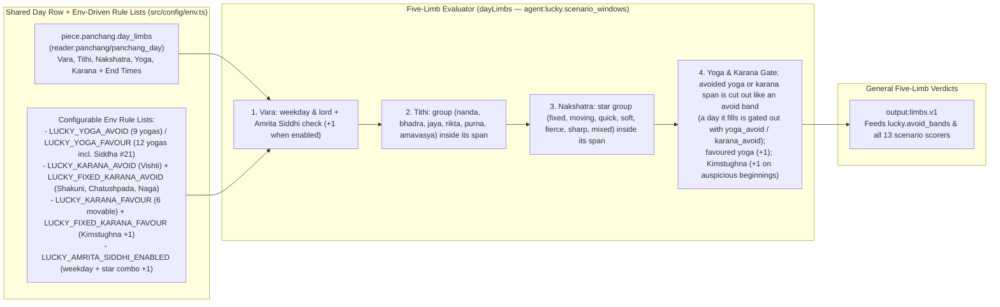

---

## Page 3 of 21 — `lucky.avoid_bands`: Avoid Bands and Good Spans of the Day

| Field | Value |
|---|---|
| **Technique ID / Title** | `lucky.avoid_bands` — Avoid bands and good spans of the day |
| **Category / Board / Status** | `self` · `lucky` · `built` |
| **Charts Declared** | `panchang:{kalams,muhurta}` |
| **Selectors** | `boards: ['lucky']` |
| **Reader Pieces** | `reader:panchang/panchang_day` (`piece.panchang.day_limbs`: `"the place's day rows today −7 … today +14 (five limbs, horas, avoid bands, good spans)"`) |
| **Agent Piece** | `agent:lucky.scenario_windows` (`avoidBands`, `nowState`, `kind: 'code'`, `system: 'none'`) |
| **Output Piece** | `output:day_bands.v1` |
| **Date-Range Window Cache** | `freshness: 'daily'` (`[day.from, day.to)` at the local place) · `scope: 'kundli'` |
| **Code & Source** | `src/reading/luckyTimes/windows.ts avoidBands, nowState; service.ts getRange` (`docs/reading-engine/49 §4.1; 47 §3`) |

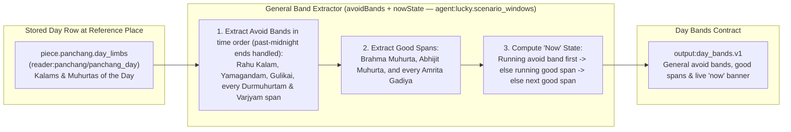

---

## Page 4 of 21 — `lucky.personal_overlay`: Personal Overlay (`tara, chandra bala` and the Chart Marks)

| Field | Value |
|---|---|
| **Technique ID / Title** | `lucky.personal_overlay` — Personal overlay (tara, chandra bala and the chart marks) |
| **Category / Board / Status** | `self` · `lucky` · `built` |
| **Charts Declared** | `panchang:{muhurta,chandra_bala}`, `nakshatra:tara` |
| **Selectors** | `boards: ['lucky']` |
| **Reader Pieces** | `reader:panchang/panchang_day` (`piece.panchang.personal_overlay`: `"the person's overlay for the same days (tara, chandra bala, grade)"`) · `reader:planet/planet_card` (`piece.digest.planet_cards`: `D1 cards of the seven hora lords (nature column)`) · `reader:activation/activation_row` (`piece.activation.calendar_slice`: `periods running on each day, every system`) |
| **Agent Piece** | `agent:lucky.day_overlay` (`kind: 'engine_pull'`, `engineType: 'muhurta'`) + `windows.ts personalScore` |
| **Output Piece** | `output:day_overlay.v1` |
| **Date-Range Window Cache** | `freshness: 'dasha'` / `'daily'` (stored once per month and place in `kundli_day_overlays`; combined with cached D1 functional nature & running dasha lords) · `scope: 'kundli'` |
| **Code & Source** | `src/reading/luckyTimes/service.ts personalDays, functionalNatureOf, runningDashaLordsOf; windows.ts personalScore` (`docs/reading-engine/49 §4.1; 53 §4.6`) |

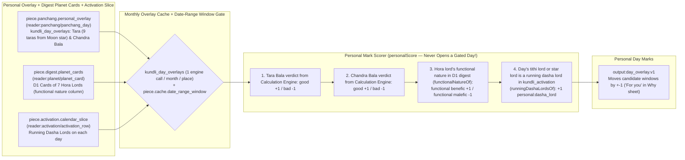

---

## Page 5 of 21 — `lucky.work.sign_contract`: Sign a Contract

| Field | Value |
|---|---|
| **Technique ID / Title** | `lucky.work.sign_contract` — Sign a contract |
| **Category / Board / Status** | `work` · `lucky` · `built` |
| **Charts Declared** | `panchang:{tithi,nakshatra,weekday,hora,muhurta,kalams,yoga,karana}` |
| **Selectors** | `boards: ['lucky']` |
| **Reader Pieces** | `reader:panchang/panchang_day` (`piece.panchang.day_limbs` + `piece.panchang.personal_overlay`) |
| **Agent Piece / Recipe Family** | `agent:lucky.scenario_windows` · Member `1 of 13` of the `lucky.*` Scenario Family (`output:windows.v1`, `freshness: 'daily'`, `scope: 'kundli'`) |
| **Scenario Rule (`SCENARIOS['work.sign_contract']`)** | Hours: `sunrise..19:00` · Floor: `3` · `dayFavour: [Thursday, Wednesday]` · `dayAvoid: [Saturday, Tuesday]` · `tithiFavour: [bhadra, purna]` · `tithiAvoid: [rikta, amavasya]` · `starFavour: [fixed]` · `starAvoid: [fierce, sharp]` · `horaFavour: [Jupiter, Mercury]` · `horaAvoid: [Saturn, Mars]` · `v1Note`: *"Mercury's motion is not yet checked; avoid signing while it moves backward."* |
| **Code & Source** | `src/reading/luckyTimes/scenarios.ts SCENARIOS['work.sign_contract']; windows.ts scenarioDay` |

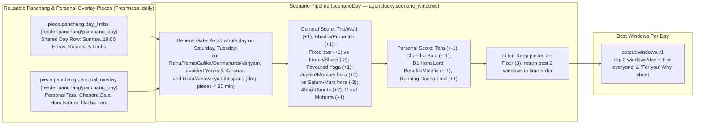

---

## Page 6 of 21 — `lucky.work.send_resume`: Send a Resume or Application

| Field | Value |
|---|---|
| **Technique ID / Title** | `lucky.work.send_resume` — Send a resume or application |
| **Category / Board / Status** | `work` · `lucky` · `built` |
| **Selectors / One-Tap Ask** | `boards: ['lucky']` · `ask: 'job'` (asks one question first before showing layer) |
| **Reader Pieces & Agent** | `reader:panchang/panchang_day` (`piece.panchang.day_limbs` + `piece.panchang.personal_overlay`) · `agent:lucky.scenario_windows` (`freshness: 'daily'`, `scope: 'kundli'`) |
| **Scenario Rule (`SCENARIOS['work.send_resume']`)** | Hours: `sunrise..20:00` · Floor: `3` · `dayFavour: [Wednesday, Thursday, Sunday]` · `dayAvoid: []` · `tithiFavour: [bhadra, nanda]` · `tithiAvoid: [rikta, amavasya]` · `starFavour: [quick, moving]` · `starAvoid: [sharp]` · `horaFavour: [Mercury, Sun, Jupiter]` · `horaAvoid: [Saturn]` |
| **Code & Source** | `src/reading/luckyTimes/scenarios.ts SCENARIOS['work.send_resume']; windows.ts scenarioDay` |

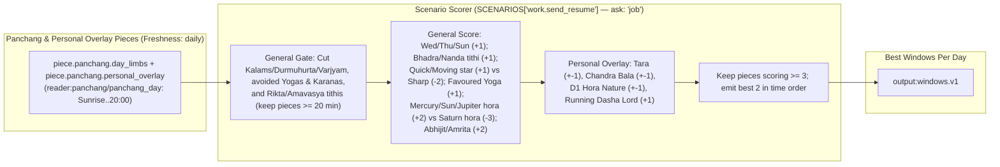

---

## Page 7 of 21 — `lucky.work.interview`: Interview or Pitch

| Field | Value |
|---|---|
| **Technique ID / Title** | `lucky.work.interview` — Interview or pitch |
| **Category / Board / Status** | `work` · `lucky` · `built` |
| **Selectors / One-Tap Ask** | `boards: ['lucky']` · `ask: 'job'` |
| **Reader Pieces & Agent** | `reader:panchang/panchang_day` (`piece.panchang.day_limbs` + `piece.panchang.personal_overlay`) · `agent:lucky.scenario_windows` (`freshness: 'daily'`, `scope: 'kundli'`) |
| **Scenario Rule (`SCENARIOS['work.interview']`)** | Hours: `sunrise..18:00` · Floor: `3` · `dayFavour: [Thursday, Sunday, Wednesday]` · `dayAvoid: []` · `tithiFavour: [jaya, bhadra]` · `tithiAvoid: [rikta, amavasya]` · `starFavour: [quick, soft]` · `starAvoid: [fierce]` · `horaFavour: [Sun, Jupiter]` · `horaAvoid: [Saturn, Mars]` |
| **Code & Source** | `src/reading/luckyTimes/scenarios.ts SCENARIOS['work.interview']; windows.ts scenarioDay` |

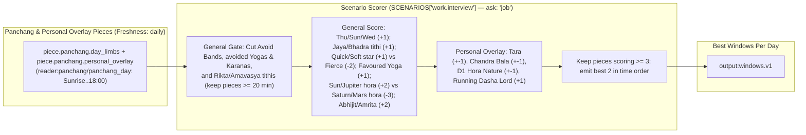

---

## Page 8 of 21 — `lucky.work.ask_raise`: Ask for a Raise

| Field | Value |
|---|---|
| **Technique ID / Title** | `lucky.work.ask_raise` — Ask for a raise |
| **Category / Board / Status** | `work` · `lucky` · `built` |
| **Selectors / One-Tap Ask** | `boards: ['lucky']` · `ask: 'job'` |
| **Reader Pieces & Agent** | `reader:panchang/panchang_day` (`piece.panchang.day_limbs` + `piece.panchang.personal_overlay`) · `agent:lucky.scenario_windows` (`freshness: 'daily'`, `scope: 'kundli'`) |
| **Scenario Rule (`SCENARIOS['work.ask_raise']`)** | Hours: `sunrise..18:00` · Floor: `3` · `dayFavour: [Thursday]` · `dayAvoid: [Saturday]` · `tithiFavour: [purna, jaya]` · `tithiAvoid: [rikta, amavasya]` · `starFavour: [fixed, quick]` · `starAvoid: [sharp, fierce]` · `horaFavour: [Jupiter, Sun]` · `horaAvoid: [Saturn]` |
| **Code & Source** | `src/reading/luckyTimes/scenarios.ts SCENARIOS['work.ask_raise']; windows.ts scenarioDay` |

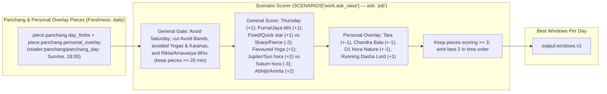

---

## Page 9 of 21 — `lucky.work.start_project`: Start a Project

| Field | Value |
|---|---|
| **Technique ID / Title** | `lucky.work.start_project` — Start a project |
| **Category / Board / Status** | `work` · `lucky` · `built` |
| **Selectors** | `boards: ['lucky']` |
| **Reader Pieces & Agent** | `reader:panchang/panchang_day` (`piece.panchang.day_limbs` + `piece.panchang.personal_overlay`) · `agent:lucky.scenario_windows` (`freshness: 'daily'`, `scope: 'kundli'`) |
| **Scenario Rule (`SCENARIOS['work.start_project']`)** | Hours: `sunrise..20:00` · `useBrahma: true` (+2) · `BEGINNING_LIMBS` (`Kimstughna` fixed karana +1 bonus) · Floor: `3` · `dayFavour: [Monday, Wednesday, Thursday]` · `dayAvoid: []` · `tithiFavour: [bhadra, nanda]` · `tithiAvoid: [rikta, amavasya]` · `starFavour: [quick, fixed]` · `starAvoid: [sharp]` · `horaFavour: [Jupiter, Mercury, Moon]` · `horaAvoid: [Saturn]` |
| **Code & Source** | `src/reading/luckyTimes/scenarios.ts SCENARIOS['work.start_project']; windows.ts scenarioDay` |

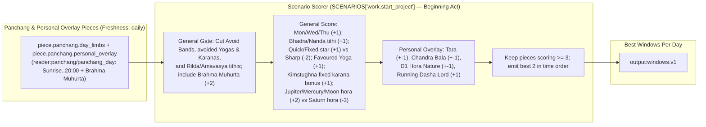

---

## Page 10 of 21 — `lucky.work.hard_talk_boss`: A Hard Talk with the Boss

| Field | Value |
|---|---|
| **Technique ID / Title** | `lucky.work.hard_talk_boss` — A hard talk with the boss |
| **Category / Board / Status** | `work` · `lucky` · `built` |
| **Selectors / One-Tap Ask** | `boards: ['lucky']` · `ask: 'who'` |
| **Reader Pieces & Agent** | `reader:panchang/panchang_day` (`piece.panchang.day_limbs` + `piece.panchang.personal_overlay`) · `agent:lucky.scenario_windows` (`freshness: 'daily'`, `scope: 'kundli'`) |
| **Scenario Rule (`SCENARIOS['work.hard_talk_boss']`)** | Hours: `sunrise..18:00` · Floor: `3` · `dayFavour: [Monday, Thursday]` · `dayAvoid: [Tuesday]` · `tithiFavour: [nanda]` · `tithiAvoid: [jaya, amavasya]` · `starFavour: [soft, fixed]` · `starAvoid: [fierce, sharp]` · `horaFavour: [Moon, Jupiter, Venus]` · `horaAvoid: [Mars, Saturn]` |
| **Code & Source** | `src/reading/luckyTimes/scenarios.ts SCENARIOS['work.hard_talk_boss']; windows.ts scenarioDay` |

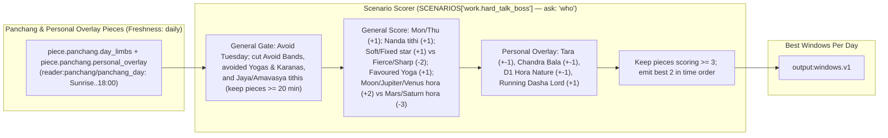

---

## Page 11 of 21 — `lucky.love.ask_out`: Ask Someone Out

| Field | Value |
|---|---|
| **Technique ID / Title** | `lucky.love.ask_out` — Ask someone out |
| **Category / Board / Status** | `love` · `lucky` · `built` |
| **Selectors / One-Tap Ask** | `boards: ['lucky']` · `ask: 'relationship'` |
| **Reader Pieces & Agent** | `reader:panchang/panchang_day` (`piece.panchang.day_limbs` + `piece.panchang.personal_overlay`) · `agent:lucky.scenario_windows` (`freshness: 'daily'`, `scope: 'kundli'`) |
| **Scenario Rule (`SCENARIOS['love.ask_out']`)** | Hours: `09:00..22:00` · Floor: `3` · `dayFavour: [Friday, Wednesday]` · `dayAvoid: [Tuesday, Saturday]` · `tithiFavour: [nanda, bhadra]` · `tithiAvoid: [rikta, amavasya]` · `starFavour: [soft]` · `starAvoid: [fierce, sharp]` · `horaFavour: [Venus, Mercury, Moon]` · `horaAvoid: [Mars, Saturn]` |
| **Code & Source** | `src/reading/luckyTimes/scenarios.ts SCENARIOS['love.ask_out']; windows.ts scenarioDay` |

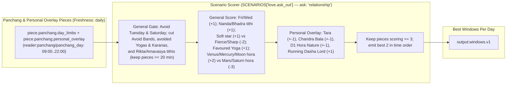

---

## Page 12 of 21 — `lucky.love.first_date`: A First Date

| Field | Value |
|---|---|
| **Technique ID / Title** | `lucky.love.first_date` — A first date |
| **Category / Board / Status** | `love` · `lucky` · `built` |
| **Selectors / One-Tap Ask** | `boards: ['lucky']` · `ask: 'relationship'` |
| **Reader Pieces & Agent** | `reader:panchang/panchang_day` (`piece.panchang.day_limbs` + `piece.panchang.personal_overlay`) · `agent:lucky.scenario_windows` (`freshness: 'daily'`, `scope: 'kundli'`) |
| **Scenario Rule (`SCENARIOS['love.first_date']`)** | Hours: `11:00..22:00` · Floor: `3` · `dayFavour: [Friday]` · `dayAvoid: []` · `tithiFavour: [nanda]` · `tithiAvoid: [amavasya]` · `starFavour: [soft]` · `starAvoid: [sharp]` · `horaFavour: [Venus, Moon]` · `horaAvoid: [Mars, Saturn]` |
| **Code & Source** | `src/reading/luckyTimes/scenarios.ts SCENARIOS['love.first_date']; windows.ts scenarioDay` |

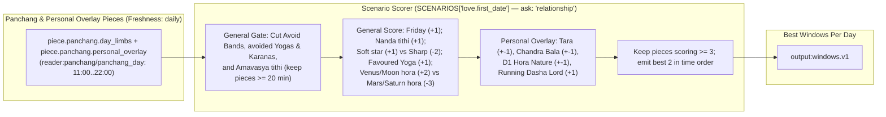

---

## Page 13 of 21 — `lucky.love.clear_air`: Clear the Air

| Field | Value |
|---|---|
| **Technique ID / Title** | `lucky.love.clear_air` — Clear the air |
| **Category / Board / Status** | `love` · `lucky` · `built` |
| **Selectors / One-Tap Ask** | `boards: ['lucky']` · `ask: 'relationship'` |
| **Reader Pieces & Agent** | `reader:panchang/panchang_day` (`piece.panchang.day_limbs` + `piece.panchang.personal_overlay`) · `agent:lucky.scenario_windows` (`freshness: 'daily'`, `scope: 'kundli'`) |
| **Scenario Rule (`SCENARIOS['love.clear_air']`)** | Hours: `09:00..22:00` · Floor: `3` · `dayFavour: [Monday, Friday]` · `dayAvoid: [Tuesday]` · `tithiFavour: [nanda]` · `tithiAvoid: [jaya]` · `starFavour: [soft, fixed]` · `starAvoid: [fierce]` · `horaFavour: [Moon, Venus]` · `horaAvoid: [Mars]` |
| **Code & Source** | `src/reading/luckyTimes/scenarios.ts SCENARIOS['love.clear_air']; windows.ts scenarioDay` |

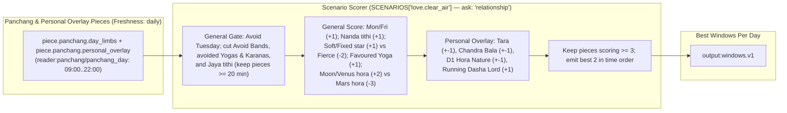

---

## Page 14 of 21 — `lucky.money.invest_buy`: Invest or Buy

| Field | Value |
|---|---|
| **Technique ID / Title** | `lucky.money.invest_buy` — Invest or buy |
| **Category / Board / Status** | `work` (money area maps to `work` category) · `lucky` · `built` |
| **Selectors** | `boards: ['lucky']` |
| **Reader Pieces & Agent** | `reader:panchang/panchang_day` (`piece.panchang.day_limbs` + `piece.panchang.personal_overlay`) · `agent:lucky.scenario_windows` (`freshness: 'daily'`, `scope: 'kundli'`) |
| **Scenario Rule (`SCENARIOS['money.invest_buy']`)** | Hours: `sunrise..19:00` · Floor: `3` · `dayFavour: [Thursday, Wednesday]` · `dayAvoid: []` · `tithiFavour: [bhadra, purna]` · `tithiAvoid: [rikta, amavasya]` · `starFavour: [fixed]` · `starAvoid: [sharp, fierce]` · `horaFavour: [Jupiter, Mercury]` · `horaAvoid: [Saturn]` · `v1Note`: *"Mercury's motion is not yet checked."* |
| **Code & Source** | `src/reading/luckyTimes/scenarios.ts SCENARIOS['money.invest_buy']; windows.ts scenarioDay` |

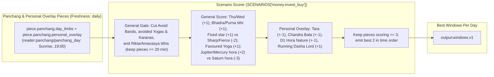

---

## Page 15 of 21 — `lucky.travel.set_out`: Set Out on a Journey

| Field | Value |
|---|---|
| **Technique ID / Title** | `lucky.travel.set_out` — Set out on a journey |
| **Category / Board / Status** | `self` (travel area maps to `self` category) · `lucky` · `built` |
| **Selectors** | `boards: ['lucky']` |
| **Reader Pieces & Agent** | `reader:panchang/panchang_day` (`piece.panchang.day_limbs` + `piece.panchang.personal_overlay`) · `agent:lucky.scenario_windows` (`freshness: 'daily'`, `scope: 'kundli'`) |
| **Scenario Rule (`SCENARIOS['travel.set_out']`)** | Hours: `sunrise..21:00` · Floor: `3` · `dayFavour: []` · `dayAvoid: []` · `tithiFavour: [bhadra, nanda]` · `tithiAvoid: [rikta, amavasya]` · `starFavour: [moving, quick]` · `starAvoid: [sharp]` · `horaFavour: [Moon, Venus, Mercury]` · `horaAvoid: [Saturn]` · `v1Note`: *"The direction rule for each weekday is not yet applied."* |
| **Code & Source** | `src/reading/luckyTimes/scenarios.ts SCENARIOS['travel.set_out']; windows.ts scenarioDay` |

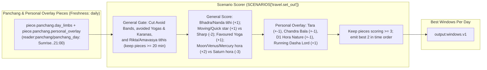

---

## Page 16 of 21 — `lucky.study.exam_submit`: Exam or Submit

| Field | Value |
|---|---|
| **Technique ID / Title** | `lucky.study.exam_submit` — Exam or submit |
| **Category / Board / Status** | `self` (study area maps to `self` category) · `lucky` · `built` |
| **Selectors** | `boards: ['lucky']` |
| **Reader Pieces & Agent** | `reader:panchang/panchang_day` (`piece.panchang.day_limbs` + `piece.panchang.personal_overlay`) · `agent:lucky.scenario_windows` (`freshness: 'daily'`, `scope: 'kundli'`) |
| **Scenario Rule (`SCENARIOS['study.exam_submit']`)** | Hours: `sunrise..20:00` · Floor: `3` · `dayFavour: [Wednesday, Thursday]` · `dayAvoid: []` · `tithiFavour: [jaya, purna]` · `tithiAvoid: [rikta]` · `starFavour: [quick]` · `starAvoid: [sharp]` · `horaFavour: [Mercury, Jupiter]` · `horaAvoid: []` |
| **Code & Source** | `src/reading/luckyTimes/scenarios.ts SCENARIOS['study.exam_submit']; windows.ts scenarioDay` |

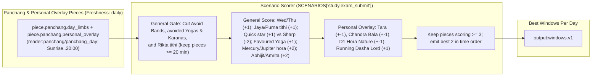

---

## Page 17 of 21 — `lucky.home.start_routine`: Start a Routine

| Field | Value |
|---|---|
| **Technique ID / Title** | `lucky.home.start_routine` — Start a routine |
| **Category / Board / Status** | `self` (home area maps to `self` category) · `lucky` · `built` |
| **Selectors** | `boards: ['lucky']` |
| **Reader Pieces & Agent** | `reader:panchang/panchang_day` (`piece.panchang.day_limbs` + `piece.panchang.personal_overlay`) · `agent:lucky.scenario_windows` (`freshness: 'daily'`, `scope: 'kundli'`) |
| **Scenario Rule (`SCENARIOS['home.start_routine']`)** | Hours: `sunrise..12:00` · `useBrahma: true` (+2) · `BEGINNING_LIMBS` (`Kimstughna` fixed karana +1 bonus) · Floor: `3` · `dayFavour: [Monday, Thursday]` · `dayAvoid: []` · `tithiFavour: [bhadra]` · `tithiAvoid: [rikta, amavasya]` · `starFavour: [fixed, quick]` · `starAvoid: []` · `horaFavour: [Sun, Moon, Jupiter]` · `horaAvoid: []` |
| **Code & Source** | `src/reading/luckyTimes/scenarios.ts SCENARIOS['home.start_routine']; windows.ts scenarioDay` |

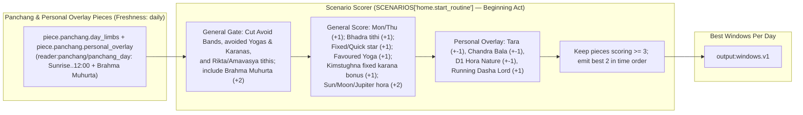

---

## Page 18 of 21 — `life.promise_scale`: Life Areas — The Weighed Promise Scale (13 Areas)

| Field | Value |
|---|---|
| **Technique ID / Title** | `life.promise_scale` — Life areas: the weighed promise scale |
| **Category / Board / Status** | `general` · `timeline` · `built` |
| **Charts Declared** | `natal:{digest.house,digest.planet,digest.yoga}`, `divisional:{D9,owning varga}`, `dasha:kundli_activation`, `annual:digest.annual`, `transit:transit_snapshot.double_transit` |
| **Selectors** | `boards: ['timeline']`, `houses: [1..12]`, `vargas: ['D1', 'D9', 'D2', 'D3', 'D4', 'D7', 'D10', 'D12', 'D20', 'D24', 'D30']` |
| **Reader Pieces** | `reader:house/house_card` (`piece.digest.house_cards`: D1 area houses + D9 + owning varga primary house) · `reader:planet/planet_card` (`piece.digest.planet_cards`: D1 area karakas + primary house lord in D9 & owning varga + `dashaCharter.fruition`) · `reader:yoga/yoga_row` (`piece.digest.yoga_register`: D1 yogas on area houses/lords) · `reader:activation/activation_row` (`piece.activation.calendar_slice`: periods running today, levels 1–2) |
| **Agent & Scorer Pieces** | `agent:life.dashboard` (`piece.scorer.promise_layer`: `promiseScale`, `kind: 'code'`, `system: 'none'`) |
| **Output Piece / Synthesizer** | `output:life_promise.v1` · feeds `life.dashboard` |
| **Date-Range Window Cache** | `freshness: 'dasha'` (`[runningPeriod.from, runningPeriod.to)` from `kundli_activation`, fallback `30d`) · `scope: 'kundli'` |
| **Code & Source** | `src/reading/life/promise.ts promiseScale` (`docs/reading-engine/34 §2, §3; 54 §4; 55 §4.1`) |

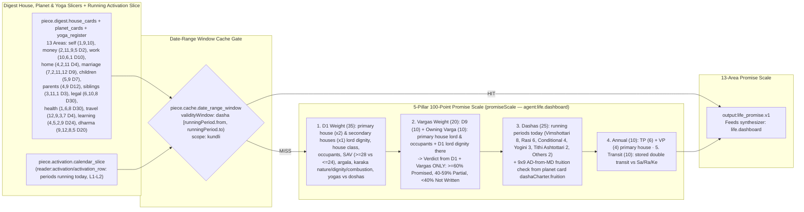

---

## Page 19 of 21 — `life.timing_agreement`: Life Areas — When It Improves, by Agreement Across Systems

| Field | Value |
|---|---|
| **Technique ID / Title** | `life.timing_agreement` — Life areas: when it improves, by agreement across systems |
| **Category / Board / Status** | `general` · `timeline` · `built` |
| **Charts Declared** | `natal:{digest.house,digest.planet,digest.yoga}`, `divisional:{D9,owning varga}`, `dasha:kundli_activation`, `annual:digest.annual`, `transit:transit_snapshot.double_transit` |
| **Selectors** | `boards: ['timeline']`, `houses: [1..12]`, `vargas: ['D1'..'D30']` |
| **Reader Pieces** | `reader:activation/activation_row` (`piece.activation.calendar_slice`: `every family, levels 1-2, today to +15 years, the area houses`) · `reader:annual/annual_row` (`piece.digest.annual_set`: `TP and VP of each year a window touches, D1 card of the primary house`) · `reader:transit/transit_row` (`piece.transit.sky_overlay`: `stored natal-overlay double_transit windows and Saturn/Rahu/Ketu rows`) |
| **Agent Piece** | `agent:life.dashboard` (`areaTiming`, `kind: 'code'`, `system: 'none'`) |
| **Output Piece / Synthesizer** | `output:life_windows.v1` · feeds `life.dashboard` |
| **Date-Range Window Cache** | `freshness: 'transit'` (`2h` window) · `scope: 'kundli'` |
| **Env Config (`src/config/env.ts`)** | `LIFE_HORIZON_YEARS=15` (clamped `5..30`) |
| **Code & Source** | `src/reading/life/timing.ts areaTiming` (`docs/reading-engine/34 §2, §3; 54 §4`) |

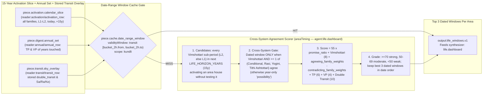

---

## Page 20 of 21 — `life.mahadasha_charter`: Remaining Largest Mahadasha (10–18+ Yrs) and Antardasha Life Charter

| Field | Value |
|---|---|
| **Technique ID / Title** | `life.mahadasha_charter` — Remaining largest Mahadasha (10-18+ yrs) and Antardasha life charter |
| **Category / Board / Status** | `general` · `timeline` · `built` |
| **Charts Declared** | `natal:{digest.house,digest.planet,digest.yoga}`, `divisional:{D9,owning varga}`, `dasha:kundli_activation`, `annual:digest.annual`, `transit:transit_snapshot.double_transit` |
| **Selectors** | `boards: ['timeline']`, `houses: [1..12]`, `vargas: ['D1'..'D30']` |
| **Reader Pieces** | `reader:house/house_card` · `reader:planet/planet_card` · `reader:yoga/yoga_row` · `reader:activation/activation_row` · `reader:annual/annual_row` · `reader:transit/transit_row` |
| **Agent Piece** | `agent:life.dashboard` (`buildMahadashaCharter`, `kind: 'code'`, `system: 'none'`) |
| **Output Piece / Synthesizer** | `output:life_charter.v1` · feeds `life.dashboard` |
| **Date-Range Window Cache** | `freshness: 'transit'` (`2h` window) · `scope: 'kundli'` |
| **Env Config (`src/config/env.ts`)** | `LIFE_CHARTER_MIN_REMAINING_YEARS=10`, `LIFE_CHARTER_HORIZON_YEARS=20`, `LIFE_CHARTER_MAX_AREAS_PER_AD=3` |
| **Code & Source** | `src/reading/life/charter.ts buildMahadashaCharter` (`docs/reading-engine/34 §3–§5; 55 §4`) |

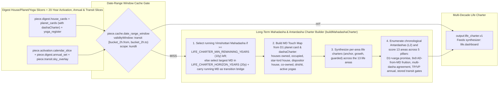

---

## Page 21 of 21 — `life.dashboard`: Your Life at a Glance and Long-Term Mahadasha Charter

| Field | Value |
|---|---|
| **Technique ID / Title** | `life.dashboard` — Your life at a glance and long-term Mahadasha charter |
| **Category / Board / Status** | `general` · `timeline` · `built` |
| **Charts Declared** | `natal:{digest.house,digest.planet,digest.yoga}`, `divisional:{D9,owning varga}`, `dasha:kundli_activation`, `annual:digest.annual`, `transit:transit_snapshot.double_transit` |
| **Selectors** | `boards: ['timeline']`, `houses: [1..12]`, `vargas: ['D1'..'D30']` |
| **Reader Pieces** | `reader:house/house_card` · `reader:planet/planet_card` · `reader:yoga/yoga_row` · `reader:activation/activation_row` · `reader:annual/annual_row` · `reader:transit/transit_row` (consumes `life.promise_scale`, `life.timing_agreement`, `life.mahadasha_charter`) |
| **Agent Piece** | `agent:life.dashboard` (`composeDashboard`, `getLifeReading`, `kind: 'code'`, `system: 'none'`) |
| **Output Piece** | `output:life_reading.v2` (stored per kundli per day in `area_builds` with `area = 'life'` and in `technique_outputs`) |
| **Date-Range Window Cache** | `freshness: 'transit'` (`2h` window) + `area_builds` daily cache · `scope: 'kundli'` |
| **Code & Source** | `src/reading/life/compose.ts composeDashboard; service.ts getLifeReading` (`docs/reading-engine/34 §1, §5 Part 1; 54 §4; 55 §4`) |

```mermaid
flowchart LR
    subgraph Upstream["3 Deterministic Life Sub-Techniques + Companion Memory (person_facts)"]
        L_PROM["life.promise_scale (life_promise.v1)"]
        L_TIME["life.timing_agreement (life_windows.v1)"]
        L_CHAR["life.mahadasha_charter (life_charter.v1)"]
        FACTS["person_facts: work.status, love.status, family.children"]
    end

    subgraph CacheGate["Date-Range Window Cache Gate + area_builds(area='life')"]
        GATE{"piece.cache.date_range_window<br/>validityWindow: transit [bucket_2h.from, bucket_2h.to)<br/>+ area_builds daily store (scope: kundli)"}
    end

    subgraph Composer["Life Dashboard Composer (composeDashboard — Zero AI / Template Sentences Only)"]
        D1["1. Digest Gate: if digest_status != 'ready', return 'preparing' and queue kundli-digest"]
        D2["2. Filter active areas: show area ONLY when it has a current pressure or a dated window"]
        D3["3. Compose per-area cards:<br/>- Issue: heaviest current test line with end date + 1 confirming question from person_facts<br/>- Cause: current test planets + withholding planets + running periods<br/>- Solution: 2 practical steps, date to hold until, best window to act in, strongest benefic weekday/gesture"]
        D4["4. Compose 'Rule for Now' (hold-and-prepare vs act-on-what-is-ready) + Mahadasha Charter cards"]
        D1 --> D2 --> D3 --> D4
    end

    subgraph Output["Complete Life Reading Dashboard"]
        OUT["output:life_reading.v2<br/>Rendered on Profile -> Timeline screen"]
    end

    L_PROM & L_TIME & L_CHAR & FACTS --> GATE
    GATE -->|"HIT (status: cached/skipped)"| OUT
    GATE -->|"MISS"| D1
    D4 --> OUT
```
