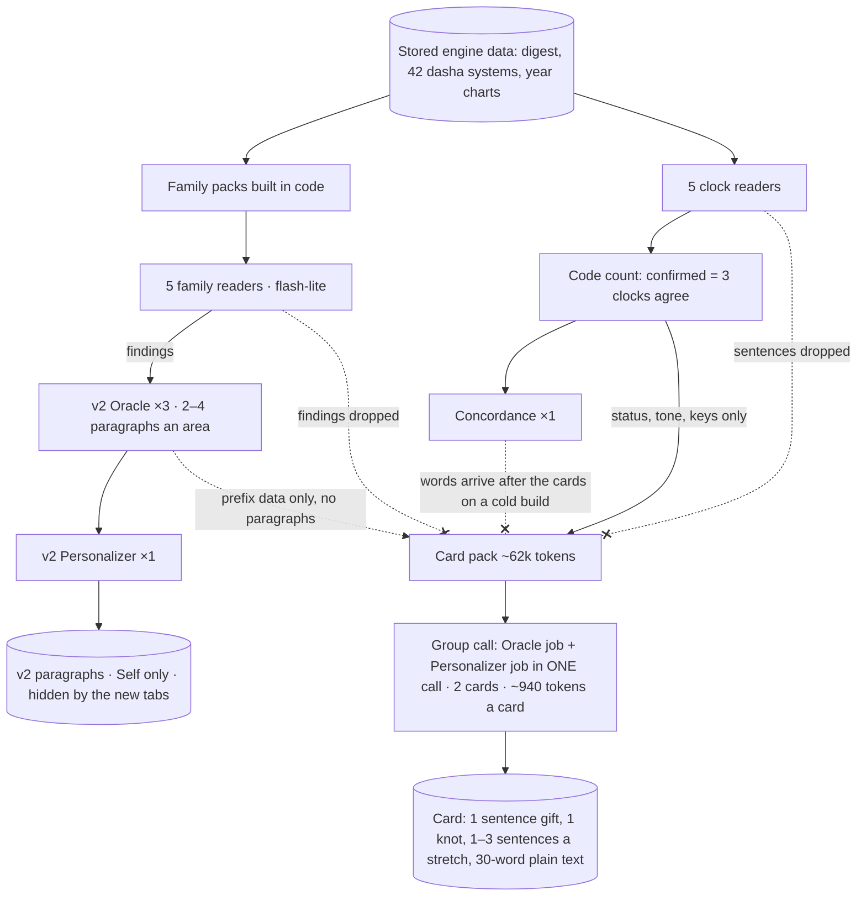
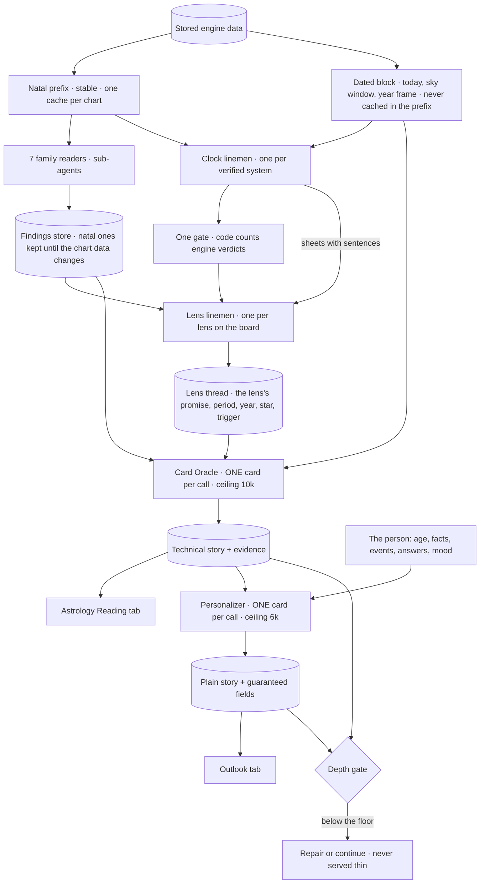

# 09 · The reading comes first: one deep story per card, a guarded pipeline, and rules that stop it being cut again

Written 2026-11-19, revision 2, approved by Sachin the same day. Revision 1 (commit `546e822`) had eight labelled
steps; Sachin rejected them. It builds on doc 07 (`docs/techniques/07-one-evidence-chain-for-every-reading.md`), whose
five decisions are taken at their defaults. The rules it adds are in `SOUL.md` §5, `AGENTS.md` ("Reading depth is a
release gate") and `CLAUDE.md`.

## Context

- The reading shown on a card today is one paragraph: one sentence of gift, one of knot, 1–3 sentences for one stretch.
  The prompt claims "40+ dasha systems"; the card is given five.
- It got that thin in five steps between 9 and 18 Nov 2026, each for a speed or cost target (docs 68, 70, 71, 86 and the
  doc 70 replay). No rule forbade it and no test measured depth. The side-by-side check doc 71 required has no record.
- A second loss was in the web: the new tabs hid the long reading behind a condition that is never true, and removed "?".
- Sachin's direction (2026-11-19): output limits must never fail the app or thin the reading; SOUL.md and AGENTS.md must
  forbid any agent trading the reading for cost or speed; the reading is one grounded, progressive story that opens with
  the maha dasha and relates it to the sub-period, the Tithi Pravesha year, the Moon, D9 and the card's own divisional
  chart and the other dasha systems; the plan must state how every technique executes, how data and context are cached,
  how each agent's output flows up, what the Personalizer is guaranteed to write, and each agent's time and tokens.

**Decisions taken (Sachin, 2026-11-19)**

| # | Decision |
|---|---|
| 1 | Two tellings of one story. The Oracle writes the technical story, naming placements (chart, house, sign, star): Astrology Reading tab. The Personalizer retells it in the same order in plain words, as the astrologer: Outlook tab. No section headings in either. |
| 2 | Only verified systems are shown and counted, and only those that apply to the person's chart. "Verified" today means not flagged by the research; the engine reference test runs afterwards and removes any that fail. |
| 3 | The Personalizer is optimistic and growth-led; it never hides a heavy stretch and never exceeds the Oracle's confidence. |
| 4 | The quota pays for the re-read. Everyone refreshes their dashboards after the release. No free re-read. |
| 5 | The Personalizer gets the age in years (never prints it). The Personalize wizard also uses age and known facts to suggest which cards apply. |
| 6 | Doc 07's five decisions at their defaults (age-36 rule kept as a house rule; year D1 before year D9; one gate; nakshatra rules on planets and star dashas, not Narayana; Vimshottari from the Moon). |
| 7 | Output ceiling 10,000 tokens per Oracle call, one card per call, cards written in parallel. |
| 8 | Naming (2026-11-19): wherever the product refers to its own reading as "the systems", "systems read" or "timing systems", the words shown to the person are "AdAstra AI": "How AdAstra AI read it", "AdAstra AI read", "On 5 of 7 timing views, AdAstra AI reads this stretch as mixed". Applies to the web, the served sentences and the Personalizer prompt. |

## 1. Start (checked 2026-11-19: server `develop` `dd1dad5`, live Lambda env, `agent_runs` of the last 4 days)

**Live flags:** `SELF_V2_BUILD=1`, `SELF_V3_BUILD=1`, `READING_CLOCK_LAYER=1`, `CARDS_GROUP_PACK=1`, `BOARDS_V3=love,work`,
`READING_EXPLICIT_CACHE=1`. Oracle model `gemini-3.8-flash`; reader model `gemini-3.1-flash-lite`. No cap overrides.

**Measured per call** (successful runs only):

| Agent | Model | Input tokens (cached) | Output | Time | Cost |
|---|---|---|---|---|---|
| family readers ×5 | 3.1-flash-lite | 1.5k–9k; `family.year` 203k–305k | 270–1,150 + ~650 thinking | 3–7 s | $0.002–0.006 |
| v2 Oracle ×3 | 3.8-flash | 20k–43k (18k) | 3,750 avg, 4,716 max | 32 s avg, 42 s max | $0.02 |
| v2 Personalizer ×1 | 3.8-flash | 13k (11k) | 5,855 avg, 6,603 max | 48 s avg, 55 s max | $0.024 |
| clock readers ×5 | 3.8-flash | 48k (43k) | 1,512 | 17 s avg, 31 s max | $0.012 |
| concordance ×1 | 3.8-flash | 45k (43k) | 630 | 9 s | $0.007 |
| card group call (2 cards) | 3.8-flash | 59k (57k) | 1,357 | 16 s avg, 31 s max | $0.011 |

Writing speed is 85–120 output tokens a second. Price fitted from these rows: input about $0.75, cached input $0.075,
output $3.50 per million tokens. None of the "failed" rows were length or validation failures (cache hits and one
prepayment outage).

**What flows where today (the "before" picture)**

- A cold Self board is 21 model calls (worst case 29). Four upstream outputs are paid for and never reach a card.
- `lineman.self`, `lineman.love`, `lineman.work` exist (prompt `readers/R15-self`) but do not run on the live path.
- The shared prefix carries today's date, so every clock sheet and card key misses on a later day: the whole reading is
  bought again each day the board is rebuilt.
- A document cut at its output cap is discarded (v2 Oracle, clock sheet) or fails its whole group (cards).
- Self cards get no technique rows (`cardTechniques()` returns `[]`); on the grouped path no card gets a chart-routing
  line or a retrograde signal (`cards/group.ts:126-133` passes neither).
- The pack has no houses counted from the Moon. Node may not count them; the model may read them from the signs.

**Systems that pass decision 2 for the test chart** (`dasha.applicable`: only Dwisaptati applies of nine conditional):

| Shown and counted | Why |
|---|---|
| Vimshottari (all levels) | lead clock; not flagged |
| Narayana, maha dasha level only | its flag is on sub-periods; my judgement, removed if the reference test fails |
| Sudasa | not flagged; Rath's clock for pay and standing |
| Lagna Kendradi | matches the reference by code reading; low weight |
| The conditional dasha that applies (here Dwisaptati) | condition checked by the engine |
| Patyayini (in-year) | verified by a run |
| Tithi Pravesha year chart | year lagna, houses, year lord once named (engine E3) |

Never shown: Yogini, Chara, Drig, Trikona, Mandooka, Tara, Naisargika, Mudda (flagged); Shoola, Sthira, Brahma, Niryana
Shoola, Navamsa, Aayu (longevity); any conditional dasha that does not apply; unchecked ones (Shodashottari,
Shat-trimsha). The floor that keeps a board from blanking: Vimshottari, one sign dasha and the year.

## 2. End goal

- Every card on every dashboard and lens carries **one technical story of 700–1,400 words** and **one plain story of
  350–700 words**, both in this order: the maha dasha; its sub-period; the Tithi Pravesha year (this year, and one line
  on last year); the same from the Moon; D9 and the card's own divisional chart; the other verified systems and where
  they overlap; the trigger; the verdict and what would change it.
- The technique differs by lens, in the order the Rath research gives for that lens.
- Nothing a model writes for the reader is dropped on the way up, and nothing served is hidden by the web.
- A limit never shortens or discards a reading: a call that reaches its ceiling is continued; a build that reaches its
  spend cap finishes the remaining cards in the next round.
- Rules in SOUL.md, AGENTS.md and CLAUDE.md, plus tests, make a thinner reading a failed build.
- Limits: first card readable within 120 s of a cold open, the whole board within 180 s, reopening costs no model call.

## 3. The pipeline after the change

### 3.1 Each agent: what it consumes, writes, and is allotted

| Layer | Agent (count) | Model · thinking | Consumes | Writes | Input tokens | Output ceiling (expected) | Timeout | Est. cost each |
|---|---|---|---|---|---|---|---|---|
| Sub-agents | Family readers ×7: `family.rasi` (from the lagna), `family.moon` (new: from the Moon), `family.varga` (D9 + routed charts, all houses), `family.star` (new: star, star lord, pada, tara per planet), `family.dasha` (verified systems only), `family.year` (this and last Tithi Pravesha year: D1 houses, D9, routed year chart; trimmed from 203k to about 15k), `family.sky` | 3.1-flash-lite · medium | its family pack (code, from stored engine data) | keyed findings in chart language, each bullet citing `{key}` | 2k–15k, cached | 6,000 (800–2,000) | 60 s | $0.003 |
| Linemen of time | Clock linemen ×3–7 (one per verified system; today's clock readers) | 3.8-flash · low | natal prefix + dated block + that system's rows | a sheet: per stretch and matter, tone, a sentence, strength, keys. Star dashas judged by the lord, sign dashas by the sign | 48k (43k cached) | 8,192 (1.5k–2.5k) | 60 s | $0.012 |
| Linemen of subject | Lens linemen ×1–5 (one per lens with cards on the board; revives `lineman.*`) | 3.8-flash · medium | natal prefix; the seven findings; the clock sheets **with their sentences**; the gate's statuses; the lens recipe | the lens thread: for this lens's subject, promise → period → year → star → trigger, each with keys and source tags | 45k cached + ~14k | 10,000 (2.5k–4k) | 90 s | $0.03 |
| Oracle | Card Oracle ×N (one per card, all in parallel, `CARDS_BOARD_PARALLEL` 8 → 12) | 3.8-flash · low (env `READING_MODEL_ORACLE` can raise it) | natal prefix; dated block; its lens thread; the findings it cites; the card brief; the card's matter rows; the person's confirm answers | the technical story, its beat index, headline, stretches, gift, knot, confirm, certainty, evidence | 62k cached + ~6k | **10,000** (3k–6k) | 150 s | $0.02–0.03 |
| Personalizer | Card Personalizer ×N (one per card, in parallel, starts as each Oracle card lands) | 3.8-flash · low | that card's Oracle object; the person (age in years, life stage, facts, events with dates, answers, mood, declined topics); the portrait | the plain story and the guaranteed fields (§3.3) | ~8k | **6,000** (1.5k–2.5k) | 90 s | $0.012–0.015 |

- **Retired once the depth gate passes on the new cards:** the v2 Oracle ×3, the v2 Personalizer, the concordance call
  and the group call. Their work moves into the lens linemen and the per-card calls. The Self hero line is written by
  the Personalizer of the `diagnosis` card.
- **Totals (estimate, measured before release):** cold Self board of 11 cards: 7 + 6 + 3 + 11 + 11 = 38 calls, about
  $0.65, first card at about 100 s, all cards by about 150 s. A Love or Work lens refresh of 5 cards: about $0.35,
  about 110 s. Same-day reopen: 0 calls.

### 3.2 Caching: data, context and results

| What | Where | Key | Lives until |
|---|---|---|---|
| Engine data and digest | `kundli_data`, `kundli_digest`, `kundli_activation` | chart, calc version | the engine data changes |
| Natal prefix (D1 from the lagna and the Moon, D9, routed charts, star lines, promise ledger) | Gemini explicit cache, warmed once per build with `ensurePromptCache` (`llm/promptCache.ts`) | model + system + text; **no date in it** | 30 min, extended on use; deleted after the build |
| Dated block (today, sky window, year frame) | second part of each request, not cached | — | per call |
| Family findings | `reading_findings_cache` (exists) | pack hash + prompt version | natal: the chart data changes; dated: the shortest cited period ends |
| Clock sheets | `technique_outputs` `reading.clock.sheet` | system + frame + prefix + prompt; **as-of day removed** | the earliest edge of a cited period |
| Lens thread | `technique_outputs` `reading.lens.thread` (new technique id) | lens + sheet hashes + findings hashes + recipe hash | same |
| Card Oracle story | `technique_outputs` `self.card.reading` | card + lens thread hash + matters + confirm stamp + prompt hashes | "Good until": the earliest of the cited sub-period end, the year end, the cited transit date |
| Personalizer output | same row, `face` part | Oracle key + person hash + portrait hash | the Oracle story or the person changes |

- Self cards follow the same offline-first rule as Love and Work: a card is re-read when its "Good until" passes or the
  person refreshes (charged). The daily build keeps only the short "right now" line. Otherwise the deep reading would
  be bought every day.
- A confirm tap re-runs that card's Personalizer only (about $0.013), not the chart reading.

### 3.3 What the Personalizer is guaranteed to prepare

Required on every card; a card missing any of them goes to one repair, then to the fallback:

| Field | Guarantee |
|---|---|
| `story` | 350–700 words, the Oracle's story retold in the same order, in the astrologer's voice, for this person's stage of life. No chart term. Every date is one the Oracle gave. |
| `line` | one sentence with a date |
| per stretch: `asks`, `step`, `growth` | what the stretch asks, one "If …, then …" step, what it is building in the person |
| `why` | why this holds for this person, worded to the Oracle's confidence |
| `ladder` | four steps, always (SOUL.md §3 requires four tiers; today it is off by default) |
| `confirm` | the Oracle's past question as one yes/no question, whenever the Oracle gave one |

Confidence wording follows the gate: confirmed → stated with dates; leaning → "the signs lean toward"; open → what
would bring it, asked; contested → both sides; not promised → never timed. **Fallback:** if the Personalizer fails
twice, the card is served with the Oracle's headline and technical story, "The plain reading is being written", and the
Personalizer is queued again. A card is never blank and never thin.

### 3.4 What the Oracle is guaranteed to write

- `story`: 700–1,400 words, continuous, in the fixed order of §2. Every period is named with its system. Placements are
  named. Where the research has no rule for a lens (Friendships, Craft & hobby timing) it says so and does not fill it.
- `beats[]`: an index, not shown: for each of the nine beats, `held` (yes / partly / no / na), the systems used and the
  evidence keys. The depth gate reads this.
- Today's fields stay: headline, stretches, gift, knot, confirm, certainty, evidence.

### 3.5 Limits that cannot thin the reading

| Limit | Today | New | When reached |
|---|---|---|---|
| Card Oracle output | ~1,000 planned a card | 10,000 a call | the call is continued from where it stopped; nothing is discarded |
| Personalizer output | 4,096 | 6,000 a call | continued |
| Lens lineman / clock lineman / family reader | — / 8,192 / 4,000 | 10,000 / 8,192 / 6,000 | continued; a cut finding is no longer thrown away |
| Spend per board build | $0.45 (`READING_SPEND_CAP_USD`) | **$1.50** (new `READING_BOARD_SPEND_CAP_USD`); chat answers stay $0.45 | remaining cards are read in the next round; never written shorter |
| Spend per card | — | $0.12 safety stop | the card shows "still being read" and is retried |
| Time | cold build under 30 s (AGENTS.md) | first card 120 s, board 180 s, with stage and card-by-card progress | cards appear as they finish |

## 4. Technique fixes (each active technique against the research)

Fixed in the server and prompts now (no engine change):

| Technique | Today | Fix |
|---|---|---|
| Card Oracle prompt | "40+ systems"; one sentence each | the story contract; systems named; the claim removed |
| Chart routing (`renderActiveTimingAndVargaBlock`) | Self ids only; Love/Work fall to D1+D9; nothing on the grouped path | one table for all 90 cards (`cards/routing.ts`, doc 08) |
| Love chart | D7 as the Love chart; "D11 proxy"; "A5 from AL" for friends | romance: 5th, Venus, D9, A7; friends: 11th from lagna and AL; D7 only for children; A5 removed |
| Clock set | Vimshottari, Karaka, Yogini, Tithi Ashtottari, Narayana, all equal | the verified set of §1 by lens; Sudasa added for Work; Yogini, Chara, Karaka out |
| Star layer | cusp stars; tara by a regex in Node | `family.star` reads the stored star data; the regex is removed; tara rule only inside a malefic's period (PD 20.23); the star-lord rule tagged as commentary |
| Year layer | no year houses on a card; briefs ask for a year D10 the pack lacks | year D1 houses and the routed year chart in `family.year`; read after the birth chart, never alone |
| Jupiter's aspect as protection | cited as a rule | no source: removed from the protection layer |
| Period judged | lord only, system not named | star dasha: lord from the lagna (owner, seat, dignity, navamsa, links), then its star; sign dasha: the sign, its occupants, its lord, from the arudhas; sub-period by its house from the maha dasha lord |
| From the Moon | absent | `family.moon` reads houses from the Moon's sign (the model reads; Node does not count) |
| Lens recipes | none | 13 recipe files from the Rath research with source tags and keep-out lists |
| Briefs | 18 Self, 6 Love, 6 Work briefs name no divisional chart; some name charts the pack lacks | each brief names its routed charts; a unit test fails a brief that names a chart the pack does not carry |

Needs the engine (doc 07 E-list, own releases): the reference test and fixes (E1, E2); year lord and hora lord names
(E3); tara and star lord per chart (E4); Narayana on D9 and D10 (E5); `d1_d9`, `vargottama`, `houses_activated` so the
Node verdicts in `dashaAssessment.ts`, `career.ts` and `houseLayers.ts` can be deleted (E6); houses from the Moon as an
engine field (new, E10); the one gate replacing the four counts (doc 07 step 9).

## 5. The process and rules so this cannot happen again

**Text added on approval** (2026-11-19; the live wording is in the files themselves):

*SOUL.md, new §5 "The reading comes first":*
> The astrological reading is the product. No agent, prompt, limit or layout may shorten it, summarise it away, drop a
> chart, a dasha system, the year chart or a divisional chart from it, or hide it from the person, in order to save
> cost, tokens or time. When a limit is reached the reading is continued or queued, never cut. Every card carries the
> full technical story and the full plain story. A change that reduces what a card reads or shows is made only with
> Sachin's written yes and the depth replay table beside it.

*AGENTS.md, new section "Reading depth is a release gate"* (and line 169's "cold build < 30 s" is replaced by the
budgets of §3.5; the 10 s interactive deadline stays for chat only):
> 1. Depth floor: every stored card has a technical story of at least 700 words that cites, by evidence key, the maha
>    dasha and sub-period with their system, the year chart, D9, the card's own divisional chart and at least two
>    verified dasha systems; and a plain story of at least 350 words. A card below the floor is repaired, not served.
> 2. Nothing is dropped upward: each agent's output is either read by the next layer or deleted from the pipeline. An
>    agent whose output no one reads is a bug.
> 3. Nothing served is hidden: every reading field the API serves has a place on screen, and a test proves it.
> 4. A limit never discards: MAX_TOKENS continues; a spend cap queues.
> 5. Any change that lowers an output ceiling, shortens a prompt contract, merges model calls, removes a layer or hides
>    a field must include the depth replay (old against new on the test charts: words, charts cited, systems cited) and
>    Sachin's yes. Speed and cost targets are met by caching, parallel calls and validity windows, never by depth.
> 6. Plans state per-agent input, output and time allotments, as doc 09 does.

*CLAUDE.md, one bullet:* "**The reading is never cut for cost or speed.** See 'Reading depth is a release gate' in
`AGENTS.md` and §5 of `SOUL.md`."

**Enforcement in code and CI:**
- `tests/unit/reading/depthFloor.test.ts`: the floor of rule 1 on fixture cards; also run by the store before a card is
  marked ready (counts words and evidence-key kinds; no word lists).
- `tests/unit/reading/noDroppedOutputs.test.ts`: every agent id in the build has a consumer registered in one table.
- Web `tests/servedFieldsRendered.test.tsx`: a fixture card with every served reading field; each text is found in a tab.
- `scripts/depth-replay.ts`: prints the old-against-new table from stored rows; no paid call.
- `agent_runs` gains nothing new; the depth numbers are read from stored cards by the admin research page.

## 6. API and screens

- No new endpoint. Each served card gains `v3.story` (technical), `v3.plain.story`, `v3.spans[].growth`; `v3.thread` of
  revision 1 is dropped. The technical story is served under the existing `feature.why_panel` grant.
- **Outlook:** headline, then the plain story, then toolbar icons for the short sections (Why and What to do; Key dates;
  How the systems read it; The ladder; The gift and the knot). "Is this right?" stays pinned. "?" opens the story.
- **Astrology Reading:** the technical story as continuous text, and under it a small list of the verified systems used.
- **Refresh notice** on every board after the release: "A deeper reading is ready. Refresh uses 1 of your questions."
- **Personalize wizard:** suggests cards from age and known facts (`suggested` flag already in `self/v3/types.ts:87`).
- Phone layout unchanged until approved.
- **Self header line** (retire-v2 step 4): GET /api/self/v3 serves `headerLine: string | null`, the `diagnosis` card's
  plain `line` (redacted as served); null when that card is off, locked, unread or its plain reading is pending. The
  key is always present (`null`, never omitted); it is absent only on a body from a server that predates the field.
- **Two "Good until" dates:** each card's `v3.goodUntil` stays per card; the Self board chip's `refresh.validUntil`
  (SELF_BOARD_FROM_CARDS) is the earliest per-card Good until across the shown deck (a card with none counts by its
  stored row's last good day), so the chip never claims a later day than any card on the board.

## 7. Files

- New (server): `src/reading/cards/routing.ts`, `cards/story.ts` (schema, depth gate, continue-on-cut), `clocks/systems.ts`,
  `reading/lens/lineman.ts`, `prompts/cards/threads/*.md` (13), `prompts/family/moon.md`, `prompts/family/star.md`,
  `scripts/depth-replay.ts`, the three tests of §5.
- Changed (server): `self/v2/build.ts` (families feed the store; v2 retired behind the gate), `self/v3/build.ts`,
  `cards/run.ts`, `cards/oracle.ts`, `cards/store.ts`, `clocks/reader.ts`, `clocks/run.ts`, `clocks/layerCache.ts`
  (as-of day out of the key), `slices/render.ts` (dated block split from the natal prefix), `self/v3/personalizer.ts`,
  `person/profile.ts`, `llm/gemini.ts` (continue on MAX_TOKENS), `config/env.ts`, prompts `cards/oracle.md`,
  `personalizer/self-v3.md`, `clock/reader.md`, 90 briefs.
- Reused as they are: `runFamilyReaders` and `reading_findings_cache`; `ensurePromptCache` and the cache lease;
  `readOneClock`; the `lineman.*` registry rows; `readCardOracle` (the one-card path already exists);
  `runPersonalizerV3`; `withTechniqueOutput`; `lensValidity.ts`; `techniqueStamp`; `redactEngineText`.
- Web (`feat/board-polish`): `OutlookView.tsx`, `AstrologyView.tsx`, `CardFrame.tsx`, `lib/selfV3Api.ts`.
- Docs: doc 09 rewritten to this plan; doc 08 routing table; SOUL.md, AGENTS.md, CLAUDE.md text of §5.

## 8. Steps after approval

0. Tell the web agent on `feat/board-polish` to keep the Outlook toolbar, "?" and the full reading, and to render one
   continuous story instead of eight steps.
1. Add the §5 rules to SOUL.md, AGENTS.md, CLAUDE.md; rewrite doc 09; put the research (`75bc0a0`) and docs 07, 09 on `develop`.
2. Depth tests and `depth-replay.ts` first, failing on today's cards (the baseline table is filed in `docs/`).
3. Doc 08 routing table and the 13 lens recipes; `cards/routing.ts`; brief coverage test.
4. Split the natal prefix from the dated block; take the as-of day out of the sheet and layer keys.
5. `clocks/systems.ts` (the verified set); clock linemen keep their sentences; check the engine's pressure rows exist
   for Sudasa, Lagna Kendradi and Patyayini (if not, file the engine request and use the stored period rows).
6. Family readers: add `family.moon` and `family.star`, trim `family.year`, store all findings for the linemen.
7. Lens linemen (`reading/lens/lineman.ts`) and the lens thread store.
8. Card Oracle: one card per call, the story contract, continue-on-cut, the depth gate before "ready".
9. Personalizer: one per card, the guaranteed fields, the new voice, age in years, the fallback.
10. Caps and budgets in `config/env.ts`; the refresh notice; Self cards offline-first.
11. Web: the two stories, the served-fields test, screenshots.
12. **One paid measured build** on staging after Sachin's separate yes (live key; one You board of 11 cards and one Love
    lens of 5: about 55 calls, estimated $1.00; time and cost read from `agent_runs`).
13. Depth replay old against new; retire the v2 Oracle, v2 Personalizer, concordance and group call when it passes.
14. Release server then web through `develop` → `release-candidate-staging`; engine phase follows doc 07.

## Verification

- Server: `npx tsc --noEmit`; `npx vitest run tests/unit/reading`; the three new tests green; `depth-replay.ts` table.
- Web: `npx tsc --noEmit -p tsconfig.app.json`; `npm run test:run`; `e2e/board-outlook.spec.ts`, `e2e/phone-card-v2.spec.ts`.
- Staging (step 12): a Marriage card and a Your job card each carry a technical story over 700 words that opens with the
  maha dasha, names each system, cites the year chart, D9 and its own chart, and differ by recipe; each has a plain
  story over 350 words in the same order; first card within 120 s, board within 180 s, build under $1.50; a second open
  the same day makes no model call.
