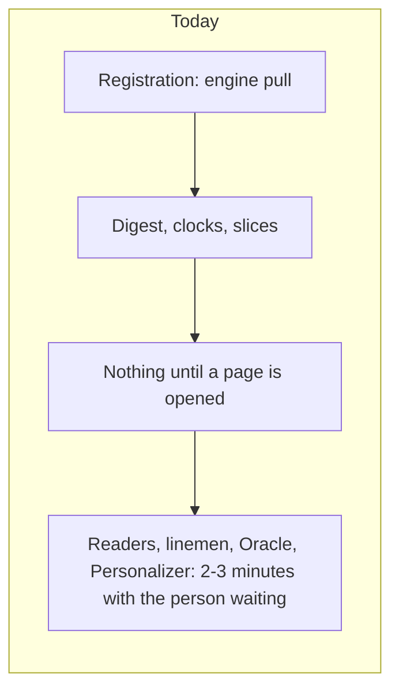
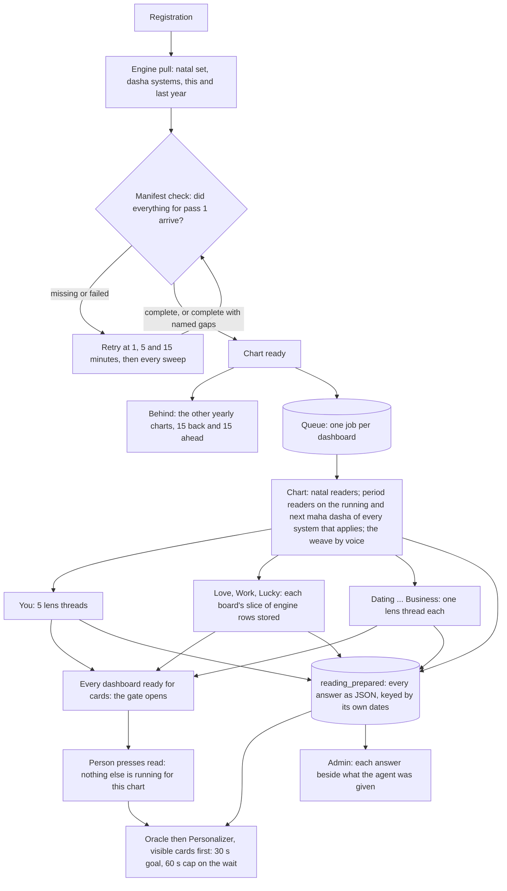

# 11 · The reading prepared ahead (rev 4): one status from registration to ready, a queue the dashboards work through, the current and the next maha dasha first

Rev 4 written 2026-11-22, after Sachin's five refinements and his approval to start the build. Rev 3 is `2708eb5`;
rev 1 is `ebc2316`; rev 2 is `f0cb9b5` and `0aa9525`.

**What rev 4 changes from rev 3** (three read-only checks on `develop` `2708eb5`, web `819dba3` and the research)

| # | Change | From |
|---|---|---|
| 1 | **The disk guard is removed**, from this plan and from the code (§1, §4.5, §8 step 2b) | Sachin |
| 2 | **Everything the v2 build supplied has a named supplier** that the preparation build calls directly (§4.9). v2 is still what runs today; three things would have had no supplier once it is switched off | Sachin; code check |
| 3 | **The shared-data method is corrected in eight places** (§4.5): the Love and Work house layers are astrology worked out in Node and are not stored or given to the linemen; only four of the seven shared readers are once per chart; the natal context is split into a core with no date and a dated frame; each reader has its own prompt file and hash; neutral readers answer house by house; a lineman in preparation reads its lens's whole card list; nothing is run at card time; every job claim is one statement | code check |
| 4 | **The confirmation rule is restated as steps in order** (doc 12 rev 2): the pair of Vimshottari and the sign dasha confirms; the year chart places; nothing else raises a status | research check |
| 5 | **Nothing starts a reading while the chart is being prepared** (§4.8): one gate inside the queue functions; the refresh and card-read controls are disabled with "Building your chart data" | Sachin |
| 6 | One milestone, **every dashboard ready** (about 5:55, estimate), replaces "You ready first"; all 13 lens threads run together after the weave. The queue pause for a card request and "the build runs the missing job itself" are gone: the gate makes them unnecessary | follows from 5 |
| 7 | **Key-moving changes live on the preparation path only**, under new unit names, behind `READING_PREP`. The live prefix stays byte for byte (`natalPrefixPin`), so no stored reading is bought again while paid calls are off | follows from 3 |
| 8 | **Helpers, disruptors and waiting strength** in every reading (doc 13; §4.10) | Sachin, 22 Nov |

**What rev 3 changed from rev 2**

| # | Change | From |
|---|---|---|
| 1 | Pass 1 reads the **current and the next maha dasha** of every dasha system **that applies to the person** (33 on the test chart, not 41), judged by the confirmation rule of doc 12 | Sachin; doc 12 |
| 2 | The target for a new person is **3 to 5 minutes** from signup to "You is ready for cards". Calls run side by side to reach it | Sachin |
| 3 | The Oracle and Personalizer have a **30-second goal and a 60-second hard cap on the wait**, per dashboard, and nothing else runs for that chart while they work | Sachin |
| 4 | No reading is written before cards are chosen (starter cards: no) | Sachin |
| 5 | Everything a sub-agent reads is cached for the request, and **all caches are taken down together when the request completes** | Sachin |
| 6 | The year passes stay **switched off** | Sachin |
| 7 | **No paid call and no paid test** is in the sequence. The work is built and checked with fakes, dry runs and free measurements | Sachin |
| 8 | Shared and dashboard-specific results are stored separately, and each technique records which upstream results it used and where they are (§4.5) | Sachin |
| 10 | **Level 4 is no longer waited for** in pass 1; it is added when its rows arrive (open point G) | needed for the 3–5 minutes; Sachin to confirm |
| 9 | The index rebuild is done: the database went from 532 MB to 294 MB (`docs/db-maintenance/`) | Sachin's yes |

Nothing in doc 09 is removed: every agent that runs today still runs and writes at least what it writes today.
Doc 10's budget ledger, deadline per read, `reading_units` record and 25-run gate are kept and required by this plan.

## Decisions

| # | Decision | Status |
|---|---|---|
| 1 | **Read all that apply; the pair confirms.** Every dasha system that applies to the person is read. Vimshottari and the sign dasha together confirm; the purpose dasha strengthens for its own subject; the year chart places; every other system is support (doc 12 rev 2 §4) | Taken 21 Nov, restated 22 Nov after the research check; approved with the rev 4 plan |
| 2 | **Preparation stops below the Oracle.** Sub-agents and linemen run after registration. The Oracle and Personalizer run when cards are chosen, visible cards first. No starter cards | Taken |
| 3 | **Current and next maha dasha first.** Year passes are designed (§4.6) and switched off | Taken |
| 4 | **A queue with a status**, dashboards in a fixed order | Taken |
| 5 | **Dashboards do not wait for the 15 + 15 yearly pull.** They start when the first pass has its data; the rest of the pull runs behind (§4.2) | Default kept; explained to Sachin |
| 6 | **Cache per request, taken down at once** when the request completes | Taken |
| 7 | **3 to 5 minutes** to the first dashboard; 30 s goal and 60 s cap for cards | Taken |
| 8 | **No paid calls for now** | Taken |
| 9 | **Nothing starts a reading while the chart is being prepared**, for all dashboards together (§4.8) | Taken 22 Nov |
| 10 | **No disk guard** | Taken 22 Nov |
| 11 | **Node-computed house layers are not stored as prepared answers and not given to the linemen.** Boards store slices of engine rows | Taken 22 Nov (approved with the rev 4 plan) |

Still open, each with the default being built. A to G were not answered on 22 Nov; their defaults stand, unconfirmed:

| # | Open point | Default |
|---|---|---|
| A | **The 60-second cap and the depth rule.** At measured writing speed a long technical story plus its plain retelling can pass 60 s. `SOUL.md` §5 says a limit never cuts a reading | The cap is on **the wait**: at 60 s the dashboard shows every card that is finished, and a card still being written appears when it is done, at full length. Stopping the writing itself at 60 s would cut a story and needs your written yes |
| B | **Side by side, not in sequence.** Reaching 3–5 minutes means the calls inside a job run together and, once the chart job is done, the dashboards' jobs run together up to the call limit. Your earlier message said "in sequence" | Side by side. The queue order and the status per dashboard stay. `READING_PREP_PARALLEL=1` and `READING_PREP_JOBS=1` give strict sequence |
| C | Lens linemen and the Oracle read the titles of the cards on the person's board, so their answers cannot be prepared before the person chooses | **Now required, not a choice** (§4.5 fault 5): they read the lens's full card list, the same for everyone. Its depth replay needs model runs, so that check stays open until paid runs are allowed |
| D | Standing yes for preparation spend on every new chart | Built behind `READING_PREP=0`. Nothing is spent until you turn it on |
| E | Disk size before signups open | With the guard removed nothing in code stops a write when the disk is nearly full. At about 49 MB a chart roughly 95 more charts fill the 5 GB disk. Decide the disk size, or cut the rows per chart, before opening signups |
| F | **30 cents.** You set 30 seconds and 30 cents for a dashboard read. With the reading unchanged, 30 cents covers 8 cards today and 4 from January (the model's price doubles); a deck of 11 is about $0.40 today | Nothing is shortened to fit. Your choice of: a cap per card (about $0.04 today), a smaller first deck, or a higher cap for the first reading (free to the person under the 19 Nov rule). Due by 15 December |
| G | **Level 4.** You asked for the current maha dasha down to level 4. Level-4 rows come from a separate worker that runs one chart at a time, up to 10 minutes each, and has never run for three of the six charts | Pass 1 does not wait: it reads levels 1–3, the status shows "level 4 filling", and the level-4 cells are added when the rows land. Waiting for it keeps your wording exactly and puts the first dashboard at 10 minutes or more whenever two people sign up together |
| H | **Who leads the star voice.** Today the conditional dasha that applies leads (Rath's line); BPHS calls Vimshottari chief and common practice has Vimshottari lead (doc 12 rev 2 §4) | Today's behaviour is kept, as a setting: `READING_STAR_LEAD=clock` (default) or `vimshottari`. The research leans to Vimshottari; switching changes how a chart with a conditional dasha reads, so it is yours |
| I | **The gate covers all dashboards** (your words) | All. Per dashboard would open You about 15 seconds sooner and bring back the queue-pause logic |

## 1. Start (checked 2026-11-21: server `develop`, the staging database and Lambda, read only)

**Registration and the engine pull**

| Fact | Where |
|---|---|
| Registration invokes the server's own Lambda (900 s timeout) with a `kundli-sync` event. A lease on `kundlis.queue_started_at` keeps two workers off one chart. A 15-minute sweep picks up what is incomplete | `services/kundliSyncWorker.ts:1-31,166-177,384-447`; Lambda config |
| The pull is the engine catalogue: 186 natal types and 7 yearly types marked served. Each stored row has a status: ready, fetching, failed or unsupported. Up to 4 engine calls run at once, 250 ms apart | `chartData/registration.ts`; `kundli_data`; `config/env.ts:159-161` |
| For the newest chart about 180 rows landed in the first 2 minutes after signup | `kundli_data.fetched_at`, chart `e1df0fcf` |
| **The digest build takes a median of 71 seconds**; 9 in 10 finish within 163 s; the fastest took 22 s and the slowest 176 s (16 builds in the last 21 days) | CloudWatch, `digest_built` events, read 2026-11-21 |
| **There is no single status.** A chart has `queue_status`, `facts_status`, `digest_status`, `last_sync_error` and row counts worked out on request | `schema.prisma:113-128`; `services/chartStatusService.ts` |
| **"Complete" can have holes** (§4.2 explains the three on the test chart). A failed, given-up or unsupported row counts as settled, and nothing lists what is missing | `kundliSyncWorker.ts:340-348`; `chartStatusService.ts:67` |
| Yearly charts: 10 years back and 10 ahead, Tithi Pravesha and Varsha in D1, D9, D10 only, filled by a sweep at **40 engine calls a run**. That cap is ours, not the engine's | `digest/annualSet.ts:12-16`; `env.ts:1757-1760` |
| Dasha rows: 42 systems; levels 1–3 from birth to 30 years ahead; level 4 only near today, written by a separate Lambda (`aiastra-dasha-deep-worker`, 600 s) one chart at a time and only for charts someone has opened. Three of six charts have none | `digest/activation.ts:3-4`; `workers/dashaDeep.ts:12-16` |
| Six conditional dashas that do not apply to the test chart are stored anyway, for life | `dasha.applicable`; `kundli_activation` |

**The current and the next maha dasha, measured on the test chart (systems that apply only)**

| Fact | Number |
|---|---|
| Systems stored / apply / with a running maha dasha | 42 / 34 / 33 (doc 12 §2) |
| Sub-periods inside the 33 running maha dashas | 347 |
| Level-3 rows inside the running sub-periods | 354 |
| Level-4 rows inside the running level-3 periods | 372 |
| Systems with a next maha dasha stored; its sub-periods | 32; 339 |
| Next maha dashas starting within two years | 10 (Narayana 2027-10-15, Dwisaptati-sama 2028-02-16, Vimshottari 2028-03-16, Sudasa 2028-08-03 among them) |
| Pass 1 in all | about 1,510 rows, about 38,000 tokens |
| **Nothing is scoped this way today.** Cards read the next 12 months of at most 5 clocks; only the "This chapter" card reads the next maha dasha lord | `self/v3/yearFrame.ts`; `prompts/cards/threads/self.chapter.md:33` |

**Sub-agents, cache, queue, disk**

| Fact | Where |
|---|---|
| **The shared readers process the same data for every dashboard.** There is one build per chart: Love and Work queue the Self build. The 7 family readers, the clock readers, the agreement ledger and the natal context take no dashboard, lens, card or person facts as input (the one personal input is the reading clock the person chose) | `families/run.ts:66-117`; `clocks/reader.ts:289-405`; `slices/natalPrefix.ts:333`; `boards/v3Service.ts:82`; `self/sub/index.ts:109` |
| **Only four of the seven are once per chart** (rasi, moon, star, varga; kept 10 years). The dasha reader's result ends with the running sub-period, the year reader's with the Tithi Pravesha year, the sky reader's with the month. The natal context is not natal-only either: its reading frame carries running periods, windows, live transits and the year (checked 22 Nov; rev 3 said "each is stored once per chart") | `self/oracle.ts:299,359,447,451-490`; `oracle/prewarm.ts:213`; `slices/natalPrefix.ts:211-281` |
| **Their prompts are written for the Self board** ("the self, mind, and body houses"; body parts), and the natal context carries only the 12 Self area briefs. The reader prompts are strings in code, outside the prompt version hash, so editing one changes no key; an edit to any prompt file re-reads all seven | `self/oracle.ts:456,497,531-548`; `natalPrefix.ts:282-292`; `scripts/embed-prompts.mjs:30` |
| **Data that differs by dashboard:** the Love and Work house layers (Love reads houses 7, 5, 11, 2, 4, 8, 12; Work reads 10, 6, 1, 2, 11, 3, 7, 9, 12), computed in code on every build; the lens recipe and matters; the cards. The lens linemen do not read the house layers today; only the card pack does | `cards/techniques.ts:441-477`; `area/love.ts:11`; `area/work.ts:15`; `lens/lineman.ts:76-95` |
| **Those house layers are astrology worked out in Node**, against the repo's first rule: dignity by text match, score points, strong / moderate / weak grades, a confidence from counting votes, the D1/D10 split verdict, the age-36 switch | `area/houseLayers.ts:137-138,457-475,898-901`; `career.ts:241-251`; `dashaAssessment.ts:124-126` |
| **Linemen cannot run before cards are chosen today.** The build stops under 5 cards, lenses come from the picks, and the key holds the card titles, so different picks buy the thread again. A card read before its thread exists is bought again when the thread arrives | `self/v3/build.ts:261-265,378-381`; `lens/lineman.ts:128,178`; `cards/storyInputs.ts:77` |
| **v2 is still what runs.** Its retirement is built behind two flags that are off, and it is only a branch inside the v2 build: every shared step is reachable only through `runSelfV2Build` with `SELF_V2_BUILD=1` (§4.9) | `self/v2/build.ts:192,290-345`; `synthesisValidity.ts:22-24`; `config/env.ts:1195-1221` |
| **The build lock is check-then-write**, so two invocations can both build one board; the web ignores the server's build state on the refresh control and shows a 409 "building" as an error | `self/buildEvent.ts:321-329`; web `BoardV3.tsx:728`, `lib/boardRefresh.ts` |
| **Nothing records which upstream results a technique used or where they are.** `PIPELINE_CONSUMERS` lists who reads each output; a cache hit is a `cached` flag, and a family-reader hit writes no run row at all | `cards/pipeline.ts:25-45`; `techniques/outputStore.ts:192-200,397-424`; `families/run.ts:121` |
| A cache is created on its second use, lives 30 minutes from its last use, and is deleted when the whole build ends. Cache storage has no price in the code. There is no limit on calls in flight to the model; a refused call is retried once | `llm/promptCache.ts:11-61`; `llm/cacheLease.ts:73-93`; `llm/models.ts:38-49`; `llm/gemini.ts:8,242` |
| Background work runs as events the server sends itself, each with a marker row as its lease and a sweep as its retry. There is no SQS | `server.ts:143-167`; `package.json:39` |
| Every digest rebuild deletes all stored answers for the chart, and deletes and re-inserts the chart's dasha rows | `digest/build.ts:1735-1738,1768-1802` |
| **Disk after the index rebuild of 21 Nov:** 294 MB for 6 charts, about 49 MB a chart (it was 532 MB and 88 MB), on a 5 GB disk | `docs/db-maintenance/2026-11-21-kundli-activation-index-rebuild.md` |
| **The disk guard is being removed (Sachin, 22 Nov).** It was a check before bulk writes of dasha rows that refused a write past 70 % of the disk, added after the disk filled on 9 Nov. After its removal nothing in code stops such a write; the database size is shown as a number on the admin Preparation page (open point E) | `digest/diskGuard.ts`; `workers/dashaDeep.ts:276-323`; `digest/levelsBackfill.ts` |
| Card model prices (`gemini-3.8-flash`): input $0.75, cached $0.075, output $3.75 per million tokens, doubling on 1 January 2027. Measured writing speed 85–120 tokens a second | `llm/models.ts:38-56`; `agent_runs` |
| **Every model time and cost in this plan is an estimate.** They cannot be measured without paid calls, which are not allowed now | — |

## 2. End goal

- A new chart has **one status** from "registered" to "ready": what arrived from the engine, what did not, what is
  being retried.
- **3 to 5 minutes after signup every dashboard is ready for cards** (estimate: about 5:55 with today's pull and digest,
  about 4:45 with the two levers in §4.4). Until then the person can log in and look around, and no reading can be
  started: the controls say "Building your chart data".
- When the person chooses cards, the Oracle and the Personalizer are the only things running for that chart: stories on
  screen in about 30 seconds, never more than 60 seconds of waiting.
- Every reading names who helps the person, what disrupts them and which strength is waiting for its period (doc 13).
- Every dashboard technique reads the running and the next maha dasha of every dasha system that applies, and states
  how far the systems confirm one another (doc 12).
- Opening a dashboard whose stories are stored makes no model call. A refresh after new facts or answers runs only the
  Personalizer.
- A period's reading is stored against that period's own dates and is never bought twice.
- Each technique shows which upstream results it used, when each was made and where it is stored; each sub-agent
  answer can be opened beside what the agent was given.
- No rebuild or sweep deletes a stored answer that is still valid. No cache outlives its request.

## 3. Deliverable

**Server**
- Migration M56: `kundli_pipeline` (the one status row per chart), phase 1. Migration M57: `reading_prep_jobs` (the
  queue), `reading_prepared` (every stored answer), a scope key on `kundli_slices`, phase 2. Numbers re-checked when
  written; another session is on `develop`.
- `src/reading/pipeline/manifest.ts`, `pipeline/status.ts`, `pipeline/retry.ts`.
- `src/reading/prep/gate.ts` (the one check every queue door asks, §4.8), `prep/order.ts`, `prep/queue.ts`,
  `prep/dispatch.ts`, `prep/scope.ts`, `prep/requirements.ts` (what each technique needs and where it is stored),
  `prep/processors/{chart,self,board,lens,lucky}.ts`, `prep/store.ts`, `prep/cache.ts`, `prep/review.ts`.
- `src/reading/clocks/needle.ts` (the period readers and the weave), `clocks/systems.ts` (voice and tag per system),
  `self/v3/header.ts` (the hero's parts, §4.9), `reading/roles/` (helpers, disruptors, waiting strength; doc 13).
- Changed: `digest/annualSet.ts`, `services/kundliSyncWorker.ts`, `services/chartStatusService.ts`, `digest/event.ts`,
  `digest/build.ts` (scoped delete), `techniques/outputStore.ts`, `families/run.ts` and `self/oracle.ts` (on the
  preparation path: subject-neutral prompts from their own files, JSON by schema house by house, applicability from the
  engine's verdict), `slices/natalPrefix.ts` (a natal core and a dated frame beside the unchanged live prefix),
  `lens/lineman.ts` (the lens's full card list; its board's slice of engine rows), `cards/oracle.ts`, `cards/run.ts`
  (the 60-second wait, the streamed hand-off), `self/v3/build.ts`, `self/buildEvent.ts` and `boards/lensRefresh.ts`
  (the gate; a one-statement claim), `person/portrait.ts`, `llm/cacheLease.ts`, `llm/models.ts`, `config/env.ts`,
  registry and catalog rows, `cards/pipeline.ts`.
- Removed: `digest/diskGuard.ts` and its use in `workers/dashaDeep.ts`, `digest/levelsBackfill.ts` and two scripts.
- Not changed: `area/houseLayers.ts`, `cards/techniques.ts` (the card pack keeps what it reads today; §4.5 fault 1).
- Prompts: `clock/period-reader.md`, `clock/weave.md`, `family/*.md` (new, one per reader); the 13 lens recipes,
  `lens/lineman.md`, `cards/oracle.md`, the Personalizer prompt.
- Tests beside each file; `scripts/prep-replay.ts --dry` (prints every planned call with its input size and estimated
  cost and makes no call); recorded fake answers for the queue tests.

**Admin app:** one page, "Preparation". **Web:** the status line; the disabled refresh and card-read controls with
"Building your chart data" (`pages/you/v2/FreshReading.tsx`, `pages/board/v3/BoardV3.tsx`, `lib/boardRefresh.ts`,
`ReadingStamp.tsx`, `SelfBoardV2.tsx`). **Docs:** this plan, doc 12 rev 2, doc 13, the rule text of §6.

## 4. How it works when done

### 4.1 Before and after

### 4.2 Backend: one status and the manifest

- **The manifest** is a list, built in code from the engine catalogue, of everything a chart must have, and what
  needs it:

  | Item | Count | Needed for |
  |---|---|---|
  | Natal types the catalogue marks served | 186 | chat, pass 1 |
  | `dasha.applicable`; for each system that applies: level 1–3 rows, a running maha dasha with sub-periods, the next maha dasha with sub-periods | 34 systems on the test chart | pass 1 |
  | Level-4 rows under the running level-3 period | 33 | pass 1, not waited for (below) |
  | The clock set's dated rows | 4–5 | pass 1 |
  | This and last Tithi Pravesha year: the year chart in 20 divisional charts, Varsha in D1, D9, D10, the year dasha, Mudda, Patyayini, sahams, Tajaka | 28 rows a year | pass 1 |
  | The same for each other year, 15 back to 15 ahead | 28 × 29 | the year passes (off) |
  | Digest sections, activation rows, slices | — | pass 1 |

- **What "complete has holes" means today.** The code calls a chart complete when every row is *settled*, and a row
  that failed, was given up on, or that the engine could not serve counts as settled. Nothing lists them. The test
  chart is marked complete and has three:

  | Hole | What is wrong | Why nothing caught it |
  |---|---|---|
  | The `kaala` dated rows failed on 10 Nov | one clock's rows never arrived | the check only counts that four clock rows are ready; four others are, so the failed one is never asked for again |
  | Kalachakra has level 1 only | no sub-periods at all, for life | the pull row is "ready"; nobody compares what a ready row contains with what it should contain |
  | Aayu has no period from 2016-10-22 to 2027-12-13 | an 11-year hole in the stored periods, including today | the same |

  With the manifest each of these is a **named gap** in the status and on the admin page, and a failed row is retried.
- **The verdict**, per need: *complete*; *complete with named gaps*; *incomplete* (something required is missing and
  is being retried).
- Each dashboard declares which items it **requires** and which are **optional**. A required gap blocks that dashboard.
  An optional gap is named in the sub-agent's input as "not available" and never filled in. D1, D9, the star voice, the
  sign voice and the Tithi Pravesha year are required everywhere.
- **Level 4** is asked for at chart ready and **not waited for** (open point G): pass 1 reads levels 1–3 and the
  level-4 cells are added when the rows land. Waiting would put the 3–5 minutes out of reach whenever two people sign
  up together.
- **Retry:** a row that blocks pass 1 is refetched after 1, 5 and 15 minutes, then at every sweep, in place of the
  6-hour wait. After 6 failures it is given up and named.
- **Why the dashboards do not wait for the 15 + 15 yearly pull.** Pass 1 needs this year and last year: 56 rows,
  pulled inside the registration run. The other 812 rows are needed only by the year passes, which are off. The "2 to 4
  hours" of rev 2 was our own cap of 40 engine calls per sweep run, not the engine's speed. Rev 3 lifts that cap for a
  new chart: the rest is pulled behind the dashboards, nearest year first, 4 calls at a time (estimate: 10 to 20
  minutes), and the status shows it as "filling", not as missing.
- **`kundli_pipeline`** holds the result so the queue and the admin page read one row. It is recomputed from the stored
  rows at the end of every sync, digest and clock run; the rows stay the truth.
- **Stages:** `registered → pulling → checking → chart_ready → preparing → ready`, with `blocked` (a required gap) and
  `paused` (spend stop, switch off) beside them. `ready` means every dashboard's job is done, skipped or has failed for
  good; it is the stage the gate of §4.8 opens on. The rest of the yearly pull and level 4 carry on behind as
  "filling".

### 4.3 Backend: the queue and the order

- **`reading_prep_jobs`**: one row per chart, dashboard and pass, with `seq`, `priority`, `status` (waiting_data,
  queued, running, done, failed, skipped), `attempts`, `lease_until`, times, calls, cost, error, and the list of
  requirements with where each was found (§4.5). All jobs are written when the chart becomes ready.
- **Order** (from `PORTAL_DASHBOARDS`, with the shared work first):

  | # | Job | What its processor does | Runs |
  |---|---|---|---|
  | 0 | chart | natal readers; period readers; dated readers and clock readers; the weave | calls side by side |
  | 1 | self | five lens threads | side by side |
  | 2–4 | love, work, lucky | the board's slice: the engine's own rows for the board's houses and charts, picked by house number, stored per board. Nothing is graded or computed; no model call | seconds, beside job 1 |
  | 5–12 | dating, marriage, friends, allies, career_start, primary_job, hobby, business | one lens thread each | together with job 1, up to the call limit |

  Jobs 1 to 12 all start when job 0 is done. The order above is the order they are listed, claimed and shown in; since
  no card can be read until all are done (§4.8), there is no reason to hold a later dashboard back.
- **Every processor has the same four steps:** resolve its requirements (found in the store, or run now, or blocked) →
  cut its slices and store them → run its sub-agents → store each answer with its dates. A unit already stored with
  the same inputs is read, not run again. "Run now" exists in preparation only; at card time a requirement is found or
  the card waits (§4.5).
- **A job is claimed in one statement** (`UPDATE … WHERE status = 'queued' … RETURNING`), never check-then-write.
- **The wake-up** is a `reading-prep` event the server sends itself. One invocation keeps taking the next job until 10
  of its 15 minutes are used, so there is no pause between dashboards. Every answer is stored as it lands; a rerun
  resumes at the first missing unit. The 15-minute sweep requeues a job whose lease lapsed. Three attempts, then
  `failed`, shown, and the queue moves on; a failed job is tried again after 30 minutes.
- **Limits:** one preparation at a time per chart; two charts at a time (`READING_PREP_CHARTS`); at most 12 model calls
  in flight per chart (`READING_PREP_PARALLEL`); a refused call backs off and retries (new: the code has no limiter
  today).
- **Priority:** a dashboard the person has open is claimed first. No card request can arrive while the queue runs
  (§4.8), so there is no pause logic.

### 4.4 Backend: pass 1, the current and the next maha dasha

- **Scope**, selected from stored rows by date (Node computes no astrology), for every system the engine says applies:
  the running maha dasha, every sub-period inside it, levels 3 and 4 under the running sub-period; **the next maha
  dasha and its sub-periods**; the previous maha dasha in one line. About 1,510 rows on the test chart. With it: this
  and last Tithi Pravesha year and the sky, as today.
- **The natal readers** (`family.rasi`, `family.moon`, `family.star`, `family.varga`) run once per chart. On the
  preparation path their prompts are subject-neutral and they answer **house by house on a fixed schema**: all 12
  houses, the same fields for each. Code checks that every house is present (by key, never by words), so a neutral
  reader cannot quietly skip the houses a Self-first prompt used to favour. What was Self-only in the old prompts (the
  body list) moves into the You lens recipes. Whether neutral readers lose depth is checked by the depth replay when
  paid runs are allowed.
- **The period readers** (new): about 12 calls of three systems each, grouped by voice (doc 12 §3). Each returns one
  **cell per period**: the houses the engine stored, what the period brings and for which of the 12 matters, a tone,
  the evidence keys. The running and the next maha dasha get a full judgement; the closing sub-period is flagged.
- **A cell is stored against its own system, level and dates** and is not rewritten while the chart data and the prompt
  are unchanged. When a sub-period ends, the next one's cell already exists.
- **The weave** (new): three calls side by side, four matters each. It compiles all cells by voice and applies the rule
  of doc 12 §4: per matter, the status (confirmed, leaning, open, contested), which voices carry it, the support from
  the other systems reported separately, and the chapter turn when the leading voices change maha dasha together.
- **The clock readers** of today still run for the 12-month frame.
- **The lens threads:** one lineman per lens, as today (promise → period → year → star → trigger), now reading the
  cells and the weave, its lens's **whole card list and every matter** (no pick is in its key), and for Love and Work
  lenses their board's slice of engine rows. The Node-computed house layers are not given to it.

**Allotment per agent (estimates; not measurable until paid runs are allowed):**

| Agent | Calls | Model · thinking | Input tokens | Output ceiling (expected) | Timeout | Est. cost each |
|---|---|---|---|---|---|---|
| Natal readers | 4 | 3.1-flash-lite · medium | 2k–10k | 6,000 (800–2,000) | 60 s | $0.003 |
| `family.dasha`, `family.year`, `family.sky` | 3 | same | 2k–15k | 6,000 | 60 s | $0.002–0.006 |
| Period readers | about 12 | 3.8-flash · low | 45k cached + ~3k | 10,000 (about 5,000), continued when cut | 150 s | $0.025 |
| Weave | 3 | 3.8-flash · medium | 45k cached + ~40k cached | 10,000 (2k–3k) | 150 s | $0.02 |
| Clock readers | 5 | 3.8-flash · low | 48k (43k cached) | 8,192 | 60 s | $0.012 |
| Lens linemen | 13 | 3.8-flash · medium | 85k cached + ~8k | 10,000 (2.5k–4k), continued when cut | 150 s | $0.03 |

**The clock from signup (estimates, except where marked measured):**

| Step | Time | Running total |
|---|---|---|
| Natal pull, 186 types, with this and last year's 56 rows, 4 engine calls at a time | about 2 min 15 s (measured: about 180 rows in the first 2 minutes; the 56 extra are an estimate) | 2:15 |
| Digest build (it writes the dasha rows and the house cards everything below reads) | about 1 min 10 s (**measured**: median 71 s; 1 in 10 takes over 2 min 40 s) | 3:25 |
| Natal readers and period readers side by side; the clock rows are pulled beside them | about 55 s (estimate) | 4:20 |
| Weave | about 35 s (estimate) | 4:55 |
| All 13 lens threads together (12 calls in flight, then the last), the three board slices beside them | about 60 s (estimate) | **about 5:55: every dashboard ready, the gate opens** |

Rev 3 had You ready at about 5:40 and every dashboard at about 7:10. With one gate for all dashboards the lens threads
no longer queue behind each other.

- Only the pull and the digest are measured. The model steps cannot be measured without paid calls. A slow digest
  (1 in 10) adds up to 1 min 45 s.
- Nothing model-related can start before the digest: the digest build writes the dasha rows, and the natal context
  every agent reads first is cut from it. This and last year's rows are pulled with the natal set so the first digest
  already holds them (a year that completes later would mark the digest stale and build it again).
- **Where this lands against 3 to 5 minutes: about 5:55, outside.** Two levers bring it inside:
  1. **The digest is the real lever.** It is the one slow step that costs nothing to speed up. At 30 seconds the gate
     opens at about 5:15; its slow runs (up to 2 min 56 s) are filed for investigation.
  2. The lens threads can start on the cells while the weave runs and take the weave's statuses in a short second
     step: about 30 seconds saved, at one extra call per lens.
  With both, about 4:45. Three minutes is not reachable while the pull and the digest alone take over three.
- **Cost of pass 1:** about $0.85 a chart (range $0.70–1.00), stop at $1.50. Nothing is spent while `READING_PREP=0`.

### 4.5 Backend: what is shared, what is separate, and how a technique knows

| Result | Same data for every dashboard? | Stored | Key |
|---|---|---|---|
| The natal core (rasi and varga packs, the promise ledger; **no date**) and the four natal readers | **Yes, and once per chart** | once, in `reading_prepared` | chart, unit, input hash, the reader's own prompt hash |
| The dated frame, the dated readers (dasha, year, sky), clock sheets, cells, the weave | **Yes for every dashboard, but not once per chart:** each ends with its own period, year or month | once per chart **and period** | chart, unit, its own dates, input hash, prompt hash; the weave also carries who leads the star voice |
| A board's slice (You: the 12 Self area briefs; Love, Work: the engine's rows for the board's houses and charts) | **No.** Different houses and charts per board | **separately per board** | chart, board, digest version |
| Lens thread | **No.** Its recipe, matters and board slice differ | separately per lens | chart, lens, dates, input hash. No card pick |
| Oracle story, plain story | No. Per card | per card | chart, card, dates, input hash; person hash for the plain story |

**What was wrong in rev 3, and the fix (Sachin asked for this check on 22 Nov)**

| # | Fault | Fix |
|---|---|---|
| 1 | Rev 3 stored the Love and Work house layers per board and gave them to the linemen. Those layers are astrology worked out in Node (§1), which the repo's first rule forbids and which Sachin blames for wrong readings | Not stored as prepared answers, not given to the linemen. A board's slice holds engine rows only. **The card pack is unchanged:** it reads these layers today, and replacing them needs the engine fields of doc 07 E6, the depth replay and Sachin's yes. Filed P1 |
| 2 | "Stored once per chart" was true for four of the seven shared readers only, and the natal context carries dated lines | The table above: a natal core with no date; dated results stored against their own dates |
| 3 | A subject-neutral prompt would not have taken effect: reader prompts are strings in code outside the version hash, and natal findings are kept 10 years | One prompt file and one hash per reader, in its key |
| 4 | A neutral reader may go shallow, unverifiable without paid runs | The house-by-house schema of §4.4, checked in code; the depth replay on the paid list |
| 5 | Linemen cannot run before cards are chosen, and their key holds the picks | The lens's whole card list; no pick in the key (open point C, now required) |
| 6 | A card read before its thread exists is bought twice | The gate of §4.8; nothing is run at card time |
| 7 | No record of which results a technique used; a reader cache hit leaves no trace | The requirements record below; a run row on every hit |
| 8 | No limit on calls in flight; a check-then-write build lock | The limiter of §4.3; one-statement claims |

- **One rule for every key-moving change** (2, 3, 4, 5, and the portrait and hero changes of §4.9): it is made on the
  preparation path only, under new unit names (`reading.natal.core`, `reading.family.<name>`, `reading.period.cell`,
  `reading.weave`, `reading.lens.thread`), behind `READING_PREP`. The live path keeps its prefix byte for byte
  (`natalPrefixPin` test) and its stored findings, so nothing already stored is bought again while paid calls are
  off. The two paths meet when `READING_PREP` is turned on, which is a paid step and Sachin's yes.
- **Requirements (`prep/requirements.ts`).** Each technique (a lens thread, a card) declares the upstream results it
  needs. Before it runs, each requirement is resolved and recorded on the job: **found** (the unit's id, where it is
  stored, when it was made, its dates), **run now** (preparation only), or **missing**. A found result is never run
  again. At card time there are two states only: found, or the card waits.
- **The agent is told too.** The input of a lineman or the Oracle opens with the list of results it was given, by name
  and date, so its answer can cite them and the review page can show a result that was given and not used.
- **Linemen compile, in preparation.** The weave compiles every system by the steps of doc 12 §4; each lens lineman
  compiles the shared results and its board's slice into the lens thread. Both run in the queue, before any card is
  chosen.

**Slices, the store and the cache**

| What | Where | Lives until |
|---|---|---|
| Slices (what each agent is given) | `kundli_slices`, with a scope key | its rows change. Kept 30 days for review, then only the hash |
| Every answer, with the keys it was given and the keys it cited, tokens, time, cost, model, job | `reading_prepared`, JSON | its inputs change. Never deleted by a digest rebuild or a date sweep |
| Caches | Gemini explicit caches, one set per **request** | the request completes |

- **Cache rule (decision 6).** A request is one preparation run for a chart, or one dashboard's card reading. At its
  start, everything two or more of its calls will read is cached: the natal context, and for the lens threads the
  cells, the weave and the findings as a second block. **When the request completes, or fails, every cache it made is
  deleted in one step.** As a safety net each cache also expires two minutes after its last use. A block that only one
  call reads is sent as plain input. Cache storage gets a rate in the price table so its cost is recorded.
- `digest/build.ts` stops deleting every stored answer; an answer is reused only when the hash of the rows it read is
  unchanged.
- **Disk:** about 1 MB a chart for pass 1. There is no disk check (decision 10); the database size is a number on the
  admin Preparation page.

### 4.6 The year passes (designed, switched off)

Kept from rev 2 and not built now: after pass 1, one pass per Tithi Pravesha year (previous, next, outward to ten each
way), each in the same dashboard order, at an estimated $0.43 a year for all dashboards. `READING_PREP_YEARS=0`. The
store and the queue are shaped so that turning them on later adds jobs and no new tables.

### 4.7 Backend: cards, when the person chooses them

- **Picks are saved; nothing starts by itself.** While the chart is being prepared the person can choose cards and the
  choice is stored. When the gate opens the control reads "Read my cards" and the person presses it. (With
  `READING_PREP=0` boards still build on open as they do today, once the chart is ready.)
- **Full focus, by construction.** A card reading can only start when preparation for the chart has finished (§4.8),
  so the Oracle and the Personalizer are the only calls running for that chart. Rev 3's "the build runs the missing
  job itself" and its queue pause are removed. If a requirement is missing after a failed job, the card shows "Some
  of the calculations did not finish. We are trying again." and is not read thin.
- **Order:** the cards on screen first, in deck order, then the rest. The Oracle runs for all of them side by side
  (limit 12). Each card's Personalizer starts from the Oracle's story as it streams, not after the whole answer.
- **30-second goal, 60-second cap on the wait** (open point A). At 60 seconds the dashboard shows every finished card;
  a card still being written shows "still being read" and appears when done, at full length. Its own time limits (150 s
  for the Oracle, 90 s for the Personalizer) are unchanged, and a call cut at its ceiling is continued.
- The Oracle reads the lens thread, the weave and the cells for its lens, the findings it cites, the card brief and the
  lens's full card list. The Personalizer alone reads the person.

| Cards chosen | Stories on screen (estimate) | Cost today | From January |
|---|---|---|---|
| 7 | 35–60 s | about $0.25 | $0.50 |
| 8 | 35–60 s | about $0.29 | $0.58 |
| 11 | 35–60 s | about $0.40 | $0.80 |

A technical story is 2,500–4,000 tokens: 21–47 s at the measured speed. A plain story is 1,200–2,000 tokens: 10–24 s.
With the streamed hand-off they overlap, so most cards should land inside 45 s and the longest may pass 60 s.

### 4.8 API, screens and the review page

- **`GET` chart status** (existing) gains `pipeline`: `{stage, done, total, line, locked}`: the stage, the jobs done
  and in all, a plain sentence, and whether readings are locked. No raw error and no engine name is sent. The board
  GETs (`/api/self/v2`, `/api/self/v3`, `/api/board/:board/v3`) serve the same block.
- **The gate (Sachin, 22 Nov): nothing starts a reading while the chart is being prepared.**
  - **Rule.** From registration until every dashboard's preparation is stored, no reading can be started, on any
    dashboard. The person can log in, look around and pick cards.
  - **Server, one place.** `prep/gate.ts` `readingGate(kundli)` is asked inside the functions that queue a build
    (`queueSelfReadingBuild`, `boards/lensRefresh.ts`, the lens deck queue in `boards/v3Service.ts`), so every door is
    covered at once: the refresh routes, card reads, layout saves, the clock change, and the page GETs that queue a
    build today. A refused call answers 409 `{code:'preparing', pipeline:{…}}` and queues nothing.
  - **What locks.** With `READING_PREP=0` (what ships first) there is no preparation queue and the sub-agents run
    inside the board build, so the gate locks when **the chart is not ready** (chart status `pending` or `building`,
    or the digest not ready) **or a build is already running for this chart on any dashboard**. With `READING_PREP=1`
    it locks until the pipeline stage is `ready`.
  - **What never locks.** A chart whose status is `failed` (it shows its own retry message, as today); a build marker
    older than 10 minutes; a dashboard other than the one whose own job failed for good. After 15 minutes of
    `preparing` the gate falls back to per dashboard (that dashboard's job and the chart job done), so one stuck job
    cannot lock everything.
  - **Web.** `FreshControl` gets a disabled state that is shown even before a first reading exists: **"Building your
    chart data"**, with the step under it ("Preparing Love · 7 of 13"). The card-read control and the board veil use
    the same flag, on the phone sheet and the desktop row; `ReadingStamp` and `SelfBoardV2` too while the old boards
    are reachable. `lib/boardRefresh.ts` learns the `preparing` answer, and a 409 `building` is no longer shown as an
    error. The page polls every 5 s while locked.
  - **Existing charts** when preparation is switched on later: their stored stories stay readable; refresh is locked
    for the few minutes their preparation takes.
- **Web copy:** "Getting your chart" → "Checking everything arrived" → "Reading your chart" → "Reading your current
  period" → "Preparing You" (then each dashboard) → "Your chart is ready. Choose your cards." A blocked chart shows
  "Some of the calculations did not finish. We are trying again." and the Retry button.
- **Admin, "Preparation" page** (per chart): the status row and named gaps; the job list with each requirement and
  where it was found; and for each answer the slice it was given, the JSON it returned, **the keys it was given and did
  not cite**, validation issues, tokens, time and cost. The given-against-cited list compares evidence keys in code; it
  is not a scan of words.

### 4.9 What the v2 build supplied, and who supplies it now

**State on 22 Nov: v2 has not been replaced yet. It is still what runs.** Its retirement is built on `develop` behind
`SELF_V2_RETIRED` and `SELF_BOARD_FROM_CARDS`; both are off and the work is not deployed, so nothing is lost today.
The gaps below open the day the flag is switched. And "retired" is only a branch **inside** the v2 build: every shared
step is reachable only through `runSelfV2Build`, which needs `SELF_V2_BUILD=1`; turning that off would stop every
reading. The preparation build therefore calls each supplier directly, never through the v2 build.

| v2 supplied | Supplier in the preparation build | State |
|---|---|---|
| Sub-techniques S1–S10 | `self/sub/index.ts` `runSelfSubTechniques`, called by the chart job | kept |
| The 12 Self area briefs | `self/areas/index.ts` `buildAreaBriefs` → the You board slice | kept, moved out of the shared context |
| The promise ledger, the reading frame, the key helpers | `slices/natalPrefix.ts` → the natal core and the dated frame | kept, split (§4.5) |
| The 7 family readers and their findings | `families/run.ts` `runFamilyReaders`, booked to their own technique ids (today they are booked to `self.v2.oracle`) | kept, renamed |
| Cache warm and lease | `slices/warm.ts`; `prep/cache.ts` | kept |
| The portrait | `person/portrait.ts` | kept. **Gap:** its behaviour patterns came from the v2 Oracle. New supplier: the `self.temperament` lens thread |
| The hero | The sentence: `headerLine` from the diagnosis card (exists, `self/v3/service.ts:105`). **Gap:** the question, tone, strip, "eases at" and next check. New `self/v3/header.ts`: the question from the diagnosis card's confirm, the tone from the weave's status for the card's matter, the dates from the stored windows (`self/storedWindows.ts`; dates the engine stored, nothing computed) |
| The quality score | **Gap:** nothing replaces it. New supplier: the depth gate's counts per card (`cards/story.ts`: words, beats held, systems cited) |
| "Good until", progress stages, the clock choice, the quota commit and first-reading-free | `self/boardState.ts`, `self/progress.ts` (fed by the pipeline status), `v2api/service.ts`, `self/buildEvent.ts` | kept |
| Layer rows (`self.sub.*`, `self.v2.<area>`) | still written; nobody reads them today | read by the admin Preparation page (an output nobody reads is a bug, AGENTS.md) |
| The v2 area paragraphs, `v2.card`, `v2.details` | not supplied again | by design: the card stories replace them; a card not yet read shows "not read yet" |

- **When the gaps are filled.** The quality counts come with the card path (phase 4) and work on either path. The
  hero's tone and the portrait's patterns read the weave and the `self.temperament` thread, which exist only on the
  preparation path (phase 3). **`SELF_V2_RETIRED` is not switched on before all three suppliers are in.**
- **The techniques catalogue** (`techniques/catalog.ts`, `subagentCachePlan.ts`, `agents/registry.ts`): rows are added
  for the natal core, the seven readers, period cells, the weave and the lens thread, and `self.card.reading` declares
  what it really reads (the natal context, findings and sub-techniques, not only activation rows). The three
  `self.v2.*` rows stay while that path is live and are retired in the change that switches the flag.
- **The technique docs.** Twelve say they "feed v2" (ten under `docs/techniques/self/`, two under `general/`). Each
  now names its real reader. Four (`self.character_arc`, `self.personality_joy`, `general.jaimini_karakamsha`,
  `general.sudarshana_chakra`) never reached any code, v2 or cards, and say so.
- **Tests.** The chart job produces every row above with `SELF_V2_BUILD=0`; no file under `prep/` may import
  `self/v2/build`.

### 4.10 Helpers, disruptors and waiting strength (Sachin, 22 Nov)

Every reading names, for this person: who protects and guides them and where their luck sits; what makes them lose
their calm, their money or their word; and which planets are weak or hidden now and deliver when their own period
comes. The Oracle finds them; the Personalizer puts them first, in words anyone can follow. The method, the engine
fields it needs and the gaps are in `docs/techniques/13-helpers-disruptors-and-waiting-strength.md`. In this plan it
is one more prepared unit of the chart job (`reading.roles`, natal, once per chart, with a dated part for the running
maha dasha) and three fields on every card.

## 5. Architecture

- **Engine:** every astrological fact, row, date and applicability verdict. No new calculation is asked for by this
  plan; doc 12 §8 lists what would improve it.
- **Server, request path:** reads the status and stored answers; never runs a sub-agent.
- **Server, events:** `kundli-sync` (pull) → manifest check → `reading-prep` (jobs, 900 s Lambda, 10-minute budget) →
  `self-reading-build` (cards). The sweeps are the retry for all three.
- **Database:** the queue, the status, the slices and the answers. A lease per job and a unique key per answer make a
  repeated run harmless.
- **Guarantees:** resumable per answer; an answer is reused only on an input-hash match; with `READING_PREP=0`, or on
  any preparation failure, a board builds on open as it does today.

## 6. Rules to change on approval

*`SOUL.md` §5, replace the "only verified systems" bullet with:*
> **Every dasha system that applies to the person is read, for the running and the next maha dasha; only the pair
> confirms.** Vimshottari confirmed by the sign dasha is a confirmation; the purpose dasha strengthens for its own
> subject; the year chart places a confirmed matter in a year and never raises a status; every other system is
> reported as support (`docs/techniques/12`). A longevity dasha is never named to the person. A system the engine
> marks as not applying, or has not checked, is not read.

*`AGENTS.md`, "Board and technique machinery", add:*
> 8. **Prepared in the queue, keyed by its own dates.** An agent whose input is the chart and a period runs in the
>    preparation queue and stores JSON in `reading_prepared`. An agent may read the person's choices or facts only if it
>    runs when cards are chosen. No rebuild or sweep deletes a prepared answer whose inputs are unchanged.
> 9. **Complete means checked.** A chart is ready only when the manifest says every required item arrived. A failed or
>    unsupported row is a named gap, never a silent pass.
> 10. **Same data, one result; different data, separate results.** A result that does not depend on the dashboard is
>    stored once per chart, or once per chart and period when it is dated. One that does is stored per board or lens.
>    Every technique records which results it used and where they are. **A prepared answer holds engine rows and model
>    findings only, never a grade or verdict worked out in Node.**
> 11. **A cache lives for one request** and all of a request's caches are deleted together when it completes.
> 12. **Nothing starts a reading while the chart is being prepared.** Every function that queues a build asks
>    `readingGate` first; the web shows "Building your chart data" and disables the controls.
> 13. **The preparation build never goes through the v2 build.** A supplier is called directly.

## 7. Ingredients

| Ingredient | Detail | Owner |
|---|---|---|
| Migrations M56, M57 | M56: `kundli_pipeline` (phase 1). M57: the queue, the store and the slice scope key (phase 2). Additive | dev agent; applied for testing under the standing yes |
| Env | `READING_PREP` (0), `READING_PREP_YEARS` (0), `READING_PREP_PARALLEL` (12), `READING_PREP_JOBS` (12), `READING_PREP_CHARTS` (2), `READING_PREP_STOP_USD` (1.50), `READING_PREP_DAILY_USD` (25), `READING_GATE_FALLBACK_MIN` (15), `READING_STAR_LEAD` (`clock`), `CARDS_WAIT_CAP_MS` (60000); `ANNUAL_SPAN_YEARS` 10 → 15. `DB_DISK_LIMIT_BYTES` and `DB_DISK_MAX_FILL` are no longer read | deploy session |
| Build agents | Opus 5.5 at high effort for code (Sachin, 22 Nov); Haiku at medium for worktrees and installs | — |
| Events | `reading-prep` on the existing `POST /events`; the existing sweep rule also sweeps the queue. No new IAM, no SQS | dev agent; no infra change |
| Engine | no code change; more yearly rows asked for | — |
| Fakes | recorded answers per agent schema, so the queue, the store and the card path run end to end with no model call | dev agent |
| Free measurements | pull and digest times from the logs and from one new test registration (engine calls only) | dev agent |
| Paid runs | **none now.** Listed in §9 "Later" | Sachin's yes, when he allows them |
| Doc 10 | its ledger, deadline and `reading_units` record, built first or alongside | the session that owns doc 10 |

## 8. Action steps in sequence (no step makes a model call)

1. Apply the rule text of §6 and doc 12 to the technique docs (done with rev 3: docs 08, 09 and the per-dashboard
   technique docs).
2. `pipeline/manifest.ts`, `pipeline/status.ts`, `kundli_pipeline` (M56). Done: the test chart reports "complete with named gaps" and names `kaala`, Kalachakra and Aayu.
   - **2b. The disk guard out** (own branch, beside step 2): delete `digest/diskGuard.ts`; remove its use in
     `workers/dashaDeep.ts`, `digest/levelsBackfill.ts`, `scripts/backfill-dasha-levels.ts` and the inline copy in
     `scripts/pull-sachin-annual.ts`; remove its tests. The `deferred_disk` and `stopped_disk` statuses stay readable
     (stored rows hold them). The Lambda's `DB_DISK_LIMIT_BYTES` is left as it is. Done: no importer remains; the
     worker and backfill tests pass.
   - **2c. The gate, first version** (§4.8): `prep/gate.ts` on the chart status and a running build; the 409; the
     `pipeline` block on the GETs; the web's disabled controls and copy. Before it ships, a read-only check on staging
     that none of the six existing charts would be locked. Done: every queue door answers 409 `preparing` while the
     chart is not ready and queues nothing; screenshots of the locked and open control at phone and desktop width.
3. `pipeline/retry.ts`, the sweep change, `annualSet.ts` (15 + 15, every Tithi Pravesha divisional chart, this and last
   year inside the sync run, the rest behind). Done: fake-engine test of the 1, 5, 15-minute retry; 868 keys for one
   chart; a dry-run byte estimate. *Parallel with step 4.*
4. `reading_prepared`, `prep/store.ts` (M57), scoped digest delete, the scope key on slices, each board's slice of
   engine rows stored per board. Done: a digest rebuild leaves an answer with unchanged inputs in place; a test fails
   if a board slice carries a field that `houseLayers.ts`, `career.ts` or `dashaAssessment.ts` computed.
5. `prep/queue.ts`, `prep/order.ts`, `prep/dispatch.ts`, `prep/requirements.ts`, the `reading-prep` event, the call
   limiter, one-statement claims; the gate widens from the chart status to the job list, with the 15-minute
   fallback. The chart job calls the suppliers of §4.9 directly. Done with fake processors: jobs are claimed in
   order; requirements are recorded as found, run or missing; a lapsed lease is requeued; a failed job does not stop
   the next dashboard; two invocations cannot claim one job; the chart job runs with `SELF_V2_BUILD=0`.
6. `prep/scope.ts` and `clocks/systems.ts` (voices and tags; applicability from the engine's verdict). Done: for the
   test chart 33 systems, about 1,510 rows, the six that do not apply and the two unchecked absent. *Parallel with 5.*
7. Period readers and the weave (`clocks/needle.ts`), prompts, registry and catalog rows. Done with fakes: one cell per
   period; the status per matter follows doc 12 §4 on hand-built cells (a confirmed, a leaning, a contested and a
   divided-voice case).
8. Family readers on the preparation path: one prompt file and hash each, subject-neutral, house by house on a schema.
   The natal core and the dated frame beside the unchanged live prefix. Lens linemen and the Oracle: the lens's full
   card list, the cells, the weave, the board slice. The 13 recipes and `cards/oracle.md`: the running and the next
   maha dasha, the steps of doc 12 §4. The roles unit and the three card fields of doc 13. The hero parts and the
   portrait's patterns (§4.9). Done: schema and prompt tests; a brief names no data the pack lacks; `natalPrefixPin`
   still passes on the live path. **Open until paid runs:** the depth replay.
9. The processors, `prep/cache.ts`, the spend stops. Done: `prep-replay.ts --dry` prints every planned call for the
   test chart; with fakes, every cache a request made is deleted when it ends.
10. `self/v3/build.ts`, `buildEvent.ts`, `cards/run.ts`: prepared answers only (nothing run at card time), visible
    order, the streamed hand-off, the 60-second wait, the quality counts from the depth gate. Done with fakes: a card
    reading makes only Oracle and Personalizer calls; a slow fake card appears after the cap at full length; a card
    whose requirement is missing waits and is not read thin.
11. `prep/review.ts`, the admin page, the web status line. Done: screenshots from fakes.
12. One new test registration on staging with `READING_PREP=0` (engine calls only): time each stage of the pull, the
    check and the digest; file what is found.

## 9. Development phases

| Phase | Steps | Ships | Closing check (free) |
|---|---|---|---|
| 1 One status | 1–3, 2b, 2c | manifest, status, retry, the pull; the disk guard out; the gate's first version on the server and the web | a chart on staging reaches `chart_ready` with its gaps named; stage times recorded; the controls lock and open on a fixture |
| 2 The queue and the store | 4–6 | tables, events, scope, requirements, board slices, the suppliers of §4.9 called directly, the gate on the job list | fake processors run in order on staging; a rebuild leaves answers in place; the chart job runs with `SELF_V2_BUILD=0` |
| 3 The current and next maha dasha | 7–9 | period readers, weave, neutral readers, the roles unit, the hero and portrait suppliers, processors, all behind `READING_PREP=0` | dry run lists every call; unit tests of the confirmation steps |
| 4 Cards and seeing the work | 10–12 | card path with the three role fields and the quality counts, admin page, status line | fakes end to end; screenshots |

Phase 1 started 2026-11-22 on three branches: server `feat/prep-p1-status` and `chore/remove-disk-guard`, web
`feat/prep-gate`. Nothing is pushed from the dev session; the deploy session pushes and deploys.

**Later, each on Sachin's yes, in this order:** the doc 09 and retire-v2 replay; one pass 1 on the test chart (34 calls,
est. $0.85); a deck of 8 cards (16 calls, est. $0.29); the depth replay for the changed lineman and Oracle inputs; the
25-run gate per dashboard; turning `READING_PREP` on; the year passes.

## 10. One recommendation

Build phases 1 to 4 with no model call, behind `READING_PREP=0`: the status and manifest first, because they are free,
they fix a real fault today (charts marked complete with holes) and everything else keys on them.

| Alternative | Verdict |
|---|---|
| SQS as the queue | Not now: new infrastructure, and the status would still live in the database |
| Strict sequence for every call | Not the default: about 25 minutes to every dashboard; the settings allow it |
| Wait for all 868 yearly rows before any dashboard | Rejected: nothing in pass 1 reads them |
| Count every system that agrees | Rejected: systems of one family are one voice (doc 12); more clocks agree by accident |
| Count four voices (rev 3) | Replaced: the research reads Rath as a hierarchy, not a vote; the pair confirms and the year places (doc 12 rev 2) |
| Store the Love and Work house layers and give them to the linemen (rev 3) | Rejected: they are astrology worked out in Node |
| Lock one dashboard at a time | Not the default: Sachin asked for all; it also brings back the queue-pause logic for about 15 seconds gained |
| Keep the disk guard | Removed on Sachin's instruction; the risk is named in open point E |
| One model call per dasha system | Rejected: 33 calls for the same rows; twelve grouped calls write the same cells |
| A separate copy of the shared readers per dashboard | Rejected: the data is identical; subject-neutral prompts and one stored result serve all |
| Stop a story at 60 seconds | Forbidden by the depth rules without Sachin's written yes |
| Starter cards at signup | Rejected by Sachin: the Oracle and Personalizer run only when cards are chosen |

## Verification

- Server: `npx tsc --noEmit`; `npx vitest run tests/unit/reading tests/unit/agents tests/unit/techniques`; new tests for
  the manifest, the retry, the queue order and one-statement claims, the requirements record, the scope, the
  confirmation steps and statuses, the store, the scoped delete, the cache life, the 60-second wait, the gate on
  every queue door, the chart job with `SELF_V2_BUILD=0`, no importer of `diskGuard`.
- Web: `npx tsc --noEmit -p tsconfig.app.json`; `npm run test:run`; the refresh and card-read controls locked with
  "Building your chart data" and open at stage `ready`, at phone and desktop width.
- Dry run: `scripts/prep-replay.ts --dry` for the test chart.
- Staging, free: one test registration timed stage by stage; the status row at each stage; the admin page on fakes.
