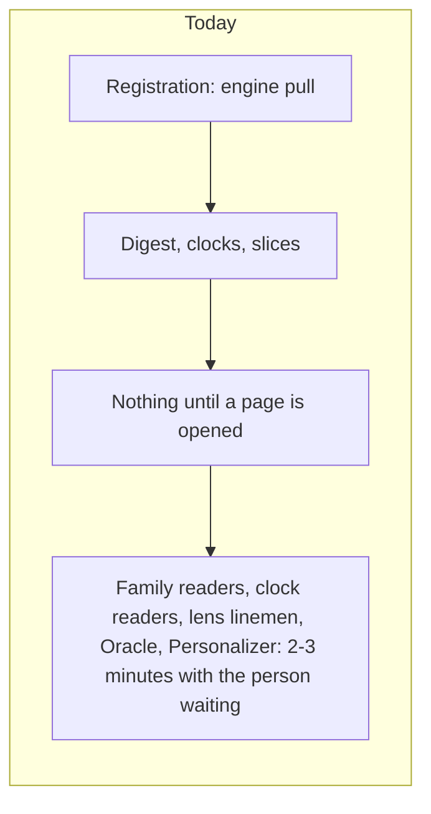
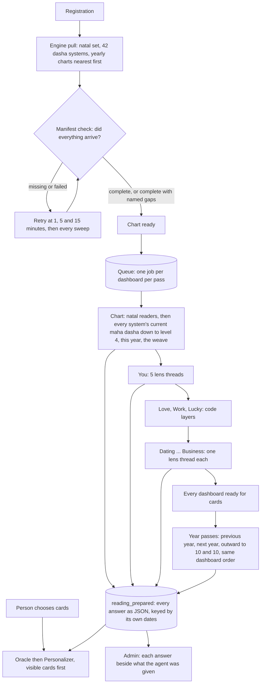

# 11 · The reading prepared ahead (rev 2): one status from registration to ready, a queue the dashboards work through in order, the current maha dasha first

Rev 2 written 2026-11-21, after Sachin's second message of that day. Plan only; no code is changed by this document.
Rev 1 (commit `ebc2316`) prepared ten years back and two ahead in one job and wrote the suggested You cards at signup.
Rev 2 replaces that with what Sachin asked for:

1. One overall status from registration to "ready", with a check that everything arrived from the engine and a retry
   for what did not.
2. A queue. Each dashboard has a processor that takes its jobs from the queue, in a fixed order, one dashboard at a time.
3. The first pass covers **the current maha dasha only**, in every dasha system, down to level 4, with this Tithi
   Pravesha year. Every dashboard finishes that pass before anything else starts.
4. After that the queue goes by Tithi Pravesha year: the previous year, the next year, and outward to ten back and ten
   ahead.
5. Preparation runs sub-agents and linemen only. The Oracle and the Personalizer run when the person has chosen their
   cards, visible cards first.
6. Every slice and every sub-agent answer is stored, so the answers can be reviewed: what each agent was given and what
   it brought back.

Nothing in doc 09 is removed: every agent that runs today still runs and writes at least what it writes today.

**How it sits with doc 10** (`10-sixty-seconds-fifty-cents.md`): its two numbers become 30 seconds and 30 cents; its
default of a shorter technical story is withdrawn. Its budget ledger (money reserved before a call), its deadline per
read, its `reading_units` record and its gate of 25 forced runs are kept and are required by this plan.

Phase 0, the paid replay of doc 09 and retire-v2, is still the first step and still waits for Sachin's yes.

## Decisions

| # | Decision | Status |
|---|---|---|
| 1 | **Read all, count verified.** The Oracle receives every dasha system that applies, each tagged verified, unverified, duplicate or longevity. Only verified ones count toward confidence | Taken 21 Nov, unchanged |
| 2 | **Preparation stops below the Oracle.** Sub-agents and linemen run after registration. The Oracle and Personalizer run when cards are chosen, visible cards first | **Changed in rev 2** (rev 1 wrote the eight suggested You cards at signup) |
| 3 | **Current maha dasha first, then by Tithi Pravesha year.** Not ten years at once, and not the previous maha dasha | **Changed in rev 2** (rev 1 cut sub-period windows over 10 years back and 2 ahead) |
| 4 | **A queue with a status**, dashboards in sequence, one passing to the next | New in rev 2 |
| 5 | **The engine pull covers 15 years back and 15 ahead** of Tithi Pravesha charts in every divisional chart; the readings cover 10 and 10 | New in rev 2 |

Open points. Each has a default I will build unless you change it:

| # | Open point | Default |
|---|---|---|
| J | **The cache.** You asked for the cache to end as soon as each sub-agent is done (about a minute) and understood that was already built. It is not: today a cache lives 30 minutes from its last use and is deleted when the whole build ends. Ending it after each sub-agent means every call pays for the chart data in full: about **$0.92 a chart** in pass 1 | One cache per chart for the run of the queue, ended when the last job finishes and never alive more than two minutes after its last use: about **$0.13** for the same reads, plus storage for about 12 minutes (about 25 if every call is sequential), which the code cannot price yet. Say "per sub-agent" and I build yours |
| A | **Money for the year passes.** Reading 20 more years for all 12 dashboards is about **$8.60 a person today and about $17 from January** (estimate, §4.6). The current maha dasha pass is about $0.85 | Build it as you described, nearest years first, under a daily ceiling ($25) and a per-person stop, behind `READING_PREP_YEARS=0` until the first measured run. The cheaper setting (all 20 years for the chart, dashboards' year threads two years each way: about $4.45) is one number |
| B | **What blocks the dashboards.** You said to wait for the engine to finish everything. The full 15 + 15 pull is 868 engine calls and takes 2–4 hours at today's rate | Dashboards start when everything the **current maha dasha pass** needs has arrived (about 5 minutes). Each year pass waits for its own year. One setting makes it wait for all 868 |
| C | **Starter cards.** With no Oracle at signup, a new person sees no reading until they choose cards; the first reading then takes about 30 s for the technical story | As you said: nothing until cards are chosen. Writing the eight suggested You cards in the first pass would add about $0.29 a person and make the first open instant |
| D | **Inside one dashboard's job**, calls that do not depend on each other | Four at a time (the repo's rule). Dashboards themselves strictly one after another. `READING_PREP_PARALLEL=1` makes every call sequential; the first run is timed both ways |
| E | **Disk.** A chart takes about 88 MB today, so about 35 more charts fit before the disk guard stops writes (§1) | Rebuild the three `kundli_activation` indexes (asked on 19 Nov, unanswered) and decide the disk size before signups open. The preparation refuses to start when the guard says no |
| F | Lens linemen and the Oracle read the titles of the cards on the person's board, so their answers cannot be prepared before the person chooses | They read the lens's full card list (the same for everyone). Now a prerequisite, with the depth replay table (AGENTS.md rule 5) |
| G | Standing yes for preparation spend on every new chart | Switch `READING_PREP=1`, stop of $1.50 a chart for the first pass ($3.00 from January), daily ceiling $25, only for verified e-mail and complete birth data. Off until phase 0 passes |
| H | SQS or the database as the queue | The database, woken by the events the server already uses (§10). SQS is new infrastructure and would need its own yes |
| I | Who gets the top-up when a sub-period ends | People who opened the app in the last 30 days, 7 days ahead of the date. Others when they next open |

## 1. Start (checked 2026-11-21: server `develop` `ebc2316`, the staging database, read only)

**Registration and the engine pull**

| Fact | Where |
|---|---|
| Registration invokes the server's own Lambda with a `kundli-sync` event. A lease on `kundlis.queue_started_at` keeps two workers off one chart. A 15-minute sweep picks up what is incomplete | `services/kundliSyncWorker.ts:1-31,166-177,384-447` |
| The pull is the engine catalogue: 186 natal types and 7 yearly types marked served in `chart_data_types`. Each stored row has a status: ready, fetching, failed or unsupported | `services/chartCatalogSync.ts`; `chartData/registration.ts`; `kundli_data` |
| For the newest chart about 180 rows landed in the first 2 minutes after signup. How long signup to digest takes is **not in the data**: the charts were re-synced together on 15 Nov and `fetched_at` is overwritten on a refetch (that re-sync went from pull to digest in 1 min 41 s). "About 5 minutes to chart ready" below is an estimate that phase 1 measures | `kundli_data.fetched_at`, `kundlis.digest_built_at`, chart `e1df0fcf` |
| **There is no single status.** A chart has `queue_status`, `facts_status`, `digest_status`, `last_sync_error` and row counts worked out on request | `schema.prisma:113-128`; `services/chartStatusService.ts` |
| **A failed, given-up or unsupported row counts as settled**, so "complete" can have holes. The failed-row retry waits 6 hours | `kundliSyncWorker.ts:35,340-348`; `chartStatusService.ts:67` |
| Three holes on the test chart today, none reported anywhere: the `kaala` pressure row failed on 10 Nov and was never refetched; `kalachakra` has no level-2 rows in its running maha dasha; `aayu` has no running level-1 row | `kundli_data`, `kundli_activation` |
| Yearly charts are filled later by the digest sweep: 10 years back and 10 ahead, Tithi Pravesha and Varsha in D1, D9, D10 only, at most 40 engine calls a run. The newest chart's 218 yearly rows took about 25 minutes | `digest/annualSet.ts:12-16`; `env.ts:1757-1760` |
| The test chart holds 31 years (2006–2036) with the Tithi Pravesha chart in 20 divisional charts for 25 of them, from a one-off pull | `kundli_data`, `variant LIKE 'year=%'` |
| Dasha rows: 42 systems; levels 1–3 from birth to 30 years ahead; level 4 only from 90 days back to 365 ahead, written by a separate Lambda (`aiastra-dasha-deep-worker`) that runs one chart at a time and only for charts someone has opened. Three of the six charts have no level-4 rows | `digest/activation.ts:3-4`; `workers/dashaDeep.ts:12-16`; `workers/dashaDeepFocus.ts:37`; Lambda env |
| Nothing model-related runs at sync. No reading is queued until a page is opened | `kundliSyncWorker.ts:198-214`; callers of `queueSelfReadingBuild` |

**The current maha dasha, measured on the test chart**

| Fact | Number |
|---|---|
| Systems with a running maha dasha | 41 of 42. Their spans differ, from 3 to 30 years (Vimshottari 2018-03-16 to 2028-03-16; Narayana 2021-10-15 to 2027-10-15) |
| Sub-periods (level 2) inside the 41 running maha dashas | 408 |
| Level-3 rows inside the 41 running sub-periods | 415 |
| Level-4 rows inside the 41 running level-3 periods | 433 |
| The chain: previous, running and next maha dasha, plus the three rows above | about 1,380 rows, about 35,000 tokens |
| All level-3 rows inside the running maha dashas (not read in pass 1) | 4,367 |
| Rows touching one Tithi Pravesha year | level 2: 88 · level 3: 591 |
| **Nothing is scoped to a current maha dasha today.** Cards read the next 12 months of at most 5 clocks; slices cover 12 months back to 18 ahead | `self/v3/yearFrame.ts:1-32,124`; `slices/render.ts:20-22`; `env.ts:861-876` |

**Sub-agents, dashboards, cache, queue, disk**

| Fact | Where |
|---|---|
| **Most sub-agents are shared by every dashboard:** the 7 family readers and the clock readers. Sub-techniques S1–S10, the house layers, the career map and Lucky times are code, with no model call. What is particular to a dashboard is one lens lineman per lens (13 lenses) | `cards/pipeline.ts:25-44`; `lens/lineman.ts:1-10`; `self/sub/index.ts:1-7`; `area/career.ts:2` |
| The only ordered list of dashboards: self, love, work, lucky, dating, marriage, friends, allies, career_start, primary_job, hobby, business | `profile/facts.ts:39` |
| **A cache is not deleted after each sub-agent.** An explicit cache is created on its second use, lives 30 minutes from its last use, and is deleted when the whole build ends. No branch has a per-agent delete. The price table has no rate for cache storage, so that cost is not recorded | `llm/promptCache.ts:11-61`; `llm/cacheLease.ts:73-93`; `llm/models.ts:38-49`; `git log --all -- src/reading/llm` |
| Background work runs as events the server sends itself (`kundli-sync`, `kundli-digest`, `self-reading-build`), each with a marker row as its lease and a sweep as its retry. **There is no SQS** in the repo or the package list | `server.ts:143-167`; `digest/event.ts`; `self/buildEvent.ts`; `package.json:39` |
| Every digest rebuild deletes all stored answers for the chart; rows a day past `valid_to` are swept; `kundli_slices` holds one row per slice with no date | `digest/build.ts:1735-1738`; `techniques/outputStore.ts:552-563`; `schema.prisma:1632-1648` |
| **Disk: 532 MB for 6 charts, about 88 MB a chart.** `kundli_activation` is 360 MB: 78 MB of rows (281,397) and 282 MB of indexes. The guard is set on staging (`DB_DISK_LIMIT_BYTES` = 5 GB, fill 0.7, so 3,758 MB) but it checks bulk dasha-row writes only. At today's size about 35 more charts fit under it; about 33 with what this plan stores | `pg_total_relation_size`; `digest/diskGuard.ts:1-9`; Lambda env |
| Card model prices (`gemini-3.8-flash`): input $0.75, cached $0.075, output $3.75 per million tokens, **doubling on 1 January 2027**. Reader model (`gemini-3.1-flash-lite`): $0.25, $0.025, $1.50 | `llm/models.ts:38-56` |
| The doc 09 pipeline has never run on the live model. **Every time and cost in this plan is an estimate** until phase 0 | doc 09 §8 step 12 |

## 2. End goal

- A new chart has **one status** that says where it is between "registered" and "ready", what arrived from the engine,
  what did not, and what is being retried.
- About 5 minutes after signup the chart is checked and complete for the first pass. About 12 minutes after that, every
  dashboard has its sub-agent answers for the current maha dasha stored (estimate; about 25 minutes if every call is
  sequential). The You dashboard is ready for cards first.
- **The first reading for a brand-new person is slower than today, and every reading after it is faster.** Today a
  first board builds in 2–3 minutes once the chart is in. With this plan the You dashboard is ready for cards about
  11–12 minutes after signup (about 25 if every call is sequential), then the cards take about 45 seconds. A person who
  chooses cards before that sees the status line, and their dashboard's jobs run first. Open point C (starter cards)
  and more calls side by side in the chart job are the two ways to shorten it.
- When the person chooses cards, only the Oracle and the Personalizer run, visible cards first: technical stories in
  about 30 s, plain stories about 15 s after.
- Opening a dashboard whose stories are stored makes no model call. A refresh after new facts or answers runs only the
  Personalizer (about 15 s and about $0.13 for 11 cards).
- In idle time the same queue reads the previous Tithi Pravesha year, the next, and outward to ten each way, so the
  person can ask about the past and the future on any dashboard.
- A period's reading is stored against that period's own dates and is never bought twice: when a sub-period ends, the
  next one's reading is already there.
- Each answer can be opened beside what the agent was given, with what it did not use listed.
- No rebuild, sweep or later pass deletes a stored answer that is still valid. No cache outlives the work that reads it.

## 3. Deliverable

**Server**
- Migration M56: `kundli_pipeline` (the one status row per chart), `reading_prep_jobs` (the queue),
  `reading_prepared` (every stored answer), a scope key on `kundli_slices`.
- `src/reading/pipeline/manifest.ts` (what must exist for a chart, and the verdict), `pipeline/status.ts` (the stages
  and the API shape), `pipeline/retry.ts`.
- `src/reading/prep/order.ts` (dashboards × passes), `prep/queue.ts` (enqueue, claim, finish, pass on),
  `prep/dispatch.ts` (the `reading-prep` event: one job per invocation), `prep/scope.ts` (the current maha dasha chain
  and each year's rows, selected from stored rows), `prep/processors/{chart,self,board,lens,lucky}.ts`,
  `prep/store.ts`, `prep/cache.ts`, `prep/review.ts` (given against cited).
- `src/reading/clocks/needle.ts` (the period readers and the weave) and `clocks/systems.ts` (tags for all 42 systems).
- Changed: `digest/annualSet.ts` (15 + 15 years, every Tithi Pravesha divisional chart), `services/kundliSyncWorker.ts`,
  `services/chartStatusService.ts`, `digest/event.ts`, `digest/build.ts` (scoped delete), `techniques/outputStore.ts`
  (sweep rule), `families/run.ts` (JSON by schema, runs per scope), `lens/lineman.ts`, `cards/oracle.ts`,
  `self/v3/build.ts` and `self/buildEvent.ts` (read prepared answers; cards in visible order), `llm/cacheLease.ts`,
  `llm/models.ts` (cache storage rate), `config/env.ts`, registry and catalog rows, `cards/pipeline.ts` (consumers).
- Prompts: `clock/period-reader.md`, `clock/weave.md` (new); `lens/lineman.md`, `cards/oracle.md`, the family prompts.
- Tests beside each file; `scripts/prep-replay.ts` (runs the queue for one chart with a spend stop; `--dry` prints every
  planned call with its input size and estimated cost and makes no call).

**Admin app:** one page, "Preparation": per chart the status and the gaps, the job list, and each answer beside its input.

**Web:** the status line during preparation; no other screen change.

**Docs:** this plan; the `SOUL.md` and `AGENTS.md` text of §6; TODOS entries.

## 4. How it works when done

### 4.1 Before and after

### 4.2 Backend: one status and the manifest

- **The manifest** is a list, built in code from the engine catalogue, of everything a chart must have. Each item says
  what needs it:

  | Item | Count | Needed for |
  |---|---|---|
  | Natal types the catalogue marks served | 186 | chat, pass 1 |
  | `dasha.applicable`, and for each system that applies: level 1–3 rows, a running maha dasha, sub-periods inside it | 42 systems | pass 1 |
  | Level-4 rows inside the running level-3 period of each system | 41 | pass 1 (waits up to 10 minutes, see below) |
  | The clock set's dated rows | 4–5 | pass 1 |
  | This and last Tithi Pravesha year: the year chart in 20 divisional charts, Varsha in D1, D9, D10, the year dasha, Mudda, Patyayini, sahams, Tajaka | 28 rows a year | pass 1 |
  | The same for each other year, 15 back to 15 ahead | 28 × 29 | that year's pass |
  | Digest sections, activation rows, slices | — | pass 1 |

- **The verdict**, per need: *complete*; *complete with named gaps* (the engine does not serve an item for this chart,
  for example a conditional dasha that does not apply, or an item was given up after retries: each is named);
  *incomplete* (something required is missing and is being retried).
- Each dashboard declares which items it **requires** and which are **optional**. A required gap blocks that dashboard
  and is shown on the admin page. An optional gap is named in the sub-agent's input as "not available" and is never
  filled in. D1, D9, the reading clock and the Tithi Pravesha year are required everywhere; a single unverified dasha
  system is optional.
- **Level 4** comes from a separate worker that runs one chart at a time and has not run for three of the six charts.
  Chart-ready asks it for the new chart; pass 1 waits up to 10 minutes, then goes on with levels 1–3 and names the gap,
  and the level-4 cells are added when the rows land. With several signups at once, level 4 will often arrive after
  pass 1. To make pass 1 always wait for it, level 4 becomes a required item (one line), at the cost of that wait.
- **Retry:** a row that blocks pass 1 is refetched after 1, 5 and 15 minutes, then at every sweep, in place of the
  6-hour wait. After 6 failures it is given up and named. The Retry button and the admin page clear a give-up.
- **`kundli_pipeline`** holds the result so the queue and the admin page read one row: `stage`, the verdict per need,
  counts (required, ready, failed, unsupported, missing), the named gaps, attempts, `next_retry_at`, the spend so far.
  It is recomputed from the stored rows at the end of every sync, digest and clock run; the rows stay the truth.
- **Stages:** `registered → pulling → checking → chart_ready → preparing → ready_for_cards → years → complete`, with
  `blocked` (a required gap) and `paused` (spend stop, disk guard, switch off) beside them.

### 4.3 Backend: the queue and the order

- **`reading_prep_jobs`**: one row per chart, dashboard, pass and scope (`maha`, or `year:2025`), with `seq`,
  `priority`, `status` (waiting_data, queued, running, done, failed, skipped), `attempts`, `lease_until`, times, calls,
  cost and error. All jobs of pass 1 are written when the chart becomes ready, so the whole plan for a person is visible
  from the first minute.
- **Order within a pass** (from `PORTAL_DASHBOARDS`, with the shared work first):

  | # | Job | What its processor does |
  |---|---|---|
  | 0a | chart · natal | the four natal readers |
  | 0b | chart · periods | the period readers over every system's chain |
  | 0c | chart · weave | the dated readers (dasha, year, sky), the clock readers, the weave |
  | 1 | self | five lens threads (temperament, mind, purpose, body, chapter) |
  | 2–4 | love, work, lucky | the board's code layers, stored; no model call |
  | 5–12 | dating, marriage, friends, allies, career_start, primary_job, hobby, business | one lens thread each |

- **Every processor has the same four steps:** check its required items in the manifest → cut its slices and store
  them → run its sub-agents → store each answer with its dates. Then it marks the job done and wakes the queue for the
  next job. A unit already stored with the same inputs is read, not run again, so no dashboard repeats shared work.
- **The wake-up** is a `reading-prep` event the server sends itself (the pattern of `kundli-sync`). One invocation runs
  one job under the job's lease. If its time runs out, every answer already stored stays and the next invocation
  resumes at the first missing unit. Lambda's own retry is off (as for the other events); the 15-minute sweep requeues
  a job whose lease has lapsed. After three attempts a job is `failed` and shown, and the queue moves on to the next
  dashboard; the sweep tries a failed job again after 30 minutes.
- **One job at a time per chart. Two charts at a time** across all people (`READING_PREP_CHARTS`, default 2).
- **Priority:** a dashboard the person has open moves to the front of its pass. Year passes run only after every
  dashboard's pass 1.
- **Passes:** pass 1 is the current maha dasha (§4.4). Then `year:Y−1`, `year:Y+1`, `year:Y−2`, `year:Y+2` … to ten
  each way (§4.6), each pass in the same dashboard order.

### 4.4 Backend: pass 1, the current maha dasha

- **Scope.** For each of the 41 systems, selected from stored rows by date (Node computes no astrology): the running
  maha dasha with the previous and the next (as cards read today), every sub-period inside the running maha dasha, the
  level-3 periods inside the running sub-period, and the level-4 periods inside the running level-3 period. About 1,380
  rows. With it: this and last Tithi Pravesha year (D1, D9 and the routed year charts, the in-year dashas) and the sky,
  as today.
- **The natal readers** (`family.rasi`, `family.moon`, `family.star`, `family.varga`) run once per chart: the yogas,
  the strengths, benefic and malefic standing, the stars, the divisional charts. Their answers hold until the chart data
  changes.
- **The period readers** (new): about eight calls, five or six systems each, grouped by family (star dashas,
  conditional and other star dashas, karaka dashas, sign dashas in four groups). Each reads every system of its group,
  including unverified, duplicate and longevity ones, and returns one **cell per period**: the houses the engine
  stored, what the period brings and for which of the 12 matters, a tone, the evidence keys. A star dasha is judged by
  its lord, a sign dasha by its sign (doc 09 §4).
- **A cell is stored against its own system, level and dates**, and is not rewritten while the chart data and the
  prompt are unchanged. When a sub-period ends, the next sub-period's cell already exists; a small top-up call adds the
  level-3 and level-4 cells under it (open point I).
- **The weave** (new): one call that reads all cells and records, per matter, which systems point where, where a star
  dasha and a sign dasha agree (the gate of doc 07), which are duplicates, and a confidence counted from verified,
  independent systems only.
- **The clock readers** of today still run for the 12-month frame.
- **The lens threads:** one lineman per lens, as today (promise → period → year → star → trigger), now reading the
  cells and the weave for the current maha dasha as well as the family findings and the clock sheets. A thread holds
  until the reading clock's running sub-period ends or the Tithi Pravesha year ends, whichever is first.

**Allotment per agent (estimates until phase 0):**

| Agent | Calls in pass 1 | Model · thinking | Input tokens | Output ceiling (expected) | Timeout | Est. cost each |
|---|---|---|---|---|---|---|
| Natal readers | 4 | 3.1-flash-lite · medium | 2k–10k | 6,000 (800–2,000) | 60 s | $0.003 |
| `family.dasha`, `family.year`, `family.sky` | 3 | same | 2k–15k | 6,000 | 60 s | $0.002–0.006 |
| Period readers | about 8 | 3.8-flash · low | 45k cached + ~5k | 10,000 (about 7,700), continued when cut | 150 s | $0.036 |
| Weave | 1 | 3.8-flash · medium | 45k cached + ~40k | 10,000 (6k–8k) | 150 s | $0.05 |
| Clock readers | 5 | 3.8-flash · low | 48k (43k cached) | 8,192 | 60 s | $0.012 |
| Lens linemen | 13 | 3.8-flash · medium | 45k cached + ~16k | 10,000 (2.5k–4k), continued when cut | 150 s | $0.03 |

| Pass 1 for one chart | Calls | Time, calls four at a time inside a job | Time, every call sequential | Cost |
|---|---|---|---|---|
| Chart jobs (0a–0c) | 21 | about 5 min | about 15 min | about $0.45 |
| You | 5 | about 1.5 min | about 4 min | about $0.15 |
| Love, Work, Lucky | 0 | seconds | seconds | $0 |
| Eight lens dashboards | 8 | about 6 min | about 6 min | about $0.24 |
| **Total** | 34 | **about 12 min** | **about 25 min** | **about $0.85** (range $0.70–1.00), stop at $1.50 |

The You dashboard is ready for cards about 6–7 minutes after the chart is ready.

### 4.5 Backend: slices, the store and the cache

| What | Where | Key | Lives until |
|---|---|---|---|
| Slices (what each agent is given) | `kundli_slices`, with a scope key | chart, slice, scope, hash | its rows change. Kept 30 days for review, then only the hash (a slice can be cut again from stored rows) |
| Cells, weave, family findings, lens threads, Oracle and plain stories | `reading_prepared`, JSON | chart, layer, unit, from, to, hash of inputs, prompt hash | its inputs change. Never deleted by a digest rebuild or a date sweep |
| With each answer | the same row | — | the keys it was given, the keys it cited, tokens, time, cost, model, job |
| The natal context (about 45,000 tokens that every card-model agent reads first) | one Gemini explicit cache per chart **per run of the queue** | model, text, no date | created when a run starts, lives about 2 minutes from its last use, deleted when the last job of the run ends |

- **Cache rule (open point J, the default).** A slice read by one call is sent as plain input and never cached. Only the natal context
  is cached, because 27 of pass 1's calls read it. Deleting it after each sub-agent would cost more, not less: creating
  a cache is charged as one full read ($0.034 today), so 27 calls would pay about $0.92 in creations against about
  $0.13 with one cache for the run. With a two-minute life it cannot outlive the work by more than two minutes; the $0.13 leaves out storage, which the price table cannot
  price yet. The cache name is kept on the status row so the next job reuses it. Cache storage gets a rate in the price table so it is
  recorded.
- `digest/build.ts` stops deleting every stored answer; an answer is reused only when the hash of the rows it read is
  unchanged. The date sweep skips `reading_prepared`.
- **Disk.** Estimated addition per chart: about 1 MB for pass 1, about 7 MB for twenty years, about 1 MB for the wider
  yearly pull. The same disk limits are checked before each preparation job (the guard covers only dasha-row
  writes today); a refusal sets the status to `paused`.

### 4.6 Backend: the year passes

- After every dashboard has finished pass 1, the queue adds one pass per Tithi Pravesha year: previous, next, and
  outward, ten each way. The year's dates come from the stored year rows.
- **Chart job for a year:** `family.year` and `family.sky` for that year, the period readers for cells not yet stored
  that touch the year (levels 1–3: about 590 level-3 rows a year on the test chart), and a weave for the year.
- **Dashboard jobs for a year:** each lens writes its thread for that year, so chat and cards can speak about it.
- A year pass waits for that year's 28 engine rows (open point B); the pull fills them nearest year first.

| Year passes (estimates) | Per year | Twenty years | From January |
|---|---|---|---|
| Chart job | about $0.17 | $3.40 | $6.80 |
| Dashboards' year threads (13 lenses) | about $0.26 | $5.20 | $10.40 |
| **All, as described** | about $0.43 | **about $8.60** | about $17 |
| Chart job for 20 years, dashboards for 2 years each way | — | about $4.45 | about $8.90 |

- A change to a sub-agent's prompt makes its stored answers stale. Pass 1 is run again first; the year passes run again
  in idle time under the daily ceiling. While the prompts are still being tuned, that is the reason to keep the year
  passes off or to a few years: each prompt change would buy the stored years again.

### 4.7 Backend: cards, when the person chooses them

- Saving the card choice queues the board build that exists today. It reads the prepared answers.
- **The chart jobs (0a–0c) and the dashboard's own job are prerequisites.** If any is not finished, the build claims it
  and runs it itself, in order, under the job's lease, then goes on to the cards.
- **If another invocation holds that job's lease**, the build starts no second run. It moves the dashboard to the front,
  watches the job row (every 5 s, up to its own 12-minute budget) while the board shows the status line, and goes on
  when the job is done. If the lease lapses first, the build claims the job.
- **Order:** the cards on screen first, in deck order, then the rest. The Oracle runs for the chosen cards side by side
  (limit 12, as today); each card's Personalizer starts as its technical story lands. Cards appear one by one.
- The Oracle reads the lens thread, the weave and the cells for its lens, the family findings it cites, the card brief
  and the lens's full card list (open point F). The Personalizer alone reads the person.

| Cards chosen | Time to the technical stories | Plain stories | Cost today | From January |
|---|---|---|---|---|
| 7 | about 30 s | about 15 s later | about $0.25 | $0.50 |
| 8 | about 30 s | about 15 s later | about $0.29 | $0.58 |
| 11 | about 30 s | about 15 s later | about $0.40 | $0.80 |

(Add about $0.03 when no cache is alive for the chart.)

**Against 30 seconds and 30 cents:** the technical stories fit 30 seconds; the plain stories arrive after it until the
streamed hand-off (phase 5). Thirty cents covers eight cards today and four from January; a deck of 11 is about $0.40.
Nothing is shortened to fit. The choice is yours: a cap per card (about $0.04 today), a smaller first deck, or a higher
cap for the first reading (which is free to the person under the 19 Nov rule). The re-fit is due by 15 December.

### 4.8 API, screens and the review page

- **`GET` chart status** (existing) gains `pipeline`: the stage, `done` and `total` jobs, the dashboard being prepared,
  and a plain sentence. No raw error and no engine name is sent.
- **Board GET** (existing): `build.stage` shows the dashboard's own job state before cards exist.
- **Web copy:** "Getting your chart" → "Checking everything arrived" → "Reading your chart" → "Reading your current
  period" → "Preparing You" (then each dashboard) → "Ready. Choose your cards." A blocked chart shows "Some of the
  calculations did not finish. We are trying again." and the Retry button.
- **Admin, "Preparation" page** (per chart): the status row and named gaps; the job list (dashboard, pass, status,
  time, calls, cost, attempts); and for each answer the slice it was given, the JSON it returned, **the keys it was
  given and did not cite**, validation issues, tokens, time and cost, with the previous prompt version's answer beside
  it. The given-against-cited list is a comparison of evidence keys in code, not a scan of words.

## 5. Architecture

- **Engine:** every astrological fact, row and date. This plan asks it for more rows (15 + 15 years, every Tithi
  Pravesha divisional chart) and no new calculation.
- **Server, request path:** reads the status and stored answers; never runs a sub-agent.
- **Server, events:** `kundli-sync` (pull) → manifest check → `reading-prep` (one job per invocation, 900 s Lambda,
  12-minute budget) → `self-reading-build` (cards). The sweeps are the retry for all three.
- **Database:** the queue, the status, the slices and the answers. A job's lease and a unique key per answer make a
  repeated run harmless.
- **Models:** sub-agents and linemen in the queue; the Oracle and Personalizer when cards are chosen.
- **Guarantees:** resumable per answer; one job at a time per chart; an answer is reused only on an input-hash match;
  with `READING_PREP=0`, or on any preparation failure, a board builds on open as it does today.

## 6. Rules to change on approval

*`SOUL.md` §5, replace the "only verified systems" bullet with:*
> **Every dasha system that applies to the chart is read; only verified ones are counted.** The Oracle threads through
> all of them for the full picture. It may name any system except a longevity clock. A system the research flags is
> named as unverified and never adds to confidence. A system the engine marks as not applying to this chart is left out.

*`AGENTS.md`, "Board and technique machinery", add:*
> 8. **Prepared in the queue, keyed by its own dates.** An agent whose input is the chart and a period runs in the
>    preparation queue and stores JSON in `reading_prepared` against that period's dates. An agent may read the
>    person's choices or facts only if it runs when cards are chosen. No rebuild, sweep or later pass deletes a prepared
>    answer whose inputs are unchanged. A prompt cache lives only for the run that reads it.
> 9. **Complete means checked.** A chart is ready only when the manifest says every required item arrived. A failed or
>    unsupported row is a named gap, never a silent pass.

## 7. Ingredients

| Ingredient | Detail | Owner |
|---|---|---|
| Migration M56 | three new tables and one column set; additive | dev agent; applied for testing under the standing yes |
| Env | `READING_PREP`, `READING_PREP_YEARS`, `READING_PREP_YEARS_BACK` / `_AHEAD` (10), `READING_PREP_PARALLEL` (4), `READING_PREP_CHARTS` (2), `READING_PREP_STOP_USD` (1.50), `READING_PREP_DAILY_USD` (25), `READING_PREP_WAIT_ALL_YEARS` (0); `ANNUAL_SPAN_YEARS` 10 → 15 | deploy session |
| Events | `reading-prep` on the existing `POST /events`; the existing 15-minute rule also sweeps the queue. No new IAM, no SQS | dev agent; no infra change |
| Engine | no code change; 868 yearly calls a chart, up from 210 | — |
| Index rebuild and disk size | open point E | Sachin's yes; deploy session |
| Paid runs | phase 0 replay; one pass 1 on the test chart; later the year passes and the 25-run gates | Sachin's yes each time, with the count and cost stated first |
| Test data | the six staging charts (all test data) | — |
| Doc 10 | its ledger, deadline and `reading_units` record, built first or alongside | the session that owns doc 10 |

## 8. Action steps in sequence

1. **Phase 0, needs Sachin's yes:** the doc 09 and retire-v2 paid replay (about 50 calls, $0.75–1.10, $2.00 stop). The
   tables above are corrected from it before later steps ship.
2. `pipeline/manifest.ts`, `pipeline/status.ts`, `kundli_pipeline`. Done: the test chart reports "complete with named
   gaps" and names `kaala`, `kalachakra` and `aayu`; a chart with a missing required row reports incomplete.
3. `pipeline/retry.ts` and the sweep change. Done: a failed required row is refetched at 1, 5 and 15 minutes in a test
   with a fake engine. *Parallel with step 4.*
4. `annualSet.ts` to 15 + 15 years and every Tithi Pravesha divisional chart, nearest first, with the disk guard and a
   dry-run byte estimate. Done: the key list is 868 for one chart; nothing is fetched twice.
5. `reading_prepared`, `prep/store.ts`, scoped digest delete, sweep rule, the scope key on slices. Done: a digest
   rebuild leaves an answer with unchanged inputs in place.
6. `prep/queue.ts`, `prep/order.ts`, `prep/dispatch.ts`, the `reading-prep` event. Done with fake processors: jobs run
   in order, one at a time per chart; a lapsed lease is requeued; a failed job does not stop the next dashboard.
7. `prep/scope.ts` and `clocks/systems.ts`. Done: for the test chart the chain is 41 systems and about 1,380 rows, all
   from stored rows; every system appears once with its tag. *Parallel with step 6.*
8. Period readers and the weave (`clocks/needle.ts`), prompts, registry and catalog rows, consumer rows. Done with
   fakes: one cell per period; duplicates folded; confidence counts verified systems only.
9. Family readers return JSON and run per scope; lens linemen and the Oracle read the lens's full card list and the
   cells (open point F). Done: the depth replay shows no card reads less; two boards on one chart share a thread key.
10. The processors, `prep/cache.ts`, the spend stops, `READING_PREP`. Done: `prep-replay.ts --dry` prints every planned
    call for the test chart with its estimated cost and makes no call.
11. `self/v3/build.ts` and `buildEvent.ts` read prepared answers; cards in visible order. Done: with pass 1 stored, a
    card choice makes only Oracle and Personalizer calls.
12. `prep/review.ts`, the admin page, the web status line.
13. **Paid check, needs Sachin's yes:** pass 1 for the test chart (34 calls, est. $0.85, $1.50 stop), timed four at a
    time, and again fully sequential on a second chart; then a deck of 8 cards (16 calls, est. $0.29).
14. Year passes (`READING_PREP_YEARS`): two years each way on the test chart first (paid, on a yes), then the rest.
15. The streamed hand-off to the Personalizer; top-ups when a sub-period ends; findings to `docs/TODOS.md`.

## 9. Development phases

| Phase | Steps | Ships | Closing check |
|---|---|---|---|
| 0 Prove what is built | 1 | nothing new | measured time and cost per agent; depth table against the baseline |
| 1 One status | 2–4 | manifest, status, retry, the wider pull | a new chart on staging reaches `chart_ready` with its gaps named; a log line per retry |
| 2 The queue and the store | 5–7 | tables, events, scope | fake processors pass the baton in order on staging; a rebuild leaves answers in place |
| 3 The current maha dasha | 8–11, 13 | period readers, weave, processors, cards from prepared answers | paid check: pass 1 within the stop; times recorded both ways; a deck of 8 from prepared answers; depth not lower |
| 4 Seeing the work | 12 | admin page, web status line | screenshots of one chart's jobs and of one answer beside its input |
| 5 The years and the edges | 14–15 | year passes, top-ups, streamed hand-off | two years each way stored for the test chart; cost per year measured; then the 25-run gate per dashboard |

## 10. One recommendation

Build phases 1–3 as one release after phase 0: the status and manifest, the queue in the database, and the current
maha dasha pass for every dashboard, with cards written when chosen. Keep the year passes switched off until pass 1 has
been measured and the sub-agent prompts have settled, because every prompt change buys the stored years again.

| Alternative | Verdict |
|---|---|
| SQS (FIFO, one group per chart) as the queue | Not now: new infrastructure, IAM and a deploy path, and the status would still live in the database. The queue is one module, so it can move later |
| One job that prepares everything (rev 1) | Replaced: no order, no status per dashboard, nothing to review step by step |
| End the cache after every sub-agent (as Sachin described) | Not the default: about $0.92 a chart against $0.13; priced in open point J, his to choose |
| Wait for all 868 yearly rows before any dashboard starts | Not the default: 2–4 hours before the first reading. One setting (open point B) |
| One model call per dasha system | Rejected: 41 calls for the same rows; eight grouped calls write the same cells |
| Read all level-3 rows of every running maha dasha in pass 1 | Not now: 4,367 rows, about three times the cost; the year passes cover them year by year |
| Split each lens thread into maha dasha, sub-period and year calls | Kept in reserve: three times the calls; tried only if the measured lens job is the slow step |
| Shorten the technical story to fit 30 cents | Forbidden by the depth rules |

## Verification

- Server: `npx tsc --noEmit`; `npx vitest run tests/unit/reading tests/unit/agents tests/unit/techniques`; new tests for
  the manifest, the retry, the queue order and leases, the scope, the store, the scoped delete, the cache life;
  `depth-replay.ts` old against new.
- Dry run: `scripts/prep-replay.ts --dry` for the test chart.
- Staging (steps 1 and 13): the status row at each stage; job times and cost from `agent_runs`; no cache alive two
  minutes after the last job; a digest top-up leaves the answers in place; the admin page shows what one period reader
  was given and did not cite.
