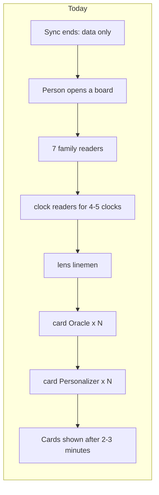
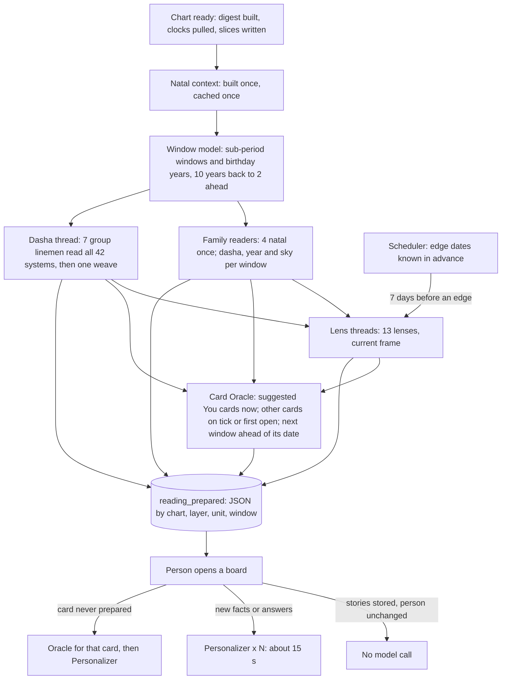

# 11 · The reading prepared ahead: every sub-agent run once after sync, all dasha systems threaded, a dashboard read in 30 seconds for 30 cents

Written 2026-11-21. Plan only; no code is changed by this document. It builds on doc 09 (two stories per card, the depth
gate) and the "retire v2" work (the natal context step), both on `develop` at `3817d17` and not yet deployed. Nothing in
doc 09 is removed: this plan changes **when** each agent runs and **what it is keyed on**, not what it reads or writes.

**How it sits with doc 10** (`10-sixty-seconds-fifty-cents.md`, written the same morning from an earlier instruction:
60 s, 40 cents planned, 50 cents hard, 25 test runs before a dashboard goes live):
- **Replaced:** doc 10's two numbers become **30 seconds and 30 cents** for every dashboard open or refresh. Its
  decision 2 (accept a shorter technical story, with "read deeper" on a tap) is withdrawn: Sachin's instruction here is
  that nothing is deleted or shortened. Its decision 1 ("Chart foundation", built once after the welcome wizard) is the
  seed of this plan and is widened to everything below the Oracle.
- **Kept, and required by this plan:** doc 10's budget ledger (money reserved before a call, not counted after), the
  deadline per read, the `reading_units` record per read with `agent_runs.unit_id`, the warning log when a technique
  would pass the cap, and the gate of 25 forced cold runs before a read is switched on. Doc 10 builds them; this plan
  uses them with the new numbers and adds one more kind of read, the preparation, with its own budget.

Sachin's request (2026-11-21): without deleting anything from the technique, regroup how sub-agents are called; keep
every data point, context and prompt in cache; give the Oracle all 40 dasha systems to thread through before it writes;
a reading takes 30 seconds at most and 30 cents. Move the work offline: once a new person's chart data is synced, run
every sub-agent and lineman for all dashboards, slice the data per agent, and store each agent's answer as JSON by date
range (the dasha windows), for the past 10 years and the next 2. The sky never goes out of order, so the sequence and
the dates are known in advance.

## Decisions taken (Sachin, 2026-11-21)

| # | Decision |
|---|---|
| 1 | **Read all, count verified.** The Oracle receives every dasha system that applies to the chart, each tagged verified, unverified, duplicate or longevity. It threads through all of them and may name any except longevity clocks. Only verified ones count toward confidence; an unverified one is named as such. This replaces "only verified systems are read" in `SOUL.md` §5 (text in §5 below). |
| 2 | **At signup:** everything below the Oracle (sub-agents, the dasha thread, all 13 lens threads) is prepared and stored as JSON by dasha window, plus the full reading for the suggested You cards so the first open is instant. Love and Work cards are written when a lens is first opened. |
| 3 | **Prepare ahead of the dates.** Dasha edges are known in advance, so the next window's stories are written in idle time before the date arrives, and a card's story starts the moment it is ticked in the picker. Opening or refreshing then runs only the plain retelling. |

Still open, with defaults (change any):

| # | Open point | Default |
|---|---|---|
| A | Standing yes for signup spend. Preparation is a paid call for every new chart. | A standing yes with a switch (`READING_PREP=1`), a per-chart stop of $1.50 ($3.00 from January), a daily ceiling of $25, and a gate (verified e-mail, complete birth data, digest ready). Off until the phase 0 replay passes. |
| E | Doc 10's 25-run gate, at the new numbers. | Kept: an open or refresh is switched on for a dashboard only after 25 forced runs on staging stay within 30 s and $0.30 with every card at the depth floor (25 refreshes of 11 cards is about $3.25 a dashboard today). The preparation read needs 5 runs across the test charts within its stop (about $4.75). Each batch on Sachin's yes, with its count and cost stated first. |
| B | Lens linemen and the Oracle read the titles of the cards on the person's board. That makes their answers depend on the person's choices, so they cannot be prepared ahead. | They read the lens's full card list instead (same for everyone). This changes an input, so it ships with the depth replay table (AGENTS.md rule 5). |
| C | The Oracle reads the person's confirm answers. | Answers go to the Personalizer only (already decided in the retire-v2 work); the Oracle reads them at the next window or a paid refresh. |
| D | Who is prepared ahead of an edge date. | People who opened the app in the last 30 days. Others are prepared when they next open. |

## 1. Start (checked 2026-11-21: server `develop` `3817d17`, staging database, `agent_runs`)

| Fact | Where |
|---|---|
| **Nothing model-related runs at sync, and no reading is queued.** Sync ends with the clock pulls and the slices, both code. Only page opens, layout changes and refreshes queue a build | `services/kundliSyncWorker.ts:198-214`; callers of `queueSelfReadingBuild` |
| Sync order on a first registration: engine pull → digest build (async) → clock pulls need the digest's rows, so the 15-minute sweep fills them later | `self/sub/pressure.ts:362-378`; `kundliSyncWorker.ts:223-243` |
| `technique_outputs` can hold one JSON answer per chart, technique and date window (`valid_from`, `valid_to`; a row is served when its window covers the date asked for) | `prisma/schema.prisma:1382-1406`; `techniques/outputStore.ts:357-498` |
| **Every digest rebuild deletes all stored answers for the chart**, including the yearly top-ups the sweep triggers. This already threatens doc 09's stored stories | `digest/build.ts:1735-1738` |
| Rows more than a day past `valid_to` are swept, so past windows cannot be kept there today | `techniques/outputStore.ts:552-563` |
| `kundli_slices` holds one row per slice with no date: a run for another window overwrites the current one | `schema.prisma:1632-1648` |
| The clock layer's "valid until" never matches (a broken pattern), so it falls back to the end of the current stretch | `clocks/layerCache.ts:142` (filed in TODOS) |
| Family readers and clock readers depend only on chart data and a date. Lens linemen hash the board's card titles. The Oracle reads the titles, the person's answers and the age. The Personalizer reads the person | `lens/lineman.ts:121-138`; `cards/oracle.ts:345-387`; `cards/run.ts:326-366` |
| Family readers return free text; clock readers, linemen, the Oracle and the Personalizer return JSON by schema | `families/run.ts:105-189` |
| The frame is the next 12 months from today; slices cover 12 months back to 18 ahead | `self/v3/yearFrame.ts:26,124`; `slices/render.ts:21-64` |
| 42 systems are stored. In the span 10 years back to 2 ahead, the test chart has 109 maha dasha rows, 720 sub-period rows and 7,374 third-level rows. Levels 1–2 of every system are about 21,000 tokens; level 3 for the next 24 months is about 30,000 | `kundli_activation` |
| Vimshottari has 13 sub-period windows in that span; three touch the next two years. Their edge dates are stored | `kundli_activation`, `system='vimsottari'`, `level=2` |
| The suggested You deck is eight cards (`suggestedLayout()`); a new board has no cards until the person chooses, and nothing is read below 5 cards | `self/v3/layout.ts:65`; `v3/build.ts:256-265` |
| Explicit Gemini caches exist (30-minute life, extended on use, deleted after a build). Streaming exists. There is no batch mode in the code | `llm/promptCache.ts`; `llm/gemini.ts:312` |
| Measured writing speed 85–120 tokens a second; the server's cold start adds about 7 s | `agent_runs`; doc 10 §1 |
| Prices today for the model that writes the cards (`gemini-3.8-flash`): input $0.75, cached $0.075, output $3.75 per million tokens. **They double on 1 January 2027** (input $1.50, cached $0.15, output $7.50) | `llm/models.ts:45,51-56` |
| Creating the cached prefix (about $0.047 a build today) is not priced in `agent_runs`, and a timed-out call is recorded at $0 | doc 10 §1 |
| Database 531 MB of 5 GB; 6 charts | staging |
| **The doc 09 pipeline has never run on the live model.** Every time and cost below is an estimate until the phase 0 replay | doc 09 §8 step 12 |

## 2. End goal

- Within minutes of a chart being ready, every agent below the Oracle has run once and its answer is stored as JSON,
  keyed by chart, agent and date window. The suggested You cards are fully written.
- The Oracle's input for any card includes the **dasha thread**: every applicable system, read and woven per window.
- Opening a dashboard whose stories are stored makes no model call. Refreshing after new facts or answers runs only the
  plain retelling: **about 15 s and under $0.15 for 11 cards**.
- The first open of a lens that was never prepared shows the technical story within 30 s (plain story about 12 s later
  until the streaming hand-off of phase 4 lands, then within 30 s).
- Before a dasha edge or a birthday year arrives, the next window is already prepared for active people.
- A digest rebuild, a sweep or another window's run never destroys a stored answer that is still valid.
- Every word doc 09 requires is still written; every agent that runs today still runs; none is merged or dropped.

## 3. Deliverable

**Server**
- Migration M56: `reading_prepared` (one JSON answer per chart, layer, unit and window) and `reading_prep_state` (per
  chart: status, stage, spend, next edge date). `kundli_slices` gains a window key (`window_from`, `window_to`).
- `src/reading/prep/windows.ts` (the window model, from stored rows only), `prep/store.ts`, `prep/run.ts` (the staged,
  resumable job), `prep/schedule.ts` (edge dates and the sweep), `prep/event.ts` (the event and its lease).
- `src/reading/clocks/needle.ts` (the dasha thread: group linemen and the weave) and `clocks/systems.ts` (tags for all
  42 systems).
- Changes: `families/run.ts` (JSON schema; per-window runs), `clocks/reader.ts`, `lens/lineman.ts`, `cards/oracle.ts`,
  `cards/run.ts`, `self/v3/build.ts` (read prepared answers first, run only what is missing), `digest/build.ts` (scoped
  delete), `techniques/outputStore.ts` (sweep rule), `services/kundliSyncWorker.ts` and `digest/event.ts` (trigger),
  `config/env.ts`, the registry and catalog rows for the new agents, `cards/pipeline.ts` (consumers).
- Prompts: `clock/needle-group.md`, `clock/needle-weave.md` (new); `cards/oracle.md` (the dasha thread as input; the
  rule of decision 1); `lens/lineman.md`; the family prompts (JSON output).
- Tests beside each file; `scripts/prep-replay.ts` (runs the job for one chart with a spend stop and prints the table).

**Web:** stage names for the preparation ("Reading your chart", "Threading the periods", "Writing your cards"); a card
ticked in the picker starts its story; no other screen change.

**Docs:** this plan; `SOUL.md` §5 amendment; `AGENTS.md` cache-plan line for prepared answers; TODOS entries.

## 4. How it works when done

### 4.1 Before and after

### 4.2 Backend: the window model

- A **window** is a date range in which nothing a card cites changes. It is cut from stored rows only (Node computes no
  astrology): the Vimshottari sub-period edges (13 in the test chart's span), the Tithi Pravesha birthday dates (12), and
  for the next 24 months the third-level edges of the lead clock.
- The span is 10 years back to 2 years ahead of the day the job runs, and it slides: each run adds what is new.
- The **current frame** (the next 12 months, as today) is assembled from the windows that overlap it, so today's cards
  are unchanged in content.

### 4.3 Backend: what runs when, and what each agent is allotted

Every agent of doc 09 is here; two are added (the needle group linemen and the weave), which take over the work of the
per-clock readers for systems outside the 4–5 clocks read today. Estimates until the phase 0 replay.

| Layer | Agent | When it runs | Keyed on | Model · thinking | Input tokens | Output ceiling (expected) | Timeout | Est. cost |
|---|---|---|---|---|---|---|---|---|
| Sub-agents | `family.rasi`, `family.moon`, `family.star`, `family.varga` | once per chart | chart | 3.1-flash-lite · medium | 2k–10k | 6,000 (800–2,000) | 60 s | $0.003 each |
| Sub-agents | `family.dasha` | per sub-period window: the 3 that touch the next 2 years at signup; past windows in idle time | chart + window | same | 3k–6k | 6,000 | 60 s | $0.003 each |
| Sub-agents | `family.year` | per birthday year: last, this and next at signup | chart + year | same | ~15k | 6,000 | 60 s | $0.006 each |
| Sub-agents | `family.sky` | per birthday year (the sky is shared; the houses are the chart's) | chart + year | same | 2k | 6,000 | 60 s | $0.002 each |
| Linemen of time | **Needle group linemen ×7** (new): star dashas; sign dashas A, B, C; conditional and others; karaka; in-year. Each reads every system of its group at levels 1–2 for the whole span and level 3 for the next 24 months | once per chart, then when the span slides | chart + span | 3.8-flash · low | 45k cached + 3k–8k | 10,000 (5k–7k) | 150 s | $0.03 each |
| Linemen of time | **Needle weave ×1** (new): per window and matter, which systems point where, where they overlap, the counted confidence from verified systems only | after the groups | chart + span | 3.8-flash · medium | 45k cached + ~40k | 10,000 (6k–8k) | 150 s | $0.05 |
| Linemen of time | Clock readers (today's, for the frame) | per frame | chart + frame | 3.8-flash · low | 48k (43k cached) | 8,192 | 60 s | $0.012 each |
| Linemen of subject | Lens linemen ×13 (one call per board: Self in two calls) | per frame, and 7 days before an edge | chart + lens + frame | 3.8-flash · medium | 45k cached + ~16k | 10,000 each call, continued when cut | 150 s | $0.22 for all |
| Oracle | Card Oracle, one card per call | suggested You cards at signup; any card when ticked or first opened; the next window ahead of its date | chart + card + frame | 3.8-flash · low | 62k cached + ~10k | 10,000 (2.5k–4k) | 150 s | $0.02–0.03 |
| Personalizer | Card Personalizer, one card per call | suggested You cards at signup; at open when the person's facts or answers changed | Oracle answer + person | 3.8-flash · low | ~8k | 6,000 (1.2k–2k) | 90 s | $0.011 |

**Totals (estimates):**

| Operation | Calls | Time | Cost |
|---|---|---|---|
| Preparation at signup (below the Oracle) | ~35 | 5–6 minutes in the background | $0.55–0.65 |
| + the eight suggested You cards, both stories | 16 | within the same run | $0.25–0.30 |
| **Signup total** | ~51 | 5–6 minutes | **$0.80–0.95**, stop at $1.50 |
| Open, stories stored, person unchanged | 0 | under 1 s | $0 |
| Refresh of 11 cards after new facts or answers | 11 | about 15 s | about $0.13 |
| First open of a Love or Work lens (5 cards, lens thread prepared) | 10 | technical story about 25–30 s, plain about 12 s more | about $0.20 |
| Preparing the next window ahead of an edge (13 lens threads, the person's cards) | ~3 + 2 per card | background | $0.22 + $0.035 a card |

**From 1 January 2027 every figure above doubles** (the announced price change): a signup about $1.60–1.90; a refresh
of 11 cards about $0.26, still inside 30 cents; a first open of a 5-card lens about $0.40, which is over. Before 15
December the plan re-fits that one case (prepare in idle time the starter cards of each lens the person keeps in their
dashboard list, or raise that read's cap: Sachin's choice then). No output is shortened to fit.

The 30 seconds and 30 cents hold for every open and refresh once stories are prepared. The one case above 30 s is the
plain story of a lens nobody prepared; phase 4 closes it (the Personalizer starts from the streamed story while the
Oracle finishes its index).

### 4.4 Backend: the dasha thread (all 42 systems, decision 1)

- `clocks/systems.ts` tags every system: family; verified, unverified, duplicate (of which system) or longevity;
  applies (from the stored `dasha.applicable` row for conditional systems).
- The seven group linemen read **every** system, including unverified, duplicate and longevity ones. Each returns JSON
  cells: window, matter (the 12 matters cards already use), the periods running, the houses the engine stored for them,
  a tone, one sentence, the evidence keys.
- The weave returns, per window and matter: every system that points at it, grouped by family; duplicates folded and
  marked; unverified marked; where a star dasha and a sign dasha both point (the gate of doc 07); a counted confidence
  from verified, independent systems only.
- The Oracle receives the woven thread for every window that touches its frame, and the past windows it may cite for the
  card's confirm question. It may name any system except a longevity clock; it says "unverified" when it names one that
  is. `SOUL.md` §5's depth floor (two verified systems cited) is unchanged.
- **Who reads the past ten years:** the Oracle's confirm question (a dated claim about the past the person can answer
  No to); the "This chapter", "chapters" and "year" cards; "how last year read"; card chat about a past period; the
  replay against confirmed life events (doc 07 phase 4). Lens threads are not prepared for past windows: nothing reads
  them.

### 4.5 Backend: the store, the cache and what survives

| What | Where | Key | Lives until |
|---|---|---|---|
| Prepared answers (families, needle cells, weave, lens threads, Oracle stories, plain stories) | `reading_prepared`, JSON | chart, layer, unit, `window_from`, `window_to`, hash of the inputs read, prompt hash | its inputs change (the hash misses); never deleted by a digest rebuild or by a date sweep |
| Slices per window (the dasha board of all systems, the year chart, the sky) | `kundli_slices` with a window key | chart, slice, window | the rows they were cut from change |
| Natal context | Gemini explicit cache, created at the start of a preparation or an on-demand Oracle run | model, system, text (no date) | 30 minutes, extended on use, deleted after the run |
| The person-independent part of the Personalizer prompt (voice, rules) | Gemini explicit cache, shared by the cards of one run | model, text | the run |

- `digest/build.ts` stops deleting every stored answer: a rebuild marks the chart "inputs changed"; an answer is reused
  only when the hash of the rows it read is unchanged, and stale answers are removed after 7 days.
- The date sweep skips `reading_prepared`. Past windows are kept: about 0.7 MB per chart in all (estimate). The disk
  guard (`digest/diskGuard.ts`) runs before every preparation; at 5 GB there is room for several thousand charts.
- An open needs no chart cache at all when only the Personalizer runs.

### 4.6 Backend: the job and its triggers

- **Trigger:** "chart ready" means digest ready, clocks pulled and slices written. The digest handler and the 15-minute
  sweep queue the `reading-prep` event (async self-invoke, 900 s Lambda, a lease in `reading_prep_state`).
- **Stages**, each stored as it finishes so a rerun skips what is done: windows → natal context → families ‖ needle
  groups → weave → lens threads → Oracle and Personalizer for the suggested You cards. The job re-invokes itself if its
  time runs out.
- **Scheduler:** `reading_prep_state.next_edge` is the earliest edge in the person's frame. The sweep prepares the next
  frame 7 days ahead for people active in the last 30 days.
- **Spend:** one preparation is one read in doc 10's ledger with its own stop ($1.50): money is reserved before each
  call; a daily ceiling across all charts ($25); every call carries the read's `unit_id` in `agent_runs`. `READING_PREP=0` stops everything; reads then fall back to today's build on open.
- **Board build on open** reads prepared answers first and runs only what is missing, so the two paths cannot disagree.

### 4.7 API and screens

- No new endpoint and no changed field. `build.stage` gains no new names: preparation maps onto the existing ones.
- A new person who opens the board before preparation ends sees the stage line and cards arriving one by one.
- Ticking a card in the picker or the Personalize wizard sends the existing layout save, which now starts that card's
  story at once. The wizard uses age and known facts to suggest cards (`starters`, `suggestedLayout`).

## 5. Rules to change on approval

*`SOUL.md` §5, replace the "only verified systems" bullet with:*
> **Every dasha system that applies to the chart is read; only verified ones are counted.** The Oracle threads through
> all of them for the full picture. It may name any system except a longevity clock. A system the research flags is
> named as unverified and never adds to confidence. A system the engine marks as not applying to this chart is left out.

*`AGENTS.md`, "Board and technique machinery", add:*
> 8. **Prepared ahead, keyed by window.** An agent whose input is the chart and a date range runs once per window in the
>    preparation job and stores JSON in `reading_prepared`. An agent may read the person's choices or facts only if it
>    runs at open. No rebuild, sweep or other window's run deletes a prepared answer whose inputs are unchanged.

## 6. Architecture

- **Engine:** every astrological fact, row and edge date. No engine change is needed for this plan.
- **Server:** cuts windows and slices from stored rows, runs the job, stores JSON, serves. It computes no astrology.
- **Models:** sub-agents and linemen offline; the Oracle offline for known cards and on demand for new ones; the
  Personalizer at open, because it alone reads the person.
- **Guarantees:** resumable stages; one lease per chart; stored answers reused only on an input-hash match; on any
  preparation failure the open path builds as it does today.

## 7. Action steps in sequence

1. **Phase 0, needs Sachin's yes:** the doc 09 and retire-v2 paid replay on staging (about 50 calls, $0.75–1.10, $2.00
   stop). It sets the real time and cost per agent; the tables in §4.3 are corrected from it before any step below ships.
2. Apply the §5 rule text; fix the `layerValidUntil` pattern bug (filed in TODOS). Doc 10's ledger, deadline and
   `reading_units` record (`src/reading/budget/`) are built first or alongside: this plan's job and open path spend
   through them.
3. M56 and `prep/store.ts`; scoped digest delete; sweep rule. Done: a digest rebuild in a test leaves a prepared answer
   with unchanged inputs in place and drops one whose inputs changed.
4. `prep/windows.ts` and window-keyed slices. Done: for the test chart, 13 sub-period windows and 12 birthday years, cut
   from stored rows only; running a past window leaves the current slices untouched.
5. `clocks/systems.ts` tags; the dasha board slice of all applicable systems. Done: every stored system appears once
   with its tag; a conditional system that does not apply is absent.
6. Needle group linemen and the weave, with schemas, registry and catalog rows, consumer rows. Done with fakes: cells
   for every window and matter; duplicates folded; confidence counts verified systems only.
7. Family readers return JSON by schema and run per window. Done: the depth replay shows no card reads less.
8. Lens linemen and the Oracle read the lens's full card list, not the person's board (open point B); the Oracle reads
   the dasha thread. Done: two people with different boards and the same chart get the same lens thread key.
9. `prep/run.ts`, `prep/event.ts`, the trigger at chart ready, the spend stops, `READING_PREP`. Done: unit test of the
   stage order and of a resumed run; `scripts/prep-replay.ts` dry run prints the planned calls and cost with no call.
10. Board build reads prepared answers first. Done: with everything stored, an open makes no model call; with new
    answers it makes only Personalizer calls.
11. **Paid check, needs Sachin's yes:** one full preparation for the test chart (about 51 calls, est. $0.80–0.95, $1.50
    stop), then one open, one refresh and one first open of a Love lens, each timed and costed from `agent_runs`.
12. `prep/schedule.ts`: edge dates, the 7-day sweep, the picker tick. Web stage names.
13. Phase 4: the Personalizer starts from the streamed story; measured against the 30 s line.
14. Idle backfill of past windows for existing charts, under the daily ceiling; findings to `docs/TODOS.md`.

## 8. Development phases

| Phase | Steps | Ships | Closing check |
|---|---|---|---|
| 0 Prove what is built | 1 | nothing new | measured time and cost per agent; depth table against the baseline |
| 1 A store that survives | 2–4 | migration, windows, scoped delete | a rebuild and a sweep leave valid answers in place |
| 2 All systems threaded | 5–8 | needle, JSON families, window-pure linemen and Oracle (one prompt release, with doc 09's) | the Oracle story names systems beyond today's five and marks the unverified; depth replay not lower |
| 3 Prepared at signup | 9–11 | the job, the trigger, the open path | paid check: signup within the stop; open 0 calls; refresh about 15 s and under $0.30; then the 25-run gate per dashboard (open point E) |
| 4 Ahead of the dates | 12–13 | scheduler, picker tick, streamed hand-off | a window edge passes on staging with the next stories already stored; first-time lens within 30 s |
| 5 The past | 14 | idle backfill | ten years of woven cells for the test charts; disk before and after |

Each prompt release re-keys every card and the quota pays for the re-read (decision of 19 Nov). Phase 2's prompt change
ships together with doc 09's, so people pay once.

## 9. One recommendation

Run phase 0 first, then build phases 1–3 as one release: a store that survives rebuilds, the dasha thread over all
systems, and the preparation job at chart ready.

| Alternative | Verdict |
|---|---|
| Speed the open by shortening the technical story (doc 10's default 2) or merging calls | Rejected: forbidden by the depth rules and by Sachin's instruction; preparation removes the wait without removing a word |
| One model call per dasha system (42 calls) | Rejected: about $0.50 a chart for the same rows; seven group calls read every system and cost $0.20 |
| Prepare every card of every lens at signup | Rejected by Sachin for now: about $2.20 a signup, most never opened |
| Keep prepared answers in `technique_outputs` | Rejected: digest rebuilds and the date sweep delete them |
| Keep a Gemini cache alive per person between visits | Rejected: storage is billed by the hour; stored JSON plus a cache made on demand is cheaper and survives restarts |
| Split the Oracle's story between two writers | Not chosen: the join risks the continuous story; kept in reserve behind the depth replay |
| Lens threads for all 25 past windows | Rejected: nothing reads them; the woven cells serve every use of the past |

## Verification

- Server: `npx tsc --noEmit`; `npx vitest run tests/unit/reading tests/unit/agents tests/unit/techniques`; new tests for
  the store, the windows, the needle, the job order, the scoped delete; `depth-replay.ts` old against new.
- Dry run: `scripts/prep-replay.ts --dry` lists every planned call, its input size and its estimated cost.
- Staging (steps 1 and 11): times and cost from `agent_runs`; a second open makes no model call; a digest top-up leaves
  the stories in place; an Oracle story names systems from every family and marks the unverified ones.
