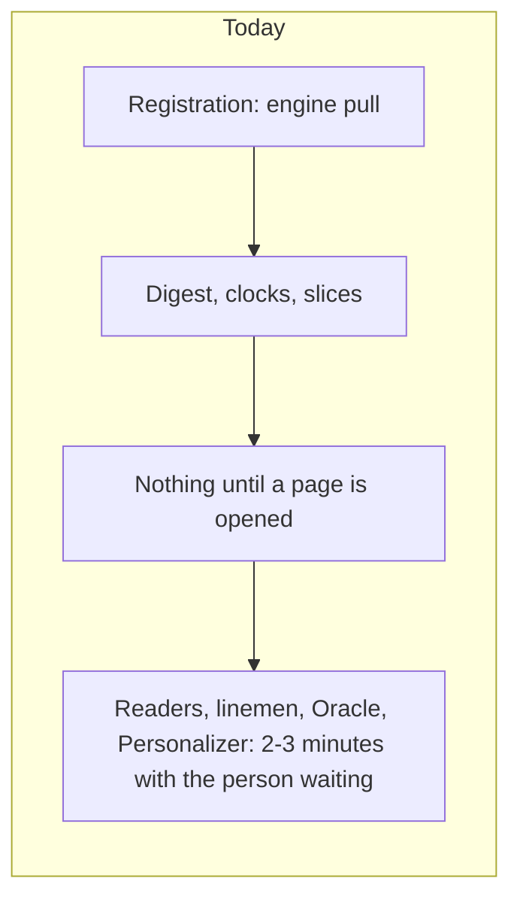
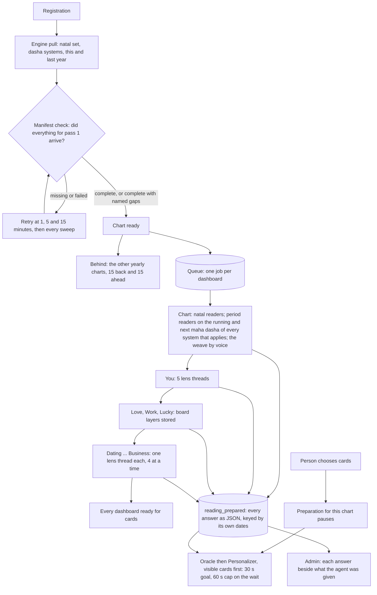

# 11 · The reading prepared ahead (rev 3): one status from registration to ready, a queue the dashboards work through, the current and the next maha dasha first

Rev 3 written 2026-11-21, after Sachin's third message of that day. Plan only; no code is changed by this document.
Rev 1 is commit `ebc2316`; rev 2 is `f0cb9b5` and `0aa9525`.

**What rev 3 changes from rev 2**

| # | Change | From |
|---|---|---|
| 1 | Pass 1 reads the **current and the next maha dasha** of every dasha system **that applies to the person** (33 on the test chart, not 41), judged by the confirmation rule of doc 12 | Sachin; doc 12 |
| 2 | The target for a new person is **3 to 5 minutes** from signup to "You is ready for cards". Calls run side by side to reach it | Sachin |
| 3 | The Oracle and Personalizer have a **30-second goal and a 60-second hard cap on the wait**, per dashboard, and nothing else runs for that chart while they work | Sachin |
| 4 | No reading is written before cards are chosen (starter cards: no) | Sachin |
| 5 | Everything a sub-agent reads is cached for the request, and **all caches are taken down together when the request completes** | Sachin |
| 6 | The year passes stay **switched off** | Sachin |
| 7 | **No paid call and no paid test** is in the sequence. The work is built and checked with fakes, dry runs and free measurements | Sachin |
| 8 | Shared and dashboard-specific results are stored separately, and each technique records which upstream results it used and where they are (§4.5) | Sachin |
| 9 | The index rebuild is done: the database went from 532 MB to 294 MB (`docs/db-maintenance/`) | Sachin's yes |

Nothing in doc 09 is removed: every agent that runs today still runs and writes at least what it writes today.
Doc 10's budget ledger, deadline per read, `reading_units` record and 25-run gate are kept and required by this plan.

## Decisions

| # | Decision | Status |
|---|---|---|
| 1 | **Read all that apply, count the voices.** Every dasha system that applies to the person is read; the count follows doc 12 (two voices confirm, at most four counted) | Taken 21 Nov; the numbers are a house rule awaiting Sachin's confirmation (doc 12 §9) |
| 2 | **Preparation stops below the Oracle.** Sub-agents and linemen run after registration. The Oracle and Personalizer run when cards are chosen, visible cards first. No starter cards | Taken |
| 3 | **Current and next maha dasha first.** Year passes are designed (§4.6) and switched off | Taken |
| 4 | **A queue with a status**, dashboards in a fixed order | Taken |
| 5 | **Dashboards do not wait for the 15 + 15 yearly pull.** They start when the first pass has its data; the rest of the pull runs behind (§4.2) | Default kept; explained to Sachin |
| 6 | **Cache per request, taken down at once** when the request completes | Taken |
| 7 | **3 to 5 minutes** to the first dashboard; 30 s goal and 60 s cap for cards | Taken |
| 8 | **No paid calls for now** | Taken |

Still open, each with the default I will build:

| # | Open point | Default |
|---|---|---|
| A | **The 60-second cap and the depth rule.** At measured writing speed a long technical story plus its plain retelling can pass 60 s. `SOUL.md` §5 says a limit never cuts a reading | The cap is on **the wait**: at 60 s the dashboard shows every card that is finished, and a card still being written appears when it is done, at full length. Stopping the writing itself at 60 s would cut a story and needs your written yes |
| B | **Side by side, not in sequence.** Reaching 3–5 minutes means the calls inside a job run together and the eight focused dashboards run four at a time. Your earlier message said "in sequence" | Side by side. The queue order and the status per dashboard stay. `READING_PREP_PARALLEL=1` and `READING_PREP_JOBS=1` give strict sequence |
| C | Lens linemen and the Oracle read the titles of the cards on the person's board, so their answers cannot be prepared before the person chooses | They read the lens's full card list (the same for everyone). A prerequisite; its depth replay needs model runs, so that check stays open until paid runs are allowed |
| D | Standing yes for preparation spend on every new chart | Built behind `READING_PREP=0`. Nothing is spent until you turn it on |
| E | Disk size before signups open | About 70 more charts fit now (§1). Decide before opening signups |

## 1. Start (checked 2026-11-21: server `develop`, the staging database and Lambda, read only)

**Registration and the engine pull**

| Fact | Where |
|---|---|
| Registration invokes the server's own Lambda (900 s timeout) with a `kundli-sync` event. A lease on `kundlis.queue_started_at` keeps two workers off one chart. A 15-minute sweep picks up what is incomplete | `services/kundliSyncWorker.ts:1-31,166-177,384-447`; Lambda config |
| The pull is the engine catalogue: 186 natal types and 7 yearly types marked served. Each stored row has a status: ready, fetching, failed or unsupported. Up to 4 engine calls run at once, 250 ms apart | `chartData/registration.ts`; `kundli_data`; `config/env.ts:159-161` |
| For the newest chart about 180 rows landed in the first 2 minutes after signup. Signup-to-digest time is **not in the table**: the charts were re-synced together on 15 Nov and `fetched_at` is overwritten on a refetch | `kundli_data.fetched_at`, chart `e1df0fcf` |
| **There is no single status.** A chart has `queue_status`, `facts_status`, `digest_status`, `last_sync_error` and row counts worked out on request | `schema.prisma:113-128`; `services/chartStatusService.ts` |
| **"Complete" can have holes** (§4.2 explains the three on the test chart). A failed, given-up or unsupported row counts as settled, and nothing lists what is missing | `kundliSyncWorker.ts:340-348`; `chartStatusService.ts:67` |
| Yearly charts: 10 years back and 10 ahead, Tithi Pravesha and Varsha in D1, D9, D10 only, filled by a sweep at **40 engine calls a run**. That cap is ours, not the engine's | `digest/annualSet.ts:12-16`; `env.ts:1757-1760` |
| Dasha rows: 42 systems; levels 1–3 from birth to 30 years ahead; level 4 only near today, written by a separate Lambda (`aiastra-dasha-deep-worker`, 600 s) one chart at a time and only for charts someone has opened. Three of six charts have none | `digest/activation.ts:3-4`; `workers/dashaDeep.ts:12-16` |
| Six conditional dashas that do not apply to the test chart are stored anyway, for life | `dasha.applicable`; `kundli_activation` |

**The current and the next maha dasha, measured on the test chart (systems that apply only)**

| Fact | Number |
|---|---|
| Systems stored / apply / with a running maha dasha | 42 / 34 / 33 (doc 12 §2) |
| Sub-periods inside the 33 running maha dashas | 347 |
| Level-3 rows inside the running sub-periods | 354 |
| Level-4 rows inside the running level-3 periods | 372 |
| Systems with a next maha dasha stored; its sub-periods | 32; 339 |
| Next maha dashas starting within two years | 10 (Narayana 2027-10-15, Dwisaptati-sama 2028-02-16, Vimshottari 2028-03-16, Sudasa 2028-08-03 among them) |
| Pass 1 in all | about 1,510 rows, about 38,000 tokens |
| **Nothing is scoped this way today.** Cards read the next 12 months of at most 5 clocks; only the "This chapter" card reads the next maha dasha lord | `self/v3/yearFrame.ts`; `prompts/cards/threads/self.chapter.md:33` |

**Sub-agents, cache, queue, disk**

| Fact | Where |
|---|---|
| **The shared readers process exactly the same data for every dashboard.** There is one build per chart: Love and Work queue the Self build. The 7 family readers, the clock readers, the agreement ledger and the natal context take no dashboard, lens, card or person as input, and each is stored once per chart | `families/run.ts:66-117`; `clocks/reader.ts:289-405`; `slices/natalPrefix.ts:333`; `boards/v3Service.ts:82` |
| **But their prompts are written for the Self board** ("the self, mind, and body houses"; body parts), and the natal context carries only the 12 Self area briefs | `self/oracle.ts:456,497,531-548`; `self/areas/index.ts:34-35` |
| **Data that differs by dashboard:** the Love and Work house layers (Love reads houses 7, 5, 11, 2, 4, 8, 12; Work reads 10, 6, 1, 2, 11, 3, 7, 9, 12), computed in code on every build and **not stored**; the lens recipe and matters; the cards. The lens linemen do not read the house layers today; only the card pack does | `cards/techniques.ts:441-477`; `area/love.ts:11`; `area/work.ts:15`; `lens/lineman.ts:76-95` |
| **Nothing records which upstream results a technique used or where they are.** `PIPELINE_CONSUMERS` lists who reads each output; a cache hit is a `cached` flag, and a family-reader hit writes no run row at all | `cards/pipeline.ts:25-45`; `techniques/outputStore.ts:192-200,397-424`; `families/run.ts:121` |
| A cache is created on its second use, lives 30 minutes from its last use, and is deleted when the whole build ends. Cache storage has no price in the code. There is no limit on calls in flight to the model; a refused call is retried once | `llm/promptCache.ts:11-61`; `llm/cacheLease.ts:73-93`; `llm/models.ts:38-49`; `llm/gemini.ts:8,242` |
| Background work runs as events the server sends itself, each with a marker row as its lease and a sweep as its retry. There is no SQS | `server.ts:143-167`; `package.json:39` |
| Every digest rebuild deletes all stored answers for the chart, and deletes and re-inserts the chart's dasha rows | `digest/build.ts:1735-1738,1768-1802` |
| **Disk after the index rebuild of 21 Nov:** 294 MB for 6 charts, about 49 MB a chart (it was 532 MB and 88 MB). The disk guard's line is 3,758 MB, so about 70 more charts fit | `docs/db-maintenance/2026-11-21-kundli-activation-index-rebuild.md` |
| **The disk guard** is a check that runs before a bulk write of dasha rows: it reads the database size, estimates what the write adds, and refuses if the total would pass 70 % of the disk. It was added after the disk filled on 9 Nov and took staging down. It covers only the deep-level worker and the backfill script | `digest/diskGuard.ts:1-9,82-83`; `workers/dashaDeep.ts:276-323` |
| Card model prices (`gemini-3.8-flash`): input $0.75, cached $0.075, output $3.75 per million tokens, doubling on 1 January 2027. Measured writing speed 85–120 tokens a second | `llm/models.ts:38-56`; `agent_runs` |
| **Every model time and cost in this plan is an estimate.** They cannot be measured without paid calls, which are not allowed now | — |

## 2. End goal

- A new chart has **one status** from "registered" to "ready": what arrived from the engine, what did not, what is
  being retried.
- **3 to 5 minutes after signup the You dashboard is ready for cards** (estimate: about 5 to 6 with today's pull and
  digest; §4.4 says what closes the gap). Every dashboard is ready about 2 minutes later.
- When the person chooses cards, the Oracle and the Personalizer are the only things running for that chart: stories on
  screen in about 30 seconds, never more than 60 seconds of waiting.
- Every dashboard technique reads the running and the next maha dasha of every dasha system that applies, and states
  how far the systems confirm one another (doc 12).
- Opening a dashboard whose stories are stored makes no model call. A refresh after new facts or answers runs only the
  Personalizer.
- A period's reading is stored against that period's own dates and is never bought twice.
- Each technique shows which upstream results it used, when each was made and where it is stored; each sub-agent
  answer can be opened beside what the agent was given.
- No rebuild or sweep deletes a stored answer that is still valid. No cache outlives its request.

## 3. Deliverable

**Server**
- Migration M56: `kundli_pipeline` (the one status row per chart), `reading_prep_jobs` (the queue),
  `reading_prepared` (every stored answer), a scope key on `kundli_slices`.
- `src/reading/pipeline/manifest.ts`, `pipeline/status.ts`, `pipeline/retry.ts`.
- `src/reading/prep/order.ts`, `prep/queue.ts`, `prep/dispatch.ts`, `prep/scope.ts`, `prep/requirements.ts` (what each
  technique needs and where it is stored), `prep/processors/{chart,self,board,lens,lucky}.ts`, `prep/store.ts`,
  `prep/cache.ts`, `prep/review.ts`.
- `src/reading/clocks/needle.ts` (the period readers and the weave), `clocks/systems.ts` (voice and tag per system).
- Changed: `digest/annualSet.ts`, `services/kundliSyncWorker.ts`, `services/chartStatusService.ts`, `digest/event.ts`,
  `digest/build.ts` (scoped delete), `techniques/outputStore.ts`, `families/run.ts` and `self/oracle.ts` (subject-neutral
  prompts, JSON by schema, applicability from the engine's verdict), `lens/lineman.ts` (reads its board's layers),
  `cards/techniques.ts` (board layers stored), `cards/oracle.ts`, `cards/run.ts` (the 60-second wait, the streamed
  hand-off), `self/v3/build.ts`, `self/buildEvent.ts`, `llm/cacheLease.ts`, `llm/models.ts`, `config/env.ts`, registry
  and catalog rows, `cards/pipeline.ts`.
- Prompts: `clock/period-reader.md`, `clock/weave.md` (new); the 13 lens recipes, `lens/lineman.md`, `cards/oracle.md`,
  the family prompts.
- Tests beside each file; `scripts/prep-replay.ts --dry` (prints every planned call with its input size and estimated
  cost and makes no call); recorded fake answers for the queue tests.

**Admin app:** one page, "Preparation". **Web:** the status line. **Docs:** this plan, doc 12, the rule text of §6.

## 4. How it works when done

### 4.1 Before and after

### 4.2 Backend: one status and the manifest

- **The manifest** is a list, built in code from the engine catalogue, of everything a chart must have, and what
  needs it:

  | Item | Count | Needed for |
  |---|---|---|
  | Natal types the catalogue marks served | 186 | chat, pass 1 |
  | `dasha.applicable`; for each system that applies: level 1–3 rows, a running maha dasha with sub-periods, the next maha dasha with sub-periods | 34 systems on the test chart | pass 1 |
  | Level-4 rows under the running level-3 period | 33 | pass 1, not waited for (below) |
  | The clock set's dated rows | 4–5 | pass 1 |
  | This and last Tithi Pravesha year: the year chart in 20 divisional charts, Varsha in D1, D9, D10, the year dasha, Mudda, Patyayini, sahams, Tajaka | 28 rows a year | pass 1 |
  | The same for each other year, 15 back to 15 ahead | 28 × 29 | the year passes (off) |
  | Digest sections, activation rows, slices | — | pass 1 |

- **What "complete has holes" means today.** The code calls a chart complete when every row is *settled*, and a row
  that failed, was given up on, or that the engine could not serve counts as settled. Nothing lists them. The test
  chart is marked complete and has three:

  | Hole | What is wrong | Why nothing caught it |
  |---|---|---|
  | The `kaala` dated rows failed on 10 Nov | one clock's rows never arrived | the check only counts that four clock rows are ready; four others are, so the failed one is never asked for again |
  | Kalachakra has level 1 only | no sub-periods at all, for life | the pull row is "ready"; nobody compares what a ready row contains with what it should contain |
  | Aayu has no period from 2016-10-22 to 2027-12-13 | an 11-year hole in the stored periods, including today | the same |

  With the manifest each of these is a **named gap** in the status and on the admin page, and a failed row is retried.
- **The verdict**, per need: *complete*; *complete with named gaps*; *incomplete* (something required is missing and
  is being retried).
- Each dashboard declares which items it **requires** and which are **optional**. A required gap blocks that dashboard.
  An optional gap is named in the sub-agent's input as "not available" and never filled in. D1, D9, the star voice, the
  sign voice and the Tithi Pravesha year are required everywhere.
- **Level 4** is asked for at chart ready and **not waited for**: pass 1 reads levels 1–3 and the level-4 cells are
  added when the rows land. Waiting would put the 3–5 minutes out of reach whenever two people sign up together.
- **Retry:** a row that blocks pass 1 is refetched after 1, 5 and 15 minutes, then at every sweep, in place of the
  6-hour wait. After 6 failures it is given up and named.
- **Why the dashboards do not wait for the 15 + 15 yearly pull.** Pass 1 needs this year and last year: 56 rows,
  pulled inside the registration run. The other 812 rows are needed only by the year passes, which are off. The "2 to 4
  hours" of rev 2 was our own cap of 40 engine calls per sweep run, not the engine's speed. Rev 3 lifts that cap for a
  new chart: the rest is pulled behind the dashboards, nearest year first, 4 calls at a time (estimate: 10 to 20
  minutes), and the status shows it as "filling", not as missing.
- **`kundli_pipeline`** holds the result so the queue and the admin page read one row. It is recomputed from the stored
  rows at the end of every sync, digest and clock run; the rows stay the truth.
- **Stages:** `registered → pulling → checking → chart_ready → preparing → ready_for_cards → complete`, with `blocked`
  (a required gap) and `paused` (spend stop, disk, switch off) beside them.

### 4.3 Backend: the queue and the order

- **`reading_prep_jobs`**: one row per chart, dashboard and pass, with `seq`, `priority`, `status` (waiting_data,
  queued, running, done, failed, skipped), `attempts`, `lease_until`, times, calls, cost, error, and the list of
  requirements with where each was found (§4.5). All jobs are written when the chart becomes ready.
- **Order** (from `PORTAL_DASHBOARDS`, with the shared work first):

  | # | Job | What its processor does | Runs |
  |---|---|---|---|
  | 0 | chart | natal readers; period readers; dated readers and clock readers; the weave | calls side by side |
  | 1 | self | five lens threads | side by side |
  | 2–4 | love, work, lucky | the board's house layers, stored per board; no model call | one after another, seconds |
  | 5–12 | dating, marriage, friends, allies, career_start, primary_job, hobby, business | one lens thread each | four jobs at a time |

- **Every processor has the same four steps:** resolve its requirements (found in the store, or run now, or blocked) →
  cut its slices and store them → run its sub-agents → store each answer with its dates. A unit already stored with
  the same inputs is read, not run again.
- **The wake-up** is a `reading-prep` event the server sends itself. One invocation keeps taking the next job until 10
  of its 15 minutes are used, so there is no pause between dashboards. Every answer is stored as it lands; a rerun
  resumes at the first missing unit. The 15-minute sweep requeues a job whose lease lapsed. Three attempts, then
  `failed`, shown, and the queue moves on; a failed job is tried again after 30 minutes.
- **Limits:** one preparation at a time per chart; two charts at a time (`READING_PREP_CHARTS`); at most 12 model calls
  in flight per chart (`READING_PREP_PARALLEL`); a refused call backs off and retries (new: the code has no limiter
  today).
- **Priority:** a dashboard the person has open goes next. A card request pauses the queue for that chart (§4.7).

### 4.4 Backend: pass 1, the current and the next maha dasha

- **Scope**, selected from stored rows by date (Node computes no astrology), for every system the engine says applies:
  the running maha dasha, every sub-period inside it, levels 3 and 4 under the running sub-period; **the next maha
  dasha and its sub-periods**; the previous maha dasha in one line. About 1,510 rows on the test chart. With it: this
  and last Tithi Pravesha year and the sky, as today.
- **The natal readers** (`family.rasi`, `family.moon`, `family.star`, `family.varga`) run once per chart. Their prompts
  become subject-neutral: every house and every matter, not the Self houses first.
- **The period readers** (new): about 12 calls of three systems each, grouped by voice (doc 12 §3). Each returns one
  **cell per period**: the houses the engine stored, what the period brings and for which of the 12 matters, a tone,
  the evidence keys. The running and the next maha dasha get a full judgement; the closing sub-period is flagged.
- **A cell is stored against its own system, level and dates** and is not rewritten while the chart data and the prompt
  are unchanged. When a sub-period ends, the next one's cell already exists.
- **The weave** (new): three calls side by side, four matters each. It compiles all cells by voice and applies the rule
  of doc 12 §4: per matter, the status (confirmed, leaning, open, contested), which voices carry it, the support from
  the other systems reported separately, and the chapter turn when the leading voices change maha dasha together.
- **The clock readers** of today still run for the 12-month frame.
- **The lens threads:** one lineman per lens, as today (promise → period → year → star → trigger), now reading the
  cells and the weave, and for Love and Work lenses their board's stored house layers.

**Allotment per agent (estimates; not measurable until paid runs are allowed):**

| Agent | Calls | Model · thinking | Input tokens | Output ceiling (expected) | Timeout | Est. cost each |
|---|---|---|---|---|---|---|
| Natal readers | 4 | 3.1-flash-lite · medium | 2k–10k | 6,000 (800–2,000) | 60 s | $0.003 |
| `family.dasha`, `family.year`, `family.sky` | 3 | same | 2k–15k | 6,000 | 60 s | $0.002–0.006 |
| Period readers | about 12 | 3.8-flash · low | 45k cached + ~3k | 10,000 (about 5,000), continued when cut | 150 s | $0.025 |
| Weave | 3 | 3.8-flash · medium | 45k cached + ~40k cached | 10,000 (2k–3k) | 150 s | $0.02 |
| Clock readers | 5 | 3.8-flash · low | 48k (43k cached) | 8,192 | 60 s | $0.012 |
| Lens linemen | 13 | 3.8-flash · medium | 85k cached + ~8k | 10,000 (2.5k–4k), continued when cut | 150 s | $0.03 |

**The clock from signup (estimates, except where marked measured):**

| Step | Time | Running total |
|---|---|---|
| Natal pull, 186 types, 4 engine calls at a time | about 2 min (measured: about 180 rows in the first 2 minutes) | 2:00 |
| Digest build; this and last year's rows and the clock rows pulled beside it | 1 to 1.5 min (the logs' `digest_built` time is being read; §8 step 2) | 3:00–3:30 |
| Natal readers and period readers, started the moment the digest lands | about 55 s | 4:00–4:30 |
| Weave | about 35 s | 4:35–5:05 |
| You lens threads | about 45 s | **5:20–5:50: You is ready for cards** |
| Love, Work, Lucky layers; eight lens dashboards four at a time | about 1.5 min | about 7:00–7:30: every dashboard ready |

- **To get from about 5.5 minutes to inside 5:** start the period readers on the dasha rows before the digest finishes
  (they need the dasha rows and the natal rows, not the digest's house cards), and let the You lens threads start on
  the cells while the weave runs, taking the weave's status in a short second step. Both are in the build as settings
  and are measured as soon as paid runs are allowed. Three minutes is not reachable while the pull alone takes two.
- **Cost of pass 1:** about $0.85 a chart (range $0.70–1.00), stop at $1.50. Nothing is spent while `READING_PREP=0`.

### 4.5 Backend: what is shared, what is separate, and how a technique knows

| Result | Same data for every dashboard? | Stored | Key |
|---|---|---|---|
| Natal readers, dated readers, clock sheets, cells, the weave, the natal context | **Yes.** One result per chart | once, in `reading_prepared` | chart, unit, dates, input hash, prompt hash |
| House layers of a board (Love, Work; the Self area briefs) | **No.** Different houses and charts per board | **separately per board** (new: today they are recomputed and not stored) | chart, board, digest version |
| Lens thread | **No.** Its recipe, matters and board layers differ | separately per lens | chart, lens, dates, input hash |
| Oracle story, plain story | No. Per card | per card | chart, card, dates, input hash; person hash for the plain story |

- **Requirements (`prep/requirements.ts`).** Each technique (a lens thread, a card) declares the upstream results it
  needs. Before it runs, each requirement is resolved and recorded on the job: **found** (the unit's id, where it is
  stored, when it was made, its dates), **run now**, or **missing**. A found result is never run again.
- **The agent is told too.** The input of a lineman or the Oracle opens with the list of results it was given, by name
  and date, so its answer can cite them and the review page can show a result that was given and not used.
- **Linemen compile, in preparation.** The weave compiles every system into voices; each lens lineman compiles the
  shared results and its board's layers into the lens thread. Both run in the queue, before any card is chosen.

**Slices, the store and the cache**

| What | Where | Lives until |
|---|---|---|
| Slices (what each agent is given) | `kundli_slices`, with a scope key | its rows change. Kept 30 days for review, then only the hash |
| Every answer, with the keys it was given and the keys it cited, tokens, time, cost, model, job | `reading_prepared`, JSON | its inputs change. Never deleted by a digest rebuild or a date sweep |
| Caches | Gemini explicit caches, one set per **request** | the request completes |

- **Cache rule (decision 6).** A request is one preparation run for a chart, or one dashboard's card reading. At its
  start, everything two or more of its calls will read is cached: the natal context, and for the lens threads the
  cells, the weave and the findings as a second block. **When the request completes, or fails, every cache it made is
  deleted in one step.** As a safety net each cache also expires two minutes after its last use. A block that only one
  call reads is sent as plain input. Cache storage gets a rate in the price table so its cost is recorded.
- `digest/build.ts` stops deleting every stored answer; an answer is reused only when the hash of the rows it read is
  unchanged.
- **Disk:** about 1 MB a chart for pass 1. The disk check runs before each preparation job too (today it guards only
  dasha-row writes); a refusal sets the status to `paused`.

### 4.6 The year passes (designed, switched off)

Kept from rev 2 and not built now: after pass 1, one pass per Tithi Pravesha year (previous, next, outward to ten each
way), each in the same dashboard order, at an estimated $0.43 a year for all dashboards. `READING_PREP_YEARS=0`. The
store and the queue are shaped so that turning them on later adds jobs and no new tables.

### 4.7 Backend: cards, when the person chooses them

- Saving the card choice queues the board build that exists today, for that dashboard.
- **Full focus.** The preparation queue for that chart starts no new call until the card request completes. If the
  chart job or the dashboard's own job is not finished, the build runs it first, itself, under the job's lease; if
  another invocation holds that lease, the build waits on the job row and takes over if the lease lapses.
- **Order:** the cards on screen first, in deck order, then the rest. The Oracle runs for all of them side by side
  (limit 12). Each card's Personalizer starts from the Oracle's story as it streams, not after the whole answer.
- **30-second goal, 60-second cap on the wait** (open point A). At 60 seconds the dashboard shows every finished card;
  a card still being written shows "still being read" and appears when done, at full length. Its own time limits (150 s
  for the Oracle, 90 s for the Personalizer) are unchanged, and a call cut at its ceiling is continued.
- The Oracle reads the lens thread, the weave and the cells for its lens, the findings it cites, the card brief and the
  lens's full card list. The Personalizer alone reads the person.

| Cards chosen | Stories on screen (estimate) | Cost today | From January |
|---|---|---|---|
| 7 | 35–60 s | about $0.25 | $0.50 |
| 8 | 35–60 s | about $0.29 | $0.58 |
| 11 | 35–60 s | about $0.40 | $0.80 |

A technical story is 2,500–4,000 tokens: 21–47 s at the measured speed. A plain story is 1,200–2,000 tokens: 10–24 s.
With the streamed hand-off they overlap, so most cards should land inside 45 s and the longest may pass 60 s.

### 4.8 API, screens and the review page

- **`GET` chart status** (existing) gains `pipeline`: the stage, `done` and `total` jobs, the dashboard being prepared
  and a plain sentence. No raw error and no engine name is sent.
- **Web copy:** "Getting your chart" → "Checking everything arrived" → "Reading your chart" → "Reading your current
  period" → "Preparing You" (then each dashboard) → "Ready. Choose your cards." A blocked chart shows "Some of the
  calculations did not finish. We are trying again." and the Retry button.
- **Admin, "Preparation" page** (per chart): the status row and named gaps; the job list with each requirement and
  where it was found; and for each answer the slice it was given, the JSON it returned, **the keys it was given and did
  not cite**, validation issues, tokens, time and cost. The given-against-cited list compares evidence keys in code; it
  is not a scan of words.

## 5. Architecture

- **Engine:** every astrological fact, row, date and applicability verdict. No new calculation is asked for by this
  plan; doc 12 §8 lists what would improve it.
- **Server, request path:** reads the status and stored answers; never runs a sub-agent.
- **Server, events:** `kundli-sync` (pull) → manifest check → `reading-prep` (jobs, 900 s Lambda, 10-minute budget) →
  `self-reading-build` (cards). The sweeps are the retry for all three.
- **Database:** the queue, the status, the slices and the answers. A lease per job and a unique key per answer make a
  repeated run harmless.
- **Guarantees:** resumable per answer; an answer is reused only on an input-hash match; with `READING_PREP=0`, or on
  any preparation failure, a board builds on open as it does today.

## 6. Rules to change on approval

*`SOUL.md` §5, replace the "only verified systems" bullet with:*
> **Every dasha system that applies to the person is read, for the running and the next maha dasha; only independent
> voices are counted.** A star dasha confirmed by a sign dasha is a confirmation; systems of one family are one voice;
> the others are reported as support and never raise the count (`docs/techniques/12`). A longevity dasha is never named
> to the person. A system the engine marks as not applying, or has not checked, is not read.

*`AGENTS.md`, "Board and technique machinery", add:*
> 8. **Prepared in the queue, keyed by its own dates.** An agent whose input is the chart and a period runs in the
>    preparation queue and stores JSON in `reading_prepared`. An agent may read the person's choices or facts only if it
>    runs when cards are chosen. No rebuild or sweep deletes a prepared answer whose inputs are unchanged.
> 9. **Complete means checked.** A chart is ready only when the manifest says every required item arrived. A failed or
>    unsupported row is a named gap, never a silent pass.
> 10. **Same data, one result; different data, separate results.** A result that does not depend on the dashboard is
>    stored once per chart. One that does is stored per board or lens. Every technique records which results it used
>    and where they are.
> 11. **A cache lives for one request** and all of a request's caches are deleted together when it completes.

## 7. Ingredients

| Ingredient | Detail | Owner |
|---|---|---|
| Migration M56 | three new tables and one column set; additive | dev agent; applied for testing under the standing yes |
| Env | `READING_PREP` (0), `READING_PREP_YEARS` (0), `READING_PREP_PARALLEL` (12), `READING_PREP_JOBS` (4), `READING_PREP_CHARTS` (2), `READING_PREP_STOP_USD` (1.50), `READING_PREP_DAILY_USD` (25), `CARDS_WAIT_CAP_MS` (60000); `ANNUAL_SPAN_YEARS` 10 → 15 | deploy session |
| Events | `reading-prep` on the existing `POST /events`; the existing sweep rule also sweeps the queue. No new IAM, no SQS | dev agent; no infra change |
| Engine | no code change; more yearly rows asked for | — |
| Fakes | recorded answers per agent schema, so the queue, the store and the card path run end to end with no model call | dev agent |
| Free measurements | pull and digest times from the logs and from one new test registration (engine calls only) | dev agent |
| Paid runs | **none now.** Listed in §9 "Later" | Sachin's yes, when he allows them |
| Doc 10 | its ledger, deadline and `reading_units` record, built first or alongside | the session that owns doc 10 |

## 8. Action steps in sequence (no step makes a model call)

1. Apply the rule text of §6 and doc 12 to the technique docs (done with rev 3: docs 08, 09 and the per-dashboard
   technique docs).
2. `pipeline/manifest.ts`, `pipeline/status.ts`, `kundli_pipeline`; read the pull and digest times from the logs and
   record them here. Done: the test chart reports "complete with named gaps" and names `kaala`, Kalachakra and Aayu.
3. `pipeline/retry.ts`, the sweep change, `annualSet.ts` (15 + 15, every Tithi Pravesha divisional chart, this and last
   year inside the sync run, the rest behind). Done: fake-engine test of the 1, 5, 15-minute retry; 868 keys for one
   chart; a dry-run byte estimate. *Parallel with step 4.*
4. `reading_prepared`, `prep/store.ts`, scoped digest delete, the scope key on slices, board layers stored per board.
   Done: a digest rebuild leaves an answer with unchanged inputs in place.
5. `prep/queue.ts`, `prep/order.ts`, `prep/dispatch.ts`, `prep/requirements.ts`, the `reading-prep` event, the call
   limiter. Done with fake processors: jobs run in order; requirements are recorded as found, run or missing; a lapsed
   lease is requeued; a failed job does not stop the next dashboard.
6. `prep/scope.ts` and `clocks/systems.ts` (voices and tags; applicability from the engine's verdict). Done: for the
   test chart 33 systems, about 1,510 rows, the six that do not apply and the two unchecked absent. *Parallel with 5.*
7. Period readers and the weave (`clocks/needle.ts`), prompts, registry and catalog rows. Done with fakes: one cell per
   period; the status per matter follows doc 12 §4 on hand-built cells (a confirmed, a leaning, a contested and a
   divided-voice case).
8. Family readers: subject-neutral prompts, JSON by schema. Lens linemen and the Oracle: the lens's full card list, the
   cells, the weave, the board layers. The 13 recipes and `cards/oracle.md`: the running and the next maha dasha.
   Done: schema and prompt tests; a brief names no data the pack lacks. **Open until paid runs:** the depth replay.
9. The processors, `prep/cache.ts`, the spend stops. Done: `prep-replay.ts --dry` prints every planned call for the
   test chart; with fakes, every cache a request made is deleted when it ends.
10. `self/v3/build.ts`, `buildEvent.ts`, `cards/run.ts`: prepared answers first, full focus, visible order, the streamed
    hand-off, the 60-second wait. Done with fakes: a card choice makes only Oracle and Personalizer calls; a slow fake
    card appears after the cap at full length.
11. `prep/review.ts`, the admin page, the web status line. Done: screenshots from fakes.
12. One new test registration on staging with `READING_PREP=0` (engine calls only): time each stage of the pull, the
    check and the digest; file what is found.

## 9. Development phases

| Phase | Steps | Ships | Closing check (free) |
|---|---|---|---|
| 1 One status | 1–3 | manifest, status, retry, the pull | a chart on staging reaches `chart_ready` with its gaps named; stage times recorded |
| 2 The queue and the store | 4–6 | tables, events, scope, requirements | fake processors run in order on staging; a rebuild leaves answers in place |
| 3 The current and next maha dasha | 7–9 | period readers, weave, neutral readers, processors, all behind `READING_PREP=0` | dry run lists every call; unit tests of the confirmation rule |
| 4 Cards and seeing the work | 10–12 | card path, admin page, status line | fakes end to end; screenshots |

**Later, each on Sachin's yes, in this order:** the doc 09 and retire-v2 replay; one pass 1 on the test chart (34 calls,
est. $0.85); a deck of 8 cards (16 calls, est. $0.29); the depth replay for the changed lineman and Oracle inputs; the
25-run gate per dashboard; turning `READING_PREP` on; the year passes.

## 10. One recommendation

Build phases 1 to 4 with no model call, behind `READING_PREP=0`: the status and manifest first, because they are free,
they fix a real fault today (charts marked complete with holes) and everything else keys on them.

| Alternative | Verdict |
|---|---|
| SQS as the queue | Not now: new infrastructure, and the status would still live in the database |
| Strict sequence for every call | Not the default: about 25 minutes to every dashboard; the settings allow it |
| Wait for all 868 yearly rows before any dashboard | Rejected: nothing in pass 1 reads them |
| Count every system that agrees | Rejected: systems of one family are one voice (doc 12); more clocks agree by accident |
| One model call per dasha system | Rejected: 33 calls for the same rows; twelve grouped calls write the same cells |
| A separate copy of the shared readers per dashboard | Rejected: the data is identical; subject-neutral prompts and one stored result serve all |
| Stop a story at 60 seconds | Forbidden by the depth rules without Sachin's written yes |
| Starter cards at signup | Rejected by Sachin: the Oracle and Personalizer run only when cards are chosen |

## Verification

- Server: `npx tsc --noEmit`; `npx vitest run tests/unit/reading tests/unit/agents tests/unit/techniques`; new tests for
  the manifest, the retry, the queue order and leases, the requirements record, the scope, the voices and statuses, the
  store, the scoped delete, the cache life, the 60-second wait.
- Dry run: `scripts/prep-replay.ts --dry` for the test chart.
- Staging, free: one test registration timed stage by stage; the status row at each stage; the admin page on fakes.
