# Technique atlas · 01 · Self board

Written 2026-11-19. Documentation only. Layout, colours and source tags follow `00-how-to-read.md`; the shared timing
block, clock layer, year frame and status rule are drawn in `04-shared-machinery.md`.

Left-hand line numbers are from `release-candidate-staging` `0fc6bfa`; right-hand file references are from `develop`
`9fc0cf3`. The 21 readable Self cards (`READABLE_CARDS`, `self/v3/cards.ts:72`) fall into five lenses on `develop`
(`cards/routing.ts:114-134`). On live they sit in five registry groups that split them differently.

| Lens on `develop` | Cards | Live registry group |
|---|---|---|
| `self.temperament` | `lagna`, `presence`, `yogas` | character |
| `self.mind` | `mind`, `sharpness`, `mood`, `stuck`, `restores`, `play`, `learning` | mind (`learning`: character) |
| `self.purpose` | `purpose`, `drive` | character |
| `self.body` | `body`, `fitness`, `sleep`, `blood`, `layers` | body (`layers`: indian) |
| `self.chapter` | `diagnosis`, `chapter`, `chapters`, `year` | time (`diagnosis`: character) |

What every Self card has on live, whatever its lens: the shared natal slice (`family.rasi` and `family.varga` packs,
`self/v2/slices.ts:256`), in which only D9, D10 and D30 carry all twelve houses, every other divisional chart only its
1st house, and D5 and D11 are absent (`self/oracle.ts:206-209`); the year slice with dates, year lagna and year lord but
no year-chart houses (`slices/render.ts:154`); the timing block with the age band and the Self-only chart table
(`cards/oracle.ts:95`), which on the live grouped path never names the card (`cards/group.ts:126`); its ledger cells and
matter rows; no technique rows (`cards/techniques.ts:158`).

On `develop` every recipe step is prompt text read by the lens lineman and the card Oracle, so each step is gated by
`CARDS_STORY_CONTRACT` (default on) and, for the lens thread, `LENS_LINEMEN` (default on). Rows marked "found here" are
gaps found while writing this page; they are not items of plan 07 or plan 09.

## Self · Board · Board pipeline
<!-- pair id=self-board-pipeline board=self lens=- reaches=yes live=0fc6bfa dev=9fc0cf3 -->

### Live today

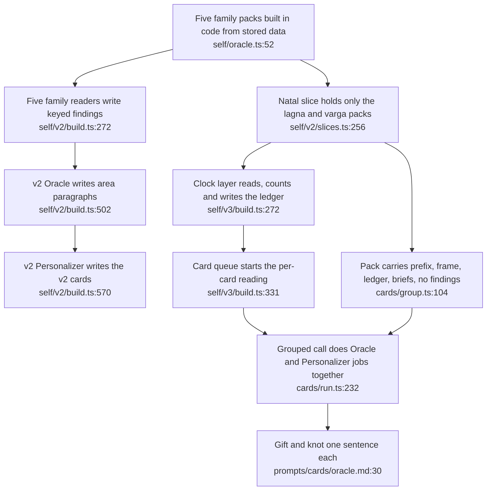

### With the research

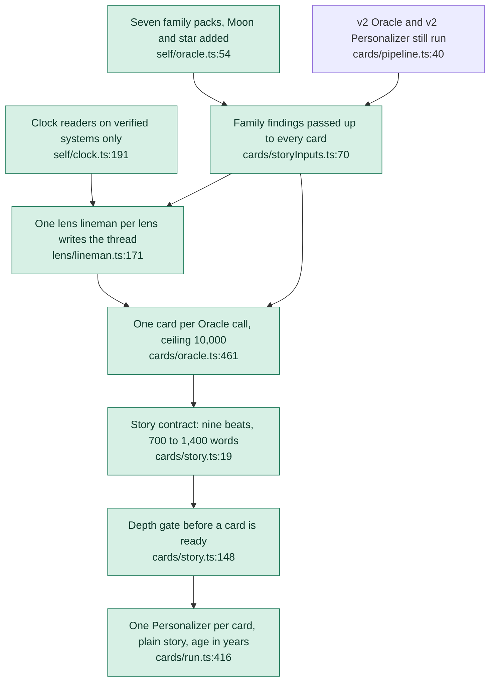

### Changes

| Change | Why | Source | Research file and heading | State | Needs |
|---|---|---|---|---|---|
| Two new family readers: `family.moon` (D1 houses with signs, lords and occupants; the model counts from the Moon's sign) and `family.star` (star, star lord, pada and star chain per planet; tara is not stored and may not be computed). No flag; they run in every v2 build (`SELF_V2_BUILD=1`). Star lords exist for D1 only. | The Moon is the mind; a planet acts through its star lord; the mind is read through the lagna lord's star lord. | Student (Moon, Rao); gap (star-lord rule, commentary without a verse); Rath (lagna lord's star lord) | `sanjay-rath/02-reading-procedure-and-precedence.md` §3 "Which reference point governs which question"; `natal-techniques/23-nakshatra-natal-reading.md` §5 "Interpretation rules"; `sanjay-rath/07-self-mind-spirituality.md` §1 Rules | built on develop | engine E4 |
| Lens linemen: one call per lens with cards on the board writes the lens thread (promise, period, year, star, trigger, each keyed and tagged) from the findings, the clock sentences, the ledger statuses and the lens recipe. Flag `LENS_LINEMEN`, default on (only with the story contract). | The research's working chain: natal promise, then dashas, then the year, then transits. Its order is assembled, not stated by any source. | Inferred | `sanjay-rath/05-timing-transits-annual-prashna.md` §8 "INFERRED reading order (not stated by any source)" | built on develop | nothing (release only) |
| One card per Oracle call with the story contract (technical story of 700 to 1,400 words in nine beats: maha, sub, year, last year, Moon, D9 and own chart, systems, trigger, verdict) and a beat index. Ceiling 10,000 tokens, continued at the cap. Flag `CARDS_STORY_CONTRACT`, default on; it turns the grouped call off. | Doc 09 decisions 1 and 7. The live card is one paragraph; the live prompt claimed "40+ dasha systems" while the card got five. | Yours | gap | built on develop | nothing (release only) |
| Depth gate: a card is stored as ready only when its story meets the word floor and cites a maha dasha and sub-period with their system, the year chart, D9, its own chart and two verified systems (key kinds, no word lists). Same flag. | Doc 09 §5 rule 1 ("Reading depth is a release gate"). | Yours | gap | built on develop | nothing (release only) |
| One Personalizer per card, chained to its Oracle card: the plain story (350 to 700 words, same order), the guaranteed fields, age in years and life stage. Same flag. | Doc 09 decisions 1, 3, 5. | Yours | gap | built on develop | nothing (release only) |
| Spend cap per board build $1.50 (`READING_BOARD_SPEND_CAP_USD`) and $0.12 per card (`READING_CARD_SPEND_CAP_USD`); cards past the cap are queued, never written shorter. Nothing schedules the queued round except the next open or sync (already filed). | Doc 09 §3.5. | Yours | gap | built on develop | nothing (release only) |
| Found here: `family.varga` still tells its reader to audit D30 as "physical/constitutional vulnerabilities" and D60 as root karma (`self/oracle.ts:486`, `:539`), and its findings now reach every card. | The body recipe and doc 08 keep D30 to strain words on the body cards and keep disease out; D60 needs a minute-exact birth time. | Rath (D30 evils and disease, sensitive) | `sanjay-rath/06-vargas.md` §1 Rules (rule 1.4); `sanjay-rath/15-sensitive-rules-and-gaps.md` §1 "Sensitive rules (titles only)" | planned | prompt |

### Stays the same

The v2 build still runs first and its family readers still feed the cards, the clock layer and its code count still run before any card, and the Personalizer still writes from the Oracle card only.

### Open

Plan 09 §8 step 13 retires the v2 Oracle, v2 Personalizer, concordance and group call after a paid depth replay (Sachin's yes), and doc 83 (`docs/reading-engine/83-one-card-writer-one-check.md`) retires the whole v2 Self path (`self/v2/build.ts`, `v2/oracle.ts`), which is where the family readers that plan 09 now feeds to every card run, so the two plans need reconciling first.

## Self · Temperament · Temperament recipe
<!-- pair id=self-temperament board=self lens=self.temperament reaches=yes live=0fc6bfa dev=9fc0cf3 -->

### Live today

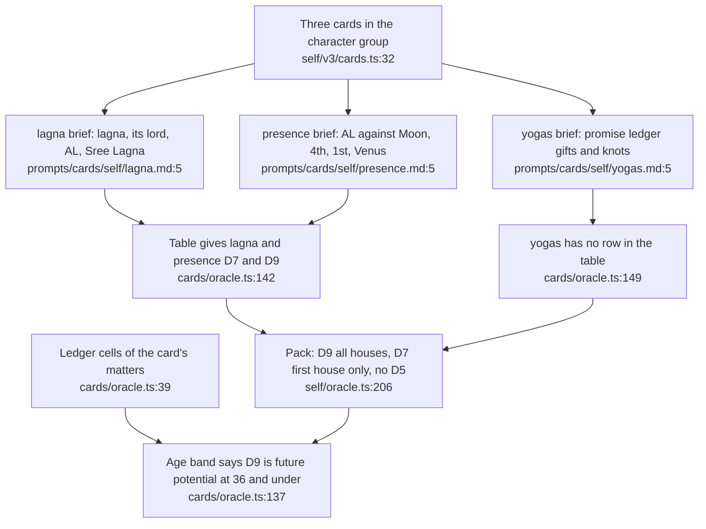

### With the research

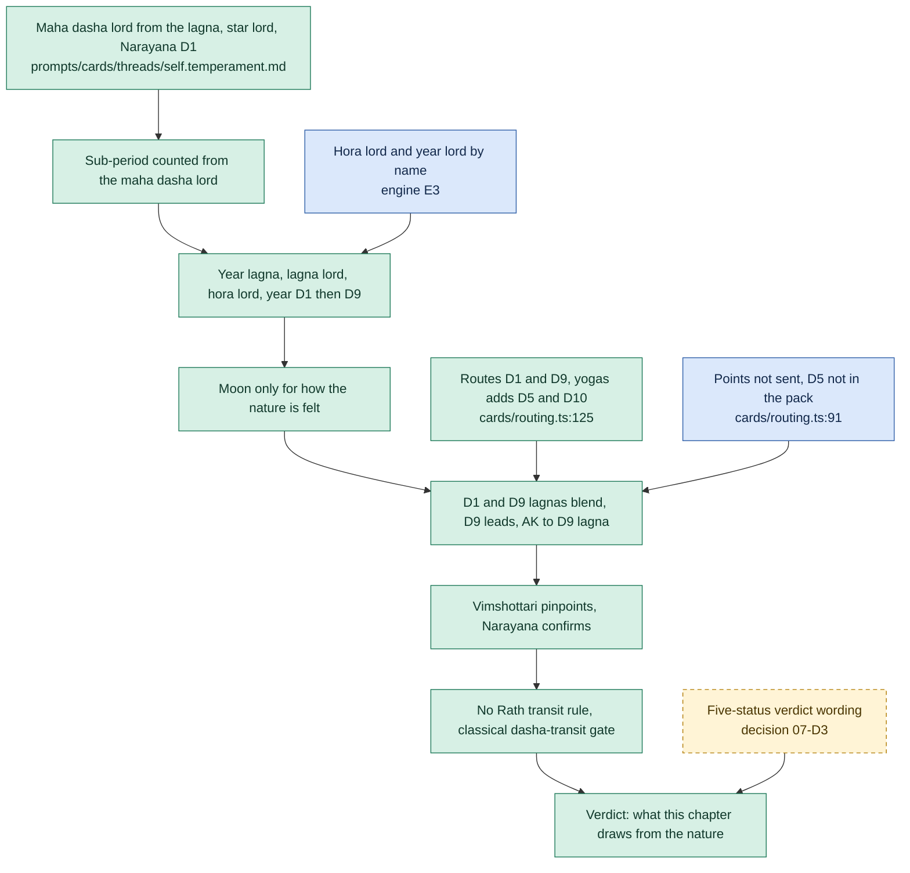

### Changes

| Change | Why | Source | Research file and heading | State | Needs |
|---|---|---|---|---|---|
| Step 1, maha dasha: the Vimshottari lord judged from the lagna (houses owned, seat, dignity, navamsa, links), then its star lord; whether it is or links to the lagna, its lord, the AL or the AK; the AK's own dasha brings hardship, a Narayana dasha of its sign achievement; the Narayana D1 sign judged from the lagna and the AL. | Dasha results follow the lord's condition; Vimshottari times the person's experience, Narayana the environment. Judging the Narayana sign from the AL is assembled. | Text (lord condition); gap (star lord); Rath (Vimshottari and Narayana roles, AK timing); Inferred (sign from the AL) | `dasha-results/dasha-lord-condition-principles.md` §4 "Rule procedure"; `sanjay-rath/04-dasha-selection-and-ranking.md` §1; `sanjay-rath/07-self-mind-spirituality.md` §1 "Timing method" | built on develop | engine E2 |
| Step 2, sub-period: the antardasha lord counted from the maha dasha lord (6th, 8th, 12th strain; kendra, trikona, 3rd, 11th work), then its own condition; planets 6th, 8th or 12th from the dasha lord act against it. | Classical bhukti rule. | Text (Phaladeepika 20.29, BPHS 57.79); Rath (6/8/12 from the dasha lord) | `dasha-results/antardasha-results-per-pair.md` §4; `sanjay-rath/02-reading-procedure-and-precedence.md` §9 "Badhaka, maraka, functional nature" | built on develop | nothing (release only) |
| Step 3, year: cast for the birthplace, never read alone; year lagna from the birth lagna, year lagna lord, hora lord as focus; year lord by weekday; then the 1st and the year AL in year D1, then year D9; Patyayini inside the year; one line on last year. The hora lord and year lord are not named in the data, and Patyayini is rendered nowhere. | No source says which year houses to read. | Rath, co-credited (casting); Student (Poddar order); Yours (weekday year lord, D1 then D9); gap (houses, Patyayini) | `sanjay-rath/05-timing-transits-annual-prashna.md` §1.1, §1.2, §1.3, §2 | built on develop | engine E3, server code |
| Step 4, Moon: the running lords' houses counted from the Moon's sign (from `family.moon`), used only for how the nature is felt, never as a second character sketch. | The Moon is the mind. Rath gives no temperament rule from the Moon sign or its star. | Student (Rao); gap (Moon temperament) | `sanjay-rath/02-reading-procedure-and-precedence.md` §3; `sanjay-rath/07-self-mind-spirituality.md` §1 Gaps | built on develop | nothing (release only) |
| Step 5, D9 and own chart: D1 and D9 lagnas blend with the D9 dominant; the lagna lord by house; Sun and AK argala on the lagna; the house from the AK to the D9 lagna leads; `presence` the AL; `lagna` the Sree Lagna; `yogas` a raja yoga confirmed in D5 and D10, early or late by house, the yogada through HL and GL. Found here: the pack has no D5, the route's points are not sent, and the old table (D7) and the "36 and under" line in the same request contradict this step. | Rath's only "D9 leads" rule, about temperament, at any age; D7 is children only. | Rath; Student (AL, Sree Lagna) | `sanjay-rath/07-self-mind-spirituality.md` §1 Rules (rules 1.2 to 1.13); `sanjay-rath/02-reading-procedure-and-precedence.md` §8 "Promise before timing; the varga confirms" | built on develop | server code |
| Step 6, other systems: Vimshottari pinpoints, Narayana must confirm; Lagna Kendradi low weight; the applying conditional confirms only; dates where two or more systems point to the lagna, its lord, the AL or the AK, as support. Found here: the spine can still be a conditional dasha, and Narayana is still toned from its levels 2 and 3. | Rath's one combining line; no required count anywhere. | Rath (Crux p.3); Student (Lagna Kendradi); Inferred (count as support) | `sanjay-rath/04-dasha-selection-and-ranking.md` §4 "Conditional nakshatra dashas", §7 "How systems combine" | built on develop | server code |
| Step 7, trigger: no Rath transit rule for temperament; only the classical gate (the sub-period lord transiting its own or exalted sign releases, debilitation blocks; the Sun entering its exaltation dates the good). | Phaladeepika 20.37 to 38. | gap (Rath); Text | `sanjay-rath/05-timing-transits-annual-prashna.md` §4 "Transits: what was found and the gaps"; `dasha-results/dasha-transit-combination.md` §1 "Sources", §4 "Rule procedure" | built on develop | nothing (release only) |
| Step 8, verdict: nature is not timed; the verdict is what this chapter brings out, from when to when, in the gate's words. The code gives four statuses, not the recipe's five. | The one gate of plan 07. | Inferred | `sanjay-rath/04-dasha-selection-and-ranking.md` §7 | decision | Sachin, server code |

### Stays the same

The briefs' "What it reads" lines, the ledger cells per matter, and the keep-out of the lagna lord's children, spouse and disease lines.

### Open

The research has no weighting among the lagna, the Moon and the AK for temperament (`sanjay-rath/07` §1 Gaps), and the recipe leaves it unfilled.

## Self · Mind · Mind recipe
<!-- pair id=self-mind board=self lens=self.mind reaches=yes live=0fc6bfa dev=9fc0cf3 -->

### Live today

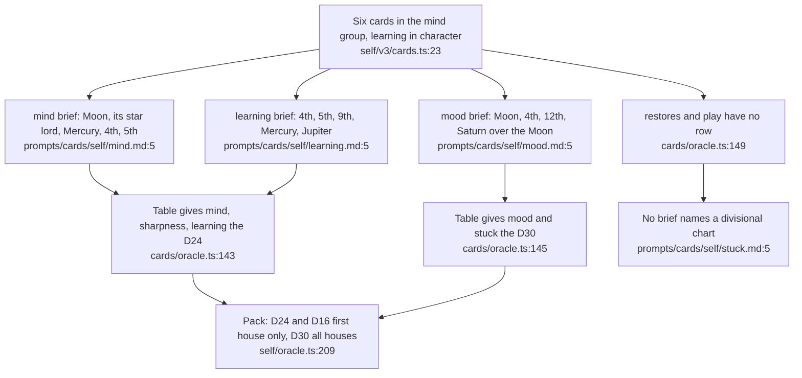

### With the research

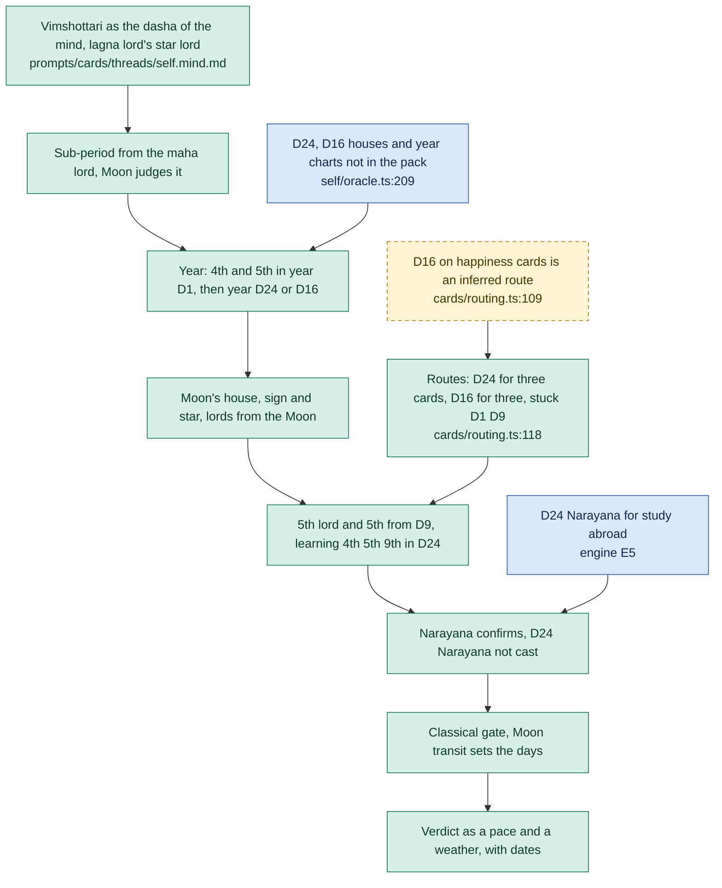

### Changes

| Change | Why | Source | Research file and heading | State | Needs |
|---|---|---|---|---|---|
| Step 1, maha dasha: Vimshottari read as the dasha of the mind and counted from the Moon; the lord judged from the lagna, then its star lord; the mind through the lagna lord's star lord (is the maha lord that planet, the Moon, Mercury, or the 4th or 5th lord); Narayana D1 as the environment around the mind. | Rath's mind and body rule; Vimshottari for mind and reaction. | Rath (rule 1.8, Vimshottari role); Text (lord condition); gap (star lord); Inferred (Narayana sign judging) | `sanjay-rath/07-self-mind-spirituality.md` §1 Rules and "Timing method"; `sanjay-rath/04-dasha-selection-and-ranking.md` §1 | built on develop | nothing (release only) |
| Step 2, sub-period: counted from the maha dasha lord, then its own condition; the Moon judges the antardasha in Rath's "tripod". | The tripod is attributed to Rath by Rao, not read in Rath's own text. | Text; Rath (6/8/12 from the dasha lord); Student (tripod) | `dasha-results/antardasha-results-per-pair.md` §4; `sanjay-rath/04-dasha-selection-and-ranking.md` §3 "Vimshottari start rules" | built on develop | nothing (release only) |
| Step 3, year: Poddar's order, then the 4th and 5th (the 12th too for `mood`, `stuck`, `restores`) in the year D1, then the year D24 or D16. `family.year` reads D9, D10, D7, D4 only, so no year D24 or D16 reaches the card; the hora lord is not named. | Order per decision 07-D2; which year houses to read is a gap. | Student (Poddar); Yours (order); gap (houses) | `sanjay-rath/05-timing-transits-annual-prashna.md` §1.3, "Gaps and conflicts" | built on develop | server code, data pull, engine E3 |
| Step 4, Moon: the Moon's house, sign and star, the running lords counted from the Moon's sign; nakshatra traits said only with another confirmation. | The Moon is happiness, ambition and how one sees one's work; the classical star lists are generic. | Student (Rao); Text (star lists) | `sanjay-rath/02-reading-procedure-and-precedence.md` §3; `natal-techniques/23-nakshatra-natal-reading.md` §5, §8 | built on develop | nothing (release only) |
| Step 5, D9 and own chart: the 5th lord, the Sun or Saturn in the 5th, the 5th from the D9 lagna or Karakamsa for skill; `learning` the 4th, 5th and 9th confirmed in D24; `mind` and `sharpness` D24; `mood`, `restores`, `play` D16 (inferred route, already filed for Sachin's look); `stuck` the 6th, 8th, 12th and the 6/8 and 2/12 relations in D1 and D9 only (D30 removed). D24 and D16 carry only their 1st house in the pack. | D24 is learning and D16 mental happiness in Rath; using them for these cards is assembled; D30 is evils and disease. | Rath (rule 1.16, learning order, D24 and D16 meanings); Inferred (D24, D16 use); Text (6/8, 2/12) | `sanjay-rath/10-health-education-property-travel-litigation.md` §2 "Education and learning"; `sanjay-rath/06-vargas.md` §1 Rules (rules 1.3, 1.4) | decision | Sachin, server code |
| Step 6, other systems: Narayana confirms Vimshottari; Lagna Kendradi low weight; the applying conditional confirms only. A D24 Narayana would time education abroad, and Rao starts Vimshottari from the D24 Moon for education; neither is cast, so the recipe says the timing comes from Narayana D1. | Varga Narayana for learning; a seeded Vimshottari. | Rath (Crux p.3, D24 Narayana); Student (D24 Moon Vimshottari, Lagna Kendradi) | `sanjay-rath/10-health-education-property-travel-litigation.md` §2 "Timing method"; `sanjay-rath/04-dasha-selection-and-ranking.md` §7 | planned | engine E5, engine E8 |
| Step 7, trigger: no Rath transit rule for the mind; the classical gate (sub-period lord's transit, the Sun's entry into its exaltation), the Moon's transit for the days. | Phaladeepika 20.36 to 38. | gap (Rath); Text | `dasha-results/dasha-transit-combination.md` §1 "Sources", §4 "Rule procedure" | built on develop | nothing (release only) |
| Step 8, verdict: a pace and a weather with dates, in the gate's words; no illness word for the mind, mood is weather, `stuck` names no person to fear. | Sensitive rules stay out. | Inferred; Rath (sensitive list) | `sanjay-rath/15-sensitive-rules-and-gaps.md` §1 | built on develop | server code |

### Stays the same

The briefs' planets and houses, the ledger cells per matter, and the D30 removed only from the cards' routes (the `family.varga` reader still reads it for every card).

### Open

There is no D16 or D24 house scheme in the research (gap), and which D24 casting the engine uses (conventional or Rao's reversed even signs) was not checked.

## Self · Purpose · Purpose recipe
<!-- pair id=self-purpose board=self lens=self.purpose reaches=yes live=0fc6bfa dev=9fc0cf3 -->

### Live today

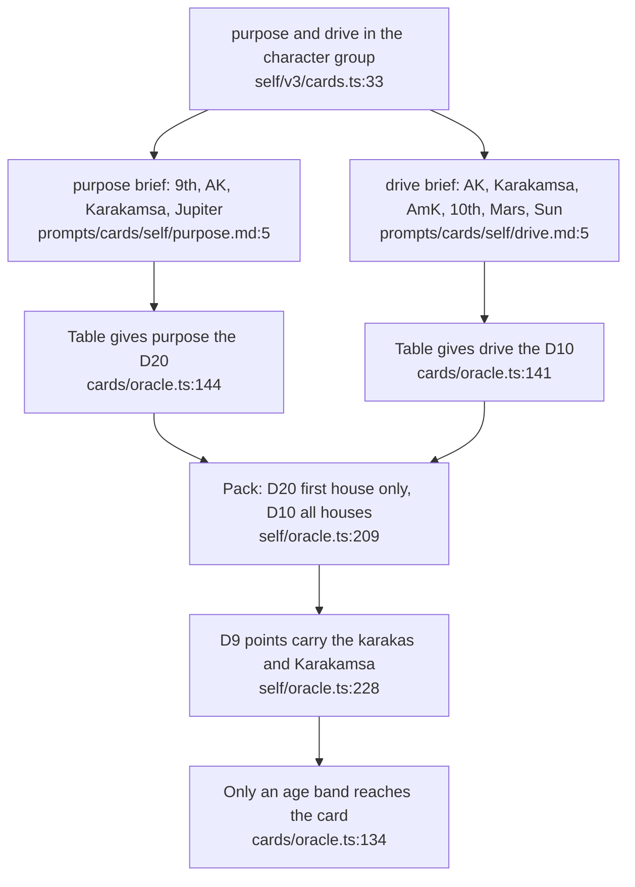

### With the research

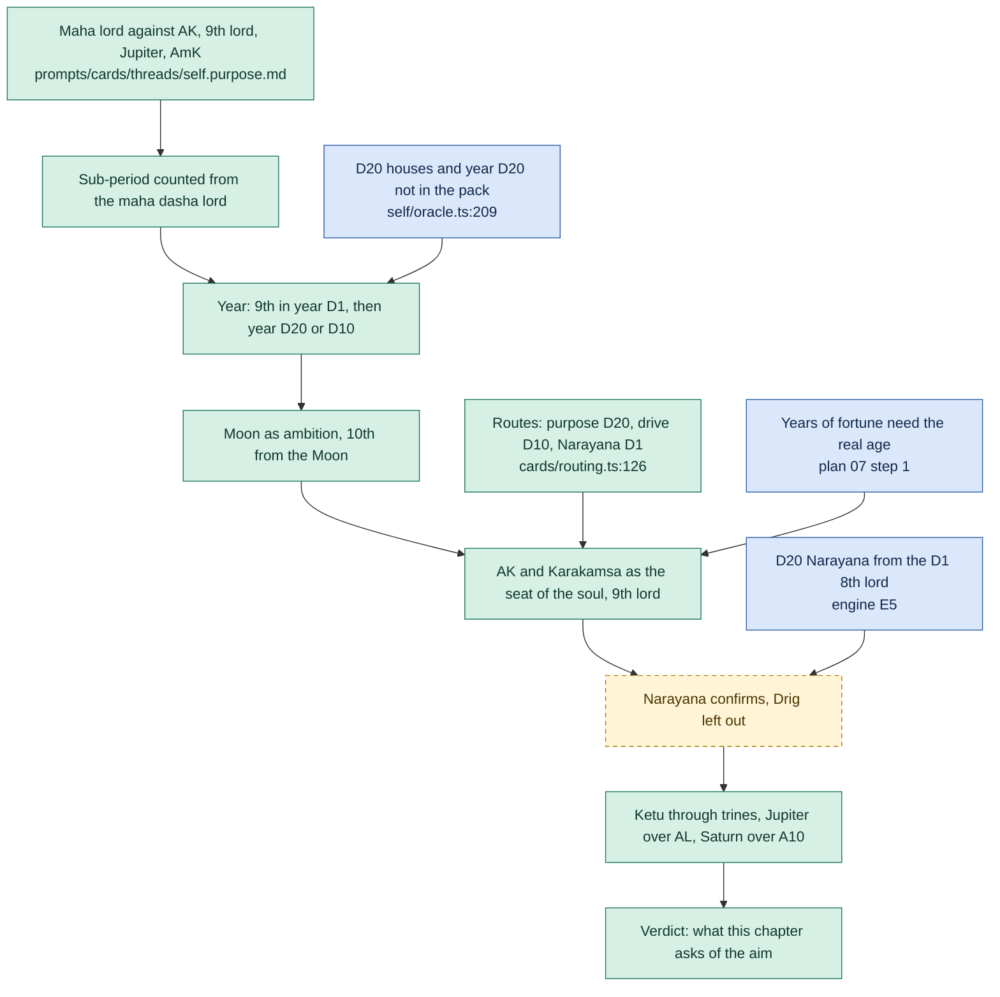

### Changes

| Change | Why | Source | Research file and heading | State | Needs |
|---|---|---|---|---|---|
| Step 1, maha dasha: the lord judged from the lagna, then its star lord; is it the AK, the 9th lord, Jupiter, or (for `drive`) the AmK or 10th lord; the AK's own dasha brings hardship, a Narayana dasha of its sign or a sign it aspects achievement; Narayana D1 read, because a D20 Narayana (from the sign the D1 8th lord holds in D20, Table 29) is not cast. | Rath's AK timing rule and varga Narayana seed. | Text (lord condition); gap (star lord); Rath (AK timing, Table 29) | `sanjay-rath/07-self-mind-spirituality.md` §1 "Timing method"; `sanjay-rath/04-dasha-selection-and-ranking.md` §2 "Narayana per varga (seed rules)" | built on develop | engine E5 |
| Step 2, sub-period: counted from the maha dasha lord, then its own condition. | Classical bhukti rule. | Text; Rath (6/8/12 from the dasha lord) | `dasha-results/antardasha-results-per-pair.md` §4 | built on develop | nothing (release only) |
| Step 3, year: Poddar's order, then the 9th (and the 10th for `drive`) in the year D1, then the year D20 (`purpose`) or year D10 (`drive`). The year D10 is in `family.year`; the year D20 is not. | Which year houses to read is a gap. | Student (Poddar); Yours (order, weekday year lord); gap (houses) | `sanjay-rath/05-timing-transits-annual-prashna.md` §1.3, "Gaps and conflicts" | built on develop | server code, data pull, engine E3 |
| Step 4, Moon: ambition and how one sees one's work; the 10th from the Moon as mental activity in the profession. | Reference points by question; the 10th from the Moon appears in Rath's career chapter. | Student (Rao); Rath (10th from the Moon in career) | `sanjay-rath/02-reading-procedure-and-precedence.md` §3; `sanjay-rath/08-career-and-wealth.md` §1 Rules | built on develop | nothing (release only) |
| Step 5, D9 and own chart: the AK and Karakamsa as a lagna, the seat of the soul (for the soul only, never for profession); the AK's lesson; a malefic, retrograde or combust AK; the house from the AK to the D9 lagna; the 9th lord as protector; the 9th from the AL; `purpose` the 9th of D20; `drive` the D10 read like a rasi chart and the AmK from Rath's cases; years of fortune when the age is within a year. D20 carries only its 1st house in the pack, and the Oracle has only the age band, so the years-of-fortune note cannot be applied. | Rath's AK, Karakamsa, 9th-house and D20 rules. | Rath (rules 1.11 to 1.18, 2.1 to 2.6, 3.12; D10; AmK cases; years of fortune, to be checked in print); Student (12th from the Karakamsa) | `sanjay-rath/07-self-mind-spirituality.md` §1, §2, §3 Rules; `sanjay-rath/08-career-and-wealth.md` §1 Rules | built on develop | server code |
| Step 6, other systems: Narayana confirms Vimshottari; Lagna Kendradi low weight; the applying conditional confirms only. Drig dasha, Rath's own clock for spiritual matters, is excluded because doc 08's verified list flags it; this overrules plan 07 §4.2. | Rath names Drig, then a D20 Narayana, for spirituality. | Rath (Drig role, Crux p.3); Yours (exclusion) | `sanjay-rath/04-dasha-selection-and-ranking.md` §1 "Which dasha answers which question", §7 | decision | Sachin, engine E1 |
| Step 7, trigger: `purpose` Ketu through the trines to the lagna or AL as an inward turn; `drive` Jupiter over the AL a win, Saturn over the A10 a loss of title, Saturn aspecting the AL strain; otherwise the classical gate. | Rath's transit triggers for spirituality and career. | Rath; Text (gate) | `sanjay-rath/07-self-mind-spirituality.md` §3 "Timing method"; `sanjay-rath/08-career-and-wealth.md` §1 "Timing method" | built on develop | nothing (release only) |
| Step 8, verdict: purpose itself is not timed; what this chapter asks of it, with dates, in the gate's words; no remedy, deity, curse or Mula dasha. | Sensitive and remedy rules wait on the owner. | Inferred; Rath (sensitive list) | `sanjay-rath/15-sensitive-rules-and-gaps.md` §1 | built on develop | server code |

### Stays the same

The briefs' houses and karakas, the D10 carried with all houses for `drive`, and the D9 points rows that hold the karakas.

### Open

The D20 casting variant and house scheme are a gap in the research (`sanjay-rath/07` §3 Gaps).

## Self · Body · Body recipe
<!-- pair id=self-body board=self lens=self.body reaches=yes live=0fc6bfa dev=9fc0cf3 -->

### Live today

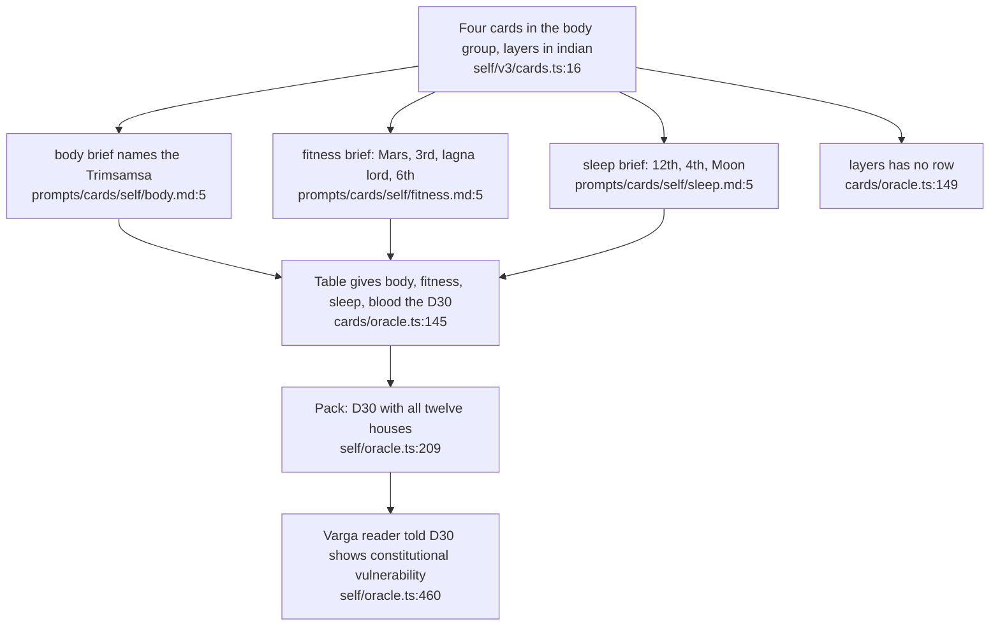

### With the research

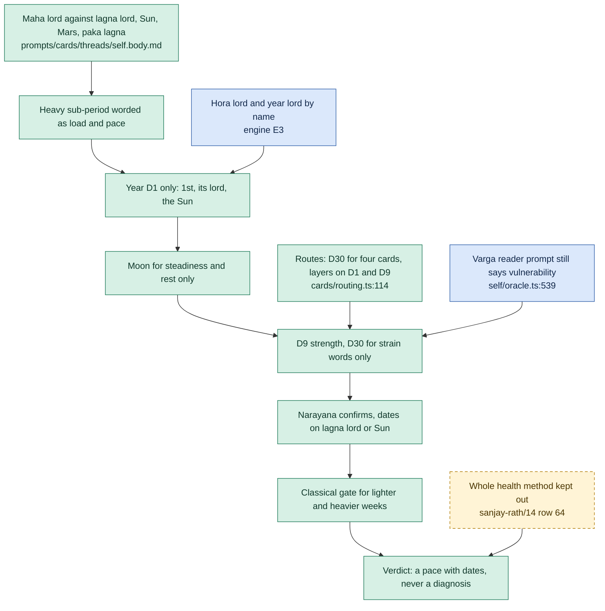

### Changes

| Change | Why | Source | Research file and heading | State | Needs |
|---|---|---|---|---|---|
| Step 1, maha dasha: the lord judged from the lagna, then its star lord; is it, or does it link to, the lagna, its lord, the Sun or (for `fitness`) Mars; the Sun as vitality, the paka lagna as the physical self, the lagna lord's sign lord for bodily matters; Narayana D1 as outer pressure on the routine, never a health event. | Reference points by question. | Text (lord condition); gap (star lord); Student (Sun, paka lagna, Rao); Rath (sign lord for the body) | `sanjay-rath/02-reading-procedure-and-precedence.md` §3; `sanjay-rath/07-self-mind-spirituality.md` §1 Rules (rules 1.8, 1.9) | built on develop | nothing (release only) |
| Step 2, sub-period: counted from the maha dasha lord; 6/8/12 a heavier stretch, kendra, trikona, 3rd, 11th a lighter one, worded as load and pace, never illness. | Classical bhukti rule, with the sensitive reading left out. | Text; Rath (6/8/12 from the dasha lord) | `dasha-results/antardasha-results-per-pair.md` §4 | built on develop | nothing (release only) |
| Step 3, year: Poddar's order, then the 1st, its lord and the Sun in the year D1 (the 12th and 4th for `sleep`); no year divisional chart; one line on how last year's energy felt. The hora lord is not named. | No source routes a year varga for the body. | Student (Poddar); Yours (weekday year lord); gap (year varga) | `sanjay-rath/05-timing-transits-annual-prashna.md` §1.3, "Gaps and conflicts" | built on develop | engine E3 |
| Step 4, Moon: the running lords from the Moon's sign, for steadiness and rest only; the Moon "stressed for health" is not used. | The Moon is the mind; the health use belongs to the sensitive method. | Student (Rao); Rath (health use, excluded) | `sanjay-rath/02-reading-procedure-and-precedence.md` §3; `sanjay-rath/04-dasha-selection-and-ranking.md` §1 | built on develop | nothing (release only) |
| Step 5, D9 and own chart: the strength of the lagna lord, Sun and Mars in D9; D30 on `body`, `fitness`, `sleep`, `blood` for strain words only; `layers` on D1 and D9 (lagna and Sun, the 4th, the Moon, Mercury, Jupiter with the 9th and 12th); `fitness` Mars and the 3rd; `sleep` the 12th. Found here: the `family.varga` reader prompt still frames D30 as "constitutional vulnerabilities" and its findings reach these cards. | D30 is evils, misfortune and disease in Rath; this narrow use is assembled. The five-layer frame has no source. | Text (Saravali 41.19, house meanings); Rath (D30 meaning); Inferred (strain-words use); gap (five layers) | `sanjay-rath/06-vargas.md` §1 Rules (rule 1.4); `natal-techniques/02-house-significations.md` §4 "Calculation / rule, the table" | built on develop | prompt |
| Step 6, other systems: Narayana confirms Vimshottari; Lagna Kendradi low weight; the applying conditional confirms only; dates where two or more point to the lagna lord, the Sun or the paka lagna, as support. | Rath's one combining line; no required count. | Rath (Crux p.3); Student (Lagna Kendradi); Inferred (count) | `sanjay-rath/04-dasha-selection-and-ranking.md` §7 | built on develop | server code |
| Step 7, trigger: the classical gate for lighter and heavier weeks only; the death triggers of Phaladeepika 20.31 to 32 stay out. | No Rath transit rule for the body outside the sensitive method. | gap (Rath); Text (Phaladeepika 20.37 to 38) | `dasha-results/dasha-transit-combination.md` §1 "Sources", §4 "Rule procedure"; `sanjay-rath/05-timing-transits-annual-prashna.md` §4 | built on develop | nothing (release only) |
| Step 8, verdict: a pace with dates, never a diagnosis; anything medical goes to a doctor. Rath's whole health method (maraka, longevity, Shoola and the ayur dashas, disease houses, D6, A6) stays out pending the owner's decision. | Sensitive throughout. | Rath (method, excluded; site disclaimer) | `sanjay-rath/10-health-education-property-travel-litigation.md` §1 "Health"; `sanjay-rath/15-sensitive-rules-and-gaps.md` §1 | decision | Sachin |

### Stays the same

The briefs' "no condition, organ, symptom, medicine or diagnosis" lines and the D30 with all houses in the pack.

### Open

`layers` sits in the indian group on live and in the body lens on `develop`, and the five-layer frame itself has no source.

## Self · Chapter · Chapter recipe
<!-- pair id=self-chapter board=self lens=self.chapter reaches=yes live=0fc6bfa dev=9fc0cf3 -->

### Live today

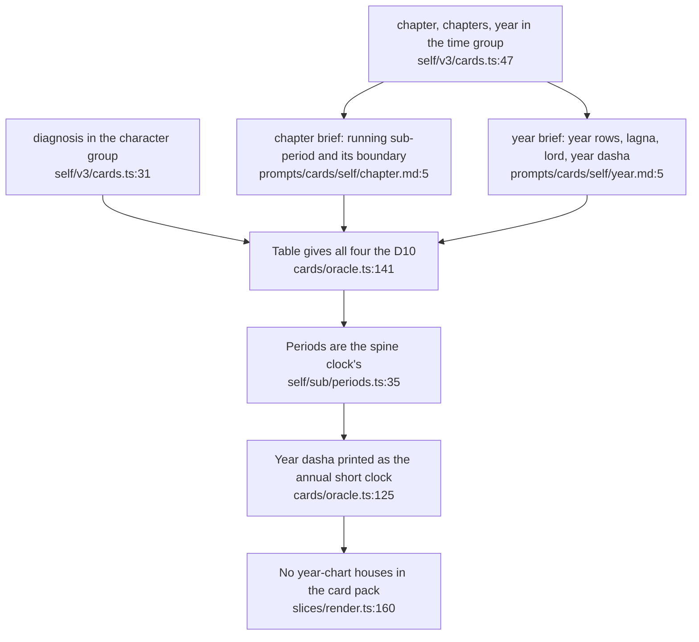

### With the research

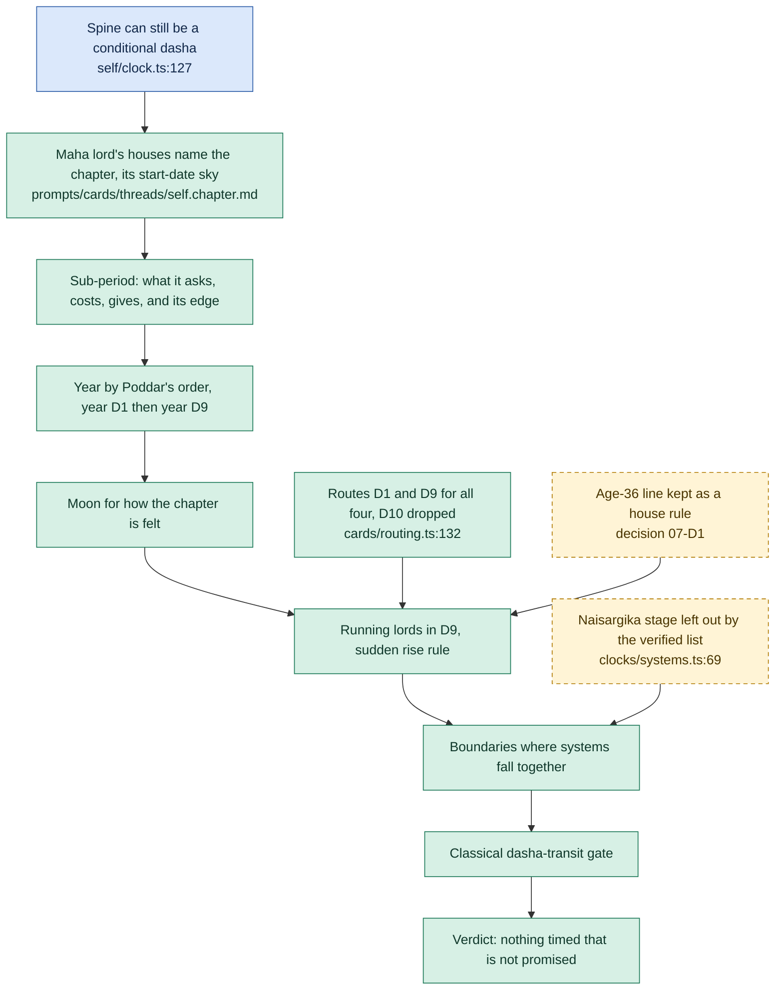

### Changes

| Change | Why | Source | Research file and heading | State | Needs |
|---|---|---|---|---|---|
| Step 1, maha dasha: the lord's houses name what the chapter is about; seat, dignity, navamsa and links say how it goes; its condition at the dasha start colours the chapter "where the data carries the start-date sky" (not checked whether it does); then its star lord; `chapters` the previous dasha in a line, the running one as the arc, its end and the next lord; Narayana D1 as environment and definite change. Found here: the spine whose periods the card is given can still be a conditional dasha, while the recipe opens with Vimshottari. | Classical dasha results by the lord's condition and its place at the dasha start. | Text (BPHS 47.5 to 6, 48; Saravali 41.16 to 18); gap (star lord); Rath (Narayana role) | `dasha-results/dasha-lord-condition-principles.md` §1, §4; `sanjay-rath/04-dasha-selection-and-ranking.md` §1 | built on develop | server code |
| Step 2, sub-period: counted from the maha dasha lord; many classical entries split it into start, middle and end; `chapter` makes it the centre with its boundary date; `diagnosis` sets the lagna lord's state against the running lords. | Classical bhukti rule. | Text; Rath (6/8/12 from the dasha lord) | `dasha-results/antardasha-results-per-pair.md` §4 | built on develop | nothing (release only) |
| Step 3, year: cast for the birthplace, never read alone; year lagna from the birth lagna (kendra eases, trikona gains, dusthana or badhaka obstructs), year lagna lord, hora lord as focus; the weekday year lord judged by its natal functional nature; year D1 houses, then year D9 for the year lord's dignity; the same planet in the same sign in both charts gives full results; Patyayini inside the year (rendered nowhere); last year as a confirm question; `year` makes this year its centre. The hora lord and year lord are not named in the data. | The birth chart overrides the year chart. | Rath, co-credited (casting); Student (Poddar); Yours (weekday year lord, D1 then D9); Text (Tajika); gap (houses, Patyayini) | `sanjay-rath/05-timing-transits-annual-prashna.md` §1.1, §1.2, §1.3, §2; `tajika-prashna-muhurta/00-overview.md` | built on develop | engine E3, server code |
| Step 4, Moon: how the chapter is felt; the running lords counted from the Moon's sign; Vimshottari counted from the Moon. | The Moon is the mind. | Student (Rao); Rath (Vimshottari from the Moon) | `sanjay-rath/02-reading-procedure-and-precedence.md` §3; `sanjay-rath/07-self-mind-spirituality.md` §1 "Timing method" | built on develop | nothing (release only) |
| Step 5, D9: the running lords' vargottama, dignity and house from the D9 lagna; debilitated in D1 with an exalted navamsa gives a sudden rise; the D10 of the live table is dropped (the old table, still in the request, says D10); years of fortune as a note (the Oracle has only the age band); the age-36 rule named a house rule in this recipe only, while the card prompt and the timing block still state it as a rule. | A planet gives in its dasha what its places across the charts promise; no source ties a life chapter to D10 or a D1/D9 rule to an age. | Student (Rao, across charts); Rath (sudden rise; years of fortune, to be checked in print); Yours (age 36); Inferred (D10 dropped) | `sanjay-rath/02-reading-procedure-and-precedence.md` §8; `sanjay-rath/08-career-and-wealth.md` §1 Rules; `sanjay-rath/06-vargas.md` §6 Gaps | decision | Sachin, server code, engine E6 |
| Step 6, other systems: Narayana confirms Vimshottari; Lagna Kendradi low weight; the applying conditional confirms only; dates where the boundaries of two or more systems fall together, as support. Naisargika life stages are never read: doc 08's verified list overrules plan 07 §4.2, which put "Naisargika stage" in the chapters row. | Naisargika is a fixed life-stage dasha, context only in the research. | Rath (Crux p.3); Student (Lagna Kendradi); Text (Naisargika, BPHS 43); Yours (exclusion) | `sanjay-rath/04-dasha-selection-and-ranking.md` §7; `dashas-other-and-annual/naisargika-dasha.md` | decision | Sachin |
| Step 7, trigger: no Rath transit rule for a chapter; the classical gate (the sub-period lord's transit, the Sun's entry into its exaltation). | Phaladeepika 20.37 to 38. | gap (Rath); Text | `dasha-results/dasha-transit-combination.md` §1 "Sources", §4 "Rule procedure" | built on develop | nothing (release only) |
| Step 8, verdict: in the gate's words; nothing is timed that is not promised; a dasha junction is never worded as danger; no maraka, longevity band or Shoola. The code gives four statuses, not five, and no "not promised". | Promise before timing; the junction rules have no classical verse. | Text (promise before timing); Inferred (gate) | `natal-techniques/00-overview.md`; `dasha-results/dasha-sandhi-and-chidra.md` | built on develop | server code |

### Stays the same

The spine clock's running periods in the timing block, the frame's spans, and the briefs' "What it reads" lines.

### Open

Whether the stored data carries the sky at each dasha start (step 1's condition) was not checked.

## Not wired

Self catalogue techniques and spec documents that no Self card reads, traced by their callers at `0fc6bfa` and
unchanged on `develop` unless stated.

| Name | Where it lives | Why it does not reach a card |
|---|---|---|
| Self house-state layers (houses 1, 4, 5, 9, 12; karakas; D9, D20, D24, D12 checks; sub-areas; sahams; sade sati) | `src/reading/area/self.ts:8` (`SELF`), built by `area/houseLayers.ts` `buildBoard` | Served by `GET /api/area/self` (`routes/areaRoutes.ts:110`, `area/boardService.ts:226`). Cards read board technique rows only through `cards/techniques.ts:157`, which returns none for a card outside the Love and Work registry. Whether the web still calls the route was not checked. |
| `self.character_arc` (age-36 D1/D9 confirmation: vargottama, neecha bhanga through D9, "false promise", "drudha karma") | `area/selfCharacterAndJoy.ts:563`, using `dasha/dashaAssessment.ts:366` | Called only by the Self area board (`area/houseLayers.ts:1033`) and the research QA script (`research/selfDashboardQa.ts:11`). |
| `self.personality_joy` | `area/selfCharacterAndJoy.ts:816` | Called only by `area/houseLayers.ts:1041` and the research QA script. |
| The D1/D9 verdict and its clock lord count for Self (`evaluateActiveDashaWithVargaAndTP`) | `dasha/dashaAssessment.ts:366` | Reaches the Self area board through `self.character_arc`; on cards it reaches only Love and Work technique rows. |
| v1 Self panels (`self.reading.atma`, `self.reading.year`, `self.reading.lagna` and the other `self.reading.*` rows) | `src/reading/self/panels/*.ts` | Imported by `self/service.ts` and `self/card.ts`, served by `routes/selfReadingRoutes.ts` and the admin lab; the v3 card path (`cards/run.ts`, `self/v3/build.ts`) does not import them. Whether that route is still used was not checked. |
| Self cards with no route: `constitution`, `aims`, `practice`, `helps`, `saturn` | `self/v3/cards.ts:20`, `:41` to `:44` | Neither offered nor brief-only, so not in `READABLE_CARDS`; `routeFor` returns null. They wait on engine exports (`engine:constitution` and others, the sade sati export for `saturn`). |
| Ten Self technique specs: `self.activation`, `self.affliction`, `self.annual`, `self.character_arc`, `self.nakshatra`, `self.personality_joy`, `self.promise`, `self.protection`, `self.transit`, `self.varga` | `docs/techniques/self/*.md` (on `develop` only; not in `0fc6bfa`) | No code loads files under `docs/techniques/` (no reference in `src/`); they describe planned behaviour (plan 07 §1). |
| `docs/techniques/03-self-board-illustrations.md` | `docs/techniques/` at both commits | Documentation only; no code loads it. |

The `self.sub.*` catalogue rows (clock, periods, year, profile, promise, risk, windows, body, mind and presence facts)
feed the v2 slices and the portrait that the card pack carries, so they are not listed as unwired; each one's path to a
card was not traced individually.
