# Technique atlas · Love board

Written 2026-11-19. Documentation only. Layout, colours and source tags follow `00-how-to-read.md`.

**Where each side was read.** Live today is `release-candidate-staging` `0fc6bfa`; every file and line in a left-hand
diagram is at that commit, written relative to `src/reading/`. With the research is `develop` `9fc0cf3`; research files
are cited relative to `docs/deep-research/`. On `develop` the files
`area/love.ts`, `area/houseLayers.ts`, `cards/techniques.ts`, `boards/v3Cards.ts` and `dasha/dashaAssessment.ts` are
byte-identical to live (`git diff --quiet` on each). So every house layer reaches a develop Love card exactly as it does
today; what develop adds is around the layers: the routing table, the lens recipes, the lens lineman, the story contract
and the verified-systems list. Layer changes are therefore drawn `planned` unless a prompt already carries them.

**Flags on develop** (`src/config/env.ts`, develop line numbers):
- `CARDS_STORY_CONTRACT` (line 1038): default **on** (anything but `0`). Turns on one card per Oracle call, the story,
  the beat index, the depth gate and the story inputs (recipe, own charts, verified systems, findings, clock sentences,
  lens thread). With it on, `CARDS_GROUP_PACK=1` no longer groups cards (`isCardsGroupPathActive`, line 1043).
- `LENS_LINEMEN` (line 1078): default **on**. Runs one lens lineman per lens with cards on the board.
- `READING_CLOCK_ORDER` (line 861): default changed from `vimsottari, narayana, tithi_pravesha, conditional, yogini,
  chara` (live) to `vimsottari, narayana, tithi_pravesha, conditional`. An env value overrides it; the live env value
  was not checked here. `clocks/systems.ts` also drops any flagged system named there.
- Brief edits and recipe files have no flag: they ship with the next prompt release and re-key every card.
- `D9_MATURITY_AGE_YEARS` (live `config/env.ts:1540`, default 36) is unchanged on develop.

Doc 09's decision table lists eight decisions, all taken on 2026-11-19 (its decision 6 takes 07-D1 to 07-D5 at their
defaults). No open "09-D1 … 09-D6" list was found, so the `dec` class is used only where a document says the owner has
not decided (the children card, which is marked "later").

## Love · Board · Board pipeline
<!-- pair id=love-pipeline board=love lens=- reaches=yes live=0fc6bfa dev=9fc0cf3 -->

### Live today

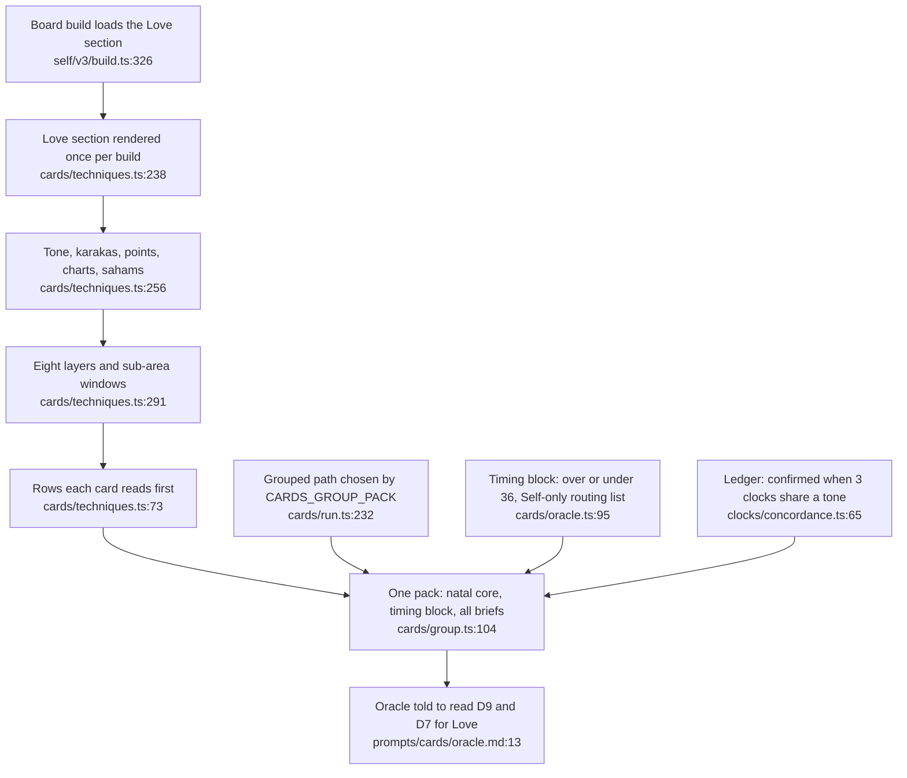

### With the research

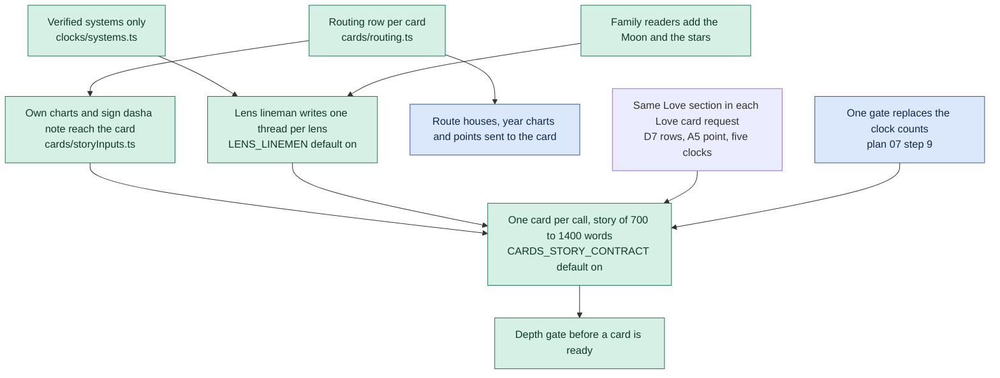

### Changes

| Change | Why | Source | Research file and heading | State | Needs |
|---|---|---|---|---|---|
| Each Love card gets its own charts from the routing table (`ownChartsOf`) and a sign-dasha line (`signDashaOf`), not the Self-only routing list that sends every Love card to "D1+D9" | The live list names Self cards only; Love cards fall through | Inferred | `docs/techniques/07` §4.2; `docs/techniques/08` "Conventions" | built on develop | nothing (release only); gated by `CARDS_STORY_CONTRACT` (default on) |
| The lens recipe and the lens thread are read before the brief | Rath reads a subject in a fixed order; the recipes copy that order per lens | Inferred | `sanjay-rath/09-love-marriage-children-family.md` §1 and §2 "Order of judgment" | built on develop | nothing (release only); thread gated by `LENS_LINEMEN` (default on) |
| Only verified systems are read, shown and counted in the story and the ledger (Yogini, Chara, Karaka, Tithi Ashtottari out) | Flagged clocks raise agreement by accident; Yogini and Tithi Ashtottari have no Rath text | Yours | `sanjay-rath/14-technique-mapping.md` row 36; `current-specs-review/06-gap-matrix.md` (verify-first rows) | built on develop | nothing (release only); `READING_CLOCK_ORDER` default and the story path |
| `family.moon` and `family.star` join the family readers; `family.year` keeps this and last year only | Plan 09 §4: houses from the Moon, star data per planet, a year chart a card can use | Student | `sanjay-rath/02` §3 (via the recipes); `natal-techniques/23-nakshatra-natal-reading.md` §5 | built on develop | nothing (release only) |
| The route's houses, year charts and points reach the card | The four recipes say "use the ROUTE line" but no request carries one; only `promiseCharts` and `signDasha` are read outside `routing.ts` | Inferred | `docs/techniques/08` "Conventions" | planned | server code |
| The Love section stops carrying D7 rows, the A5 point and Karaka, Yogini and Tithi Ashtottari periods | It still reaches every develop Love card and contradicts the recipes | Text | `sanjay-rath/06-vargas.md` rule 1.2; `sanjay-rath/09` rule 1.8 | planned | server code |
| One gate (promise, Vimshottari and a sign dasha, year) replaces the four agreement counts | Rath gives a confirmation step, not a vote; no source gives a count | Inferred | `sanjay-rath/04-dasha-selection-and-ranking.md` §7 "How systems combine" | planned | server code, engine E6, E9 |
| The real age in years replaces "over 36 / 36 and under" in the timing block | Plan 07 step 1; the age-36 rule stays as a house rule (07-D1 default) | Yours | `sanjay-rath/06-vargas.md` §6 "Gaps" | planned | server code |

### Stays the same
The Love section's rows, the ledger, the year frame and the matter rows are built as today; the story inputs are added beside them.

### Open
The develop Oracle prompt still says "D9 and D7 for Love" (`prompts/cards/oracle.md` lines 13 and 22) while every Love recipe forbids the D7; and the recipes point to a ROUTE line that is never sent.

## Love · House layers · Tone today
<!-- pair id=love-layer-tone board=love lens=- reaches=yes live=0fc6bfa dev=9fc0cf3 -->

### Live today

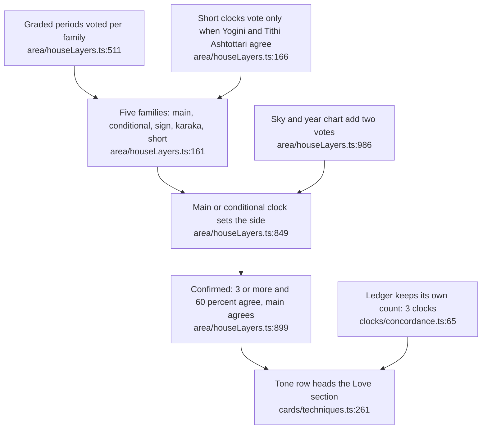

### With the research

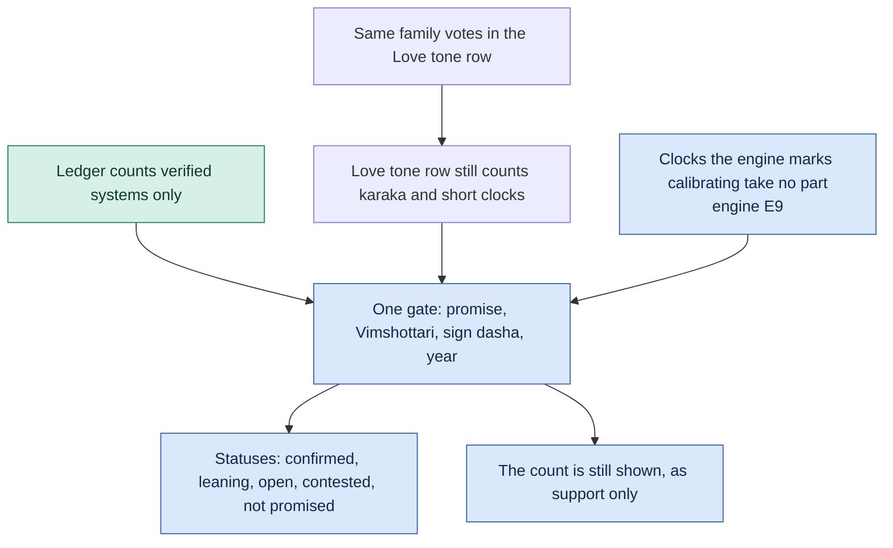

### Changes

| Change | Why | Source | Research file and heading | State | Needs |
|---|---|---|---|---|---|
| One gate replaces `presentTone`'s family count (and the ledger, year-frame and dasha-assessment counts) | Rath: a nakshatra dasha pinpoints, a rasi dasha confirms; no source asks for a number | Inferred | `sanjay-rath/04` §7 "How systems combine" | planned | server code |
| Five statuses; "not promised" is never timed | "Nothing is timed that is not promised" | Text | `natal-techniques/00-overview.md` (promise before timing) | planned | server code |
| Clocks without a passing reference test take no part | Narayana and Chara sub-periods and the Yogini table are suspected wrong | Inferred | `current-specs-review/06-gap-matrix.md` verify-first rows | planned | engine E1, E2, E9 |
| The ledger counts only verified systems | Flagged clocks agree by accident | Yours | `sanjay-rath/14` row 36 | built on develop | nothing (release only) |
| The Love tone row drops the karaka and short-clock families | `BOARD_FAMILIES` is unchanged on develop, so the tone row still counts them | gap | `sanjay-rath/14` row 36 (no Rath text for Yogini or Tithi Ashtottari) | planned | server code |
| The count stays visible as support | 07-D3 default | Yours | `docs/techniques/07` decision 3 | planned | server code |

Work parameters: the same `presentTone` runs over `WORK` (`area/work.ts:12`); on the Work board the stored Work map is the tone of record and this row is evidence only (`cards/techniques.ts:260`).

### Stays the same
The 36-month month series and the "changes on" date logic stay.

### Open
"Confirmed" means three different things today (families at `houseLayers.ts:899`, clocks at `concordance.ts:65`, lords at `dashaAssessment.ts:458`); the develop lens lineman prompt names the statuses confirmed, leaning, single, contested, while the recipes use the five-status gate that is not built.

## Love · House layers · Karakas
<!-- pair id=love-layer-karakas board=love lens=- reaches=yes live=0fc6bfa dev=9fc0cf3 -->

### Live today

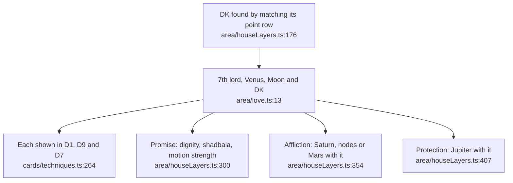

### With the research

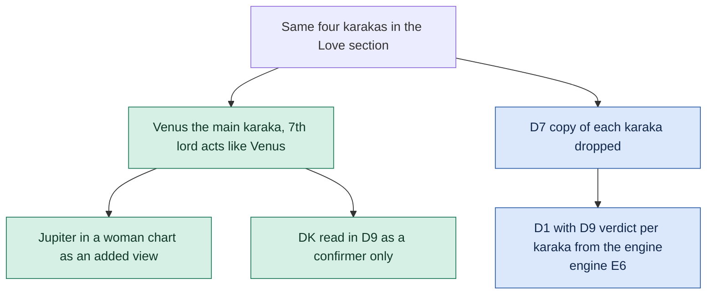

### Changes

| Change | Why | Source | Research file and heading | State | Needs |
|---|---|---|---|---|---|
| Venus leads; the 7th lord behaves like Venus (marriage recipe) | Rath's seventh-house chapter | Rath | `sanjay-rath/09` rule 2.1 | built on develop | nothing (release only) |
| Jupiter in a woman's chart is read as an added view, not a replacement | Rath and a student disagree; the recipe keeps both | Rath | `sanjay-rath/02` §10 (open conflict, cited in `love.marriage` recipe) | built on develop | nothing (release only) |
| DK only as a D9 confirmer; no selection rule | Seen in Rath's examples only | Rath | `sanjay-rath/09` rule 2.9 | built on develop | nothing (release only) |
| The D7 copy of each karaka leaves the karaka row | D7 is children | Text | `sanjay-rath/06-vargas.md` rule 1.2 | planned | server code (`area/love.ts` vargas) |
| D1 with D9 verdict per karaka comes from the engine, not Node weighting | Plan 07 step 1: Node computes nothing astrological | Text | `dasha-results/dasha-lord-condition-principles.md` §5 (Saravali 41.19, Phaladeepika 20.22) | planned | engine E6 |

Work parameters: karakas the 10th lord, the AmK and the Sun (`area/work.ts:17`), shown in D1, D10, D9 and D60.

### Stays the same
The four karaka ids and their promise, affliction and protection rows stay.

### Open
None.

## Love · House layers · Points
<!-- pair id=love-layer-points board=love lens=- reaches=yes live=0fc6bfa dev=9fc0cf3 -->

### Live today

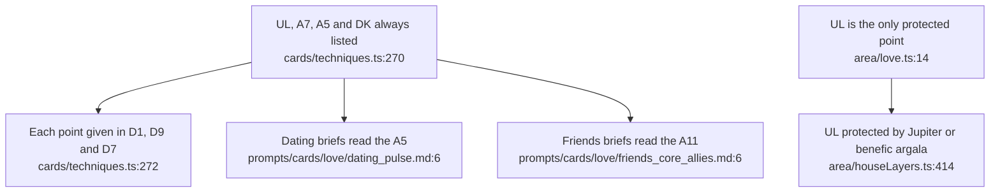

### With the research

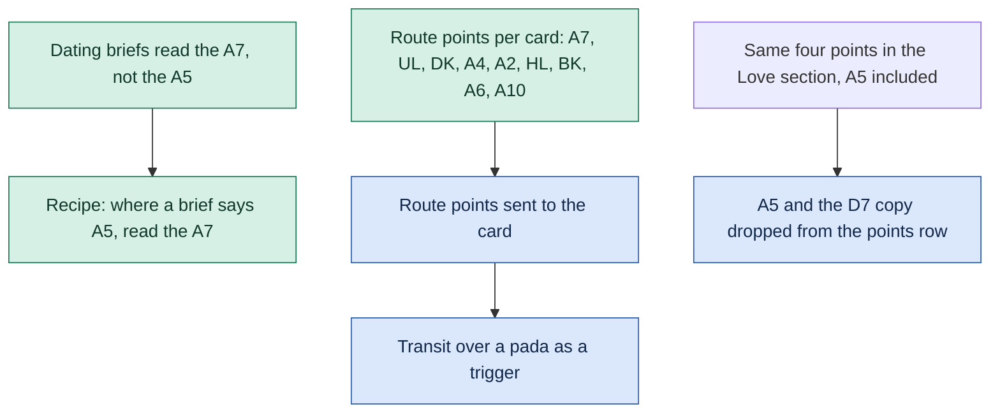

### Changes

| Change | Why | Source | Research file and heading | State | Needs |
|---|---|---|---|---|---|
| The A5 leaves the five dating briefs; the A7 takes its place | The A5 is the mantra pada; the A7 shows partners and desire | Rath | `sanjay-rath/09` rules 1.8 and 1.3 | built on develop | nothing (release only) |
| Each card names its points in the routing table | Rath reads marriage from UL and A7, money from A2 and HL, teachers from BK | Rath | `sanjay-rath/09` §2 "Rules"; `sanjay-rath/08` §2 | built on develop | nothing (release only) |
| The route's points reach the card request | Today only the recipe text names them | Inferred | `docs/techniques/08` "Conventions" | planned | server code |
| The points row drops the A5 and the D7 copy | Same reasons; the row reaches every Love card | Rath | `sanjay-rath/09` rule 1.8 | planned | server code |
| Jupiter over the 2nd from the UL, Saturn over the A10, Jupiter over the AL as triggers | Rath's only transit triggers (marriage and career) | Rath | `sanjay-rath/09` M3; `sanjay-rath/08` §1 T5 | planned | engine (a transit-over-pada output; no E number in plan 07) |

Work parameters: points AL, A10 and AmK (`cards/techniques.ts:270`); no protected point (`area/work.ts:18`).

### Stays the same
The UL stays the Love board's protected point.

### Open
Friends briefs still read the A11 on develop; no source makes the A11 a friendship point either (it is not removed, and not discussed in doc 08).

## Love · House layers · Divisional charts
<!-- pair id=love-layer-charts board=love lens=- reaches=yes live=0fc6bfa dev=9fc0cf3 -->

### Live today

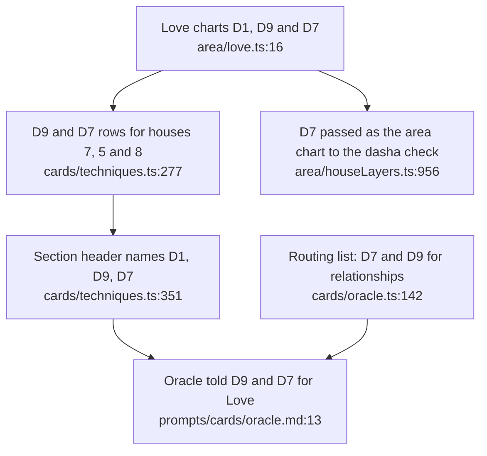

### With the research

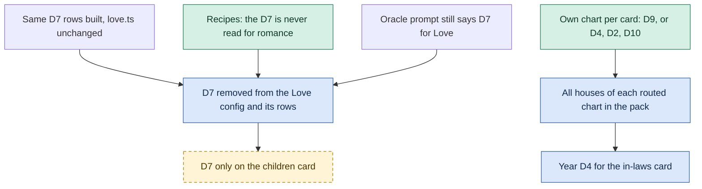

### Changes

| Change | Why | Source | Research file and heading | State | Needs |
|---|---|---|---|---|---|
| Love cards read the D9 (plus D4 on in-laws, D2 on money, D10 on allies) as their own chart | D9 is the spouse chart; love and affection are read from Venus and the D9 | Rath | `sanjay-rath/06-vargas.md` rule 1.2; `sanjay-rath/09` rule 1.2 | built on develop | nothing (release only); `CARDS_STORY_CONTRACT` |
| The D7 is removed from `area/love.ts` and the `love:chart/D7.*` rows | Romance read from D7 runs against the texts; D7 is children | Text | `sanjay-rath/06-vargas.md` rule 1.2; `current-specs-review/06-gap-matrix.md` row F11 | planned | server code |
| The Oracle prompt's "D9 and D7 for Love" and "D7/D9 relationships" lines go | They contradict the recipes on develop | Text | `sanjay-rath/06-vargas.md` rule 1.2 | planned | prompt |
| Every routed chart carries all twelve houses | Live pack has all houses only for D9, D10, D30 (doc 07 §1, not re-checked here) | Inferred | `docs/techniques/07` §1 "What each of your five points looks like today" | planned | server code |
| Year D4 pulled for the in-laws card | `ANNUAL_CHART_VARGAS` is `[1, 9, 10]` on develop; a new kundli has no year D4 | Rath | `sanjay-rath/06-vargas.md` rule 1.2 | planned | data pull |
| D7 kept for a children card only | D7 has the final say on children | Rath | `sanjay-rath/09` rule 3.8 | decision | Sachin |

Work parameters: charts D1, D10, D9 and D60 (`area/work.ts:20`); chart rows for houses 10, 6 and 1 in D10, D9 and D60; D10 is the area chart for the dasha check.

### Stays the same
D1 and D9 stay first for every Love card.

### Open
`self/oracle.ts` on develop keeps the year D7 in `YEAR_ROUTED_VARGAS` although no Love route names a year D7.

## Love · House layers · Promise
<!-- pair id=love-layer-promise board=love lens=- reaches=yes live=0fc6bfa dev=9fc0cf3 -->

### Live today

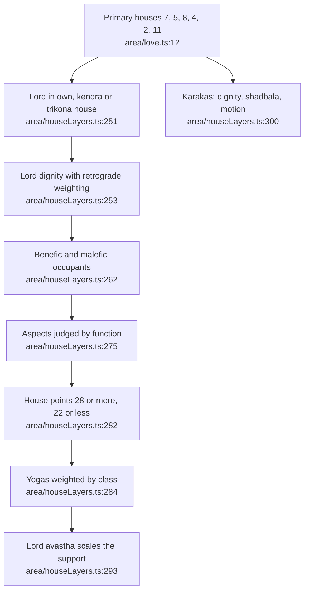

### With the research

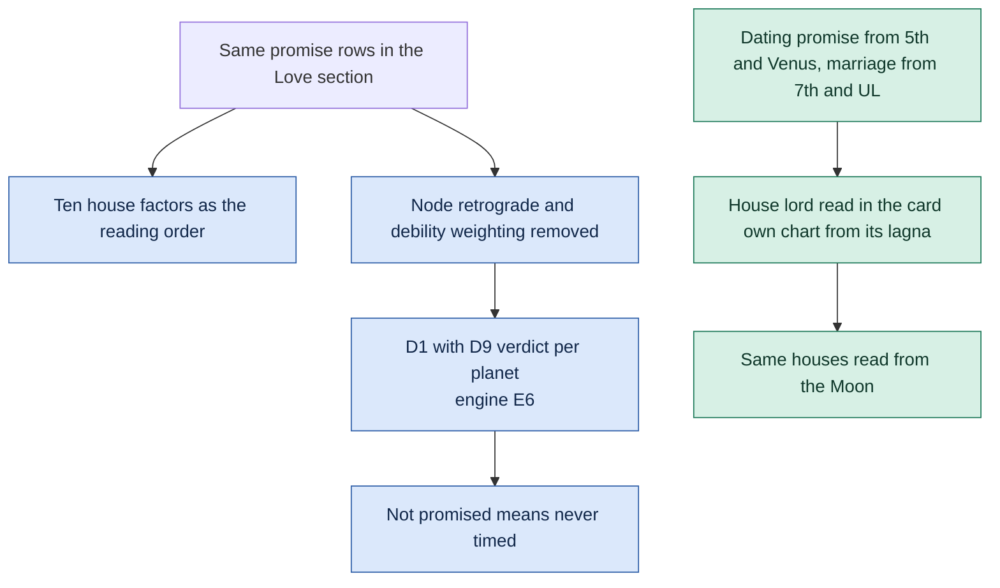

### Changes

| Change | Why | Source | Research file and heading | State | Needs |
|---|---|---|---|---|---|
| Promise rows ordered by Rath's ten house factors, the varga last | His preparation step | Rath | `sanjay-rath/14-technique-mapping.md` row 1 | planned | server code |
| The house lord is read in the card's own chart from that chart's lagna (karya rasi) | Rath's D10 rule, extended to other charts | Inferred | `sanjay-rath/06-vargas.md` §2 "Reading any varga" (rules 2.2 to 2.3) | built on develop | nothing (release only); prompt only |
| D1 with D9 per planet becomes an engine verdict | Vargottama strong; friendly sign with a bad navamsa mixed | Text | `dasha-results/dasha-lord-condition-principles.md` §5 | planned | engine E6 |
| Node's retrograde, neecha-vakra and age-36 weighting (`vakraOf`, `dashaAssessment.ts`) is removed | Node computes nothing astrological; the age rule has no source | Yours | `sanjay-rath/06-vargas.md` §6 "Gaps" | planned | engine E6 |
| The houses are also read from the Moon (`family.moon`) | The Moon is the mind | Student | `sanjay-rath/02` §3 (cited in the recipes) | built on develop | nothing (release only) |
| Lens promise order: dating 5th, Venus, D9, A7; marriage 7th, its lord, Venus, UL, A7, D9, DK | Rath's fifth- and seventh-house chapters | Inferred | `sanjay-rath/09` §1 and §2 "Order of judgment" | built on develop | nothing (release only) |
| A subject denied in D1 and its own chart is never timed | Promise before timing | Text | `natal-techniques/00-overview.md` | planned | server code |

Work parameters: primary houses 10, 6, 1, 2, 11 (`area/work.ts:16`); karakas 10th lord, AmK, Sun; no named yoga afflictions.

### Stays the same
The rows' weights, SAV thresholds and yoga weights stay in code until the gate replaces them.

### Open
None.

## Love · House layers · Protection
<!-- pair id=love-layer-protection board=love lens=- reaches=yes live=0fc6bfa dev=9fc0cf3 -->

### Live today

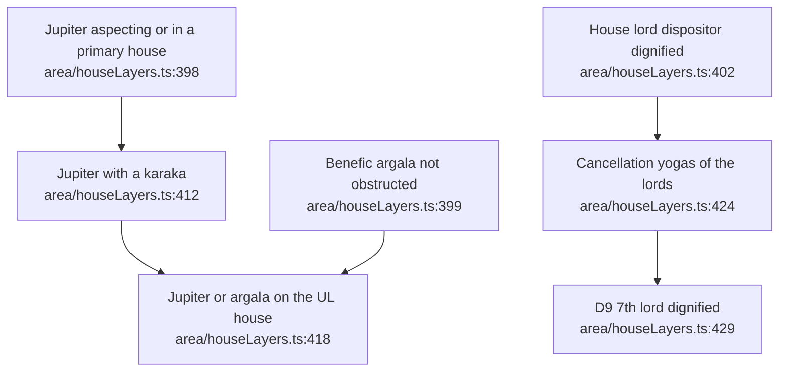

### With the research

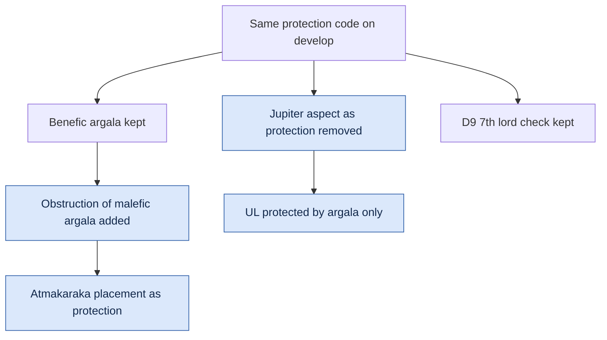

### Changes

| Change | Why | Source | Research file and heading | State | Needs |
|---|---|---|---|---|---|
| Jupiter's aspect stops counting as protection (houses, karakas, UL) | No source gives it; plan 09 §4 lists it as fixed, but `houseLayers.ts` is unchanged on develop | gap | `sanjay-rath/14-technique-mapping.md` row 68 | planned | server code |
| Obstruction of malefic argala counts as protection | Rath's protection is argala and its obstruction | Rath | `sanjay-rath/14-technique-mapping.md` row 68; `sanjay-rath/02` §5 "Argala rules" | planned | server code (research mapping only; not scheduled in plan 07 or 09) |
| The AK's placement counts as protection | Same mapping row (student part) | Student | `sanjay-rath/14-technique-mapping.md` row 68 | planned | server code (research mapping only) |
| Benefic argala and the D9 7th lord check stay | Argala is Rath's; the D9 is the spouse chart | Rath | `sanjay-rath/06-vargas.md` rule 1.2 | built on develop | nothing (release only) |

Work parameters: same code over houses 10, 6, 1, 2, 11 and karakas 10th lord, AmK, Sun; extra check D10 10th lord dignified (`area/work.ts:19`); no protected point.

### Stays the same
Cancellation yogas and the dispositor check stay.

### Open
Doc 09 §4 says the Jupiter step was "fixed in the server and prompts now"; the code on develop still has it.

## Love · House layers · Activation
<!-- pair id=love-layer-activation board=love lens=- reaches=yes live=0fc6bfa dev=9fc0cf3 -->

### Live today

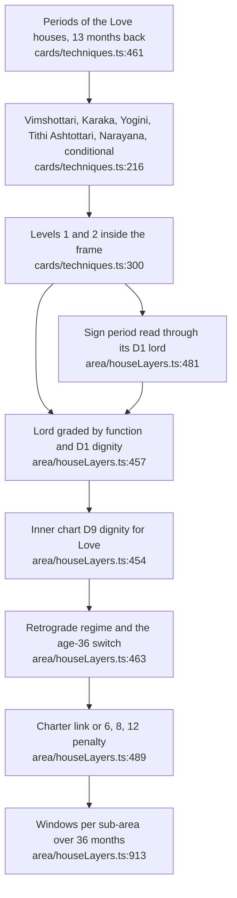

### With the research

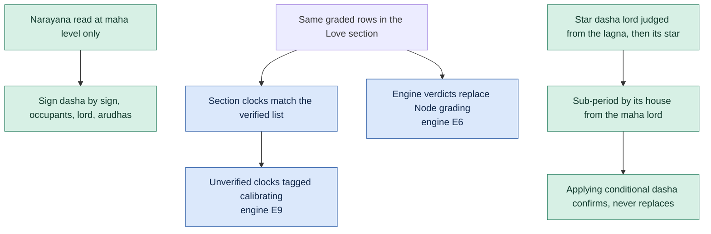

### Changes

| Change | Why | Source | Research file and heading | State | Needs |
|---|---|---|---|---|---|
| `SECTION_SYSTEMS` follows the verified list (Karaka, Yogini, Tithi Ashtottari out) | Unchanged on develop, so the Love section still grades periods from three clocks the story is told not to cite | gap | `sanjay-rath/14` row 36 | planned | server code |
| Narayana at maha dasha level only | Its sub-periods are suspected wrong in the engine | Inferred | `current-specs-review/06-gap-matrix.md` verify-first rows | built on develop | nothing (release only); story path only |
| A star dasha lord is judged from the lagna (houses owned, seat, dignity, navamsa, links), then its star | The classical dasha-lord rules | Text | `dasha-results/dasha-lord-condition-principles.md` §4 "Rule procedure" | built on develop | nothing (release only); prompt |
| A sign dasha is judged by its sign, occupants, lord and place from the arudhas | Rath's Narayana reading | Rath | `dashas-rasi-jaimini/narayana-dasha.md` (reading); `sanjay-rath/04` §7 | built on develop | nothing (release only); prompt |
| The sub-period is judged by its house from the maha dasha lord | Phaladeepika 20.29, BPHS 57.79 | Text | `dasha-results/antardasha-results-per-pair.md` §4 | built on develop | nothing (release only); prompt |
| The applying conditional dasha confirms and never replaces Vimshottari | BPHS is silent on precedence; research advice | Inferred | `dashas-nakshatra/01-applicability-matrix.md` §4 | built on develop | nothing (release only) |
| Node grading (function, dignity, D9, retrograde, charter) is replaced by engine verdicts per period row | Node computes nothing astrological | Yours | `docs/techniques/07` §5 "Architecture" | planned | engine E6 |
| Clocks without a passing reference test are tagged and leave the count | Agreement across unverified clocks is not evidence | Inferred | `current-specs-review/06-gap-matrix.md` verify-first rows | planned | engine E1, E2, E9 |

Work parameters: period query over houses 10, 6, 1, 2, 11, 3, 7, 9, 12 (`area/work.ts:15`); inner chart D10 (`houseLayers.ts:454` takes the second chart); Work adds the D1/D10 check of running lords and three family votes (`cards/techniques.ts:329`).

### Stays the same
The age-36 switch stays as a house rule (07-D1 default, tagged Yours).

### Open
None.

## Love · House layers · Transit
<!-- pair id=love-layer-transit board=love lens=- reaches=yes live=0fc6bfa dev=9fc0cf3 -->

### Live today

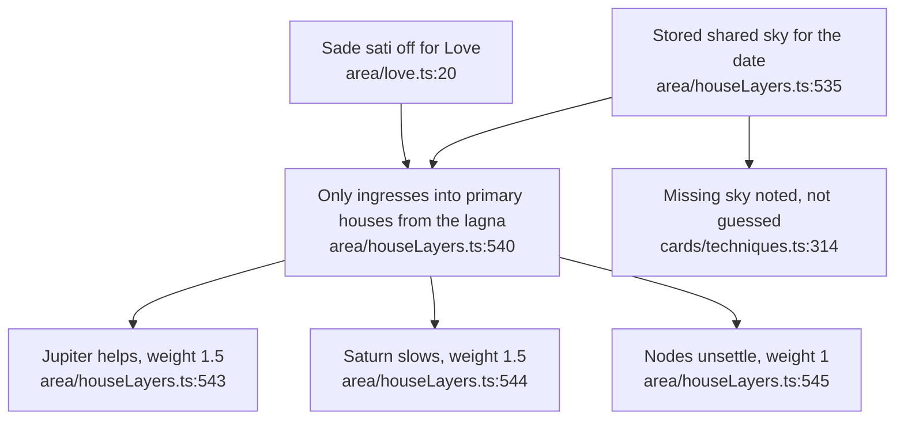

### With the research

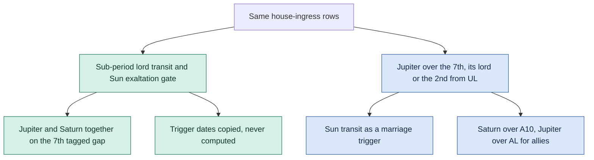

### Changes

| Change | Why | Source | Research file and heading | State | Needs |
|---|---|---|---|---|---|
| Jupiter's transit over the 7th, the 7th lord or the 2nd from the UL triggers marriage (commitment cards only) | Rath's marriage trigger | Rath | `sanjay-rath/09` M3 | planned | engine (transit over a lord or a pada is not an output; no E number in plan 07) |
| The Sun's transit as a marriage trigger | Same rule | Rath | `sanjay-rath/09` M3 | planned | engine (same) |
| Otherwise the classical gate: the sub-period lord's transit and the Sun's entry into its exaltation | Phaladeepika 20.37 to 20.38 | Text | `dasha-results/dasha-transit-combination.md` §1 | built on develop | nothing (release only); prompt |
| Jupiter and Saturn together on the 7th is said as modern practice | No verse | gap | `dasha-results/dasha-transit-combination.md` §1 | built on develop | nothing (release only) |
| Saturn over the A10 or aspecting the AL, Jupiter over the AL (Allies lens) | Rath's career triggers | Rath | `sanjay-rath/08` §1 T5 | planned | engine (same) |

Work parameters: same ingress rows over houses 10, 6, 1, 2, 11; sade sati off (`area/work.ts:24`).

### Stays the same
The layer stays a house-from-lagna reading of the shared sky; "dasha promises, transit triggers" is not cited as Rath's.

### Open
No Rath general transit doctrine was found (`sanjay-rath/14` row 37); the layer's weights are product choices.

## Love · House layers · Annual
<!-- pair id=love-layer-annual board=love lens=- reaches=yes live=0fc6bfa dev=9fc0cf3 -->

### Live today

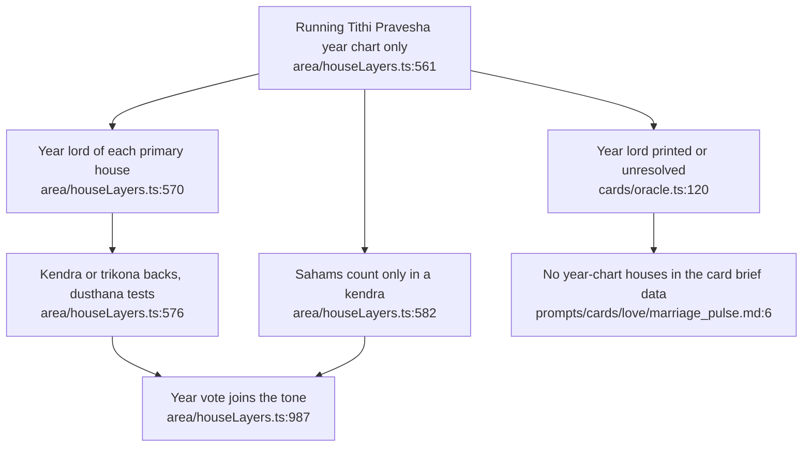

### With the research

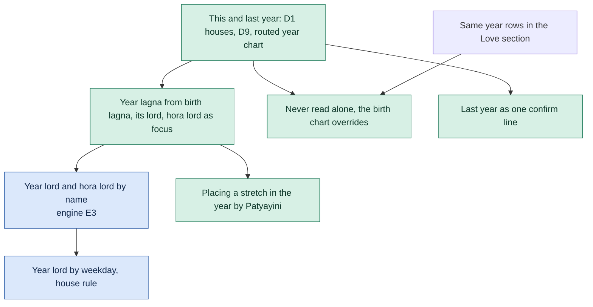

### Changes

| Change | Why | Source | Research file and heading | State | Needs |
|---|---|---|---|---|---|
| `family.year` reads this and last Tithi Pravesha year: D1 houses, D9 and the routed year charts | Live cards get dates, lagna and year lord only, no year houses | Inferred | `sanjay-rath/05-timing-transits-annual-prashna.md` §8 "INFERRED reading order" | built on develop | nothing (release only) |
| Year lagna counted from the birth lagna, then the year lagna lord, then the hora lord as the year's focus | A student's year-chart reading rules | Student | `sanjay-rath/05` §1.3 | built on develop | nothing (release only); prompt |
| The year lord and hora lord are named | The engine exports motion flags only; the pack prints "unresolved" | Student | `sanjay-rath/05` §1.2 "Year lord dispute" | planned | engine E3 |
| Year lord by weekday | No tier-A answer; owner decision of 2026-11-09 | Yours | `sanjay-rath/05` §1.2 | planned | engine E3 |
| The year chart is never read alone | The birth chart overrides | Student | `sanjay-rath/05` §2 "Annual against natal" | built on develop | nothing (release only) |
| Year D1 first, then year D9 (07-D2 default, taken) | Which year chart leads is not addressed in the research | Inferred | `sanjay-rath/05` "Gaps and conflicts" | built on develop | nothing (release only) |
| Patyayini places a stretch inside the year | Verified by an engine run; no Rath text; the in-year dasha is unresolved | gap | `sanjay-rath/05` §1.2 and "Gaps and conflicts" | built on develop | nothing (release only) |

Work parameters: same layer over houses 10, 6, 1, 2, 11 with sahams rajya, karma, punya, yasas (`area/work.ts:25`); Work also adds `workAnnualVote` (`cards/techniques.ts:336`); year D10 is pulled (`digest/annualSet.ts` `ANNUAL_CHART_VARGAS` 1, 9, 10).

### Stays the same
The year chart stays the Tithi Pravesha chart; the Varsha chart is never put in its place.

### Open
None.

## Love · House layers · Varga
<!-- pair id=love-layer-varga board=love lens=- reaches=yes live=0fc6bfa dev=9fc0cf3 -->

### Live today

```mermaid
flowchart TD
  G1["Charts after D1: D9 and D7<br/>area/houseLayers.ts:596"]
  G2["House lord dignity in that chart<br/>area/houseLayers.ts:602"]
  G3["D1 lord dignity inside D9 and D7<br/>area/houseLayers.ts:610"]
  G4["Debilitated in D1 and D9, same sign: weight 1.5<br/>area/houseLayers.ts:612"]
  G5["D9 7th skipped here, checked in protection<br/>area/houseLayers.ts:595"]
  G6["Weak rows dropped where support is strong<br/>area/houseLayers.ts:1000"]
  G7["Rows on houses 7, 5, 8, 4, 2, 11<br/>area/love.ts:12"]
  G7 --> G1
  G1 --> G2
  G1 --> G3 --> G4
  G5 --> G2
  G2 --> G6
```

### With the research

```mermaid
flowchart TD
  H1["Same varga code on develop"]
  H2["D7 dropped from the Love charts"]:::planned
  H3["D9 read from its own lagna: lagna, 5th, 7th"]:::built
  H4["House lord placed from the D9 lagna"]:::built
  H5["D1 with D9 verdict per planet<br/>engine E6"]:::planned
  H6["Same-sign debility weight unchanged, texts disagree"]
  H7["Card own chart: D4 in-laws, D2 money, D10 allies"]:::built
  H8["D7 only on the children card"]:::dec
  H1 --> H2 --> H8
  H1 --> H6
  H3 --> H4 --> H5
  H3 --> H7
  classDef built fill:#d7f0e5,stroke:#1f7a5a,color:#10382b
  classDef planned fill:#dbe8fb,stroke:#2f5fa8,color:#12284a
  classDef dec fill:#fff4d6,stroke:#b07a00,stroke-dasharray: 5 4,color:#4a3500
```

### Changes

| Change | Why | Source | Research file and heading | State | Needs |
|---|---|---|---|---|---|
| The varga layer stops grading Love lords in the D7 | D7 is children; romance from D7 runs against the texts | Text | `sanjay-rath/06-vargas.md` rule 1.2 | planned | server code |
| The D9 is read as a chart from its own lagna (lagna, 5th, 7th, Venus) | Love and affection from Venus and the D9 | Rath | `sanjay-rath/09` rule 1.2 | built on develop | nothing (release only); prompt |
| The house lord is placed from the varga lagna (karya rasi) | Rath's D10 rule, extended | Inferred | `sanjay-rath/06-vargas.md` §2 | built on develop | nothing (release only); prompt |
| D1 with D9 per planet comes from the engine | Plan 07 step 1 | Text | `dasha-results/dasha-lord-condition-principles.md` §5 | planned | engine E6 |
| A card's own chart joins the D9 (D4 home, D2 money, D10 work) | One varga per matter | Rath | `sanjay-rath/06-vargas.md` rule 1.2 | built on develop | nothing (release only) |
| The D7 returns only on a children card | D7 has the final say on children | Rath | `sanjay-rath/09` rule 3.8 | decision | Sachin |

Work parameters: charts D10, D9 and D60 after D1 over houses 10, 6, 1, 2, 11; D10 10th skipped here and checked in protection (`area/work.ts:19`).

### Stays the same
The same-sign debility weight (1.5) stays; the texts disagree on it (`current-specs-review/01` S7, cited in the digest).

### Open
`houseLayers.ts:956` also passes D7 as the Love area chart to `evaluateActiveDashaWithVargaAndTP`; only its age flag and year posture note are used by the board, so the D7 placement it computes reaches no card.

## Love · House layers · Nakshatra
<!-- pair id=love-layer-nakshatra board=love lens=- reaches=yes live=0fc6bfa dev=9fc0cf3 -->

### Live today

```mermaid
flowchart TD
  S1["Cusp star of each primary house<br/>area/houseLayers.ts:638"]
  S2["Star lord graded by its D1 dignity<br/>area/houseLayers.ts:644"]
  S3["Running Vimshottari lords, levels 1 and 2<br/>area/houseLayers.ts:653"]
  S4["Tara matched by a word list<br/>area/houseLayers.ts:632"]
  S5["Bad tara holds until the period ends<br/>area/houseLayers.ts:661"]
  S6["Tara rows themed on the 7th<br/>area/houseLayers.ts:652"]
  S1 --> S2
  S3 --> S4 --> S5
  S4 --> S6
```

### With the research

```mermaid
flowchart TD
  R1["Same cusp-star rows"]
  R2["Star, star lord, pada per planet<br/>family.star reader"]:::built
  R3["Word-list tara removed"]:::planned
  R4["Tara only in a malefic period: 3rd, 5th, 7th star"]:::planned
  R5["Tara and star lords in every chart<br/>engine E4"]:::planned
  R6["Star-lord rule tagged commentary"]:::built
  R7["No nakshatra rules on Narayana<br/>07-D4 default"]:::built
  R1 --> R3 --> R4 --> R5
  R2 --> R6
  R2 --> R7
  classDef built fill:#d7f0e5,stroke:#1f7a5a,color:#10382b
  classDef planned fill:#dbe8fb,stroke:#2f5fa8,color:#12284a
  classDef dec fill:#fff4d6,stroke:#b07a00,stroke-dasharray: 5 4,color:#4a3500
```

### Changes

| Change | Why | Source | Research file and heading | State | Needs |
|---|---|---|---|---|---|
| `family.star` gives each planet's star, star lord and pada as stored | Plan 09 §4 "Star layer"; tara is not stored per planet yet | Inferred | `natal-techniques/23-nakshatra-natal-reading.md` §4 | built on develop | nothing (release only) |
| The word-list tara (`GOOD_TARA`, `BAD_TARA`) is removed | Plan 09 §4 lists it as fixed; `houseLayers.ts` is unchanged on develop | Yours | `docs/techniques/09` §4 table "Star layer" | planned | server code |
| Tara counts only in a malefic's period: the sub-period of the 3rd, 5th or 7th star lord is adverse | Phaladeepika 20.23 | Text | `dasha-results/antardasha-results-per-pair.md` (PD 20.23) | planned | engine E4 |
| Star lords in every divisional chart | Stored in D1 only | Inferred | `docs/techniques/07` §1 data table | planned | engine E4 |
| "A planet acts through its star lord" is tagged commentary | No verse found | gap | `natal-techniques/23-nakshatra-natal-reading.md` §5 | built on develop | nothing (release only); prompt |
| No nakshatra rule is applied to Narayana | Narayana is a sign dasha; the research links them nowhere | Inferred | `dashas-rasi-jaimini/narayana-dasha.md` §4 | built on develop | nothing (release only) |

Work parameters: cusp stars of houses 10, 6, 1, 2, 11; tara rows themed on the 10th.

### Stays the same
Cusp stars and their lords' D1 dignity stay as rows.

### Open
None.

## Love · House layers · Layers that do not change
<!-- pair id=love-layers-unchanged board=love lens=- reaches=yes live=0fc6bfa dev=9fc0cf3 -->

### Live today

```mermaid
flowchart TD
  L1["Lord in a dusthana, weight 2<br/>area/houseLayers.ts:338"]
  L2["Lord debilitated without cancellation<br/>area/houseLayers.ts:341"]
  L3["Combust lord, no release date<br/>area/houseLayers.ts:346"]
  L4["Saturn, nodes and Mars as pressure<br/>area/love.ts:17"]
  L5["Kalathra and Manglik named<br/>area/love.ts:18"]
  L6["Affliction lifts when its planet period ends<br/>area/houseLayers.ts:226"]
  L7["Sahams vivaha, preethi, mitra, santapa, paradara<br/>area/love.ts:21"]
  L8["Saham rows from the year chart<br/>cards/techniques.ts:284"]
  L1 --> L6
  L2 --> L6
  L4 --> L6
  L5 --> L6
  L3 --> L6
  L7 --> L8
```

### With the research

```mermaid
flowchart TD
  M1["Lord in a dusthana, weight 2"]
  M2["Lord debilitated without cancellation"]
  M3["Combust lord, no release date"]
  M4["Saturn, nodes and Mars as pressure"]
  M5["Kalathra and Manglik named"]
  M6["Affliction lifts when its planet period ends"]
  M7["Sahams vivaha, preethi, mitra, santapa, paradara"]
  M8["Saham rows from the year chart"]
  M1 --> M6
  M2 --> M6
  M4 --> M6
  M5 --> M6
  M3 --> M6
  M7 --> M8
  classDef built fill:#d7f0e5,stroke:#1f7a5a,color:#10382b
  classDef planned fill:#dbe8fb,stroke:#2f5fa8,color:#12284a
  classDef dec fill:#fff4d6,stroke:#b07a00,stroke-dasharray: 5 4,color:#4a3500
```

### Changes

| Change | Why | Source | Research file and heading | State | Needs |
|---|---|---|---|---|---|
| Affliction: no change in plan 07 or 09 | The research mapping suggests papakartari and argala obstruction as an assembled order, but neither plan schedules it | Inferred | `sanjay-rath/14-technique-mapping.md` row 67 | none | engine (papakartari flag, no E number) |
| Affliction: the release date stays tied to the main clock first | Not discussed in the research | gap | `sanjay-rath/15` (no rule) | none | nothing (release only) |
| Sahams: no change; the natal Vivaha saham stays out | Rath names it, but sahams are exported for the year chart only | Rath | `sanjay-rath/09` M6 | none | engine (natal sahams, no E number) |

Work parameters: affliction over houses 10, 6, 1, 2, 11 with heavy planets Saturn, Rahu, Ketu (no Mars) and no named yoga afflictions; sahams rajya, karma, punya, yasas, support only (`area/work.ts:21` to `area/work.ts:25`).

### Stays the same
Both layers reach develop Love cards exactly as on live.

### Open
The affliction layer names Kalathra and Manglik yogas while the recipes keep spouse-loss readings out (`sanjay-rath/15` #7); the layer's wording is "strain", never loss, but no test enforces it.

## Love · Dating · Lens reading
<!-- pair id=love-lens-dating board=love lens=dating reaches=yes live=0fc6bfa dev=9fc0cf3 -->

Cards: `dating_pulse`, `dating_meeting_timing`, `dating_delays_blocks`, `dating_attraction_pattern`, `dating_mixed_signals`,
`dating_exes_closure`, `dating_karmic_compatibility`, `dating_intimacy_safety`, `dating_breaking_patterns`,
`dating_transition_commitment`.

### Live today

```mermaid
flowchart TD
  A1["Ten Dating cards offered<br/>boards/v3Cards.ts:131"]
  A2["Rows on meet, romance, delay, strain<br/>cards/techniques.ts:75"]
  A3["Layer sets: timing, nature, strain<br/>cards/techniques.ts:60"]
  A4["Briefs read the 5th, Venus and the A5<br/>prompts/cards/love/dating_pulse.md:6"]
  A5["D7 place of Venus if present<br/>prompts/cards/love/dating_attraction_pattern.md:6"]
  A6["Love section D9 and D7 rows<br/>cards/techniques.ts:277"]
  A7["Varga layer grades lords in D9 and D7<br/>area/houseLayers.ts:596"]
  A8["Grouped pack, no per-card routing line<br/>cards/group.ts:126"]
  A9["Age told only as over or under 36<br/>cards/oracle.ts:132"]
  A1 --> A2 --> A3
  A1 --> A4 --> A5
  A3 --> A6 --> A7
  A8 --> A4
  A9 --> A8
```

### With the research

```mermaid
flowchart TD
  B1["Maha lord from the lagna, linked to 5th, 7th, Venus, A7, UL"]:::built
  B2["Narayana D1 maha sign from the 5th, A7, UL"]:::built
  B3["Sub-period counted from the maha lord"]:::built
  B4["Year D1 then year D9: 5th, 7th, Venus"]:::built
  B5["Same houses from the Moon"]:::built
  B6["Romance from 5th, Venus, D9 and A7<br/>no D7, no A5"]:::built
  B7["Route points Venus, A7, UL, DK sent to the card"]:::planned
  B8["Jupiter over 7th or 2nd from UL, commitment cards"]:::planned
  B9["Verdict through the one gate"]:::planned
  B10["Love section still carries D7 rows"]
  B1 --> B2 --> B3 --> B4 --> B5 --> B6
  B6 --> B7
  B6 --> B8 --> B9
  B10 --> B6
  classDef built fill:#d7f0e5,stroke:#1f7a5a,color:#10382b
  classDef planned fill:#dbe8fb,stroke:#2f5fa8,color:#12284a
  classDef dec fill:#fff4d6,stroke:#b07a00,stroke-dasharray: 5 4,color:#4a3500
```

Routing rows (develop `cards/routing.ts`): promise charts D1, D9 for all ten; sign dasha Narayana D1; year charts D1, D9;
points Venus, A7, UL by default, plus DK on `dating_meeting_timing`, `dating_attraction_pattern`,
`dating_transition_commitment`; Venus, A7, AL on `dating_mixed_signals`; Venus, Moon, A7 on `dating_intimacy_safety`.

### Changes

| Change | Why | Source | Research file and heading | State | Needs |
|---|---|---|---|---|---|
| Romance is read from the 5th, Venus, the D9 and the A7; the D7 leaves the dating briefs | Love and affection from Venus and the D9; D7 is children | Rath | `sanjay-rath/09` rules 1.1, 1.2, 1.3; `sanjay-rath/06-vargas.md` rule 1.2 | built on develop | nothing (release only) |
| The A5 leaves the dating briefs | It is the mantra pada, not a romance point | Rath | `sanjay-rath/09` rule 1.8 | built on develop | nothing (release only) |
| The 2nd and 7th from the UL with A7 links describe outside attachments only where the person has confirmed a pattern | Rath's rule, kept from accusing | Rath | `sanjay-rath/09` rule 1.4 | built on develop | nothing (release only) |
| Timing uses the general dasha rules and says there is no romance timing rule | The research has none; one Rath case is an illustration | gap | `sanjay-rath/09` §1 "Gaps" and "Timing method" | built on develop | nothing (release only) |
| A commitment needs the A7 seen and D1 with D9 agreeing | The UL and the 7th alone cannot settle a marriage | Rath | `sanjay-rath/02` §2.4 (cited in the recipe) | built on develop | nothing (release only) |
| Narayana D1 confirms what Vimshottari pinpoints | Rath's one confirmation line | Rath | `sanjay-rath/04` §7 | built on develop | nothing (release only) |
| The route's points and year charts reach the card | The recipe asks for them by name; the request carries only own charts | Inferred | `docs/techniques/08` "Conventions" | planned | server code |
| Jupiter's transit over the 7th, the 7th lord or the 2nd from the UL on the two commitment cards | Rath's marriage trigger, used for commitment only | Rath | `sanjay-rath/09` M3 | planned | engine (transit over a pada; no E number) |
| The year lord and hora lord by name in the year step | The student's year order needs them | Student | `sanjay-rath/05` §1.3 | planned | engine E3 |

### Stays the same
The dating card ids, their `showWhen` rules and their `CARD_TECHNIQUES` rows stay.

### Open
The develop pack still hands every dating card the `love:chart/D7.*` rows and the D7 varga rows, and the Oracle prompt still says "D7/D9 relationships".

## Love · Marriage · Lens reading
<!-- pair id=love-lens-marriage board=love lens=marriage reaches=yes live=0fc6bfa dev=9fc0cf3 -->

Cards: `marriage_pulse`, `marriage_timing_readiness`, `marriage_daily_harmony`, `marriage_conflict_cycles`,
`marriage_communication`, `marriage_trust_transparency`, `marriage_reconciliation`, `marriage_inlaws_family`,
`marriage_finances_chores`, `marriage_longterm_longevity`, `marriage_personal_growth`. Not offered:
`marriage_children_family`.

### Live today

```mermaid
flowchart TD
  C1["Eleven Marriage cards offered<br/>boards/v3Cards.ts:143"]
  C2["Children card listed but marked later<br/>boards/v3Cards.ts:152"]
  C3["Rows on health, strain, commitment, family<br/>cards/techniques.ts:86"]
  C4["Briefs: 7th, UL, DK, Venus, D9 7th<br/>prompts/cards/love/marriage_pulse.md:6"]
  C5["D4 only if present<br/>prompts/cards/love/marriage_inlaws_family.md:6"]
  C6["Commitment needs D1 and D9 to agree<br/>prompts/cards/love/marriage_timing_readiness.md:6"]
  C7["Varga layer grades lords in D9 and D7<br/>area/houseLayers.ts:596"]
  C8["Protection: D9 7th lord dignified<br/>area/houseLayers.ts:429"]
  C9["Sign clock is Narayana on D1 only<br/>cards/techniques.ts:216"]
  C10["Over 36 told to confirm in D9<br/>cards/oracle.ts:132"]
  C1 --> C3 --> C7
  C2 --> C3
  C1 --> C4 --> C5
  C4 --> C6
  C8 --> C7
  C9 --> C3
  C10 --> C6
```

### With the research

```mermaid
flowchart TD
  D1["Maha lord linked to the D9 lagna or its lord"]:::built
  D2["Sub-period lord linked to the D9 7th lord"]:::built
  D3["Narayana D9 named, Narayana D1 read with a note"]:::built
  D4["Narayana cast on D9<br/>engine E5"]:::planned
  D5["7th, its lord, Venus, then UL and A7, then D9 and DK"]:::built
  D6["Year D1 then year D9, D4 for in-laws"]:::built
  D7["Year lord and hora lord by name<br/>engine E3"]:::planned
  D8["Jupiter over 7th, its lord or 2nd from UL"]:::planned
  D9["Children card reads the D7<br/>owner to open it"]:::dec
  D10["Love section still grades D7 lords"]
  D1 --> D2 --> D3 --> D4
  D5 --> D1
  D3 --> D6 --> D7
  D6 --> D8
  D10 --> D5
  D5 --> D9
  classDef built fill:#d7f0e5,stroke:#1f7a5a,color:#10382b
  classDef planned fill:#dbe8fb,stroke:#2f5fa8,color:#12284a
  classDef dec fill:#fff4d6,stroke:#b07a00,stroke-dasharray: 5 4,color:#4a3500
```

Routing rows (develop `cards/routing.ts`): promise charts D1, D9 (plus D4 on `marriage_inlaws_family`, D2 on
`marriage_finances_chores`); sign dasha Narayana D9 (plus Sudasa on `marriage_finances_chores`); year charts D1, D9 (plus
D4 on in-laws); points UL, A7, DK, Venus by default; UL, A4, Venus on in-laws; UL, A2, A7, HL on finances; UL, AL, AK,
DK, Karakamsa on personal growth.

### Changes

| Change | Why | Source | Research file and heading | State | Needs |
|---|---|---|---|---|---|
| Marriage timing: the Vimshottari maha dasha lord links to the D9 lagna or its lord, the sub-period lord to the D9 7th lord | Rath's marriage timing rule | Rath | `sanjay-rath/09` M1 | built on develop | nothing (release only); prompt (the link is read by the model; the engine has no link field) |
| The sign dasha is Narayana on D9, seeded from the sign the D1 9th lord occupies in the D9 | Table 29 seed rule; its use for marriage is a student's | Student | `sanjay-rath/04` §2 "Narayana per varga"; `docs/techniques/08` correction 2 | planned | engine E5 |
| Until E5, Narayana D1 is read and the card says so | The engine does not cast a varga Narayana | Inferred | `sanjay-rath/04` "Use in the product" | built on develop | nothing (release only) |
| "Narayana is more accurate for marriage" is never claimed | A case remark, downgraded by the research | gap | `sanjay-rath/04` §8 "Corrections to earlier claims" | built on develop | nothing (release only) |
| Order: the 7th, its lord and Venus; then the UL and the A7; then the D9 and the DK | The UL and the 7th alone cannot settle a marriage | Rath | `sanjay-rath/09` §2 "Order of judgment"; rules 2.3, 2.4 | built on develop | nothing (release only) |
| The rasi chart may serve better where the bond is a living arrangement | A student's caveat on the D9 | Student | `sanjay-rath/02` §10 (cited in the recipe) | built on develop | nothing (release only) |
| In-laws card reads the D4 and the year D4 | D4 is home and fixed property | Rath | `sanjay-rath/06-vargas.md` rule 1.2; `sanjay-rath/09` rule 2.3 | planned | data pull (year D4 not in `ANNUAL_CHART_VARGAS`) |
| Jupiter's or the Sun's transit over the 7th, its lord or the 2nd from the UL | Rath's marriage trigger | Rath | `sanjay-rath/09` M3 | planned | engine (transit over a lord or pada; no E number) |
| The children card opens and is the one Love card that reads the D7 (D7 Narayana from the D7 sign of the D1 7th lord) | D7 has the final say; Rath's double check | Rath | `sanjay-rath/09` rule 3.8, C1, C4 | decision | Sachin, engine E5 |

### Stays the same
The marriage card ids and their `CARD_TECHNIQUES` rows stay; separation is never predicted.

### Open
`marriage_children_family` still has a `CARD_TECHNIQUES` row (`cards/techniques.ts:95`) but no brief and no route; Rath's pregnancy and fertility rules stay out (`sanjay-rath/15` #8, #9).

## Love · Friends · Lens reading
<!-- pair id=love-lens-friends board=love lens=friends reaches=yes live=0fc6bfa dev=9fc0cf3 -->

Cards: `friends_social_energy`, `friends_core_allies`, `friends_outgrowing_circles`, `friends_finding_tribe`,
`friends_boundaries_drains`, `friends_mentors_guides`, `friends_reputation_belonging`.

### Live today

```mermaid
flowchart TD
  E1["Seven Friends cards offered<br/>boards/v3Cards.ts:157"]
  E2["All read the friends sub-area<br/>cards/techniques.ts:99"]
  E3["Friends planets: 11th lord, 4th lord, Mercury, Venus<br/>area/love.ts:32"]
  E4["Only house 11 for sign periods<br/>area/love.ts:32"]
  E5["Briefs: D11 stand-in from the 11th, A11, D9 and D10 11th<br/>prompts/cards/love/friends_core_allies.md:6"]
  E6["Points row lists the A5<br/>cards/techniques.ts:270"]
  E7["Varga layer reads D9 and D7 for house 11<br/>area/houseLayers.ts:596"]
  E8["House 11 worded as friendships<br/>area/love.ts:38"]
  E1 --> E2 --> E3
  E2 --> E4
  E1 --> E5
  E6 --> E5
  E4 --> E7 --> E8
```

### With the research

```mermaid
flowchart TD
  F1["11th from the lagna and from the AL, in D1 and D9"]:::built
  F2["No D11 and no D10 stand-in"]:::built
  F3["No A5 from the AL"]:::built
  F4["Every friendship meaning tagged gap"]:::built
  F5["Bhratrikaraka as teacher on the mentors card"]:::built
  F6["6th lord in the 5th on the outgrowing card"]:::built
  F7["Year D1 11th, no year divisional chart"]:::built
  F8["Leaning at most, never confirmed"]:::built
  F9["Love section friends rows unchanged"]
  F10["Classical transit gate only"]:::built
  F1 --> F2
  F1 --> F3
  F1 --> F4
  F4 --> F5
  F4 --> F6
  F1 --> F7 --> F10 --> F8
  F9 --> F1
  classDef built fill:#d7f0e5,stroke:#1f7a5a,color:#10382b
  classDef planned fill:#dbe8fb,stroke:#2f5fa8,color:#12284a
  classDef dec fill:#fff4d6,stroke:#b07a00,stroke-dasharray: 5 4,color:#4a3500
```

Routing rows (develop `cards/routing.ts`): promise charts D1, D9; sign dasha Narayana D1; year chart D1; points AL by
default; AL, Moon on `friends_social_energy` and `friends_boundaries_drains`; AL, Jupiter on `friends_core_allies` and
`friends_finding_tribe`; AL, Jupiter, BK on `friends_mentors_guides`.

### Changes

| Change | Why | Source | Research file and heading | State | Needs |
|---|---|---|---|---|---|
| The D11 stand-in sentence leaves all seven briefs | Rath names no area for the D11; its use is destruction | Rath | `sanjay-rath/06-vargas.md` rule 1.2; `sanjay-rath/15` #23 | built on develop | nothing (release only) |
| The D10 11th leaves `friends_core_allies` | It only stood in for the D11 | gap | `docs/techniques/08` "Charts removed from briefs" | built on develop | nothing (release only) |
| Friends are read from the 11th counted from the lagna and from the AL, in the D1 and the D9 | The research has no friendship rule; the 11th is gains and elder siblings, the 11th from the AL visible income | gap | `natal-techniques/02` §4 (11th list); `sanjay-rath/08` rule 2.6 | built on develop | nothing (release only) |
| The A5 counted from the AL is not read (plan 07 §4.2 had it, citing BPHS 29.35; doc 08 correction 1 removed it) | BPHS 29.35 applies the AL-to-A7 test to other padas (amity between padas), not to friends; the A5 is the mantra pada | Text | `jaimini-apparatus/arudha-padas.md` "AL and A7 (dara pada)"; `sanjay-rath/09` rule 1.8 | built on develop | nothing (release only) |
| Bhratrikaraka as the teacher on `friends_mentors_guides` | Rath's karaka rule | Rath | `sanjay-rath/07` rule 3.5 | built on develop | nothing (release only) |
| The 6th lord in the 5th makes friends turn hostile, only where it is there | Rath's rule | Rath | `sanjay-rath/10` rule 5.3 | built on develop | nothing (release only) |
| A friends card is never "confirmed"; at most leaning | No friendship rule stands behind a date | Inferred | `docs/techniques/07` §4.1 step 3 | built on develop | nothing (release only); prompt only until the gate exists |

### Stays the same
The Love section's `friends` sub-area (11th lord, 4th lord, Mercury, Venus; house 11) and its windows stay in the pack.

### Open
The task brief and plan 07 §4.2 name "A5 from the AL" as the friends point; develop follows doc 08 and drops it. The live and develop briefs still read the A11, which no source ties to friendship either.

## Love · Allies · Lens reading
<!-- pair id=love-lens-allies board=love lens=allies reaches=yes live=0fc6bfa dev=9fc0cf3 -->

Cards: `allies_pulse`, `allies_bosses_authority`, `allies_team_politics`, `allies_cofounder_fit`,
`allies_clients_deals`, `allies_managing_people`, `allies_networking_allies`, `allies_contracts_disputes`.

### Live today

```mermaid
flowchart TD
  G1["Eight Allies cards on the Love board<br/>boards/v3Cards.ts:166"]
  G2["Rows read Work promotion, security, business<br/>cards/techniques.ts:107"]
  G3["Networking also reads Love friends rows<br/>cards/techniques.ts:113"]
  G4["Work section: D1, D10, D9, D60<br/>area/work.ts:20"]
  G5["Stored Work map wins over the layers<br/>cards/techniques.ts:372"]
  G6["Briefs read D10 houses, A10, A7<br/>prompts/cards/love/allies_pulse.md:6"]
  G7["D11 stand-in in two briefs<br/>prompts/cards/love/allies_cofounder_fit.md:6"]
  G8["D30 only if present<br/>prompts/cards/love/allies_team_politics.md:6"]
  G9["Grouped pack, no per-card routing line<br/>cards/group.ts:126"]
  G1 --> G2 --> G4 --> G5
  G1 --> G3
  G1 --> G6
  G6 --> G7
  G6 --> G8
  G9 --> G6
```

### With the research

```mermaid
flowchart TD
  H1["Maha lord from the lagna, then in the D10"]:::built
  H2["D10 5th lord opens, 7th lord unsettles service"]:::built
  H3["Narayana D10 named, Narayana D1 read with a note"]:::built
  H4["Narayana cast on D10<br/>engine E5"]:::planned
  H5["D10 houses: 9th boss, 5th team, 6th service, 7th partners"]:::built
  H6["A10 titles, A7 business pada, A5 counted in D10"]:::built
  H7["Year D1 then year D10"]:::built
  H8["Saturn over A10, Jupiter over AL"]:::planned
  H9["Card rows still point at Work sub-areas"]
  H10["Sudasa on the clients card"]:::built
  H1 --> H2 --> H3 --> H4
  H5 --> H6
  H1 --> H5
  H3 --> H7 --> H8
  H9 --> H5
  H6 --> H10
  classDef built fill:#d7f0e5,stroke:#1f7a5a,color:#10382b
  classDef planned fill:#dbe8fb,stroke:#2f5fa8,color:#12284a
  classDef dec fill:#fff4d6,stroke:#b07a00,stroke-dasharray: 5 4,color:#4a3500
```

Routing rows (develop `cards/routing.ts`): promise charts D1, D9, D10 (plus D2 on `allies_clients_deals`); sign dasha
Narayana D10 (plus Sudasa on clients); year charts D1, D10; points A10, A7 by default; A10, AL, AmK on pulse; A10, Sun on
bosses; A6, AL on team politics and contracts; A7, DK on cofounder; A10, A5 (D10) on managing people; A10, AL on
networking.

### Changes

| Change | Why | Source | Research file and heading | State | Needs |
|---|---|---|---|---|---|
| The people at work are read from D10 houses: the 9th the boss, the 5th subordinates and authority, the 6th service, the 7th business and partners | Rath's D10 rule | Rath | `sanjay-rath/08` rule 1.20 | built on develop | nothing (release only) |
| D10 house lords time events: the 5th lord brings openings, the 7th lord unsettles service | Rath's D10 timing | Rath | `sanjay-rath/08` §1 T1 | built on develop | nothing (release only) |
| A10 for titles, A7 as the business pada; A5 counted in the D10 for following and awards | Rath for A10 and A7; a student for the D10 A5 | Rath | `sanjay-rath/08` rules 1.10 and 1.22 (1.22 is Student) | built on develop | nothing (release only) |
| Narayana D10 seeded from the D10 sign of the D1 10th lord | Table 29; its D10 application is inferred | Inferred | `sanjay-rath/04` §2; `sanjay-rath/06-vargas.md` rule 4.6 | planned | engine E5 |
| The D11 stand-in leaves `allies_cofounder_fit` and `allies_networking_allies`; the D30 leaves team politics, cofounder and contracts | D11 is destruction; D30 is evils and illness | Rath | `sanjay-rath/06-vargas.md` rules 1.2, 1.4; `sanjay-rath/15` #17, #23 | built on develop | nothing (release only) |
| Disputes: the 3rd and 6th from the AL against those from the A6 | Rath's dispute rule | Rath | `sanjay-rath/10` §5 | built on develop | nothing (release only) |
| Saturn over the A10, Saturn aspecting the AL, Jupiter over the AL as triggers | Rath's career triggers | Rath | `sanjay-rath/08` §1 T5 | planned | engine (transit over a pada; no E number) |
| Sudasa on the clients card | Rath's clock for prosperity; its calculation is a student's | Rath | `sanjay-rath/08` §2 W1, W2 | built on develop | nothing (release only) |

### Stays the same
The Allies `CARD_TECHNIQUES` rows still point at the Work board's promotion, job_security, business, pay and job_change sub-areas, and the stored Work map still wins over them.

### Open
No plan says whether the Allies technique rows should move from the Work sub-areas to the D10 route; today the card reads both, and the cofounder card's DK is kept only to keep the spouse apart from the business partner (`sanjay-rath/02` §6, Student).

## Not wired

Love techniques and specs that no card reads, at either commit. Callers were traced with `git grep` at `0fc6bfa` and on
`develop`.

| Name | Where it lives | Why it does not reach a card |
|---|---|---|
| `love.relationship_arc` (`buildLoveRelationshipArc`) | `area/selfCharacterAndJoy.ts`; called in `buildBoard` (`area/houseLayers.ts:1035`); catalogue row in `techniques/catalog.ts` | It lands in the older Love board body (`characterArc`), served by `getLoveBoard` (`routes/areaRoutes.ts`). `renderBoardTechniques` takes only `built.board.tone` from `buildBoard` (`cards/techniques.ts:257` to `261`), so no card pack carries it. Its catalogue text cites the unsourced age-36 rule and "40+ dasha systems". |
| `love.bonding_chemistry` (`buildLoveBondingAndChemistry`) | `area/selfCharacterAndJoy.ts`; called at `area/houseLayers.ts:1043`; spec `docs/techniques/love/love.bonding_chemistry.md` (develop only) | Same path as the arc (`personalityAndJoy` in the older board body). No catalogue id at `0fc6bfa`. The partner-synastry half of the spec is not built. |
| Love lead and fit (`LOVE_LEAD`, `LOVE_FIT`; catalogue `love.meet`, `love.health`, `love.reconcile`) | `area/love.ts:67` and `:78`; used by `area/loveService.ts` | Used only by the older board's `shapeBoard`; v3 cards choose by `showWhen` in `boards/v3Cards.ts`. The sub-area windows themselves do reach cards as `love:sub/*` rows. |
| Love reading panels (`love.reading.heart`, `partner`, `bond`, `circle`, `struggle`, `chapters`, `diagnosis`, `clock`, `year`, `purview`, `audit`) | `self/panels/love.ts`; `self/service.ts:127` (`LOVE_PANELS`) | Run by the older board reading service; no file under `cards/` or `self/v3/` imports them. `circle` and `bond` read the D7. |
| `love.reading.oracle` (old Love Oracle with `lineman.love`) | `self/oracle.ts` | The old Love reading path. Doc 09 §1 records that `lineman.*` did not run on the live card path; on develop the `lineman.love` agent id is reused by the new lens lineman (`lens/lineman.ts`). |
| `marriage_children_family` | `boards/v3Cards.ts:152` (`later: true`); row at `cards/techniques.ts:95` | Not offered, no brief, no route (`docs/techniques/08` "Cards with no route"). |
| `research.love_dashboard_qa` | `research/loveDashboardQa.ts` | Staff research page; reads D1, D9, D7 and D30; never a card. |
| Eleven Love specs (`love.activation`, `love.affliction`, `love.annual`, `love.bonding_chemistry`, `love.promise`, `love.protection`, `love.reading.oracle`, `love.relationship_arc`, `love.subareas`, `love.transit`, `love.varga`) | `docs/techniques/love/*.md` on develop; absent at `0fc6bfa` | No code loads any file under `docs/techniques/` (doc 07 §1); the README marks them built, which doc 07 calls false. Several describe D7 and D30 use the recipes now forbid. |
| Rath marriage timing aids: Jupiter progression (M4), Sudarshana with Venus (M5), natal Vivaha saham (M6) | `sanjay-rath/09` §2 "Timing method" | Not computed by the engine; the marriage recipe names them as a gap. |
| Year D7 in `YEAR_ROUTED_VARGAS` | `self/oracle.ts` (develop) | `family.year` keeps a stored year D7, but no Love route names a year D7 while the children card is closed. |
