# Technique atlas · Work board

Written 2026-11-19. Documentation only. Layout, colours and source tags follow `00-how-to-read.md`.

Left side: `release-candidate-staging` `0fc6bfa`; every left-hand node ends with its file and line at that commit
(paths under `src/reading/` unless they start with `src/`). Right side: `develop` `9fc0cf3` plus plans 07 and 09.

What the code shows, against the facts handed to this writer:

- **Config holds.** `area/work.ts:15-20`: primary houses 10, 6, 1, 2, 11 (the activation query adds 3, 7, 9, 12),
  karakas the 10th lord, the AmK and the Sun, charts D1, D10, D9, D60.
- **"A dasha vote counts only when D1 and D10 agree" is not what the code does.** The votes drop a lord only when the
  check says `split` (`area/career.ts:336`, `:365`, `:387`). `agrees` is printed on the card row and used nowhere else.
  `agrees` is also true when D1 and D10 differ and D9 is not neutral, in either direction (`area/career.ts:245`).
  The catalogue text (`src/techniques/catalog.ts:302-305`) says the D60 confirms with a minute-exact birth time; the
  check never reads the D60.
- **The age rule runs only on the main clock and the annual vote.** The conditional and karaka votes call the check
  without the age (`area/career.ts:335`, `:364`).
- **Year houses do reach Work cards, in part.** The Work section's annual layer prints the year D1 lords of houses 10, 6,
  1, 2, 11 when they sit well or badly, and the four sahams (`area/houseLayers.ts:565-590`,
  `cards/techniques.ts:284-289`). The year D10 is read only inside the annual vote, which reaches the card as one
  word and a planet (`cards/techniques.ts:338`). So the briefs that ask for "the year's D10 chart" ask for something
  the card does not hold.
- **Craft cards read the Work section with no sub-area.** With an empty sub-area list a card gets every row of its
  layers, which are the career houses (`cards/techniques.ts:136-141`, `:399`). It gets no sub-area or map row.
- **The year lord may never be set.** A Tithi Pravesha row carries a year lord only when the engine payload names one
  (`digest/build.ts:1397`). Plan 07 §1 and the research inventory say the engine does not export it yet (E3). The
  year-lord branch of the annual vote therefore rarely or never runs. This was not checked against stored rows.
- **Flags on develop.** Every built change that reaches a card through the story block (routing, own charts, sign
  dasha note, lens recipe, verified systems, findings) is behind `CARDS_STORY_CONTRACT` (default on,
  `src/config/env.ts:1038`); the lens thread is also behind `LENS_LINEMEN` (default on, `src/config/env.ts:1078`) and
  runs only when the story contract is on (`self/v3/build.ts:240`, `:367`). Three built changes have no flag and ship
  on release: the edited briefs, the `READING_CLOCK_ORDER` default without Yogini and Chara (`src/config/env.ts:861`),
  and the family-pack filter to verified systems and to this and last year's charts (`self/oracle.ts` on develop).
  Whether staging sets either flag to 0 was not checked. With the story contract on, the grouped card call is off
  (`src/config/env.ts:1044`).
- **Year houses on develop come through findings.** The cards receive the family readers' findings
  (`self/v2/build.ts:637` on develop), and a Love or Work lens refresh queues that same build
  (`boards/lensRefresh.ts`). That the findings are fresh on a lens refresh was not run or traced further.
- **`dec` in this file.** Doc 09 decision 6 took plan 07's five decisions at their defaults. A node is marked `dec`
  only where that default is a house rule with no source, so the choice is still Sachin's to revisit (07-D1 the age-36
  rule, 07-D2 the year D9). Doc 09 lists eight decisions, not six.

## Work · All lenses · Board pipeline
<!-- pair id=work-board-pipeline board=work lens=- reaches=yes live=0fc6bfa dev=9fc0cf3 -->

### Live today

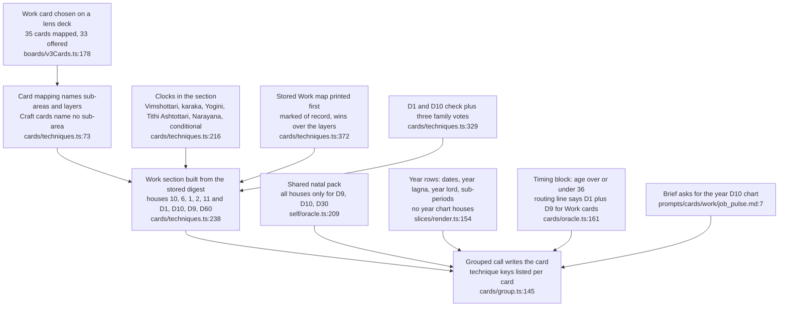

### With the research

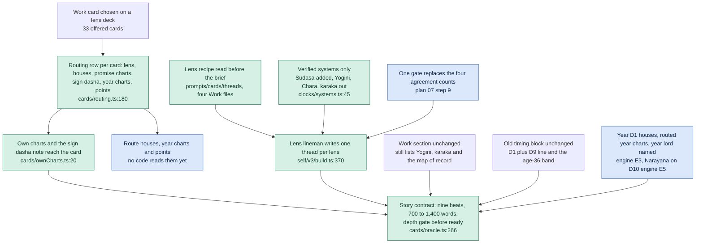

### Changes

| Change | Why | Source | Research file and heading | State | Needs |
|---|---|---|---|---|---|
| One routing row per Work card names the D10 as its own chart, Narayana on D10, the year D10 and the points; only the own charts and the sign dasha note reach the card (flag `CARDS_STORY_CONTRACT`, default on) | the D10 decides the career and is read like a rasi chart | Rath (D10 as full chart); Inferred (read last) | `sanjay-rath/06-vargas.md` §6 rule 6.2; `08-career-and-wealth.md` §1 rule 1.16 | built on develop | server code (houses, year charts and points are not passed) |
| Lens recipe and lens thread before the brief (flag `LENS_LINEMEN`, default on) | the research gives one order of judgment for career | Inferred | `sanjay-rath/08-career-and-wealth.md` §1 "Order of judgment" | built on develop | nothing (release only) |
| Only verified systems are read and counted in the story; Sudasa added for pay cards; Yogini, Chara, karaka and Tithi Ashtottari never shown | Yogini and Tithi Ashtottari have no Rath text; Sudasa is Rath's prosperity clock | Rath (Sudasa role); Student (Sudasa calculation); gap (Yogini) | `sanjay-rath/04-dasha-selection-and-ranking.md` §1, §8; `14-technique-mapping.md` row 36 | built on develop | nothing (release only) |
| Story contract: 700 to 1,400 words in nine beats, depth gate | Sachin's direction; no research rule on length | Yours | the research is silent (gap); `docs/techniques/09` §3.4 | built on develop | nothing (release only) |
| Year D1 houses, D9 and year D10 reach the card through the `family.year` findings (this year and last only); year D2 and D24 are not kept | the year chart is never read alone and is read after the birth chart | Student; houses to read: gap | `sanjay-rath/05-timing-transits-annual-prashna.md` §2, §1.3, "Gaps and conflicts" | built on develop (D1, D9, D10, D7, D4 only, `self/oracle.ts:529`) | server code; data pull (year D2, D24 stored for few charts) |
| Narayana cast on the D10 | the D10 Narayana is the professional environment, key in the working years | Rath (Table 29 rule); Inferred (D10 seed by extension) | `sanjay-rath/04-dasha-selection-and-ranking.md` §2; `06-vargas.md` §4 rule 4.6 | planned | engine E5 |
| Year lord and hora lord named on the year payload | the card is told "year lord unresolved" today | Yours (weekday lord, decided 2026-11-09); attribution conflict | `sanjay-rath/05-timing-transits-annual-prashna.md` §1.2 | planned | engine E3 |
| One gate replaces the confirmed and likely counts | no source gives a required number of agreeing systems | Inferred from Rath (*Crux* p.3) | `sanjay-rath/04-dasha-selection-and-ranking.md` §7 | planned | server code |

### Stays the same

The `BOARD TECHNIQUES: WORK` section, its stored map "of record", the old timing block with the D1 plus D9 routing line and the age band, and the 33 briefs' "What it reads" lines (14 edited) all still reach the card on develop.

### Open

On develop a Work card is told both "focus on D1 plus D9" (`cards/oracle.ts`, unchanged) and "this card's own charts: D10", and its Work section still prints Yogini, Tithi Ashtottari and karaka rows that its recipe forbids it to read.

## Work · Board votes · D1/D10 check of the running lords
<!-- pair id=work-d10-check board=work lens=- reaches=yes live=0fc6bfa dev=9fc0cf3 -->

### Live today

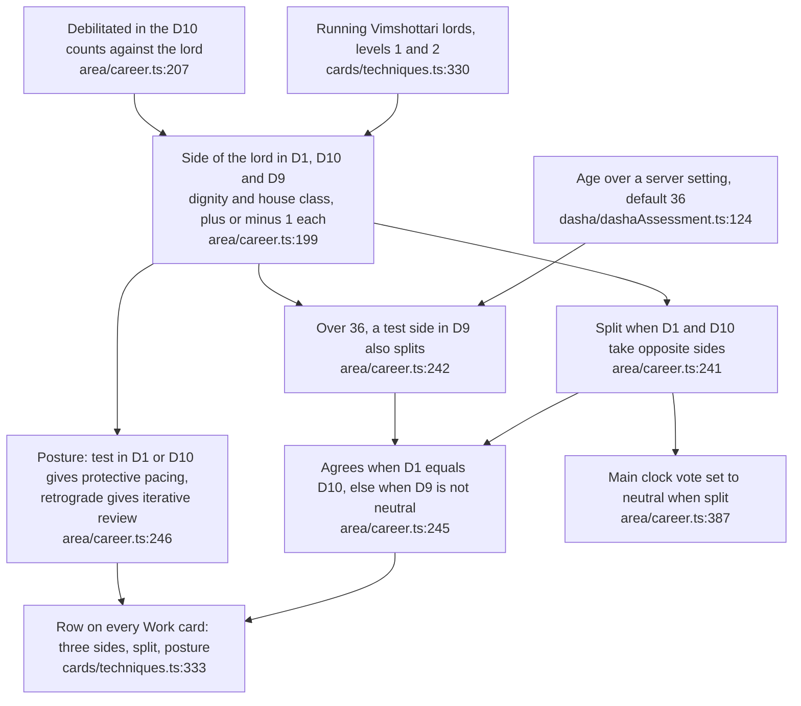

### With the research

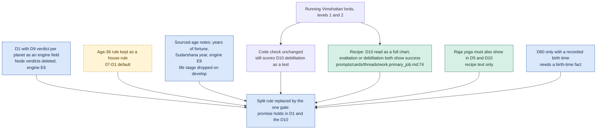

### Changes

| Change | Why | Source | Research file and heading | State | Needs |
|---|---|---|---|---|---|
| The card is told that exaltation and debilitation in the D10 both show success | ordinary dignity logic is reversed in the D10 | Rath | `sanjay-rath/08-career-and-wealth.md` §1 rule 1.19; `06-vargas.md` §6 rule 6.3 | built on develop (prompt only; `area/career.ts` still scores it the other way) | server code |
| D1 with D9 verdict moves to an engine field | Node may compute nothing astrological; vargottama strong, friendly sign with enemy navamsa mixed, debilitated D1 with exalted navamsa a sudden rise | Text (Saravali 41.19, Phaladeepika 20.22); Rath (sudden rise) | `dasha-results/dasha-lord-condition-principles.md` §4, §5; `sanjay-rath/08-career-and-wealth.md` §1 T6 | planned | engine E6 |
| Age 36 kept unchanged as a house rule | no Rath, student or classical source ties a D1/D9 rule to any age | Yours | `sanjay-rath/06-vargas.md` §6 "Gaps"; `current-specs-review/06-gap-matrix.md` row C09 | decision | Sachin (07-D1) |
| Sourced age notes beside it: years of fortune and the Sudarshana year; plan 07's third note, the Naisargika life stage, is overruled on develop (`clocks/systems.ts` marks Naisargika never shown; doc 08 "Verified dasha systems") | the only age rules with sources | Rath (years of fortune, not checked in print); Text (Sudarshana, BPHS 74; Naisargika, BPHS 43) | `sanjay-rath/07` table of years of fortune; `dashas-other-and-annual/sudarshana-chakra-dasha.md`; `naisargika-dasha.md` | planned | engine E8 |
| Raja yoga confirmed in the D5 and the D10 | a raja yoga must also show in the D5 and D10 | Rath | `sanjay-rath/08-career-and-wealth.md` §1 rule 1.17 | built on develop (prompt only; the D5 is not in the pack's chart list, `self/oracle.ts:206`, and `docs/TODOS.md` notes it is not exported) | data pull |
| "Split, the vote does not count" replaced by the gate | no source weighs a varga against the D1 when a period promises in one and denies in the other | gap; gate Inferred from Rath | `sanjay-rath/06-vargas.md` §6 "Gaps"; `04-dasha-selection-and-ranking.md` §7 | planned | server code |
| D60 used only with a recorded birth time | the D60 lagna moves about every two minutes | Student | `sanjay-rath/14-technique-mapping.md` row 74; `natal-techniques/11-shodashavarga-divisional-charts.md` §8 | planned | server code |

### Stays the same

`workD10Check` and its card row are unchanged on develop, and the D60 is still listed in the Work charts with no birth-time gate.

### Open

The conditional and karaka votes call the check without the age, so the age-36 split applies to two of the four callers only; and the catalogue's D60 step has no code behind it.

## Work · Board votes · Conditional family vote
<!-- pair id=work-conditional-family board=work lens=- reaches=yes live=0fc6bfa dev=9fc0cf3 -->

### Live today

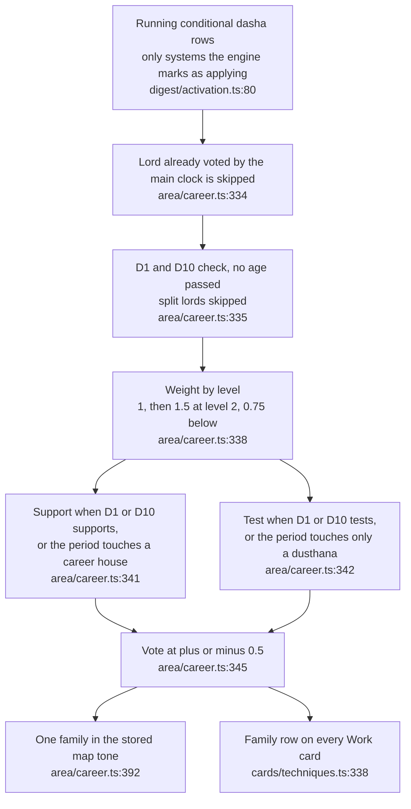

### With the research

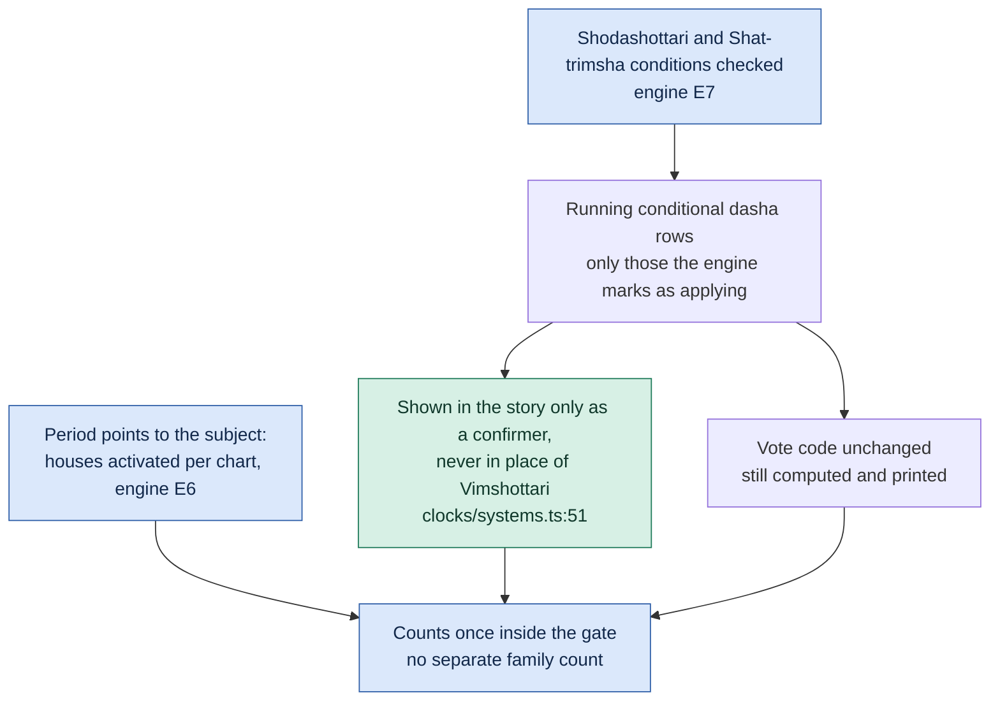

### Changes

| Change | Why | Source | Research file and heading | State | Needs |
|---|---|---|---|---|---|
| The applying conditional dasha confirms and never replaces Vimshottari in the story | each verse says "should be considered", not "replaces"; Rath gives no tie-break | Text (BPHS 46 is silent on replacing); advice Inferred | `dashas-nakshatra/01-applicability-matrix.md` §3, §4; `sanjay-rath/04-dasha-selection-and-ranking.md` §4 | built on develop | nothing (release only) |
| Two conditions the engine never checks get checked | Shodashottari and Shat-trimsha can never apply today | Text (BPHS 46.24, 46.43) | `dashas-nakshatra/01-applicability-matrix.md` table | planned | engine E7 |
| "Touches a career house" read from an engine field | the house link is counted in Node today from the stored row | Inferred | `docs/techniques/07` §4.1 step 2 | planned | engine E6 |
| The family vote folds into the gate | no source asks for a count of agreeing families | Inferred from Rath | `sanjay-rath/04-dasha-selection-and-ranking.md` §7 | planned | server code |

### Stays the same

`workConditionalVote` and its card row are unchanged on develop.

### Open

The code weighs a level-2 period at 1.5, the catalogue says 0.5 (`src/techniques/catalog.ts:265`); and when several conditional dashas apply, the research names no tie-break (only a student's own controlling-planet rule).

## Work · Board votes · Karaka family vote
<!-- pair id=work-karaka-family board=work lens=- reaches=yes live=0fc6bfa dev=9fc0cf3 -->

### Live today

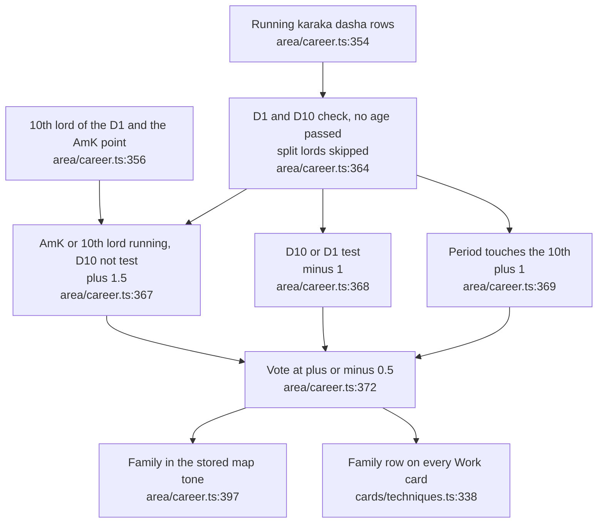

### With the research

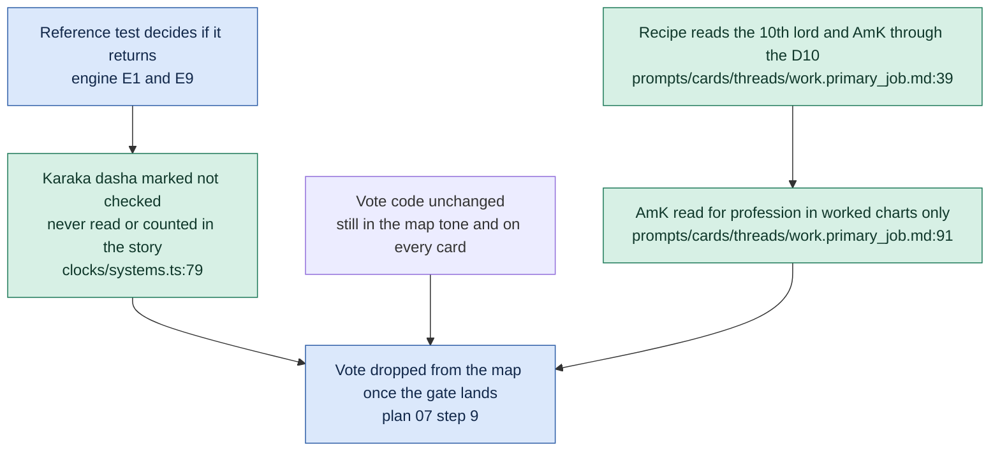

### Changes

| Change | Why | Source | Research file and heading | State | Needs |
|---|---|---|---|---|---|
| The karaka dasha is left out of what the story reads and counts | not checked against the research or the reference test | gap | `docs/techniques/09` §1 "Systems that pass decision 2"; `sanjay-rath/04-dasha-selection-and-ranking.md` §1 table (no karaka dasha) | built on develop | nothing (release only) |
| The AmK is read as a profession pointer in worked charts only | Rath gives no standalone AmK rule | Rath (cases) | `sanjay-rath/08-career-and-wealth.md` §1 rule 1.11 | built on develop (prompt) | nothing (release only) |
| A reference run decides whether the clock comes back | unverified clocks agree by accident | Inferred | `docs/techniques/07` §6 E1, E9 | planned | engine E1 |
| The karaka family leaves the map's count | the gate counts engine verdicts of verified systems only | Inferred | `docs/techniques/07` §4.1 step 3 | planned | server code |

### Stays the same

`workKarakaVote` still adds plus 1.5 when the AmK or the 10th lord runs, and it still votes in the stored map shown as "of record".

### Open

Develop shows a card a karaka family vote in its Work section while its recipe and verified list say the karaka dasha is not read.

## Work · Board votes · Annual family vote
<!-- pair id=work-annual-family board=work lens=- reaches=yes live=0fc6bfa dev=9fc0cf3 -->

### Live today

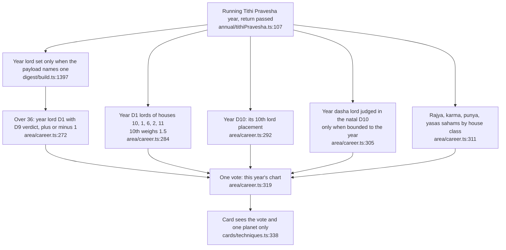

### With the research

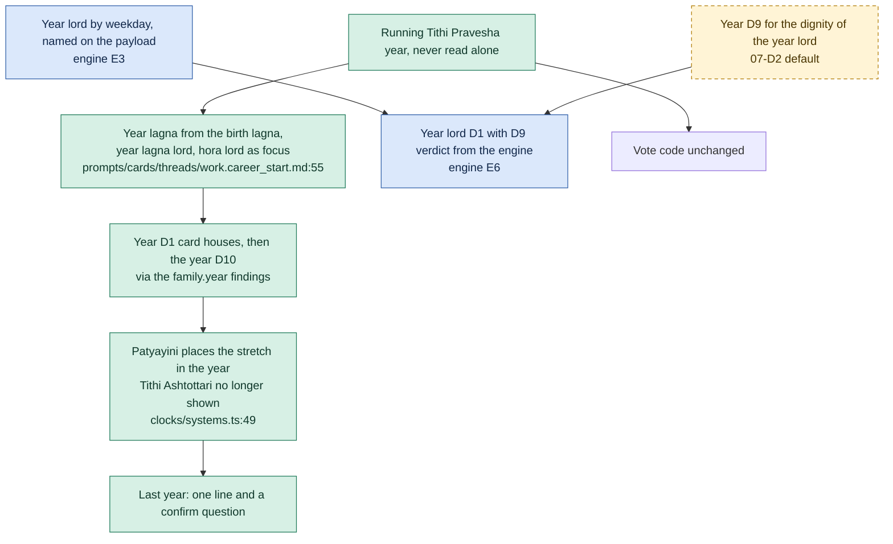

### Changes

| Change | Why | Source | Research file and heading | State | Needs |
|---|---|---|---|---|---|
| The year chart is read after the birth chart and never alone | the natal chart has overriding influence | Student | `sanjay-rath/05-timing-transits-annual-prashna.md` §2 | built on develop (prompt) | nothing (release only) |
| Year lagna counted from the birth lagna, year lagna lord, hora lord | the only published reading rules for the year chart | Student | `sanjay-rath/05-timing-transits-annual-prashna.md` §1.3 | built on develop (prompt; the hora lord name is not stored) | engine E3 |
| Year lord named, by weekday | today the code reads a year lord that is usually absent | Yours (decided 2026-11-09); the three candidates are disputed and none is Rath's | `sanjay-rath/05-timing-transits-annual-prashna.md` §1.2; `dashas-other-and-annual/tithi-pravesha-chart-and-year-lord.md` | planned | engine E3 |
| Year D1 houses of the card, then the year D10 | no source names the houses to read in the year chart | gap (houses); Inferred (order) | `sanjay-rath/05-timing-transits-annual-prashna.md` "Gaps and conflicts" | built on develop (findings only) | nothing (release only) |
| Year D9 used for the year lord's dignity, after the year D1 | no source compares the year D1 with the year D9 | Yours | the research is silent (gap); `docs/techniques/07` decision 2 | decision | Sachin (07-D2) |
| Patyayini places the stretch in the year; the Tithi Ashtottari short clock is no longer shown | the in-year dasha is unresolved in the research; Patyayini passed an engine run | gap | `sanjay-rath/05-timing-transits-annual-prashna.md` §3, "Gaps and conflicts" | built on develop (story only; the vote still reads the year dasha) | server code |
| Over-36 verdict on the year lord kept | no source ties a D9 rule to age | Yours | `sanjay-rath/06-vargas.md` §6 "Gaps" | decision | Sachin (07-D1) |

### Stays the same

`workAnnualVote` is unchanged on develop: year D1 and year D10 houses, the year dasha lord, four sahams, and the vote reaches the card as one word.

### Open

Until E3 ships, the year-lord step in the vote probably never runs, and the 10th house loop overwrites the lead planet whenever the year 10th has a lord (`area/career.ts:287`).

## Work · Board votes · Stored Work map of record
<!-- pair id=work-map-of-record board=work lens=- reaches=yes live=0fc6bfa dev=9fc0cf3 -->

### Live today

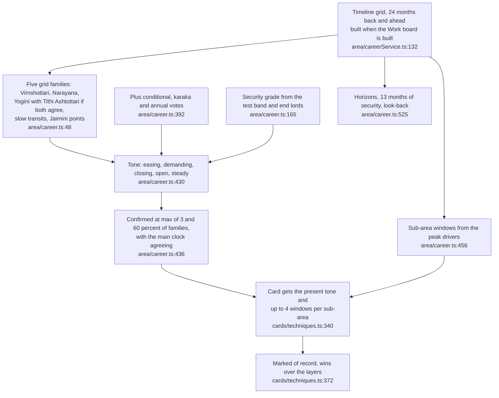

### With the research

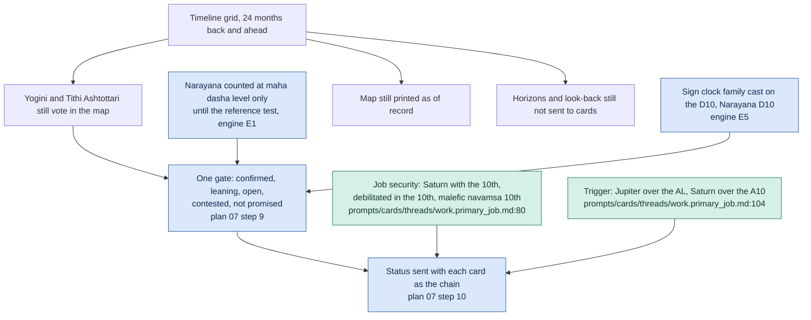

### Changes

| Change | Why | Source | Research file and heading | State | Needs |
|---|---|---|---|---|---|
| The gate replaces "confirmed at max of 3 and 60 percent" | Rath's rule is that a sign dasha confirms what Vimshottari pinpoints; no source gives a count | Inferred from Rath (*Crux* p.3) | `sanjay-rath/04-dasha-selection-and-ranking.md` §7 | planned | server code |
| Yogini and Tithi Ashtottari leave the count | no Rath text for either; Yogini is not an SJC clock | gap | `sanjay-rath/14-technique-mapping.md` row 36; `04-dasha-selection-and-ranking.md` "Gaps and conflicts" | planned (built for the story only) | server code |
| Narayana counted at maha dasha level only | its sub-periods may be wrong in the engine | Inferred | `current-specs-review/06-gap-matrix.md` row B01 | planned | engine E1 |
| The sign clock family reads Narayana cast on the D10 instead of the D1 | the D10 Narayana is the professional environment, key in the working years | Rath (Table 29 rule); Inferred (D10 seed) | `sanjay-rath/04-dasha-selection-and-ranking.md` §2; `06-vargas.md` §4 rule 4.6 | planned | engine E5 |
| Job-security screen named for the card: Saturn with the 10th or its lord, debilitated planets in the 10th, malefics in the navamsa 10th | Rath's unemployment checks | Rath | `sanjay-rath/08-career-and-wealth.md` §1 rule 1.9 | built on develop (prompt) | nothing (release only) |
| Triggers over the arudhas | Rath's only career transit rules | Rath | `sanjay-rath/08-career-and-wealth.md` §1 T5 | built on develop (prompt; transit over an arudha is not an engine output) | server code |

### Stays the same

`careerMap` and `presentState` are unchanged on develop, and the Work section still puts the map first as the tone and windows "of record".

### Open

The map's `present` row is in no card's own keys and not in the always-stamped layers (`cards/techniques.ts:397`, `:425`), so a change in the stored tone alone may not re-read a card; not tested.

## House layers on the Work board

The layers themselves are drawn in `02-love.md`. Work parameters come from `area/work.ts:15-36` at `0fc6bfa`; the layer
code (`area/houseLayers.ts`) is unchanged on develop.

| Layer | Work parameters | Differs from Love? |
|---|---|---|
| Promise (`area/houseLayers.ts:237`) | D1 houses 10, 6, 1, 2, 11; karakas the 10th lord, the AmK, the Sun; no affliction yogas | Same code; Love reads houses 7, 5, 8, 4, 2, 11 and the 7th lord, Venus, the Moon, the DK |
| Affliction (`:327`) | heavy planets Saturn, Rahu, Ketu; no yoga names; no gandanta or sade sati | Love adds Mars and the Kalathra and Manglik yogas |
| Protection (`:389`) | no protected point; extra check: the D10 10th lord dignified (`vargaChecks`) | Love protects the UL and checks the D9 7th; plan 09 §4 removes Jupiter's aspect as protection for both, not yet built |
| Activation (`:477`) | periods touching houses 10, 6, 1, 2, 11, 3, 7, 9, 12, graded with the D10 as the inner chart (`:454`) | Yes: a lord debilitated in the D10 grades down, against `sanjay-rath/08` rule 1.19; Love grades in the D9 |
| Transit (`:535`) | Jupiter, Saturn, Rahu, Ketu over houses 10, 6, 1, 2, 11 | Same rule, other houses |
| Annual (`:565`) | year D1 lords of houses 10, 6, 1, 2, 11; sahams rajya, karma, punya, yasas in a kendra; no test sahams | Love reads vivaha, preethi, mitra and two test sahams |
| Varga (`:593`) | D10, D9 and D60 for houses 10, 6, 1, 2, 11 (the D10 10th is left to the protection check) | Yes: D10 debilitation counts as weak, against rule 1.19; the D60 has no birth-time gate. Love reads D9 and D7 |
| Nakshatra (`:636`) | cusp stars of houses 10, 6, 1, 2, 11; tara of the running Vimshottari lords | Same code |
| Sub-areas (`:913`) | seven: getting a job, changing jobs, promotion, job security, abroad, pay, business | The stored Work map's windows replace these as "of record" on a card; Love has no such override |

## Work · Starting out · Lens reading order
<!-- pair id=work-lens-career-start board=work lens=career_start reaches=yes live=0fc6bfa dev=9fc0cf3 -->

### Live today

Cards: `start_launch_window`, `start_first_role_timing`, `start_offer_decision`, `start_imposter_syndrome`, `start_relocation_abroad`, `start_three_year_foundation` (offered); `start_degree_to_career` is mapped but marked later.

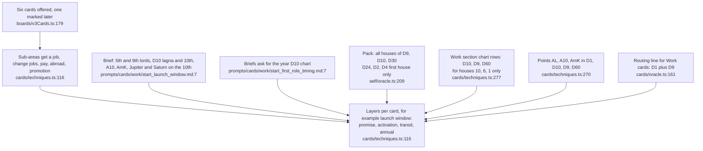

### With the research

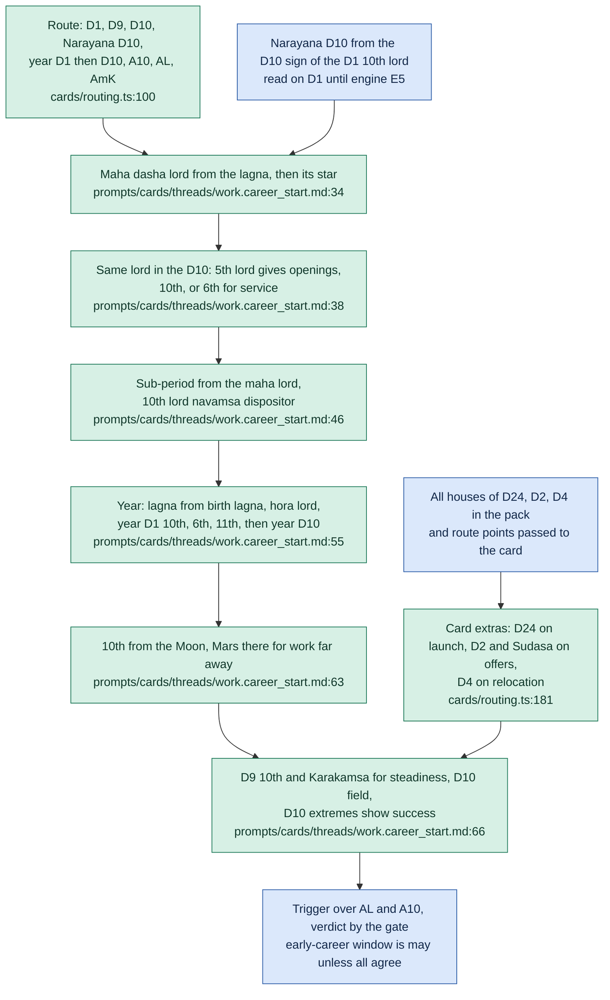

### Changes

| Change | Why | Source | Research file and heading | State | Needs |
|---|---|---|---|---|---|
| The D10 read as a full chart and last: artha trikona 2, 6, 10 and the 7th, read like a rasi chart | the D10 decides the career | Rath (full chart); Inferred (read last) | `sanjay-rath/08-career-and-wealth.md` §1 rule 1.16; `06-vargas.md` §6 rule 6.2 | built on develop (prompt; D10 houses already in the pack) | nothing (release only) |
| The D10 5th lord for new openings and a first job | the 5th lord "will always give" new openings; there is no separate first-job rule | Rath; first job: gap | `sanjay-rath/08-career-and-wealth.md` §1 T1, "Gaps" | built on develop (prompt) | nothing (release only) |
| Narayana on the D10 | the professional environment, key in the working years | Rath (Table 29 rule); Inferred (D10 seed) | `sanjay-rath/04-dasha-selection-and-ranking.md` §2; `08-career-and-wealth.md` §1 T7 | planned | engine E5 |
| A10 for titles, the AL's occupants for the field | Rath's arudha rules for career | Rath | `sanjay-rath/08-career-and-wealth.md` §1 rule 1.10 | built on develop (prompt; points from the Work section) | nothing (release only) |
| D10 exaltation or debilitation both show success | against ordinary dignity logic | Rath | `sanjay-rath/08-career-and-wealth.md` §1 rule 1.19 | built on develop (prompt; the layers still score it the other way) | server code |
| `start_offer_decision` adds the D2 and Sudasa | Sudasa times finance; the D2 meaning is disputed in Rath's own texts | Rath (Sudasa role); Student (calculation) | `sanjay-rath/08-career-and-wealth.md` §2 W1, W2; `06-vargas.md` §1 rule 1.9 | built on develop (route and prompt; D2 has only its 1st house in the pack) | server code |
| D24 on the launch card, D4 on the relocation card | the D24 is learning; the D4 for going abroad is a student's rule | Rath (D24); Student (D4) | `sanjay-rath/10` §2, rule 3.9 | built on develop (route; first house only in the pack) | server code |
| Year D1 then year D10 | houses to read in the year chart are not in the research | gap (houses); Inferred (order) | `sanjay-rath/05-timing-transits-annual-prashna.md` "Gaps and conflicts" | built on develop (findings) | nothing (release only) |

### Stays the same

The Work section rows for sub-areas get a job, change jobs, pay and abroad still reach these cards, with the stored map's windows as "of record".

### Open

The route's points (A10, AL, AmK) and year charts are written in `cards/routing.ts` but no code passes them to the card; the recipe's "ROUTE line" does not exist in any request.

## Work · Your job · Lens reading order
<!-- pair id=work-lens-primary-job board=work lens=primary_job reaches=yes live=0fc6bfa dev=9fc0cf3 -->

### Live today

Cards: `job_pulse`, `job_security_layoff`, `job_stay_or_leave`, `job_promotion_recognition`, `job_salary_bonuses`, `job_burnout_load`, `job_boss_politics`, `job_leading_teams`, `job_industry_switch`, `job_remote_abroad`, `job_skill_building` (11, all offered).

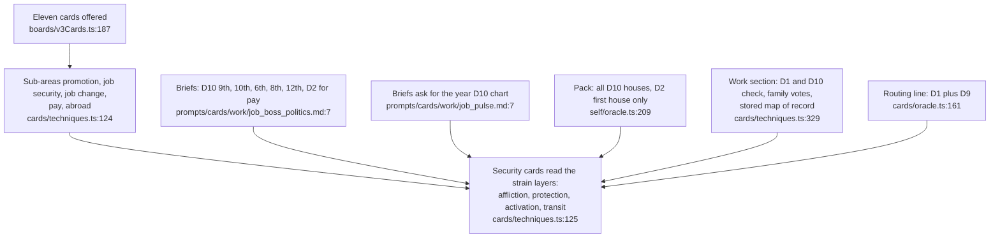

### With the research

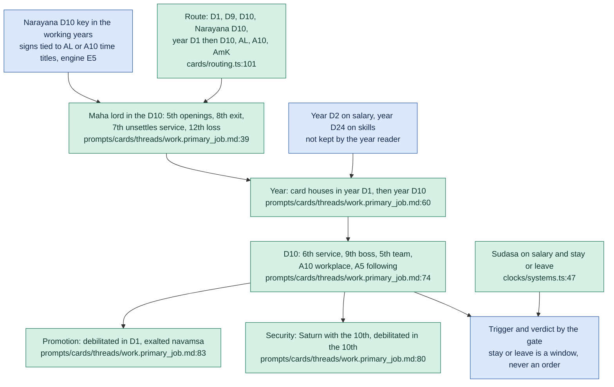

### Changes

| Change | Why | Source | Research file and heading | State | Needs |
|---|---|---|---|---|---|
| D10 houses as people and stages: 6th service, 9th boss and independence, 5th subordinates and authority, 8th exit, 7th lord unsettles service | Rath's D10 house lords for events | Rath | `sanjay-rath/08-career-and-wealth.md` §1 rule 1.20, T1 | built on develop (prompt; all D10 houses in the pack) | nothing (release only) |
| A10 in the D10 as workplace, A5 in the D10 as following and awards | a student's D10 arudha rules | Student | `sanjay-rath/08-career-and-wealth.md` §1 rule 1.22 | built on develop (prompt; D10 arudhas not in the Work section) | server code |
| Narayana on the D10, "key in the working years"; Narayana signs tied to AL or A10 time titles | Rath's varga Narayana and title rule | Rath (role and T4); Inferred (D10 seed) | `sanjay-rath/04-dasha-selection-and-ranking.md` §2; `08-career-and-wealth.md` §1 T4, T7 | planned (read on D1 meanwhile) | engine E5 |
| Sudasa for pay and standing on `job_salary_bonuses` and `job_stay_or_leave`, never "only when the Moon sign is stronger" | Sudasa times finance and fortune | Rath (role); Student (calculation) | `sanjay-rath/08-career-and-wealth.md` §2 W1, W2; `04-dasha-selection-and-ranking.md` §8 | built on develop | nothing (release only) |
| Sudden promotion from a debilitated planet in an exalted navamsa, short-lived if retrograde | Rath's promotion rule | Rath | `sanjay-rath/08-career-and-wealth.md` §1 T6 | built on develop (prompt) | nothing (release only) |
| Unemployment screen on `job_security_layoff`, worded as a stretch to watch | Rath's job-loss checks | Rath | `sanjay-rath/08-career-and-wealth.md` §1 rule 1.9 | built on develop (prompt) | nothing (release only) |
| Year D2 on `job_salary_bonuses` and year D24 on `job_skill_building` | the route names them; the year reader keeps D1, D9, D10, D7, D4 only | gap (houses); Inferred (order) | `sanjay-rath/05-timing-transits-annual-prashna.md` "Gaps and conflicts" | planned | server code; data pull |

### Stays the same

The Work section's sub-area rows, the D1 and D10 check, the three family votes and the stored map still reach these cards.

### Open

The recipe reads D10 debilitation as success while the Work section's varga and activation rows on the same card call it weak.

## Work · Craft and hobby · Lens reading order
<!-- pair id=work-lens-hobby board=work lens=hobby reaches=yes live=0fc6bfa dev=9fc0cf3 -->

### Live today

Cards: `craft_creative_flow`, `craft_energizing_medium`, `craft_creative_blocks`, `craft_monetize_hobby`, `craft_shipping_projects`, `craft_audience_community` (6, all offered).

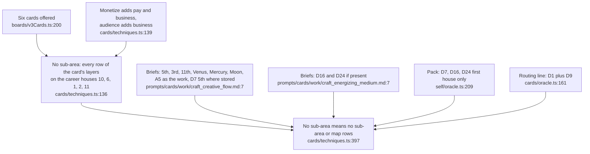

### With the research

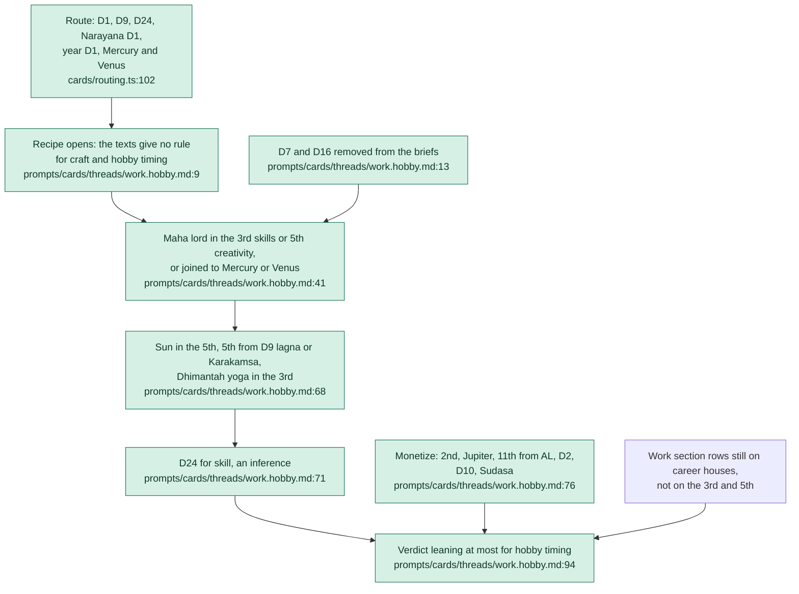

### Changes

| Change | Why | Source | Research file and heading | State | Needs |
|---|---|---|---|---|---|
| The recipe states that the research is silent on craft and hobby, and tags every hobby meaning Inferred | Rath gives no hobby rule; only adjacent rules exist | gap | `sanjay-rath/08-career-and-wealth.md` §1 sub-areas; research digest §E Work | built on develop | nothing (release only) |
| The D7 is removed from the five Craft briefs | the D7 is the chart of children | Text (BPHS); Rath | `sanjay-rath/06-vargas.md` §1 rule 1.2 | built on develop (Sachin's yes recorded in doc 08) | nothing (release only) |
| The D16 is removed; the D24 is read for skill instead | no source ties the D16 to craft; the D24 is learning, its use for craft is an inference | gap (D16); Rath (D24 learning); Inferred (D24 for craft) | `sanjay-rath/06-vargas.md` §1 rule 1.3 | built on develop (D24 has only its 1st house in the pack) | server code |
| The 3rd for skills, the 5th and the Sun in it for creativity, Mercury and Venus as media | the nearest Rath rules; "Mercury in the Karakamsa gives crafts" is a Jaimini sutra, not Rath, and the recipe does not use it | Rath (3rd, 5th); Inferred (as hobby meaning) | `sanjay-rath/09` rule 5.1; `07` rule 1.16; `08-career-and-wealth.md` §1 rule 1.13 | built on develop (prompt) | nothing (release only) |
| Hobby timing reads "leaning" at most; only the money side can be confirmed | no craft rule stands behind a confirmed date | Inferred | `docs/techniques/07` §4.1 step 3 | built on develop (prompt) | nothing (release only) |
| No craft trigger: only the classical sub-period transit gate | no source gives a craft trigger | gap; Text (gate) | `dasha-results/dasha-transit-combination.md` §1 | built on develop (prompt) | nothing (release only) |
| Craft cards read rows on the 3rd and 5th instead of the career houses | `CARD_TECHNIQUES` gives them no sub-area, so they get career-house rows | Inferred | `docs/techniques/07` §4.2 Work craft row | planned (not in any plan step yet) | server code |

### Stays the same

The six Craft cards still get the Work section's career-house rows (houses 10, 6, 1, 2, 11) for their layers, and the briefs still name the natal A5 as "the work".

### Open

Whether the D24's houses should reach the pack for the Craft cards, and whether the Craft cards should read the Work section at all, are not decided in any plan.

## Work · Business · Lens reading order
<!-- pair id=work-lens-business board=work lens=business reaches=yes live=0fc6bfa dev=9fc0cf3 -->

### Live today

Cards: `biz_readiness`, `biz_ideal_industry`, `biz_launch_timing`, `biz_cashflow_margins`, `biz_clients_sales`, `biz_partnerships_fit`, `biz_hiring_team`, `biz_capital_assets`, `biz_scaling_risk`, `biz_founder_burnout` (offered); `biz_legal_safeguards` is mapped but marked later.

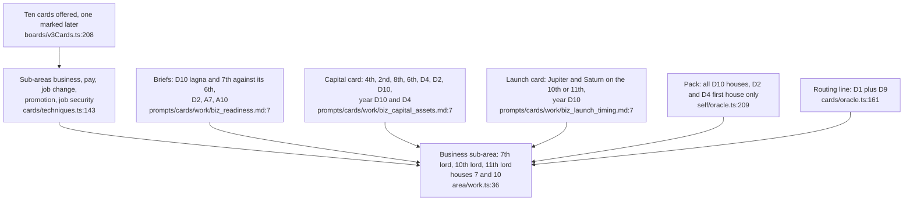

### With the research

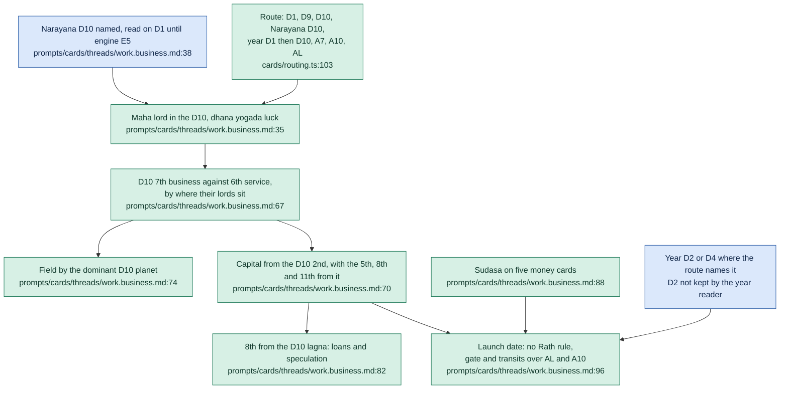

### Changes

| Change | Why | Source | Research file and heading | State | Needs |
|---|---|---|---|---|---|
| Business against service from where the D10 6th and 7th lords sit, not only house strength; lagna lord in the 9th suits business | Rath weighs the lords' seats | Rath | `sanjay-rath/08-career-and-wealth.md` §1 rule 1.20 | built on develop (prompt; the comparison is not an engine output) | nothing (release only) |
| Capital from the D10 2nd; the 5th, 8th and 11th from it are partners' money, loans and own funds | Rath's business-start capital rule | Rath | `sanjay-rath/08-career-and-wealth.md` §1 rule 1.21 | built on develop (prompt; all D10 houses in the pack) | nothing (release only) |
| Field from the dominant D10 planet; Mercury or Venus in the 10th suit business | Rath's D10 field list; "dominant" has no stated measure | Rath | `sanjay-rath/08-career-and-wealth.md` §1 rules 1.2, 1.18 | built on develop (prompt) | nothing (release only) |
| 8th from the D10 lagna for business loans and speculation; a benefic 8th favours business | Rath's only speculation and debt rules | Rath | `sanjay-rath/08-career-and-wealth.md` §2 W6, W7 | built on develop (prompt) | nothing (release only) |
| Sudasa on `biz_readiness`, `biz_launch_timing`, `biz_cashflow_margins`, `biz_hiring_team`, `biz_capital_assets` | Sudasa times finance and fortune | Rath (role); Student (calculation) | `sanjay-rath/08-career-and-wealth.md` §2 W1, W2 | built on develop | nothing (release only) |
| Launch timing says the research has no business-start rule and falls back to the gate and the arudha transits | no Rath rule on business start dates | gap; Rath (T5 transits) | `sanjay-rath/08-career-and-wealth.md` §1 "Gaps", T5 | built on develop (prompt) | nothing (release only) |
| Narayana on the D10 | the professional environment | Rath (Table 29 rule); Inferred (D10 seed) | `sanjay-rath/04-dasha-selection-and-ranking.md` §2 | planned | engine E5 |
| Year D2 for `biz_launch_timing` and `biz_cashflow_margins` | named by the route | gap (houses) | `sanjay-rath/05-timing-transits-annual-prashna.md` "Gaps and conflicts" | planned | server code; data pull |

### Stays the same

The Work section's business sub-area still names the 7th, 10th and 11th lords and houses 7 and 10, and the stored map's business windows remain "of record".

### Open

`biz_partnerships_fit` uses the DK only to keep a spouse apart from a business partner; the research names no business-partner karaka, only the A7.

## Not wired

Work catalogue techniques and spec documents that no card reads, traced at `0fc6bfa` unless marked.

| Name | Where it lives | Why it does not reach a card |
|---|---|---|
| `work.horizons` | `area/career.ts:525`, stored in the Work map | `renderBoardTechniques` reads only `present` and `ahead` from the map (`cards/techniques.ts:340-347`) |
| `work.looking_back` | `area/career.ts:544` | same: the map's `back` list is never rendered |
| Monthly security list (part of `work.security_grade`) | `area/career.ts:541` | same; only the present grade and each window's grade reach a card |
| `work.character_arc` | `area/career.ts:557`, `area/selfCharacterAndJoy.ts`; catalogue cites *Crux* for the age-36 rule | stored as `characterArc` in the map, never rendered by `cards/techniques.ts`; the research could not find the rule in *Crux* |
| Work vocation blueprint | `area/career.ts:558` | stored as `vocationBlueprint`, never rendered; it rests on Karakamsa profession, which is not Rath's (`sanjay-rath/08` rule 1.13) |
| `work.reading.vocation`, `standing`, `ground`, `gain`, `struggle`, `year`, `purview`, `audit`, `diagnosis`, `chapters`, `clock` | `self/panels/work.ts`, run by `self/service.ts:287` `getBoardReading` | called from `self/buildEvent.ts:202` and `src/routes/adminLabRoutes.ts:265`; no card pack slice reads the panels. Whether the build event runs the Work board on staging was not checked |
| `work.reading.oracle` (Work lineman, `lineman.work`) | `src/agents/registry.ts:385`, `self/oracle.ts:1043` | stage of the same board reading; doc 09 §1 says it does not run on the live card path. Develop's lens linemen use `prompts/lens/lineman.md` instead |
| D60 step of `work.d10_check` | `src/techniques/catalog.ts:302-305` | `workD10Check` never reads the D60 (`area/career.ts:232-253`) |
| Sudasa period rows (live only) | stored engine dashas | no live technique reads them; on develop they reach the story as verified period rows (`clocks/systems.ts:47`) |
| `docs/techniques/work/*.md` (10 specs, develop only) | `docs/techniques/work/` | no code loads any file under `docs/techniques/` (plan 07 §1) |
| `docs/techniques/05-work-board-illustrations.md` | `docs/techniques/` | same |
| Career method docs 42 and 43 | `docs/reading-engine/42-life-area-reading-career.md`, `43-career-reading-technique.md` | specs behind `area/career.ts`; no code loads them |
| Love and Work card techniques spec | `docs/dashboards/14-love-work-card-techniques.md` | spec behind `cards/techniques.ts`; no code loads it |
| Route houses, year charts and points (develop) | `cards/routing.ts:56-65` | only `promiseCharts`, `lens` and `signDasha` have a caller (`cards/ownCharts.ts`); `docs/TODOS.md` plans `family.year` to read `yearCharts` after a merge |
