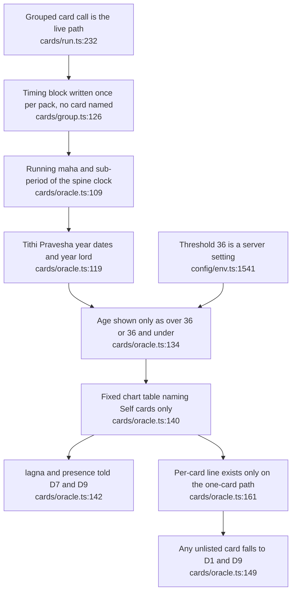
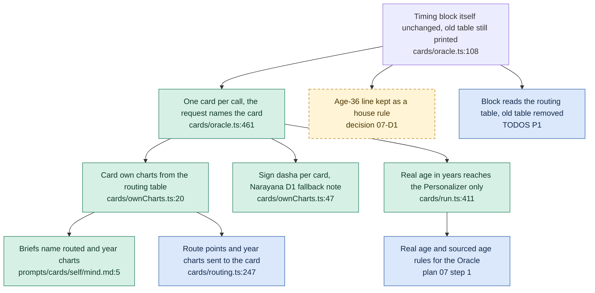
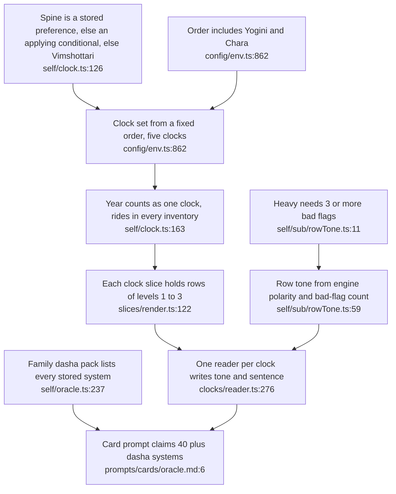
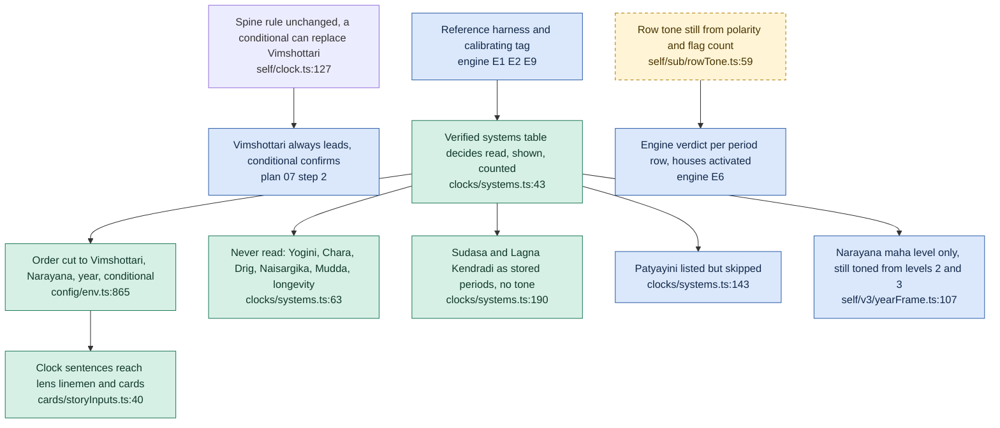
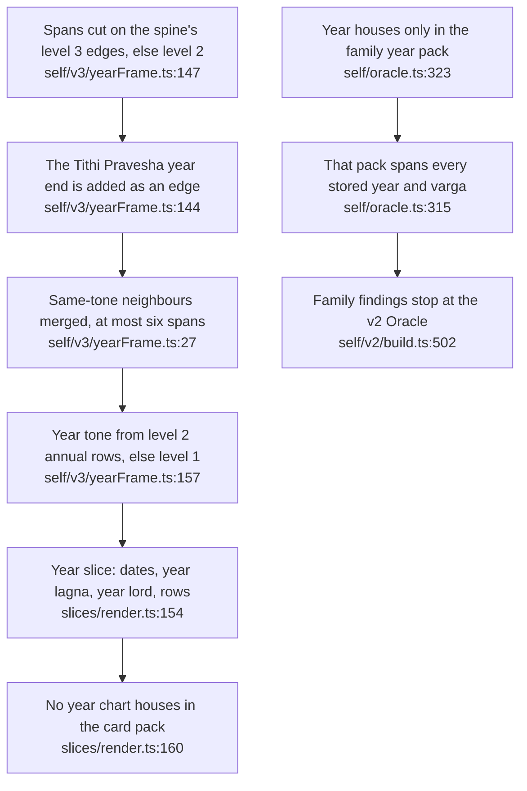
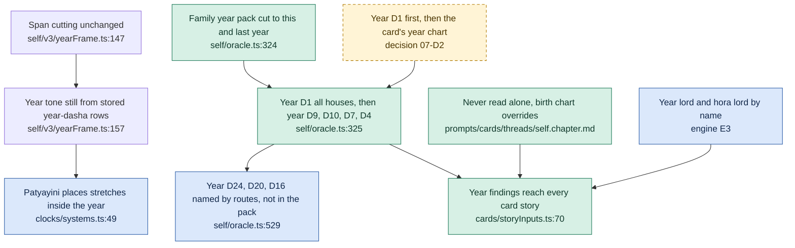
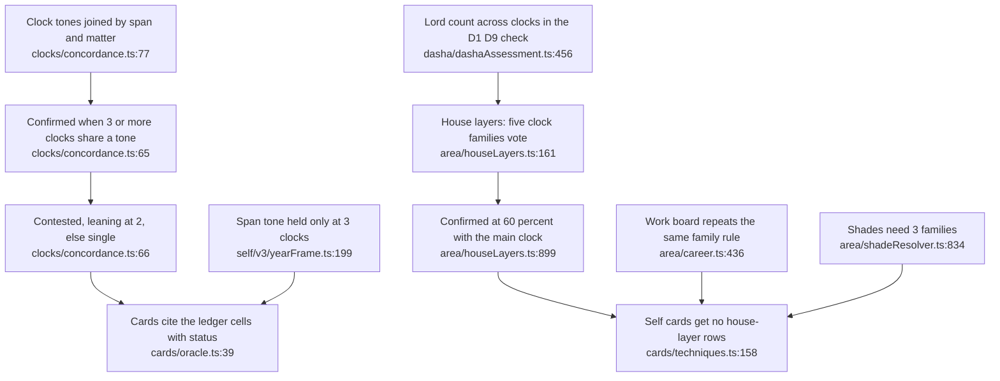
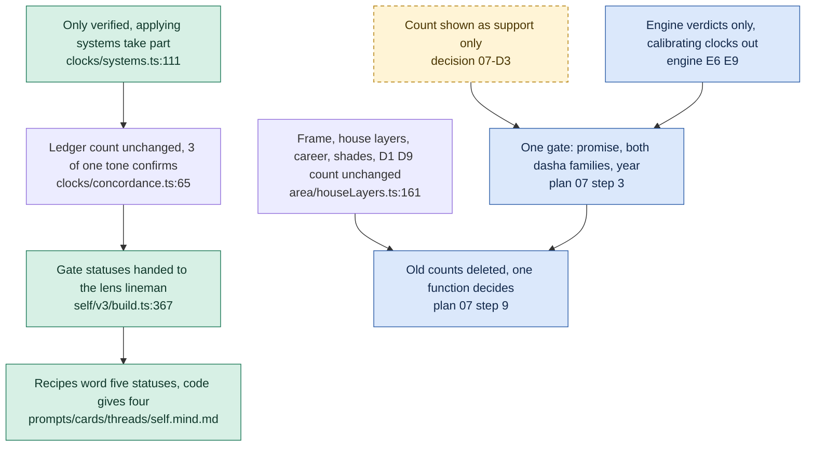

# Technique atlas · 04 · Shared machinery

Written 2026-11-19. Documentation only. Layout, colours and source tags follow `00-how-to-read.md`.

Four pieces every card on every board passes through: the timing and chart-routing block in the card request, the clock
layer, the year frame, and the rule that turns clock agreement into a status. Left-hand line numbers are from
`release-candidate-staging` `0fc6bfa`; right-hand file references are from `develop` `9fc0cf3`.

Flags on the live server (doc 09 §1): `SELF_V2_BUILD=1`, `SELF_V3_BUILD=1`, `READING_CLOCK_LAYER=1`,
`CARDS_GROUP_PACK=1`. On `develop`, the new card path is gated by `CARDS_STORY_CONTRACT` (default on; turning it on also
turns the grouped call off, `config/env.ts:1043`) and `LENS_LINEMEN` (default on). Both default to on, so releasing
`develop` switches them on unless the live environment sets them to `0`. Rows marked "found here" are gaps found while
writing this page; they are not items of plan 07 or plan 09.

## Shared · Card request · Timing and chart-routing block
<!-- pair id=shared-timing-routing board=shared lens=- reaches=yes live=0fc6bfa dev=9fc0cf3 -->

### Live today

### With the research

### Changes

| Change | Why | Source | Research file and heading | State | Needs |
|---|---|---|---|---|---|
| Each card is read in its own call with a story block that names its own charts (`THIS CARD'S OWN CHARTS`, from `routeFor`). Flag `CARDS_STORY_CONTRACT`, default on; needs `SELF_V3_BUILD=1` and `READING_CLOCK_LAYER=1`. The old table stays in the same request, so a `develop` card gets two routings that disagree (for `lagna`: D7 in the table, D9 as its own chart); removing it is the server change needed. | One table for all 90 cards (plan 09 §4); each subject has its own divisional chart. | Rath | `sanjay-rath/06-vargas.md` §1 "Choosing the varga: five harmonic cycles", Rules | built on develop | server code |
| The card is told its sign dasha and, where the route names Narayana on D9, D10, D20 or D24, that Narayana on D1 is read instead. Same flag. | Vimshottari pinpoints, a sign dasha confirms; a divisional Narayana starts from the sign the D1 lord of the controlling house holds in that chart. | Rath | `sanjay-rath/04-dasha-selection-and-ranking.md` §2 "Narayana per varga (seed rules)" and §7 "How systems combine" | built on develop | engine E5 |
| Every Self brief gains a "Charts:" sentence naming its routed chart and year charts, "only where the shared data carries them". No flag (prompt text). The pack still lacks D16, D20, D24 houses and any D5. | Briefs named charts the pack did not hold. Which year-chart houses to read is not in the research. | Inferred | `sanjay-rath/05-timing-transits-annual-prashna.md` "Gaps and conflicts" | built on develop | server code |
| Age in whole years and life stage go to the Personalizer, never printed. Flag `CARDS_STORY_CONTRACT`. The Oracle still gets only the band. | Doc 09 decision 5. | Yours | gap | built on develop | nothing (release only) |
| The Oracle gets the real age and three sourced age rules: Naisargika stage, Sudarshana year house, years of fortune. Doc 08's verified list now bars Naisargika, so plan 07 and doc 08 disagree on the first rule. | Plan 07 §4.1 step 1. | Text (BPHS 43, BPHS 74); Rath (years of fortune, read through a summary, to be checked in print) | `dashas-other-and-annual/naisargika-dasha.md`; `dashas-other-and-annual/sudarshana-chakra-dasha.md`; `sanjay-rath/07-self-mind-spirituality.md` §2 "Timing method" | planned | server code, engine E8 |
| The "over 36" line stays, worded as a rule ("Mutual D1+D9 confirmation applies"), in the block and in three places in `prompts/cards/oracle.md`; only the `self.chapter` recipe calls it a house rule. | Decision 07-D1 default. No source ties a D1/D9 rule to any age. | Yours | `sanjay-rath/06-vargas.md` §6 "Weighing D1 against a varga", Gaps | decision | Sachin |
| The block reads the routing table for every card and stops printing the Self-only table. Already filed (TODOS, reading recipes, P1). | Doc 08 "Open items". | Inferred | `docs/techniques/08-card-routing-table.md` "Open items" (product doc; the research is silent) | planned | server code |
| Found here: the route's points (AL, AK, Sun, Sree Lagna, Karakamsa and others), subject houses and year charts reach no request. Only `promiseCharts` and `signDasha` are read (`cards/ownCharts.ts`); the recipes refer to a "ROUTE line" that no code renders. | The recipes cannot follow their own first line without it. | Rath; Student (per point, doc 08 source column) | `sanjay-rath/02-reading-procedure-and-precedence.md` §3 "Which reference point governs which question" | planned | server code |

### Stays the same

The running maha and sub-period shown are the spine clock's (which can be a conditional dasha), the year lord prints as stored ("unresolved" when missing), and the stance line is still set by whether any span is heavy.

### Open

The year lord and hora lord are not exported by name (engine E3), and the "36 and under: D9 as future potential" line contradicts the temperament recipe, which makes the D9 lagna lead at any age.

## Shared · Clocks · Clock layer
<!-- pair id=shared-clock-layer board=shared lens=- reaches=yes live=0fc6bfa dev=9fc0cf3 -->

### Live today

### With the research

### Changes

| Change | Why | Source | Research file and heading | State | Needs |
|---|---|---|---|---|---|
| A table (`clocks/systems.ts`) decides which systems are read, shown and counted: Vimshottari (all levels), Narayana (maha level), Sudasa, Lagna Kendradi, the one applying conditional, Patyayini, the year chart. No flag; it applies on every path. | Doc 09 decision 2. The research flags several clocks at sub-period level and warns that more clocks raise agreement by accident. | Inferred | `reports/Vedic dasha systems and prediction techniques.md` (more clocks, spurious agreement); `sanjay-rath/15-sensitive-rules-and-gaps.md` §2 "Open gaps and unread sources" (gap 11) | built on develop | nothing (release only) |
| The clock order default drops Yogini and Chara (`READING_CLOCK_ORDER`, no flag; a live env value would override it, not checked). Never read: Yogini, Chara, Drig, Trikona, Mandooka, Tara, Naisargika, Mudda, the longevity dashas, a conditional that does not apply, Shodashottari, Shat-trimsha. | Chara is the movable-lagna form of Narayana, so the two are one system. Yogini has no Rath or SJC text. | Rath (Chara); gap (Yogini) | `sanjay-rath/04-dasha-selection-and-ranking.md` §6 "Chara as movable Narayana"; `dashas-nakshatra/yogini.md` | built on develop | nothing (release only) |
| Sudasa and Lagna Kendradi reach the reading as stored period rows, never as a clock tone (no engine pressure rows yet). Found here: Sudasa is `show: always`, so its rows go to every card, Self included, although the Self recipes say "Sudasa is not read on this lens" and doc 08 limits it to Work and money cards. | Sudasa is Rath's clock for prosperity; Lagna Kendradi is material fortune, low weight. | Rath (Sudasa role); Student (Sudasa calculation, Lagna Kendradi) | `sanjay-rath/04-dasha-selection-and-ranking.md` §1 "Which dasha answers which question" | built on develop | server code |
| Found here: Narayana is marked maha dasha level only, but the mark is applied only to stored-period rendering. The clock reader slice (`slices/render.ts` `clockRows`, levels 1 to 3, unchanged on `develop`) and the year frame (`deepestAt` picks the deepest row) still read and count Narayana's level 2 and 3 rows. | The research suspects the engine's Narayana antardasha (verify first). | Inferred | `current-specs-review/06-gap-matrix.md` row B01; `reports/Vedic dasha systems and prediction techniques.md` (engine suspicions) | planned | server code, engine E2 |
| Patyayini is counted in the table and named in every recipe, but `shownSystems` skips it (feed `annual`) and no pack renders it. Already filed (TODOS, reading depth). | Places a stretch inside the year. | gap (verified by an engine run, no Rath text) | `sanjay-rath/05-timing-transits-annual-prashna.md` "Gaps and conflicts" | planned | server code |
| The conditional dasha confirms and never replaces Vimshottari. Found here: `resolveClockV2` is unchanged on `develop`, so an applying conditional (or a stored preference) still becomes the spine whose edges cut the spans and whose periods the timing block prints. The preference half is already filed. | BPHS says each conditional "should be considered", not "replaces"; the research advises against a silent replacement. | Inferred (the Text is silent) | `dashas-nakshatra/01-applicability-matrix.md` §3 "What to do when several apply", §4 "Design notes for AI Astra" | planned | server code, Sachin |
| A clock's tone comes from an engine verdict per period row (`houses_activated` per chart), judged by the period lord's condition, not from the server's count of stored bad flags. The flag-count stopgap reshapes the engine's verdict and its header says it waits on Sachin's confirmation. | Node computes nothing astrological. | Text (dasha lord condition) | `dasha-results/dasha-lord-condition-principles.md` §4 "Rule procedure" | planned | engine E6, Sachin |
| Reference harness against an outside reference for Vimshottari, Narayana, Chara, Yogini, Mudda, Tithi Ashtottari; a `calibrating` tag removes any failing system from every count. | Agreement counted across unverified clocks is not evidence. | Inferred | `current-specs-review/06-gap-matrix.md` (verify-first rows); `reports/Vedic dasha systems and prediction techniques.md` | planned | engine E1, E2, E9 |
| The clock readers' sentences reach the lens linemen and the card story instead of stopping at the concordance. Flags `LENS_LINEMEN` and `CARDS_STORY_CONTRACT`, both default on. | Doc 09 rule "nothing is dropped upward". | Yours | gap | built on develop | nothing (release only) |

### Stays the same

One reader per clock per build, the year as one slot riding in every inventory, `READING_CLOCKS` 5, and the flag-count tone rule (`PRESSES_MIN_BAD_FLAGS` default 3).

### Open

Vimshottari still starts from the Moon only (decision 07-D5, engine E8), and whether Sudasa should be filtered by lens or shown on every card is not decided anywhere.

## Shared · Year · Year frame
<!-- pair id=shared-year-frame board=shared lens=- reaches=yes live=0fc6bfa dev=9fc0cf3 -->

### Live today

### With the research

### Changes

| Change | Why | Source | Research file and heading | State | Needs |
|---|---|---|---|---|---|
| `family.year` reads only this and last Tithi Pravesha year (it read every stored year in every varga: 203k to 305k tokens). No flag; runs in every v2 build. | Last year is read as "how last year felt" and one confirm question, never a prediction. | Inferred | `sanjay-rath/05-timing-transits-annual-prashna.md` "Use in the product" | built on develop | nothing (release only) |
| All twelve houses of the year D1 are listed; other year charts keep occupied houses and the 1st, 6th, 8th, 10th. | Year lagna counted from the birth lagna, then year lagna lord, hora lord. No source says which year houses to read. | Student (Poddar); gap (houses) | `sanjay-rath/05-timing-transits-annual-prashna.md` §1.3 "Other Poddar reading rules"; "Gaps and conflicts" | built on develop | nothing (release only) |
| The year reader's findings reach every card's story (`FAMILY FINDINGS`). Flag `CARDS_STORY_CONTRACT`. On live they stop at the v2 Oracle and the card sees only year dates, lagna and lord. | Doc 09 rule "nothing is dropped upward". | Yours | gap | built on develop | nothing (release only) |
| The year D1 is read first, then the year chart of the card's subject; the year D9 for the year lord's dignity. `family.year` still reads the fixed set D9, D10, D7, D4 (`YEAR_ROUTED_VARGAS`, already filed), so the Self routes' year D24, D20 and D16 never reach a card, and the year D7 is read on every card although doc 08 keeps D7 for children. Year D16, D20, D24 are stored only where a one-off script ran. | Decision 07-D2 default. "D9 is better than D1 for the year chart" is not addressed in any source. | Yours; Inferred (order) | `dashas-other-and-annual/tithi-pravesha-chart-and-year-lord.md` §6 "Variants and disputes"; `sanjay-rath/05-timing-transits-annual-prashna.md` "Gaps and conflicts" | decision | Sachin, server code, data pull |
| The year lord and hora lord are named in the pack. Today the engine gives motion flags only and the year lord prints as stored or "unresolved". | The hora lord sets the year's focus; the year lord is the weekday lord by house rule (decided 2026-11-09); the sources dispute it. | Student (hora lord, Poddar); Yours (weekday year lord) | `sanjay-rath/05-timing-transits-annual-prashna.md` §1.2 "Year lord dispute" | planned | engine E3 |
| Stretches inside the year are placed by Patyayini. Today the year's tone in the frame comes from the stored level 2 annual rows (the year dasha; doc 07 records Tithi Ashtottari as the stored in-year system, not checked here), and the timing block prints that year dasha as "Annual Short Clock" although `systems.ts` marks Tithi Ashtottari `never` (found here). | The in-year dasha is unresolved in the research; Tithi Ashtottari is not settled as Rath's. | gap | `dashas-other-and-annual/tithi-pravesha-chart-and-year-lord.md` §6 "Variants and disputes"; `sanjay-rath/05-timing-transits-annual-prashna.md` "Gaps and conflicts" | planned | server code |
| The year chart is never read alone; the birth chart overrides it. The same planet in the same sign in both charts gives full results (in the `self.chapter` recipe only). Prompt text, flag `CARDS_STORY_CONTRACT`. | The natal chart has overriding influence. | Student (Poddar); Text (Tajika) | `sanjay-rath/05-timing-transits-annual-prashna.md` §2 "Annual against natal"; `tajika-prashna-muhurta/00-overview.md` | built on develop | nothing (release only) |

### Stays the same

Spans are still cut from the spine clock's stored edges with the year edge added, six at most, with a tone held only when `READING_CLOCKS_MIN` (default 3) clocks share it.

### Open

The year's place (birthplace on Rath's page, residence in common practice) and month rule (solar against lunar) are disputed in the research and not stated in the code; which the engine uses was not checked beyond doc 07's note.

## Shared · Agreement · Status rule
<!-- pair id=shared-status-rule board=shared lens=- reaches=yes live=0fc6bfa dev=9fc0cf3 -->

### Live today

### With the research

### Changes

| Change | Why | Source | Research file and heading | State | Needs |
|---|---|---|---|---|---|
| Only verified systems that apply to the chart enter the count (Yogini and Chara no longer vote; a conditional only when the engine says it applies). No flag. With the default order and no applying conditional, three tone clocks remain (Vimshottari, Narayana, the year), so "confirmed" and a held span tone both need all three to agree. | No source gives a required number of agreeing systems; unverified clocks agree by accident. | Inferred | `sanjay-rath/15-sensitive-rules-and-gaps.md` §2 "Open gaps and unread sources" (gap 13) | built on develop | nothing (release only) |
| The ledger statuses go to the lens lineman as "the GATE" and on to every card of the lens. Flags `LENS_LINEMEN`, `CARDS_STORY_CONTRACT`. | One status per span and matter, read before the card is written. | Yours | gap | built on develop | nothing (release only) |
| Found here: the recipes word the verdict in five statuses (confirmed, leaning, open, contested, not promised); the code still produces four (confirmed, leaning, contested, single) and never "open" or "not promised". | Plan 07's gate table was written into the prompts before the gate was built. | Inferred | `sanjay-rath/04-dasha-selection-and-ranking.md` §7 "How systems combine" | built on develop | server code |
| One gate replaces the counts: confirmed only when the promise holds, Vimshottari and the sign dasha both point, and the year supports; leaning on one family; not promised never timed. | The research describes a hierarchy of gates, not a vote. Rath's one line: a sign dasha such as Narayana must confirm what Vimshottari pinpoints. Nothing is timed that is not promised. | Inferred (the five-status gate); Rath (the Crux p.3 line only); Text (promise before timing) | `sanjay-rath/04-dasha-selection-and-ranking.md` §7 "How systems combine"; `natal-techniques/00-overview.md` | planned | server code, engine E6 |
| The count stays visible only as support, never as proof. | Decision 07-D3 default; doc 09 decision 6 records it as taken at default, while the atlas key treats 07-D1 to D5 as open. | Yours | `sanjay-rath/05-timing-transits-annual-prashna.md` §7 "Multi-method agreement" | decision | Sachin |
| The year is a condition of "confirmed". | The order of annual and transit layers is assembled by the researchers, and the research folders disagree on it. | Student (Poddar, year under the natal promise); Inferred (order) | `sanjay-rath/05-timing-transits-annual-prashna.md` §8 "INFERRED reading order (not stated by any source)" | planned | engine E3 |
| Plan 07 step 9 deletes the counts in `yearFrame.ts`, `concordance.ts`, `houseLayers.ts`, `career.ts` and the D1/D9 lord count in `dashaAssessment.ts` in favour of one function; a `calibrating` clock takes no part. Found here: the shade count (`area/shadeResolver.ts:834`, `SHADE_CONFIRM_MIN_FAMILIES` default 3) is a further site the plan does not name, and doc 07 cites `dashaAssessment.ts:449` where the count is at 456. | Several rules that can disagree; three of them count tones that rest on suspect sub-periods. | Inferred | `current-specs-review/06-gap-matrix.md` (verify-first rows) | planned | server code, engine E1, E9 |

### Stays the same

`statusOf` is untouched on `develop`: confirmed at three clocks of one tone with at most one against, contested when heavy meets light, leaning at two, single otherwise.

### Open

The house layers, the Work family vote and the D1/D9 lord count reach Love and Work cards only; no Self card reads any of them.
