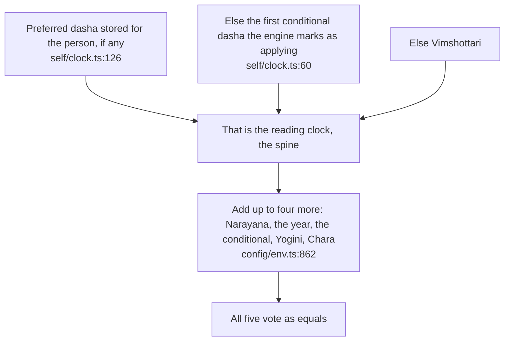
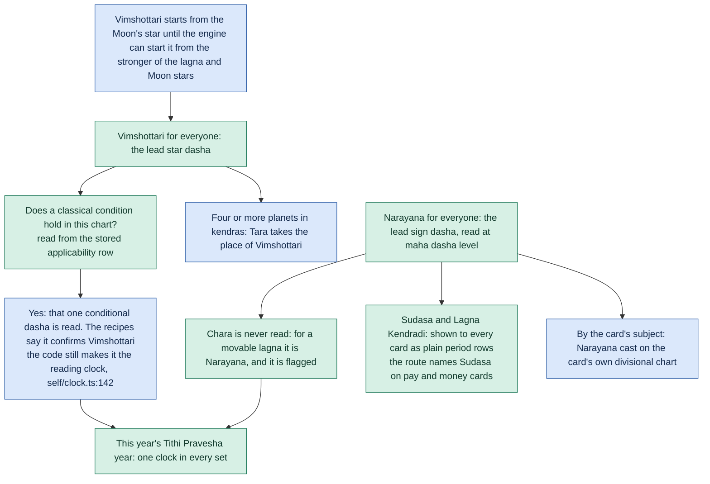
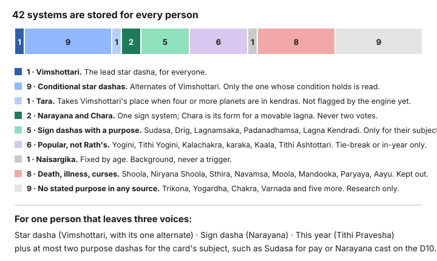
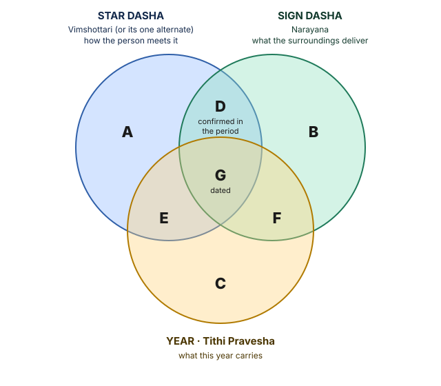
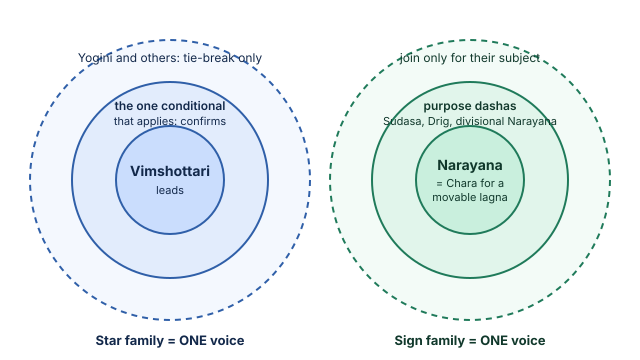
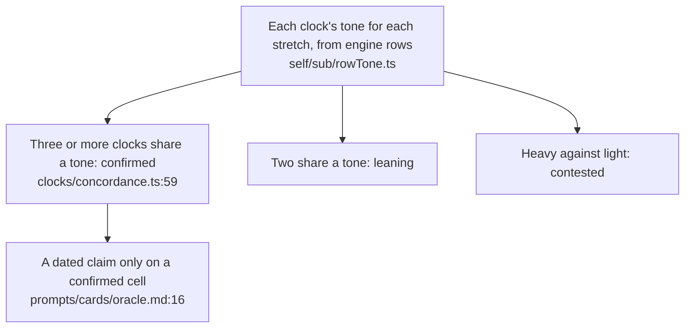
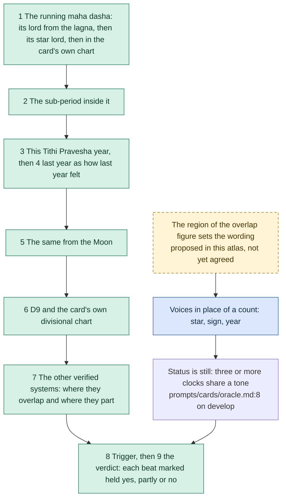

# Technique atlas · 05 · Clocks: which apply, which to combine, and how to read their overlaps

Written 2026-11-19. Sources: `docs/deep-research/sanjay-rath/04-dasha-selection-and-ranking.md`,
`dashas-nakshatra/01-applicability-matrix.md`, `dashas-rasi-jaimini/01-which-rasi-dasha-for-what.md`,
`sanjay-rath/05-timing-transits-annual-prashna.md`; the stored `dasha.applicable` and `kundli_activation` rows; the
verified-systems list of plan 09 §1 and doc 08. Tags as in `00-how-to-read.md`.

A "clock" is one dasha system: a calendar of periods, each ruled by a planet or a sign. The engine serves 42 of them for
every person. This file answers four questions.

## 1. Which clocks apply to one person

<!-- pair id=clocks.applies board=clocks lens=- reaches=yes live=0fc6bfa dev=9fc0cf3 -->

### Live today

### With the research

### Changes

| Change | Why | Source | Research file and heading | State | Needs |
|---|---|---|---|---|---|
| A conditional dasha confirms Vimshottari and does not replace it | Rath's order is Vimshottari by default; the texts say a conditional dasha "should be considered", never "replaces" | Rath; Text (BPHS 46) | `sanjay-rath/04` §4; `dashas-nakshatra/01` §3–4 | built in the lens recipes (prompt); **not** in the clock code, which still picks the applying conditional as the reading clock (`self/clock.ts:142` on develop) | server code |
| The clock set shrinks from six names to four: Vimshottari, Narayana, the year, the conditional | Yogini and Chara are flagged; Sudasa and Lagna Kendradi have no engine verdict rows yet | Inferred | plan 09 §1; `clocks/systems.ts` | built on develop (`config/env.ts` `READING_CLOCK_ORDER`) | nothing (release only) |
| Only the conditional dasha whose condition holds is read | Each has an exact condition; for the example person one of nine holds | Text (BPHS 46.17–46.43) | `dashas-nakshatra/01` table | built on develop | engine E7 for the two unchecked ones |
| Chara is not read beside Narayana | For a movable lagna they are one system | Rath | `sanjay-rath/04` §6 | built on develop | nothing |
| Yogini and karaka dasha stop voting | No Rath or SJC text for Yogini; its star table is suspected wrong in the engine | Inferred | `sanjay-rath/04` §1 note; `current-specs-review/06` A11 | built on develop | engine E1 to verify |
| Narayana read at maha dasha level only | Its sub-periods are suspected wrong in the engine | Inferred (code reading) | `current-specs-review/06` B01 | built on develop | engine E1, E2 |
| Sudasa is read, and named on pay and money cards | "Prosperity" is Sudasa's stated purpose; check Narayana with Sudasa | Rath (role); Student (calculation) | `sanjay-rath/04` §1, §7 | built on develop as plain period rows; it has no tone, so it cannot yet agree or disagree with a clock | engine pressure rows for Sudasa |
| Lagna Kendradi is read at low weight | Material fortune, per Rao | Student | `sanjay-rath/04` §1 (PVR purpose map) | built on develop as plain period rows | nothing |
| Narayana cast on the card's own divisional chart | "The D10 is the professional environment, key in the working years" | Rath | `sanjay-rath/04` §2 | planned | engine E5 |
| Tara in place of Vimshottari | Rath's stated condition; the engine computes Tara but does not flag the condition | Rath | `sanjay-rath/04` §3, §5 | planned | engine E7 |
| Vimshottari's starting star | Rath's two texts differ; the engine starts from the Moon only | Rath (both) | `sanjay-rath/04` §3 | planned (plan 07 decision 5, taken at its default: the Moon for now) | engine E8 |

### Stays the same

The engine decides applicability; the server computes nothing. Levels 1–3 are read; level 4 only near today.

### Open

Develop never reads Drig. Rath names Drig, read before the D20 Narayana, for spiritual matters, so the purpose cards
have no purpose dasha on develop. Plan 09 excluded it as flagged; the engine reference test decides.
Develop also never reads Naisargika (plan 07 kept it as background) or Tithi Ashtottari (marked "not checked yet"), and
lists Patyayini as counted although nothing reads it yet (`clocks/systems.ts:141`).

### Worked example: Person A (anonymised, from stored rows)

| Check | Stored result | Effect |
|---|---|---|
| Lagna lord in the 7th, or 7th lord in the lagna | applies | Dwisaptati-sama is read as the confirming star dasha |
| Six other conditions (Ashtottari, Chaturashiti-sama, Dwadashottari, Panchottari, Shatabdika, Shashtihayani) | do not apply | those six are never read for this person |
| Shodashottari, Shat-trimsha-sama | never checked by the engine | never read until E7 |
| Lagna in a dual sign | — | Narayana runs kendra then trines; Chara would be a different, wrong sequence here |
| Card on the Work board | — | Sudasa joins; D10 Narayana joins when the engine can cast it |

So Person A's readings rest on: Vimshottari confirmed by Dwisaptati-sama (one voice), Narayana (one voice), the
Tithi Pravesha year (one voice), and Sudasa on pay cards.

## 2. Why not all forty

| Group | Systems (42 in all) | What the research supports | On develop (`clocks/systems.ts`) | Why | Source |
|---|---|---|---|---|---|
| Lead star dasha | Vimshottari | Read for everyone | read, all levels | Chief dasha; shows the mind and pinpoints | Text (BPHS 46); Rath |
| Its alternates | Ashtottari, Shodashottari, Dwadashottari, Panchottari, Shatabdika, Chaturashiti-sama, Dwisaptati-sama, Shashtihayani, Shat-trimsha-sama | At most the one that applies; same voice as Vimshottari | seven read only if the engine says they apply; two never (unchecked) | All are seeded by the Moon's star; other reckonings of the same thing | Text (BPHS 46) |
| Tara | Tara | In place of Vimshottari when its condition holds | never | The engine does not flag the condition | Rath |
| Lead sign dasha | Narayana; Chara | One voice | Narayana at maha dasha level; Chara never | Chara is Narayana for a movable lagna | Rath |
| Purpose sign dashas | Sudasa (prosperity), Drig (spirit), Lagnamsaka (ideals), Padanadhamsa (image), Lagna Kendradi (material fortune) | Join only for their subject | Sudasa and Lagna Kendradi read as period rows; Drig, Lagnamsaka, Padanadhamsa never | Rath frames dashas by purpose and calls ranking them "useless" | Rath; Lagna Kendradi is Student |
| Popular, not Rath's | Yogini, Tithi Yogini, Kalachakra, karaka dasha, Kaala, Tithi Ashtottari | Tie-break at most | never | No Rath rule text found for any | gap |
| Fixed by age | Naisargika | Background only | never | The same for everyone of the same age | Text (BPHS 43) |
| Death, illness, curses | Shoola, Niryana Shoola, Sthira, Navamsa dasha, Moola, Mandooka, Paryaya, Aayu | Kept out of readings | never | Their stated purpose is longevity, destruction or curses | Rath; Text |
| No stated purpose | Trikona, Yogardha, Chakra, Varnada, Sandhya, Tara-lagna, Buddhi-gathi, Yoga-Vimshottari, Karana Chaturashiti | Research only | never | No source says what they are for | gap |

Four reasons, in the research's own terms:

1. **Many are one system.** Nine conditional dashas are alternates of Vimshottari; Chara is Narayana; Lagnamsaka and
   Padanadhamsa are Narayana from other starting points. Counting them as separate confirmations counts one thing twice.
2. **Each has a purpose.** Rath picks the dasha by the question. His "full examination" names five: Narayana, Sudasa,
   Vimshottari, Shoola and Drig. Shoola is a longevity dasha and stays out, which leaves four [Rath, *Narayana Dasa* p.xv].
3. **More clocks agree by accident.** No source in any tier gives a required number of agreeing systems
   (`sanjay-rath/04` §7; `reports/Vedic dasha systems…` L37).
4. **Some are not verified.** The Narayana and Chara sub-periods and the first six stars of the Yogini table are
   suspected wrong from reading the engine's code (`current-specs-review/06`, rows B01, B03, A11).

## 3. Reading the overlaps: three voices

| Region | What agrees | Reading | Wording | Source |
|---|---|---|---|---|
| D | Star and sign dasha, not the year | The event is confirmed in the period. This is Rath's stated pair: the star dasha pinpoints, the sign dasha confirms | "In this period", no month | Rath (*Crux* p.3) |
| G | All three | In the period and in this year | A dated statement | Inferred from D plus the year |
| E | Star dasha and the year | Felt and wanted this year; the surroundings do not deliver yet | "May", framed as readiness | Inferred from Rath's mind-and-environment line |
| F | Sign dasha and the year | Happens around the person this year without their drive | "May", framed as an opening to notice | Inferred, same |
| A | Star dasha only | A mood or wish, not an event | A note, never a date | Inferred |
| B | Sign dasha only | The setting is there; nothing is moving it | A note, never a date | Inferred |
| C | The year only | A passing colour of the year | A note, never a date | Inferred; the birth chart overrides the year [Student, Poddar] |

Only region D is Rath's own rule. The rest is our reading of his line that Narayana shows the environment and
Vimshottari the person's mind (*Narayana Dasa* pp.xiii–xiv). It is proposed here and not yet agreed. Before any region is
read, the promise must hold: the birth chart and the card's own divisional chart agree. Nothing is timed that is not
promised [Text].

## 4. Inside one circle

Members of one family make that voice firmer; they never add a confirmation.

| Inside the star voice | Role |
|---|---|
| Vimshottari | leads |
| The one conditional dasha that applies | confirms; if it disagrees, the star voice is "split" and counts as silent |
| Yogini and other popular star clocks | tie-break only, and only once verified |

| Inside the sign voice | Role |
|---|---|
| Narayana | leads |
| Sudasa, or Narayana cast on the card's divisional chart | joins for its subject; agreement makes a dated statement firmer |
| Chara | never read beside Narayana |

## 5. Reading order

<!-- pair id=clocks.order board=clocks lens=- reaches=yes live=0fc6bfa dev=9fc0cf3 -->

### Live today

### With the research

### Changes

| Change | Why | Source | Research file and heading | State | Needs |
|---|---|---|---|---|---|
| One ordered thread of nine beats, each marked held or not | Sachin asked for the reading to run from the maha dasha through the stars to the verdict | Yours (plan 09 request 2) | plan 09 §4; lens recipes under `prompts/cards/threads/` | built on develop | nothing (release only) |
| The period comes first; the divisional chart is beat 6 | The research's order is promise, then period: "nothing is timed that is not promised" | Text; Rath (the divisional chart is his last confirming factor) | `natal-techniques/00` L3–8; `sanjay-rath/02` §2.1 | built on develop in the other order; a card can time a matter before checking it is promised | Sachin |
| Only verified systems may be named | Unverified clocks agree by accident | Inferred | `current-specs-review/06` P0 rows | built on develop | engine E1 |
| Voices, not a count of clocks | No source gives a number; the star-and-sign pair is the stated rule | Rath | `sanjay-rath/04` §7 | planned; on develop the rule is still three or more of four clocks, and two of those four are Vimshottari and its own alternate | server code (plan 07 step 9) |
| The region sets the wording | Our reading of the mind-and-environment line | Inferred | `sanjay-rath/04` §1 | decision (new in this atlas; plan 07 decision 3 settled only that one gate replaces the counts) | Sachin |
| Star lord of the period lord | A planet acts through its star lord | commentary, no verse | `natal-techniques/23` §5 | built on develop for D1 | engine E4 for divisional charts |

### Stays the same

Clock tones still come from the engine's rows; the model writes sentences, never tones or dates.

### Open

The order of the year and the transit layer differs between research folders; only promise then period is textual
(`sanjay-rath/05` §8 against `docs/deep-research/README.md` L307). With four clocks of which two are one star voice,
"three or more agree" can be reached by Vimshottari, its alternate and one other: that is two voices, not three.

## 6. Which clocks join on each dashboard

| Dashboard | Star voice | Sign voice | Year | Purpose dasha the research names | On develop |
|---|---|---|---|---|---|
| Self: temperament, body, chapters | Vimshottari + the conditional | Narayana | year D1 | — | read |
| Self: mind, learning | same | Narayana | year D24 | D24 Narayana [Rath] | not possible yet (engine E5) |
| Self: purpose | same | Narayana | year D20 | Drig, then D20 Narayana [Rath] | Drig never read; D20 Narayana needs E5 |
| Love: dating, friends | same | Narayana | year D9, year D1 | — | read |
| Love: marriage | same | Narayana | year D9 | D9 Narayana [Student] | needs E5 |
| Love: allies | same | Narayana | year D10 | D10 Narayana [Rath] | needs E5 |
| Work: starting out, your job, business | same | Narayana | year D10 | Sudasa for pay [Rath role]; D10 Narayana [Rath] | Sudasa read as period rows; D10 Narayana needs E5 |
| Work: craft | same | Narayana | year D1 | — | read |

Until the engine can cast Narayana on a divisional chart, the routing table says the reading uses Narayana on D1 and
says so (`docs/techniques/08-card-routing-table.md`, Conventions).
